# Joint Front and Rear Scene: NAS Pilot

*2026-10-03 · Track B · Owner-authorized finite CPU experiment, following the NAS P1 evidence recheck.*

**Outcome: completed4096 updates; rear fitting failed on TRAIN and inspected DEV.** Signal conservation and contract tests passed. This run supplies a reproducible negative result, not a Track A replacement.

## 🧭 Scope and channel contract

The owner resumed training for this experiment. The September 30 pause remains the historical disposition of the spectral40k candidate; this run does not resume the PC queue or deploy a replacement for Track A.

| Interface | Channels | Status |
|---|---|---|
| Observed input | Stereo L/R | Downmix of the same authored target |
| Learned scene | FL, FR, C, Ls, Rs | Five jointly supervised outputs |
| Physical CarPlay 5.1 interface | FL, FR, C, LFE, Ls, Rs | Six channels; no pilot hook integration |
| LFE | Separate deterministic DSP proposed | Zero in these targets; not implemented by this pilot |

In 5.1, Ls is one left surround bus and Rs one right surround bus. Separate side and rear pairs would require another output layout. Five learned channels do not mean a five-channel production transport: the centre C is included, while LFE is absent from this model.

## 🧠 Changed mechanism

The earlier [P1 evidence](UPMIX_NAS_SCENE_RECHECK_2026-10-03.md) already tested direct stereo-to-multichannel learning. This is a new fitting recipe, not a claim that the idea has never been tried and not a single-factor architecture ablation against P1.

| Element | Pilot specification |
|---|---|
| Analysis | 48 kHz, FFT1024, hop256, no centred padding |
| Features | Frame-local spectral level, stereo relations, past phase advance, frequency positions |
| Shared encoder | Three separable frequency blocks; 32 pooled bands |
| Temporal context | Forward band GRU10 plus global GRU64 |
| Output | Five full-bin complex operators, each combining both stereo inputs |
| Front parameterization | Stereo identity plus learned corrections before joint projection |
| Normalization | Current frame only; no future/window gain estimate |
| Supervision | Fixed TRAIN channel-power-normalized complex MSE plus .05 magnitude MAE |
| Parameters | 68,044 |
| Dense neural cost | 103,418,625 MAC/s, arithmetic estimate |
| Excluded cost | FFT/WOLA, features, projection, complex application, normalization, nonlinearities and LFE DSP |
| Qualification | No int8 port or complete device measurement |

```mermaid
flowchart LR
  accTitle: Joint scene learning and accounting
  accDescr: A shared causal encoder estimates five channels from stereo. A weighted projection preserves the baseline downmix, while any added rear effect is separately measured.
  stereo_input["Stereo L/R"] --> past_analysis["Past-only STFT and features"]
  past_analysis --> shared_encoder["Frequency, band and global encoder"]
  shared_encoder --> five_heads["FL, FR, C, Ls, Rs operators"]
  five_heads --> dry_projection["Joint dry downmix projection"]
  dry_projection --> baseline_scene["Five-channel baseline"]
  baseline_scene --> explicit_effect["Declared rear duplication"]
  baseline_scene --> signal_accounting["Compare downmix with input"]
  explicit_effect --> signal_accounting
```



The neural graph uses no future frames. Its 21.33 ms framing window is not an end-to-end latency measurement. Finite-excerpt WOLA exists for diagnostics; a native streaming implementation remains separate work.

## ⚖️ Signal preservation and effects

The frozen dry downmix excludes LFE:

```text
XL = FL + sqrt(0.5) * C + sqrt(0.5) * Ls
XR = FR + sqrt(0.5) * C + sqrt(0.5) * Rs
```

For raw five-by-two operators A, the projection uses `B = D.T * inverse(D * D.T)` and `A_base = A + B * (I - D * A)`. Therefore `D * Y_base = X` within floating-point error. Projection acts on all five heads; tests confirm both front and rear losses still reach every raw output head.

The supervised baseline uses zero effect gain. A separate diagnostic adds .10 times the actual estimated rear signal, preserving its identity as E. The relevant residual is `D * Y_out - D * E - X`. This permits deliberate duplication as requested by the owner; the residual cannot be retroactively labelled an effect. The implementation's .25 maximum duplication gain is an experimental limit, not an approved Audi setting. No audible preference or protected-source safety follows from conservation alone.

## 🗂️ Data and frozen protocol

| Item | Admission |
|---|---|
| Corpus | Existing `albumdb-paper51-48k-a/research-catalog.json` on NAS |
| TRAIN | albumdb-01/04/05/06/07/08/09, seven songs |
| Inspected DEV | albumdb-02/03, two songs |
| Untouched recording | Not opened; absent from this derived catalog |
| Target | Authored multichannel masters with frozen immersive-to-5.1 fold |
| Pair construction | X is a known downmix of the same Y; not an independent commercial stereo master |
| Channel order | Source FL/FR/FC/LFE/SL/SR; silent LFE verified |
| Integrity | Full SHA256 and header geometry checked for every admitted WAV |
| Gain | One catalog common attenuation per excerpt, shared across channels |
| Artist separation | No; one artist, previously inspected DEV |
| Target admission | Authored reconstruction only; not cabin-safe source-role targets |

The run has 4096 AdamW updates, learning rate .001, weight decay .0001, seed20261003 and three CPU threads. Each update uses 32 warm frames and 96 scored frames from one random TRAIN excerpt; the scored interval is .512 s. Recurrent state starts afresh for each crop. Long song state and vocal-entry behaviour are not measured here.

Monitoring uses two fixed 256-frame crops per admitted song, approximately 1.38 s each, excluding the first 32 frames from spectral scoring. These repeated, short, inspected DEV crops are diagnostics, not untouched final validation. The loss denominator comes only from TRAIN; per-crop silent-target flags must be inspected when interpreting channel NMSE.

### Recorded launch

```text
NAS: <nas>, CPU only; CUDA unavailable
Root: /mnt/shared/users/<user>/Audi/upmix-training-2026-09-11/runtime/scene-joint-front-rear-20261003-a
Start: 2026-10-03T23:08:04.960675+00:00
PID at launch: 403068
Horizon: 4096 updates
```

Code snapshots live in `code/`; the run writes `run/protocol.json`, `status.json`, `initial.json`, `monitorNNNNN.json`, hashed checkpoints, `latest.json` and a terminal `report.json`. Source hashes bind the checkpoint protocol. No packages were installed, no prior run/data was overwritten, and no Track A hook file was changed. An owned `run/STOP` marker requests a retained-output stop.

## 🧪 Verification and outcome

Three contract tests passed locally and again on NAS: waveform/effect accounting, future-prefix invariance and chunk/state equivalence, and gradients from front/rear losses reaching every output head. Python compilation passed locally.

<!-- PILOT_RESULT_START -->
**Completed: 4096/4096 updates; fitting screen failed.** Runtime 804.4 s.

| Split | Initial rear NMSE | Latest rear NMSE | Median rear energy / target | Median rear cosine | Maximum dry PCM relative null RMS |
|---|---:|---:|---:|---:|---:|
| TRAIN | 1.014396 | 0.970831 | 0.179756 | 0.200074 | 1.052e-06 |
| Inspected DEV | 1.029485 | 1.135732 | 0.252150 | 0.051933 | 4.976e-07 |

Rear NMSE measures target reconstruction error: zero is exact and one is a silent rear baseline. It is not rear share, leakage or the fraction of input sent backwards. Front/centre recovery and conserved downmix do not establish rear recovery.

Terminal checks: train_rear=false, inspected_dev_rear=false, front_nonworse=true, dry_null=true.

The rear fitting gates failed; this recipe has not demonstrated useful authored rear recovery even on TRAIN. Low rear target correlation also rules out treating this as a simple gain fix. This bounded run does not prove that every joint-scene architecture will fail, or isolate architecture from loss, state horizon and target ambiguity. No extension or follow-up training was queued.

A post-hoc calculation from the saved energy/cosine metrics grants each rear channel in each crop its own target-informed, unconstrained real gain. Its optimistic NMSE is `1 - cosine^2`: median .959891 on TRAIN and .997229 on inspected DEV. Even allowing polarity reversal, amplification alone does not recover the target structure. This is a numerical bound, not a rendered or deployable gain candidate. No additional audio inference or training was run.

Per-channel terminal median NMSE, order FL/FR/C/Ls/Rs:

- TRAIN: 0.526455, 0.501774, 0.139408, 0.950203, 1.005330.
- DEV: 0.666339, 0.643797, 0.175727, 1.180675, 1.126788.

Silent-target review: [('train', 'albumdb-04', 2)]. The only unknown denominator is the TRAIN albumdb-04 centre crop; all rear denominators are known, so this does not explain the failed rear gates.

[Machine-readable evidence](UPMIX_JOINT_SCENE_NAS_PILOT_2026-10-03.json) contains the frozen protocol, source/catalog hashes, raw initial/latest monitor rows, checkpoint hash and full monitor curve. Full checkpoint/history outputs remain in the immutable NAS run root.
<!-- PILOT_RESULT_END -->

Frozen fitting gates are TRAIN median rear NMSE≤.50, inspected DEV≤.80, both FL/FR medians no worse than initialization on both splits, and dry PCM relative null RMS≤1e-5. These are terminal fitting checks, not release gates. The runner's per-channel summaries retain silent-target rows; review their flags before interpreting them as evidence.

Even a fitting pass would leave the original full40/untouched20 source protection, rear-share, transitions and swinging checks, independently mastered stereo transfer, complete causal int8 device budget/latency, and owner live CarPlay comparison unproven. Targets may intentionally contain rear vocals or reverb; authored scene reconstruction does not automatically satisfy the owner's no-voice-behind requirement.

## 📁 Implementation and next decision

- [scene_joint_net.py](RETIRED_TOOLS.md#tool-4f996c57d64f): shared estimator, projection, declared effect and finite analysis/synthesis.
- [test_scene_joint_net.py](RETIRED_TOOLS.md#tool-e90d78658c0e): signal, causality/state and gradient contracts.
- [train_scene_joint_nas.py](RETIRED_TOOLS.md#tool-e602dc3f4215): finite NAS runner, frozen catalog validation, monitoring and terminal report.

The terminal result fails both rear fitting gates. Retain this run and diagnose target recoverability and the optimization/estimator mechanism before extending the same recipe. A follow-up should distinguish recoverable coherent rear content from ambiguous diffuse effects and compare target-informed operator reachability with estimator fitting on the same excerpts. Changing encoder, loss and dataset together would again obscure the cause. A future fitting pass would still require recording-disjoint authored data and protected-source/entry analysis before considering a hook port.

### Proposed diagnostic order

1. Establish target-informed reachability using this exact five-head projection and coefficient limits on the same TRAIN crops. The earlier P1 oracle is evidence for a different output construction.
2. Attempt fitting one fixed TRAIN excerpt with the unchanged model/loss. Failure would focus investigation on the estimator, output, gradients and optimization; success only proves memorization of that excerpt.
3. Restore multiple TRAIN recordings under matched conditions, then inspected DEV. Separate coherent rear recovery from diffuse ambience statistics if their learning behaviour differs.

At the time this sequence was written, these were proposed diagnostics, not queued training jobs. The owner subsequently selected step2: [one fixed TRAIN excerpt fitting](UPMIX_JOINT_SCENE_FIXED_FIT_2026-10-03.md) records that separate bounded run. Step1 reachability and step3 multisong follow-up remain unexecuted. No architecture or dataset replacement is justified by the failed pilot alone.
