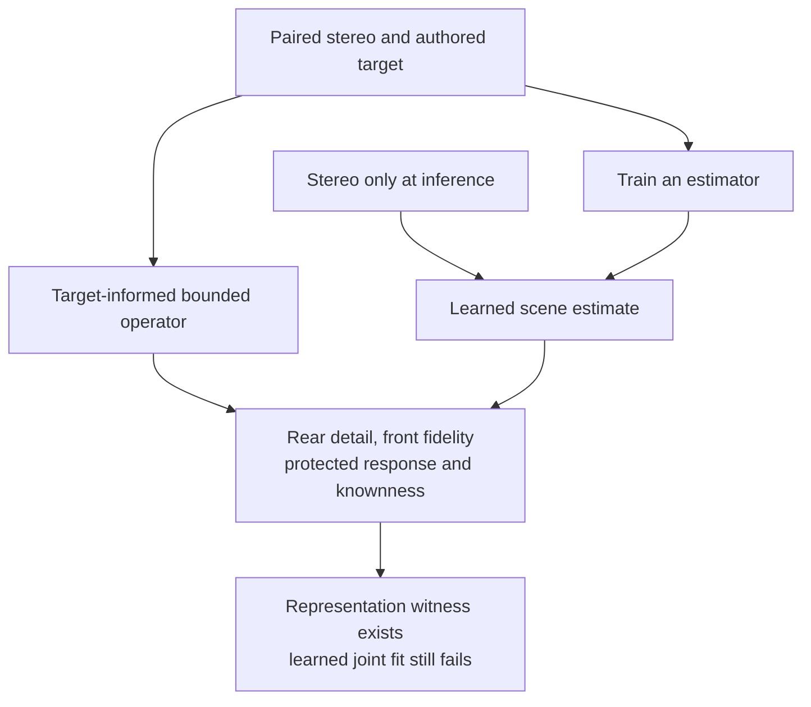

# NAS Scene-Training Archive Recheck

*2026-10-03 · Saved-report inspection on NAS <nas> · No new training, audio inference, listening or deployment.*

---

## 🧭 Why this changes the discussion

The owner pointed back to the NAS after proposing joint front/rear scene learning from authored 5.1 masters. The archive contains substantially more relevant work than the early P1 pilot alone. A new scene-supervised experiment must account for the later multisong loss comparison, startup-policy comparison and target-informed representability controls.

**Verified:** the inspected limited P1 studies did not meet their joint diagnostic conditions. A target-informed bounded operator could represent rear targets accurately, while its learned counterpart had poor reconstruction and, in one inspected case, weak target correlation. This does not prove that direct scene learning is impossible or that one specific encoder/loss caused the failure.

**Our revised recommendation:** establish a changed, testable learning mechanism before restarting. Joint front/rear supervision remains a proposal; it must be compared with the historical analytical-front path and its mixed-source failures. [Current architecture discussion](UPMIX_REAR_SCENE_RESEARCH_2026-10-03.md#owner-proposal-learn-the-rear-scene-from-authored-multichannel-masters).

## 📦 Read scope and provenance

Read timestamp for the numerical excerpts: **2026-10-03 20:07:45 UTC**. Private root:

```text
/mnt/shared/users/<user>/Audi/upmix-training-2026-09-11
```

The supplied SSH helper authenticated; private reads used the authorized `luka` account context. No account/configuration changes were made. The runtime root contains206 directories, including57 named `p1-*`. Those are directories containing training, qualification, preparation and diagnostic work, **not57 independent models**.

Ten selected runtime trees were listed to a bounded depth. Nine selected saved reports were read and SHA256-bound; additional excerpts came from those same files. No checkpoint was loaded, PCM decoded, full archive rehashed, or process resumed. No private evaluation audio was newly opened. Historical reports mention their past evaluations; reading them is not a new evaluation.

[Sanitized report bindings and numerical excerpts](UPMIX_NAS_SCENE_RECHECK_2026-10-03.json) retain the exact relative report paths, raw-file hashes, completion/scope fields and selected values. They do not contain credentials or download links. Original reports remain on the NAS.

The earlier consolidated [training history](UPMIX_TRAINING_HISTORY.md#-p1-direct-stereo-to-multichannel) and [dataset inventory](../UPMIX_DATASETS_AND_TEACHERS.md#-where-it-all-lives) remain useful. Their September15 inventory is historical; the live directory enumeration here is an October3 observation.

## 📊 Relevant recovered experiments

Paths below are relative to the private root. These use their **historical P1 metrics**, not today's DEV40 source rear-share and vocal-entry metrics.

| Saved experiment | What the retained report establishes | Limitation |
|---|---|---|
| `runtime/p1-native51-pilot-a/pilot/run/report.json` | Pilot complete:2 epochs,5014 updates, real-music training; checkpoint replay fields retained. | Foreground protection was not trained; model/car approval false. Update count is not music diversity. |
| `runtime/p1-folded-orchestrator-a/comparison/comparison.json` | Canonical→rear-only/analytical-front: front NMSE .108688→.105117; rear NMSE .311297→.301070; worst counterfactual ratio .164132→.140504. Eight of nine research checks pass. | Mixed protection check fails; no independent authored-centre target; DEV reused; no car approval. |
| `runtime/p1-front-rate-orchestrator-b/comparison/report.json` | Completed1024-update LR .0003 geometry diagnostic. Original worst mixed ratio .056178; opposite-polarity .168255. Every geometry fails joint fit. | TRAIN diagnostic, no full-corpus exposure or DEV/heldout PCM; old ratio denominators and thresholds apply. |
| `runtime/p1-prefix-probe-owner-a/experiment/report.json` | Completed control/prefix-jitter pair:64 additional updates per arm; original parent preserved. | Conditioning pilot, no full-corpus training, DEV/heldout or car approval. Its metrics were not re-aggregated here. |
| `runtime/p1-multisong-loss-ablation-a/study/report.json` | Completed matched loss comparison:240 updates per arm, same architecture. Assessment worst rear NMSE .999549 for `joint_reference`,1.001554 for `reconstruction_detail`;0/5 geometry joint passes in each partition/arm. | Fifteen optimizer cases and six song-group-disjoint assessment cases, all historical TRAIN. Quiet ratios remain unknown. |
| `runtime/p1-multisong-v2-prep-a/matched-study/report.json` | Completed240-update pair with the same new loss and different startup policy. Baseline versus `startup_exact_zero_v1` assessment worst rear NMSE .999549364/.999549372; both fail active-band checks and all five geometry joint fits. | This startup intervention does not solve the observed fitting failure; not a full-corpus architecture verdict. |
| `runtime/p1-multisong-v2-diagnosis-a/oracle/report.json` | Exact-target spectrum sanity passes. On original geometry, bounded-ratio witness worst rear NMSE .000178858 on optimizer cases and .0000276744 on assessment cases; active-band checks pass. | Uses target and future information; no learned forward inference. Aggregate joint checks retain unknowns, so this is not a product pass. |
| `runtime/p1-multisong-v2-diagnosis-a/scaling/report.json` | Read-only gain/target-correlation diagnostic across21 cases. Pooled scalar total-loss optimum approximately1.3463; it was not applied/rendered. | Target-informed numerical diagnostic; no gain candidate or listening result. |
| `runtime/c2-scene-reference-a/comparison/report.json` | Seven-case reference comparison complete; no neural training. Zero-removal parity with C1 retained. | Musical quality is null; acoustic scene, semantic roles and car approval false. |

The early native pilot is a completed training job, not a promoted model. The later comparisons are mostly short, controlled studies; their failures must not be described as exhaustive large-data scene-model training.

## 🔬 What the later diagnostics tell us

### The output representation can express the inspected target

The bounded-ratio control uses privileged knowledge of the desired target. Its assessment worst rear NMSE .0000276744 is far below the learned baseline's .999549. This demonstrates a representability witness for these cases and this operator construction. It does not demonstrate a causal estimator, unseen-song learning, optimum coefficients, or that an arbitrary authored 5.1 mix is recoverable from stereo.

The exact-target sanity result (~1.29e−14 worst rear NMSE on original geometry) separately confirms the numerical reference path. Do not conflate that exact spectrum injection with the bounded operator witness.

### Low output and wrong structure coexist in an inspected case

The first stored scaling case reports:

| Quantity | Saved value |
|---|---:|
| Predicted rear energy / target rear energy | .006830506 |
| Rear/target cosine | .126561604 |
| Reconstruction-only scalar optimum |1.295531 |
| Total-loss scalar optimum |1.277365 |

That is approximately0.68% of **that case's target rear energy**, not0.68% of the song or today's source rear-share metric. The weak cosine indicates that simply increasing volume cannot repair the target structure. The first row is an example, not a median over21 cases. The pooled scalar optimum is1.346299; no optimum audio was rendered or tested.

### Removing one loss pressure did not provide the missing scene

The matched loss comparison reports a sole selected-loss change and the same model architecture. Both learned arms retain assessment worst rear NMSE near1.0. That undermines the narrow claim that this particular loss intervention alone cures the problem. It does not isolate data, representation inference, initialization, horizon or optimization as the sole cause.

Similarly, the startup-policy pair produces essentially identical worst assessment error. Continuing that policy change without a changed hypothesis has no demonstrated benefit.

### Silence and tiny ratios do not satisfy the intended goal

Some summaries retain `original_metrics_all_known=false` and null protected-source checks because quiet cases are ineligible for ratio judgments. Tiny raw leakage values cannot be reported as a protection pass. Near1 NMSE is the error scale of a silent prediction for a nonzero target, but that scalar alone does not prove every output is silent; the energy/correlation diagnostic supplies additional evidence for one case.

## 🛠️ Consequence for the proposed joint front/rear model



The idea is still viable as research, with a more explicit contract:

1. Use paired downmix/master targets with checked channel order, common gain and alignment. Audit genuine authored rear content separately from automatically upmixed references.
2. Make one shared model learn rear audio and front residuals jointly; compare against the existing analytical-front baseline under matched conditions.
3. Measure rear detail and target correlation, front fidelity, protected-source response and vocal-entry stability separately. Downmix closure alone accepts a quiet rear.
4. First establish fitting on a small fixed set without exploiting target information at inference; then assess recording-disjoint data and actual stereo-master distribution shift. Preserve the old P1 counterfactual/geometry fixtures.
5. Only after demonstrated scene quality proceed to compression, complete int8/device measurements and blind live CarPlay listening. No dataset growth or encoder enlargement is assumed to fix the failure without a matched test.

This recheck launches no training and changes no Track A, environment or NAS artifact. It provides evidence for planning; the owner-requested pause and finite restart constraints remain in force.
