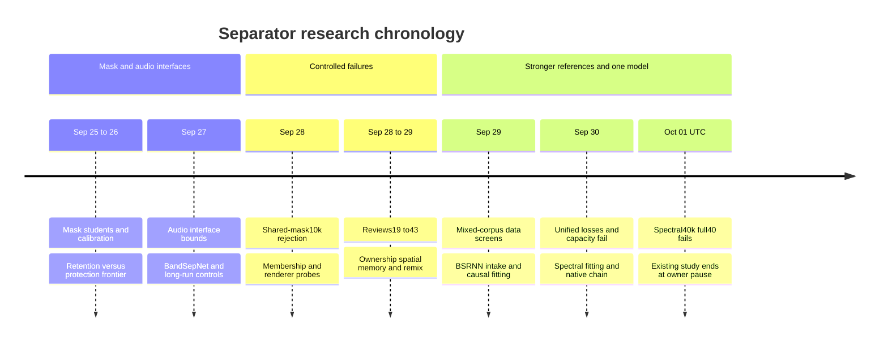

# Upmix separator research: historical attempt ledger

_2026-09-25 through 2026-09-30 local dates, with the final PC readback at 2026-10-01 03:28 UTC. Continuation of the earlier controller/separator history; successes, rejected mechanisms, interrupted runs and unexecuted plans are preserved._

---

## 📋 Scope and reading rules

The [training history](../UPMIX_TRAINING_HISTORY.md) retains V9–V16, G1–G17, H1, P1, R1/C1/C2 and Q1–q6d from the earlier period. This ledger continues that history through the later mask students, separator ladder, reviews16–43, data interventions, BSRNN reference, one-network reconstruction and completed spectral40k comparison. The [source plan](UPMIX_SOURCE_SEPARATION_PLAN.md), [night report](UPMIX_SEPARATOR_NIGHT_REPORT_2026-09-28.md), individual reports and [unified chronological ledger](UPMIX_UNIFIED_SCENE_ARCHITECTURE_2026-09-30.md) retain full recipes, learning curves, hashes and per-song evidence.

An entry represents a changed training recipe, inference/renderer intervention, diagnostic, intake or execution failure. A checkpoint monitor is part of its parent experiment; it is not counted as a new architecture. Related arms are named separately where their results differ. There is no defensible single “number of architectures” obtained by adding reviews, checkpoints, seeds, renderer points and infrastructure checks together.

| Label | Meaning |
| --- | --- |
| **Completed / rejected** | The stated frozen comparison finished and failed its promotion gate |
| **Completed / scope pass** | The named fitting, numerical or privileged diagnostic passed; product acceptance remains separate |
| **Interrupted** | A launch or partial run exists; no completed result is implied |
| **Prepared / paused** | Code, a recipe or prototype exists; efficacy evidence does not |
| **Privileged** | True stems or future/song-specific information unavailable to a causal device candidate |
| **Deployed** | Track A's established car path; offline proxy failure and owner listening are distinct |

**Current outcome:** the new spectral40k candidate fails joint promotion. Its nominal original full40 rear shares are guitar/keys/piano/strings .225/.217/.219/.191 and voice/bass/drums .0139/.1585/.0139, with31/40 swinging songs and vocal-entry median/p10 .799/.451. The final study has ended and released its lease; no next efficacy run is queued. Agent work remains paused. [Terminal result and raw evidence](UPMIX_UNIFIED_SCENE_ARCHITECTURE_2026-09-30.md#-completed-spectral40k-pair-joint-promotion-fails).

_Chronology of the research stages: mask ranking and routing were followed by audio separation, renderer bounds, controlled ownership/memory/data tests, a large reference and finally a single causal spectral model. Passing a privileged or numerical stage did not establish a deployable rear scene._

## 🧪 Mask students, 2026-09-25 to 09-26

Source for this complete named ladder: [Phase0 training log](UPMIX_SOURCE_SEPARATION_PLAN.md#training-log-phase-0). These are historical operating points and sample sets, not values for the latest Track A build. In particular, guitar-only swing counts cannot certify the later any-stem goal.

| Attempt | Changed or tested | Observed result / disposition |
| --- | --- | --- |
| v2–v4 | Per-bin MLP and ownership loss | Protect-everything collapse; other-owned output .02–.08 |
| v7 | Balanced BCE TFNet plus contamination ramp | Before ramp vocal/other .73/.78; after .025/.14; discrimination insufficient |
| v8a | 2048 analysis, frequency convolution and causal bin GRU | Same ramp pattern; after .025/.18 |
| Owned-cell classifier probe | Balanced local-spectrum classification at512/2048 grids | Both DEV AUC .81; diagnostic evidence only |
| v9a | Input standardization and mastering gains | Necessary feature correction; still .71/.74 before ramp |
| v10 | Probe descriptor transplanted into eligibility mask | Guitar .12, voice .08, drums .29;1/39 guitar swings; protection fails |
| v11 | Five-role fractional-power softmax | Guitar .13, voice .09, drums .28; pipeline reproduces ranking but not selectivity |
| v11 threshold .3 | Routing operating point | Voice .05, guitar .07; no guitar swings; rear delivery lost |
| v11 threshold/sharpening sweep | Threshold .3/.5 and powers2/3 | Voice/guitar tradeoff persists; no joint point |
| v12 | Three prior controls as32ms input context | Guitar .13, keys .15, voice .10; no useful improvement |
| v13 | Per-band recurrent history | Eligible/protected AUC .66→.75; guitar .16, voice .11, drums .33; bolder output |
| v11 other-only route | Remove cymbals from eligibility | Drums .28→.17; guitar .13→.12; protected leakage remains |
| v14 | v13 with ramped leakage/retention | Voice .02 but guitar .06, keys .07;8/39 guitar swings |
| v13 hard vocal veto | Independent band-level suppression | Voice .11→.02, guitar .16→.06;4/39 guitar swings; useful evidence costs retention |
| v11 hard vocal veto | Same protector on weaker student | Voice .01, guitar .05; no any-stem swings in recorded condition; insufficient rear |
| v15 launch | TFNet variant | Keyword-argument crash recorded; requeue is not a completed quality result |
| v16 | 2048 convolution under softmax | AUC .76/.82 but flat eligibility; voice .07/guitar .08; no joint win |
| v13 soft veto .5/.7 | Soft protected multiplier | Voice .04/.03, guitar .09/.08; below rear target |
| v17 | Whole-spectrum convolution/GRU and full-resolution skip | AUC .75/.82; voice .08, guitar .11; underconfident probabilities |
| v17/v16 calibration | DEV Platt fit | v17 essentially unchanged; calibration did not provide missing evidence |
| Mask-space reread / drift diagnostic | Recheck logs and reset-state segments | Earlier “sharp v13” values belonged to ramped v14; no observed GRU drift explanation |
| v21a | Context plus descriptor full_probe | Voice .09, guitar .13; frontier remains; later belongs to Track A |
| v17 learned presence head | Joint learned vocal-presence soft multiplier | Voice .08→.05, guitar .11→.07; closes both sides |
| v18 | Whole-spectrum student plus ramp | Voice .02, guitar .05; movement increases; first C screen hung and was recovered |
| v19 | Planned ramped-mask plus teacher protection-only supervision | Listed as a next recipe in the original plan; no completed outcome asserted |
| v21b | Salience-weighted CE | Same .09 voice/.13 guitar; no product gain |
| v22 | Wide bidirectional ceiling study | Stopped at2k of6k; partial .08 voice/.13 guitar; not a completed capacity bound |
| v22b | Full-resolution frequency GRU plus causal time GRU | Best vocal ranking .85 AUC; same .09 voice/.13 guitar operating point |
| TRAIN versus DEV mask audit | Sixteen songs each on saved students | Mask-space underconfidence also on TRAIN; not a unique diagnosis of all architecture/data limits |
| v23 | Four-hop mean target | Voice .08/guitar .12 on38 songs; two renders failed; incomplete coverage retained |
| v20 | Teacher vocal-channel distillation plus late ramp | Voice .02/guitar .08, with7/39 guitar and11/40 vocal swings; fails |
| v20 before ramp | Inspect softmax mass before protection counterweight | Eligibility .84–.93 in vocal cells; later traced partly to an unramped retention term |
| htdemucs mask through DSP | Teacher reference at the same grid | Voice .03/guitar .20; teacher information exists, but reported early swings were guitar-only |
| v24 | Full-role teacher distillation | Stopped at750 for eligibility drift; no completed product result |
| v24b | Teacher confidence>.8 | Stopped at750; drift persists |
| v24c | Equal teacher-role weight | Stopped at1k; drift persists across domains |
| v25t | Teacher-only plain CE diagnostic | No corresponding drift; exposes unramped `missed` term in earlier recipes |
| Retention-ramp fix | Ramp missed/retention with leakage | Corrects a concrete training bug; teacher-error explanations alone were insufficient |
| v26a | Clean confident/balanced role distillation | Teacher correlation .34→.61 but confident target cells still student≈.37; DSP voice .09/guitar .12 |
| v26b | Clean role KD plus corrected ramp | Voice .02/guitar .06;6/39 guitar and10/40 vocal swings; reject |
| v27a | Direct eligibility distillation | Voice .08/guitar .12; better target following does not yield joint rear improvement |
| v27b | Direct eligibility plus ramp | Voice .02/guitar .06; same retention cost |
| v29a | Frequency-modeling student,210M estimated neural MAC/s | Better ranking/error but voice .08/guitar .12; over the current150M constraint |
| v29b | Same frequency student plus ramp | Voice .02/guitar .05; same tradeoff |
| v29r11 | Leakage:retention1:1 | Intermediate .04 voice/.08 guitar point; no new frontier |
| v29r12 | Planned1:2 weight point | Listed pending in source snapshot; no completed outcome asserted here |
| diag7a | Four fixed teacher songs, original training settings | CE−entropy≈.27 despite repeated exposure; diagnostic only |
| diag7b | Remove weight decay | Essentially same diagnostic result |
| diag7c | Balance pure/mixed strata per role | Both eligible and protected outputs rise; fit gap persists |

The original log contains strong interpretations such as “not the features” or “capacity is not the wall.” Preserve its measurements while limiting conclusions to the specific tested models. The later [research review](UPMIX_RESEARCH_REVIEW_2026-09-29.md) explicitly corrects those broader exclusions.

## 🎛️ Audio interfaces, separator ladder and rapid screens

Source: [interface and separator sections of the plan](UPMIX_SOURCE_SEPARATION_PLAN.md#-the-separator-student-2026-09-27-0400-sep_netpy), [night report](UPMIX_SEPARATOR_NIGHT_REPORT_2026-09-28.md), and the [review16 consolidated handoff ledger](UPMIX_SEPARATOR_HANDOFF.md#experiment-sequence-and-disposition). Original table headings with emoji may require navigation through the source document's table of contents.

| Attempt | Intervention / scope | Result / status |
| --- | --- | --- |
| Six-way interface comparison | Oracle/teacher masks versus eligible audio and bounded IRM, original full40 C | All-stem recount: oracle mask14, true audio8, IRM audio7, teacher mask23, teacher audio16, teacher2 audio20 swings |
| sep1 | Small magnitude-mask separator,6k | Selection score chose near-silence: guitar .02, voice .01; selection method rejected |
| sep2 | SI-SDR selection and20k | Best−1.76dB; guitar .12/voice .04;5/39 guitar swings |
| sep3 | BandSepNet complex masks,125M estimated neural MAC/s | Stopped60k after plateau; best47k−.24dB, stable-gain guitar .09/voice .02 |
| sep3 24k versus47k | Checkpoint/C comparison | Higher scalar SDR did not produce more rear instruments |
| sep3 gain1.3/1.6 | Fixed-audio gain diagnostics | Guitar .16/.18 but12/15 guitar-swing songs; no rescue |
| sep3 held share300/800ms | Release smoothing before injection | Voice .08/.10 and10/14 guitar-swing songs; prolongs protected admission |
| sep4 / cleaner RoFormer pseudo recipe | Proposed cleaner residual and truth-heavier continuation | Prepared/queued in historical plan; no completed result cited |
| sep5 | Width×2,394M estimated neural MAC/s, matched40k | Best−.34dB; guitar .12/voice .03; no joint gain; specific width test, not global capacity exclusion |
| sep6 | Truth-only supervision,40k | Guitar .10/voice .02; does not repair rear/entry frontier |
| sep7 | Bidirectional mixing across bands,180M estimated neural MAC/s | Guitar .12/voice .03; particular spectral mechanism fails joint gate |
| sep8 | Log-magnitude loss,40k | Guitar .11/voice .04;16/40 any-stem swings on recount |
| Gap attribution | Frozen masks on true sources | Eligible .29–.37 versus IRM .77; weak air; cells and source-energy weighting distinguished |
| Transition diagnostic |43 entries/40 exits/54 sustained controls | Entry suppression and release explain a part of movement; steady scenes differ |
| sep9 | Eight-hop lookahead,40k | G1: G/K/P/S .102/.106/.080/.081, V/B/D .031/.065/.092,11/40 swings; reject |
| sep9 G1.3 | Same saved separator, higher drive |23/40 swings and worse protection; reject |
| sep9c / sep10 / sep11 / sep12 | Matched decoder/future-context and later planned runs | Paused; not completed negative evidence about all future context |
| Rapid anchor seeds1/2 | Matched4k controls | Eligible .42–.47 and entry-tail .39–.43 establish actual seed/run variation |
| Sharedmask4k | One bounded mask shared across stereo |1/20 swings and entry-tail .58; air≈−29dB; mechanism signal, not product |
| Sharedmask versus anchor10k | Fixed-age confirmation | Swings3→5/20, entry-tail .400→.431, bass .080→.096; reject continuation |
| Log-loss rapid screen | Change objective only | Air≈−16 versus−23dB but conservative output; no joint improvement |
| Band-balanced rapid screen | Balance frequency contribution | No documented joint frontier break |
| Attribution-loss rapid path | Add attributed losses | NaN handling fixed; efficacy run paused rather than claimed negative |
| `sharedmask_log` and other paused rapid tags | Additional planned recipes | No completed result inferred from a queue line |
| Passive difference matrix | Side signal,7kHz low-pass,12ms delay,−3dB | G/K/P .13/.21/.19, voice .05; guitar4/39/vocal7/40/keys4/27 swings; [baseline ledger](UPMIX_SOURCE_SEPARATION_PLAN.md#-classical-baselines-through-the-same-harness-2026-09-26-baseline_upmixpy) |
| Primary/ambient baseline | Simplified coherence-based extraction | Voice .02, guitar .06, keys .12; drums18/40 and vocals12/40 swinging; [baseline ledger](UPMIX_SOURCE_SEPARATION_PLAN.md#-classical-baselines-through-the-same-harness-2026-09-26-baseline_upmixpy) |
| Classical versus learned rear-error check | Same oracle-referenced C outputs, optionally one gain fit | Passive broadband error5.59→.99 after gain fit, versus v13 .15; scalar rear share alone misses output-content differences |
| Track A mask-drive1.0/1.3/1.5/1.7 sweep | Renderer gain with current protection mask | Historical guitar .07/.13/.17/.21 accompanied by voice .04/.06/.08/.10; owner chose1.5; [phase1/car record](UPMIX_MASK_PHASE1_REPORT_2026-09-27.md) |

## 🔍 Review16 to review43: each controlled mechanism

These review IDs identify decisions and comparisons; they are not an architecture count. Sources below contain exact controls, losses, inference conventions, promotion gates and coverage.

### Renderer and membership attempts

| Attempt | Measured outcome | Record |
| --- | --- | --- |
| Review16 global membership | Swings6→9/20; worst eligible loss88.6%; reject | [Membership](UPMIX_PERSISTENT_MEMBERSHIP_SCREEN_2026-09-28.md) |
| Per-source oracle activity latches | Swings6→6; guitar/keys almost always open; reject those latches | [Membership](UPMIX_PERSISTENT_MEMBERSHIP_SCREEN_2026-09-28.md) |
| Separate protected cues, weights2/G1 | Improves voice/bass but misses piano/strings/drums and six swings | [Membership](UPMIX_PERSISTENT_MEMBERSHIP_SCREEN_2026-09-28.md) |
| Protected cues, weights4/G1.2 | Instruments recover with13/20 swings; reject | [Membership](UPMIX_PERSISTENT_MEMBERSHIP_SCREEN_2026-09-28.md) |
| Protected cues, weights4/G1/body0 | Six swings, strings .100 and drums .082; reject | [Membership](UPMIX_PERSISTENT_MEMBERSHIP_SCREEN_2026-09-28.md) |
| True-audio air-off/retention screen | Enriched20 qualifies two knobs for original full40 | [Oracle renderer](UPMIX_ORACLE_RENDERER_PROBE_2026-09-28.md) |
| Original full40 air-off/retention.75 | Air-off rear−.575dB outside gate; retention strings .134<.14; reject | [Oracle renderer](UPMIX_ORACLE_RENDERER_PROBE_2026-09-28.md) |
| Posthoc gain.427 / retention.70 | Gain produces new swings; retention barely clears DEV strings but fails TEST keys .128 | [Oracle renderer](UPMIX_ORACLE_RENDERER_PROBE_2026-09-28.md) |
| Swing timing/component attribution | Six of eight oracle swing songs have no qualifying vocal entry; rear energy varies at fixed extremes | [Architecture gate](UPMIX_ARCHITECTURE_GATE_2026-09-28.md) |
| Production-mask knob screen | Baseline15/20 swings; air-off14 and retention7 both fail joint screen | [Production renderer](UPMIX_PRODUCTION_RENDERER_PROBE_2026-09-28.md) |
| Static-knob CMA-ES |18 points on six fixed songs; zero feasible, low scalar score prefers quiet rear | [CMA pilot](UPMIX_CMA_RENDERER_PILOT_2026-09-28.md) |
| Review17 / IRM retention.70 full40 | Swings7→3 but strings .132<.14; reject | [Architecture gate](UPMIX_ARCHITECTURE_GATE_2026-09-28.md) |
| Review18 direct object with old bed |8/20 swings; no useful stability gain | [Direct object](UPMIX_DIRECT_OBJECT_RENDERER_PROBE_2026-09-28.md) |
| Direct object without bed/body variants | Removing bed gives6; removing body at.40 gives2 but rear+2.114dB | [Direct object](UPMIX_DIRECT_OBJECT_RENDERER_PROBE_2026-09-28.md) |
| Frozen direct/no-bed/body0 .3235 bound | True audio8→0/40 and ideal-mask audio7→0/40; observed renderer gates pass | [Direct object](UPMIX_DIRECT_OBJECT_RENDERER_PROBE_2026-09-28.md) |
| Reused TEST20 renderer bound | Zero swings but missing wind coverage invalidates formal gate; not untouched | [Direct object](UPMIX_DIRECT_OBJECT_RENDERER_PROBE_2026-09-28.md) |
| sep9 in new host route | Same injection, swings6→1/20; guitar/keys/piano/bass still fail | [Direct object](UPMIX_DIRECT_OBJECT_RENDERER_PROBE_2026-09-28.md) |

### Source, overlap and memory attempts

| Review | Single mechanism and result | Record |
| --- | --- | --- |
|19 | Shared-mask source loss: eligible .46→.49 with more protected audio and rear+.668dB; reject | [Causal source pair](UPMIX_CAUSAL_SOURCE_PAIR_2026-09-28.md) |
|20 | Four competing roles: eligible .462→.351; entry .788/.539; learned model reject | [Four-role probe](UPMIX_CAUSAL_ROLE_PROBE_2026-09-28.md) |
|20 bound | True power target passes original full40 renderer; unavailable labels | [Four-role probe](UPMIX_CAUSAL_ROLE_PROBE_2026-09-28.md) |
|20 temperature | Sharper scores retain unfavorable protected/eligible frontier | [Four-role probe](UPMIX_CAUSAL_ROLE_PROBE_2026-09-28.md) |
|21 | Rare confident-role loss: eligible .337, entry .786/.520; reject | [Role focus](UPMIX_CAUSAL_ROLE_FOCUS_2026-09-28.md) |
|21 threshold diagnostic | Posthoc hard threshold trades recall for protection; not promoted | [Role focus](UPMIX_CAUSAL_ROLE_FOCUS_2026-09-28.md) |
|22 immediate | Smooth confidence mapping passes source-only gate narrowly but entry .826/.473 fails | [Confidence mapping](UPMIX_CAUSAL_CONFIDENCE_MAP_2026-09-28.md) |
|22 EMA |80ms causal smoothing worsens protection and entry tail; reject | [Confidence mapping](UPMIX_CAUSAL_CONFIDENCE_MAP_2026-09-28.md) |
|23 | Separate complex audio/role heads: lower scalar vocal leak but source ratios/entry fail | [Dual head](UPMIX_DUAL_HEAD_CAUSAL_PROBE_2026-09-28.md) |
|24 | Two-tap past/current complex FIR: early scalar gain vanishes by4k; entry .786/.447 fails | [Deep filter](UPMIX_CAUSAL_DEEP_FILTER_PROBE_2026-09-28.md) |
|25 | Continuous60s versus8s reset: differences within±.05dB; mismatch diagnosis does not fire | [Context audit](UPMIX_CONTINUOUS_CONTEXT_AUDIT_2026-09-28.md) |
|26 | Privileged full stereo operator beats diagonal in11/12 songs; representation diagnostic passes | [Spatial bound](UPMIX_SPATIAL_CUE_UPPER_BOUND_2026-09-28.md) |
|27 | Learned2×2 matrix: scalar SDR improves but protected ratios and .776/.466 entry fail | [Matrix student](UPMIX_CAUSAL_MATRIX_PROBE_2026-09-28.md) |
|28 | Zero-cross ablation: cross path active,≈30.8% output energy; full path still fails | [Cross ablation](UPMIX_MATRIX_CROSS_ABLATION_2026-09-28.md) |
|29 | Matrix source loss: eligible .404→.462 but protected ratios and .841/.535 entry fail | [Matrix source loss](UPMIX_MATRIX_SOURCE_LOSS_PROBE_2026-09-28.md) |
|30 | Added vocal output chiefly pure-protected cells; diagnostic identifies a failure location | [Cell attribution](UPMIX_MATRIX_CELL_ATTRIBUTION_2026-09-28.md) |
|31 | Privileged protected-cell veto improves ratios but drops eligible .462→.426 and entry tail | [Veto bound](UPMIX_PROTECTED_VETO_UPPER_BOUND_2026-09-28.md) |
|32 | Vocal consistency collapses eligible .462→.071; entry ratio passes on nearly silent output | [Vocal invariance](UPMIX_VOCAL_INVARIANCE_PROBE_2026-09-28.md) |
|33 | Anchored onset target avoids silence but protection and .833/.526 real entries fail | [Entry target](UPMIX_VOCAL_ENTRY_TARGET_PROBE_2026-09-28.md) |
|34 | Short first-window fits fail; recency-weighted privileged30s fits pass median gate, outliers remain | [Memory horizon](UPMIX_SPATIAL_MEMORY_HORIZON_2026-09-28.md) |
|35 | Slow8s evidence state versus reset control: state active, protected ratios/entry p10 fail | [Dual state](UPMIX_DUAL_STATE_PROBE_2026-09-28.md) |
|36 | Pure-cell AUC .941 hides mixed-cell correlation .192 and weak immediate decoder response | [Role-cue audit](UPMIX_ROLE_CUE_AUDIT_2026-09-28.md) |
|37 | Fine-bin direct role route stronger, but overlap correlation unchanged and entry tail worsens | [Fine role](UPMIX_FINE_ROLE_PROBE_2026-09-28.md) |
|38 | Privileged bounded real IRM: vocal/drum/entry pass, bass/E .0589>.0339 fails | [Overlap bound](UPMIX_OVERLAP_ORACLE_BOUND_2026-09-29.md) |
|39 | Privileged disjoint stereo fit passes median source/entry gates; severe near-zero song outlier | [Spatial overlap](UPMIX_SPATIAL_OVERLAP_BOUND_2026-09-29.md) |
|40 | Causal student cue fit improves bass but vocal/E .545 and drums/E .071 fail | [Student cue](UPMIX_STUDENT_SPATIAL_CUE_2026-09-29.md) |
|41 | Five privileged subtraction targets improve some ratios but lose eligible recall; all joint fail | [Cue attribution](UPMIX_CUE_ATTRIBUTION_BOUND_2026-09-29.md) |
|42 | Restarted frozen4k operator anchor: lower operator loss, eligible .478→.431 and entry p10 .710→.676; reject | [Operator anchor](UPMIX_OPERATOR_ANCHOR_PROBE_2026-09-29.md) |
|43 | Four distinct-song causal remix: eligible .4921→.4912, entry p10 .5814→.5893; protected/tail gates fail | [Cross-song probe](UPMIX_CROSSSONG_AUGMENT_PROBE_2026-09-29.md) |

## 🎼 Data interventions and interrupted queue state

| Attempt | Outcome | Record |
| --- | --- | --- |
| Accidental rapid remix launch during planning | Stopped with short log and no checkpoint; stale lease/queue cleared after live-owner check; archived as `remix_aborted` | [Planning snapshot](UPMIX_SOURCE_SEPARATION_PLAN.md#next-decision-data-first-architecture-second-owner-planning-update-2026-09-29) |
| Initial operator_anchor4k during stop | Stopped without checkpoint; later restarted only as the frozen review42 pair, documented separately | [Operator anchor](UPMIX_OPERATOR_ANCHOR_PROBE_2026-09-29.md) |
| BandSepNet Moises remix4k | Eligible .42→.44, voice .197→.208, entry .758/.390→.719/.395, same3/20 swings; reject | [Moises remix](UPMIX_MOISES_REMIX_PROBE_2026-09-29.md) |
| Curated OnAir4k | Five admitted songs, explicit12.5% all-window exposure; lower recall/guitar/strings, more voice; reject | [OnAir trial](UPMIX_ONAIR_DATA_PROBE_2026-09-29.md) |
| Detailed Moises instrument cache |176/176 TRAIN sidecars close exactly to eligible slot; cache/metadata pass, not model efficacy | [Instrument sidecar](UPMIX_MOISES_INSTRUMENT_SIDECAR_2026-09-29.md) |
| Detailed instrument remix4k | Eligible .44→.42, entry .738/.400→.727/.396; same3/20 swings; reject | [Instrument sidecar](UPMIX_MOISES_INSTRUMENT_SIDECAR_2026-09-29.md) |
| Cross-corpus Moises/OnAir4k |≈17.5% windows contain cross-corpus donors; lower eligible/entry tail, same4/20 swings; reject | [Cross-corpus trial](UPMIX_CROSS_CORPUS_REMIX_PROBE_2026-09-29.md) |
| DSD100 acquisition / Dev cache recipe | Integrity/overlap intake and external-test reservation documented; proposed training is not a completed run | [DSD100 intake](UPMIX_DSD100_INDEPENDENT_CORPUS_2026-09-29.md) |
| Cambridge three-song real-stem4k | Verified caches and matched control; corrected source audit still negative | [Cambridge trial](UPMIX_CAMBRIDGE_TRIAL_2026-09-29.md) |
| Teacher-cache remix / enforced vocal share | Separate hypotheses require leakage/exposure audit; no completed result asserted | [Data plan](UPMIX_SOURCE_SEPARATION_PLAN.md#next-decision-data-first-architecture-second-owner-planning-update-2026-09-29) |
| MUSDB18 / MedleyDB / Slakh additions | Surveyed possibilities; not falsely recorded as downloaded or trained in this cycle | [Data plan](UPMIX_SOURCE_SEPARATION_PLAN.md#next-decision-data-first-architecture-second-owner-planning-update-2026-09-29) |

These results bound specific small-pool samplers and training ages. They do not show that all dataset mixing fails. The rapid default's whole-window normalization is noncausal; causal fine-role remix is a distinct experiment, not a replication of the rapid network.

## 🧠 Fitting diagnosis and the BSRNN reference

| Attempt | Completed finding / disposition | Record |
| --- | --- | --- |
| Experiment effectiveness audit | Short4k signals and different controls/coverage were insufficient for broad claims | [Effectiveness audit](UPMIX_EXPERIMENT_EFFECTIVENESS_AUDIT_2026-09-29.md) |
| Fixed-TRAIN learnability and raw/cache audit | Fits, alignment, physical polarity and metric semantics checked; decoder relaxation offers privileged room | [Training-path diagnosis](UPMIX_TRAINING_PATH_DIAGNOSIS_2026-09-29.md) |
| Polarity-invariant input10k | Exact symmetry fixed, objective+3.38%, SI-SDR7.797→7.630dB; all reconstruction gates fail | [Invariant input](UPMIX_INVARIANT_INPUT_PROBE_2026-09-29.md) |
| Direct decoder-state teaching2k | Coordinate error−5.86% but audio loss+19.6%, SDR7.794→7.536; reject | [State teaching](UPMIX_DECODER_STATE_SUPERVISION_2026-09-29.md) |
| Same-cost band redistribution10k |≈+.155dB TRAIN SDR and .76% lower loss; fails predeclared useful-gain gate | [Band allocation](UPMIX_BAND_ALLOCATION_PROBE_2026-09-29.md) |
| Literature/repository review |22 research lines checked; hypotheses distinguished from verified implementation properties | [Research review](UPMIX_RESEARCH_REVIEW_2026-09-29.md) |
| BSRNN checkpoint intake | Pinned source/five verified public checkpoints and isolated reference environment | [Intake](UPMIX_BSRNN_REFERENCE_INTAKE_2026-09-29.md) |
| Large versus optimized SIMO inference | Original-gain TRAIN4 other SI-SDR7.463 versus11.013dB; noncausal offline comparison | [Inference](UPMIX_BSRNN_PRETRAINED_INFERENCE_2026-09-29.md) |
| SIMO original full40 real C |14 observed offline gates pass; no causal/budget/device/car qualification | [Reference C test](UPMIX_BSRNN_REAL_C_CHECK_2026-09-29.md) |
| Matched large causal encoder fitting | Better fixed-decoder TRAIN reconstruction; broader quality and cost still open at that stage | [Causal encoder](UPMIX_CAUSAL_REFERENCE_ENCODER_2026-09-29.md) |
| Large causal all-TRAIN40k/full40 | Paired source+1.30dB, guitar .121, strings .109, entry .804/.420;≈2.168G neural MAC/s; reject | [Causal generalization](UPMIX_CAUSAL_GENERALIZATION_2026-09-29.md) |

## 🔧 Unified single-network iterations, 2026-09-30

Every row below is detailed in the [unified chronological ledger](UPMIX_UNIFIED_SCENE_ARCHITECTURE_2026-09-30.md). No new one-model path was integrated into Track A's owned hook. Scene heads remain dormant and center zero; successful arithmetic does not prove bright rear instruments.

| Attempt | Evidence / result | Disposition |
| --- | --- | --- |
| Initial common audio/scene prototype | Single shared encoder, source and scene heads, counted neural operations and causal structure | Implemented; fitting next |
| Initial10k eligible-only/joint pair | Joint6.914 versus6.750dB eligible TRAIN; absolute7dB floor fails | Extend only under frozen20k protocol |
| Real inverse-FFT endpoint repair | DC/Nyquist complex endpoint defect reproduced; corrected new Track B synthesis | Numerical fix retained; original failure archived |
| Corrected matched20k source pair | Eligible7.564 control/7.539 joint, protected reconstruction passes specified fitting checks | TRAIN4 scope pass |
| Independent float/int8 model graph | C state/source parity; original int8 drums−.840dB | Float execution pass; original drum quantization fail retained |
| ARM/QNX model execution | Actual emulated target arithmetic checked on fitted/smoke weights | Numerical scope pass; not physical device timing |
| Selected-output graph | Skip training-only protected output rows, bit-exact selected parity |91.5555M dense formula/observations for original graph; no total-device claim |
| Full PCM16 FFT/WOLA/C chain | Past-only STFT, one model, NN-free six-channel renderer; state/reset/prefix checks | Standalone research implementation |
| TRAIN state-horizon reset diagnostic | Did not repair broad control | Negative diagnostic |
| TRAIN mixture consistency | Frozen terminal projection offers no repair | Negative diagnostic |
| Shared-decoder gradient diagnosis | No evidence that protected gradients alone explain broad failure | Negative diagnostic |
| Broad eligible-only versus joint40k | Joint G/K/P/S .177/.193/.194/.195; bass .130,27swings,entry .765/.431 | Full40 joint reject |
| Function-preserving capacity expansion | Identical initial outputs and matched20k continuations | Structural pass only |
| Old capacity pair original full40 | Paired DEV+.103dB; expanded bass .1197,28swings,entry .7475/.3735 | Reject expansion as repair |
| Exact-labelled eligible C bound | G/K/P/S .386/.396/.395/.392; V/B/D .0057/.0125/.0117;2swings at.40 | Eleven observed privileged renderer gates pass |
| Exact complex-mask source/event bound | Entry1.0346/.8820 on original event inventory | Two entry gates pass; unavailable labels/cancellation caveat |
| Old capacity C rear-spectrum audit | G/K6–10k .038/.023 versus oracle .412/.367 | Measures missing treble; overall rear shares insufficient |
| New spectral encoder structural prototype |48×2 grouped time/current-frame frequency versus24×3 control | On-budget dense-operation screen; no efficacy yet |
| Fresh spectral/control fixed20k fitting |7.524 versus6.654dB, paired+.811, every crop≥+.573 | All ten frozen TRAIN fitting gates pass |
| Spectral neural C/int8/ARM port | Source/state/selected-row numerical checks; TRAIN int8 eligible loss≈.066dB | Numerical/fitting scope pass |
| Spectral full FFT/WOLA/C chain | Native19 checks; ARM64hop execution and corrected verifier failure retained | One-model chain numerical scope pass |
| Joint24 decoder privileged diagnosis | Feasible bounded features raise eligible7.524→14.051dB; residual treble error remains | Label-dependent diagnostic; not an inferable or certified ceiling |
| Actual-mixture native mask observation |17 arithmetic/transparency checks using saved assets and synthetic partitions | Arithmetic only; synthetic sources not efficacy |
| Native true-TRAIN mixture/entry check | Eligible float7.5235/int87.4619dB, paired loss .0639/worst .0982; three entries | Two quantization gates pass; no DEV product claim |
| Native full40 int8 assessor | Original40/231/265 inventory, rounding residual, prerequisite and resume guards prepared | Not run; requires acoustically promoted terminal |
| Upper64 decoder v1 structure | Preserves float start;22 checks; observed129.327M selected denseMAC/s | Preparation, no efficacy training |
| Upper64 decoder v2 structure | CPU-only seed guard;23 checks, same observed counts; gradients reach all new branches | Authoritative structural pass; no new C/int8 port |
| Spectral/control all156TRAIN40k | Both160,000windows and identical draw digest; terminal audit passes | Completed fixed training |
| Spectral/control original full40/event pair | Spectral31swings/bass .1585/entry .799/.451; paired DEV+.1383dB | Joint promotion false; original13absolute gates9pass/4fail |
| Final spectral rear-spectrum audit | Saved original C rows checked against current Track A and oracle, same identities/coverage | Descriptive analysis; no new candidate/gate |

The upper64 verifier contains one disposable synthetic optimizer probe to demonstrate derivative routes. The initialized candidate and original parent remain unchanged; this is not a trained upper64 model. Added hidden coordinates may change the old int8 activation scale even with zero outgoing float columns, so float-preserving initialization is not an int8 guarantee.

## 🐛 Execution failures, corrections and evidence boundaries

| Event | Correction / retained evidence |
| --- | --- |
| Teacher-distillation eligibility drift | Unramped retention term found; distinguish concrete bug from earlier teacher/prior hypotheses |
| v15 argument crash / v22 partial stop / v23 failed renders | Preserve failed/partial coverage; never count them as complete negative quality experiments |
| Rapid attribution NaN / missing bass | Correct shape/empty-value handling; missing rows remain missing |
| Rapid completed queue line repeated | Explicitly write empty queue; clear only after live ownership check |
| Accidental queue command accepted despite UI rejection | Preserve short aborted log, remove stale lease only with no live trainer; owner-requested stop documented |
| Cross-corpus PowerShell flag split into characters | Correct argument-array splat; preserve completed control; rerun only missing smoke |
| Raw/cache and changed-input checkpoint loader mismatch | Validate exact feature formula and checkpoint semantics; wrong loader's low-quality output is not model evidence |
| cuDNN state-teaching backward in eval mode | Set training mode before continuations; reuse verified frozen targets |
| Inverse FFT real endpoints | Repair synthesis boundary; preserve earlier parity failure and old checkpoints |
| Native/C path and ARM verifier failures | Rebuild/use named copied host and exact fitted assets; retain original failure and successful corrected checks |
| PCM rounding attribution | Apply the actual mixture-inferred mask to true sources; keep separate input-rounding residual and exact inventory |
| Observer SSH/Windows tail read hangs | Check exact processes/complete markers; a missing observer response is not restart authorization |
| Prospective decoder MAC formulas | Later actual Python hooks confirm129.327M; neither arithmetic stage is a device benchmark |
| Historical TEST/“untouched20” claims | Inspected TEST songs are selection data; reserved20 independent of current candidate but not globally pristine |
| Guitar-only movement count | Recount union of any-stem swinging songs; earlier3/39 or5/39 values cannot certify full goal |
| Scalar/gain selection | Fix nominal operating point, retain all failed variants and absolute gates; no near-silence or best-checkpoint rescue |
| Owner feedback and live testing | Earlier sighted Track A listening differs from blind one-network acceptance; no new owner verdict invented |

Track A's mask-reset fix, int8/NEON≈1.33ms mask time, drive1.5 and rear-air−9 car calibration are recorded in its [phase1 report](UPMIX_MASK_PHASE1_REPORT_2026-09-27.md), [matched40 baseline](../UPMIX_TRACKA_MATCHED40_2026-09-30.md) and [deploy/listening log](../UPMIX_LISTENING_AND_DEPLOY_LOG.md). That mask timing is not free time for the full new chain, and the historical render probes are not hook deployments.

## 🎯 Final archive and continuation boundary

The final spectral study's [archive inventory](UPMIX_UNIFIED_SCENE_ARCHITECTURE_2026-09-30_spectral_broad_final_inventory.json) lists18 original PC files with SHA-256 and byte counts: manifest, terminal audit, both checkpoint completion/evaluation records, full40 protocol and pair/arm/event records, and all six operating-point CSVs. [Independent aggregation checks](UPMIX_UNIFIED_SCENE_ARCHITECTURE_2026-09-30_spectral_broad_archive_checks.json) reproduce each40-song/231-row summary and original11 renderer gates; both event inventories are84entries+79exits+102sustained controls=265. [Final read-only PC state](UPMIX_UNIFIED_SCENE_ARCHITECTURE_2026-09-30_spectral_broad_final_pc_state.json) observes no matching study supervisor/trainer/evaluator, no owning lease and no runner-failure marker.

The last [readable session wrap](UPMIX_SESSION_WRAP_2026-09-30.md) provides the unchanged original acceptance gates and restart instructions. No new efficacy task was launched to populate this ledger. The finite plan still reserves at most one matched upper64-versus24 decoder experiment if the owner resumes and the terminal upper-band defect warrants it. This preparation is not permission to restart the GPU queue automatically.

After that reserved comparison, continued joint failure ends automatic architecture enumeration and leads to a best-measured delivery with extraction/rendering/compute evidence. Native full40 int8, genuinely untouched20 with instrument coverage, loaded-device≤150M MAC/s/≤85ms and owner blind live CarPlay remain required. Listening is pending until actually performed; the original goal is not complete.
