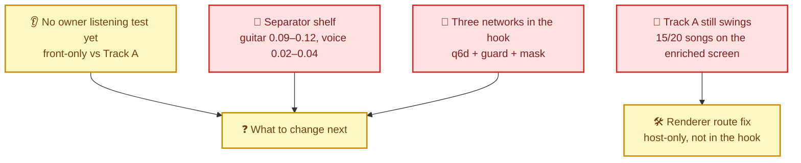
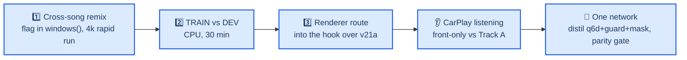

# Upmix Status and Problems 2026-09-29

**Historical ledger and final spectral result, owner-requested documentation:** [Complete separator attempt chronicle](UPMIX_SEPARATOR_CHRONICLE_2026-09-25_TO_2026-09-30.md) continues the original training history with named mask/sep variants, every review16–43 mechanism, data interventions, interrupted/paused attempts, BSRNN and one-network iterations. [Completed spectral40k full40 pair](UPMIX_UNIFIED_SCENE_ARCHITECTURE_2026-09-30.md#-completed-spectral40k-pair-joint-promotion-fails): nominal G/K/P/S .225/.217/.219/.191, V/B/D .0139/.1585/.0139,31/40 swings, entry .799/.451;9/13 absolute gates pass but bass/movement/both entry gates fail. Paired DEV source gain+.1383dB<+.3 and string regression fail relative promotion. Original CSV/event/hash evidence is archived. At2026-10-01T03:28:25Z the study is terminal, matching processes/lease absent; no new efficacy run is queued and the agent stays paused. Earlier pending/running snapshots are historical.

**Owner-requested wrap / agent pause, 2026-09-30:** [Consolidated session record](UPMIX_SESSION_WRAP_2026-09-30.md) collects results, failures, all experiment-report links, one-network architecture, raw artifacts, acceptance gaps and the finite restart sequence. At 2026-10-01T01:38:36.9304050Z spectral is 37,000/40k with supervisor45888/launcher37976/trainer18188 live; control40k is terminal. The already running supervisor may finish its fixed training/audit/full40 evaluation; pausing the agent does not stop that external job. No upper64 efficacy training is queued. Upper64 Python preparation passes23 structural checks and observes129.327M selected denseMAC/s; no quality, int8 port or device claim. Full40 spectral, native int8 qualification, genuinely untouched20, loaded-device≤150M/≤85ms and owner CarPlay proof remain open. Earlier live snapshots below are historical.

**Latest contingent architecture preparation:** The single upper64-versus24 decoder hypothesis is implemented in isolated Python files and passes23 CPU structural checks on the fitted20k parent/original TRAIN4. Float initial outputs/waveforms/shared state and low/mid weights are exact; all added branches have a nonzero derivative route. Observed selected129.327M denseMAC/s matches the formula; full four-source training graph187.827M is not the device path. No efficacy training/queue, new C/int8 port or quality win. Current spectral28,250/40k is verified live at2026-10-01T01:08:36Z under45888/37976/18188. [Evidence, quantization risk and unchanged finite next step](UPMIX_UNIFIED_SCENE_ARCHITECTURE_2026-09-30.md#contingent-upper64-decoder-preserving-initialization-and-observed-dense-counts-pass). Earlier snapshots below are historical; physical unit/independent20/owner proof is pending.

**Latest native preparation, 2026-09-30:** CPU actual-mixture C float/int8 assessment completes on the original true TRAIN4 and three detected TRAIN entries. Eligible median7.5235→7.4619dB, paired median loss.0639dB/worst.0982dB; native mask/source arithmetic and true-source/residual closure pass. This is fitting/port evidence, not DEV/acoustic/product promotion. The new full40/231row/265event evaluator is prepared and refuses an unpromoted fixed40k terminal; native full40 has not run. Spectral19,750/40k is verified live at2026-10-01T00:39:01Z under45888/37976/18188; CPU study finished0 and matching processes are gone. [Exact scope, evidence and next gates](UPMIX_UNIFIED_SCENE_ARCHITECTURE_2026-09-30.md#native-floatint8-acoustic-qualification-prepared-true-train-and-entry-execution-passes). The finite search boundary remains in force; independent20/device/owner CarPlay are open. Earlier snapshots below are historical.

**Latest bounded-search decision and verified state:** Finish the frozen spectral/control40k and original full40/event comparison. If terminal treble still fails, permit one matched upper-band decoder64vs24 experiment; if that also fails joint requirements, end automatic architecture enumeration and deliver the best measured candidate plus failure/limit evidence. Owner listening remains pending until actually performed; no acceptance threshold changes. At2026-10-01T00:19:43Z spectral13,000/40k is live under45888/37976/18188; control40k is complete. Optional actual-mixture C mask observation passes17 arithmetic/transparency gates on fitted TRAIN assets; synthetic source partitions are not separation evidence. Native full40 int8, truly untouched20, physical≤150M/≤85ms and owner CarPlay remain open. [Finite decision sequence and exact evidence](UPMIX_UNIFIED_SCENE_ARCHITECTURE_2026-09-30.md#finite-architecture-search-and-actual-mixture-c-mask-observation). Earlier live snapshots below are historical.

**Latest spectral diagnosis, 2026-09-30:** The [CPU joint24decoder study](UPMIX_UNIFIED_SCENE_ARCHITECTURE_2026-09-30.md#joint-fixed24-decoder-diagnosis-encoder-room-and-residual-treble-error-coexist) completes on the original four TRAIN8s cuts: saved eligible SDR7.524→privileged feasible bounded14.051dB; joint protected medians also improve. Unbounded eligible-only reaches28.139dB but retains treble error NSE.312/.486 in8–14/14–24kHz; poor auxiliary protected outputs are not an audible-leak claim. All48affine/declared-quadratic checks and prior-fitting parity pass; finite bounded optimization is not a certified optimum and these features require labels. Live broad decoding is unfrozen and may repair the saved basis. [Existing full40 band audit](UPMIX_UNIFIED_SCENE_ARCHITECTURE_2026-09-30.md#saved-real-c-rear-spectrum-previous-capacity-model-loses-instrument-treble) separately shows old expanded G/K6–10k rear .038/.023 versus labelled oracle .412/.367; no fresh spectral rear result yet. Control40k training completed, spectral arm now3,250/40k under supervisor45888/37976/18188; terminal numerical/full40/events follow. If its treble still fails, one matched upper-band decoder64vs24 is the targeted next hypothesis (129.327M dense formula, no implemented/device/quality claim or queued job). Unit read-only SSH times out; no unit mutation. Scene dormant; independent20/full int8/device/owner CarPlay gates remain open. Older live snapshots below are historical.

**Latest Track B state, 2026-09-30:** Fresh spectral48×2 encoder20k fitting passes all10 frozen conditions and strict saved CPU/device/native/chunk/future/frozen-head audits: eligible crop median7.524 versus original24×3control6.654dB, paired median+.811dB, all4crop gains≥.573dB; protected reconstruction improves. This is TRAIN4 only. The next fixed broad pair is actually live at `D:\upmix\runs\spectral_context_generalization_v1`, WMI supervisor45888/control launcher26924/trainer32840, last27250/40k with all156TRAIN songs exposed; spectral40k follows sequentially. Both actual20step broad smokes pass saved numerical/draw audits. Common decoder adapts in both; scene frozen, reserved20 audio unread; DEV40 only terminal, then original full40×60s/231rows/265events real-C at fixed .40 plus unchanged diagnostic gains. [Terminal fitting evidence and live broad protocol](UPMIX_UNIFIED_SCENE_ARCHITECTURE_2026-09-30.md#spectral-broad-comparison-frozen156train-and-full40-real-c-study-is-live). Source-component energy is diagnostic; original protected rear, stability and entry gates remain mandatory. Old capacity pair stillFAIL; exact-labelled renderer≈39% rear/2swings and exact-mask40-event bound1.035/.882 establish privileged room for improvement. Selected116.712M dense count is not device proof; new graph standalone C float/native/QNX numeric and int8 output-selection checks now pass on the real20k fitting checkpoint ([port evidence](UPMIX_UNIFIED_SCENE_ARCHITECTURE_2026-09-30.md#spectral-encoder-cint8-port-native-and-armqnx-arithmetic-checks-pass)); TRAIN4 int8 reconstruction also passes (eligible loss.0658dB); complete standalone FFT/WOLA/C5.1 native19numeric and ARM64hop checks now pass ([chain scope](UPMIX_UNIFIED_SCENE_ARCHITECTURE_2026-09-30.md#spectral-single-network-fftwola51-chain-full-train-numeric-integration-passes)); C is zero/scene dormant; full DEV int8/acoustic quality, independent20,≤150M/≤85ms device and owner CarPlay remain open. No Track A/unit/env/other-dirty-file changes. Earlier snapshots below are historical.

**Capacity live state:** Original-graph control completed20k continuation (3,340.869s,156TRAIN); expanded arm is now training under the same singleGPU supervisor. Control TRAIN12 eligible median−.935dB/DEV40−.588dB, upper DEV transmission .0067/.0057 remain weak. Final paired audit/full40 C/entries waits for expanded20k. [Terminal control evidence](UPMIX_UNIFIED_SCENE_ARCHITECTURE_2026-09-30.md#capacity-control-continuation-completed-expanded-arm-started).

**Perfect-label renderer bound complete, 2026-09-30:** Same NN-free C,40×60s/231rows and fixed .40: guitar/keys/piano/strings .386/.396/.395/.392,voice/bass/drums .0057/.0125/.0117,2/40swings; all11 observed renderer gates pass. Thus the nominal harness can support a much stronger rear than the current network's .177guitar/27swings. The .50 oracle fails11swings/keys slope; gain alone is not a repair. [Raw evidence and scope](UPMIX_UNIFIED_SCENE_ARCHITECTURE_2026-09-30.md#exact-labelled-audio-nn-free-renderer-result-expressive-rear-is-attainable-in-this-harness). Capacity continuation remains running; expanded standalone C and ARM/QNX numerical checks pass on actual20-step TRAIN weights, without terminal acoustic/int8/device/ears qualification.

**Current Track B, 2026-09-30:** The fixed broad source study completed both40k arms and full40×60s/231-row NN-free C plus265 attributed events per arm. Joint at fixed .40 gives guitar/keys/piano/strings .177/.193/.194/.195 and voice/drums .0109/.0100, but bass .130,27/40 swing songs and entry median/p10 .765/.431 fail. Rear is3.13dB below current Track A; increasing gain worsens stability. Auxiliary source supervision alone is not a product gain. TRAIN mixture projection and shared-decoder gradient-domination diagnostics are negative. A function-preserving matched capacity continuation is running sequential20k per arm on oneGPU: original24/2/16 versus24/3/24, same data/objective/draws; expanded selected-output graph132.2505M counted denseMAC/s, not device measured. CPU/CUDA starting-function and both smoke gates pass. An independent CPU perfect-label renderer oracle checks whether the NN-free C/measurement itself meets the target. Scene remains dormant, expanded C/int8 port and original int8 drum recovery are pending; untouched20/device/ownerCarPlay remain open. [Full evidence, failures and frozen protocols](UPMIX_UNIFIED_SCENE_ARCHITECTURE_2026-09-30.md). No Track A/unit/env changes. Older snapshots below are historical.

**Current Track B execution, 2026-09-30:** Fixed broad eligible-only40k is complete on156TRAIN; joint audio supervision is past36k/40k from the identical warm start/sample sequence, with terminal audit and full DEV40 real-C/events pending. Control TRAIN12/DEV40 eligible SDR−.636/−.831dB and upper-band transmission≈.01 show that four-crop fitting success is not broad quality. Scene remains dormant. Independent C float source/waveform parity and isolated ARM/QNX execution pass; original int8 export fails drum SDR by.840dB, mainly weight rounding in the TRAIN decomposition. Selected eligible-plus-scene inference is bit exact to full inference on Windows/ARM and costs91.5555M counted dense MAC/s; device/full-chain cost remains unmeasured. TRAIN horizon resets did not repair the control. A CPU-only fixed-terminal TRAIN12 mixture-consistency diagnostic is scheduled after joint40k; no DEV selection, new GPU recipe or projection-quality result yet. [All protocols, outcomes, failures and raw artifacts](UPMIX_UNIFIED_SCENE_ARCHITECTURE_2026-09-30.md). No hook/unit/package changes. Original untouched20 and owner CarPlay gates remain open. Older snapshots below are historical.

**2026-09-30 unified execution:** Both matched20k four-crop source-fitting arms completed; all frozen fitting and saved CPU/CUDA PCM gates pass. Eligible median7.564control/7.539joint; joint vocal/drum/present-bass medians9.204/11.022/6.616dB. This is TRAIN fitting, not rear/generalization proof. Next fixed broad source study starts both arms from identical joint20k weights, trains156true-stem songs with actual past-only analysis/WOLA, keeps scene dormant, and ends in full40/231-row NN-free-C plus attributed events. Metadata-only artist reservation makes20songs candidate-independent; older models saw them, so the strict untouched20 gate stays open. [Full protocol, evidence and scope](UPMIX_UNIFIED_SCENE_ARCHITECTURE_2026-09-30.md#-frozen-broad-source-study-and-holdout-scope). No Track A/unit/environment change. Older live snapshots below are history.

**Latest execution — unified model, 2026-09-30:** [Unified report](UPMIX_UNIFIED_SCENE_ARCHITECTURE_2026-09-30.md): both10k TRAIN fitting arms completed; joint eligible median6.914dB versus6.750 control, all relative/protected comparisons pass but absolute7dB floor fails. A concrete cuFFT C2R endpoint violation was reproduced and corrected in new Track B synthesis; saved weights now pass all-source CPU/CUDA signal parity and causality. Original checkpoints/failures preserved. Bounded matched extension to20k is frozen with valid inverse FFT, same architecture/data/source coefficient; no DEV or scene promotion yet. [Current Track A full40](../UPMIX_TRACKA_MATCHED40_2026-09-30.md), actual−9dB air:29/40swings, guitar/keys/piano/strings.165/.152/.095/.069 and voice/bass/drums.076/.149/.296. Copied no-legacy-network audio host and past-only waveform path verified; scene training, broad quality, device budget and owner ears remain required. No Track A/unit/env edits.

**Earlier prototype-only snapshot — superseded by execution above:** Replace q6d+guard+v21a with one shared causal audio/scene model. The [architecture and expressiveness plan](UPMIX_UNIFIED_SCENE_ARCHITECTURE_2026-09-30.md) and isolated `unified_upmix_net.py` CPU prototype are implemented: four joint source operators, six instrument memberships/pans/update rates, carried state;483,086 parameters,110.0055M estimated denseMAC/s including all heads. Future-prefix/chunk/reset/attribution/gradient/silence structural checks passed; this is untrained, with no acoustic, device or hook-ABI claim. Owner wants full instruments clearly behind; historical15–20% floors do not establish expressiveness. Explore frozen TRAIN-calibrated20/30/40% transfer points with source protection, body/attack/band/level and entry evidence, then owner ears. Next complete copied-host replacement contract and current Track A matched full40 baseline, freeze real-TRAIN fitting/source/scene supervision, then one-GPU execution. No job queued or GPU/package/unit/Track A change from this update. Earlier proposed next scalar mechanism is superseded by this explicit unified direction; preserve its measured failures and both reference checkpoints.

**Completed Track B — broad causal pair and full C test, 2026-09-30:** The [completed comparison](UPMIX_CAUSAL_GENERALIZATION_2026-09-29.md#-completed-full40-result-2026-09-30) finished both40k horizons, strict CPU checkpoint audit,40 DEV×60s,231 stem rows per C route and265 source-attributed events per arm. All11 relative quality gates pass, **absolute product gate fails**. Median paired DEV20s SI-SDR gain **+1.302827dB**, bootstrap90%[1.051355,1.443251],39/40 nonworse. Fixed direct-C control→reference guitar/keys/piano/strings **.103/.105/.091/.103→.121/.159/.135/.109**, voice/bass/drums **.0152/.0536/.0096→.0059/.0521/.0085**,0/40 swings both; rear+.365834dB at unchanged gain. Keys/piano/protected stems/slopes pass; guitar/strings and vocal-entry **.803796/.419774 median/p10** fail. Original-C swings worsen10→15/40, so direct-C stability is not an encoder-only achievement. Reference passes10/14 observed direct gates;2.168G estimated neuralMAC/s remains over≤150M allowance. PC idle: evaluator/supervisor returned0, no Python or GPU lease; no next job queued. Next predeclare one matched source/loss mechanism study on measured guitar/strings/entry failures before compression. Exact raw results/CSV/transition rows are committed with the report. Test24/independent20/device/ownerCarPlay remain open. No Track A/unit/shared-package change. Earlier active/pause snapshots below are history.

**Completed causal fitting result — causal reference pair, 2026-09-29:** The [matched normalized residual causal encoder experiment](UPMIX_CAUSAL_REFERENCE_ENCODER_2026-09-29.md) completed both 10k arms and independent CPU checkpoint audit. Same four frozen TRAIN crops, unchanged true-audio objective and bit-identical frozen trained decoder: fresh control → reference median SI-SDR **7.754→10.500 dB** (+2.746 dB), objective **.057067→.045320** (−20.584%); all four crops improved and all eight predeclared fitting comparisons passed. Fixed-STFT future-prefix NSE **0**, decoder/source/checkpoint parity verified. This demonstrates better causal fitting for this encoder package, not generalization or a product pass: vocal/bass frozen-mask transmissions rose **.0633→.0767 / .0748→.0901**, treble remains weak, and cost is **2,167.95 M estimated neural MAC/s** versus the ≤150 M measured-device allowance. No new causal DEV/source-entry/C, device or owner listening result. PC root `D:\upmix\runs\separator_causal_reference_v1`; terminal readback zero Python, lease absent, rapid queue empty. Next prepare broader true-stem training plus source-specific TRAIN/DEV and natural-song entry/C gates before compression; no next job queued. No Track A/unit/package edit. Earlier live execution and prerequisite notes below are history; SIMO remains the separate noncausal quality reference.

**Latest Track B result — full40 pretrained SIMO check, 2026-09-29:** [Completed source/entry/real-C evaluation](UPMIX_BSRNN_REAL_C_CHECK_2026-09-29.md) passes all 14 predeclared observed offline gates with the frozen host-only direct route, original gain 1.0, 40 DEV×60 s and 231 stem rows. Guitar/keys/piano/strings rear shares **.200/.211/.219/.204**, voice/bass/drums **.0022/.0070/.0033**, **0/40** any-stem swings versus **11/40** on the original C route; rear RMS difference **+.101 dB**. Vocal-entry retention **.875674/.745983** median/p10, 84 entries across 36 songs (83 valid ratios), within 265 total events across all 40 songs. On the identical enriched DEV20/direct-C subset, sep9→SIMO guitar **.105→.204**, keys **.144→.228**, voice **.019→.002**, at fixed gain but +1.149 dB rear RMS; no level-matched architecture claim. Aggregate passes retain individual bass/entry/instrument failures and upper-band attenuation, documented in the report. This is a large noncausal pretrained reference, not a device-qualified or owner-heard candidate; untouched-20, causal int8 ≤150 M/≤85 ms and live CarPlay gates remain open. Quiet-stem coverage and native/SSH execution failures were corrected with verified saved-output/event resume; final CSV/statistics/hash readback passed. PC idle: zero active Python, GPU lease absent, rapid queue empty, upstream clean. Next proposed matched causal encoder diagnostic with the same fixed trained decoder; no training queued, no Track A/unit edit. Earlier intake/inference/execution notes below are history.

**Latest Track B result — pretrained BSRNN item 1, 2026-09-29:** [Strict inference](UPMIX_BSRNN_PRETRAINED_INFERENCE_2026-09-29.md) completed on the exact four frozen TRAIN crops: all five public checkpoints loaded with zero missing/unexpected keys and exact tensor parity; 32 predicted stems saved at original gain in 48 kHz float WAV. Optimized SIMO `other` median SI-SDR **11.013 dB**, original-style large **7.463 dB**, versus historical small causal fitting baseline **7.797 dB**. SIMO's +3.216 dB is an offline pretrained reference improvement, not a matched causal architecture result or source/entry/C/device/listening pass. Dependencies were installed only in a separate venv, sharing unchanged torch/torchaudio 2.11.0+cu128. Three setup failures and their recovery are documented. PC idle: zero Python, lease absent, queue empty; upstream source clean. Next predeclare the fixed-gain source/entry/real-C comparison using SIMO as the stronger reference, then test causal mechanisms with a matched control. No fine-tuning, new encoder, Track A or head-unit change; earlier intake-only statements below are historical.

**Latest prerequisite completed, 2026-09-29:** The owner requested full BSRNN before custom architecture work. [Pinned source and verified BSRNN-large/SIMO weights](UPMIX_BSRNN_REFERENCE_INTAKE_2026-09-29.md) are now on PC, with five extracted checkpoints and 2.84 GB of archives. No new audio result: models have not run, dependencies were not installed, and the references are noncausal. Next validate strict loading and original gain before causal adaptation. Current read-back: no Python, GPU lease absent, rapid queue empty.

**Latest research update, 2026-09-29:** The [review of 22 research lines](UPMIX_RESEARCH_REVIEW_2026-09-29.md) found substantial differences between our simplified BandSepNet and published normalized residual separators. Proposed next step: demonstrate an acoustic gain with one stronger **causal encoder and the same fixed decoder**, then check generalization and compress. This takes priority over the DSD 40k data pair proposed below. It is a hypothesis, not a new success: no candidate, code, training, device measurement or listening result was added. Completed two-tap/context negatives remain valid; the old width experiment does not exclude every capacity/optimization improvement. Documentation only this turn; last recorded PC state is idle, not freshly polled.

**Latest Track B result — band allocation, 2026-09-29:** The [same-budget 48-band test](UPMIX_BAND_ALLOCATION_PROBE_2026-09-29.md#completed-10k-result-and-decision) completed 10k on the exact four TRAIN windows. Reducing maximum band width **89→41** kept **586,916 parameters / 125.139 M estimated neural MAC/s**, but improved objective only **.055586→.055163 (0.76%)** and median SI-SDR **7.797→7.951 dB**. Three windows were nonworse, one lost .338 dB; the frozen joint gate failed. CPU checkpoint/budget/window parity passed; no DEV/C/device promotion or long extension. Keep the original partition. Next prepare the previously frozen full-horizon causal original baseline versus DSD Dev addition, rather than extend these failed shortcuts; its cache/runner remain pending and no long run is queued. GPU lease/rapid queue are clear, no Python/daemon. Earlier execution entries below are history.

**Latest Track B result — direct decoder-state teaching, 2026-09-29:** The [matched 2k continuation](UPMIX_DECODER_STATE_SUPERVISION_2026-09-29.md#completed-matched-2k-result) completed with the original encoder and a bit-identical fixed decoder. State MSE fell only **5.86%**, while audio loss worsened **.05530→.06616** versus control and median SI-SDR **7.79→7.54 dB**. All frozen gates failed; no continuation/C/device promotion. CPU target/checkpoint parity passed. About 45% of initial concatenated state-error energy is invisible to the individual band decoders, under the documented per-band projection; this is not a full-operator or universal capacity diagnosis. The cuDNN eval-mode startup error was fixed before either student ran, with saved target reuse. GPU lease/rapid queue are clear, no Python/daemon remains. Next predeclare one same-budget 48-band redistribution test, reducing the widest high-frequency groups without discarding complex phase. Nothing new is queued; earlier execution entries are history.

**Latest Track B result — invariant input, 2026-09-29:** The [fixed-TRAIN feature comparison](UPMIX_INVARIANT_INPUT_PROBE_2026-09-29.md#completed-10k-result-and-decision) completed 10k. With the same original encoder/trunk/decoder and exact TRAIN windows, magnitude/relative-phase inputs achieved polarity NSE **0** but reconstruction worsened: objective **.05559→.05747**, median SI-SDR **7.80→7.63 dB**, all four windows slightly worse. Frozen diagnostic promotion **NO**. Checkpoint semantics and feature formula passed an independent CPU audit; no DEV/C/device/car claim. This whole feature replacement also discards cross-frequency phase information, so it does not reject all polarity-invariant representations. The GPU lease/rapid queue are clear and no Python/daemon remains. Next predeclare one direct decoder-state learning diagnostic versus matched audio-loss continuation on the original encoder; no follow-up is queued. Earlier state entries below are history.

**Latest verified diagnosis, 2026-09-29:** The [TRAIN-path investigation](UPMIX_TRAINING_PATH_DIAGNOSIS_2026-09-29.md) completed four fixed-window fitting, raw/cache consistency, decoder-state relaxation, physical polarity and real-C oracle-parity checks. At 10k, the causal baseline closed 73.2% of its numerical oracle loss gap, median SI-SDR 7.80 dB. Its unchanged trained decoder reached 20.59 dB with privileged optimized states (69.9% less remaining loss), demonstrating a substantial encoder/state-inference or optimization gap rather than a decoder-only ceiling. Exact eligible reconstruction can still have protected frozen-filter contributions; real C output parity confirms these contributions are not audible contamination in the summed waveform. Treat that metric as sensitivity evidence, jointly with reconstruction, entry and C tests; no historical student is promoted. DSD100 is now fully CRC/SHA validated (50 Dev/50 Test), with Test audio undecoded/unscored and Dev conversion pending. GPU diagnostics are terminal and the rapid queue/lease clear. All audited encoder blocks receive gradients; saturation is localized, not a proven treble-failure cause. Next freeze one representation/state-learning intervention before another broad efficacy run. Device and ear gates remain open.

One page for the owner: what the stereo→5.1 upmix has achieved, what is still broken, and the order of the next steps. Details live in the linked records; this note only summarises them.

**Later Track B update, 2026-09-29:** The old GPU and "untested causes" rows below describe the original stop snapshot. Execution resumed afterward. Three matched 4k data screens failed their joint source/entry/real-C gates: MoisesDB four-family remix, a five-song curated OnAir supplement, and MoisesDB six-family instrument remix. None earned 10k. The [MoisesDB result](UPMIX_MOISES_REMIX_PROBE_2026-09-29.md#completed-4k-result-and-decision), [OnAir result](UPMIX_ONAIR_DATA_PROBE_2026-09-29.md#completed-4k-result-and-decision), [instrument-family result](UPMIX_MOISES_INSTRUMENT_SIDECAR_2026-09-29.md#completed-matched-4k-result-and-decision) and [current handoff](UPMIX_SEPARATOR_HANDOFF.md) carry the data. A previously frozen [causal slow-operator architecture pair](UPMIX_OPERATOR_ANCHOR_PROBE_2026-09-29.md#resume-after-the-data-screens-2026-09-29) now holds the PC GPU lease, with no DEV result yet. The three negatives narrow the tested data recipes, not all data or architecture choices; no Track A hook change or car listening result follows.

**Current Track B update, 2026-09-29 14:28 PC local time:** The preceding live-GPU note is historical. The causal slow-operator and fine-role cross-song probes both failed their preselected source/entry gates, and a fourth rapid data comparison—[MoisesDB–OnAir cross-corpus remix](UPMIX_CROSS_CORPUS_REMIX_PROBE_2026-09-29.md#completed-4k-pair-and-decision)—also failed at 4k and real C. That candidate left guitar/keys/piano near **.10/.09/.06**, voice near **.05**, and vocal-entry p10 worsened **.412→.384**; no 10k promotion. The GPU is free. An official DSD100 download is in progress, with an integrity and overlap audit prepared; it cannot alone prove the separate instrument-family thresholds. There is still no Track B model in the head unit, device measurement or blind live-CarPlay verdict. Preserve the full product gates and choose a larger audited real-stem pool or a targeted causal architecture intervention.

---

## 🎯 Goal

Instruments audibly and stably in the rear, the voice never, no "back and forth". The car plays ordinary stereo from the phone over **live CarPlay**; the head-unit hook builds 5.1 (`AUDIO_REALTIME_UPMIX=on`). A candidate is therefore a head-unit build/config, not a file.

---

## ✅ Achieved

### Track A — what ships in the car

| Step | Result | Commit |
| --- | --- | --- |
| Float reference of the protect-mask net | Parity with PyTorch 3.6e-7 | cc5ec5d |
| Mask net in the production path | Features on the audio thread, inference on the control worker, 3-miss fallback to the heuristic | 518fba0 |
| Install package | v21a blob, startup env, per-model settings drift check | efa42d9, 81a836e |
| int8 + NEON port | 3.92 → **1.46 M instructions/control**; QNX `expf/logf` were software double — replaced | 6bbb02e → 6d667c7 |
| Krait measurement | Mask **1.33 ms/control** of ~10.7 ms, 839/839 on time, audio thread +1 % | — |
| Reset bug | `spa_stereo_upmix_reset()` dropped the guard/mask pointers — the mask never ran in the car before this | c43a17c |
| Car tuning | Mask drive **1.5**, rear air **−9 dB**: guitars 0.17 / voice 0.08 (4 songs >15 % vs 8 in the 22.09 build); guitar swing range a quarter lower, voice a third lower | 04fb06d |
| Best build | `build/install_protected_WAUZZZF47HA098927.zip` (SHA 710342a1…075f), three models, VIN-locked | 800de9d |

### Track B — separator feasibility

| Result | Meaning |
| --- | --- |
| Bounds measured | With **true** eligible audio the renderer gives **0/40** swinging songs and instruments ~0.21–0.23: the goal is reachable in principle |
| Renderer route (review 18) | Host-only object/bed change: 8→0/40 swings on truth; even the weak sep9 estimate 6→1/20 |
| Tooling | `sep_net.py` with all ablation flags, diagnostics (`diag_gap`, `diag_transitions`, `diag_ceiling`, `diag_lossfloor`, `diag_auxgrad`), rapid loop (queue, `GPU_LEASE`, 20-song screen, `LEADERBOARD.md`) |
| Fixes | Scheduler resume (10.5× LR), log-loss NaN, attribution 0/0 NaN, UTF-16 board, deterministic prefetch seeds |
| Proxy validation | sharedmask's 4k stability gain did **not** survive to 10k — 4k ducking/swings do not predict 10k |

---

## ❌ Problems

| Problem | Evidence | Status |
| --- | --- | --- |
| **The shelf** | ~38 variants (width, supervision, band RNN, loss, lookahead, complex/matrix/role masks, 8 s memory) land on one recall/leak frontier: guitar 0.09–0.12, voice 0.02–0.04. Target ~0.20 | Open |
| **Track A still swings** | Enriched 20-song real-C screen: 15/20 any-stem swing songs; instruments .176/.166/.118/.225, voice/bass/drums .075/.150/.285 | Open |
| **CMA-ES on the frozen mask failed** | 10 params, 18 candidates, 6 songs: best score silenced the rear by 4.03 dB | Closed (negative) |
| **Three networks** | q6d (routing) + guard (vocal safety, same graph) + mask v21a, run in series on one worker; three blobs, three settings | Open |
| **No listening test** | Owner blind test front-only vs Track A over CarPlay never done | Blocking |
| **Renderer fix not in the car** | The strongest swing lever exists only in the host C renderer | Open |
| **GPU contention** | One GPU training at a time; Codex's `operator_anchor4k` holds it now | Scheduling |

### Two untested causes of the shelf

1. **No cross-song stem remix.** `windows()` in `tools/stereo-upmix-render/sep_net.py` builds every training window from the stems of *one* song (only ±6 dB per-slot gains). Standard separator training mixes stems from different songs and offsets; with ~240 true-stem songs this is the cheapest untried data lever.
2. **Under- vs over-fitting was never measured for the separators.** The Track A mask lineage was flat on TRAIN as on DEV (AUC 0.81/0.76), i.e. underfit. For the sep students the TRAIN-vs-DEV screen has not been run. A TRAIN gap → data (remix, pseudo-labels on the 3,367-song `D:\music`); no gap → capacity/training length (the Krait has 2–4× headroom).

---

## 🧭 Next steps

| # | Step | Gate |
| --- | --- | --- |
| 1 | Cross-song remix flag in `windows()`; one 4k rapid run after the GPU lease frees | +0.03 eligible at ≤ +0.01 vocal vs the 4k anchor |
| 2 | TRAIN vs DEV screen of sep3 and sharedmask_10k | Decides data vs capacity |
| 3 | Review-18 renderer route in the hook, v21a unchanged | Fewer swings on the 20-song screen at equal rear level |
| 4 | Owner listening over CarPlay | Owner verdict |
| 5 | One multi-head network distilled from the three | Parity with Track A, cost ≤ today |

---

## 🔗 Records

- [Separator handoff](UPMIX_SEPARATOR_HANDOFF.md) — full ledger and rules
- [Separator night report 2026-09-28](UPMIX_SEPARATOR_NIGHT_REPORT_2026-09-28.md)
- [Source separation plan](UPMIX_SOURCE_SEPARATION_PLAN.md)
- [Listening and deploy log](../UPMIX_LISTENING_AND_DEPLOY_LOG.md)
- [HSSR model](../HSSR_MODEL.md)
