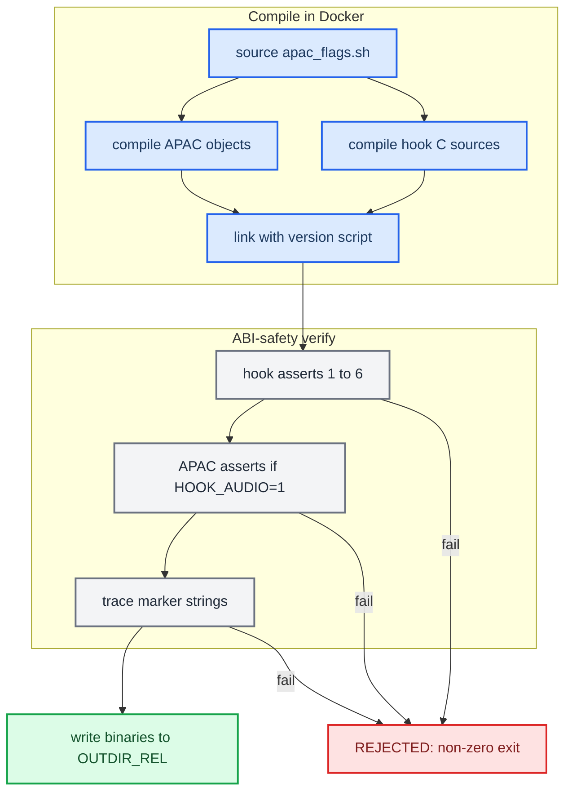

# Build System

*How source becomes shipped binaries: one Docker QNX toolchain, a shared compile+verify core, and a set of ABI-safety asserts that reject a bad `.so` before it can reach a car.*

---

## 🔧 The toolchain

Everything cross-compiles inside one Docker image family, `qnx65-armv7-toolchain`, built from [luka-dev/qnx65-armv7-toolchain](https://github.com/luka-dev/qnx65-armv7-toolchain). No VM is needed. Build the image once; if it is missing, the build stops and prints the same command:

```bash
git clone https://github.com/luka-dev/qnx65-armv7-toolchain
cd qnx65-armv7-toolchain
./host-scripts/qnx-run.sh build        # :8.5-full, also tagged :latest
./host-scripts/qnx-run.sh build 4.9    # :4.9, only for QNX_TOOLCHAIN_VARIANT=4.9
```

The tag picks the compiler:

| Tag | Compiler | Used by |
|---|---|---|
| `latest` | GCC 8.5.0 (`:latest` is the `8.5-full` image) | the default for the hook and the only tag the renderers use |
| `8.5` | GCC 8.5.0 + gas 2.38 | the hook, if you ask for it |
| `4.9` | GCC 4.9.4 + stock gas 2.19 | the hook, as the legacy baseline |

`QNX_TOOLCHAIN_VARIANT` chooses the tag for the hook. Only `latest`, `4.9` and `8.5` are accepted, and it defaults to `latest`. The renderers always use `:latest`.

The BSP client libraries (`libscreen`, `libEGL`, `libGLESv2`, `libOmxCore`) export their API **only on the unit**, because the generic SDP does not have them. The renderer build therefore generates **import stubs**: the right symbol names with empty bodies, under the right SONAME, so the link resolves. It also links with `--allow-shlib-undefined`, which leaves each BSP library's own dependencies to be resolved on the unit at runtime.

## ⚙️ What each script builds

| Script | Input | Output | Notes |
|---|---|---|---|
| `scripts/build_hook.sh` | `hook/`, `apac_decoder/` | `build/unprotected/libcarplay_hook.so` (+ `libcarplay_apac.so`) | Builds without protection only. It takes no arguments, sets `OUTDIR_REL=build/unprotected` and calls the shared core. |
| `scripts/build_hook_protected.sh <VIN>` | same | `build/protected_<VIN>/` (stamped) | Uses the same core with `PROT_BUILD=1`, then stamps the result. See [VIN Protection](VIN_PROTECTION.md). |
| `scripts/build_hook_common.sh` | — | — | The one shared compile+verify core, `carplay_build_hook()`, sourced by both hook scripts. |
| `scripts/build_java.sh` | `java_patch/` + `java_resources/` | `build/carplay_hook.jar` + `build/carplay_hook-build.json` | Targets Foundation 1.1 with `-source 1.4 -target 1.4`. It takes no arguments. |
| `scripts/build_renderers.sh [grid]` | `maneuver_render/`, `altscreen_render/`, `common/` | `build/maneuver_render`, `build/altscreen_render` (+ `build/libmaneuver_scene.a`) | The `grid` argument adds `-DCR_DEBUG_GRID` to the maneuver build. |
| `scripts/apac_flags.sh` | — | — | The single source of the APAC compiler flags. The hook core and `apac_decoder/bench/build_qnx_bench.sh` both source it. |
| `scripts/run_tests.sh` | `hook/`, `tests/` | — | Host-side tests for the hook. The APAC decoder has its own suite, `make -C apac_decoder check`. |

## 🔧 The hook build and its verify

`build_hook_common.sh` deliberately holds **one** copy of the compile and the ABI-safety verify. The protected `.so` has to pass exactly the same gates as the shipping one, and a second copy of the verify could drift and ship a broken binary. Protection is decided at compile time (`#ifdef CARPLAY_PROT`), so it lives in a shared core rather than in a wrapper around a finished `.so`.

The APAC decoder ships as an **optional** `libcarplay_apac.so`. The hook only `dlopen`s it for a buffered Spatial stream and has no `DT_NEEDED` entry for it. It is C++ behind a C interface and is linked with GCC rather than G++, so `libstdc++.so.6` never ends up in `DT_NEEDED`; the unit's image does not carry that library.



### The ABI-safety asserts

Each assert is there because breaking it makes the `.so` crash or fail to load on the QNX 6.5 unit. Any failed check stops the build with `REJECTED:` (`build_hook_common.sh:158`).

| Assert (`build_hook_common.sh`) | Why it matters |
|---|---|
| `emutls = 0` (`:163`) | `__thread` on GCC/QNX 6.5 ARMv7 produces emulated TLS, and its resolver crashes host threads that were created before our `LD_PRELOAD`. See [Landmines](../LANDMINES.md). |
| No `__cxa_throw` / `__gxx_personality` / `_ZTI` / `_ZTS` / `_ZTV` (`:167`) | No exceptions or RTTI reached the link. |
| No undefined `_Znw` / `_Zna` / `_ZdlPv` / `_ZdaPv` / `__cxa_guard` / `_ZSt` / `_ZNSt` (`:171`) | Nothing from the C++ runtime or STL, and no static-init guards. |
| No `libstdc++` in `DT_NEEDED` (`:175`) | The unit's image does not carry it. |
| No `libcarplay_apac` in `DT_NEEDED` (`:177`) | The codec must stay `dlopen`-only, never a hard dependency. |
| QSA bridge exports: exactly 5 with audio, 0 without (`:179-184`) | `snd_pcm_{open_name,plugin_params,plugin_setup,plugin_write,close}` must match `HOOK_AUDIO`. |
| Trace HID seams: 2 in trace builds, 0 in quiet builds (`:185-190`) | `HIDRemotePlaybackFillReport` and `HIDDevicePostReport` exist only with `AUDIO_STATE_TRACE=1`. |
| Exact export allowlist (`:196-221`) | The `LD_PRELOAD` ABI is a fixed set of interposed symbols. Everything compiles hidden by default and goes through a version script, and the result is diffed against `hook/carplay_hook.exports.map`. That list is trimmed first for quiet builds and for `HOOK_AUDIO=0`. The map has 28 entries, so a quiet audio build exports **26**, a trace build **28**, and a quiet `HOOK_AUDIO=0` build **9** (Setup, TearDown, CopyServerInfo, SetNightMode, `CinemoCreateIAP` and the four NME seams). Before hidden visibility the hook exported about 125 (2026-08-11 seam audit) to 208 (2026-09-07 audit) symbols — module defs, helpers, stb — all preemptible; the 2026-09-07 audit's "24 / 26" counts predate the current map. |
| `.init_array` size `000004` and no `*_module_(init\|fini)` (`:228-231`) | Only the compiler's own entry is allowed. Eager module constructors used to call `pthread_create` while the QNX loader lock was held, so cold start depended on scheduler timing and could deadlock. |
| APAC: emutls, exceptions/RTTI, STL, `libstdc++` and `.init_array` checks repeated, plus exactly one `spa_apac_codec_get_api` export (`:240-252`) | Loading the codec with `dlopen` must not bring back the hazards removed from the hook. This is skipped for `HOOK_AUDIO=0`. |
| Marker strings (`:259-268`) | `AUDIO_STATE_TRACE=1` must contain `IAP_NOW_PLAYING_START`, and `ALTSCREEN_PACE_TRACE=1` must contain `111 pace gen=`. |

<details>
<summary>Build flags (all set as <code>env=value</code> before the command)</summary>

---

All of these are validated as `0`/`1` in `build_hook_common.sh:54-66`, except the toolchain variant.

| Flag | Default | Effect |
|---|---|---|
| `HOOK_AUDIO` | `1` | `0` removes the type-103 audio path at compile time (`-DHOOK_AUDIO=0`): the `hook/audio/*` sources and the QSA/AirPlay audio interposers are left out, and `libcarplay_apac.so` is not built. A codec left in the output directory by an earlier audio build is removed. `AUDIO_SPATIAL=0` only disables type 103 at runtime; `HOOK_AUDIO=0` takes it out of the binary. |
| `LOG` | `1` | `0` sets `-DENABLE_LOGGING=0`, which turns off logging and diagnostic captures (`:75`). |
| `AUDIO_STATE_TRACE` | `0` | `1` sets `-DENABLE_STATE_TRACE=1`, a compact lifecycle trace. It exports the two trace HID seams and checks the markers after the build. |
| `ALTSCREEN_PACE_TRACE` | `0` | `1` sets `-DENABLE_ALTSCREEN_PACE_TRACE=1`, a stream-111 pacing trace. The markers are checked after the build. |
| `LOG_RGD_PACKET_RAW` | `0` | `1` sets `-DRGD_TRACE_RAW_FULL=1`, which logs raw RGD packets. It requires `LOG=1` (`:66`). |
| `QNX_TOOLCHAIN_VARIANT` | `latest` | `latest`, `4.9` or `8.5` (`:44-48`). The default `latest` is GCC 8.5. |

At runtime the hook only logs at **WARN** and above by default. `LOG_INFO` never reaches `/tmp/carplay_hook.log` unless you `touch /mnt/app/carplay_verbose`, so any instrumentation you want to read back from the car must use `LOG_WARN`. See `memory/hook_log_is_warn_only.md` and [Landmines](../LANDMINES.md).

</details>

---

## 📦 The Java build

`build_java.sh` compiles `java_patch/` (`:25`), the only Java tree, against `../../Tools/jxe2jar/out/MU1316-final.jar` plus two OSGi jars, using the bundled Zulu JDK 8 `javac` with `-source 1.4 -target 1.4` (`:17-23`, `:62`). It then copies `java_resources/` into the jar (`:70`). The unit runs IBM J9 **Foundation Profile 1.1** (about J2SE 1.4, `jclfoun11`), so the bytecode is major version 48 and the code cannot use generics, enums, enhanced for-loops or autoboxing. `-target 1.4` matters because it makes `"a"+b` compile to `StringBuffer`; the runtime has no `StringBuilder`.

Trap: targeting 1.4 against a JDK 8 `rt.jar` does **not** restrict which APIs you can call. A 1.5 method compiles fine and then throws `NoSuchMethodError` on the unit.

The build ID comes from `CARPLAY_BUILD_ID`, or failing that from `git describe --always --dirty` (`:52`). It is written into a generated copy of `CarPlayApp.java`, and the source tree is never edited (`:54-60`). The build also writes `build/carplay_hook-build.json`, which records the jar's size, SHA-256, build ID, commit, whether the source was dirty, and `deployed: false` (`:74-86`).

## 📊 The renderers

`build_renderers.sh` builds `maneuver_render` and `altscreen_render` in `qnx65-armv7-toolchain:latest` (`:23`).

- The maneuver scene engine (`maneuver_render/scene/*.cpp`) is C++11 compiled with `-fno-exceptions -fno-rtti` and archived into `build/libmaneuver_scene.a`. If it pulls in any C++ runtime symbol, the build fails (`:61-77`). The top-level binaries are C.
- `maneuver_render` links stubs for `libscreen`, `libEGL` and `libGLESv2` (`:57-74`).
- `altscreen_render` links stubs for `libscreen`, `libOmxCore`, `libEGL` and `libGLESv2` (`:82-92`). It uses EGL/GLES because its loader is a GLES2 shader (`loader/prism.c`, `screen_egl_present.c`).
- Both binaries are checked to be ARM ELF with `emutls = 0` (`:95-102`).

At runtime, `maneuver_render`'s EGL needs `GRAPHICS_ROOT=/proc/boot`. The generation monitor starts every renderer with that variable set and with `LD_PRELOAD` cleared (`deploy/smartphone_integrator/carplay_monitor.sh:93`). See `memory/graphics_root_egl_trap.md` and [Landmines](../LANDMINES.md).

## ⚡ Determinism note

`apac_flags.sh` is the only definition of how the APAC decoder is compiled. The shipping build and the benchmark both source it, because a drifted copy would let the benchmark report headroom for a binary nobody ships. `-fno-threadsafe-statics` avoids `__cxa_guard_acquire`, which this libstdc++ configuration lacks. `-D_NO_CPP_INLINES` stops the QNX headers from pulling in C++ inline definitions (`apac_flags.sh:12-20`). The flags also include `-Wall -Wextra -Werror`. The host-side upmix bench compiles with `-ffp-contract=off` because the ARMv7 target has no FMA, and a host build that fused multiply-adds would not match the unit's arithmetic (`tools/stereo-upmix-render/bench/build_host.sh:9-11`).

Provenance: `scripts/build_hook.sh`, `scripts/build_hook_common.sh`, `scripts/build_java.sh`, `scripts/build_renderers.sh`, `scripts/apac_flags.sh`, `scripts/run_tests.sh`, [qnx65-armv7-toolchain README](https://github.com/luka-dev/qnx65-armv7-toolchain#readme).

## 🔍 Checking a build beyond the asserts

The asserts gate the hook `.so` only. The Java jar and the cross-process wire are checked by separate scripts, used by every production audit ([Production Audits](PRODUCTION_AUDITS.md)):

- `scripts/audit_java_stock.sh` rebuilds the jar and checks every reference both ways against the real MU1316 J9 classes (`MU1316-final.jar`, `MU1316-combined.jar`, the firmware `jcl.jar`), never the JDK 8 `rt.jar`. This is what catches a 1.5 API that `-target 1.4` lets through.
- `scripts/check_local_protocols.py` checks that the Java and C wire constants match (39–41 of them across audits) and that every shipped class is version 48.0.
- After a Java build, `javap -verbose` on a class should show the real build ID; a literal `@BUILD_ID@` means the generated source was not used.

History: before the Docker image the hook was built by `compile_c.sh` over SSH on a QNX 6.5 SDP VM, and the jar was described as "Java 1.2" but compiled with `-source 8 -target 8`; both are superseded ([Archive and History](../reference/ARCHIVE_AND_HISTORY.md)). The 2026-09-14 baseline audit removed an unused `-lm` from the altScreen link; the later PRISM loader needs libm again, so both renderer links carry `-lm` today (`scripts/build_renderers.sh:74`, `:92`). **[code]**

---

## 📚 Sources

Merged originals were removed from the tree after this note absorbed them; they remain in git history (commit 23972aa).

- `ARCHITECTURE`: the list of supported build outputs.
- `HOOK_RELEASE_SAFETY_AUDIT`: origin of the hidden-visibility export allowlist.
- `FRIDAY_BASELINE_AUDIT_2026_09_14`: the `-lm` removal.
- `oldREADME`: the pre-Docker build.
