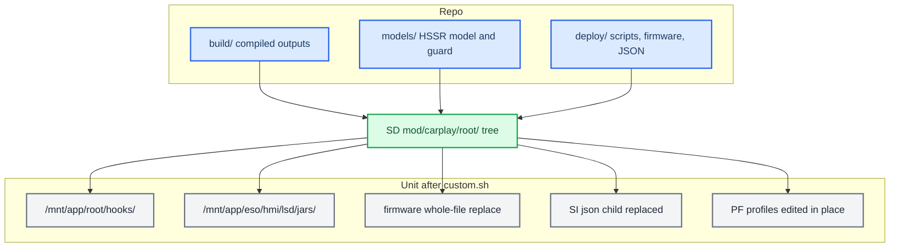

# Deploy and Release

*The build scripts only produce loose binaries. You assemble a release by hand from three folders into `mod/carplay/root/` on an M.I.B. card, install it with `custom.sh`, and never reboot the car without asking.*

---

## 📦 Builds emit binaries, not releases

There is no packaging script; `package_mib.py`, `package_protected.sh` and `deploy_over_ssh.sh` have all been deleted. Each build script writes its outputs into `build/`, and you assemble a release **by hand** from three folders:

- `build/` holds the compiled outputs: `libcarplay_hook.so`, `libcarplay_apac.so`, `maneuver_render`, `altscreen_render` and `carplay_hook.jar`.
- `models/` holds the HSSR models, `hssr_model.bin` and `hssr_guard.bin`.
- `deploy/` holds the startup scripts, the patched firmware (`smartphone_integrator` and `deva-ctrl-qc.so`) and the SI child JSON.

`custom.sh` installs whatever it finds under `mod/carplay/root/`. It copies every file in that tree to the same path under `/` (`install_MoreIncredibleBash/mod/custom.sh:29-32`, `:118-133`). You put each file at its on-unit path yourself, using the map below.



## 🔗 The artifact map

The on-unit column is the path under `/`. On the card, that same file goes at `mod/carplay/root/<on-unit path>`.

| File | Source in the repo | On-unit path |
|---|---|---|
| `libcarplay_hook.so` | `build/unprotected/`, or `build/protected_<VIN>/` for a stamped build | `/mnt/app/root/hooks/` |
| `libcarplay_apac.so` | `build/unprotected/` or `build/protected_<VIN>/`; leave it out of a `HOOK_AUDIO=0` build | `/mnt/app/root/hooks/` |
| `maneuver_render` | `build/` (`build_renderers.sh`) | `/mnt/app/root/hooks/` |
| `altscreen_render` | `build/` (`build_renderers.sh`) | `/mnt/app/root/hooks/` |
| `carplay_hook.jar` | `build/` (`build_java.sh`) | `/mnt/app/eso/hmi/lsd/jars/` |
| `hssr_model.bin` | `models/hssr-q6d-moises-a/`, the main control model | `/mnt/app/root/hooks/` |
| `hssr_guard.bin` | `models/hssr-selection-v11/`, the V11 vocal guard, loaded from beside the main model (`hook/audio/audio_hook.c:1756`) | `/mnt/app/root/hooks/` |
| `flag_atlas.rgba` | `maneuver_render/resources/` | `/mnt/app/root/hooks/` (`maneuver_render/main.c:45`) |
| `carplay_{startup,monitor,processes,cleanup}.sh` | `deploy/smartphone_integrator/` | `/mnt/app/root/hooks/` |
| `smartphone_integrator` | `deploy/smartphone_integrator/` | `/mnt/app/eso/bin/apps/` (replaces the whole file) |
| `deva-ctrl-qc.so` | `deploy/deva-ctrl-qc/deva-ctrl-qc.so.patched`, renamed | `/mnt/app/armle/lib/dll/` (replaces the whole file) |
| `carplay_child.json` | `deploy/smartphone_integrator/` | Not installed as a file: it goes in `mod/carplay/` next to `root/`, and `custom.sh` splices it in as `children.carplay` |
| `patch_si_rearm.py` | `deploy/experimental/usb_replug_recovery/` | Host-side only, to reproduce or reverse the SI re-arm patch; never staged |

Build the compiled outputs first (`build_hook.sh` or `build_hook_protected.sh`, then `build_renderers.sh` and `build_java.sh`); everything else is copied unchanged. `custom.sh` sets modes itself: `755` for `.so` files, the renderers, `eso/bin/apps/*` and `*.sh`, `644` for everything else (`custom.sh:37-45`). `.gitignore` keeps `mod/carplay/root/` and `mod/carplay/carplay_child.json` out of git.

### Firmware and model identities

`custom.sh` backs up each replaced firmware file once, as `*.carplay-stock`, before an atomic rename on the same partition (`custom.sh:47`, `:51`, `:127-131`). It does **not** check SHA-256 identities, so staging the correct images is your job. Check with `shasum -a 256`; the repo copies matched when this was last checked.

| File | SHA-256 | Note |
|---|---|---|
| `deploy/smartphone_integrator/smartphone_integrator` | `606236a81c7c4dafda6fdd08fe6eb27c43252796784da25d9760a7d552ee2af3` | SI re-arm image, read back from the HU on 2026-09-16 (not re-verified on the unit since) |
| `deploy/deva-ctrl-qc/deva-ctrl-qc.so.patched` | `398e7213be4e966719eed5ff9736fb9142f11e161033f01263f29db640e06355` | final mirror build; three-step chain in `deploy/deva-ctrl-qc/BUILD_CHAIN.md` |
| `deploy/deva-ctrl-qc/deva-ctrl-qc.so.stock` | `58dddcabaa94c2fecf989855a6f810ec219926f49669a0ed9482ed629fdc64b9` | stock input |
| `models/hssr-q6d-moises-a/hssr_model.bin` | `96abe57d9ee703f2e39c0231de97580c303ce896ce044b7450c14240002b0a0e` | q6d main model |
| `models/hssr-selection-v11/hssr_guard.bin` | `ab01463e9359f013c4b40f311d630bd20af48d761ad361563cb5246f6bd686ae` | V11 guard |

**PF firewall:** no patch file is installed. `custom.sh` edits the `carplay0` inbound TCP rule in place, widening ` 6030,` (or ` 6030:6031,` / ` 6030:6033,`) to ` 6030:6032,` in each of `pf.conf`, `pf.ecm0.conf`, `pf.mlan0.conf` and `pf.ppp0.conf` (`custom.sh:35`, `:89-110`). Because it does this in the shell, it needs no `patch`, `sed` or Python on the HU. `deploy/pf/patched/` is a reference result, regenerated by `deploy/pf/patch_pf.sh`. See [PF Firewall](../connect-and-usb/PF_FIREWALL.md) and [Landmines](../LANDMINES.md) for the trap where the PF profile is chosen per interface.

## 💾 The M.I.B. SD install

Copy the contents of `install_MoreIncredibleBash/` over the root of the M.I.B. SD card, then stage the release inside `mod/carplay/`:

```text
SD1/
  mod/custom.sh
  mod/carplay/carplay_child.json          from deploy/smartphone_integrator/
  mod/carplay/root/mnt/app/root/hooks/     .so, renderers, models, atlas, carplay_*.sh
  mod/carplay/root/mnt/app/eso/hmi/lsd/jars/carplay_hook.jar
  mod/carplay/root/mnt/app/eso/bin/apps/smartphone_integrator
  mod/carplay/root/mnt/app/armle/lib/dll/deva-ctrl-qc.so
```

To install, run **GEM → M.I.B. → Advanced Settings → Run Custom Script** (`mod/custom.sh`) with CarPlay disconnected. If it is started on the RCC it hands itself to the MMX (`:25-27`). It then:

1. remounts `/mnt/app` and `/mnt/system` read-write;
2. copies each file under `root/` onto `/` through an atomic rename;
3. patches `smartphone_integrator.json` by replacing the `"carplay"` child;
4. widens the PF profiles;
5. runs `sync` and prints `DONE (install). Reboot the HU to load.` (`:112-138`).

It stops no processes and does not reboot.

If `carplay_child.json` is missing from `mod/carplay/`, the JSON patch is skipped with a `WARN` (`:57`) and the hook never loads. If `mod/carplay/root/` is missing, the script exits with `no payload tree` (`:32`).

To check an install on the unit (the mod only becomes active after a reboot, and on a protected build only on the stamped VIN):

```bash
grep carplay_startup.sh /mnt/system/etc/eso/production/smartphone_integrator.json
grep -o '6030:6032' /mnt/system/etc/pf.conf /mnt/system/etc/pf.ecm0.conf
```

On a car with the LTE modem the live profile is `pf.ecm0.conf`, not `pf.conf`.

To uninstall, copy `uninstall_MoreIncredibleBash/` over the card instead. That script needs no payload tree or marker. It renames every `*.carplay-stock` it finds under `/mnt/app` and `/mnt/system` back to the original, which covers the firmware, the SI JSON and the PF profiles. It then deletes the files on its fixed owned list (`uninstall_MoreIncredibleBash/mod/custom.sh:22-53`). The list includes `hssr_guard.bin` (`:26`); the "[open] missing from the list" remark in `DEPLOYMENT.md` and `PROTECTOR.md` is superseded. `custom.sh uninstall` from the install folder (`install_MoreIncredibleBash/mod/custom.sh:140-159`) is a second path when the payload tree is present. Both READMEs that described the old generated uninstaller (`.orig` restore, `package_mib.py`) are gone or stale; the scripts are authoritative. **[code]**

The runtime side of the install (which process owns what, the generation monitor, why renderers are never `servicemgr` services) is in [Architecture](../reference/ARCHITECTURE.md).

## 🌐 SSH deploy and its traps

No SSH deploy script remains in `scripts/`. A push over SSH is done by hand to the unit (`root@10.173.189.1`, or other `10.173.189.x` addresses). The unit has a bare QNX environment, and a naive copy fails in four ways:

| Trap | Fix |
|---|---|
| The unit has no remote `scp` binary | Push with `ssh host 'cat > /path/file.new' < local`, then `chmod`, `mv` and `sync`. |
| sshd rate-limits repeated password logins | Open one multiplexed master (`ControlMaster=auto`, with a `ControlPath` under 104 bytes) and reuse it. The first call goes through `sshpass`; the rest are plain `ssh`. |
| `ssh` inside `while read` eats the loop's stdin | Always use `ssh -n` (or `< /dev/null`) in loops. |
| zsh does not word-split unquoted `$OPTS` | Put deploy snippets in a `#!/bin/bash` script, not inline. |

The login banner prints on STDOUT even for `ssh host cmd`, so a binary read-back has to print a marker first (`echo __BEGIN__; cat f`) and strip everything up to it. The unit has no `scp`, `tar`, `cksum`, `sha256sum` or `base64`, so the only end-to-end check is to read the file back and `cmp` it locally. `/mnt/app` stays read-only until `mount -uw /mnt/app`. `/tmp` maps to `/dev/shmem`, which cannot hold directories. Source: `memory/audi_ssh_transport_traps.md`.

## ⚠️ Never reboot the unit unasked

This is a hard rule, not a preference: the user is usually sitting in the car.

- **Deploying files is fine; restarting is not.** Copy the artifacts, report what is staged, and say plainly that it needs a restart to take effect. Then **stop and wait**. Approval to deploy is not approval to reboot, and approval once is not approval the next time. See `memory/feedback_never_reboot_unit.md`.
- **The C hook** (`libcarplay_hook.so`) is loaded per fork. `carplay_startup.sh` adds `LD_PRELOAD` only to its own `dio_manager` (`deploy/smartphone_integrator/carplay_startup.sh:50`), so a new `dio_manager` generation picks up a redeployed `.so`.
- **The jar is different.** `carplay_hook.jar` is on j9's `-Xbootclasspath`, so it does nothing until the JVM restarts. Killing j9 counts as a critical-process death and **restarts the whole system** (about 50 s): SSH drops and the screen goes black mid-drive. Always warn before killing j9. See `memory/java_jar_deploy_reboots_unit.md` and [Landmines](../LANDMINES.md).

The install is atomic per file (a rename on the same partition), not a transaction across both flash partitions. A manual reboot activates the release.

Provenance: `install_MoreIncredibleBash/mod/custom.sh`, `uninstall_MoreIncredibleBash/mod/custom.sh`, `deploy/smartphone_integrator/README.md`, `deploy/pf/README.md`.

History: the pre-TCP releases installed the hook by adding `LD_PRELOAD` directly to the SI JSON and the jar by prepending it to `CLASSPATH` in `navigation.json`, plus a patched `komoviewstyle.conf`; see [Archive and History](../reference/ARCHIVE_AND_HISTORY.md).

**Related:** [Upmix Listening and Deploy Log](../audio/UPMIX_LISTENING_AND_DEPLOY_LOG.md) — the upmix deploy chronology and its SSH notes.


---

## 📚 Sources

Merged originals were removed from the tree after this note absorbed them; they remain in git history (commit 23972aa).

- `RELEASE_ARTIFACTS`: the source → on-unit map, SD layout and firmware/model hashes.
- `DEPLOYMENT`: install/uninstall steps and process ownership.
- `PROTECTOR`: the protected-release variant and post-install checks.
- `oldREADME`: the pre-TCP device paths.
