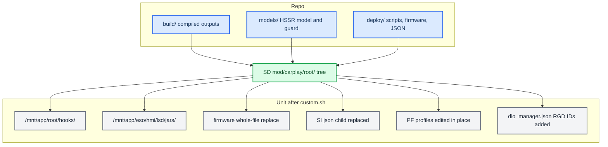

# Deploy and Release

*The build scripts only produce loose binaries. `scripts/prepare_install.sh` assembles them, with the models and `deploy/` files, into `mod/carplay/root/` for an M.I.B. card; `custom.sh` installs it. Never reboot the car without asking.*

---

## 📦 Builds emit binaries, not releases

Each build script writes its outputs into `build/`. `scripts/prepare_install.sh <hook build dir>` (e.g. `build/protected_<VIN>` or `build/unprotected`) rebuilds the jar and renderers (`SKIP_BUILD=1` reuses them), stages every file below at its on-unit path and writes `build/install_<name>/install_MoreIncredibleBash/` plus `build/install_<name>.zip`. A hook folder without `libcarplay_apac.so` (`HOOK_AUDIO=0`) also leaves out the HSSR models. The old `package_mib.py`, `package_protected.sh` and `deploy_over_ssh.sh` stay deleted. A release comes from three folders:

- `build/` holds the compiled outputs: `libcarplay_hook.so`, `libcarplay_apac.so`, `maneuver_render`, `altscreen_render` and `carplay_hook.jar`.
- `models/` holds the HSSR models, `hssr_model.bin` and `hssr_guard.bin`.
- `deploy/` holds the startup scripts, the patched firmware (`smartphone_integrator` and `deva-ctrl-qc.so`) and the SI child JSON.

`custom.sh` installs whatever it finds under `mod/carplay/root/`. It copies every file in that tree to the same path under `/` (`install_MoreIncredibleBash/mod/custom.sh:30-33`, `:164-182`). You put each file at its on-unit path yourself, using the map below.



## 🔗 The artifact map

The on-unit column is the path under `/`. On the card, that same file goes at `mod/carplay/root/<on-unit path>`.

| File | Source in the repo | On-unit path |
|---|---|---|
| `libcarplay_hook.so` | `build/unprotected/`, or `build/protected_<VIN>/` for a stamped build | `/mnt/app/root/hooks/` |
| `libcarplay_apac.so` | `build/unprotected/` or `build/protected_<VIN>/`; leave it out of a `HOOK_AUDIO=0` build | `/mnt/app/root/hooks/` |
| `maneuver_render` | `build/` (`build_renderers.sh`) | `/mnt/app/root/hooks/` |
| `altscreen_render` | `build/` (`build_renderers.sh`) | `/mnt/app/root/hooks/` |
| `carplay_hook.jar` | `build/` (`build_java.sh`) | `/mnt/app/eso/hmi/lsd/jars/` |
| `hssr_model.bin` | `models/hssr-q6d-moises-a/`, the main control model | `/mnt/app/root/hooks/` |
| `hssr_guard.bin` | `models/hssr-selection-v11/`, the V11 vocal guard, loaded from beside the main model (`hook/audio/audio_hook.c:1756`) | `/mnt/app/root/hooks/` |
| `flag_atlas.rgba` | `maneuver_render/resources/` | `/mnt/app/root/hooks/` (`maneuver_render/main.c:45`) |
| `carplay_{startup,monitor,processes,cleanup}.sh` | `deploy/smartphone_integrator/` | `/mnt/app/root/hooks/` |
| `smartphone_integrator` | `deploy/smartphone_integrator/` | `/mnt/app/eso/bin/apps/` (replaces the whole file) |
| `deva-ctrl-qc.so` | `deploy/deva-ctrl-qc/deva-ctrl-qc.so.patched`, renamed | `/mnt/app/armle/lib/dll/` (replaces the whole file) |
| `carplay_child.json` | `deploy/smartphone_integrator/` | Not installed as a file: it goes in `mod/carplay/` next to `root/`, and `custom.sh` splices it in as `children.carplay` |
| `dio_manager.json` | Not staged: `custom.sh` adds the route-guidance message IDs in place (see [Route-guidance message IDs](#-route-guidance-message-ids-in-dio_managerjson)) | `/mnt/system/etc/eso/production/` |
| `patch_si_rearm.py` | `deploy/experimental/usb_replug_recovery/` | Host-side only, to reproduce or reverse the SI re-arm patch; never staged |

Build the compiled outputs first (`build_hook.sh` or `build_hook_protected.sh`, then `build_renderers.sh` and `build_java.sh`); everything else is copied unchanged. `custom.sh` sets modes itself: `755` for `.so` files, the renderers, `eso/bin/apps/*` and `*.sh`, `644` for everything else (`custom.sh:39-47`). `.gitignore` keeps `mod/carplay/root/` and `mod/carplay/carplay_child.json` out of git.

### Firmware and model identities

`custom.sh` backs up each replaced firmware file once, as `*.carplay-stock`, before an atomic rename on the same partition (`custom.sh:49`, `:53`, `:174-178`). It does **not** check SHA-256 identities, so staging the correct images is your job. Check with `shasum -a 256`; the repo copies matched when this was last checked.

| File | SHA-256 | Note |
|---|---|---|
| `deploy/smartphone_integrator/smartphone_integrator` | `606236a81c7c4dafda6fdd08fe6eb27c43252796784da25d9760a7d552ee2af3` | SI re-arm image, read back from the HU on 2026-09-16 (not re-verified on the unit since) |
| `deploy/deva-ctrl-qc/deva-ctrl-qc.so.patched` | `398e7213be4e966719eed5ff9736fb9142f11e161033f01263f29db640e06355` | final mirror build; three-step chain in `deploy/deva-ctrl-qc/BUILD_CHAIN.md` |
| `deploy/deva-ctrl-qc/deva-ctrl-qc.so.stock` | `58dddcabaa94c2fecf989855a6f810ec219926f49669a0ed9482ed629fdc64b9` | stock input |
| `models/hssr-q6d-moises-a/hssr_model.bin` | `96abe57d9ee703f2e39c0231de97580c303ce896ce044b7450c14240002b0a0e` | q6d main model |
| `models/hssr-selection-v11/hssr_guard.bin` | `ab01463e9359f013c4b40f311d630bd20af48d761ad361563cb5246f6bd686ae` | V11 guard |

**PF firewall:** no patch file is installed. `custom.sh` edits the `carplay0` inbound TCP rule in place, widening ` 6030,` (or ` 6030:6031,` / ` 6030:6033,`) to ` 6030:6032,` in each of `pf.conf`, `pf.ecm0.conf`, `pf.mlan0.conf` and `pf.ppp0.conf` (`custom.sh:36`, `:90-112`). Because it does this in the shell, it needs no `patch`, `sed` or Python on the HU. `deploy/pf/patched/` is a reference result, regenerated by `deploy/pf/patch_pf.sh`. See [PF Firewall](../connect-and-usb/PF_FIREWALL.md) and [Landmines](../LANDMINES.md) for the trap where the PF profile is chosen per interface.

## 💾 The M.I.B. SD install

Copy the contents of `install_MoreIncredibleBash/` over the root of the M.I.B. SD card, then stage the release inside `mod/carplay/`:

```text
SD1/
  mod/custom.sh                           the installer
  mod/command.sh                          forwarder for older M.I.B. releases (via "Run individual script")
  mod/carplay/carplay_child.json          from deploy/smartphone_integrator/
  mod/carplay/root/mnt/app/root/hooks/     .so, renderers, models, atlas, carplay_*.sh
  mod/carplay/root/mnt/app/eso/hmi/lsd/jars/carplay_hook.jar
  mod/carplay/root/mnt/app/eso/bin/apps/smartphone_integrator
  mod/carplay/root/mnt/app/armle/lib/dll/deva-ctrl-qc.so
```

To install, run the M.I.B. custom-script entry with CarPlay disconnected. Its name depends on the M.I.B. build:

| M.I.B. build | GEM entry | Runs |
|---|---|---|
| Release zips, tags up to **V3.7.1** | **Advanced Settings → Run individual script** ("Place command.sh with script in /mod/ folder in M.I.B SD root") | `/mod/command.sh` via `esd/scripts/individual.sh` |
| `main` since `e531867` (2024-07-05, "More clear naming") | **Advanced Settings → Run Custom Script** ("Run /mod/custom.sh from m.i.b. SD") | `/mod/custom.sh` via `esd/scripts/custom.sh` |

Until 2026-09-24 the package shipped only `custom.sh`, so on a release-zip M.I.B. the entry printed "Nothing to do!" and nothing was installed. The package now also ships `mod/command.sh`, a three-line forwarder to `custom.sh` (a symlink is impossible: the SD card is FAT). The M.I.B. launcher also sources `/mod/command.sh` while it installs M.I.B. itself (`apps/launcher:114-117`); `$0` is then the launcher, so the forwarder does nothing. Both packages (install and uninstall) carry it.

The script is `mod/custom.sh`. If it is started on the RCC it hands itself to the MMX (`:25-28`). It then:

1. remounts `/mnt/app` and `/mnt/system` read-write;
2. copies each file under `root/` onto `/` through an atomic rename, skipping the macOS junk a Mac-written card carries (`._name` AppleDouble files and `.DS_Store`) and deleting any copy an older install put on the unit (a `._carplay_hook.jar` in `lsd/jars` would land on j9's bootclasspath);
3. patches `smartphone_integrator.json` by replacing the `"carplay"` child;
4. widens the PF profiles;
5. registers the route-guidance and telephony message IDs in `dio_manager.json`;
6. runs `sync` and prints `DONE (install). Reboot the HU to load.` (`:159-186`).

It stops no processes and does not reboot.

If `carplay_child.json` is missing from `mod/carplay/`, the JSON patch is skipped with a `WARN` (`:59`) and the hook never loads. If `mod/carplay/root/` is missing, the script exits with `no payload tree` (`:33`).

Watch the install output for `dio_manager.json route-guidance and telephony IDs registered` (or `already registered`). A `WARN dio_manager.json …` line means the file had an unexpected layout and was left as-is; then do the [manual step](#-route-guidance-message-ids-in-dio_managerjson) before the reboot, or route guidance (maneuvers, lanes, the cluster turn card) never arrives.

To check an install on the unit (the mod only becomes active after a reboot, and on a protected build only on the stamped VIN):

```bash
grep carplay_startup.sh /mnt/system/etc/eso/production/smartphone_integrator.json
grep -o '6030:6032' /mnt/system/etc/pf.conf /mnt/system/etc/pf.ecm0.conf
grep -c '"0x5204"' /mnt/system/etc/eso/production/dio_manager.json
grep -c '"0x4171"' /mnt/system/etc/eso/production/dio_manager.json
```

Both counts must be 1. The unit's `grep` has no working `-o`, so check a representative ID from each set. The full list is in the table below.

On a car with the LTE modem the live profile is `pf.ecm0.conf`, not `pf.conf`.

To uninstall, copy `uninstall_MoreIncredibleBash/` over the card instead. That script needs no payload tree or marker. It renames every `*.carplay-stock` it finds under `/mnt/app` and `/mnt/system` back to the original, which covers the firmware, the SI JSON, the PF profiles and `dio_manager.json`. It then deletes the files on its fixed owned list (`uninstall_MoreIncredibleBash/mod/custom.sh:23-54`). The list includes `hssr_guard.bin` (`:27`); the "[open] missing from the list" remark in `DEPLOYMENT.md` and `PROTECTOR.md` is superseded. `custom.sh uninstall` from the install folder (`install_MoreIncredibleBash/mod/custom.sh:188-209`) is a second path when the payload tree is present. Both READMEs that described the old generated uninstaller (`.orig` restore, `package_mib.py`) are gone or stale; the scripts are authoritative. **[code]**

### Collecting logs

Copy `logging_MoreIncredibleBash/` over the card and run it through the same M.I.B. entry. It deletes nothing on the unit or the card. **[code]**


- **Where:** `<card>/carplay_logs/NNN/`, where `NNN` is the highest existing number + 1, so a deleted older folder is never reused. The unit clock is often wrong, so `info.txt` records what it said and whether verbose was already on. A read-only card is remounted writable (`mount -uw`, trying `sda0`, `sdb0`, `usb0_0`).
- **What:**

| In the folder | Content |
|---|---|
| `tmp/` | `/tmp/*.log*`, `carplay_*`, `spatial_*`, `*.pid`; never the shared-memory objects that also live in `/tmp` |
| `config/` | `dio_manager.json`, `smartphone_integrator.json`, `pf.conf`, `pf.ecm0.conf` |
| `core/` | cores of `dio_manager`, both renderers and `smartphone_integrator` from `/mnt/ota/system/core` |
| `*.txt` | `sloginfo` of MMX and RCC, `pidin ar` / `info`, `mount`, `df`, `ifconfig`, `netstat -rn`, `pfctl -sr`, the hook and jar listing, every `*.carplay-stock`, the `/tmp` and core listings |

- **Verbose:** the run ends by creating `/tmp/carplay_verbose` ([what it switches on](BUILD_SYSTEM.md)). The hook reads it at the next phone connect and `altscreen_render` at its next report; the Java log only at j9 start, and `/tmp` is empty after a reboot. The marker is in RAM, so a reboot turns verbose off again.
- **Check:** `scripts/test_logging_mib.sh` runs it on a fake card under every shell found (ksh93, mksh from the pdksh line like QNX 6.5 `/bin/sh`, dash, sh).

## 🔧 Manual install (without M.I.B.)

The same install as `custom.sh`, by hand. You need a **root shell on the unit, over SSH or
Telnet**, whichever your unit has enabled. How you get one and the address to connect to depend on your
unit; this guide does not assume either.
Disconnect CarPlay first and back up anything you change. Put the release files somewhere on the
unit (an SD card or USB stick works) and `cd` there.

### 1. Make the partitions writable

```bash
mount -uw /mnt/app
mount -uw /mnt/system
mkdir -p /mnt/app/root/hooks
```

### 2. Copy the files

| File | Goes to | Mode |
|---|---|---|
| `libcarplay_hook.so`, `libcarplay_apac.so` | `/mnt/app/root/hooks/` | 755 |
| `maneuver_render`, `altscreen_render` | `/mnt/app/root/hooks/` | 755 |
| `carplay_startup.sh`, `carplay_monitor.sh`, `carplay_processes.sh`, `carplay_cleanup.sh` | `/mnt/app/root/hooks/` | 755 |
| `hssr_model.bin`, `hssr_guard.bin`, `flag_atlas.rgba` | `/mnt/app/root/hooks/` | 644 |
| `carplay_hook.jar` | `/mnt/app/eso/hmi/lsd/jars/` | 644 |

```bash
cp libcarplay_hook.so libcarplay_apac.so maneuver_render altscreen_render carplay_*.sh /mnt/app/root/hooks/
cp hssr_model.bin hssr_guard.bin flag_atlas.rgba /mnt/app/root/hooks/
chmod 755 /mnt/app/root/hooks/*.so /mnt/app/root/hooks/*_render /mnt/app/root/hooks/carplay_*.sh
cp carplay_hook.jar /mnt/app/eso/hmi/lsd/jars/
```

Leave `libcarplay_apac.so` out of a `HOOK_AUDIO=0` build.

**The two stock binaries go in through a temporary name and `mv`.** `smartphone_integrator` and
`deva-ctrl-qc.so` (the repo's `deva-ctrl-qc.so.patched`) replace files the system is running. Do
not `cp` straight over them: copy to `<name>.new` in the same folder, then `mv` it onto the real
name. A `mv` inside one partition is a rename, so the file switches in one step; the running
process keeps the old copy it already opened, and nothing ever sees a half-written file. Check both
images against their hashes first ([identities](#firmware-and-model-identities)).

```bash
cp smartphone_integrator /mnt/app/eso/bin/apps/smartphone_integrator.new
chmod 755 /mnt/app/eso/bin/apps/smartphone_integrator.new
mv /mnt/app/eso/bin/apps/smartphone_integrator.new /mnt/app/eso/bin/apps/smartphone_integrator

cp deva-ctrl-qc.so /mnt/app/armle/lib/dll/deva-ctrl-qc.so.new
chmod 755 /mnt/app/armle/lib/dll/deva-ctrl-qc.so.new
mv /mnt/app/armle/lib/dll/deva-ctrl-qc.so.new /mnt/app/armle/lib/dll/deva-ctrl-qc.so
```

### 3. Edit three config files

Edit each on the unit, or copy it off, edit it and copy it back.

**`/mnt/system/etc/eso/production/smartphone_integrator.json`**: replace the whole
`"carplay": { … }` block under `children` with the contents of `carplay_child.json` from the
release, and keep the comma after it. The stock block runs `dio_manager` directly; ours runs
`carplay_startup.sh`:

```json
"carplay": {
  "exec": "carplay_startup.sh",
  "path": "/mnt/app/root/hooks",
  "params": "",
  "envs": [
    "LD_LIBRARY_PATH=/mnt/app/root/lib-target:/eso/lib:/mnt/app/usr/lib:/mnt/app/armle/lib:/mnt/app/armle/lib/dll:/mnt/app/armle/usr/lib",
    "IPL_CONFIG_DIR_DIO_MANAGER=/etc/eso/production"
  ],
  "startupTimeout": 10000,
  "stopTimeout": 8000,
  "watchdogTimeout": 60000,
  "disableWatchdog": false,
  "maxSetupRetries": 2,
  "maxRuntimeRetries": 2,
  "decoderUse": false,
  "selfTermination": true,
  "cleanupScript": "/mnt/app/root/hooks/carplay_cleanup.sh",
  "retriesBeforeDowntime": 3,
  "downtime": 30000,
  "restartDelay": 3000,
  "portResetTime": 250
},
```

**`/mnt/system/etc/pf.conf`, `pf.ecm0.conf`, `pf.mlan0.conf`, `pf.ppp0.conf`** (all four; an LTE
car uses `pf.ecm0.conf`): in the `carplay0` line change ` 6030,` to ` 6030:6032,`:

```text
before: pass in quick on carplay0 proto tcp from any to any port { 5000:5001, 5010, 6000:6001, 6030, 6100, 6200, 7000:7001, 7100 } allow-opts
after:  pass in quick on carplay0 proto tcp from any to any port { 5000:5001, 5010, 6000:6001, 6030:6032, 6100, 6200, 7000:7001, 7100 } allow-opts
```

**`/mnt/system/etc/eso/production/dio_manager.json`**: add the route-guidance IDs (`0x5200`,
`0x5203` sent; `0x5201`, `0x5202`, `0x5204` received) and the telephony IDs (`0x415B`, `0x415C`, `0x415D`, `0x415F`,
`0x4160`, `0x4170` sent; `0x4171` received) at the end of the two lists. Without the route-guidance IDs iOS
sends route guidance and the SDK drops it; without the telephony IDs the cluster phone tab has no
recents/favorites, accept, hang-up, swap, hold or mute ([CarPlay Telephony](../cluster-and-rgi/CARPLAY_TELEPHONY.md)).

```json
before:
"MessagesSentByAccessory":["0x5000", "0x5002", "0xAE00", "0xAE02", "0xAE03", "0x4154", "0x4156", "0x4157", "0x4159", "0xFFFB", "0x4C00", "0x4C02", "0x4C03", "0x4C05"],
"MessagesReceivedFromDevice":["0x4E09", "0x4E0A", "0x4E0C", "0x5001", "0xAE01", "0x4155", "0x4158", "0xFFFA", "0xFFFC", "0x4C01", "0x4C04"],

after:
"MessagesSentByAccessory":["0x5000", "0x5002", "0xAE00", "0xAE02", "0xAE03", "0x4154", "0x4156", "0x4157", "0x4159", "0xFFFB", "0x4C00", "0x4C02", "0x4C03", "0x4C05", "0x5200", "0x5203", "0x415B", "0x415C", "0x415D", "0x415F", "0x4160", "0x4170"],
"MessagesReceivedFromDevice":["0x4E09", "0x4E0A", "0x4E0C", "0x5001", "0xAE01", "0x4155", "0x4158", "0xFFFA", "0xFFFC", "0x4C01", "0x4C04", "0x5201", "0x5202", "0x5204", "0x4171"],
```

The file has `##` comment lines, so edit it as text, not with a JSON tool.

### 4. Flush and reboot

```bash
sync
```

Wait a few seconds after `sync`, then reboot. A forced reboot (the MMI button combo) right after
copying can leave files truncated or missing. After the reboot, start a route in Apple Maps: the
cluster map, the turn arrow and the HUD arrow must appear. Logs: `/tmp/carplay_hook.log` and
`/tmp/carplay_java.log`.

## 🧭 Route-guidance message IDs in dio_manager.json

Route guidance needs **two** things, and the installer provides only one:

1. **The hook's Identify patch** (automatic). `rgd_identify_patcher` adds or replaces the route-guidance component `0x001E` in the outgoing iAP2 Identify, so iOS offers route guidance at all (`hook/routeguidance/rgd_hook.c:1547-1611`). It does not touch any message-ID list.
2. **The message-ID registration** (done by `custom.sh`, or by hand as below). The Cinemo iAP2 SDK inside `dio_manager` only passes messages listed in `/mnt/system/etc/eso/production/dio_manager.json`. Without the IDs, iOS sends route guidance and the SDK drops it; iOS also never sends lane guidance (`0x5204`) unless it is in the received list. **[car]** (early development; recorded in the original deployment guide)

Stock MU1316 P5087 lists none of them (checked against the firmware copy of `dio_manager.json`, lines 164 and 177). Add:

| List | IDs to add | Messages |
|---|---|---|
| `MessagesSentByAccessory` | `0x5200`, `0x5203` | StartRouteGuidanceUpdates, StopRouteGuidanceUpdates |
| `MessagesReceivedFromDevice` | `0x5201`, `0x5202`, `0x5204` | RouteGuidanceUpdate, RouteGuidanceManeuverUpdate, LaneGuidanceInformation |
| `MessagesSentByAccessory` | `0x415B`, `0x415C`, `0x415D`, `0x415F`, `0x4160`, `0x4170` | AcceptCall, EndCall, SwapCalls, HoldStatusUpdate, MuteStatusUpdate, StartListUpdates ([CarPlay Telephony](../cluster-and-rgi/CARPLAY_TELEPHONY.md)) |
| `MessagesReceivedFromDevice` | `0x4171` | ListUpdate (recents and favorites) |

Without the telephony IDs the call screen still works (it comes from stock `DSICarplay`); only the cluster's recents/favorites lists, hold/resume and mic mute are missing. If iOS rejects the telephony IDs in Identify, Cinemo removes them from its identification pool by itself and continues (`OnIdentificationRejected`, `libNmeVfs.so@0xE438C`). **[decompile]**

The file is not strict JSON: it carries `##` comment lines above each list, so edit the two list lines as text and do not run it through a JSON tool.

**Installer.** `patch_dio()` in `custom.sh` (`install_MoreIncredibleBash/mod/custom.sh:114-157`) does this in plain ksh, like the PF edit. It reads the file line by line, appends each missing ID before the list's closing `]`, and leaves `##` lines alone. It refuses to write unless it found exactly one of each list and every ID in `DIO_SENT_IDS` / `DIO_RECV_IDS` is present afterwards. It backs up the stock file once as `dio_manager.json.carplay-stock` (so both uninstall paths restore it), then swaps the file in with an atomic rename. Re-running it is a no-op. `scripts/test_install_dio.sh` checks all of that under ksh, dash and sh. **[code]**

**By hand (manual installs).** If you install without the M.I.B. script, or the installer printed a `WARN`, do the same over SSH after the files are in place and **before** the reboot (`dio_manager` reads the file only at start). On the host, in a `#!/bin/bash` script, with `HU` set to your unit's SSH target:

```bash
F=/mnt/system/etc/eso/production/dio_manager.json

# 1. Make /mnt/system writable and keep a stock backup once.
#    The uninstaller renames every *.carplay-stock back, so this also covers removal.
ssh -n "$HU" "mount -uw /mnt/system; [ -e $F.carplay-stock ] || cp -p $F $F.carplay-stock"

# 2. Pull the file and add the IDs on the host. Re-running is a no-op.
ssh -n "$HU" "cat $F" > dio_manager.json
python3 - dio_manager.json <<'PY'
import re, sys
path = sys.argv[1]
text = open(path).read()
add = {"MessagesSentByAccessory": ["0x5200", "0x5203", "0x415B", "0x415C", "0x415D", "0x415F", "0x4160", "0x4170"],
       "MessagesReceivedFromDevice": ["0x5201", "0x5202", "0x5204", "0x4171"]}
for key, ids in add.items():
    m = re.search(r'"%s"\s*:\s*\[([^\]]*)\]' % key, text)
    have = [h.upper() for h in re.findall(r'"(0x[0-9A-Fa-f]+)"', m.group(1))]
    new = [i for i in ids if i.upper() not in have]
    if new:
        text = text[:m.end(1)] + "".join(', "%s"' % i for i in new) + text[m.end(1):]
open(path, "w").write(text)
PY

# 3. Push it back atomically (the unit has no scp), then flush to flash.
ssh "$HU" "cat > $F.new" < dio_manager.json
ssh -n "$HU" "chmod 644 $F.new && mv $F.new $F && sync"

# 4. Verify on the host copy: every ID must be listed.
grep -oE '"0x(520[0-4]|415[BCDF]|4160|417[01])"' dio_manager.json | sort -u
```

Then disconnect CarPlay and have the owner reboot the HU (never reboot it unasked, see below). After the reboot, start a route in Apple Maps: the cluster must show the turn card and the HUD arrow. If nothing appears, check the file again with the grep above: when the IDs are missing the SDK drops the messages before the hook sees them, so the hook logs nothing about them. (The hook's WARN `Unknown 0x52xx msgid=…`, `hook/framework/hook_framework.c:360-368`, covers only IDs that do arrive but that the hook does not handle.)

To undo only this step: `ssh -n "$HU" "mount -uw /mnt/system; mv $F.carplay-stock $F; sync"`, then reboot.

The runtime side of the install (which process owns what, the generation monitor, why renderers are never `servicemgr` services) is in [Architecture](../reference/ARCHITECTURE.md).

## 🌐 SSH deploy and its traps

No SSH deploy script remains in `scripts/`. A push over SSH is done by hand; the development unit answers at `root@10.173.189.1` (or other `10.173.189.x` addresses), which is that unit's own setup, not a stock address. The unit has a bare QNX environment, and a naive copy fails in four ways:

| Trap | Fix |
|---|---|
| The unit has no remote `scp` binary | Push with `ssh host 'cat > /path/file.new' < local`, then `chmod`, `mv` and `sync`. |
| sshd rate-limits repeated password logins | Open one multiplexed master (`ControlMaster=auto`, with a `ControlPath` under 104 bytes) and reuse it. The first call goes through `sshpass`; the rest are plain `ssh`. |
| `ssh` inside `while read` eats the loop's stdin | Always use `ssh -n` (or `< /dev/null`) in loops. |
| zsh does not word-split unquoted `$OPTS` | Put deploy snippets in a `#!/bin/bash` script, not inline. |

The login banner prints on STDOUT even for `ssh host cmd`, so a binary read-back has to print a marker first (`echo __BEGIN__; cat f`) and strip everything up to it. The unit has no `scp`, `tar`, `cksum`, `sha256sum` or `base64`, so the only end-to-end check is to read the file back and `cmp` it locally. `/mnt/app` stays read-only until `mount -uw /mnt/app`. `/tmp` maps to `/dev/shmem`, which cannot hold directories. Source: `memory/audi_ssh_transport_traps.md`.

## ⚠️ Never reboot the unit unasked

This is a hard rule, not a preference: the user is usually sitting in the car.

- **Deploying files is fine; restarting is not.** Copy the artifacts, report what is staged, and say plainly that it needs a restart to take effect. Then **stop and wait**. Approval to deploy is not approval to reboot, and approval once is not approval the next time. See `memory/feedback_never_reboot_unit.md`.
- **The C hook** (`libcarplay_hook.so`) is loaded per fork. `carplay_startup.sh` adds `LD_PRELOAD` only to its own `dio_manager` (`deploy/smartphone_integrator/carplay_startup.sh:50`), so a new `dio_manager` generation picks up a redeployed `.so`.
- **The jar is different.** `carplay_hook.jar` is on j9's `-Xbootclasspath`, so it does nothing until the JVM restarts. Killing j9 counts as a critical-process death and **restarts the whole system** (about 50 s): SSH drops and the screen goes black mid-drive. Always warn before killing j9. See `memory/java_jar_deploy_reboots_unit.md` and [Landmines](../LANDMINES.md).

The install is atomic per file (a rename on the same partition), not a transaction across both flash partitions. A manual reboot activates the release.

Provenance: `install_MoreIncredibleBash/mod/custom.sh`, `uninstall_MoreIncredibleBash/mod/custom.sh`, `deploy/smartphone_integrator/README.md`, `deploy/pf/README.md`.

History: the pre-TCP releases installed the hook by adding `LD_PRELOAD` directly to the SI JSON and the jar by prepending it to `CLASSPATH` in `navigation.json`, plus a patched `komoviewstyle.conf`; see [Archive and History](../reference/ARCHIVE_AND_HISTORY.md).

**Related:** [Upmix Listening and Deploy Log](../audio/UPMIX_LISTENING_AND_DEPLOY_LOG.md) — the upmix deploy chronology and its SSH notes.


---

## 📚 Sources

Merged originals were removed from the tree after this note absorbed them; they remain in git history (commit 23972aa).

- `RELEASE_ARTIFACTS`: the source → on-unit map, SD layout and firmware/model hashes.
- `DEPLOYMENT`: install/uninstall steps and process ownership.
- `PROTECTOR`: the protected-release variant and post-install checks.
- `oldREADME`: the pre-TCP device paths.
