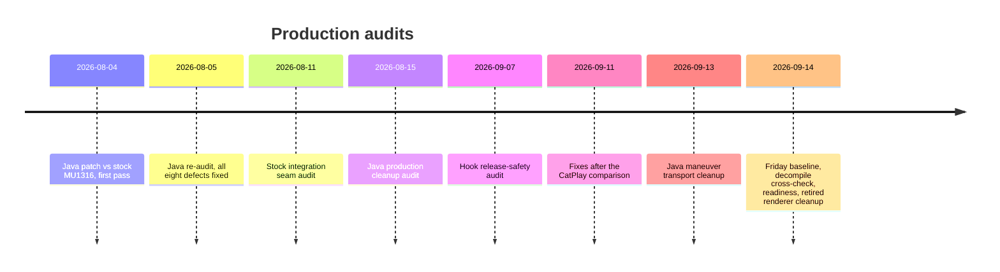

# Production Audits

*Every release-safety and production-readiness review of the hook, the Java patch and the renderers (August to September 2026): what each found, what was fixed, what today's code says, and which checks still need the car.*

---

## 📋 How to use this note

Each audit below is a dated snapshot. Its line numbers point at the tree it reviewed, not today's tree, so every finding carries a **status against current code** checked for this note. Truth tags: **[code]** checked in today's repo, **[car]** seen on the unit, **[decompile]** read from stock binaries, **[open]** still unverified. The stock-seam audit (2026-08-11) lives in [Architecture](../reference/ARCHITECTURE.md) because it describes the design, not a defect list.

*Audit timeline, August to September 2026.*



| Date | Audit | Verdict then | Status now |
|---|---|---|---|
| 08-04 / 08-05 | Java patch vs stock MU1316 | Not a stable stock replacement until P0s fixed; re-audit: 8 runtime defects fixed | Superseded by later audits; its counts are stale |
| 08-11 | Stock integration seams | Design sound; 3 hardening items | See [Architecture](../reference/ARCHITECTURE.md) |
| 08-15 | Java production cleanup | No disposable subsystem; 4 cleanup groups | All groups done |
| 09-07 | Hook release safety | 8 invariants closed | Holds; export counts changed |
| 09-11 | CatPlay comparison fixes | 6 bugs + follow-ups fixed | Holds |
| 09-13 | Java maneuver transport | Dead paths removed, packets identical | Holds |
| 09-14 | Friday baseline | No runtime defect; `libm` dropped | Loader since moved to PRISM |
| 09-14 | Decompile cross-check | Reflection ladders removed | Holds |
| 09-14 | Production readiness | Not ready: 3 findings | All 3 fixed in code |
| 09-14 | Retired renderer cleanup | HU cursor stack removed | Holds |

## 🔍 Java patch vs stock MU1316 (2026-08-04, re-audit 08-05)

Authority was the decompiled stock `MU1316-combined-vf` and `MU1316-combined-final.jar`. The first pass reviewed 30 files / 10,916 lines (8 full stock replacements + 22 new classes) and compared every replacement with `javap -protected -s`. The re-audit tree had 28 files / 11,081 lines, 80 class files, major version 48, no missing stock public/protected member. **Today's tree is 41 sources** ([Architecture](../reference/ARCHITECTURE.md)); treat those counts as history. **[code]**

### What the first pass found (why the code looks the way it does)

| Pri | Defect | Lesson kept in today's code |
|---|---|---|
| P0 | Cold boot with active route never called `setNavActive(true)`: the only sticky RGI snapshot arrived before `maneuver_render`, and a later `FRAME_READY` did not re-drive the state machine | A generation-bound presentation worker replays the cached RGI on renderer READY/FRAME_READY; `ctx 81 → 80` only after BAP update **and** a real `FRAME_READY` |
| P0 | Planes 98/101/102 kept opacity 0 on nav inactive → active; `ClusterLayerController.apply()` ran only on KDK model updates and swallowed errors | The last KDK layout is cached and replayed after every physical context switch |
| P0 | `ClusterProbe` was live control code: `on()` returned true, a one-shot called `setFavoredViewMode(3,false)` after 20 s, and every context switch built a stack trace | Class and call sites deleted; stock `ClusterViewMode` restored |
| P0 | `connected/videoAvailable/navActive` read without a memory barrier across threads | Flags are `volatile`, writes under one lock |
| P0 | Unbounded DEBUG logging with autoflush to `/tmp` | See the logging contract below |
| P1 | A replacement `AppState` forced id/owner to 0 globally, breaking PHONE (1) and SPEECH (3) as well as NAVI (2), and the outgoing serializer | Stock `AppState` restored; only incoming NAVI id 2 is neutralised in the converter |
| P1 | `videoAvailable` could hold the CarPlay context after disconnect; the ctl server served one client with a blocking `read()` | Preemptable, generation-bound control clients; 1500 ms grace then authoritative clear |
| P1 | `CarplayBus.off()` could not cancel an already-copied callback | Frame processing and teardown serialized; worker generation invalidated and joined |
| P1 | Cover art not tied to lifecycle or projection source | Paired start/stop, CarPlay-source flag, session reset of CRC/metadata |
| P1 | Java parser silently truncated at 512 keys while a full RGI snapshot can exceed it (16 maneuvers, 32 lane slots) | Capacity 1024 plus an explicit overflow warning (`CarplayBus.java:253-260`, `:334`) **[code]** |
| P1 | OSGi `ServiceReference` leaked every session | `FrameworkRef.ServiceHandle` releases in `RgdModule.stop()` |
| P1 | Retry thread survived fast reconnect (swallowed `InterruptedException`) | Retry generation + identity check |
| P1 | Renderer death callback written but never wired; ownership checked too late | Wired after fixing the ownership order |
| P1 | Failed BAP start never retried | Explicit activation-pending retry |
| P1 | NavStatus gate did not restore native values on release | Wrapper caches compass/altitude/scale/text/destination and replays on release |
| P1 | Renderer waits (2500 ms / 1200 ms) ran on the single bus reader thread | Non-blocking handshake; edge/retry worker instead |
| P1 | Stock native navigation is cancelled for the whole CarPlay session (`RouteManager.stopRouteGuidance()` at connect) | Kept on purpose: the REPLACE product contract |
| P2 | Distance/bargraph semantics changed for all nav sources, not only CarPlay | Kept; stock hides the distance while the bargraph shows, the patch shows both |
| P2 | Contexts 80/81 only exist off G24, yet `AltScreenModule` still picked them | Feature disabled when `kombiType == 4` |
| P2 | Touch sink not re-installed after component deinit/init | `init()` re-installs it |
| P2 | Worker could switch to stale context 74 before publishing connected state | State published before the worker starts |

### Re-audit fixes (2026-08-05)

- RGI start retry: 200 ms for the first 10 s, then every 2 s until the CarPlay generation ends; a late Navigation service edge triggers a controlled RGD rebind.
- The NavStatus/RG wrapper is installed synchronously on `NavigationJobs` in `ClusterService.setCombiBAPService()`, **before** stock `setCombiService() → updateAll()` can publish stale state; later changes go through `Navigation.getDispatcher()`.
- `CoverArtProviderMux` keeps the already-registered stock Media provider (type 0) and routes only source 21 / CarPlay listRef to the CarPlay cache.
- Failed renderer IPC binds closed their `ServerSocket` (they leaked one FD every 500 ms); the bind log is limited to one line per 10 s.
- `source_supports_rg=0` always clears counts, order, maneuver and lane caches.
- Shutdown decides whether a stock route exists **before** renderer teardown, so a live native route keeps its route-info.
- A partial `BAPBridge.onStart()` rolls back RGStatus, type, descriptor, distance, exit, renderer, gfx and counters.
- `CarplayDSILifecycleController.updateTouchEvents()` partitions each mixed batch by `isTouchScreen()` instead of trusting element 0.
- `ClusterLayerController.apply()` is called only for the cluster terminal with sysconst `KOMBI_KDK_VIA_DISPLAYABLES`.

Remaining validation gap then and now: `ManeuverMapper`, `RendererMapper` and `SideStreets` have no stock Java counterpart, so MHI3 parity rests on regression vectors (now in `scripts/test_route_info.sh`, see the toolbox below). The on-unit matrix it demanded: cold boot with route active → exactly one `81 → 80`; kill `maneuver_render` → immediate 81, back to 80 on new READY; fast replug and dio bounce; full disconnect restores ctx 74, KDK backings and NavStatus; Android Auto → CarPlay without stale art or CRC. **[open]** as a formal matrix; the owner reported connect, reconnect and mode transitions closed on the car on 2026-09-17. **[car]**

Sources: `JAVA_PATCH_STOCK_AUDIT`

## 🔧 Java production cleanup and decompile cross-check

**2026-08-15 cleanup audit.** Verdict: no whole Java subsystem was disposable. Every stock replacement must stay: deleting one silently restores the stock class and removes the hook, and "unused" methods in them may be called by stock code. Four cleanup groups were found; all are done in today's code:

1. **Route-info phase** first looked dead (no caller of `onInfoModeToggle()`). Closed differently: `SteeringWheelInputModule` binds the raw MFW left-roller press (`DSIKeyPanel.ATTR_KEY2`, `board=4 code=40`) to `InfoModeListener` only while the VC's confirmed main context is `MAIN_CONTEXT_NAVIGATION_MAP` (20). The phase code is live; do not remove it. Keep `lastEtaSeconds`, `lastTimeRemaining*`, `currentRemainingSeconds()`, `currentArrivalSeconds()`: they publish the real FctID 22 absolute ETA.
2. **Fake `ClusterService` pipeline API** (`activate/deactivateCustomRendererPipeline()`, a constant string and an empty method) removed with its unreachable caller; real readiness is `RendererServer.isReady()/isFrameReady()`. `refreshInitializingScreenAfterCarPlay()` came back on 2026-09-16 with a real caller, because stock NAVSD `INITIALIZING` masks the independent altScreen plane. The other live accessors: `getDSIResponseContainer()`, `triggerRefreshRGIValid()`, and the CombiBAP getter/setter used by `AltScreenNavStatusGate`.
3. **KOMO reflection ladder** (three strategies in `BAPBridge.forceGfxAvailable()`) removed. `KOMOService` has no `dataRate` field; it belongs to `ClusterViewMode`. Today's code calls stock `KOMOService.updateDataRate(rate, 1)` **before** `updateGfxState(state, 1)`, because enabling gfx replays the cached rate (`java_patch/com/luka/carplay/rgd/BAPBridge.java:2263-2281`), with the public `ClusterViewMode` setters as fallback. `ClusterService.setKOMODataRate()` is a no-op unless `Util.isClusterMapMOST()`, and calling it reflectively does not bypass that guard. **[code]**
4. **Disabled diagnostics** removed: `traceBap`/`traceDescriptor` (a compile-time-false flag still built every argument string) and the standalone `Log.d` sites.

Size then: 29 sources / 12,617 lines, 97 classes, all six replaced outer classes ABI-complete; expected reduction 250–350 lines, mostly in `BAPBridge`. Also flagged dead then: `FrameworkRef.context()/deviceManager()/hmiServiceApp()`, `CarplayBus.isConnected()/Data.bool()`, `RendererServer.isConnected()`. Status 2026-09-22: `FrameworkRef.context()/deviceManager()/hmiServiceApp()` and `CarplayBus.Data.bool()` still have no callers (`FrameworkRef.java:36-40`); `CarplayBus.isConnected()` is used only by `tests/CarplayBusTransportTest.java:86`; `RendererServer.isConnected()` is live again (`BAPBridge.java:2104`); `CarplayBus.stop()` has no caller (the transport is process-lifetime) but was kept as a harmless bounded shutdown. Dead members removed at the same time: `CarPlayApp.fw()`, `CarplayBus.Data.strList()`, `BAPBridge.isActionBlinkThreadRunning()`, `EXITVIEW_ROW/ASIA`, `AltScreenModule.isClusterActive()`, `RouteGuidance.ROUTE_STATE_ACCEPT_ALL_MANEUVER_IDX`. Kept on purpose: `CarplayBus` (:19810) and `RendererServer` (:19800) serve different peers; `AltscreenControlServer` (:19832); style detection in `AltScreenModule` (the loader needs classic/sport); `RgdModule`, `FrameworkRef.ServiceHandle`, `Module`; `AltScreenCombiBAPListener`, `TouchpadController`, the mappers and lane fallback; the cover-art chain; and the diagnostic raw skin byte on the :19832 layout packet (not worth a protocol change).

The **only reflection left** is `CoverArtProviderMux` → `AbstractPictureManager.pictureProviders`: there is no public getter, and without it CarPlay would evict the Media cover-art provider. It is the only file importing `java.lang.reflect` under `java_patch/`. **[code]**

**2026-09-14 decompile cross-check.** Ran on the experimental HU-cursor tree (43 sources, 9 replacements, 152 classes); that experiment was later removed, but its fixes merged to master (`7fce1c4`, merged by `7b6cc45`). It moved the Java build to fresh stock references:

| Input under `Tools/jxe2jar/` | SHA-256 |
|---|---|
| `out/MU1316-final.jar` (decompile + compile input, never copied into the shipped jar) | `7ad6744c75985b7757be00a1a701b4efafbcef796b481bf34c535b9d351688f0` |
| `out/MU1316-combined.jar` (pre-AccessInline, used for back-reference checks) | `bbfd4f4adca0f88852e4aa090f2b1da7c692c1b47e9279a0a8625572b5bd05dd` |
| `libs/jcl/MHI2Q_US_AUG22_P5087_MU1316/jcl.jar` (real J9 API surface) | `33514c851b1be807acddf6bedf370e60e7f91e3ebf180acfcc38d21ce9a3abea` |

Why two jars: AccessInline unrolls `access$…` and may deliberately break Java visibility for a readable decompile, so references from the remaining stock into the patch are checked against `combined.jar`. The fresh VF output leaves `class$… == null ? … : …` constructs without always keeping `class$(String)`; `tests/java_reference.py` rewrites them to `Type.class` for comparison, without editing the decompile. Distance formatting now uses the recovered public nested type `BAPDistanceFormatter.BAPDistance` (`getValue()`/`getUnit()`) instead of reflection. `scripts/audit_java_stock.sh` rebuilds the jar and checks references both ways (patch → final/J9: 11,159 refs, 0 errors; remaining stock → patch: 340 refs, 0 errors) against real J9 classes, never the JDK 8 `rt.jar`. A reference check is not a JVM verifier: it does not prove branch behaviour, thread order or dynamic loading. Other checks of that pass: remaining combined → patch 330 refs, 0 errors; 35,095 stock classes scanned per pass; the replaced `TMDeviceControl` family (30 classes) was proven byte-equivalent after normalisation except the one changed method, with its 16 one-argument state constructors and 221 methods checked and an ASM `BasicVerifier` run (ASM is test-only); `KomoGraphicsStateTest` executes the real MU1316 `KOMOService`/`ClusterViewMode` code for cache, pacing, repeat, reconnect and the no-KOMO fallback; `check_local_protocols.py` 41 constants and 152 classes at 48.0. Rule kept from it: the decompiler artifacts `"isNativeLittleEndian"` / `"isNativeLittleEdian"` mean `""` when porting stock code ([Landmines](../LANDMINES.md)).

Sources: `JAVA_PRODUCTION_CLEANUP_AUDIT`, `JAVA_DECOMPILE_CROSSCHECK_2026_09_14`

## 🔐 Hook release safety (2026-09-07)

Code invariants recorded after the buffered AAC/APAC and HSSR work (not an on-car report):

1. **Cover-art input bounded before stb allocates**: checked EXIF/TIFF offsets; images over 4096 px on either axis or 8 Mpx total are rejected (`hook/coverart/coverart_hook.c:22`). Deterministic malformed corpus + 50,000 ASan/UBSan fuzz cases.
2. **Buffered PCM crosses QSA transactionally**: `peek` reserves one whole period without moving the ring head; `commit` advances only by the frames QSA accepted; zero/error keeps the period, a short write keeps the exact tail; flush/stop waits for an outstanding reservation.
3. **AltScreen sends use flags 0** because this io-pkt returns `ENOSYS` for `MSG_NOSIGNAL`; renderer-link timeouts use `CLOCK_MONOTONIC`.
4. **SETUP never waits to reap an old receiver.** A new SETUP retires the old generations (stop + listener close), takes a different slot out of `ALT_MAX_SESSIONS 4` (`hook/altscreen/altscreen_hook.c:1046`), and publishes the global AV generation only after the response is complete; command lookup is `(session pointer, AV generation)`; if all four slots are retiring, SETUP fails at once. This retired the seam audit's 1.8 s `ALT_REAP_WAIT_MS` (gone from the code). **[code]**
5. **Reversible bus signal policy**: `sigaction` saves dio's SIGPIPE and fatal-signal dispositions, fatal diagnostics are async-signal-safe and re-raise into the predecessor, clean shutdown restores everything ([Hook to Java Bus](../reference/HOOK_TO_JAVA_BUS.md)).
6. **Hidden visibility + version script**: the former 208-symbol surface (module defs, helpers, stb) is no longer preemptible. The audit counted 24 quiet / 26 trace exports; **today's allowlist has 28 entries, so a quiet audio build exports 26, a trace build 28, and a `HOOK_AUDIO=0` quiet build 9** (`hook/carplay_hook.exports.map`, [Build System](BUILD_SYSTEM.md)). **[code]**
7. **QSA flush/prepare pairing**: a successful timeline flush must be followed by a successful prepare; a persistent prepare-needed flag survives handle reclaim and is cleared only by a successful real prepare.
8. **Cinemo AAC callbacks cannot silently truncate** past the 4096-frame FIFO or the caller's capacity; overflow returns `SPA_APAC_ERR_OUTPUT_SPACE`, emits nothing partial and flushes to a recovery boundary.

Sources: `HOOK_RELEASE_SAFETY_AUDIT`

## 🔍 Fixes after the CatPlay comparison (2026-09-11)

Base `mhi2-carplay 6fe1aa0` vs a local CatPlay `13d174e`, used only as a second source for formats and semantics; its commented-out stream types 103/111 prove nothing about APAC or Audi altScreen. Six bugs from the first report:

| Bug | Fix |
|---|---|
| Full TEARDOWN with missing/empty `streams` kept our streams alive | `airplay_seams.c` normalises such requests to NULL for every module; stock still gets the original dict |
| A failed config send let a new decoder open on a P-frame | The forwarder requires cached config **and** an IDR on every new connection |
| Different files mixed inside one iAP2 session | Passive assembler tracks file id, session id, Setup, first/last data, Cancel and size; sends no ACK |
| EXIF thumbnail cut the outer JPEG | End of image = last packet of the file, not the first `FF D9` |
| A complete last packet waited for the next Recv | A full current packet with valid length and checksums suffices |
| Several images in one read lost the newest | Returns the newest complete image and keeps a partial next one |

Follow-ups: duplicate packets no longer duplicate bytes (both checksums, ordering, sequence wrap at 255); an older transfer finishing late cannot replace a newer cover; Identify reset drops pending art and bumps the publish generation, re-checked just before the PNG write; PNG writes handle EINTR and short writes before the atomic rename; the non-blocking video socket waits for `POLLOUT` after `EAGAIN` with a bounded total send time; a corrupt NAL length rejects the whole access unit; incomplete or oversized avcC publishes no partial SPS/PPS (cache 4096 bytes, was 512); AES-CTR Init/Update failures end reception and IDR re-request intervals use monotonic time; the forwarding toggle is mutex-protected. On the bus: a failed malloc while replacing a sticky entry keeps the previous entry (previously `has_last` could stay set with a NULL payload and crash replay in `memcpy`); a failed sync send stops replay at the first error; the socket is checked by fd **and** generation before every write, and only the connector closes the fd after the reader finishes, so a reused fd number cannot reach a new connection.

Cover-art assembler limits: up to 800,000 bytes per file, at most four images buffered, a 1 MiB reorder queue, a 65,535-byte raw buffer; on exhaustion unfinished transfers are dropped rather than spliced across a gap. With a type in Setup only artwork type 2 is accepted. The car (2026-09-12) showed an **8-byte size-only Setup**, which is now accepted (9 bytes is still an error); without a typed Setup, a JPEG/PNG signature must sit at the very start of the transfer, even if split across packets. SYN-negotiated session ids survive Identify. Built `LOG=0` quiet: `libcarplay_hook.so` `4757563ed0c3696b5647fd8638c1b4190d16ff3fd5c6548b7ae989393c21f283`, `libcarplay_apac.so` `a6a7bc8c3f17dfe170765b04a461259a407269de47dde6fe0a2b3f6b2695044f`. Verified with `scripts/run_tests.sh`, ASan/UBSan on the audio interposers and four new tests, and the Clang Static Analyzer on `coverart_stream.c`, `altscreen_av.c` and `bus.c` (clean); the cover fixture in `tests/fixtures/coverart/` is synthetic. The follow-up comparison with Showcase/AirPlay2 (more OMX fixes) and the on-HU regressions report are separate sources in `sources/reference/`. Host tests do not cover QNX OMX, physical USB or the cluster display.

Sources: `CATPLAY_REVIEW_FIXES`

## 🔍 Renderer, transport and baseline cleanups (2026-09-13 and 09-14)

**Java maneuver transport (09-13).** The flow is `RouteGuidance.State → ManeuverMapper → RendererMapper.map → RendererServer → native engine`: the shared mapper picks family and fallback direction, the adapter converts to wire units while keeping continuous angles and full circles, and only the native engine owns geometry, camera, progress and shadows. Lane events use their own transport. Removed: the side-road round trip through BAP direction bins, `mapIcon/mapDirection/mapExitAngle` and their duplicate legacy path, three unused `sendBapManeuver` overloads, the test-only `sendBargraph`, a redundant loop bound after the 18-road limit, and stale comments (displayable 20, renderer blink timer). Do **not** restore the older independent CarPlay type table: it mapped on-ramps to MERGE and off-ramps to EXIT and produced the S-shaped arrows the owner replaced with slight turns. Kept: ±1000 validity handling and real vs missing −1°; typed direction wins over a contradicting raw angle; full roundabouts, snap-to-road, real sharp angles; the forward side road on off-ramps. History: before `b71ecb9` BAPBridge called `mapIcon`, `mapDirection` and `mapExitAngle` separately and sent degree-valued commands; `b71ecb9` made the resolved HUD maneuver the semantic fallback, and `3f87f64` restored the forward road for off-ramps. Proof: `ManeuverChainAudit` produced **7,890 identical HUD packets and 7,890 identical 48-byte renderer packets** before and after. See [HUD Renderer](../cluster-and-rgi/HUD_RENDERER.md).

**Friday baseline (09-14).** Baseline `59646e98` (2026-09-11) vs HEAD `f5b43db` plus the working tree. Findings: the altScreen build still linked `-lm` with no math symbol used, leaving a `libm.so.2` `DT_NEEDED`; removed then, though the later PRISM loader uses libm again ([Cluster Loader](../altscreen-and-video/CLUSTER_LOADER.md)). `output/` had grown by 402 tracked files / 20.47 MiB of review evidence (`output/r2` 5.90 MiB, `output/arrow-progress` 5.75 MiB, `output/maneuver-preview` 3.40 MiB) that no build consumes. The audit also stressed that a cleanup commit must include untracked runtime inputs, or a tracked-only diff hides replacements. Intentional changes since Friday kept: arrow progress replacing the separate bargraph, the independent lane panel, route generations with retained dirty state and source timestamps, explicit next-street text, stock distance/KOMO APIs instead of reflection, state-only avcC notices, queue-age timestamps, a 1000 ms bounded input wait above the 750 ms loader-stop allowance, size-only artwork Setup, PID-identity checks in the supervisor, and `input/TouchpadController`. The 200 ms decoded-output catch-up is a threshold, not a measured latency bound.

**Retired renderer cleanup (09-14).** Removed the HU cursor renderer, the Java cursor/startup packages, the custom `TMDeviceControl`, the main-video observer and its hook interposes, context 103, its supervision, previews and tests, plus the PRISM zoom/reveal branches and demo tooling; loader code, shader and assets now live in `altscreen_render/loader/`, and `common/` keeps only the managed-window helper. Stock `TMDeviceControl` owns the main-menu identity and HU context 78 is `{16,59}`; touchpad movement still yields DPAD through `input/TouchpadController`. Validation then: 33 Java sources and 107 patch classes with zero linkage errors, 26 hook exports, both renderers without emutls, four 180-frame loader captures; the altScreen candidate was `build/releases/altscreen-prism-cleanup-20260914/`. Superseded: those docs said the installers still name `cursor_render` to remove the old binary; today neither `custom.sh` mentions it. **[code]**

Sources: `RENDERER_JAVA_TRANSPORT_AUDIT`, `FRIDAY_BASELINE_AUDIT_2026_09_14`, `RETIRED_RENDERER_CLEANUP_2026_09_14`

## ⚠️ Production readiness (2026-09-14)

Reviewed commit `630acd9`, rebuilt from `git archive` with `LOG=0`, no raw RGD, no state trace. Verdict **not ready for unconditional sign-off**; all three findings were then fixed:

| Pri | Finding | Fix, checked in today's code |
|---|---|---|
| P2 | `applyLifecycle()` released `lifecycleLock` before publishing `lifecycleAppliedGeneration`, so a Navigation rebind in that gap was dropped | Generation is published under the same monitor; module calls stay outside the small state lock (`CarPlayApp.java:124-261`) **[code]** |
| P2 | `VIDEO_ON` depended on a later socket record: readiness was checked only after a read, so a static last picture could leave VIDEO_ON unsent for the whole static interval | The control thread samples decoder readiness itself (`altscreen_render/altctl.c:23`, `:82-83`, `:123-125`), about every 100 ms; no new thread, socket, opcode or idle timeout **[code]** |
| P3 | `altscreen_render` reopened stderr with `"w"`, so supervisor truncation did not reset its offset (614,400 → 143 → 614,419 bytes in the repro) | stderr reopened in append mode (`altscreen_render/main.c:484`) **[code]** |

Evidence of the audit lives under `build/production-audit-20260914/` (`artifact-manifest.json` with SHA-256 of 14 outputs, `probes/`, `logs/lifecycle-race.log`, `logs/alt-static-video.log`, `logs/log-cap.log`); its passing checks included Java linkage for 107 classes, 7890 maneuver chain rows, 1088 parity checks, 1083 lane angle/status cases, 39 wire constants and real OpenGL PRISM checks over four layouts × six phases. Package of the fix: `build/releases/carplay-readiness-fix-20260914/` (14 files, `manifest.json`). Physical checks still owed then: loader-to-first-frame, legal static scenes, queue-latency recovery, repeated replug, small/full VC views, HUD/maneuver/lanes and input. On 2026-09-17 the owner confirmed connect, reconnect and mode transitions closed on the car. **[car]** Enabling the second-display advert does not settle the iOS 26/27 compatibility question ([iOS Version Gate](../connect-and-usb/IOS_VERSION_GATE.md)).

Sources: `PRODUCTION_READINESS_AUDIT_2026_09_14`

## 💾 Production logging contract

Production emits **WARN and ERROR only**; INFO stays compiled in and is lifted without a rebuild or restart by one marker file, read by Java when `Log` first initialises and by the hook in `log_init()` (`hook/framework/logging.c:195-196`, `java_patch/com/luka/carplay/framework/Log.java:20-22`):

```bash
touch /mnt/app/carplay_verbose     # or /tmp/carplay_verbose; remove to go back
```

| Component | Level | File | Bound |
|---|---|---|---|
| Java `Log` | W (I with marker) | `/tmp/carplay_java.log` | 512 KiB, one `.1` generation (`Log.java:44`) |
| C hook | WARN (INFO with marker) | `/tmp/carplay_hook.log` | 1 MB × 3 files |
| `maneuver_render` | stderr | `/tmp/maneuver_render.log` | 512 KB, capped by the supervisor |
| `altscreen_render` | stderr, append | `/tmp/altscreen_render.log` | 512 KB, capped by the supervisor |
| supervisor | — | `/tmp/carplay_wrapper.log` | 512 KB, capped by the supervisor |

`/tmp` is a ramdisk on a unit powered for weeks, so an uncapped append is the one logging problem that can break something. `cp_cap_all_logs` (`deploy/smartphone_integrator/carplay_processes.sh:186-190`) truncates the three plain redirects in place every ~5 min of the monitor loop; truncating an `O_APPEND` file restarts it at offset 0 with no reopen, so neither `cp` nor `mv` is needed. The size comes from `ls -l` field 5 via positional parameters, so no external utility is required. `traceBap`/`traceDescriptor` and the debug `Log.d` sites were removed (five in one-line catch blocks were promoted to `Log.w` so a swallowed exception still surfaces); `Log.i` stays because it is the state-transition record the marker turns on.

Contradiction: the logging doc says all standalone `Log.d` sites are gone, but two are back in `java_patch/com/luka/carplay/core/AltScreenNavStatusGate.java:82` and `:136`. **[code]**

Sources: `PRODUCTION_LOGGING`

## 🔧 The audit toolbox

| Command | What it proves |
|---|---|
| `scripts/run_tests.sh` | Host hook suite: cover-art safety/stream/pipeline, AV config, decoder sink, worker, timing, presenter takeover, malformed RGD, bus |
| `scripts/test_hook_audio.sh`, `scripts/test_audio_interposers.sh` | APAP framing/decrypt, AAC/APAC switching, trim, reference decode; audio interposers |
| `scripts/test_route_info.sh` | Route presentation (1363–1487 checks), maneuver parity (1088), delta/sentinels, distance/bargraph/blink, viewport, lanes and recovery, the C→Java contract |
| `scripts/test_maneuver_native.sh` | Native parity, scene ownership, contact shadows, peer loss (ASan/UBSan) |
| `scripts/test_java_transports.sh` | Queue/CLEAR ordering, fragmented transport, stale writers, 30 restart cycles |
| `scripts/audit_java_stock.sh` | Rebuilds the jar and checks references both ways against MU1316 final/combined J9 classes |
| `scripts/check_local_protocols.py` | Java/C wire constants match (39–41 across audits) and every shipped class is version 48.0 |
| `scripts/test_supervisor_lifecycle.sh`, `scripts/test_usb_replug_*.sh` | Supervisor/PID ownership, install/uninstall, USB recovery bundle |

Common ceiling: host tests and stubbed GL/OMX prove byte handling, I/O errors and ordering, not Qualcomm timestamps, Adreno timing or display pacing. One APAC integration test skips without the private `logs/captures/apac_5_1_live_20260831_0205` capture.

---

## 📚 Sources

Merged originals were removed from the tree after this note absorbed them; they remain in git history (commit 23972aa).

- `JAVA_PATCH_STOCK_AUDIT`: 2026-08-04 Java audit vs stock MU1316 and the 08-05 re-audit (Russian).
- `JAVA_PRODUCTION_CLEANUP_AUDIT`: 2026-08-15 cleanup groups and keep list.
- `JAVA_DECOMPILE_CROSSCHECK_2026_09_14`: fresh MU1316 references, KOMO dataRate owner, two-way reference audit (Russian).
- `HOOK_RELEASE_SAFETY_AUDIT`: eight hook invariants of 2026-09-07.
- `CATPLAY_REVIEW_FIXES`: fixes after the CatPlay comparison (Russian).
- `RENDERER_JAVA_TRANSPORT_AUDIT`: Java maneuver transport cleanup and packet-identity proof.
- `FRIDAY_BASELINE_AUDIT_2026_09_14`: diff of the tree against the Friday baseline.
- `RETIRED_RENDERER_CLEANUP_2026_09_14`: removal of the HU cursor stack and PRISM transitions.
- `PRODUCTION_READINESS_AUDIT_2026_09_14`: three readiness findings and their fixes.
- `PRODUCTION_LOGGING`: WARN-only logging contract and log caps.

See also [Architecture](../reference/ARCHITECTURE.md), [Build System](BUILD_SYSTEM.md), [Deploy and Release](DEPLOY_AND_RELEASE.md), [Hook to Java Bus](../reference/HOOK_TO_JAVA_BUS.md), [Landmines](../LANDMINES.md).
