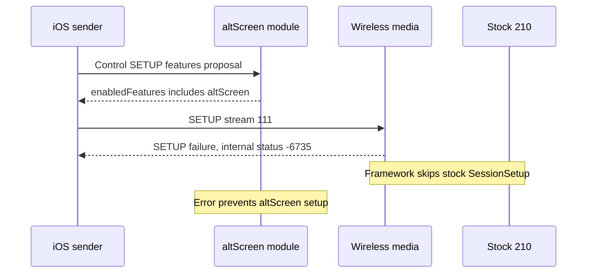

# Wireless hook review against iOS and MHI2Q 210

_Static interoperability review and host reproductions — MU1316/P5087, 2026-09-29._

---

[Wireless overview](../wireless-carplay/README.md) · [Architecture](../wireless-carplay/STOCK210_ARCHITECTURE.md) · [Validation ledger](../wireless-carplay/STOCK210_VALIDATION.md)

## 📋 Review result

The original **AirPlay 210.81 plus hook** design remains justified by the
inspected receiver ABI and iOS pairing/media code. The initial review found
**three confirmed defects**, now corrected by the offline follow-up below.
Wireless currently offers the main display only; paired stream 111 remains
future work. Physical iPhone/HU validation is still required.

| Finding | Priority | Trigger | Observed result |
|---|---|---|---|
| R1: authentication order | P1 | iAP2 certificate request before identification acceptance | Request silently ignored |
| R2: advertised second screen | P1 | Successful altScreen negotiation followed by stream 111 SETUP | Media hook returns `-6735` before stock/altScreen setup |
| R3: wired mode isolation | P2 | Wired owner with `MHI2Q_CP_WIRELESS_MEDIA=1` | Wireless callback returns `-6709` with pairing disabled |

Reviewed repository snapshot: `1cbfc82f296b6c3986939c0239f8d84de96b603c`.
The wireless implementation comes from `a97471d`; documentation migration is
`c8a1ad3`. Existing unrelated audio/rescue working-tree changes were excluded.
The initial review changed documentation only. The follow-up changes production
code and adds permanent regression tests. Original reproductions and decompiler
exports are under ignored `build/review-ios210/`. No HU access or firmware writes
were performed.

## 🔍 Confirmed findings

These findings and their original line numbers describe the pinned pre-fix
snapshot above. Their corrections and current validation follow this section.

### R1 — Accept authentication before identification completes

**Location:** [control.rs](../../wireless/daemon/src/control.rs), lines 185–216.
`ControlMachine` starts in `AwaitIdentification`. Only identification acceptance
(`0x1D02`) changes it to `AwaitAuth`; certificate/challenge requests and
authentication success/failure are matched only in `AwaitAuth`. An early
`RequestAuthenticationCertificate` (`0xAA00`) falls through to `Ok(None)`.

The iOS 26.1 CoreAccessories export contains both orderings. Authentication
completion checks whether identification has completed or still needs to
start. Identification completion likewise checks authentication. The
authentication feature sends `0xAA00` without requiring prior identification
acceptance. `_authCompleted` sends `0xAA05` and sets authentication state 2
even when identification is not yet accepted.[^ios-auth]

**Impact:** a phone taking the authentication-first path waits for a certificate
while our daemon waits for identification. This prevents MFi/bootstrap from
progressing on that path. Static evidence establishes a supported ordering;
it does not establish which ordering every iOS version chooses on this HU.

A host probe calling the actual Rust crate, with a synthetic certificate
provider, produced:

```text
auth-first RequestAuthenticationCertificate: reply=None, phase=AwaitIdentification
identification-first RequestAuthenticationCertificate: reply_len=Some(13), phase=AwaitAuth
```

**Required correction:** track identification and authentication independently.
Service authentication requests in either legal order, retain failure handling,
and release Wi-Fi/CarPlay bootstrap only after both prerequisites succeed.
Regression cases must cover both orders, interleaving, authentication failure
before identification, and reset on a new RFCOMM generation.

### R2 — Reconcile altScreen negotiation with paired media support

**Locations:** [media.c](../../hook/wireless/media.c), lines 130 and 163–168;
[altscreen_hook.c](../../hook/altscreen/altscreen_hook.c), lines 1830–1890;
[wrapper source](../../deploy/smartphone_integrator/carplay_startup.sh), lines
63–64. The [wrapper builder](../../wireless/integration/build_wrapper_candidate.py)
preserves `ALTSCREEN_HANDLE_ALT=1` and `ALTSCREEN_ADVERT_DISPLAYS=1`.

When preflight succeeds, the altScreen module adds `altScreen` to control
SETUP's `enabledFeatures` and publishes its two-display contract. The final
[wireless advertisement callback](../../hook/wireless/advertisement.c) filters
audio formats but leaves this display contract intact. However, paired media
has three slots and accepts only stream types 100, 101 and 110.

Fresh iOS 27 AirPlaySender decompilation confirms the sender's screen type
selection: `APEndpointStreamScreenCreate` at `0x2510df8ac` compares the selected
display property with the main display's property; equal selects 110, different
selects 111 (`0x2510dfc04`–`0x2510dfc10`). Its SETUP builder also has explicit
110/111 cases. This is a real sender path, not just a feature name in strings.[^ios27]



`wireless_setup` runs with `HOOK_PRIORITY_FIRST`. After it sets an error,
[airplay_seams.c](../../hook/framework/airplay_seams.c), lines 183–201, skips
the real `AirPlayReceiverSessionSetup`. `alt_on_setup_response` requires a
successful result and a response dictionary, so it cannot recover this request.

A host probe includes the actual `media.c`, with small CF and successful
key-derivation substitutes. Changing only the requested screen type gives:

```text
actual cp_media_prepare: screen110=0, screen111=-6735
```

**Impact:** whenever the second-screen contract is successfully negotiated,
the implementation cannot satisfy its media SETUP. Whether iOS tears down the
whole session after this rejection still needs runtime observation; failure of
that SETUP is deterministic.

**Required correction:** for the initial wireless candidate, suppress the
second-screen contract consistently in negotiation and advertisement until
paired stream 111 is implemented. Preserve the existing wired behavior.
Alternatively, add full CU-keyed stream 111 support. Merely allowing 111 in
`slot_for` is insufficient: the current altScreen receiver derives AES-CTR from
stock `session+456` at `altscreen_hook.c:1663`, while the wireless path removes
the legacy AES envelope and uses separate paired media keys.

Regression coverage must run the actual wrapper configuration, negotiate
features, fetch `/info`, and SETUP every advertised stream. Existing main-screen
fixtures do not establish this contract.

### R3 — Scope the media SETUP guard to wireless owner mode

**Location:** [wireless_hook.c](../../hook/wireless/wireless_hook.c), lines
324–340, and [media.c](../../hook/wireless/media.c), lines 90–91.
`wireless_init` correctly returns early for a wired owner. `wireless_setup`
does not check owner mode or the initialization state: it checks only the
media environment flag, then requires a verified wireless connection.

With `MHI2Q_DIO_OWNER_MODE=wired` and `MHI2Q_CP_WIRELESS_MEDIA=1`, no pairing
connection is created, so the callback sets `setup->result=-6709`. The same
framework behavior described in R2 then prevents stock USB SessionSetup.

A host probe calls the actual `wireless_init`, `wireless_setup` and
`cp_media_enabled` implementations:

```text
actual wireless_setup: wired mode, media=1, enabled=0: result=-6709
actual wireless_setup: wired mode, media unset: result=0
```

**Scope:** this is an inherited-environment bug. A normal independently launched
Smartphone Integrator process has not been shown to receive the supervisor's
wireless flags. Therefore this review does not claim that every default USB
connection currently fails. A wired launch from an environment carrying the
wireless flags is enough to trigger the defect.

**Required correction:** return without changing SETUP for a wired owner,
independently of stray wireless flags. In wireless mode, retain rejection of
missing or unverified pairing context; simply testing `enabled` and falling
back to legacy SETUP after a wireless initialization failure would weaken the
existing protection. Add wired and wireless mode/flag/failure tests that invoke
the actual AirPlay callback, in addition to process-ownership tests.

## 🔧 Corrections and regression coverage

| Finding | Correction | Permanent coverage |
|---|---|---|
| R1 | Independent identification/authentication completion; terminal failure until a new generation | Four new Rust tests, including all ten legal interleavings and credential gating |
| R2 | altScreen preflight, negotiation and `/info` publication skip wireless owners, including cached contracts | Actual altScreen callback tests with wrapper flags enabled; QEMU feature proposal and parsed SETUP/info checks |
| R3 | SETUP callback acts only for a wireless owner; failed wireless init still rejects unverified SETUP | Actual callback matrix for absent/wired/wireless owner, media flag, initialization and verification; prior error preserved |

The wired altScreen path is retained. This correction removes the unsupported
wireless display promise; it does not implement paired stream 111. The current
media admission guard continues to reject that stream.

The permanent C fixtures include production callback code. CF, key derivation
and host-width context pointers are substituted; the runner uses AddressSanitizer
and UndefinedBehaviorSanitizer. It checks valid stream types, unsupported types,
invalid audio formats, authentication/key failures, atomic rollback, selective
and full teardown, connection-ID reuse prevention and fresh owner cleanup.

```sh
cargo test --offline --manifest-path wireless/daemon/Cargo.toml
python3 tests/test_wireless_hook_contract.py
bash scripts/build_hook_wireless.sh
bash scripts/build_hook.sh
python3 tests/carplay_lab/qnx/qemu_capture.py --wireless-hook-qemu \
  --wireless-media-qemu --wireless-lifecycle-qemu --mesh --start-experiment \
  --seed-display --skip-hid-qemu --mdnsd --mock-mac-qemu --interface-lo0-qemu
```

Follow-up results: **27 Rust tests passed**; all three C fixture suites passed
under both sanitizers; wireless/wired QNX builds passed their exact export gates
(41/26). The combined stock210 run passed three DIO owner generations, two media
sessions, stable pairing identity, events, AVC input, PCM/microphone, USB priority
and wireless resume. The second phone completes authentication before starting
identification. Production altScreen flags are enabled in the fixture; both
parsed SETUP responses omit `altScreen`, and all four `/info` snapshots omit a
second display and the unsupported feature.

Running the new tests against the pre-fix production sources detects the
original bugs: the altScreen and owner suites fail, and the Rust authentication
order/interleaving tests fail. This establishes that the added assertions catch
the reviewed regressions.

| Rebuilt artifact | SHA-256 |
|---|---|
| `build/wireless/libcarplay_hook.so` | `1743bf59198f1ae25e58266b1810775e2ed187be48f2d48ce6a9d9d9b55bc5c4` |
| `build/unprotected/libcarplay_hook.so` | `645334499029d7704a352b98b4387ecab67b86d09c9b281533d58297bd25b4d3` |
| Production/default-feature QNX `mhi2q-wireless-daemon` | `14973ef1235d85a7332244a5d317cc3087d53502031db74323aba354a0dac994` |

Current combined log: `wireless/receiver_bridge/out/qemu_stock210_lifecycle.log`.
The fixture builds the synthetic phone separately and stages the same default-
feature daemon used by the review archive builder.
Host and build logs remain ignored local artifacts. These tests retain synthetic
MFi/radio/USB peers and input-only decoder evidence; hardware playback and
physical SI/USB behavior are not established.

The standalone QNX daemon regression also passed two phone sessions with
CarPlay Control, a rejected first receiver START, transient MFi NACK/short-transfer
retries and subsequent successful handover:

```sh
python3 wireless/daemon/probes/qemu_daemon_bridge.py --phone-probe \
  --control-probe --reject-once --mfi-retry-qemu --repeat-phone-qemu
```

Log: `wireless/daemon/out/qemu_daemon_phone_repeat.log`.

## ⚙️ Architecture checks

| Boundary | Evidence checked | Assessment |
|---|---|---|
| CU capability | iOS 27 `airPlayDescription_supportsCUPairingAndEncryption`, `0x250f5c704`, tests bits 38/46/43/48; hook advertises 37/38 | CU extension is relevant; this predicate itself has no sourceVersion comparison |
| Stock SETUP entry | Original `_requestProcessSetup`, `0x2f198`, and `AirPlayReceiverSessionSetup`, `0x272b8` | Missing legacy `et` bypasses the old MFi-SAP AES-envelope branch; normal stock session setup remains reachable |
| Stream key derivation | iOS 27 `_coreUtilsKeyHolder_CreateEncryptionKeysForStream`, `0x250f5eed4`, and hook `derive_stream` | `DataStream-Salt%llu` and input/output labels agree |
| Screen read boundary | Original `AirPlayReceiverSessionScreen_ProcessFrames`, `0x2b154`, and NetSocket reader | 128-byte header/body callback boundary supports the hook's media adaptation approach |
| MFi signing boundary | Original `APSMFiPlatform_CreateSignature`, Rust MFi adapter and namespaced SDK shim | Inspected register/signing sequence is consistent; physical chip success remains untested |
| Full teardown | Original `AirPlayReceiverSessionTearDown`, `0x26b60`, and framework normalization | Missing/empty stream list is normalized as full teardown for hook state |

These are static compatibility checks, not proof of end-to-end playback. They
support keeping the original receiver, platform integration and decoder. They
do not justify transplanting MH2p AirPlay280 or claiming that every iOS admission
check has been exhausted. Bluetooth MFi authentication, AirPlay pairing and
paired media remain distinct stages.[^stock210][^ios27]

## 🧪 Initial review validation and limits

| Check rerun in this review | Result | What it covers |
|---|---|---|
| `cargo test --offline --manifest-path wireless/daemon/Cargo.toml` | 23 passed | Existing daemon test suite |
| `python3 wireless/verify_graft_points.py` | All checks passed | Donor/target strings and SDP byte checks implemented by that script |
| Rust authentication-order probe | R1 reproduced | Actual control machine; synthetic MFi provider |
| C media and owner-mode probes | R2/R3 reproduced | Actual callbacks; CF/key substitutes; host process |
| IDA decompilation and targeted disassembly | Evidence above | Local iOS 27 and stock210 binaries |

The temporary host probe commands were:

```sh
cargo run --offline --manifest-path build/review-ios210/probe/Cargo.toml
cc -O1 -Wl,-dead_strip build/review-ios210/wired_probe.c \
  build/review-ios210/media_probe.c -o build/review-ios210/hooks_probe
./build/review-ios210/hooks_probe
```

Those probe files are local review artifacts, not repository test-suite files.
They reproduce the current bugs; permanent regression tests should assert the
corrected behavior. The C probe renames its included `close`/`sendto` exports
to avoid interposing the host's libc. It does not emulate QNX or test crypto.

The initial review did not rerun the previous [combined QEMU run](../wireless-carplay/STOCK210_RECEIVER_LIFECYCLE.md).
The correction follow-up above does. Its synthetic wired child establishes owner handoff, not a real stock USB
SETUP with inherited flags. Likewise, its media fixtures do not establish
second-screen negotiation, hardware decoding, live iPhone behavior, MFi I2C
timing or Bluetooth callback scheduling under load.

## 🎯 Follow-up acceptance criteria

Items 1–3 and the offline part of item 4 are covered by the correction tests.
The physical checks in item 4 and paired stream 111 support remain future work.

1. Complete both iAP2 authentication/identification orders before allowing Wi-Fi
   credentials or CarPlay StartSession.
2. Make wireless `enabledFeatures`, `/info` displays and supported media types
   describe the same contract under the generated wrapper's environment.
3. Ensure wired SETUP remains stock behavior with every wireless flag present,
   while wireless SETUP still rejects unverified contexts and failed init.
4. Rerun the combined stock210 QEMU flow after these corrections, then retain
   the separately authorized hardware checks already listed in the overview.

## 📚 Primary local evidence

[^ios-auth]: iOS 26.1 / `23B85`, local decompiler exports under `Refferences/iPhone18-3_26.1_23B85_Restore/System/Library/PrivateFrameworks/CoreAccessories.framework/System/Library/PrivateFrameworks/CoreAccessories.framework/Support/CoreAccessories/`. `CoreAccessories_01.mm:4714–4723` sends the certificate request; `CoreAccessories_11.mm:9271–9287` completes authentication independently of identification; `CoreAccessories_15.mm:7040–7080` and `7083–7244` contain the two completion callbacks. SHA-256: `_01.mm` `d749f9bc8d3c53db972056f94438e3b145be64a39c17b600aa250b8d9e13adc6`; `_11.mm` `2561d9f740d454a6621341392fcc2f7e436d913fd2d294629d427fb9aea425b1`; `_15.mm` `80b7108eb6546be1e5279ca5c46504da4b5ab30a6951fc43f94e5a2f88e6fc16`. These are exports of compiled iOS code, not original Apple source.

[^ios27]: iOS 27 / `24A5418b`, extracted `Refferences/ios27_dsc/24A5418b__iPhone18,1/aps_out/AirPlaySender`; SHA-256 `379fb232ff228287d3b11d1253b1b942e6c50dd633d150cfab6acb9d063bead1`. Fresh IDA reads include `_APEndpointStreamScreenCreate` `0x2510df8ac`, `_apsession_setupStreamCreatingResponseInternal` `0x250f5af2c`, `_coreUtilsKeyHolder_CreateEncryptionKeysForStream` `0x250f5eed4`, and the CU feature predicate `0x250f5c704`. Local exports: `build/review-ios210/ios27_screen_create.c`, `ios27_setup.c`, `ios27_version_gate.c`. R1 uses the separate 26.1 CoreAccessories evidence; it is not claimed as a fresh iOS 27 daemon trace.

[^stock210]: Original `Firmwares/HU/MU1316-MHI2Q_US_AUG22_P5087-JTB-07426.03.1811930398/advanced/MU1316-appimg/eso/lib/libairplay.so`; SHA-256 `01c116b1674215daa0602d556a6d9b2eb48c2113ca294ea1f5d58787e3f656f2`. Function addresses above refer to this library with image base 0. Additional ABI context is in [HTTP pairing](../wireless-carplay/STOCK210_HTTP_PAIRING_ABI.md) and [media crypto](../wireless-carplay/STOCK210_MEDIA_CRYPTO_ABI.md).
