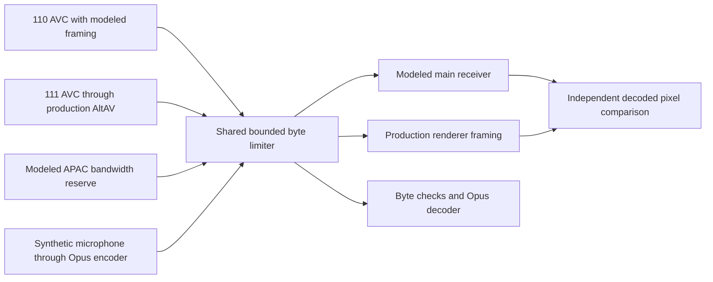

# Concurrent media transport stress

_2026-10-22 · local transport test · physical Wi-Fi and full CarPlay acceptance remain separate._

[Laboratory](README.md) · [Native media checkpoint](WIRELESS_MEDIA_VALIDATION.md) · [Wi-Fi evidence](../stock-patches/README.md)

## 🎯 Scope

The first stress layer asks whether one shared application-throughput budget delivers two continuously moving AVC sources at 30 frames/s alongside audio traffic. It measures complete-picture deadlines, queue drops/reconnection and compressed-data integrity. It does not measure display presentation or reproduce an iPhone's bitrate adaptation.

| Component | Executed path |
| --- | --- |
| Main 110 load | Valid 1024×480 AVC, rapid zoom, 30 fps, approximately 10 Mbit/s; explicit paced TCP frame model |
| AltScreen 111 load | Valid 1440×542 AVC, rapid zoom, 30 fps, approximately 8 Mbit/s; **production AltAV asynchronous queue and production renderer framing** |
| APAC reserve | **Modeled opaque payload**, 2 Mbit/s in 20-ms chunks; no APAC codec in this test |
| Microphone | Synthetic 16-kHz mono tone; **production Opus encoder and decoder execute during load**, with 20-ms packets and 32-kbit/s VBR target; byte-exact TCP delivery |
| Shared link | All application bytes use one bounded FIFO limiter, 10-ms burst credit; 40/30/20/10 Mbit/s and a shared 200-ms outage |
| Video oracle | Independent FFmpeg `explode`/`xerror`; received pixels match the source picture **at its reported sequence number**, including across AltAV reconnections |

The microphone's reverse direction is modeled on loopback, using unencrypted TCP rather than wireless RTP. This test exercises real Opus computation, without microphone hardware/AEC. APAC 5.1 has its own successful vphone/QNX receipt; it is **not decoded under this stress load**. Video decoding happens after capture, so concurrent decoder CPU/GPU capacity and native QNX/Java focus are not accepted here.



## ⏱️ Timing and verdicts

Each screen has `duration × 30` source pictures. A **100-ms modeled playout buffer** passes only if every picture arrives by its individual source timestamp +100 ms. Raw arrival gaps remain separate metrics: a gap alone does not prove underrun when the pictures on either side still meet their deadlines. `actual_presented_fps_verified` remains false. Reports include p50/p95/p99/max latency, frame loss, gaps over 66.7 ms and arrivals during the source window. A late drain cannot inflate the source-window rate.

Darwin Python and C `CLOCK_MONOTONIC` have different epochs after sleep. A startup handshake aligns start times; every measured latency stays within its original clock domain. The test never subtracts unconverted Python and C timestamps.

Before each capacity, a saturated four-flow scheduler calibration checks measured pacing against its requested rate within 10%. Raw measured rates are saved. Host scheduling noise may fail calibration; such a run is invalid rather than evidence about the HU.

The suite's `passed` field means integrity checks and negative controls passed. `target_40mbps_pacing_pass` separately reports the 40-Mbit/s deadline result. The 10-Mbit/s overload and 200-ms outage must violate the deadline criterion. Surviving pictures still have to decode correctly; corruption is never accepted as expected overload behavior.

## 🧪 Run

```bash
python3 -m unittest tests.carplay_lab.common.test_media_stress
python3 -m tests.carplay_lab.common.media_stress --seconds 10
```

Duration is bounded to 3–30 seconds. The runner uses ephemeral loopback ports and its own child process. It does not start/stop QEMU or vphone, contact the HU, alter interfaces or install system traffic shaping.

Artifacts: `build/wireless-validation-20261022/media-stress/`. Overall/per-scenario JSON includes calibration, 100-ms goodput bins, source/code hashes, received AVC and AltAV logs. The production AltAV helper runs under ASan/UBSan. An exception marks `result.json` failed rather than retaining a stale success.

## 📊 Measured local snapshot

A calibrated 10-second run sends 300 source pictures per screen. Total application traffic is approximately 20.18 Mbit/s. All five scenarios pass byte/pixel integrity checks; the calibration and overload/outage negative controls also pass. The 100-ms deadline result is separate:

| Scenario | Max 110 latency | Max 111 latency | 111 pictures received | Modeled playout |
| --- | --- | --- | --- | --- |
| 40mbps | 55.9 ms | 96.4 ms | 300/300 | PASS |
| 30mbps | 91.4 ms | 155.9 ms | 300/300 | FAIL |
| 20mbps | 1004.4 ms | 187.9 ms | 300/300 | FAIL |
| 10mbps-overload | 8929.3 ms | 6507.4 ms | 130/300 | FAIL |
| 40mbps-stall200 | 191.0 ms | 220.0 ms | 300/300 | FAIL |

At 40 Mbit/s, all source pictures meet their deadlines. At 30 Mbit/s this run retains every picture but misses some AltScreen deadlines; earlier short runs varied, so 30 Mbit/s is not declared a stable pass. At 20 Mbit/s backlog grows; at 10 Mbit/s the actual AltAV queue drops/reconnects. A 200-ms outage violates deadlines even with the 40-Mbit/s cap. These are model/host observations, not an iPhone or HU radio requirement. Each scenario also encodes and decodes 160,000 synthetic microphone PCM samples with the production Opus codec.

## 🚗 Remaining full-stand test

The next layer needs simultaneous moving native vphone 110/111, real APAC and microphone traffic through QNX, with aligned packet capture and native decode/present/audio counters. Both screens need continuous motion. Separate isolated APAC and codec passes cannot be added together and called simultaneous acceptance. Physical 2.4-GHz retries/interference, amplifier output and microphone acoustics then require the HU.
