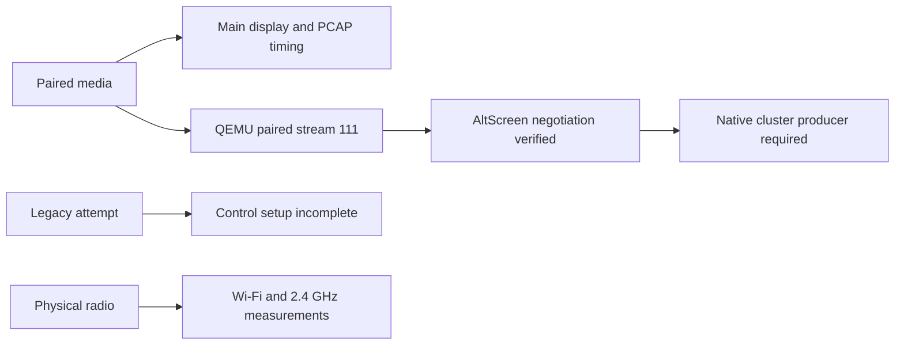
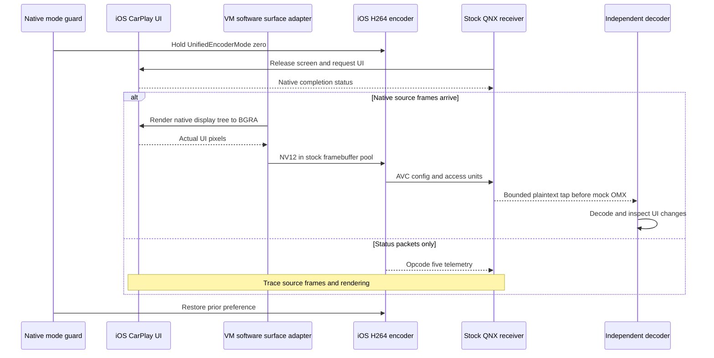

# Native CarPlay screen test

_Prepared iOS/QNX laboratory · 2026-10-11 · Native CarPlay video independently decoded: 31-frame baseline and 519-frame longer run with PCAP timing._

---

[Lab setup and evidence](IOS_VM_LAB.md) · [Software MFi tests](../wireless-carplay/TEST_SOFTWARE_MFI.md) · [Wireless overview](../wireless-carplay/README.md)

The [vphone migration](VPHONE_LAB.md) is now the active guest bring-up. The frame
counts and decoder evidence below belong to retained Inferno/iOS 14 runs;
they do not establish video from vphone. QNX capture and pacing tools have moved
to `tests/carplay_lab/common/`, with compatible legacy command entry points.

## 📋 Verified baseline

The isolated iOS guest boots with real SEP and keybag state, accepts live
software MFi authentication, and sends actual native CarPlay UI to the
stock-210 QNX receiver. A VM-only software adapter renders the QuartzCore
display into the native framebuffer's NV12 pool, replacing the unavailable
GPU writeback producer. Stock iOS encoding, encrypted transport and QNX
receive/decryption remain in the path. Independent FFmpeg decoding now
verifies the resulting UI.

Screen negotiation requests 800×480 at 30 FPS. Before the surface adapter,
the bounded baseline completed with 110 iPhone-to-QNX TCP
payload packets on screen port `6030` (35,407 bytes over 107.3 seconds). They
were opcode `5` status telemetry. Each reported `sentFramesAvg=0` and
`queuedFramesAvg=0` even though `encoderCurrentFPS=30`; that field reflects
the configured encoder rate and does not prove that frames were sent. No
screen access units or decoded native UI were observed in that older run.

The native encoder can encode real CPU-generated pixels when
`UnifiedEncoderMode=0` is active in `com.apple.VideoProcessing` and
`EncoderUsage=38` selects the legacy path. Both isolated probes produced
4602 bytes of H.264, independently decoded into three 800×480 frames with
changing luma. This is the baseline for this test; the probe pixels do not
enter CarPlay.

| Check | Current evidence |
|---|---|
| Native iAP2 / MFi | Positive and corrupted-signature controls |
| QNX control session | Pair Setup/Verify, MFi-SAP, session startup |
| Software H.264 | Three independently decoded frames per probe |
| Native CarPlay render tree | Actual 800×480 Music UI captured through QuartzCore and visually verified |
| Native framebuffer submission | 15 real UI submissions and relinquishes; probe result `0` |
| CarPlay AVC configuration / access units | 32 complete decoder-input records: one configuration and 31 frames |
| Independent native UI decode | H.264, 800×480, yuv420p; 31 frames, 26 distinct decoded hashes; Dashboard visually inspected |
| Longer primary-screen pacing | 60 guest-second adapter run; 519 independently decoded frames; PCAP measurement below |
| AltScreen | QEMU-only paired profile negotiated 1440×542 / stream 111; no cluster video access units yet |
| Actual MMI display / 2.4 GHz radio | Outside this USB/Ethernet test |

The earlier live session also confirmed the receiver's `untakeScreen` and `requestUI`
callbacks completed with status `0`, the QNX decoder reported startup, and the
iOS log selected `ftvc` with `EncoderUsage=38`. Those facts show control and
encoder setup progress, but do not prove that the virtual display supplied
pixels to the encoder. The bounded preference guard logged
`software-mode restored=1` after 300 guest seconds.

The remaining rendering fault is separate: Maps dereferences a null Metal
resource manager, and the native Metal probe returns no device. Keep this
fault visible while testing the rest of the native screen path.

## 🎵 Alternate native UI probe

The follow-up build requested `music://` through the native
`AirPlayReceiverSessionRequestUI` call. The SDK declaration and implementation
take `CFStringRef inURL`, and the probe passes that type. QNX returned success
and SpringBoard moved keyboard focus to `com.apple.Music`. The first filtered
syslog reported `scene:(null)` and omitted the CarPlay process. That capture
could not establish whether the Music scene activated. Later full syslogs
explicitly show `Car[2-3]:com.apple.Music`, logical activation success, and a
completed `SceneUpdate` transaction. The native CarPlay scene now has direct
runtime evidence.

The refreshed port-6030 capture contains 198 iPhone-to-QNX status packets
(63,746 payload bytes over 193.8 seconds). Every parsed telemetry plist reports
`sentFramesAvg=0`, `queuedFramesAvg=0`, and `encoderCurrentFPS=30`. No screen
access units arrived. The native mode hold restored the prior preference after
its 300-second bound. The PCAP, iAP result, filtered syslog, and QNX serial log
are local under `build/ios-vm-lab/combined-usb/` and are not required for the
repeatable recipe.

Before the software surface adapter, the native source stopped with `submitted 0 frames`; backboardd logged
`acquireWritebackSurface` as not ready and then busy. The adapter bridges
the rendered display tree to its framebuffer/encoder input. Maps'
null Metal resource manager remains a separate fault; Music gives a usable
native scene for tracing the main screen.

### Verified native capture

The opt-in `--screen-render-probe` renders the real `Wireless` display through
`CARenderServerRenderDisplay` into an IOSurface. The initial probe could not
open `IOSurfaceRoot` (`0xe00002e2`, not permitted). Granting the narrow
`IOSurfaceRootUserClient` class permission, together with QuartzCore capture
and client-port entitlements, changed the open result to `0` and allowed a
native 800×480 BGRA capture.

The verified capture has 3,200 bytes per row, 1,536,000 bytes total, and
363,809 nonzero RGB pixels. Its BGRA SHA-256 is
`35e144f17240568e1f8f67d86c8cb9debf6762224c49f9f913db36b050e25647`.
Visual inspection shows the CarPlay sidebar and the Music screen asking the
user to check Apple Music on the iPhone. That message is native app content;
it is not a capture failure. Local evidence is
`build/ios-vm-lab/combined-usb/native-carplay-verified.png` and its JSON metadata.
This proves native UI rendering, not H.264 transmission or QNX decoding.

Provision capture on the stopped clone with:

```sh
python3 tests/carplay_lab/legacy_ios/prepare_combined_usb.py --software-encoder-session --screen-render-probe
```

Use the session recipe below with the Music receiver build. Fetch the bounded
outputs only through the owned emulator's usbmuxd endpoint:

```sh
clang -O2 -Wall -Wextra -Werror tests/carplay_lab/legacy_ios/fetch_video_probe.c \
  $(pkg-config --cflags --libs libimobiledevice-1.0) \
  -o build/ios-vm-lab/combined-usb/fetch-video-probe
USBMUXD_SOCKET_ADDRESS=127.0.0.1:32229 \
  build/ios-vm-lab/combined-usb/fetch-video-probe --screen
```

The guest files are `/var/mobile/Media/mhi2-carplay-screen.{json,bgra}`.
After the mode guard restores its preference, a readback-only boot can be
prepared with `--no-video-probe` and without either screen probe flag. It
removes the probe launch jobs and preserves the captured files. Starting the
capture job again deletes its previous output, so retrieve the files first.
The encrypted Data volume was not available in the host's offline image
mount; that mount cannot establish the presence or absence of Media files or
encoder preferences.

### Bounded framebuffer experiment

`--screen-framebuffer-probe` is an alternative to the capture flag. It first
captures real native UI and then attempts at most 15 submissions to framebuffer
1 through the stock acquire/submit/relinquish path. It does not supply synthetic
test pixels. The internal MediaToolbox entry points are not dyld exports;
the probe checks the pinned image UUID and the first four instructions of
each entry point before calling them. Any mismatch stops framebuffer access.
The working path explicitly loads MediaToolbox and registers its hotplug
source and callback on a CFRunLoop. Without registration the client remains
inactive. The server also requires `com.apple.backboardd`; otherwise it rejects
the connection with `kFigXPCError_MessageSendFailed` (`-16155`). This right is
present only in the explicit framebuffer-probe helper build, not in default
USB or capture-only helpers.

The optional `--screen-seconds 60` or `120` switches the framebuffer helper
to a timed run, with `--screen-fps 1..30` limiting UI sampling. Its monotonic
deadline begins at the first successful submission. The helper captures the
current native display at each opportunity, skips missed sampling slots,
and never creates a catch-up burst. The native encoder and receiver still
decide which frames to transmit and display. The timed build holds software
encoder mode for at most 600 guest seconds; the default remains 300. Wait
for `software-mode restored=1` before stopping the guest.

```sh
python3 tests/carplay_lab/legacy_ios/prepare_combined_usb.py \
  --software-encoder-session --screen-framebuffer-probe \
  --screen-seconds 120 --screen-fps 30
python3 tests/carplay_lab/legacy_ios/qnx_network.py build \
  --pairing --media --software-mfi --request-ui --request-ui-music \
  --capture-video --capture-video-long
```

Use the authentication/NCM recipe below. `--capture-video-long` raises the
first AVC handle's diagnostic budget from 32 records / 2 MiB to 4096 records
/ 16 MiB. Each buffer is still limited to 256 KiB. The strict extractor accepts
both old and timestamped records, with a 64 MiB UART-log bound. UART capture
adds work before decoder dispatch, so it affects the timing being measured.

### Longer native-video measurement

The 2026-10-11 run selected **60 guest seconds**, not 60 host seconds. The
adapter completed with result `0` and 113 successful native surface submissions.
The complete QNX capture contains 520 records: one configuration and 519
picture buffers, totalling 201,678 bytes. FFmpeg independently decoded all
519 frames at 800×480/yuv420p without errors; 121 decoded hashes differ.
Visual inspection shows native Music content and the sidebar.

| Measurement | Result |
|---|---|
| PCAP video span | 47.780 seconds on the companion capture clock |
| PCAP observed video rate | 10.841 access units/s |
| PCAP interarrival median / p95 / max | 70.264 / 183.018 / 2178.084 ms |
| Repeated TCP payload / unresolved sequence gap | 0 / 0 bytes in this capture |
| Native adapter interval median | 490.718 ms on the iOS guest clock |
| Native render/conversion cost median / max | 361.860 / 980.325 ms on the iOS guest clock |
| QNX picture-buffer span | 247.235 seconds on the QNX monotonic clock |
| H.264 SHA-256 | `94cc37a8c56451412ab02b8dafe506b531bce0769db55423b8d93d8f98605374` |

The QNX/PCAP span ratio is about 5.174; the clocks are not aligned. Their
intervals must not be subtracted to estimate end-to-end latency, nor should
the QNX-derived rate be treated as wall-clock FPS. The adapter submission
count is also not the encoder's output count: the native display pipeline
emitted more pictures than the helper submitted. Report each stage separately.
Zero repeated bytes does not prove zero RF packet loss. Telemetry still
reports configured `encoderCurrentFPS=30`, which is not observed FPS.

The read-only PCAP analyzer reassembles screen TCP in sequence, validates
overlaps, ignores exact duplicates for first-arrival timing, and reads only
the clear 128-byte screen headers and opcode-5 telemetry. It needs the SYN;
it neither decrypts nor changes video. A capture gap is reported rather than
filled. IPv6 extension headers and fragmented IPv4 are outside its parser.

```sh
python3 tests/carplay_lab/legacy_ios/frame_pacing.py \
  build/ios-vm-lab/combined-usb/pacing-60-qnx-serial.log \
  --source-log build/ios-vm-lab/combined-usb/pacing-60-ios-serial.log \
  --output build/ios-vm-lab/combined-usb/pacing-60-timing.json
python3 tests/carplay_lab/legacy_ios/screen_wire_pacing.py \
  build/ios-vm-lab/combined-usb/pacing-60.pcap \
  --output build/ios-vm-lab/combined-usb/pacing-60-wire.json
```

Evidence is retained under `build/ios-vm-lab/combined-usb/pacing-60*`.
The full-range NV12 conversion, native encoder and stream ordering are unchanged.

### Separate legacy AltScreen experiment

The working paired session uses authenticated ChaCha media. The existing
production stream-111 receiver uses legacy AES-CTR, so the production wireless-owner
guard intentionally suppresses its advert and negotiation. Enabling wrapper
flags cannot make that combination work. Do not remove the guard.

`qnx_network.py build --legacy-altscreen` is an isolated alternative: it uses
the existing hook in wired-owner mode, disables paired pairing/media, and
enables the existing two-display/stream-111 contract. It still requires the
lab's software MFi build and real MFi-SAP authentication. Start iAP **without**
`--receiver-public-key` for this experiment; the paired recipe includes that
key and is a different session. Diagnostic hook logs go to guest UART in
this profile only. A successful build or advert is not proof of stream 111.

```sh
python3 tests/carplay_lab/legacy_ios/qnx_network.py build \
  --pairing --media --software-mfi --request-ui --request-ui-music \
  --capture-video --legacy-altscreen
python3 tests/carplay_lab/legacy_ios/mfi_probe.py --start-carplay --hold-seconds 180 \
  --receiver-ipv6 fe80::4254:ff:fe12:3456
```

Stop the preceding session, restart QNX, and obtain fresh iOS/NCM/MFi state
using the recipe below before running this variant. The default software
surface adapter targets framebuffer 1 / 800×480; the opt-in framebuffer-2
producer below adds 1440×542. Maps also still requires an unavailable Metal
device. Actual second-display negotiation, pixels, and decode need separate
evidence. NCM Ethernet validates transport/control integration, not Bluetooth
discovery, Wi-Fi association or 2.4 GHz airtime.

The legacy run on 2026-10-11 authenticated iAP2 and resolved the stock display
primitives, but iOS then sent `POST /pair-setup RTSP/1.0` (`X-Apple-HKP: 0`).
This profile did not finish control setup; iOS logged endpoint activation
error `200404`. No stream 111 was negotiated. Evidence is retained under
`combined-usb/legacy-altscreen*`. Omitting the iAP public key is therefore not
enough to establish a working legacy session on this prepared iOS build.

### QEMU-only paired AltScreen

The separate `WIRELESS_ALT_QEMU=1` build adds an authenticated stream-111
receiver to the working paired path. The build script allows it only with
`HOOK_WIRELESS=1` and output directory `build/wireless-alt-qemu`. The default
and shipping hook retain their wireless AltScreen suppression. This is an
experiment, not a deployment configuration.

```sh
bash -c 'source scripts/build_hook_common.sh; \
  OUTDIR_REL=build/wireless-alt-qemu HOOK_WIRELESS=1 HOOK_AUDIO=0 \
  WIRELESS_ALT_QEMU=1 QNX_TOOLCHAIN_VARIANT=8.5 carplay_build_hook'
python3 tests/carplay_lab/legacy_ios/qnx_network.py build \
  --pairing --media --software-mfi --request-ui --request-ui-music \
  --capture-video --paired-altscreen
```

Use the ordinary paired authentication/NCM recipe, including the **current**
receiver public key. `--paired-altscreen` rejects the legacy profile and checks
that the selected hook contains the QEMU-only receiver. The profile explicitly
sets its runtime gate; a normal hook cannot opt in by an environment flag alone.

For stream 111, media admission derives the same `DataStream-Salt<connectionID>`
read key as stream 110. The receiver claims that key exactly once, starts with
nonce zero, authenticates the original 128-byte header and ciphertext using
the existing SDK ChaCha primitive, and removes the 16-byte tag only after
successful authentication. Bad framing, tag failure, nonce exhaustion and a
second claim fail closed. Session teardown retains connection-ID history;
the failed transport cannot resume with reset nonces. Legacy AES is selected
only for the legacy owner. No pairing or certificate check is disabled.

| Live check on 2026-10-11 | Evidence |
|---|---|
| Control feature negotiation | `enabledFeatures` accepted `altScreen` and `viewAreas` |
| Display contract | Preflight retained the real main UUID plus a distinct cluster UUID |
| Native second display | iOS reported 1440×542, 292×110 mm and created `CarInstruments` / `CARInstrumentCluster` |
| Stream 111 setup | iOS offered 111; QNX claimed the fresh paired key and opened port 6031; SETUP returned `0` |
| Main display regression | 32 complete records independently decode into 31 native 800×480 frames |
| Cluster video | PCAP: 238 opcode-5 telemetry and 153 opcode-1 state records; zero opcode-0 video access units |

Evidence is local under `combined-usb/paired-altscreen*`. The clear-header
PCAP analyzer can inspect port 6031 with `--port 6031`. This run confirms
negotiation and transport startup, **not native interoperability of encrypted
111 video payloads**: the second framebuffer has not supplied pictures.
The next requirement is a verified native cluster producer and independent
decode. Maps' missing Metal device remains a separate rendering limitation.

The host contract tests cover authenticated admission, single key claims,
rollback, teardown and connection-ID reuse. ASan/UBSan framing tests exercise
10,000 bounded inputs; an independent OpenSSL ChaCha AEAD oracle rejects
replay and 1,000 header/key/ciphertext/tag mutations. Those tests verify the
wrapper's behavior, not native 111 video delivery. Native SDK interoperability
for actual cluster access units still requires live evidence.

### Native framebuffer-2 producer

`--cluster-framebuffer-probe` installs a second root launch job in its own
process. MediaToolbox caches the requested framebuffer capacity on the first
call per process: this job requests two borrowed objects and selects object
2, while the main-screen job retains its single-object contract. Missing or
aliased objects stop the cluster probe before acquisition.

```sh
python3 tests/carplay_lab/legacy_ios/prepare_combined_usb.py \
  --software-encoder-session --screen-framebuffer-probe \
  --cluster-framebuffer-probe
```

The cluster display names `Wireless-1` / `wireless1` come from the native
CADisplay log. BGRA capture is 1440×542, 5760 bytes/row, 3,121,920 bytes total.
The producer validates both NV12 planes, preserves their independent strides
and converts full-range BT.601 just like the main-screen adapter. Every acquired
surface is relinquished. A correctly sized, active native display may render
black before scene selection; that case is recorded as zero nonzero RGB pixels
and must not be described as visible UI.

The pinned MediaToolbox UUID/instruction check now covers eleven entry points,
including supported digital modes, mode selection and timing-mode size. The
producer selects only an advertised mode whose dimensions match 1440×542.
The verified native list used color ID `0` and timing ID `0`; selection returned
`0`. A later acquired `420f` surface was 1440×542, aggregate row 2220 and
allocation 1,203,304 bytes. Aggregate row remains unsuitable for planar writes.

The initial live experiment acquired and submitted three such surfaces **after
the CarPlay session ended**; no cluster AVC records reached QNX. This proves
pool access, not active stream-111 video. Active acquisition returned busy;
an earlier syslog showed attempted encoder size 0×0 / `kVTParameterErr`.
The current experiment waits after mode selection, requests the default acquire
flags, and selects the native scene after the committed stream socket connects.
Actual encrypted 111 delivery and independent decode remain acceptance checks.

Guest captures have separate names `mhi2-carplay-cluster.{json,bgra}`.
The owned AFC fetcher supports `--cluster`; failed fetches delete those local
outputs without touching the main-screen capture. The QEMU receiver provides
a separate bounded Annex B tap after successful 111 authentication and
whole-access-unit validation/conversion. It has its own record/byte budget.

```sh
USBMUXD_SOCKET_ADDRESS=127.0.0.1:32229 \
  build/ios-vm-lab/combined-usb/fetch-video-probe --cluster
python3 tests/carplay_lab/legacy_ios/extract_native_video.py \
  build/ios-vm-lab/qnx-network/serial.log --cluster \
  --output build/ios-vm-lab/combined-usb/native-cluster.h264
```

Host syslog/AFC needs a valid pairing with the synthetic guest, independent of
iAP2 MFi. After companion cold boot that pairing may require the native trust
dialog again. Only one USB probe may own each interface. A `ncm_ready` marker
alone does not prove Ethernet traffic; archive packet counts and PCAP before
calling a transport test successful. Repeated boots exposed an EHCI/MMIO state
failure in the long-lived companion; restarting that owned VM restored traffic.

Provisioning saves checksummed native GPT metadata before applying the temporary
512-byte view. A busy owned attachment is retried, then detached before native
metadata restoration; pending recovery never writes inside a filesystem.
Hook builds now propagate Docker compilation failures instead of reporting an
old output as newly compiled. Diagnostic video logging is scoped to the cloned
media-server job and its prior environment is retained for restoration.



The acquired surface uses `420f` with two planes. Its aggregate row value
was 1,252 bytes and allocation 601,024 bytes, so it must not be treated as a
packed BGRA buffer. The adapter obtains each plane's address, dimensions and
stride, validates its bounds, and converts actual native BGRA pixels to
full-range BT.601 NV12. The native encoder logs `ITU_R_601_4` as its YCbCr
matrix. Every successful acquire is relinquished, including error paths.

The input failure reported on 2026-10-11 was an incorrect coordinate
interpretation: QMP uses the screenshot's top-left origin, with Y increasing
downward. Inferno converts Y internally to the touch sensor's coordinate system;
callers must not invert it again. Waking with `f5` followed by a swipe from
`(16384, 32000)` to `(16384, 8000)` unlocked Home on the existing VM. A short
pixel-coordinate tap opened Settings, and a swipe scrolled its list. Local
evidence is `input-standard-up.png`, `input-settings-tap.png`, and
`input-settings-scroll.png` under `build/ios-vm-lab/combined-usb/`.
`AppleInputDeviceSupport` report-length/state errors also occur with successful
input, so they are not evidence that the touch path is blocked. Input is now
verified. Inspect the latest backlight log before sending `f5`, since that key
toggles power. Explicit `unlock --wake` now waits three seconds after the key
and refreshes headless scanout before touching the screen. Warm wake/unlock
with this refresh was verified live. Allow the native software-rendered UI to settle
before using a screenshot to select the next tap. A stale screenshot can
remain visible after the display has turned off.

## 🔗 Native screen sequence

This diagram describes the integration test and its acceptance branches. The
video branch below is verified for the bounded main-display run. The adapter
supplies actual native UI pixels; it does not inject the isolated test pattern.



## 🔧 Run the bounded session

### Prerequisites

Use the prepared lab described in [IOS_VM_LAB.md](IOS_VM_LAB.md). These commands
do not perform an initial restore or provision a clean machine. Run from the
repository root with the ARM companion and its loopback usbmuxd tunnel active.

| Asset | Required state |
|---|---|
| iOS profile | Combined USB, real SEP, input control |
| Cache workaround | Pinned codec-property patch applied |
| QNX build | Pairing, media, software MFi, Music UI request, bounded video capture |
| Companion SSH | Loopback `32228`, existing lab identity |
| usbmuxd | Loopback `32229`, synthetic UDID only |

### Prepare iOS and a fresh QNX receiver

If a previous mode guard is still active, wait for `software-mode restored=1`
before stopping that guest. The QNX `/info` diagnostic also requires startup
readiness; retry the read if the receiver has not reached its ready marker.

```sh
python3 tests/carplay_lab/legacy_ios/lab.py stop
python3 tests/carplay_lab/legacy_ios/prepare_combined_usb.py --software-encoder-session --screen-framebuffer-probe
python3 tests/carplay_lab/legacy_ios/qnx_network.py stop
python3 tests/carplay_lab/legacy_ios/qnx_network.py build --pairing --media --software-mfi --request-ui --request-ui-music --capture-video
python3 tests/carplay_lab/legacy_ios/qnx_network.py start --transport socket
python3 tests/carplay_lab/legacy_ios/qnx_network.py info
python3 tests/carplay_lab/legacy_ios/lab.py start --boot normal --virtual-dock --combined-usb --input-control --ncm-visible
```

Record `pk` from this fresh receiver's `info` response. Its RAM-backed identity
can change across boots. Restart QNX before each new NCM socket run; a previous
reconnect without restarting received traffic but transmitted no frames.

The [native helper](../../tests/carplay_lab/legacy_ios/usb_fixture.c) validates the
synthetic USB identity before holding the preference. The child waits for
300 guest seconds, logs elapsed time every 30 seconds and has a 310-second
alarm. This path does not call the CPU-pixel probe. The parent restores the
previous preference after child exit or failure.

UART readiness markers in `build/ios-vm-lab/sep-real/normal-serial.log`:

```text
[mhi2-video-info] software-mode synced=1 present=1 value=0
[mhi2-encoder-session] native mode held for 300 seconds; no probe pixels
```

### Start authentication and the Ethernet bridge

Copy the current bridge into the running companion; its `/tmp` files are lost
on a cold boot:

```sh
scp -o BatchMode=yes -o IdentitiesOnly=yes \
  -o UserKnownHostsFile=build/ios-vm-lab/companion-arm/known-hosts \
  -i build/ios-vm-lab/guest-access -P 32228 \
  tests/carplay_lab/legacy_ios/ncm_link.py root@127.0.0.1:/tmp/mhi2-ncm-link.py
```

Run these three bounded processes in separate terminals while the native mode
hold is active:

```sh
python3 tests/carplay_lab/legacy_ios/mfi_sap.py --seconds 300 \
  > build/ios-vm-lab/combined-usb/native-screen-mfi-sap.log
```

```sh
ssh -o BatchMode=yes -o IdentitiesOnly=yes \
  -o UserKnownHostsFile=build/ios-vm-lab/companion-arm/known-hosts \
  -i build/ios-vm-lab/guest-access -p 32228 root@127.0.0.1 \
  'python3 /tmp/mhi2-ncm-link.py --seconds 300 --qnx-socket' \
  > build/ios-vm-lab/combined-usb/native-screen-ncm.log
```

For the last terminal, set `receiver_public_key` to the `pk` read from the
current QNX boot, then run:

```sh
python3 tests/carplay_lab/legacy_ios/mfi_probe.py --start-carplay --hold-seconds 180 \
  --receiver-ipv6 fe80::4254:ff:fe12:3456 \
  --receiver-public-key "$receiver_public_key" \
  > build/ios-vm-lab/combined-usb/native-screen-iap.json
```

Wait for `ncm_ready` before starting the iAP probe. Only one probe may own each
USB interface at a time. Keep at most one synthetic-device syslog reader.
Use `input_control.py unlock` to send the native upward gesture and accept any
visible CarPlay prompt. Add `--wake` only when the recorded backlight state is
off; it sends `f5`, which toggles the screen. Confirm Home in a fresh screenshot
before starting the video test. A phone screenshot alone does not establish a
CarPlay stream.

## 🧪 Acceptance evidence

### Decoded native video run

| Check | Verified result |
|---|---|
| Native framebuffer adapter | `finished result=0 submitted=15`; all submit/release results `0` |
| Decoder-input capture | 32 complete records; 81,854 bytes |
| Independent decoder | H.264, 800×480, yuv420p, 31 frames; no decode errors |
| UI changes | 26 distinct decoded frame hashes; Dashboard and sidebar visible |
| H.264 SHA-256 | `9ade4b0dff2b13c3a676d0c3f87e8d084cf4715b291609b6056bd0028f098e7c` |
| Cleanup | Native preference guard logged `software-mode restored=1` |

QNX's hardware OMX component remains a mock. The opt-in capture observes
its actual decrypted AVC input and forwards each buffer to the original
method unchanged. `OMX_EmptyThisBuffer` is an SDK macro dispatching through
the component's method table, so the tap wraps the first AVC component's
per-instance slot. It is bounded to 32 buffers and 2 MiB per QNX process.
Host FFmpeg supplies the real independent decode; black mock output is not
used as video evidence.

QEMU host USB diagnostics previously interrupted UART hex records. They now
go to `qnx-network/qemu-host.log`; guest UART remains in `serial.log`. The
extractor rejects incomplete, duplicated, reordered and malformed records.

```sh
python3 tests/carplay_lab/legacy_ios/extract_native_video.py \
  build/ios-vm-lab/qnx-network/serial.log \
  --output build/ios-vm-lab/combined-usb/native-carplay.h264
ffprobe -v error -count_frames \
  -show_entries stream=codec_name,width,height,pix_fmt,nb_read_frames \
  -of json build/ios-vm-lab/combined-usb/native-carplay.h264
ffmpeg -v error -i build/ios-vm-lab/combined-usb/native-carplay.h264 \
  -f framemd5 build/ios-vm-lab/combined-usb/native-carplay.framemd5
```

The verified decoded image is local at
`build/ios-vm-lab/combined-usb/native-carplay-clean-decoded.png`.
Maps' Metal fault leaves its map area blank. This primary-screen experiment
does not verify AltScreen, audio playback, physical MMI rendering, a 2.4 GHz
radio link, or sustained 30 FPS. The source adapter deliberately limits the
number of submissions; configured FPS and codec defaults are not a pacing
measurement.

### Historical null-URL baseline run

| Stage | Result |
|---|---|
| iAP2/MFi authentication | Passed; valid host signature accepted |
| NCM/QNX transport | Passed; bidirectional Ethernet traffic |
| Native UI ownership | `untakeScreen` and `requestUI` completed with status `0` |
| iOS encoder selection | `EncoderUsage=38`, `ftvc` legacy H.264 path |
| Screen socket | 110 iPhone-to-QNX payload packets, 35,407 bytes / 107.3 s |
| Screen packet content | Opcode `5` status telemetry; `sentFramesAvg=0`, `queuedFramesAvg=0`, `encoderCurrentFPS=30` |
| Native screen access units | Not observed |
| Independent decode of CarPlay UI | Not available; no access units to decode |
| Preference cleanup | Passed; `software-mode restored=1` |

The receiver log's `Decoder started successfully` is compatible with an
initialized decoder waiting for input. It does not change the result above.
The phone-unlock screenshot proves only that the emulated phone reached Home.

### Acceptance criteria

| Stage | Required evidence | Insufficient evidence |
|---|---|---|
| Preference hold | Readback zero during the actual session | Earlier isolated encoder success |
| Native control | Session starts, UI commands complete | HTTP socket opens |
| Capture source | Virtual-display frames reach encoder | Virtual framebuffer resume alone |
| Video transport | Screen opcodes `0` and `1` | Opcode `5`, nominal FPS in telemetry |
| Decode | Real UI at negotiated dimensions | Decoder startup message |
| UI response | Captured picture changes after native interaction | Input command acknowledged |
| Cleanup | `software-mode restored=1` | VM stopped before restoration |

The historical capture and run metadata are in the ignored lab directory:
`native-screen-live.pcap`, `native-screen-iap.json`, `native-screen-ncm.log`,
`native-screen-live-syslog.txt`, `native-screen-receiver-info.json`, and
`../sep-real/normal-serial.log`. That older PCAP has only status telemetry
on port `6030`; it contains no access units to decode. If a later capture
contains encrypted screen data, inspect the native receiver's authenticated
decode path and retain generated session material locally.

The subsequent `music://` run carried 198 status packets / 63,746 bytes over
193.8 seconds, again with zero sent or queued frames. The URL type is correct;
the filtered log did not establish scene activation. Later full captures and
the decoded run above resolve that uncertainty. See the alternate UI probe above
and `native-screen-music-final.pcap` for the local capture.

Frame pacing requires a separate timed capture: inter-frame intervals,
gaps, frame age and queue depth. Timing from this emulated run describes this
stand; a requested 30 FPS or three isolated test frames is not a throughput
measurement.

## 🔍 Failure triage

| Observation | Next check |
|---|---|
| Only opcode `5`, zero sent frames | Virtual-display source and native render logs |
| Framebuffer client is inactive | Hotplug source, callback and CFRunLoop registration |
| `vfbserv_verifyConnection` denies helper | Explicit framebuffer build's `com.apple.backboardd` right |
| Acquired surface is `420f` | Validate plane strides; convert actual BGRA pixels instead of treating it as packed RGB |
| Malformed UART video capture | Separate host diagnostics; never repair missing payload bytes by guesswork |
| `Failed to allocate ... hwEncoder` | Preference active when encoder initializes |
| Maps fault at address `0x88` | Null Metal resource manager; no native Metal device |
| NCM RX increases, TX stays zero | Restart QNX before reconnecting |
| No device after reboot | USB enumeration and companion reconnect readiness |
| Missing mode restoration marker | Preserve logs and restore the previous preference before another baseline run |

## 🧩 Static and sanitizer checks

The laboratory Python suite passed 72 tests, including strict UART capture
parsing with 1,000 randomized chunk cases. ASan/UBSan checks cover RGB/alpha
and padding boundaries, 10,000 independent-reference color conversions,
10,000 decoder-buffer bounds cases, and framebuffer acquire/release cleanup
for BGRA, NV12 and failures.

```sh
python3 -m unittest discover -s tests/carplay_lab/legacy_ios -p 'test_*.py'
clang -O1 -Wall -Wextra -Werror -fsanitize=address,undefined \
  tests/carplay_lab/legacy_ios/test_bgra_to_nv12.c \
  -o build/ios-vm-lab/test-bgra-to-nv12
build/ios-vm-lab/test-bgra-to-nv12
clang -O1 -Wall -Wextra -Werror -fsanitize=address,undefined \
  -ffunction-sections -Wl,-dead_strip \
  tests/carplay_lab/legacy_ios/test_screen_framebuffer_probe.c \
  -o build/ios-vm-lab/test-screen-framebuffer-probe
build/ios-vm-lab/test-screen-framebuffer-probe
```

The bounded primary-screen session now validates authentication, native UI
rendering, framebuffer submission, stock encoding, encrypted delivery and
independent decoding. Maps rendering, continuous frame pacing and the other
vehicle channels remain separate checks.
