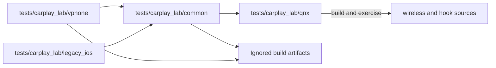

# CarPlay emulator laboratory

_vphone sender, QNX/QEMU receiver and reproducible timing evidence._

[Documentation home](../README.md) · [Test source tree](../../tests/carplay_lab/README.md) · [Wireless implementation](../wireless-carplay/README.md)

## 📋 Current stand

The active backend combines native iOS 26.6.2 in vphone with the stock210 ARM/QNX receiver. The stand provides independent video decode, AAC/APAC PCM inspection, input transport, lifecycle tests and native SI/J9 integration profiles.

| Guide | Use it for |
| --- | --- |
| [vphone lab](VPHONE_LAB.md) | Sender setup, Bluetooth/bootstrap and operating commands |
| [Native wireless QNX](NATIVE_WIRELESS_QNX.md) | Rust bootstrap, VM association adapter and receiver pairing |
| [Native screen test](NATIVE_SCREEN_TEST.md) | Main and AltScreen decode checks |
| [Timing](VPHONE_TIMING.md) | Clock correction, buffering and queue measurements |
| [Media stress](MEDIA_STRESS_TEST.md) | Concurrent streams, pacing and fault injection |
| [Media and native HMI validation](WIRELESS_MEDIA_VALIDATION.md) | Codec/PCM checks and real SI/Java integration |
| [Wireless completion](WIRELESS_COMPLETION_PLAN.md) | Remaining production integration and vehicle acceptance gates |

Individual profiles use explicit peripheral and association models. Inspect the profile's contract before interpreting a result as full-session coverage.

## 🔗 Source boundary

The stable launcher is `scripts/carplay_lab.sh`; Python modules now live under
`tests.carplay_lab`. Runtime images and evidence keep their existing ignored
paths. Production receiver code stays in `wireless/receiver_bridge/`; the
emulator harness and synthetic phones live in the test tree.

## 🧪 Profile boundaries

Use the [shared profile matrix and acceptance ledger](WIRELESS_COMPLETION_PLAN.md) to distinguish host contracts, native QNX, vphone media, real J9 startup and physical HU results. Run-specific receipts name every substituted peripheral and the exact input hashes. Dated suite counts and earlier failures are retained in the [historical lab overview](../archive/snapshots-2026-10-29/carplay-lab/README.md); they are not current test status.
