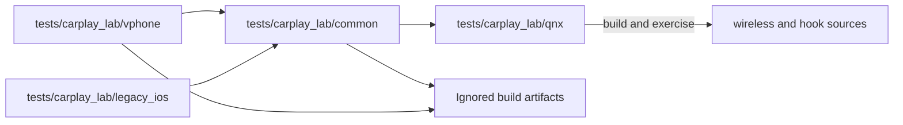

# CarPlay emulator laboratory

_vphone sender, QNX/QEMU receiver and reproducible timing evidence._

[Documentation home](../README.md) · [Test source tree](../../tests/carplay_lab/README.md) · [Wireless implementation](../wireless-carplay/README.md)

## 📋 Current stand

The active backend is vphone with native iOS 26.6.2 CarPlay, a software MFi
fixture and the stock210 QNX receiver. Both Maps streams have independently
decoded snapshots at 800×480 and 1440×542. The measured clock correction, BPF
buffering and remaining QEMU queue are documented separately from physical
wireless implementation and on-unit radio measurements.

| Note | Scope |
|---|---|
| [vphone runbook](VPHONE_LAB.md) | Current setup, ownership checks, pairing, input and native video |
| [Timing and queue evidence](VPHONE_TIMING.md) | Host/QNX clocks, native packet stages and sender sink pressure |
| [Retained iOS 14 laboratory](IOS_VM_LAB.md) | Inferno build recipe and historical bring-up |
| [Retained native screen tests](NATIVE_SCREEN_TEST.md) | Software-surface and paired-111 experiments on the older guest |
| [iOS/stock210 review](IOS210_CODE_REVIEW.md) | Receiver/protocol findings and reproduced corrections |
| [Wireless software MFi tests](../wireless-carplay/TEST_SOFTWARE_MFI.md) | Daemon crypto/control isolation and synthetic bootstrap tests |

## 🔗 Source boundary

The stable launcher is `scripts/carplay_lab.sh`; Python modules now live under
`tests.carplay_lab`. Runtime images and evidence keep their existing ignored
paths. Production receiver code stays in `wireless/receiver_bridge/`; the
emulator harness and synthetic phones live in the test tree.

## 🧪 Acceptance limits

Emulator results establish the exercised native protocol and decoded captures.
They do not establish physical OMX presentation, a 2.4 GHz CarPlay session,
stable 30 fps or turn-by-turn navigation. The [timing report](VPHONE_TIMING.md)
records the remaining backlog and unsuccessful URB-count experiment.

The source separation passes 101 vphone and 97 retained Python tests, native
RAM/input tests with 10,000 seeded inputs, and 200,000 native trace-parser
fuzzer inputs under ASan/UBSan. QNX toolchain 8.5 builds both the lab image and
the ordinary stock210 receiver; the diagnostic QEMU relinks, boots and serves
native `/info` and clock RPCs through the existing launcher.

The broader repository Python run still reports one amplifier Java-contract
failure and 16 errors from absent amplifier analysis artifacts (48 skipped).
The unchanged root-only suite reproduces those same failures; they are outside
the emulator test suite. Detailed local logs use the `layout-*` prefix under
`build/vphone-lab/`.
