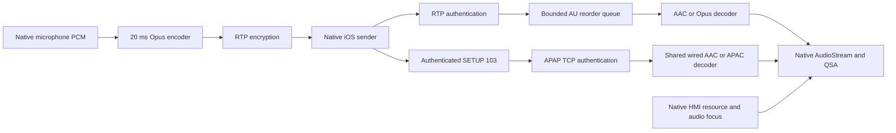
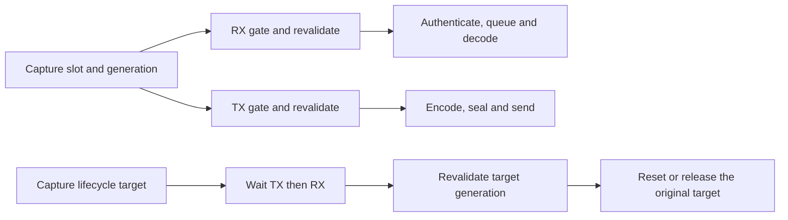

# Wireless media and native HMI validation

This guide describes current media contracts and reproducible test profiles. Use the [shared ledger](WIRELESS_COMPLETION_PLAN.md) for implementation status and remaining acceptance. The [dated investigation and receipts](../archive/internal-reference-2026-10-29/carplay-lab/WIRELESS_MEDIA_VALIDATION.md) preserve earlier failures, corrections and measurements.

[Laboratory](README.md) · [Native wireless runbook](NATIVE_WIRELESS_QNX.md) · [SI implementation](../wireless-carplay/SI_STAGE2_OFFLINE.md)

## Audio protocol

The observed native sender uses capability and wire transport **102** for wireless AAC media (`0x00400000`), and 100/101 for voice. Main media requires AAC-LC; voice requires Opus or AAC-ELD. These codec families need separate capability entries. The [call/Siri contract](../audio/CALL_AND_SIRI_ROUTING.md) still defines routing.

Pinned stock `libairplay.so` SHA-256: `01c116b1674215daa0602d556a6d9b2eb48c2113ca294ea1f5d58787e3f656f2`. Its main/alt worker at `0x261C4` unconditionally swaps incoming PCM bytes before native jitter insertion. `AudioConverterNew_compat`/`FillComplexBuffer_compat` return unsupported and have no decoder call path from this worker. Advertising AAC alone cannot fix playback.

The opt-in path (`MHI2Q_CP_WIRELESS_AUDIO=1`, admitted wireless owner only) therefore:

1. Advertises actual probed AAC-LC stereo support in capability 102, and Opus mono in 100/101.
2. Authenticates encrypted RTP before queueing compressed access units.
3. Reorders access units before predictive decoding and supplies S16 through the native jitter-read boundary.
4. Encodes microphone PCM into complete 20 ms Opus packets before sealing RTP.
5. Retains native AudioStream/QSA/resource routing and ordinary wired jitter behavior.
6. Maps admitted wireless AAC main-high 102 to stock210's native main100 context, restores 102 in the response, and maps that session's 102 teardown back to the same native context. The whole request validates before mutation; IDs/keys remain unchanged and retired IDs cannot be reused.
7. Retains independently negotiated buffered 103 through the existing wired APAP receiver and AAC/APAC decoder, with its own key, TCP transport and lifecycle.



Opus 1.5.2 is built from the pinned upstream archive, SHA-256 `65c1d2f78b9f2fb20082c38cbe47c951ad5839345876e46941612ee87f9a7ce1`, as a PIC fixed-point static library. The build records its toolchain/image/archive hashes and copies its license beside the hook.

## Buffered admission and six-channel source

The optional-module contract is [buffered_wireless.h](../../hook/audio/buffered_wireless.h). The wireless final `/info` pass retains the audio module's 103 descriptor only for the matching negotiated `mainBuffered` session with an installed dispatcher. Admission uses the wired APAP validator and descriptor's authenticated 32-byte `shk`; it does not invent a DataStream connection ID/key. Mixed SETUP validates before committing realtime state. Missing modules, duplicate descriptors and malformed inputs fail closed.

Native APAC SETUP uses index 65, APAP=true, spf=1024, ct=0 and audioFormat=0. Omitted `isMedia` is accepted only with mandatory `audioType=media`; explicit false/malformed flags fail. SAD widening follows a READY, actually expanded matching 48-kHz sink. Realtime 44.1-kHz media, voice and rejected widening retain stock geometry.

`audio_playback.py --channels 6 --engine avplayer` supplies WAVE_FORMAT_EXTENSIBLE FL/FR/FC/LFE/SL/SR with distinct tones and mask `0x60f` (`5.1(side)`). AVQueuePlayer requests multichannel output and records the actual route; a preference is not a forced route. The oracle checks every channel and rejects silence, swapped/missing channels and dropouts. The fixture uses UpMix Off to measure discrete identity.

The spatial hardware model loads **after** the hook because hook-owned cold QSA opens use `RTLD_NEXT`. The capture observer precedes pairing. Private model QSA handles never enter native libasound. `HTTP210_LAB=1` composes named test callbacks behind guarded pairing/admission; production artifacts contain no lab callback lookup. These distinctions must appear in the build manifest.

## Queue and execution contracts

The compressed realtime queue has 64 fixed AU payload slots and a 64-byte index permutation. Sorting/pop move indices, not whole payloads. Duplicate/late filtering, RTP wrap, decoder history and overflow handling remain part of the queue contract. Buffered 103/APAC uses its own receiver; wired PCM bypasses this compressed queue.

Primary wireless video looks up its reader under `screen_readers_lock`; registration/removal take `media_lock` then `screen_readers_lock`. Network reads and AEAD run after releasing the registry lock. Native synchronous `ProcessFrames` owns the stack reader until return. See [media.c](../../hook/wireless/media.c) and the [contention test](../../tests/wireless_media_contract_test.c).

### Wireless audio RX/TX isolation and reuse protection

The realtime audio adapters have independent fixed RX and TX gates at both layers. In [media.c](../../hook/wireless/media.c), RX owns packet authentication/queue submission and TX owns microphone sequence/nonce reservation, encoding and sending. In [audio_stream.c](../../hook/wireless/audio_stream.c), RX owns the AU queue/decoder and TX owns the Opus encoder/partial PCM frame. Registry mutexes protect only lookup and publication. Blocking microphone sends do not hold either registry mutex or the RX gates. Packets within each direction retain their existing serialization and ordering.



Init/free/reset and media publication/teardown/forget acquire their layer's gates in **TX → RX → registry** order. They never hold a registry mutex while waiting for a direction gate. Media data paths acquire the media direction gate before the corresponding codec gate. Emit callbacks may send but must not synchronously call jitter or media lifecycle functions. Native workers still stop/join before their session/jitter memory is destroyed; the gates do not replace native socket cancellation or make a blocked syscall finish immediately.

Generation tickets cover both data and cleanup. Receive snapshots its route before the native blocking receive; it rejects a delayed old packet after fd/session reuse, before applying replacement keys. Codec calls reject a replaced jitter slot instead of falling through into native freed/reused memory. A delayed `free`, `reset`, media teardown or owner cleanup also rechecks its original generation, so it cannot destroy a replacement. Selective teardown checks the individual stream generation inside a continuing session. Nonce reservation remains under TX and a failed/short send still consumes its nonce. Counters fail closed on exhaustion; initialization rejects an already tracked jitter before touching its native pool.

## Native codec and PCM profile

[wireless_audio_runtime.py](../../tests/carplay_lab/qnx/wireless_audio_runtime.py) tests codec/queue behavior and, with `--streams`, stock jitter/Cinemo boundaries. The concurrency runner exercises blocked TX with continued RX and generation reuse. Host crypto canaries are models; the native concurrency profile uses SDK AEAD. Neither is a physical radio or HMI test.

Cinemo AAC priming can produce zero output for the first AU. Later PCM retains the **current** AU timestamp; it must not inherit that first AU's timestamp. Gaps are represented as silence. Cinemo codec configuration runs outside `pthread_once` because it starts and waits for another thread; the remaining once-initializer resolves symbols only.

The native vphone audio profile lives in [wireless_audio_lab.py](../../tests/carplay_lab/vphone/wireless_audio_lab.py). It uses actual AVAudioPlayer/AVQueuePlayer and native receiver codecs, with declared HMI/QSA and receive-only MainHigh control models. The peripheral's `controlPort` isolates codec testing; it does not implement RTCP clock or retransmission. Keep that receipt flag false and the audio path opt-in until the [MainHigh gate](WIRELESS_COMPLETION_PLAN.md#mainhigh-control) is accepted.

Retained results include native AAC tone playback, discrete APAC PCM and APAC→AAC transitions. The APAC run-7 capture spans about 114 ms; AAC's 45-second player run contains a short 64-KiB PCM window. Neither is a long-duration loss/drift measurement. Exact frequencies, SNR, source hashes, negative controls and failure receipts remain in the archived record.

<a id="native-hmi-si"></a>
<a id="real-hmi-profile"></a>

## Real Java HMI profile

[hmi_si.py](../../tests/carplay_lab/qnx/hmi_si.py) builds a separate overlay for `Tools/mhi2q-qemu`, using its supported HMI launcher, release J9/LSD/Screen and native EGL/GLES/KGSL. There is no replacement Java SI/CarPlay provider. The runner checks its build receipt and stops only its owned launcher/RAM.

The recorded eight-check acceptance covers payload readback, adapter publication, native NOOP/deletion, client completion, actual swaps and concurrent SI/Java processes. **This is startup and controller-queue evidence.** Wireless admission, SI-owned DIO media and real Java audio-focus ACK are not part of that result. Keep a consistent private DLL set and a real `/dev/urandom` service in this profile.

## Video stress and output ownership

`tests.carplay_lab.common.alt_forward_stress` generates rapid-zoom AVC, sends it through production AltAV/TCP/framing, then independently decodes and compares ordered source pixels. Overflow recovery must begin at IDR. It does not exercise physical OMX, native-32m cache/surface ownership or HU presentation.

The renderer rejects oversized input rather than submitting clipped pictures. `OMX_BUFFERFLAG_DATACORRUPT` marks health false and stops queued presentation, allowing bounded config/IDR recovery. Normal teardown owns returned buffers. This handling is a code contract, not proof that decoder-marked corruption caused the owner's earlier visual incident.

## Capacity planning

Use [Media stress](MEDIA_STRESS_TEST.md) for the shared-capacity model. The planning target of 30–40 Mbit/s application goodput, preferably at least 40 Mbit/s headroom, is not a measured simultaneous 110/111@30-fps requirement. Reserve estimates are 15–20 Mbit/s for screens, 1–2 for APAC, 0.06–0.1 for mic RTP and 0.2–0.5 for control/metadata, before margin. Content, IDR bursts and encoding determine actual rates; six-tone APAC bitrate is not representative of music peaks. Measure short-window goodput, latency and queues in the combined profile.

## Reproduction

Run from the repository root with the lab's pinned native inputs:

```sh
python3 -m unittest tests.test_wireless_audio_codec tests.test_wireless_hook_contract
python3 -m tests.carplay_lab.qnx.wireless_audio_runtime
python3 -m tests.carplay_lab.qnx.wireless_audio_runtime --streams
python3 -m tests.carplay_lab.qnx.wireless_audio_concurrency_runtime
python3 -m tests.carplay_lab.qnx.wireless_screen_runtime
python3 -m tests.carplay_lab.common.alt_forward_stress
python3 -m tests.carplay_lab.qnx.hmi_si
python3 -m tests.carplay_lab.qnx.hmi_si run --seconds 240
```

For the native sender, build the isolated audio lab, prepare its owned virtual link, start QNX and software-MFi service, then run the bounded native Bluetooth API profile. Retain source/player/PCM receipts and image hashes together. Use `--help` on [wireless_audio_lab.py](../../tests/carplay_lab/vphone/wireless_audio_lab.py) for profile-specific options. The [ledger](WIRELESS_COMPLETION_PLAN.md) owns the combined-session and physical acceptance checklist.
