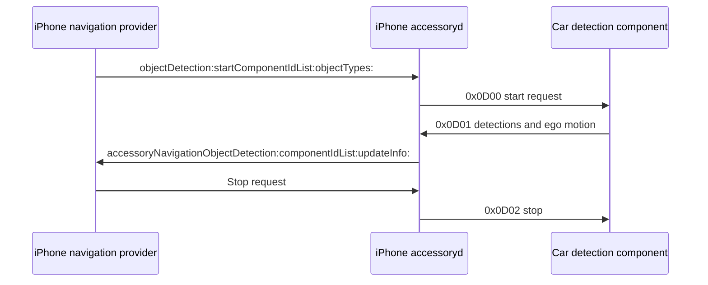

# CarPlay speed-limit investigation

*MHI2, 2026-09-30. Rechecked earlier research against iOS 26.6 (23G71) and iOS 27.0 (24A5418b) binaries.*

---

## 📋 Result

The checked iAP2 route-guidance interface has no numeric speed-limit field. The road-object channel is designed for **car → iPhone** detections, so it cannot be used to request Apple Maps' speed limit; the ordinary identification path also rejects it in both checked builds. The cluster-video scene accepts `showSpeedLimit=yes` in **both 26.6 and 27**. Whether Maps actually renders a sign with our display geometry remains an on-car experiment. `[decompile]` / `[open]`

This corrects two earlier claims in [Route Guidance TLVs](IAP2_ROUTE_GUIDANCE_TLVS.md) and [Third-party Nav Apps](THIRD_PARTY_NAV_APPS.md): the phone does not return road-object detections to the car, and the ordinary Maps cluster URL does not ignore `showSpeedLimit` on 26.6.

### Which 0x message returns the iOS speed limit?

No message ID or TLV field has been confirmed to export a numeric speed limit from iOS in the checked iAP2 RGI path. The examined interfaces below do not provide that result. This is a bounded finding about these paths, not proof that every private iOS interface lacks numeric speed limits. `[decompile]` / `[open]`

| Identifier/setting | What it carries or controls | Numeric iOS speed-limit export? |
|---|---|---|
| `0x5200` | Accessory → phone request to start route-guidance updates | Starts the known RGI subscription, whose checked schema has no speed-limit field |
| `0x5201` | Phone → accessory route-guidance update | No speed-limit field found in the checked schema |
| `0x5202` | Phone → accessory maneuver update | No speed-limit field found in the checked schema |
| `0x5204` | Phone → accessory lane-guidance information | Lane information; no speed-limit field found in the checked schema |
| `0x0D00` | Phone → accessory request to start accessory detections | No |
| `0x0D01` | Accessory → phone detection update, including generic RoadSign Type/Value | Opposite direction; not an exported Maps limit |
| `0x0D02` | Phone → accessory request to stop accessory detections | No |
| `showSpeedLimit=yes` | Maps cluster-video scene display policy | Requests a rendered sign; does not return its number through a TLV |

For the field listings and message directions, see [Route Guidance TLVs](IAP2_ROUTE_GUIDANCE_TLVS.md) and [Road Object Detection](IAP2_ROAD_OBJECT_DETECTION.md). A future claim that another `0x...` exports speed limits must include a decoded schema or a labeled phone → accessory capture; a suggestive symbol or sign-related field name is insufficient.

## 🔍 What StartRoadObjectDetection does

`StartRoadObjectDetection` is the descriptive name used here for `iap2_navigation_startRoadObjectDetectionHandler`. The phone builds message `0x0D00` and sends it to the accessory through `iap2_sessionControl_sendOutgoingMessage`. Its payload supplies component IDs (parameter 0) and requested object categories (void parameters 1–3). The handler consults `platform_navigation_objectDetectionComponentGetSupportedTypes`. These are accessory components supplying detections, not destinations for a Maps speed-limit feed. `[decompile]`

The deeper [Road Object Detection research](IAP2_ROAD_OBJECT_DETECTION.md) separates start categories from the byte-valued subtype `Type` fields and documents the identification rejection. Both 26.6 and 27 reject advertised `0x0D00–0x0D02` in the checked Navigation path, and reject Navigation identification parameter `0x0021`. The sequence below shows the implemented direction if activated, not a verified working negotiation. `[decompile]` / `[open]`

| Message | Direction | Function |
|---|---|---|
| `0x0D00` | iPhone → car | Start detections |
| `0x0D01` | car → iPhone | Detection update |
| `0x0D02` | iPhone → car | Stop detections |

The incoming-message dispatch table `_kiAP2MessageHandlerEntries_Navigation` contains `0x5200`, `0x5203`, and `0x0D01`. This places the detection update alongside the car's requests to start/stop phone route guidance. The detection handler parses TLVs, calls `platform_navigation_objectDetectionUpdateInfo`, and reaches `ACCNavigationServer`, which iterates registered navigation providers and invokes their detection callback. `[decompile]`

Detection update fields are component ID, timestamp, EgoSpeed, EgoYawRate, RoadSign, RoadLane, and RoadObject. RoadSign contains ID, State, Type, Value, LateralOffset, and ForwardOffset. **Type/Value are sensor-report fields**, not evidence of an exported Maps speed limit. Specific sign-type enum values, value units, and provider behavior were not established in this pass. `[decompile]` / `[open]`

### Accepted object families

| Family | Available data |
|---|---|
| `RoadSign` | ID, state, type, value, lateral/forward offsets |
| `RoadLane` | ID, state, left/right boundary types and colors, width, curvature fields; right-curvature delivery has implementation inconsistencies |
| `RoadObject` | ID, state, type, IsMoving, lateral/forward offsets, speeds, accelerations |

`RoadSign.Value` is a string on the wire: the 26.1 parser uses `iAP2MsgCopyDataAsCFString` for field 3, and the 27 parser calls it at `0x1000c4248`. This field is not restricted to a numeric speed. The 26.1 class names and the 27 classes/symbols agree on these three families. Concrete sign and object subtype enums (for example, which values identify a particular sign or a pedestrian) remain undecoded; acceptance by accessoryd does not prove that a navigation app uses or displays each family. `[decompile]` / `[open]`

### Evidence addresses

Both `accessoryd` files are Mach-O arm64e, 64-bit, little-endian, preferred base `0x100000000`. In these files, subtracting that base from the listed VA gives the corresponding file offset, also recorded in the manifests.

| Function/table | iOS 26.6 VA | iOS 27 VA |
|---|---|---|
| Start handler | `0x10014ff4c` | `0x10017619c` |
| Incoming update handler | `0x10014cd24` | `0x100173a50` |
| Stop handler | `0x100150514` | `0x1001766d4` |
| Incoming dispatch table | `0x10021b630` | `0x10021b5d8` |
| Platform update bridge | `0x100039f64` | `0x1000dbd54` |
| Server update method | `0x1000ddc68` | `0x100062de4` |

For 27, the start handler loads `w1 = 0x0D00` at `0x100176498` and sends at `0x100176668`. The update handler calls the platform bridge at `0x100173ef4`; the server calls `iterateNavigationProviderListSync:` at `0x100062fd0`; its provider block calls `accessoryNavigationObjectDetection:componentIdList:updateInfo:` at `0x100063128`. The stop handler loads `0x0D02` at `0x1001768a4` and sends at `0x100176954`.

## 📺 Cluster video speed-limit setting

`+[DBInstrumentClusterURLHandler applySettingsForClusterURL:toSceneSettings:]` handles `showSpeedLimit` in the **Maps URL branch** in both versions. It passes the URL value through `_clusterSettingForURLValue:` and calls `setShowsSpeedLimit:`. Settings are 1 = enabled (`yes`/`1`), 2 = disabled (`no`/`0` or absent), and 3 = user preference (`user`). `[decompile]`

| Evidence | iOS 26.6 VA | iOS 27 VA |
|---|---|---|
| URL handler | `0x25040e2b8` | `0x25e4c3ce8` |
| Speed setting conversion call | `0x25040e84c` | `0x25e4c42b0` |
| Speed setting setter call | `0x25040e858` | `0x25e4c42bc` |
| `showSpeedLimit` string | `0x250656fe9` | `0x25e750995` |

The 27 setter goes through stub `0x260077a80`, whose selector is `setShowsSpeedLimit:` at `0x1f801c6b8`. This was checked directly in the shared cache because the extracted image's stub symbols do not resolve every island call. The 26.1 decompilation already shows the same Maps query branch; its separate `nextGenHostedContent` branch has a different query set. The earlier version-only conclusion did not account for these branches. `[decompile]`

`CPInstrumentClusterController.speedLimitSetting` is a **display policy**, not a numeric road speed. The 26.1 controller stores the setting and notifies its delegate; the scene reads `showsSpeedLimit` from cluster settings.

Our hook currently puts `showSpeedLimit=no` in both `ALT_CLUSTER_URL_RGI_OFF` and `ALT_CLUSTER_URL_RGI_ON`. The next bounded experiment is to request `yes`, then check Apple Maps with a known mapped limit in full and narrow VC zones, on each iOS version. No runtime setting, build, or deployment was changed during this investigation. `[code]` / `[open]`

## 🧪 Proposed cluster sign experiment

This is the independent next experiment for the original speed-limit display goal. It does not depend on activating Road Object Detection. Parser support is verified; rendered sign visibility is still untested. `[decompile]` / `[open]`

| Step | Proposed action | Evidence to retain |
|---|---|---|
| Baseline | Capture the current Maps cluster scene with `showSpeedLimit=no` | iOS build, scene URL, VC mode and screenshot/frame |
| Display request | In an experimental build, change both `ALT_CLUSTER_URL_RGI_OFF` and `ALT_CLUSTER_URL_RGI_ON` to request `showSpeedLimit=yes` | Exact build/source revision and requested URL |
| Full-zone check | Use Apple Maps at a location with a known mapped limit in the full VC map zone | Whether the sign appears; its placement and clipping |
| Narrow-zone check | Repeat in the narrow VC map zone | Whether the sign remains visible after the layout change |
| Version check | Repeat on 26.6 and 27, recording route-active state | Results for each build and geometry rather than a version-only assumption |

If a sign is visible and the goal requires a numeric value, first establish an accessible decoded-frame path, then investigate OCR of the sign with its unit/context. No OCR implementation or accuracy result exists in this research. Failure to render a sign would not by itself overturn the verified URL-parser behavior; scene/client behavior, mapped data, route state, and geometry would still need examination. `[open]`

The experiment above is saved as a plan. The hook still requests `no`; no test build or deployment was performed while saving these notes.

## 📚 Numeric extraction and limits of the result

The 26.6 and 27 `ACCNavigationRouteGuidanceUpdateInfo` keys match the known route state, maneuver, road name, distance, ETA, lanes, source, and EV fields. Neither checked version adds a speed-limit key. The checked 26.1 Maps `CarMetadataNavigationListener`/`ACCNavigationInfoBuilder` and CarPlay metadata classes also provide no speed-limit export in that path. `[decompile]`

This establishes the behavior of the checked RGI and road-object interfaces. It does not establish that every private CarPlay Ultra/route-sharing interface lacks numeric limits. No live phone/car trace was collected. OCR of a rendered sign would be a separate extraction approach, requiring the sign to appear and a suitable decoded frame path; it is not implemented or validated here.

## 🔗 Sources and artifacts

- Earlier notes: [Feature Survey](../altscreen-and-video/CARPLAY_FEATURE_SURVEY.md), [Route Guidance TLVs](IAP2_ROUTE_GUIDANCE_TLVS.md), [Third-party Nav Apps](THIRD_PARTY_NAV_APPS.md).
- Local source root: `<workspace>/Refferences`.
- Raw disassembly, incoming dispatch tables, fingerprints, and IPSW build metadata: `ios_carplay_diff/analysis/speed_limit_2026-09-29/`. The directory was started on September 29 and completed September 30.
- `accessoryd`: `ios_carplay_diff/ios26/23G71__iPhone18,2/System/Library/PrivateFrameworks/CoreAccessories.framework/Support/accessoryd` and the corresponding `ios27/24A5418b__iPhone18,1/.../accessoryd`.
- `DashBoard`: `ios266_extract/dylibs/DashBoard` and `ios27_dsc/24A5418b__iPhone18,1/DashBoard`, plus each version's original `dyld_shared_cache_arm64e`.
- 26.1 decompilations: `iPhone18-3_26.1_23B85_Restore/System/Library/PrivateFrameworks/CoreAccessories.framework/`, nested `ACCNavigationServer.mm`, `ACCNavigationServerRemote.mm`, `DBInstrumentClusterURLHandler.mm`, `CPInstrumentClusterController.mm`, and `CPTemplateApplicationInstrumentClusterScene.mm`.
- `ios27_ff`/`ios_carplay_diff` daemon and feature survey checked for alternate names; no alternate speed-limit export was established. Existing extracts were used rather than re-extracting the IPSWs. Both IPSW `BuildManifest.plist` files confirm the version/build/device labels.

| Binary | SHA-256 |
|---|---|
| 26.6 accessoryd | `58a19762e55440ecbb5153d95bcfcb594f5425d9de695d2c7e387a42a0c559d6` |
| 27 accessoryd | `3c736704d7edd2dbc3aa4d7adfacb3dae14ad7e80e2b0a6d78d4e23e1081f9ef` |
| 26.6 DashBoard | `c69ef00411cdc8c1b266e5d137f2508052aff2cd28502636705e8be675fdede3` |
| 27 DashBoard | `7b4bd5a33ac27ddb67ec1518a770ad33b34138857eba7dc565bae16d1dd92db1` |
