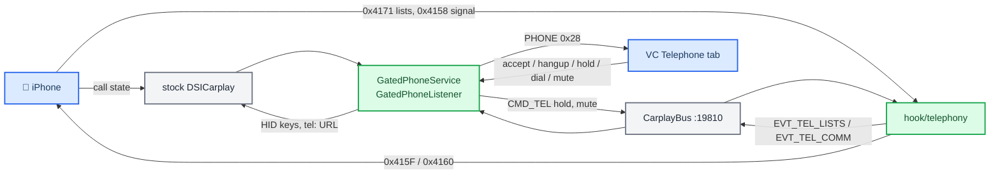

# CarPlay Telephony

*Shows CarPlay calls on the cluster telephone tab, which stock only fills for a Bluetooth HFP phone and otherwise covers with "Your iPhone is in Apple CarPlay mode. It is only possible to make and receive calls via Apple CarPlay." Status: **working on the car**, confirmed by the owner on 2026-09-23 on the first try.*

---

## 📋 What it does

While CarPlay owns the iPhone, the cluster telephone tab behaves as it does with a BT phone:

- the call screen: caller name and number, ringing / dialing / active / held, and the call timer;
- accept, hang up, hold, resume and swap from the tab and the steering wheel; dialling;
- mic mute;
- recents and favorites, and dialling from them;
- the missed-call indication, signal strength, register state and carrier name.

A caller picture is not possible: iAP2 CallStateUpdate carries no image ([iAP2 Communications](IAP2_COMMUNICATIONS.md#-callstateupdate-0x4155-and-call-control)).

The idea follows xPaiiN's `mst2-carplay-vc` on MIB2 Standard (call data from iAP2, commands back to the phone). That code hooks `ipod-drvr-iap2`, which MHI2Q does not have, so only the idea and its car-verified wire bytes carry over.

Details live in two companion notes:

- [VC Telephone Tab](VC_TELEPHONE_TAB.md): what the cluster reads, why `mct = 3` removes the note, the Tel key on both sides, what lists and mute need.
- [iAP2 Communications](IAP2_COMMUNICATIONS.md): every message and parameter, with the iOS, Cinemo and car evidence.

## 🏗️ Architecture

| Piece | Where | Role |
|---|---|---|
| `GatedPhoneService` | `java_patch/com/luka/carplay/telephony/` | wraps the stock `CombiBAPServicePhone` (HU PHONE 0x28) |
| `GatedPhoneListener` | same | wraps the stock `CombiBAPServicePhoneListener` (`TelBAPManagerTel1`) |
| `ServiceManagerPhone` | `java_patch/de/audi/app/combi/bap/app/phone/` (patched stock) | registers both wrappers |
| `CarplayDSILifecycleController` | `java_patch/de/audi/app/terminalmode/dsi/carplay/` (patched stock) | forwards `updateCallState`, installs the `Commands` (HID keys, `tel:` URL), filters the duplicate stock phone key |
| `hook/telephony/tel_hook.c` | native hook | StartListUpdates, ListUpdate and CommunicationsUpdate parsing, hold and mute |

Only `CombiModulePhone`'s getter and the diagnosis connector reach `AppConnectorPhone` directly, and neither publishes call data. `[code]`

## 🚦 The gate

`GatedPhoneService` uses stock's own verdict: it turns on when stock sends FctID 14 with `mobileConnectionType == 5`, which `BAPPropertyTelFSGSetup` does only while CarPlay is active (`TerminalModeDevice.isActive() && getConnectionMethod() == 1`, `:170-186`), and off on any other value. Off, every call passes straight through and a BT phone works as stock. There is no `Module` and no `CarPlayApp` wiring. `[code]`

While on, it publishes the values below and caches stock's values for every function it overrides, then replays them on gate-off. It also drops the CarPlay call cache on gate-off, so no stale call shows on the next connect.

| FctID | Published while CarPlay is active |
|---|---|
| 14 | stock's setup with `mct = 3` (HFP) instead of 5 — the normal branch on the VC ([why](VC_TELEPHONE_TAB.md#-mobileconnectiontype-and-the-carplay-note)) |
| 15 | Tel_State 15 (phone on, no SIM), privacy off |
| 16 | CallState, CallInfo, CallDurationSync, DialNumber, HangupCall, AcceptCall, CallHold, ResumeCall, MicroMute, CombinedNumbers, FavoriteList, MissedCallIndication, RegisterState, NetworkProvider, SignalQuality |
| 22 / 23 / 24 | CarPlay's calls from `DSICarplay.updateCallState`: CONNECTING + incoming → 1 ringing, CONNECTING + outgoing → 3 dialing, ACTIVE → 2, HOLDING → 5, DISCONNECTED → idle slot. Options follow the state (ringing → accept, active → hold, held → resume). The name is blank when it equals the number. CallDurationSync = time since the call went active; the VC runs the timer |
| 34 | the commanded mute state; resets when the last call ends |
| 45 | missed calls at the top of recents (newest first) up to the first answered or dialed call and newer than the last VC reset: `missedCalls` = summed occurrences, `missedNumbers` = their count. The VC's reset stores the phone-clock time of the newest entry |
| 49 / 60 | recents and favorites from the hook. Number = RemoteID, name = DisplayName, blanked when it is only a formatted number; recents type 1/2/3 → BAP received/dialed/missed |
| 18 / 20 / 21 | register state (iAP2 2 → 2 searching, 3 → 3 denied, 4 → 1 registered, 5 → 4 roaming, else and airplane → 0), carrier name, signal (0..5 bars × 20 = the stock DSI percent scale) |

## 📲 Actions from the cluster

`GatedPhoneListener` handles these while the gate is on and passes everything else, and everything while the gate is off, to stock:

| VC action | Goes to | Answer to the VC |
|---|---|---|
| AcceptCall 30 | `DSICarplay.postButtonEvent(BUTTON_ACCEPT_CALL 13)` | 0 if a call rings, else 1 |
| HangupCall 29 | `BUTTON_END_CALL 14` (stock's own `endCall`) | 0 if a call exists, else 1 |
| CallHold 31, ResumeCall 32 | `CMD_TEL [2][on]` → hook → HoldStatusUpdate 0x415F | 0 if a call exists, else 1 |
| swap | `BUTTON_FLASH_CALL 20` | 0 if two calls exist, else 1 |
| DialNumber 26, dial from a list | `requestUI2("tel:<number>")` (stock's own `callNumber`) | 0 |
| MicroMute 34 | `CMD_TEL [1][on]` → hook → MuteStatusUpdate 0x4160 | MicroMute status = the commanded state |
| resetMissedCallsIndicator | local | MissedCallIndication 0/0 |

Mute is optimistic: a mute toggled on the phone is not read back, because stock's CommunicationsUpdate subscription does not include MuteStatus. `[code]` Hang-up clears the VC mute (`GatedPhoneService.publishCalls`, `n == 0`); nothing has to be sent to the phone. On iOS mute is a property of each call: MuteStatusUpdate sets `setUplinkMuted:` on `frontmostAudioOrVideoCall` and does nothing without a call, the reported MuteStatus is that call's `isUplinkMuted`, and `CSDCallStateController` / `CSDProviderCallDataSource` apply mute per call (automatic mute only for push-to-talk channels and an A2DP route), so every new call starts unmuted (`ACCCommunicationsFeaturePlugin.mm:1081-1104`, `:3237-3307`, iOS 26.1). The commands are absolute (on/off), never a toggle, so they cannot invert. The one remaining mismatch: a mute changed on the phone during a call is not shown on the VC until the call ends. `[decompile]`

**One Tel press, two copies.** The stock HU already sends the steering-wheel phone key to CarPlay as FLASH 20 (Audi's single answer-or-end key), and the VC now also sends AcceptCall/HangupCall over BAP ([VC Telephone Tab](VC_TELEPHONE_TAB.md#-the-steering-wheel-tel-key)). While the gate is on, `GatedPhoneService` keeps only the first of the two within 800 ms: the patched `postDSICarplayButtonEvent` drops a stock phone key that follows ours (`dropStockPhoneKey`), and our accept or hangup is not pressed when stock's copy just went out. `[code]`

## 🔌 Hook, bus and install

- **Hook** (`hook/telephony/tel_hook.c`): sends StartListUpdates once per Identify cycle when stock's StartCallStateUpdates leaves; folds ListUpdate messages into the running lists (`tel_merge_lists`); reads stock's CommunicationsUpdate (`tel_merge_comm`); sends HoldStatusUpdate and MuteStatusUpdate on `CMD_TEL`. It never replaces or blocks a stock message. Formats and evidence: [iAP2 Communications](IAP2_COMMUNICATIONS.md). `[code]`
- **Bus:** `EVT_TEL_LISTS 0x0040` (sticky text: `r.<i>.a|b|type|ts|occ`, `f.<i>.a|b`), `EVT_TEL_COMM 0x0041` (sticky text: `signal`, `registration`, `airplane`, `carrier`; −1 = not reported), both published empty at init and on every new Identify or disconnect; `CMD_TEL 0x0117` = `[u8 action][u8 on]`, 1 = mute, 2 = hold ([Hook to Java Bus](../reference/HOOK_TO_JAVA_BUS.md)). `[code]`
- **Install:** `custom.sh` adds `0x415F`, `0x4160`, `0x4170` (sent) and `0x4171` (received) to `dio_manager.json` next to the route-guidance IDs ([Deploy and Release](../build-and-deploy/DEPLOY_AND_RELEASE.md#-route-guidance-message-ids-in-dio_managerjson)). Without them only the lists, hold and mute are missing.
- **Tests:** `tests/tel_hook_test.c` checks the StartListUpdates bytes against the car-verified request, the hold/mute layout, three captured ListUpdate frames, one captured CommunicationsUpdate frame, split and shrinking lists, and 100 000 malformed inputs.

## 🪜 Status

| # | What | Status |
|---|---|---|
| 0 | A/B test of the `mct = 3` lever | Skipped by the owner (2026-09-23): a BT HFP phone drives the same path, and the VC decompile confirms it |
| 1 | Call screen: calls, state, name, number, timer | Implemented |
| 2 | `hook/telephony`, `patch_dio` with ID lists | Implemented |
| 3 | Accept, hangup, hold/resume, swap, dial | Implemented |
| 4 | Recents and favorites, dial from a list | Implemented |
| 5 | Mic mute, missed-call indication, signal, register state, carrier | Implemented |
| – | Caller picture | Not possible over iAP2 |

On 2026-09-23 the owner confirmed on the car that it works on the first try. The logs from that session (`logs/telephony-20260923-102339/`, not in git) show the gate switching on at CarPlay connect and iOS sending 12 recents (the CarPlay cap) and 4 favorites within 21 s of the hook starting. `[car]`

## ✅ On-car checks

Needs the new jar, the new hook and the new `dio_manager.json` IDs; the jar only loads after a full HU reboot. `touch /mnt/app/carplay_verbose` lifts the hook log to INFO.

**Tab with CarPlay connected**
- [ ] No "Your iPhone is in Apple CarPlay mode" note; the tab looks like a BT phone's.
- [ ] If the note stays, reconnect CarPlay (FctID 14 is sent again).
- [ ] A brief "phone connected" notice on connect is expected (the 5 → 3 change).

**Calls**
- [ ] Incoming: name and number, ringing, the accept popup.
- [ ] Outgoing: dialing.
- [ ] Answered: active, the timer runs.
- [ ] Hung up: the tab clears, no stale call.
- [ ] Unknown caller: the number shows, the name is blank.

**Actions**
- [ ] Steering-wheel Tel while ringing accepts **exactly once**.
- [ ] Steering-wheel Tel during a call hangs up **exactly once**.
- [ ] Steering-wheel Tel with no call opens recents on the cluster.
- [ ] HU log shows `MFLPhoneButtonsListener.keyPressed` on a Tel press (the stock copy).
- [ ] Accept and hang up from the tab.
- [ ] Hold and resume (iOS refuses hold when the call does not allow it).
- [ ] Mute mutes the microphone on the phone; the cluster button follows.
- [ ] Two calls: swap switches.
- [ ] Dialling from the cluster calls through CarPlay.

**Lists**
- [ ] Recents appear, up to 12 (hook log `lists: recents=N`, Java `CarPlay lists: recents=N`).
- [ ] Incoming, outgoing and missed land in the right category.
- [ ] Dates and times are right (HU time zone).
- [ ] Favorites appear with the right number and name.
- [ ] Dialling from a list calls the right number.
- [ ] A new call updates the list without reconnecting.
- [ ] No lists at all: check the `dio_manager.json` IDs and that the phone lists this car as a CarPlay vehicle.

**Signal, carrier, missed calls**
- [ ] Signal bars and the carrier name from the iPhone.
- [ ] Airplane mode on the iPhone: no signal, not registered.
- [ ] A missed call lights the missed-call indication.
- [ ] Opening the list on the cluster resets it; a new missed call lights it again.
- [ ] Calling back removes that call from the count.

**Regression**
- [ ] CarPlay off: the BT phone works as stock (calls, lists, steering-wheel Tel).
- [ ] Navigation/RGI, cover art, music and altScreen unchanged.
- [ ] Reconnecting the phone refreshes lists and calls; nothing stale remains.

## ❓ Open questions

Settled statically on 2026-09-23: the hold/mute parameter, the recents type values, the string order in both lists, the Identify rules, the list split, what the VC needs for lists and mute, that 5 → 3 re-runs the VC's note rule, the PHONE op_State, and that the HU gets the steering-wheel keys. Left for the car:

- Our VC build may differ from the A5 2018 VC the decompile came from; the normal branch of the note rule needs `DP[0x12A] == 117`.
- A Tel press must act exactly once (the 800 ms filter).
- iOS stops the lists when the accessory is not a CarPlay-paired vehicle; when that re-check fires was not traced.
- Who owns the tab when a second BT phone has a real call during CarPlay? Today CarPlay does, for as long as stock reports `mct = 5`. (Stock hangs up HFP calls when CarPlay starts, `TelTerminalModeHandler.TMActiveState.enter:125-131`.)

## ⚠️ Rules and traps

- Touch only content on 0x28. **Never** touch HMIState or op-state on LSG 41: that produced two phone icons ([Phone Tab Gating](PHONE_TAB_GATING.md)).
- `getTelMode()` returns the raw DSI value (HFP = 3). `moduleState` describes the NAD modem, not the BT phone.
- Inject as an extra iAP2 message and never replace a stock one. Never call `SendIAP2` from shutdown ([Landmines](../LANDMINES.md)).
- The telephony IDs ride `dio_manager.json`, not the Identify patch.
- Clear state on `HOOK_EVENT_IDENTIFY_START` and on disconnect, and publish a baseline sticky frame at init.
- Java target is 1.4: no generics, enums or autoboxing. Check new API with `recompile_check.py`.
- Leave the HU disclaimer screen 300326 (`TEL_INIT_PHONE_CARPLAY`) alone. It is a separate path from the cluster.
- Never log phone numbers or names at WARN.

## 🔗 Related

- [VC Telephone Tab](VC_TELEPHONE_TAB.md) and [iAP2 Communications](IAP2_COMMUNICATIONS.md): the two companion notes.
- [Phone Tab Gating](PHONE_TAB_GATING.md): the earlier attempt to hide the tab, the signal traps and the refuted levers.
- [RGI and BAP Bridge](RGI_AND_BAP_BRIDGE.md): the same hook → bus → gated BAP service pattern for navigation.
- [Hook to Java Bus](../reference/HOOK_TO_JAVA_BUS.md): frame format and ID ranges.

Provenance: 2026-09-23, against `Tools/jxe2jar/out/MU1316-vf`, `UiModVC/A5_2018_unpacked/hmi_app.elf` (VC `AU491_0379`), Cinemo `libNmeVfs.so` MU1316, the iOS 26.1 pseudo-source and iOS 27 `accessoryd`, `logs/accessoryd-packets-2026-08-21-233610.log.ips`, and xPaiiN's `mst2-carplay-vc` and V54.3D11 test pack (`cpvc-tel-lib`, the MU1102 ListUpdate capture, `CombinedNumbersCarPlay.mapCallMode`).
