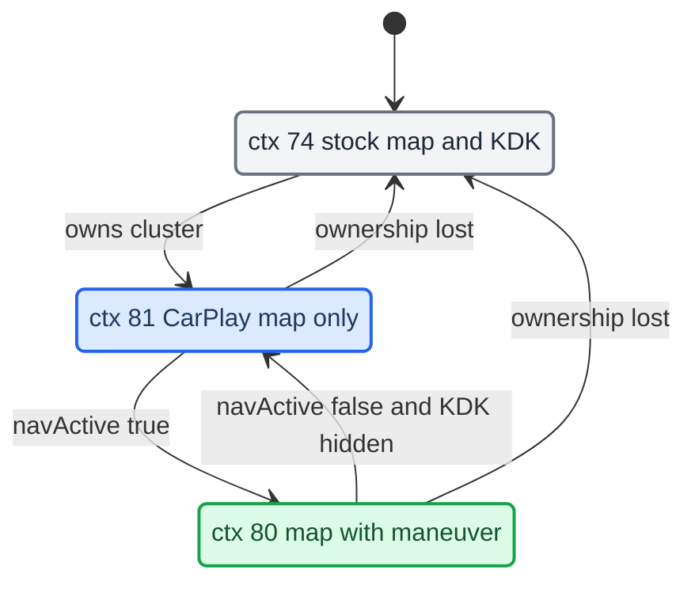

# Cluster Contexts

*How the CarPlay cluster gets its own DisplayManager contexts (74 stock, 80 nav, 81 map, 82/83 CarPlay arrows over the Audi map), why we reuse stock backings, the single writer that switches between them, and the cockpit map modes that choose among them.*

---

## 📋 The three contexts

The Audi cluster (LVDS2, terminal 1, 1440×542 visible) composites a set of displayables per DisplayManager context. The stock cluster contexts (72 map, 74 map+KDK, 75 blank) do not carry our CarPlay planes. So we declare our own contexts on every unit whose `kombiType != 4` (G24). `[car]` (on-unit `dmdt gd/gc/gs`), `[code]` (`java_patch/de/audi/tghu/fwhmi/DisplayManagerMIB2High.java:177-182`)

| Context | Displayables (index 0 = front) | Meaning |
|---|---|---|
| `74` | `{20, 102, 101, 33}` | Stock map + KDK maneuver, used when CarPlay does not own the cluster (`DisplayManagerMIB2High.java:156-164`) |
| `80` | `{98, 101, 102, 99}` | CarPlay nav active: our `maneuver_render` (98) over the KDK backings (101/102) over the CarPlay map plane (99) (`:178`) |
| `81` | `{99}` | CarPlay connected, not navigating: the CarPlay map plane only (`:179`) |
| `82` | `{98, 101, 102, 33}` | Cockpit map mode "Audi map + CarPlay arrows" while CarPlay guides: our maneuver over the KDK backings over the **stock** map 33 (this fork) |
| `83` | `{98, 101, 102, 58}` | The same over the stock alternative map 58, chosen when the stock map controller targets 76/77 (this fork) |

Displayables: `98` is our `maneuver_render` window (Software, 328×181), `99` is the `altscreen_render` CarPlay plane, `101`/`102` are the stock 987 KDK Image backings, `20` is the stock KDK maneuver, and `33` is the stock cluster map. `[code]` (`java_patch/com/luka/carplay/cluster/ClusterLayerController.java:8-10`, `maneuver_render/protocol.h:108`)

On G24 (`kombiType == 4`) there is no ctx 80/81. `AltScreenModule.start()` disables itself there. `[code]` (`java_patch/com/luka/carplay/core/AltScreenModule.java:119-122`, `:386-390`)

## 🗺️ Cockpit map modes (this fork)

`CockpitMapSetting` chooses what the Virtual Cockpit shows while CarPlay is connected. The mode is stored in the HMI persistence (namespace 1009, key 1001, next to the UpMix level), survives restarts, and applies at once. `[code]` (`java_patch/com/luka/carplay/core/CockpitMapSetting.java`, `tests/CockpitMapModeTest.java`), `[open]` until car-tested

| Mode | Cluster context | Route guidance on the cluster and HUD | Roller zoom | Stock route at connect |
|---|---|---|---|---|
| **Phone map** (default, luka's behaviour) | 81, 80 while CarPlay guides | CarPlay (BAP + our maneuver box) | phone map | cancelled (`BAPBridge.engageTakeover`) |
| **Audi map + CarPlay arrows** (Allemon's arrow-over-stock-map idea) | stock contexts, 82/83 while CarPlay guides | CarPlay | Audi map | cancelled |
| **Audi navigation** | stock contexts throughout | the stock navigation (its own route, KDK, route text, HUD) | Audi map | kept: `RgdModule` does not take over |

"Audi navigation" works like M.I.B.'s NavActiveIgnore without its side effect: luka's narrow seam in `CarplayDSILifecycleController.convertAppState` already hides CarPlay's NAVI ownership from the HMI, and with no takeover the stock route keeps guiding in the cockpit and HUD while Waze or Maps runs on the main screen (two voice guidances if both talk). Switching into or out of "Audi navigation" rebinds the RGD module through the same serialized path as a Navigation-service change (`CarPlayApp.onCockpitMapModeChanged`); switching back to a CarPlay mode takes over again, which cancels a running stock route as at connect.

What follows the mode: `AltScreenModule.computeDesiredCtxLocked()` is the single place that maps session state + mode to a context. `isClusterPinned()` (stock context writes blocked: `CombiMapController.switchToTargetContext`, `DisplayManagerMIB2High.switchContext`) is always true in phone mode, only while CarPlay guides in arrows mode, never in Audi mode. `ownsRouteGuidance()` (KDK planes in `ClusterLayerController`, the HU distance model in `ClusterService`, the OK fallback) is false only in Audi mode. `isPhoneMapShown()` (roller zoom to the phone) is true only in phone mode. Contexts 82/83 do not wait for the phone video's first frame. `[code]`

**Steering-wheel shortcut.** A long press on the left roller (DSIKeyPanel key 40, states 3/4 long pressed/started) steps phone map → Audi map + arrows → Audi navigation → phone map, once per press, only while CarPlay is connected and the cockpit shows its map tab (FctID 44 bit 0 `lvdsMapIsVisible`, or the "MMI in the cluster" screen manager where present); other tabs keep their own long-press use. The short press (OK, route info) now acts on release, so one press is never both. No on-screen confirmation yet: the cockpit switches visibly. `[code]`

## ⚠️ Displayable 103 is not creatable, so reuse 101/102

`103` is an unregistered DSI id. `createImageDisplayable(103)` silently does nothing, and only pre-registered ids exist in the DM. So we never invent displayable ids. We reuse the two stock KDK backings `101` and `102`. `[car]`, `[code]` (`DisplayManagerMIB2High.java:174-176`)

Two traps live here:

- **The 101/102 names are inverted vs physical size.** `DISPLAYABLE_KDK_BACKGROUND_SMALL_STAGE = 101` is the larger 328×180 in-tube (sport) panel. `LARGE_STAGE = 102` is the smaller 210×153 popup. "Stage" means map-scene size, not backing size. `[code]` (`java_patch/de/esolutions/hmi/widgets/audi/evo/high/widgets/CombiMapController.java:33-36`)
- **The backings exist only when `sysConst(541) == 2`.** `configureDM()` creates 101/102 only then (`DisplayManagerMIB2High.java:231-235`). Our A5 FPK car reports `541 == 2`. The same condition gates the call from `CombiMapController` into `ClusterLayerController.apply` (`CombiMapController.java:197-202`). `[car]`, `[code]`

<details>
<summary>Plane geometry (read from the stock Layout by `ClusterLayerController`)</summary>

`ClusterLayerController` owns the CarPlay plane geometry. The stock `CombiMapController` only forwards to it. `[code]`

- **Geometry is not hardcoded.** It is read from the terminal's active stock `Layout` constants (slots 58-61 and 118-125). Classic and Sport on B9 use different in-tube anchors, and the skin switch changes the `Layout` at runtime (`ClusterLayerController.java:17-20`, `:37-43`, `:130-148`). The resolved Classic and Sport values are tabled in [KDK Geometry and Animation](KDK_GEOMETRY_AND_ANIMATION.md).
- **Fallback before the first Layout** (`:57-62`): in-tube crop `0,0,328,180` at `(984,139)`, popup crop `59,27,210,153` at `(1091,110)`.
- **Stage** is taken from VC FctID 54 (`onVcPresentation`, `:220-236`). Before FctID 54 arrives, the stock hint bit `BITFIELD_KDK_POSITION_IN_TUBE` is used (`CombiMapController.java:187-189`).
- **Visibility** is taken from VC FctID 44 (`onVcVisibility`, `:209-217`). The requested View mode never reveals a layer (`:12-13`).
- **One composition path**: `setCropping(98, crop…, dst…)`, `setPosition(backing, dst)`, and the other backing gets opacity 0 (`:318-331`). The crop destination equals the backing position.
- **Nav-off or disconnect**: planes `98/101/102` get opacity 0 while CarPlay owns the cluster and nav is off (`:312-316`). On release, the last stock backing state is restored (`:293-310`).
- The layout's small-stage offset (slots 80/81) is logged but never applied. Applying it broke Sport singlescreen on the car (`:283-288`). `[car]`

</details>

---

## ⚙️ The single-writer state machine

`AltScreenModule` has one persistent worker thread. It is the only caller of `DisplayManager.switchContext` and `setUpdateRate` for terminal 1. `republish()` recomputes `desiredCtx`, and the worker converges `currentCtx` to it. `[code]` (`AltScreenModule.java:18-21`, `:125-132`, `:301-316`) Two writers of the cluster context were the original cause of the black cluster, the 30 s hang, and the View button reverting to stock. `[car]`

Stock writes are also blocked at the DM. While CarPlay owns terminal 1, `DisplayManagerMIB2High.switchContext` drops any cluster write that does not come from the worker thread. `[code]` (`DisplayManagerMIB2High.java:300-316`)

The inputs:

- `connected` comes from `AltScreenModule.start/stop`, driven by `CarPlayApp` activation. Cluster ownership is `connected || videoAvailable`. `videoAvailable` comes from the renderer's `VIDEO_ON`/`VIDEO_OFF` and bridges short TMDev bounces. `[code]` (`AltScreenModule.java:133-138`, `:306-307`, `:333-344`; `AltscreenControlServer.java:207-231`)
- `navActive` comes from `RouteGuidance.rgActive` (the BAP nav-active moment) via `setNavActive()`. It is not the stock KDK-visible bit. `[code]` (`RouteGuidance.java:543`, `:786`; `CombiMapController.java:214-217`)
- Nav-off is delayed. On `setNavActive(false)`, if the VC still shows the KDK, `navHidePending` keeps ctx 80 until VC FctID 44 withdraws visibility. There is no timer. `[code]` (`AltScreenModule.java:356-378`, `ClusterLayerController.java:216`)
- The worker also waits for `rendererReady` (first posted frame) before it takes over. `[code]` (`AltScreenModule.java:502`, `:575`)



Ctx 81 (map via plane 99) is drawn even when not navigating. The CarPlay cluster map is always on while CarPlay owns the cluster. `[car]`, `[code]` (`AltScreenModule.java:428`)

## 🔧 Entering ctx 80/81: direct switch, guarded by `ctx < 80`

The worker enters ctx 80/81 by a direct `switchContext`, not through the stock view-mode chain. On this unit the view-mode chain does nothing: the cluster map is FPK, so `ClusterViewMode.refreshViewMode` returns early. `[car]`, `[code]` (comment at `java_patch/com/luka/carplay/rgd/BAPBridge.java:2276`)

- Coming from a non-CarPlay context, the worker first bounces through ctx 72, waits 180 ms, and then switches. Between 80 and 81 it switches directly, without the bounce. After the switch it sets the terminal to 30 fps. `[code]` (`AltScreenModule.java:47-50`, `:560-584`)
- On disconnect the worker sets 0 fps, switches to 74, and restores 30 fps. `[code]` (`AltScreenModule.java:585-599`)
- `DisplayManagerMIB2High.switchContext` normally remaps a stock context to its KDK twin (`addKDKToContext`) while `visibleKDKs[term] == 20`. Our contexts skip that remap (`ctx < FIRST_CARPLAY_CONTEXT`). Otherwise `switchContext(80)` would fall through to 73. `getMappedInternalContext` is identity. `[code]` (`DisplayManagerMIB2High.java:36`, `:53-55`, `:318-325`)
- View-button pin: `CombiMapController.switchToTargetContext` returns early while `AltScreenModule.isConnected()`. `[code]` (`CombiMapController.java:345-356`)

## ⚠️ The altScreen advert is on in production

Earlier notes said the altScreen advertisement must stay off. That is stale. The ctx 80/81 design draws the phone's type-111 stream on plane 99, so production startup enables the advert. `[code]` (`deploy/smartphone_integrator/carplay_startup.sh:52-54`: `ALTSCREEN_HANDLE_ALT=1`, `ALTSCREEN_ADVERT_DISPLAYS=1`; gates at `hook/altscreen/altscreen_hook.c:721`, `:792`)

The old 80↔74 flapping came from two context writers, which the single writer and the DM block above now prevent. The env gates are value-checked (`env_on`); see `memory/hook_getenv_presence_check_trap.md` and [Landmines](../LANDMINES.md).

## 🔍 What the stock DM holds, and how to look with `dmdt`

A live `dmdt` dump of the stock A5 (MU1316) shows what really exists. `[car]` (`logs/dmtd.log`, `logs/dmtd_hook.log`)

- `dmdt gd`: seven displayables only: 16 HMI 1024×480, 17 rear camera (Overlay), 19 map viewer 1024×436, 20 route guidance 328×181, 33 `KOMBI_MAP_VIEW` 1440×455, 101 328×180, 102 210×153. No 58, 59, 36 or 44.
- `dmdt gs`: two displays. Main Display / LVDS1 / 1024×480 / ctx 10 (or 0) = {16, 19}, the central MMI screen. Cluster Display / LVDS2 / 1440×542 / ctx 74 = {20, 102, 101, 33}, the HU's feed to the cluster. The VC draws gauges and tabs itself; the HU sends only the map composition.
- `dmdt gc`: stock declares 87 contexts when `kombiType != 4` and 158 when `== 4`, including `dc[72] = {33}`, `dc[74] = {20,102,101,33}`, `dc[76] = {58}`, `dc[78] = {16,59}`. Context 78 is dead on the A5 because nothing creates 59 (see [Smartphone Tab and Kombi DSI](SMARTPHONE_TAB_AND_KOMBI_DSI.md)).

Our patched `DisplayManagerMIB2High` sizes the array at 82 on A5 (stock 0..78 plus 80/81) and 158 on G24 (`java_patch/de/audi/tghu/fwhmi/DisplayManagerMIB2High.java:39-40`, `:63-65`). The A5 is the FPK variant (`sysConst(541) == 2`, it has 101/102) and not `kombiType == 4`, so `createImageDisplayable` works and the positioning terminal is 1. `[code]`

`dmdt` (`/eso/bin/apps/dmdt`, from `MU1316-MHI2Q_US_AUG22_P5087-JTB-07426.03.1811930398/advanced/MU1316-appimg/eso/bin/apps/dmdt`, IDA session `mu1316_dmdt`) is a thin client for the DM debug IPC. It starts a comm agent `DMRCClient` on domain `local`, connects proxies to `asi.displaymanager.DebugTool` and `DebugToolReply`, sends one request, waits for the async reply, prints it, sleeps 50 ms and exits (main `0x106050`, proxies `0x103278`, reply wait `0x103C84`/`0x103C04`). `[decompile]`

| CLI | id | Action |
|---|---:|---|
| `gd` | 1 | list displayables |
| `dc <ctx> <displayable...>` | 2 | declare a context |
| `sc <display_id> <ctx>` | 3 | switch context |
| `dm <display_id> on` / `off` | 4 / 5 | debug mode |
| `ts <display_id> <path>` | 6 | screenshot |
| `sb <display_id>` | 7 | switch buffered context |
| `gc` | 8 | list contexts |
| `gs` | 9 | system info |
| `gld on` / `off` | 10 / 11 | global debug labels |

Argv parsing is at `0x105B98` (32-byte command struct), dispatch at `0x105F48`. `gs`/`gd`/`gc` send request id 123 (`0x103D3C`/`0x103D00`/`0x103CC4`); `sc` calls a virtual method with `(display_id, context_id, 123)` (`0x102DA4`); `dc` builds an Int32Array (`0x102E88`). The `gs` printer (`0x104914`) prints, per display, name, terminal, size, current context id, and each displayable of that context (names via `0x102980`, `--` when unnamed). `gs` has no numeric display id; `sc` needs one, and only display order, name and terminal (`LVDS1`/`LVDS2`) identify it. `[decompile]`

```text
	display: Cluster Display
	terminal: LVDS2
	size: 1440 x 542
	context id: 74
		20 (DISPLAYABLE_MAP_ROUTE_GUIDANCE)
		102 (--)
		101 (--)
		33 (DISPLAYABLE_KOMBI_MAP_VIEW)
```

`maneuver_render` used to `popen("/eso/bin/apps/dmdt gs")` to learn cluster focus, and a hardened parser (match `terminal: LVDS2`, merge stderr, force `sc` on parse failure) was written after "dmdt focus unknown" logs. That is superseded: the renderer runs no `dmdt` now, and context routing is Java's job through `AltScreenModule`. `[code]` (`maneuver_render/platform_qnx.c:6`, `:146`, `:212`, `:395`)

### How a window becomes a displayable

The DM binds an external window to a displayable by its ID string, not by who created it. This is why `altscreen_render` and `maneuver_render` can own 99 and 98 as plain Screen clients.

1. The client creates a window, puts it in the DM's window group with `screen_manage_window(win, "How are you gentlemen?")`, and sets `SCREEN_PROPERTY_ID_STRING` to the displayable number (`"98"`, `"99"`). Our renderers do this with raw `screen_create_window` and `screen_manage_window`, without `libdisplayinit` (`common/cluster_surface.h:7-30`, `common/cluster_surface.c:48`, `maneuver_render/platform_qnx.c:4-6`). `[code]`
2. `CScreenHandler` receives the new-window screen event (`handleScreenEvent`), reads the ID string back with `atoi`, wraps the window in a `CSurfaceSource`, stores it in the DM's surface-source map (an rb-tree at `DisplayManager+0x68`) and calls `CDisplayable::attachSource`. It stamps `SCREEN_PROPERTY_MANAGER_STRING = "All your base are belong to us!"` on windows it owns. `[decompile]` (`libdm_modMain.so`; the class and method symbols are exported, the `atoi`/`+0x68` details come from the original RE notes)
3. For the cluster, `CASIMostEncoder::setActiveDisplayable` records the displayable-to-display mapping and forwards it to the video encoder ([Cluster Video Encoder](../altscreen-and-video/CLUSTER_VIDEO_ENCODER.md)). `[decompile]`

Displayables 98 and 99 have no stock owner, so their slots are empty until our window arrives: binding them is not a race with a stock producer. The DM can disown a window on context transitions; `cluster_surface_lost()` detects that so the renderer rebuilds its surface on a fresh window (`common/cluster_surface.h:18-22`). `[code]`

## 🔗 Related

- [RGI and BAP Bridge](RGI_AND_BAP_BRIDGE.md): what sets `rgActive` and `navActive`.
- [HUD Renderer](HUD_RENDERER.md): what fills plane 98.
- [AltScreen Cluster Video](../altscreen-and-video/ALTSCREEN_CLUSTER_VIDEO.md): the CarPlay video on plane 99.
- [Reconnect and Lifecycle](../altscreen-and-video/RECONNECT_AND_LIFECYCLE.md): `CarPlayApp` activation and the deactivate debounce.
- [KDK Geometry and Animation](KDK_GEOMETRY_AND_ANIMATION.md): the Layout table behind the plane geometry, and the View / FctID 44 / FctID 54 sequence.
- [Smartphone Tab and Kombi DSI](SMARTPHONE_TAB_AND_KOMBI_DSI.md): displayable owners and the MOST H.264 path to the VC.
- [HMI Startup and Identity](../connect-and-usb/HMI_STARTUP_AND_IDENTITY.md): which stock chain asks for the main and cluster contexts first at connect.
- [VC Layout and Fonts](VC_LAYOUT_AND_FONTS.md): the VC text layout around the map.
- [PDC Small Stage](PDC_SMALL_STAGE.md): why the parking popup used to hide CarPlay, and the Java guard.
- [Partial 360 Camera Preflight](../altscreen-and-video/PARTIAL_360_CAMERA_PREFLIGHT.md): the camera/OPS split and its context contract.

## 📚 Sources

Merged originals were removed from the tree after this note absorbed them; they remain in git history (commit 23972aa).

- `dmdt_mu1316_analysis`: `dmdt` commands, `gs` output format, the old renderer parser.
- `SMARTPHONE_CLUSTER_KNOWLEDGE`: the live `dmdt gd/gs/gc` dump and the FPK / kombiType findings.
- `CLUSTER_VIEW_STOCK_SYNC`: stage from FctID 54 and visibility from FctID 44 (detail in [KDK Geometry and Animation](KDK_GEOMETRY_AND_ANIMATION.md)).

Earlier provenance: `MEMORY.md` (Cluster CarPlay contexts), `memory/carplay_cluster_context_architecture.md`, `memory/cluster_carplay_viewmode_design.md` (its "rides the stock view-mode chain" claim is superseded by the direct switch); source `java_patch/com/luka/carplay/cluster/ClusterLayerController.java`, `java_patch/com/luka/carplay/core/AltScreenModule.java`, `java_patch/de/audi/tghu/fwhmi/DisplayManagerMIB2High.java`, `java_patch/de/esolutions/hmi/widgets/audi/evo/high/widgets/CombiMapController.java`.
