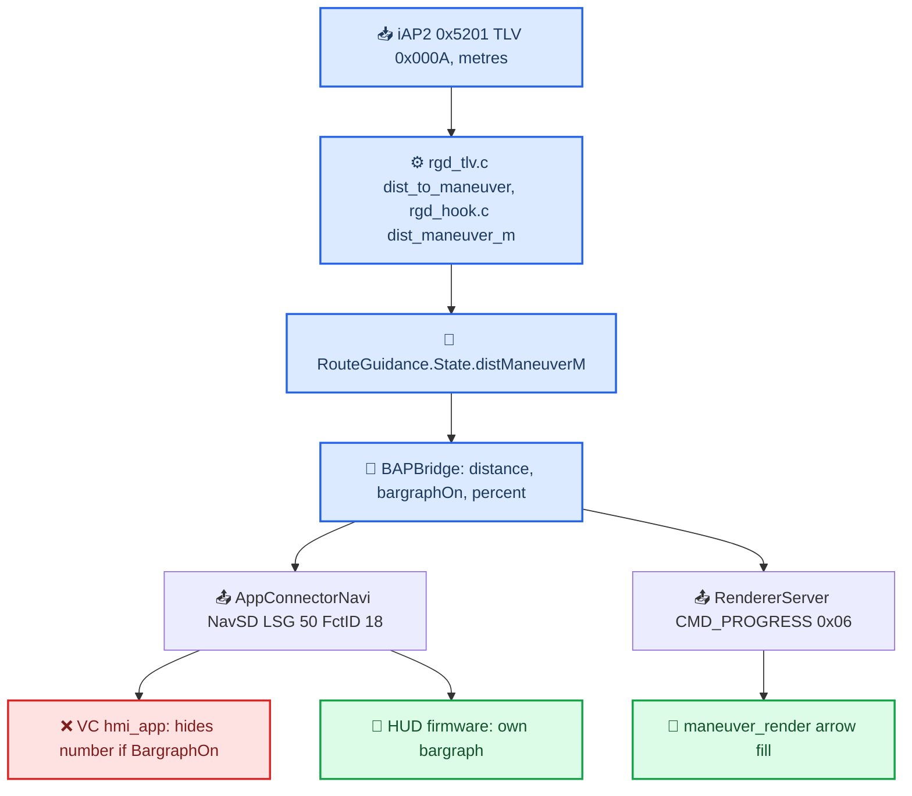

# Distance Bargraph

*Why the VC hides the distance number while the bargraph is on, what the HUD firmware can draw, the exact FctID 18 bytes, and how our renderer shows progress as arrow fill instead of a bargraph column.*

---

## 📋 The short version

- Our BAP packet carries distance **and** bargraph together, both valid. The number disappears on the **VC** because its own `hmi_app.elf` hides the distance label whenever `BargraphOn != 0`. `[decompile]`
- The **HUD** graphics code can draw number and bargraph in the same pass. Which upstream step turns BAP into its internal "group enabled / digit selectors" packet is still unknown. `[decompile]`, `[open]`
- On the VC our `maneuver_render` shows progress as a **fill of the 3D arrow**; the old native bargraph column was removed. The HUD keeps its own stock bargraph from the same BAP data. `[code]`
- No firmware was changed and no option below is implemented. Changing the Java thresholds or resending `valid = 1` cannot bypass the VC predicate. `[decompile]`

The BAP-side policy (prepare thresholds, 15% denominator cap, 20% blink, 600 ms phase) lives in [RGI and BAP Bridge](RGI_AND_BAP_BRIDGE.md); it is summarised here only where the chain needs it.

## 📊 Distance source and the FctID 18 payload



- 0x5202 TLV `0x0005` (`distance_between` → `mN_distance` → `State.mDistance[N]`) is the step length. It sets the **denominator**, not the remaining distance.
- `0 < distM <= denominator` → `bargraphOn`, `percent = distM * 100 / denominator`. Vehicle speed is not involved. Below 20% the 600 ms worker toggles percent between 100 and 0; **both blink phases keep `bargraphOn = true` and the positive distance**, so an empty phase does not bring the number back on the VC. `[code]` (`java_patch/com/luka/carplay/rgd/BAPBridge.java:289-310`)
- `sendDistanceToManeuverRaw` passes the stock `BAPDistanceFormatter` result to `appConnectorNavi.updateDistanceToNextManeuver(value, unit, bargraphOn, percent)` and then, once BAP returned, sends the renderer `level = percent * 16 / 100` and the explicit phase. The renderer is skipped while `rendererManeuverPending` so progress of a new maneuver never lands on the old arrow. `[code]` (`BAPBridge.java:324-360`)

Stock `AppConnectorNavi` judges validity only by `value != -1`; `bargraphOnOff` and `bargraph` are set independently. The real serializer writes an 8-byte `DistanceToNextManeuver_Status`: `[decompile]`

| Offset | Field | Example: 150 m, bar 75% on |
|---|---|---|
| 0–3 | Distance, uint32 little endian, displayed value × 10 | `dc 05 00 00` = 1500 |
| 4 | Unit (0 = metres) | `00` |
| 5 | BargraphOnOff | `01` |
| 6 | Bargraph 0–100 | `4b` = 75 |
| 7 | ValidityInformation bit 0 | `01` |

Full payload `dc 05 00 00 00 01 4b 01`. It is little endian, unlike the big-endian header of our localhost bus. BargraphOnOff values 2–254 are reserved; do not use them to dodge the predicate. `tests/DistanceBargraphChainTest.java` runs the real `BAPBridge` + stock `AppConnectorNavi` + stock serializer (needs `-Xverify:none` because HotSpot rejects an `invokespecial` in the JXE-reconstructed `BAPFunctionPropertyFSG`); five cases pass (150 m/75%, 30 m/100%, 30 m/0%, 300 m bar off, zero/clear). `[model]`

### Three different "distance" consumers

Do not treat these as one path:

1. **CarPlay sender:** `core/RgdModule.java` hands the framework `CombiBAPServiceNavi` to `RouteGuidance` → `BAPBridge`. This direct sender stays open during CarPlay.
2. **Stock ClusterService BAP writes:** `core/AltScreenNavStatusGate.java` installs `GatedCombiService` on `Navigation.ClusterService.combiBAPListener.combiservice`; stock FctID 18 writes are blocked while CarPlay owns the cluster.
3. **HU Java model:** `ClusterService` keeps `MODEL_DIST_TO_MANEUVER` (64) valid with `!showBargraph || AltScreenModule.isConnected()`; the bargraph model is 65. This is an HU model, not the VC predicate. The stock MOST/KOMO branch separately keeps `flag1 = !showBargraph` for `refreshDistanceToNextManeuverMOST` → `komoService.setDistanceToNextManeuver`. `[code]` (`java_patch/de/audi/tghu/navi/app/cluster/ClusterService.java:377-386`)

An older `NAVSD_FCTID_MATRIX.md` claim that the patched `ClusterService` already lets the VC co-render both was wrong: that class runs on the HU and CarPlay sends FctID 18 through path 1.

Sources: `DISTANCE_BARGRAPH_CHAIN`, `RGI_HUD_RENDERER_KNOWLEDGE`

## ❌ The VC hiding predicate

Analysed file: `/Users/luka/Desktop/AUDI_2/Patches/UiModVC/A5_2018_unpacked/hmi_app.elf` (AU491 / A5 2018), SHA-256 `d2df7d51e7dc6e9d16f0eb063142cb39212e32148b729041d318489bbbe9dc9b`, ELF32 ARM LE, QNX `/usr/lib/ldqnx.so.2`, first PT_LOAD at file offset 0 → VA `0x100000`. The image installed in the car was not read, so the addresses belong to this ELF only. `[decompile]`

| DP ID (`dp_monitor.cfg`) | Meaning |
|---|---|
| `0x02000066` | DistanceToNextManeuver BargraphOn |
| `0x02000067` | Distance, string |
| `0x02000068` | Unit |
| `0x02000069` | ValidityInformation |
| `0x02000070` | RG_Status |
| `0x02000071` | RG_Status_available |

Function **VA `0x5eca80`** reads five DPs through `0x69ecd0` and returns:

```c
visible = rg_available != 0 && rg_status == 1 && bargraph_on == 0
       && distance_valid != 0 && unit <= 5;   /* signed int16 compare */
```

The deciding branch is `0x5ecaec ldrsh r3,[sp,0xa]` / `0x5ecaf0 cmp r3,0` / **`0x5ecaf4 bne 0x5ecb18`** (file offset `0x4ecaf4`, bytes `07 00 00 1a`). Callback `0x5f0d58` feeds the result to the widget visibility setter `0x654830` (string `m_visibleByModel.m_DPID`, writes `widget+0xa0` in direct mode). `tools/verify_vc_distance_visibility.py` executes the real ARM predicate, callback and setter under Unicorn 2.1.4 for **336 combinations** (only DP reads and the virtual widget getter stubbed): with active RG, valid distance in metres, BargraphOn 0 → visible 1, BargraphOn 1 → visible 0. The model-bound setter branch was not executed. The script refuses any other ELF hash. `[decompile]`

External evidence (outside the repo): stock `AppConnectorNavi`, `BAPDistanceFormatter`, `DistanceToNextManeuver_Status`, `ByteArrayStream` in `/Users/luka/Desktop/AUDI_2/Tools/jxe2jar/out/MU1316-combined-vf/` (executable `MU1316-combined-final.jar`); BAP NAV SD v2.80 §8 `Refferences/476121999-BAP-FC-NAV-SD-P30DF48-v2-80-F.md`; `dp_monitor.cfg` under `Refferences/VC_AUDI/nand_extraction/extract_app/KI_FPK_AU491/gss-applications/8/default/app.img/dp/`; signal-read index `UiModVC/vc_native_studio/assets/runtime/hmi_signal_usage.json`; logs `LocalLogs/reviews/distance-bargraph-chain-2026-09-11/`.

Sources: `DISTANCE_BARGRAPH_CHAIN`

## 🔍 What the HUD graphics can draw

Firmware roots under `/Users/luka/Desktop/AUDI_2/Firmwares/HUD/extracted/`. FD_61 = raw GDC image (ARM32 LE, ARM mode), FD_62 = scene data, FD_51 = the V850 MCU. `.GraphicsDrawTask.text` maps FD_61 file offset `0x12debc` to runtime VA `0x808f5000` (size `0x2329b4`); function file offset = `0x12debc + (VA − 0x808f5000)`. The two versions differ in 14 bytes of that section, but the walker/selector range `[0x13259c, 0x133e44)` and the FD_62 page tree `[0x1294, 0x114a68)` are byte-identical. `[decompile]`

| Firmware | Block | SHA-256 |
|---|---|---|
| `FL_8W6919617G_1952_APPL_V000` | FD_61 | `0146bfb0ac3584f3f6fe19f2d38a97c65f3bbd4bbed63d2d43c51db24bf4dc63` |
| same | FD_62 | `259409a247a297417d6b398bb42a9f51897514604f320c0b184ccb92b53c35ee` |
| `FL_8W6919617M_2325_APPL_V000` | FD_61 | `8a71ffd31fdfc17131507e0d259bd216751ec2c7918468b8e18ba58787198fc1` |
| same | FD_62 | `81a31aa257ef322d3333f2e10770d3edb32179abff75e0bd904689503007449b` |

The GDC consumes an internal packet, not the 8 BAP bytes: `packet[8]` page, `[9..12]` group mask, `[13]` extra group bits, `[13+field]` element selectors.

| Runtime VA | FD_61 offset | Role |
|---|---|---|
| `0x808f96e0` | `0x13259c` | page/group walker (body `0x808f96e4`) |
| `0x808f9e68` | `0x132d24` | element dispatch by kind |
| `0x808fa750` | `0x13360c` | draws up to six numeric glyphs |
| `0x808fae9c` | `0x133d58` | selector read by field/type/mask |
| `0x808fa984` | `0x133840` | surface descriptor hand-off |

Entry addresses include the `mov ip, sp` before the prologue; the old IDA base split those into separate functions.

- **Distance (page 3):** groups **9** and **14** (FD_62 nodes `0x943a8`, `0x95524`, kind 3, base field 28), six nibble selectors from `packet[41..44]`, selector 15 = skip digit. Unit is a separate element (`0x9465c`/`0x957d8`), low nibble of `packet[41]`: internal 0 = no unit, 1 = `r0691 "m"`. That is a different numbering from BAP unit 0 = metres, so a BAP payload can never be forwarded as-is. The numeric draw function never reads the bargraph field.
- **Bargraph:** group **2**, node `0x8f3e4`, kind 0, field 32, level from **`packet[45]`**: 17 states 0–16 of 16 segment surfaces each; selector 17 draws nothing. It is an internal 0–16 level, not the BAP 0–100 percent.
- Flags at `0x6e3658`/`0x6e3656` belong to cached/composite surfaces (kind 1/5/6), not to BAP BargraphOn.

`tools/verify_hud_distance_bargraph.py` executes walker, dispatch, selector and glyph positioning of both firmwares (only surface submit, memcpy and a registration helper stubbed): **108 scenarios per firmware, 216 total** (2 numeric groups × 18 bar values × 3 number states). `[decompile]`

| Renderer input | Digits | Unit | Bar segments |
|---|---:|---:|---:|
| 150 m, bar 0–16 | 3 | 1 | 16 |
| 150 m, bar 17 | 3 | 1 | 0 |
| digits = selector 15, bar 0–16 | 0 | 1 | 16 |
| distance group off, bar 0–16 | 0 | 0 | 16 |

Example positions (x, y, w, h): `1` (80,79,15,23), `5` (95,79,15,23), `0` (110,79,15,23), `m` (127,89,17,12), bar segments x = 159, w = 11. Number and bar do not overlap there.

So if the real HUD swaps the number for the bar, the switch is already in its input (group 9/14 off, or digits = 15). Which producer writes that mask and where is `[open]`; the next step is to trace writes to groups 9/14 and fields 28–32 on a FctID 18 change, or to capture GDC packets before and after the bar appears. The old `HUD_ANALYSIS.md` architecture guesses were not used as evidence. The GDC logs lived in `output/r2/hud-distance-bargraph-2026-09-11/`, which was not preserved.

Sources: `HUD_DISTANCE_BARGRAPH_CHAIN`

## 🤔 Options for showing number and bar together

None is implemented. `[open]`

| Option | What changes | Cost |
|---|---|---|
| A. Patch the VC predicate | Remove only `bargraph_on == 0` (the branch at `0x5ecaf4`), keep RG/validity/unit checks | Firmware-specific; affects stock navigation too unless CarPlay-gated; layout of text + bar on every screen must be checked. Does not change the HUD |
| B. HU only: split outputs | BAP sends valid distance with `BargraphOnOff = 0`; the renderer keeps the logical bar and blink | Needs a separate renderer flag (zeroing the shared `bargraphOn` would kill both bars). Also turns off the HUD bar if the HUD follows this field |
| C. Draw the number ourselves | New renderer command with formatted distance/unit, glyph drawing, popup/side layout, replay on reconnect | Most work; VC number stays hidden but ours sits next to the bar. The current renderer protocol has no text command |

Adding a number to our MOST frame solves the VC only; patching the VC does not touch the HUD. Turning the BAP bar off is not a solution for both devices at once.

Sources: `DISTANCE_BARGRAPH_CHAIN`, `HUD_DISTANCE_BARGRAPH_CHAIN`

## 🔄 From bargraph column to arrow fill

The old renderer drew a 16-segment bargraph column (`CMD_BARGRAPH` in the 2026-09-11 docs). It is gone: progress is now `CMD_PROGRESS` (0x06, `payload[0]` remaining level 0–16, `[1]` mode, `[2]` phase under flag 0x20) and the arrow itself fills. Remaining level 16 = empty, 0 = full. `[code]` (`maneuver_render/protocol.h:24`, `maneuver_render/arrow_progress.h:5-10`). Details of fill, blink and handoff: [HUD Renderer](HUD_RENDERER.md).

<details>
<summary>History: the bargraph viewport and side-selection design (removed)</summary>

At `59646e9` the bar sat at the right edge of the whole 328×180 frame, so in the big-screen popup crop `(59,27,210,153)` it was off-screen. The fix introduced what still exists: Java sends the visible area and the renderer animates to it.

- Viewport path (still current): `AltScreenModule` stage change → `RouteGuidance` wakes its worker → `BAPBridge.refreshRendererViewport()` reads `ClusterLayerController.maneuverViewport()` → `RendererServer.sendVisibleArea` → `CMD_VISIBLE_AREA` 0x08 (`[2..9]` four BE u16 x, y, w, h, top-left origin) → 250 ms ease in/out, retarget continues from the current position, the same area does not restart. Duplicate areas are suppressed only after a successful enqueue; reconnect clears the cache. Before any area arrives the renderer uses the popup crop as the safe default. `[code]` (`BAPBridge.java:2133-2138`, `java_patch/com/luka/carplay/cluster/ClusterLayerController.java:78-87`, `maneuver_render/protocol.h:115-120`)
- Removed behaviour: right side by default, flip left only if the incoming maneuver's final arrow-tip prism overlapped the bar (triangle clipping with 3 px shadow margin, not bounding boxes), decided once per maneuver change and applied in one frame, ties → right. Each segment had a black drop shadow (~(0.75, 1) px offset, 2 px feather). `maneuver_select_bargraph()` built a separate mesh of the final maneuver for that test.
- Its checks (24 OpenGL captures, 120 camera positions, ARM build) and GIFs under `output/bargraph-layout/` were not preserved. The document is not a request to bring the column back.

</details>

---

Sources: `MANEUVER_BARGRAPH_VIEWPORT`, `ARROW_PROGRESS_EXPERIMENT`

## 🔗 Related

- [RGI and BAP Bridge](RGI_AND_BAP_BRIDGE.md): FctID 18 policy, denominator, blink worker.
- [HUD Renderer](HUD_RENDERER.md): arrow fill, blink tint and viewport animation.
- [VC Layout and Fonts](VC_LAYOUT_AND_FONTS.md): the other VC labels in the same NavStatus container.

## 📚 Sources

Merged originals were removed from the tree after this note absorbed them; they remain in git history (commit 23972aa).

- `DISTANCE_BARGRAPH_CHAIN`: iAP2 → BAP → VC predicate, FctID 18 bytes, options A/B/C.
- `HUD_DISTANCE_BARGRAPH_CHAIN`: HUD GDC emulation of number + bar.
- `MANEUVER_BARGRAPH_VIEWPORT`: the removed column and its viewport animation.
- `ARROW_PROGRESS_EXPERIMENT`: why the column was replaced by arrow fill.
- `RGI_HUD_RENDERER_KNOWLEDGE`: status summary, open HUD question.
