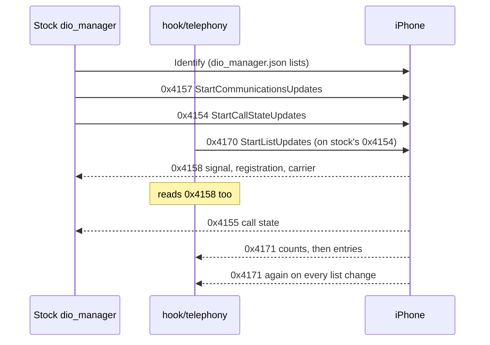

# iAP2 Communications

*The iAP2 Communications messages behind [CarPlay Telephony](CARPLAY_TELEPHONY.md): which ones stock already uses, which ones the hook adds, their exact parameters, and the evidence for every layout (iOS source, Cinemo, and captures from two cars).*

---

## 📋 The messages

| Msg | Name | Direction | Who |
|---|---|---|---|
| `0x4154` | StartCallStateUpdates | HU → phone | stock |
| `0x4155` | CallStateUpdate | phone → HU | stock (reaches Java as `DSICarplay.updateCallState`) |
| `0x4157` | StartCommunicationsUpdates | HU → phone | stock, params 0, 1, 2, 4, 5 |
| `0x4158` | CommunicationsUpdate | phone → HU | stock; the hook also reads it |
| `0x415B` | AcceptCall | HU → phone | hook (`CMD_TEL` action 3) |
| `0x415C` | EndCall | HU → phone | hook (`CMD_TEL` action 4) |
| `0x415D` | SwapCalls | HU → phone | hook (`CMD_TEL` action 5), no params |
| `0x415F` | HoldStatusUpdate | HU → phone | hook (`CMD_TEL` action 2) |
| `0x4160` | MuteStatusUpdate | HU → phone | hook (`CMD_TEL` action 1) |
| `0x4170` | StartListUpdates | HU → phone | hook, once per Identify cycle |
| `0x4171` | ListUpdate | phone → HU | hook parses it |

Stock `dio_manager.json` already lists `0x4154`/`0x4157` (sent) and `0x4155`/`0x4158` (received). The installer adds `0x415B`, `0x415C`, `0x415D`, `0x415F`, `0x4160`, `0x4170` and `0x4171` ([Deploy and Release](../build-and-deploy/DEPLOY_AND_RELEASE.md#-route-guidance-message-ids-in-dio_managerjson)). Stock dio_manager never calls Cinemo's own builders for the hook's messages; the hook sends them as extra messages through the stock `SendIAP2` worker and never replaces or blocks a stock message (`hook/telephony/tel_hook.c`). `[code]`

Evidence tags: `[decompile]` = iOS 26.1 pseudo-source (`ACCCommunicationsFeaturePlugin.mm`, `CoreAccessories_18.mm`), iOS 27 `accessoryd`, or Cinemo `libNmeVfs.so` MU1316; `[car]` = our car's 2026-08-21 accessoryd packet log, or xPaiiN's V54.3D8 capture on a MU1102 (MIB2 Standard CN).

## 🔄 Startup

The hook sends StartListUpdates once per Identify cycle, when it sees stock's outgoing 0x4154, so the link is known to be up. If the queue refuses it, the next stock 0x4154 retries. `[code]`

## 📨 StartListUpdates (0x4170)

| Param | Type | Meaning |
|---|---|---|
| 0 | void | recents available request |
| 1 | group of voids | recents properties to send (0–9) |
| 2 | void | recents count request |
| 3 | u16 | RecentsListMax |
| 4 | u8 bool | RecentsListCombine |
| 5 | void | favorites available request |
| 6 | group of voids | favorites properties to send (0–5) |
| 7 | void | favorites count request |
| 8 | u16 | FavoritesListMax |

- The hook sends 1, 3, 4, 6 and 8 with every property, max 20 each. This is byte for byte xPaiiN's request that got an answer on a real car (theirs used max 25/0); `tests/tel_hook_test.c` compares the bytes. `[car]`
- iOS parses the message in `CoreAccessories_07.mm:5564-6097`; a non-void sub-param inside a property group rejects the whole message, and param 8 alone does not start favorites. `[decompile]`
- **Max is capped at 12 for a CarPlay accessory**, 50 otherwise. `Max = 0` means that default cap, not "none" (`_calculateListCap_0`, `CoreAccessories_18.mm:7904-7979`). `[decompile]`
- **Combine** picks iOS's coalesced recents: one entry per number with an Occurrences count. `[decompile]`
- Cinemo's own builder (`libNmeVfs.so@0xFBA50`) uses the same layout. `[decompile]`

## 📥 ListUpdate (0x4171)

| Param | Type | Meaning |
|---|---|---|
| 0 | u8 bool | recents available |
| 1 | group | one recents entry |
| 2 | u16 | recents count |
| 5 | u8 bool | favorites available |
| 6 | group | one favorites entry |
| 7 | u16 | favorites count |

| Entry param | Recents | Favorites |
|---|---|---|
| 0 | index (u16, absolute) | index |
| 1 | RemoteID: the number | RemoteID |
| 2 | DisplayName: the contact name, or the formatted number without a contact | DisplayName |
| 3 | Label | Label |
| 4 | AddressBookID | AddressBookID |
| 5 | Service (u8): 1 phone, 2 FaceTime audio, 3 FaceTime video, 0 other | Service |
| 6 | Type (u8): 1 incoming, 2 outgoing, 3 missed, 0 other | – |
| 7 | UnixTimestamp (u64, seconds) | – |
| 8 | Duration (u32), only when not combined or occurrences == 1 | – |
| 9 | Occurrences (u8), only when combined | – |

- **The whole capped list is resent on every change, split by size.** Only the first message carries the header (0/2 or 5/7); follow-ups carry only entries, placed by their absolute index (`CoreAccessories_18.mm` ~7380-7420). The hook folds messages with `tel_merge_lists`: a count sets the length, an entry lands at its index. `[decompile]` `[code]`
- The iOS plugin fills RemoteID from `callerId`, DisplayName from `callerNameForDisplay`, Label from `callerIdSubStringForDisplay`; Type comes from the CallHistory status (`currentRecentsListWithCoalescing:limit:`, `ACCCommunicationsFeaturePlugin.mm:3690-3700`), and the daemon clamps anything outside 1..3 to 0 (`CoreAccessories_18.mm:7270-7290`). `[decompile]`
- xPaiiN's capture: one message with recents available and count 3, one with the three entries (a saved contact: number / contact name, type 2, occurrences 2; an unsaved number: `+86…` / the same number formatted with spaces), one with favorites available and count 0. All three frames are fixtures in `tests/tel_hook_test.c`, with the numbers and name replaced by placeholders of the same byte length. `[car]`
- Cinemo's parser (`@0xF9880`, entry `@0xF7F70`) reads the same IDs. `[decompile]`

## 🔇 HoldStatusUpdate (0x415F) and MuteStatusUpdate (0x4160)

| Msg | Param 0 | Param 1 |
|---|---|---|
| HoldStatusUpdate | HoldStatus (u8 bool) | CallUUID (string, optional; without it iOS uses the frontmost call) |
| MuteStatusUpdate | MuteStatus (u8 bool) | – |

- iOS 27 `__holdStatusUpdateHandler @0x10011ec18` and `__muteStatusUpdateHandler @0x10011ee0c` read only param 0 for the status and drop the message without it. Hold-on is refused when the call does not allow hold (`ACCCommunicationsFeaturePlugin.mm:3185-3234`); mute acts on the frontmost call (`:3296-3307`). `[decompile]`
- **Cinemo's unused builders are wrong for current iOS:** `@0xFB3C4` and `@0xFA834` put the status in param 1 (and CallUUID in 2), which iOS reads as a UUID string or ignores. The hook uses param 0, as xPaiiN's `cpvc-tel-lib` does. `[decompile]`

## 📶 CommunicationsUpdate (0x4158)

| Param | Type | Meaning |
|---|---|---|
| 0 | u8 | SignalStrength, 0..5 |
| 1 | u8 | RegistrationStatus: 0 unknown, 1 not registered, 2 searching, 3 denied, 4 home, 5 roaming, 6 emergency only |
| 2 | bool | AirplaneMode |
| 3 | bool | TTY |
| 4 | string | CarrierName |
| 5–8 | bool | CellularSupported, TelephonyEnabled, FaceTime audio/video enabled |
| 9 | bool | MuteStatus |
| 10, 11 | u8 | CurrentCallCount, NewVoicemailCount |
| 12–17 | bool | InitiateCall / EndAndAccept / HoldAndAccept / Swap / Merge / Hold available |

- Source: `CoreAccessories_18.mm:6800-6895` (the param switch) and `ACCCommunicationsFeaturePlugin.mm:953-1030` (the registration values). `[decompile]`
- iOS sends only the params in the subscription, and later updates carry only what changed; the hook merges them (`tel_merge_comm`). `[decompile]` `[code]`
- Our car's packet log: stock 0x4157 asks for 0, 1, 2, 4, 5; the answer is signal 3, registration 4, airplane 0, carrier `AT&T`, cellular 1. That frame is a fixture in `tests/tel_hook_test.c`. MuteStatus (9) is not in stock's request, so mute on the cluster is optimistic. `[car]`

## 📞 CallStateUpdate (0x4155) and call control

CallStateUpdate carries RemoteID, DisplayName, Status, Direction, CallUUID, AddressBookID, Label, Service, IsConferenced, ConferenceGroup, DisconnectReason and StartTimestamp (`CoreAccessories_18.mm:6279-6302`). **It has no picture**: iOS sends image files over iAP2 only for Now Playing artwork, so the cluster cannot show a caller photo for CarPlay calls. The HU does not parse 0x4155 itself; stock turns it into `DSICarplay.updateCallState`. `[decompile]`

Accept and hang-up use iAP2 AcceptCall/EndCall with Action 0 as param 0 and **no CallUUID**: iOS then takes `incomingCall` / `frontmostAudioOrVideoCall` (`ACCCommunicationsFeaturePlugin.mm` `acceptCallWithAction:callUUID:` / `endCallWithAction:callUUID:`, logs "No call UUID specified - falling back to ..."). Until 2026-09-24 they used CarPlay's HID telephony keys (`DSICarplay` 13/14), which on the car reached the phone neither from the cluster OK nor from the wheel. Dial still uses the `tel:` URL, which works. `[decompile]` `[car]`:

| Msg | Param 0 | Param 1 | Param 2 | Param 3 |
|---|---|---|---|---|
| InitiateCall `0x415A` | Type: 0 destination, 1 voicemail, 2 redial | DestinationID | Service 1..3 (destination only) | AddressBookID |
| AcceptCall `0x415B` | Action: 0 accept or hold-and-accept, 1 end-and-accept | CallUUID | – | – |
| EndCall `0x415C` | Action: 0 end (UUID or frontmost), 1 end all | CallUUID | – | – |
| SwapCalls `0x415D` | – | – | – | – |

## 🪪 Identify rules

From `iap2_identification_checkIdentificationMsgIDs` (`CoreAccessories_08.mm`) and the group tables in `CoreAccessories_18.mm:8222-8255` `[decompile]`:

- Declaring any message of a group requires every required message of that group, or Identify is rejected.
- **List updates:** 0x4170 (sent) and 0x4171 (received) together; 0x4172 optional.
- **Call control** (0x415A–0x4161): also requires 0x4154 (sent) and 0x4155 (received). Stock already declares both.
- **Communications:** 0x4157 (sent) and 0x4158 (received); 0x4159 optional.
- No component or capability beyond the lists.
- If iOS rejects 0x4170 anyway, Cinemo drops it from its identification pool and re-identifies without it (`OnIdentificationRejected`, `libNmeVfs.so@0xE438C`); the lists then stay empty and nothing else breaks.
- iOS stops the lists and sends "available = 0" when the accessory's certificate is not among the phone's CarPlay-paired vehicles (`iap2_communications_carPlayPairedVehiclesDidChangeHandler`, `CoreAccessories_18.mm:8019-8137`). When exactly that re-check fires was not traced. `[open]`

## 🔗 Related

- [CarPlay Telephony](CARPLAY_TELEPHONY.md): the module, the gate and the on-car checks.
- [VC Telephone Tab](VC_TELEPHONE_TAB.md): what the cluster does with the BAP side.
- [iAP2 Route Guidance TLVs](IAP2_ROUTE_GUIDANCE_TLVS.md): the other iAP2 feature the hook subscribes to, and the frame layout.
- [Hook to Java Bus](../reference/HOOK_TO_JAVA_BUS.md): `EVT_TEL_LISTS`, `EVT_TEL_COMM`, `CMD_TEL`.
