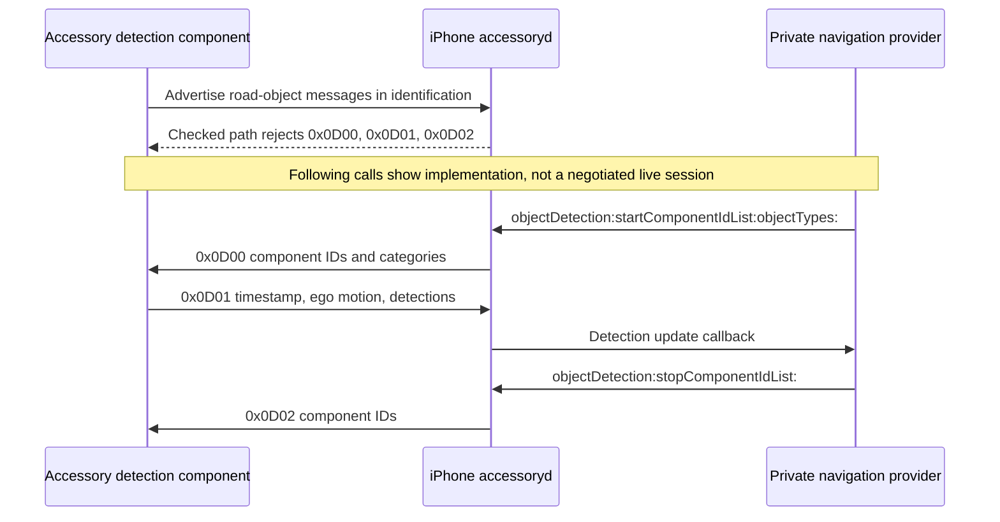
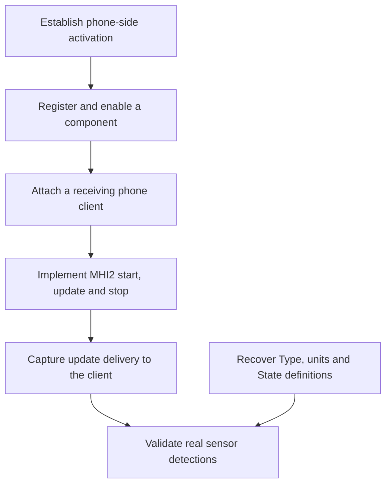

# iAP2 StartRoadObjectDetection and Type research

*2026-09-30 · iOS 26.6 / 23G71 and iOS 27.0 beta / 24A5418b · static reverse engineering, with 26.1 / 23B85 decompilations as supporting evidence.*

## 📋 Findings

`StartRoadObjectDetection` (`0x0D00`) requests detections **from the accessory into the phone**. It does not retrieve Apple Maps' speed limit. Its implementation accepts category numbers `1`, `2`, and `3`; the individual `RoadSign.Type`, `RoadObject.Type`, and lane boundary types are separate byte fields. Their semantic enum names were **not recovered**. `[decompile]` / `[open]`

There is also a negotiation barrier: both checked `accessoryd` builds explicitly reject the road-object message set when it is advertised through the ordinary Navigation identification path. Presence of parsers and private framework methods is therefore insufficient evidence that a stock phone will enable this feature. This corrects the earlier suggestion that advertising a detection component alone would enable it. `[decompile]`

| Question | Established result | Remaining uncertainty |
|---|---|---|
| Who starts detection? | Phone sends `0x0D00`; accessory sends `0x0D01`; phone sends `0x0D02` | No live session captured |
| What does start `objectTypes` accept? | Numeric categories `1–3`, encoded as empty parameters | The numeric assignment to the three families has not been independently recovered |
| What is a sign/object `Type`? | A byte read with `iAP2MsgGetDataAsU8`, boxed as a signed 8-bit CFNumber | Meaning of each numeric value; valid semantic subset |
| Does `keyForType:` decode that byte? | No: its argument is a TLV field ID | It supplies dictionary keys, not subtype labels |
| Can accessoryd parse a speed sign? | It has generic `RoadSign.Type` and string `Value` fields | Which Type means a speed-limit sign, units, and whether any client uses it |
| Can an ordinary accessory negotiate this in these builds? | The checked identification path rejects advertised road-object messages | Any alternative/private activation path |

All protocol claims below refer to the examined implementation, not an authoritative MFi definition. `[decompile]` means observed code; `[open]` means unresolved semantics or behavior. No runtime code or car configuration was changed.

## 🔢 Three different meanings of Type

These three namespaces must be kept separate:

| Namespace | Example | Width/representation | Meaning |
|---|---|---|---|
| Start-request category | `objectTypes = [1, 2, 3]` | API numbers → empty TLV parameters `1–3` | Select broad detection categories |
| TLV field selector | `RoadSign` field ID `2`; `copyInfo:2`; `keyForType:2` | TLV ID is u16 | Select the dictionary entry named `ACCNav_RODUpdate_RoadSign_Type` |
| Field value / subtype | Payload byte of `RoadSign` field `2` | Wire u8; CFNumber signed 8-bit | A particular sign subtype, whose numeric semantics remain unknown |

For example, `keyForType:2` returning the `...RoadSign_Type` key does **not** establish that subtype value `2` denotes a speed-limit sign. The "Unknown ... InfoType" logs reject unsupported field selectors, not a semantic classification byte. The information classes validate data classes; the examined Type path does not switch on the byte to translate it into a named sign or object. `[decompile]`

### Byte decoding and signed boxing

The iOS 27 RoadSign parser reads field `2` at `0x1000c418c`, stores the byte at `0x1000c4190`, and calls `CFNumberCreate` with type `1` at `0x1000c41b0`. It forwards that number under information selector `2` at `0x1000c437c`. There is no comparison against a sign-subtype enum between these operations. `[decompile]`

The RoadObject parser similarly reads field `2` at `0x100174ddc`, then calls the outlined boxing helper at `0x100174df4`. The helper at `0x10001668c` passes CFNumber type `1` to `CFNumberCreate`. Apple's local SDK header defines `kCFNumberSInt8Type = 1`. Consequently a raw byte `0xFF` is boxed as `-1`; `0x80` as `-128`. Preserve the raw byte when building a future decoder rather than interpreting the boxed negative number as an enum name. This is a representation observation, not proof that high-bit values are valid subtypes. `[decompile]`

| Type field | Wire field ID | Established value format | Semantic mapping |
|---|---|---|---|
| `RoadSign.Type` | `2` inside top-level family `4` | u8 → signed 8-bit CFNumber | Unresolved |
| `RoadObject.Type` | `2` inside family `6` | u8 → signed 8-bit CFNumber | Unresolved |
| `RoadLane.TypeLeft` | `2` inside family `5` | u8 → signed 8-bit CFNumber | Unresolved |
| `RoadLane.TypeRight` | `3` inside family `5` | u8 → signed 8-bit CFNumber | Unresolved |

The wire has room for `0–255`. That is **not** a list of 256 supported object types. No evidence assigns values to "pedestrian", "vehicle", "stop sign", "solid line", or "speed limit". State and lane-color enums remain unresolved as well. `[open]`

## 🔄 Start, update, and stop

The diagram describes the implemented data path **if it is activated**. The checked identification code prevents treating it as an observed working session.



### StartRoadObjectDetection — 0x0D00

The private API is `-[ACCNavigationProvider objectDetection:startComponentIdList:objectTypes:]`. The daemon-side remote method forwards the request to `iap2_navigation_startRoadObjectDetectionHandler` using Navigation feature ID `0x11`. `[decompile]`

| Parameter ID | Encoding | Builder behavior |
|---|---|---|
| `0` | 16-bit component ID; repeated parameter | Adds entries from the selected component list |
| `1` | Empty parameter | Emitted for category number `1` |
| `2` | Empty parameter | Emitted for category number `2` |
| `3` | Empty parameter | Emitted for category number `3` |

In iOS 27, the category loop reads the number with `CFNumberGetValue(..., 1, ...)` at `0x1001765a4`, reloads the byte, computes `category - 1`, and skips it when the unsigned result exceeds `2`. Accepted values become parameter IDs passed to `iAP2MsgAddVoidParam` at `0x1001765bc`. Thus the emitted category set is `1–3`; these are not individual sign or object subtype codes. `[decompile]`

If `objectTypes` is omitted, the handler gathers `ACCNav_RODComp_SupportedTypes` arrays from the stored object-detection component dictionaries. The fallback loop iterates the component dictionary, rather than visibly filtering it by the requested ID list. It appends the arrays without a visible deduplication step. With no resulting types it logs "no objectTypes, message not sent!". The send branch tests the total parameter count, including component IDs, so a nonempty list of invalid categories is not equivalent to a validated, meaningful category request. `[decompile]`

Do not assume `1 = RoadSign`, `2 = RoadLane`, `3 = RoadObject` from ordering alone. This would be a plausible hypothesis, but the inspected builder has no named category mapping and the component identification parser rejects the relevant candidate parameter instead of exposing a supported-types definition. `[open]`

### RoadObjectDetectionUpdate — 0x0D01

The incoming Navigation dispatch table registers `0x0D01`, together with `0x5200` and `0x5203`. It does not register `0x0D00` or `0x0D02` as incoming road-object requests. The update parser builds dictionaries and calls `platform_navigation_objectDetectionUpdateInfo`; `ACCNavigationServer` distributes the callback to registered navigation providers. `[decompile]`

`AccessoryNavigation.framework` receives the callback in `-[ACCNavigationProvider accessoryNavigationObjectDetection:componentIdList:updateInfo:]`. Its code checks for an existing accessory and enabled detection components, and has explicit logs for "accessory does not exist!" and "no component is enabled!". The delegate-facing update selector is `navigationObjectDetection:accessory:updateObjectDetectionInfo:componentList:`. These checks and methods do not establish a concrete Maps consumer. `[decompile]`

### StopRoadObjectDetection — 0x0D02

The phone builds `0x0D02` from the component list and sends it through the same outgoing session-control path. Parameter `0` supplies 16-bit component IDs. Start/stop are control requests; the separate update message carries detections. No acknowledgement behavior or timing contract was established. `[decompile]` / `[open]`

## 🚧 Identification barrier in both builds

`_checkIdentificationInfo` for Navigation checks the five-message navigation list first. When that passes, it checks `_gskMsgRoadObjectDetectionMainList`. The helper's out-flag means **at least one message from the list was advertised**, not "the list is incomplete". This was traced through `iap2_identification_checkRequiredMsgIDs`, which ORs individual membership results into the flag. `[decompile]`

When that flag is set, Navigation explicitly calls `iap2_identification_rejectMsgID` for all three road-object messages with reason argument `1`, and returns failure from the check. This occurs even when the three-message set is complete. Supplying all three IDs therefore does not avoid this branch. `[decompile]`

| Message | Direction flag in `_gskMsgRoadObjectDetectionMainList` | Required flag | Rejection call, 26.6 | Rejection call, 27 |
|---|---|---|---|---|
| `0x0D00` | `1` — accessory receives | `1` | `0x10005f254` | `0x1000c4bfc` |
| `0x0D01` | `0` — accessory sends | `1` | `0x10005f268` | `0x1000c4c10` |
| `0x0D02` | `1` — accessory receives | `1` | `0x10005f27c` | `0x1000c4c24` |

The Navigation identification parameter dispatch also sends both `0x001E` and `0x0021` to a shared parser. That parser handles `0x001E` as a display component, but **unconditionally rejects `0x0021`** with `iap2_identification_addRejectParam(..., 0x21, 1)`. Earlier local notes call `0x0021` `roadObjectDetectionComponent`; the rejected branch itself does not establish an accepted payload schema for that name. `[decompile]` / `[open]`

| Evidence | iOS 26.6 | iOS 27 |
|---|---|---|
| Navigation identification checker | `0x10005f1d4` | `0x1000c4b7c` |
| Road-object message list | `0x1001b473c` | `0x1001b0f5c` |
| Identification parameter dispatch | `0x10021b660` | `0x10021b608` |
| Shared parameter parser | `0x10005f310` | `0x1000c4d64` |
| Branch preparing rejection of `0x0021` | `0x10005f70c` | `0x1000c5150` |
| Call adding that rejection | `0x10005f9ec` | `0x1000c5438` |

The parameter dispatch entries have a **24-byte stride**, not 16 bytes. Incorrect stride decoding produces spurious IDs/pointers and can hide this shared-handler behavior.

This supports a precise conclusion: the ordinary identification path in these two binaries rejects this feature. It does not prove that every iOS product configuration or private test path lacks it. No phone patch, activation bypass, or live accessory test was attempted. `[open]`

## 📦 Detection update schema

Numeric widths below describe wire readers, not physical units. The parser boxes some unsigned wire values using signed CFNumber storage. Timestamp epoch/scale, distances, speeds, accelerations, yaw units, coordinate axes, State transitions, and IsMoving semantics have not been established. Do not assume km/h, metres, or a time base from the field names. `[decompile]` / `[open]`

### Top-level update

| Parameter ID | Field | Wire reader/format |
|---|---|---|
| `0` | Component ID | u16; collected into a component list |
| `1` | Timestamp | u64 |
| `2` | EgoSpeed | i32 |
| `3` | EgoYawRate | Two i32 values, converted to a floating ratio |
| `4` | RoadSign | Nested parameter group; collected as sign records |
| `5` | RoadLane | Nested parameter group; collected as lane records |
| `6` | RoadObject | Nested parameter group; collected as object records |

### RoadSign

| Nested field ID | Field | Wire format |
|---|---|---|
| `0` | ID | u32 |
| `1` | State | u8 |
| `2` | Type | u8; semantic enum unresolved |
| `3` | Value | String, read with `iAP2MsgCopyDataAsCFString` |
| `4` | LateralOffset | i32 |
| `5` | ForwardOffset | u32 |

The parser requires an ID to produce a sign dictionary. Type and Value are separate fields; Value is not a dedicated speed-limit integer. The code does not establish that a string such as `"50"` means km/h, mph, or a speed sign at all. `[decompile]`

### RoadLane

| Nested field ID | Field role | Wire format / implementation caveat |
|---|---|---|
| `0` | ID | u32 |
| `1` | State | u8 |
| `2` | TypeLeft | u8; enum unresolved |
| `3` | TypeRight | u8; enum unresolved |
| `4` | ColorLeft | u8; enum unresolved |
| `5` | ColorRight | u8; enum unresolved |
| `6` | Width | u32 |
| `7` | CurvatureCenter | Two i32 values → floating ratio |
| `8` | CurvatureLeft | Two i32 values → floating ratio |
| `9` | Nominal right-curvature slot | Parsed as the same ratio format in 27, but forwarded under selector `7` |

The lane parser in 27 reads field `9` at switch target `0x100174360` and stores its number at stack slot `0x40`. At `0x100174560–0x100174568` it forwards that slot using information selector **7**, not 9. Separately, `+[ACCNavigationRoadObjectRoadLaneInfo keyForType:]` maps selectors **5 and 9 to the same ColorRight key**, in both checked daemon builds and the extracted 27 framework. `[decompile]`

For 27 the daemon's key switch table is at `0x100018e20`, with branch anchor `0x1000ded78`; entries 5 and 9 both contain displacement `12`. The framework's corresponding table is at `0x22617b1b0`, anchor `0x22617cc74`, with the same duplicate displacement. The framework exports a `CurvatureRight` constant, but that does not make `keyForType:9` return it. These are implementation inconsistencies; do not document right curvature as a reliable independent delivered field. Raw switch tables were checked because radare2's formatted `pdf` output elides some case blocks. `[decompile]`

### RoadObject

| Nested field ID | Field | Wire format |
|---|---|---|
| `0` | ID | u32 |
| `1` | State | u8 |
| `2` | Type | u8; semantic enum unresolved |
| `3` | IsMoving | u8 |
| `4` | LateralOffset | i32 |
| `5` | LateralSpeed | i32 |
| `6` | LateralAccel | i32 |
| `7` | ForwardOffset | u32 |
| `8` | ForwardSpeed | i32 |
| `9` | ForwardAccel | i32 |

These fields establish a generic detected-object record, not the list of classified objects or their supported numeric codes. `[decompile]`

## 🔍 Search for subtype consumers

The search followed the transport into `AccessoryNavigation.framework`, then its importers and the available Maps binaries. It did not find a semantic Type table in the checked material.

| Search target | Observation | Limit of the observation |
|---|---|---|
| 26.6 / 27 accessoryd | Road-object parsers, dictionary keys, and generic descriptions | No named subtype translation in the examined paths |
| 27 AccessoryNavigation | Provider/component APIs and information classes | No recovered named sign/object/boundary enum |
| 27 CarKitNavigation | No matching road-object symbols or strings in the recorded scan | Its dependency on AccessoryNavigation also serves ordinary route guidance |
| 26.6 / 27 Maps executable | Imports ACCNavigationProvider; no road-object markers in symbol/string scan | Not a proof against dynamic or differently named code |
| 27 shared cache selector search | Detection callback/start selector matches were reported only in AccessoryNavigation | Scanner reported ObjC parsing errors for some metadata; coverage is not exhaustive |
| 26.1 decompilation tree | Generic daemon information classes and parser paths | Decompiled output has omissions/misidentifications; current disassembly takes precedence |
| Local MFi r32 / r2 Markdown and Carplay reference material | No matching StartRoadObjectDetection / ACCNav_ROD definitions found | Older local documents do not resolve the newer private schema |

The broad family names are verified: `RoadSign`, `RoadLane`, and `RoadObject`. Specific examples such as pedestrians, traffic lights, or speed signs must remain hypotheses until a current specification/header, a concrete consumer enum, or a labeled wire capture supplies the numeric mapping. No fabricated mapping is supplied here. `[open]`

## 🧪 Reproduction and evidence

All addresses are unslid VAs. The daemon binaries are Mach-O arm64e, 64-bit, little-endian, with preferred base `0x100000000`; for these two daemon files, VA minus that base gives the file offset. Framework addresses come from the shared cache and require its mappings rather than that subtraction.

| Entry point | iOS 26.6 VA | iOS 27 VA |
|---|---|---|
| Start handler | `0x10014ff4c` | `0x10017619c` |
| Update handler | `0x10014cd24` | `0x100173a50` |
| Stop handler | `0x100150514` | `0x1001766d4` |
| Incoming message dispatch | `0x10021b630` | `0x10021b5d8` |
| RoadSign nested parser | Supporting 26.1 decompilation used | `0x1000c4044` |
| RoadLane nested parser | Supporting 26.1 decompilation used | `0x10017419c` |
| RoadObject nested parser | Supporting 26.1 decompilation used | `0x100174c18` |
| Platform update bridge | `0x100039f64` | `0x1000dbd54` |
| Server distribution method | `0x1000ddc68` | `0x100062de4` |

27 framework entry points: provider update `0x2261812ac`, provider start `0x226181c7c`, provider stop `0x226182008`, component-enabled check `0x226183d04`, lane field-key lookup `0x22617cc3c`.

### Local sources

Reference root: `/Users/luka/Desktop/AUDI_2/Refferences`.

- Daemon 26.6: `ios_carplay_diff/ios26/23G71__iPhone18,2/System/Library/PrivateFrameworks/CoreAccessories.framework/Support/accessoryd`.
- Daemon 27: `ios_carplay_diff/ios27/24A5418b__iPhone18,1/System/Library/PrivateFrameworks/CoreAccessories.framework/Support/accessoryd`.
- Shared cache 27: `ios27_dsc/24A5418b__iPhone18,1/dyld_shared_cache_arm64e`, with its companion cache files.
- Supporting 26.1 sources: `iPhone18-3_26.1_23B85_Restore/System/Library/PrivateFrameworks/CoreAccessories.framework/System/Library/PrivateFrameworks/CoreAccessories.framework/Support/CoreAccessories/`; especially the four `ACCNavigationRoadObject*Info.mm` classes, `CoreAccessories_03.mm`, `CoreAccessories_08.mm`, `CoreAccessories_14.mm`, and `CoreAccessories_15.mm`.
- CFNumber storage definition: `/Library/Developer/CommandLineTools/SDKs/MacOSX.sdk/System/Library/Frameworks/CoreFoundation.framework/Versions/A/Headers/CFNumber.h:33`.

### Saved artifacts

`ios_carplay_diff/analysis/road_object_2026-09-30/` contains `manifest.json` with source paths, hashes, architecture metadata, scan counts and lane switch targets; `identification_dispatch.json`; `road_object_message_list.json`; identification/helper/provider/parser disassembly; and per-binary road symbol/string scan results. Empty Maps scan files are deliberate zero-match results, not missing output.

Its `dylibs/AccessoryNavigation` and `dylibs/CarKitNavigation` were extracted from the 27 cache with ObjC and stub repair. Its `maps_rootfs/24A5418b__iPhone18,1/private/var/staged_system_apps/Maps.app/Maps` was extracted from the supplied 27 IPSW. Maps 26.6 uses the existing `ios266_extract/maps_rootfs/23G71__iPhone18,2/private/var/staged_system_apps/Maps.app/Maps` extract. Earlier start/update/stop and bridge evidence remains in `ios_carplay_diff/analysis/speed_limit_2026-09-29/`.

| Binary/extract | SHA-256 |
|---|---|
| 26.6 accessoryd | `58a19762e55440ecbb5153d95bcfcb594f5425d9de695d2c7e387a42a0c559d6` |
| 27 accessoryd | `3c736704d7edd2dbc3aa4d7adfacb3dae14ad7e80e2b0a6d78d4e23e1081f9ef` |
| 27 AccessoryNavigation extract | `65d98801955a2982f1a621abbc1c47ecc8f9e5470828b30683b6ae00e1504d55` |
| 27 CarKitNavigation extract | `6ee5dc19db8fcea7064341878bc4e9bb11acfb96120e2cee2ddca2c24fda0618` |
| 26.6 Maps | `86ede9b3b76f3784883c87deb1bd4ceb5c56fd77c2899a0081d2354f457c8fe4` |
| 27 Maps | `1e6cd68112c5c12f7a7177ae2fc9220562e4ef9b1b7841570776d5256420308a` |

Example targeted commands, run from the reference root:

```sh
r2 -2 -q -e scr.color=false -c 'af @ 0x1000c4b7c; pdf @ 0x1000c4b7c' \
  'ios_carplay_diff/ios27/24A5418b__iPhone18,1/System/Library/PrivateFrameworks/CoreAccessories.framework/Support/accessoryd'

ipsw dyld extract 'ios27_dsc/24A5418b__iPhone18,1/dyld_shared_cache_arm64e' \
  AccessoryNavigation --objc --stubs --output /tmp/road_object_dylibs

ipsw dyld search objc 'ios27_dsc/24A5418b__iPhone18,1/dyld_shared_cache_arm64e' \
  --sel 'navigationObjectDetection|accessoryNavigationObjectDetection|objectDetection:startComponentIdList' \
  --no-color
```

## 🛠️ Requirements for experimental activation

Changing MHI2 alone does not resolve the rejection in the checked phone-side identification path. A prototype needs a working phone-side activation path, a registered detection component, a receiving navigation provider, and an accessory implementation. The requirements below are a proposed research plan, not a tested activation procedure. `[decompile]` / `[open]`

| Requirement | Why it is needed | Current status |
|---|---|---|
| Phone-side activation | The ordinary Navigation checker rejects the message set and parameter `0x0021` | No working alternative path established; instrumentation or modification would be needed to investigate the checked path |
| Detection component registration | Start requests and provider delivery refer to component IDs, supported categories, and enabled state | The private component model is present; an accepted identification payload/registration route is unresolved |
| Phone-side client | A provider must request start and receive the update callback | Private API entry points found; an actual Maps consumer was not established |
| MHI2 sender | The accessory receives `0x0D00`/`0x0D02` and sends `0x0D01` | No road-object sender or activation patch was implemented in this research |
| Semantic definitions and sensor input | Useful detections need real classifications, units, coordinates, and State transitions | Type mappings and units unresolved; generic synthetic records would test transport only |

Removing a rejection branch by itself is insufficient: the component must also exist in the phone's model, be enabled, and reach a client. Since the examined `0x0021` branch rejects instead of parsing a component, bypassing it does not automatically populate a component dictionary. An experiment must establish that registration separately. `[decompile]` / `[open]`



### First bounded experiment

The first target is delivery of a synthetic `0x0D01` record to an instrumented phone client. It would demonstrate the transport path, not recognition of a speed-limit sign or Maps display behavior. `[open]`

1. Establish phone-side access sufficient to observe the identification checker and private provider/component state. Capture the unmodified identification result as the baseline.
2. Establish an activation and registration path. Verify that the accessory exists, its component ID is registered, the component is enabled, and a receiving client is attached. Keep this separate from merely suppressing rejection.
3. Have the phone client request detection for that component. Capture the actual phone → accessory `0x0D00`, including the component IDs and category parameters.
4. Send one synthetic accessory → phone `0x0D01` containing the registered component ID and an ID-bearing record. Preserve any test Type as a raw byte with no invented semantic label. Record the wire payload, parser result, and client callback/dictionary together.
5. Request stop, capture phone → accessory `0x0D02`, and verify that the test sender stops producing updates. Record failures at the stage where they occur.

| Observation | What it would establish | What it would not establish |
|---|---|---|
| Identification accepted and component registered | A working negotiation/registration path for the tested setup | Availability on an unmodified phone or other builds |
| Start message captured | The phone client requested detections for the selected component | That meaningful subtypes are understood |
| Synthetic update reaches the client | Transport, parsing and provider delivery work together | A particular Type means a pedestrian, vehicle, or speed sign |
| Labeled real detections agree with verified definitions | Meaning of the tested fields and classifications | A phone → car Maps speed-limit export |

No such experiment was run. There is no confirmed activation bypass, phone modification, implemented sender, or on-car road-object trace attached to these notes. The open evidence needed is a current specification/header or a trace from a system that actually activates the feature, followed by validation of the client behavior.

## 🔗 Consequence for the Audi project

This is an accessory sensor-input design, not a phone-to-car limit API. Injecting `0x0D00` from MHI2 would reverse the implemented direction, and advertising the three-message set meets an explicit rejection in the checked phones. A prototype should first establish an actual activation path and a documented subtype mapping; a guessed `Type` plus `Value = "50"` is not sufficient. `[decompile]` / `[open]`

The independent route for displaying Maps' sign on the cluster remains the video-scene `showSpeedLimit` setting described in [CarPlay Speed Limits](CARPLAY_SPEED_LIMIT.md). Numeric extraction from that image would be a separate OCR task.

To resolve the remaining Type question, the next useful evidence is a current MFi road-object specification/header or a labeled trace from a system that really negotiates this feature. The identifier, units, State semantics, and consumer behavior should be recorded together; subtype names inferred from enum ordering would not resolve the uncertainty.
