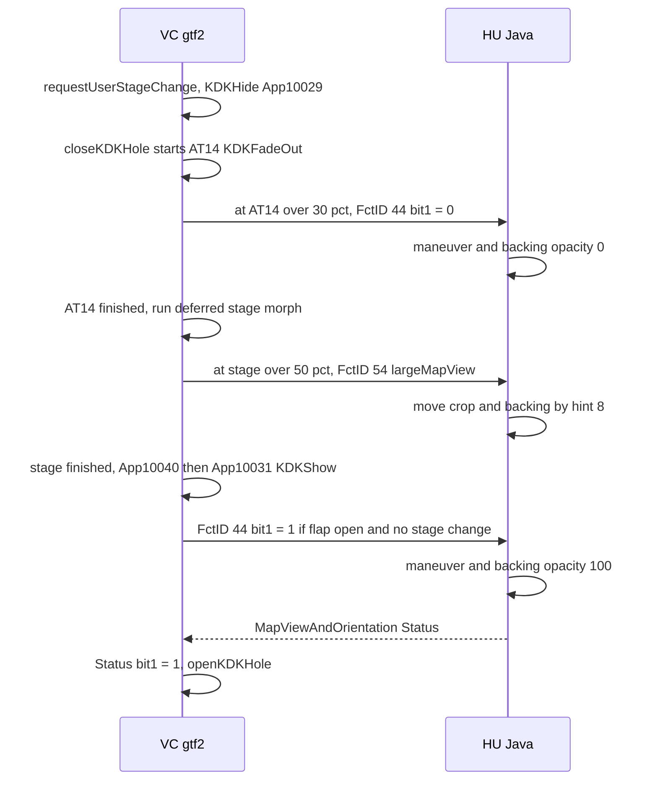

# KDK Geometry and Animation

*Where the cluster maneuver box (KDK) and its backing belong on the 1440×542 panel, who decides it, how the stock View button keeps the box in step with the VC's stage morph, and exactly how the VC fades the box in and out.*

---

## 📋 The head unit owns the rectangle, not the VC

KDK is the maneuver box in the cluster: our `maneuver_render` window (displayable 98) over a stock 987 KDK backing (101 or 102). See [Cluster Contexts](CLUSTER_CONTEXTS.md) for the displayables. `[code]`

The VC (`gtf2`, AU491 0379/1310, ARM EABI5, image base `0x100000`) does not choose the geometry. `[decompile]`

- The KDK surface is placed from four data-pool items: `LVDS_KDK_position_x`, `LVDS_KDK_position_y`, `LVDS_KDK_opacity`, `LVDS_KDK_visible`, plus a `_DM_` twin of each. None of their name strings has a code xref. They are resolved by name at model init, so no constant in `gtf2` feeds them.
- `openKDKHole` / `closeKDKHole` (`0x1765BC` / `0x176780`, around `isSportDesign@0x176740`) carry no geometry. They only post animation events 15 / 14 and flip `m_KDKHoleOpen`.
- `resizeHole` (`0x6C5BE0`) is a pass-through: `INode2D::setTranslation(x, y)` from its arguments and `setScale` from the model's width and height.
- The only hard-coded rectangles nearby belong to Night Vision (`makeNvHole`, `0x1E04FC`): big stage 640×360 centred, S-design full `x=0, y=+48, 640×400`. That matches `config/kdgui_2dmgr.json` `analog_source_rect = {0,0,640,400}`, the analog NV input.
- `stage3_fs/data/gem/engdefs/*.esd` mention KDK once, as a fade duration.

So the HU dictates the position over MOST via `IDisplayManagerKombiControl.setCropping/setPosition`, which land in `LVDS_KDK_position_x/y`. `[decompile]`

## 📊 The stock Layout table

The source of truth is `Layout.getIntegerConstant(id)`. The chain is `LayoutMIB2HighB9Sport` → `LayoutMIB2HighB9` → `LayoutMIB2HighQ7` (`INTEGER_CONSTANTS[132]`). Classic overrides only 58-61; everything else falls through to Q7. Values resolved on MU1316: `[decompile]`

| Layout id | Meaning | Classic (`LayoutMIB2HighB9`) | Sport (`LayoutMIB2HighB9Sport`) |
|---:|---|---:|---:|
| 58 / 59 | in-tube anchor → backing 101 | 1055, 207 | 984, 139 |
| 60 / 61 | popup anchor → backing 102 | 1091, 110 | 1091, 110 |
| 122-125 | in-tube crop x, y, w, h | 59, 27, 210×153 (Q7 fallback) | 0, 0, 328×180 |
| 118-121 | popup crop x, y, w, h | 59, 27, 210×153 | 59, 27, 210×153 |
| 108 / 109 | map origin (displayables 33, 58) | 0, 26 | 0, 26 |
| 80 / 81 | small-stage map offset | 0, 0 (Q7 fallback) | −476, 0 |

`ClusterLayerController` reads these slots live from the terminal's active `Layout`, so a skin switch is picked up without a restart. `[code]` (`java_patch/com/luka/carplay/cluster/ClusterLayerController.java:36-46`)

**Q7 4M uses its own pair.** `HMITerminalImplMIB2High.generateLayoutClassic/Sport` picks `LayoutMIB2HighB9(Sport)` for B9, Q2 and Q5, and `LayoutMIB2HighQ7` / `LayoutMIB2HighQ7Sport` for the Q7 (A3, R8 and TT have their own). The Q7 values differ by a few pixels, and the KDK code follows them automatically because it reads the live `Layout`. Values resolved on EU MU1329 (`java_stock/EU_MU1329_lsd.jar`, SHA-256 `a965b75a…`): `[decompile]`

| Layout id | Q7 Classic (`LayoutMIB2HighQ7`) | Q7 Sport (`LayoutMIB2HighQ7Sport`) |
|---:|---:|---:|
| 58 / 59 | 1045, 199 | 979, 133 |
| 60 / 61 | 1083, 112 | 1083, 112 |
| 122-125 | 59, 27, 210×153 | 0, 0, 328×180 |
| 118-121 | 59, 27, 210×153 | 59, 27, 210×153 |
| 108 / 109 | 0, 18 | 0, 18 |
| 80 / 81 | 0, 0 | −460, 0 |

The CarPlay **safe areas** in the hook are not taken from this table; they were measured on an A5 B9 cockpit. On a Q7 a car profile chosen from these Layout classes replaces them, see [Layout options](VC_LAYOUT_AND_FONTS.md#layout-options). `[open]` until checked on our Q7.

Classic does have an in-tube stage. It inherits the 210×153 crop from Q7. `maneuver_render` is built for that rect: the popup crop is centred horizontally on the 328-wide canvas (59 + 210/2 = 164 = 328/2), and the projection is shifted by −0.15 to centre the junction vertically. `[code]` (`maneuver_render/render.c:1242-1252`)

## ⚙️ Stage selection and the small-stage offset

**Stage (in-tube vs popup) is not a skin property.** Stock decides it in `ClusterKDKHandlerImpl.setKDKPositionHints()`: `isSmallStageActive()` adds hint 8 ("small stage, KDK in tube"), otherwise removes it ("big stage, KDK in flap"). Small stage is the same axis as `NAV_VIEW_SIZE_CHOICE == 1`, the Audi View button. `[decompile]`

History of the stage bug:

1. `ClusterLayerController` first took the stage from the stock KDK hint. During CarPlay the stock navigator sends no KDK model updates, so `apply()` never ran and `reapply()` replayed the `bind()` default (`lastPopup = true`). Fullscreen looked right only because popup is the fullscreen stage. Every small-stage view was wrong in both skins. `[car]`
2. The interim fix was `popup = !AltScreenModule.isSmallScreenViewArea()`, re-applied from `setViewAreaMode()`. It is superseded.
3. **Current code** takes the stage from VC FctID 54 (`largeMapView`), received at the VC's stage-morph midpoint. It uses the stock hint only before the first FctID 54. `[code]` (`ClusterLayerController.java:220-236`, `:282`; `java_patch/de/audi/tghu/navi/app/cluster/AltScreenCombiBAPListener.java:57-60`)

**The small-stage offset belongs to the map, not the panel.** `CombiMapController.positionMap()` adds constants 80/81 when `NAV_VIEW_SIZE_CHOICE == 1`, and applies them to displayables 33 and 58 only. `positionKDKBackgrounds` and `handleKdkDualTerminal` read no view size: the KDK panel is anchored to the tube. `[decompile]` Applying −476 px to the maneuver and backing was measured wrong on the car: it tore apart a Sport singlescreen view that stock keeps correct. The offset is logged and never applied. `[car]`, `[code]` (`ClusterLayerController.java:286-290`)

**Classic does not always raise `NAV_VIEW_SIZE_CHOICE`.** On a Classic (B9) cluster, toggling the Audi View button while CarPlay owns the cluster often produces no `NAV_VIEW_SIZE_CHOICE` model update at all: the VC restages, but the event never reaches `CombiMapController`. `[car]` (reported on a US MHI2Q P5087 with `LayoutMIB2HighB9`, public PR #15) Two things depend on that axis:

- **The maneuver panel does not.** Its stage comes from VC FctID 54 (above), so a lost event cannot misplace it. On the old stage source it showed as the popup anchor `(1091,110)` in an in-tube view, 36 px right and 97 px up of the in-tube anchor `(1055,207)`. In the `ClusterLayers apply` log, a mismatched `view=single stage=popup` pair means a stale stage, not wrong anchors; do not "fix" the anchors for it.
- **The map plane offset and the CarPlay safe area do.** `CombiMapController.syncViewSize()` reads the choice model, and only on a real change publishes it through `AltScreenModule.setViewAreaModeFromChoice()` (renderer, hook `updateViewArea`, `ClusterLayerController.reapply()`) and repositions planes 33/58. It runs on the event **and** on every KDK model update as a backup; on Sport, where the event always arrives, the backup is a no-op compare. `[code]` (`CombiMapController.java:111`, `:121`, `:136-171`; commit `f005bfb`)
- **The backup is not enough during CarPlay.** The stock navigator sends no KDK model updates while CarPlay owns the cluster (history item 1 above), and two other projects report the choice model itself staying frozen then: Allemon on the same US P5087, and ganm-afk on a Q7 4M (aberbic issue #5, which takes the view from `setMapPresentation`). So the CarPlay full/compact view area now also follows **FctID 54**: `AltScreenCombiBAPListener.setMapPresentation()` calls `AltScreenModule.onVcMapPresentation(largeMapView)` next to the KDK stage. With `view_source auto` (default) the input that reported last wins; at the connect-time seed a known FctID 54 stage beats the possibly stale choice model. `view_source choice` restores the choice-only behaviour. See [Layout options](VC_LAYOUT_AND_FONTS.md#layout-options). `[code]`, `[open]` on our Q7

Our CarPlay map is plane 99, a full 1440×542 window, and must not be translated either. The content shift lives in the advertised safe area in `hook/altscreen/altscreen_hook.c` (see [Third-party Nav Apps](THIRD_PARTY_NAV_APPS.md)). `[code]`

The decision line in `/tmp/carplay_java.log` carries every value that can change the picture, and is logged once per distinct tuple: `[code]` (`ClusterLayerController.java:345-362`)

```text
[CP/I][ClusterLayers] apply ...LayoutMIB2HighB9 style=classic view=single stage=inTube \
    backing=101 src=(59,27 210x153) dst=(1055,207) smallStageOffset=(0,0) [not applied]
```

## 🔄 How stock keeps View and KDK in step

Stock separates the panel's position from its permission to be visible. On FPK there is no "wait for View to finish" timer in the chain. Visibility comes back from the VC over BAP. `[decompile]` (root `Tools/jxe2jar/out/MU1316-vf/`: `BAPIndicationHandlerNavi.java:651,683`, `CombiBAPListener.java:1854,2034`, `ClusterService.java:663,959`, `ClusterKDKHandlerImpl.java:168,187,222`, `ViewSizeManagerCluster.java:50,126`, `CombiMapController.java:175`, serializers `navsd/serializer/MapViewAndOrientation_SetGet.java:163`, `MapViewAndOrientation_MapVisibility.java`, `Map_Presentation_SetGet.java:57`; `javap -c -p` of `ClusterKDKHandlerImpl` from `MU1316-final.jar` confirms the hint 16 / hint 4 code)

| Hint | Driven by | Chooses |
|---|---|---|
| 8 | NavSD FctID 54 `Map_Presentation.largeMapView` → `ViewSizeManagerCluster.setViewSize(large ? 2 : 1)` → `ClusterKDKHandlerImpl.viewSizeChanged()` → `hint8 = isSmallStageActive()` | crop, position, and backing (in-tube 101 or popup 102) |
| 16 | NavSD FctID 44 `MapViewAndOrientation.mapVisibility` bit 1 (`supplementaryMapViewIsVisible`) → `CombiBAPListener.setMapVisibility` → `ClusterService.setSupplementaryMap` → `setKDKVisibility` → `refreshHints` → `ChoiceModel(1,168)` → `CombiMapController.handleKdkDualTerminal()` | opacity of the maneuver and the chosen backing (100 or 0); the other backing gets 0 |
| 4 | KDK availability | whether the panel exists; on FPK it can stay set while hint 16 is clear (present but transparent) |

FctID 44 bit 0 is `lvdsMapIsVisible` (the main map). There is no stock rule "new position ⇒ opacity 100". `[decompile]`

Traps in this chain: `[decompile]`

- `BAPIndicationHandlerNavi` calls `setMapVisibility` only when the incoming struct differs from `lastStatus`, and `CombiBAPListener` checks for a change again. A missing callback does not prove a missing packet. Diagnose before the de-duplication.
- `ClusterKDKHandlerImpl.Q7FPK_FALLBACK_TIMEOUT` is initialised to −1, so its fallback timer is never created. There is no stock fixed 250 ms timer.
- The FPK `ViewSizeManagerCluster` has no completion callback: `getAnimationStatus()` returns null ("NOT IN USE"), `isAnimationRunning()` returns false, `screenChangeStateFinished(int)` is empty.
- Our `CMD_ALT_ZONE_ACK` (`0x0112`) is the phone's answer to `updateViewArea`, not the end of the VC stage morph. `[code]` (`hook/framework/bus_protocol.h:98`)

### The VC side of a View press

The sender in `gtf2` was traced statically (2026-09-22). With an active KDK, a user stage change runs this sequence. `[decompile]`



The steps with their addresses:

1. `0x12ACF0 requestUserStageChange` stores the request and calls `0x12A92C sendStageChangeMessage`.
2. If KDK is active, the mechanism is on, no fade-out runs and KDK is not hidden, `0x12A92C` first calls `0x12A7D8` (App10029 KDKHide). The nav handler `0x17BF90` calls `closeKDKHole`, which starts AT14 KDKFadeOut. The stage itself waits.
3. Past 30 % of AT14, callback `0x12B500` sends App10030 KDKHideProgress. The nav side calls `0x177800(..., false)`: it clears MapVisibility bit 1 and sends FctID 44.
4. When AT14 finishes, `0x12B42C → 0x12B2F8` marks KDKFadedOut and runs the deferred stage request. `0x12A92C` starts stage animation 0/1, updates the stage DP and sends App10002 via `0x12A298`; nav sets `stageChangeRunning = 1`.
5. Past 50 % of the stage morph, `0x12A23C` sends App10037. Nav calls `0x177230 sendStageInfo` and sends FctID 54 with bit 0 `largeMapView`.
6. When the stage finishes, `0x12A844` sends App10040 (nav clears `stageChangeRunning`), then App10031 KDKShow if KDKFadedOut and no fade-out runs.
7. App10031 calls `0x177800(..., RG_Status == 1)` and sends FctID 44.
8. The HU Status is received by `0x178FF4`. With bit 1 = 1 it calls `openKDKHole` after guards on route, power, and no transition or open already running. App10031 also has a direct `openKDKHole` path when the hole is closed and no MO request is outstanding, so step 8 is the normal path, not the only one.

`0x177800 Nav_requestKdkMapVisibility` sets bit 1 only if `requestedVisible && KDKFlapOpen && !stageChangeRunning`. Requests are serialized per type (MO outstanding at `Nav+2473`, MP at `Nav+2472`); a new MO during an outstanding one is marked pending and sent on the next Status. `OP_State != 0` blocks sending. The FctID 44 path is `0x177800 → 0x1775A0 → 0x792670` (LSG 50 / Fct 44); FctID 54 is `0x177230 → 0x17719C → 0x78E398`. `[decompile]`

Callbacks are installed by `0x12A490 StageManager_installKdkSyncCallbacks` (called from Init `0x12B1C0`; enable flag `manager+56` = 1 from the constructor `0x12A18C`): `[decompile]`

| Animation | Callback type | Threshold | Function | Action |
|---|---|---|---|---|
| 14 KDKFadeOut | progress (4) | 0.30 | `0x12B500` | App10030 → FctID 44 bit 1 = 0 |
| 14 KDKFadeOut | finished (1) | unused | `0x12B42C` | run deferred stage |
| 0/1 stage | progress (4) | 0.50 | `0x12A23C` | App10037 → FctID 54 |
| 0/1 stage | finished (1) | unused | `0x12A844` | App10040, then conditional App10031 |
| 19 KDKFlapFadeIn | progress (4) | 0.85 | `0x12B4A0` | App10032 → conditional visibility request (checks route, OP_State, no stage change) |

`0x120B20` uses the float threshold only for type 4, so a 0.98 in a "finished" registration does not mean 98 % (dispatch in `0x11D02C`). `0x11CF6C` fires a progress callback on `progress > threshold`, on the first matching update. With a 200 ms linear AT14, 30 % is about 60 ms, but that is no basis for an HU timer. `[decompile]`

So the stock order is: **fade-out → HU layer off → stage → reposition at mid-morph → stage done → HU layer on → KDK opens.** The VC itself asks the HU to hide the panel during the morph.

### What our code does with it

The earlier CarPlay patch made the box appear over the map before the VC morph ended. `setViewAreaMode` updated the target mode and `reapply()` forced opacity 100 on planes 98/101 in the in-tube branch while nav was active. Stock visibility did not drive that branch. `[car]` (whether the grey rectangle seen was plane 101 was not confirmed on the unit)

Current code (2026-09-22): `[code]`

- `AltScreenCombiBAPListener.updateMapVisibility()` forwards the accepted `supplementaryMapViewVisible` to `ClusterLayerController.onVcVisibility` before the stock Status is sent. That boundary covers the incoming FctID 44, the internal three-argument setter and the Status replay (`AltScreenCombiBAPListener.java:49-55`).
- `setMapPresentation()` forwards FctID 54 to `onVcPresentation`; the phone's target View no longer moves the KDK (`:57-60`). The renderer viewport follows the same stage (`ClusterLayerController.java:228-235`).
- Visibility is stored once, independent of the CarPlay session. `navActive` decides whether the planes may be in the context; FctID 44 decides opacity (`ClusterLayerController.java:278-316`). DM writes are serialized under `APPLY_LOCK` (`:255-257`).
- The 250 ms clear thread and the forced opacity 100 are gone. At route end ctx 80 is held until the VC withdraws visibility; if KDK is already hidden there is no wait (`java_patch/com/luka/carplay/core/AltScreenModule.java:356-378`). There is no fallback timer, so a lost BAP hide can leave ctx 80 until the next state change or disconnect.
- `BAPBridge.onRouteEnd()` keeps the last renderer frame and connection while stopping the route feed; a real disconnect does the full clear (`java_patch/com/luka/carplay/rgd/BAPBridge.java:814-817`).
- Returning to stock navigation restores the saved stock hint 8 / hint 16 and opacity (`ClusterLayerController.java:296-310`).

Host checks: `bash scripts/test_route_info.sh` covers hide → midpoint → show, repeated and internal BAP calls, layers applied before Status through the real MU1316 listener, route end and restart, late show, stock backing restore and renderer preservation. These prove Java ordering, not the physical LVDS frame. The on-car check (both View directions, Classic and Sport, route end, fast new route, disconnect) is `[open]`.

## ⚡ The KDK fade animation

Scope: AU491 0379/1310 A4/A5/Q5 2018, verified offline 2026-09-21. Firmware, model files and vehicle settings were not patched. `gtf2` SHA-256 `2ad9b41b…c6d10` (identical in `Firmwares/VC/gtf2.orig` and `UiModVC/A5_2018_unpacked/gtf2`). Firmware root `Firmwares/VC/AU_C1_AU491_0379_1310_prod_8S0906961AL_A4-A5-Q5_2018/extracted/`: executable `stage2_fs/STAGE2.1/bin/gtf2`, shipped visuals `stage2_fs/STAGE2.2/data/gtf/`, engineer menu `stage3_fs/data/gem/engdefs/AnimationParametersTubes.esd`. The IDA database with the named and commented functions is `Firmwares/VC/gtf2.orig.i64`; correctly unpacked KZBs are in `Patches/UiModVC/A5_2018_unpacked/fullstream_kzb/`, and the viewer/parser in `Patches/UiModVC/vc_native_studio/`. Visuals were decoded from `AU491-5_Basic_Tubes.kzb`, `AU491-5_Sport_Tubes.kzb`, `AU491_GlassPlates.kzb` and `AU491-5_Sport_GlassPlates.kzb` with the `vc_native.kzb.KzbArchive` parser. `[decompile]`

### Events

The native animation-name table at `0x7BEF30`:

| ID | Name |
|---:|---|
| 14 | KDKFadeOut |
| 15 | KDKFadeIn |
| 16 | KDKHoleFadeOut |
| 17 | KDKHoleFadeIn |
| 18 | KDKFlapFadeOut |
| 19 | KDKFlapFadeIn |

`openKDKHole` (`0x1765BC`) emits event 15 twice, with target selectors (1,1) and (1,2). That is not two sequential 200 ms fades. `SpeedTube_setupKdkAnimation` (`0x6E70F0`) prepares `t_KDK_status` 0 → 1 for types 15/17 and 1 → 0 for 14/16; 18/19 are separate flap cases. Fade-in requires KDK visible, not hideKdk/follow, and widget state > 14 (the meaning of the numeric states is not recovered). `0x6E66DC` (call at `0x6E68DC`) binds the SpeedTube member at offset 768 to `t_KDK_status`. `0x6E6F38` pins the value to 0 or 1 on completion. `[decompile]`

`updateKDK` (`0x6E6B2C`) has three branches: preview clears the KDK, follow, ETA and DTM fades; follow sets KDK = 0 and follow/ETA/DTM = 1; normal visible enables ETA/DTM and sends KDKFlapFadeIn, normal invisible clears them and sends KDKFlapFadeOut. `showKDKFlap` (`0x176C5C`) sets DPID 33555167 under guards and has a special S-design, non-big-stage, follow branch. So not every KDK appearance is the same animation. `[decompile]`

### Duration: 200 ms, linear

| Item | Value |
|---|---|
| Model field | `MV_ClusterFull_SpeedTube_kdkFadeAnimation` (`m_kdkFadeAnimation.m_DPID`, getter `0x646310`) |
| DPID | `0x02000329`, stored at `page+0x2AE74` = model+500 by `0x5C64E8` (built as `0x02000328 + 0x13 − 0x12`, so a literal search misses it) |
| Descriptor | namespace 2 table `0xA8B84C`, entry `0x329` → `0xA8EADC` (type `0x82`), list header `0xA89544`, data `0xA7F374` |
| Initial bytes | `00 00 14 00 00 00 14 00` → int16 `[0, 20, 0, 20]` |
| Conversion | `0x6E4D70` multiplies each by 10 → `[0, 200, 0, 200]` ms (stored at widget+912) |
| Direction | `SpeedTube_getKdkAnimationParameters` passes forward=true both ways, so this participant uses the first pair for fade-in and fade-out |
| Engineer menu | `AnimationParametersTubes.esd` lines 63-67: "KDK Fade Duration (10ms)", `persys 0x2 52`, limits 0..200 → 0..2000 ms in 10 ms steps |

That is the binary's initial DP value, not the persisted value on a given car. The setter chain from the menu to the DP array is not recovered. `poll 1000` is the menu poll interval. Adjacent menu entries, all in 10 ms units: Hub Morph Duration (`persys 0x2 56`), Gear/Speedo Move Duration (`57`), Flap Morph Duration (`58`). `[decompile]`

The clock is `eal::CTimeProvider::m_time`. With start offset S and duration D, `p = clamp((t − S) / D, 0, 1)`; the default is S = 0, D = 200 ms. There is no ease, spring, overshoot or bounce. Evaluation chain: `0x11E128` collects participant intervals → `0x125BE0` inserts starts/stops and takes the maximum end → `0x11D980` starts the clock → `0x11AE3C` linear elapsed/duration → `0x124CA0` per-primitive local fraction → `0x14E6AC`/`0x11CA14` store and fetch → `0x721FA4` computes `start + (end − start) × progress` → `0x6DEB04` writes `t_KDK_status`. Each participant keeps its own interval, so a longer overall animation does not stretch this one. Activation lands on update ticks. `[decompile]`

### Basic/Classic composition

With `p = t_KDK_status`: `[decompile]`

| Node / property | Binding |
|---|---|
| `Layers/t_root/t_pr/t_viewport/t_DTM_placeholder.LayerOpacity` (content) | `p` |
| `Scenes/t_big_speed/t_root/t_center_right/KDK_hole_decorator.BlendIntensity` (frame) | `min(2.5·p, 1)` |
| same parent, `KDK_hole_fix.BlendIntensity` (extra backing) | `clamp(5·p − 2, 0, 1)` |
| same parent, `t_KDK_hole.BlendIntensity` (covering mask) | `clamp(2.5·(1 − p), 0, 1)` |

Coefficients are simplified from float32 values. `BlendIntensity` is a material input, not screen luminance, and "frame / backing / mask" are readings of node names. No binding driven by `t_KDK_status` translates, rotates or scales anything. Movement of the surrounding parts belongs to `t_morph`, `t_hub_morph_Right` and `t_flapStatus_right`.

Phases at D = 200 ms (in general 0-0.4D, 0.4D-0.6D, 0.6D-D; at D = 400 ms that is 0-160, 160-240, 240-400 ms):

| Window | Content | Frame | Fix | Hole intensity |
|---|---|---|---|---|
| 0 ms | 0 | 0 | 0 | 1, but the Visible rule turns the hole off at p = 0 |
| 0-80 ms | 0 → 40 % | 0 → 100 % | 0 | 100 % |
| 80-120 ms | 40 → 60 % | 100 % | 0 → 100 % | 100 % |
| 120-200 ms | 60 → 100 % | 100 % | 100 % | 100 → 0 % |

The hole's Visible rule is `p · (step(1, m) + step(m, 0))` with `m = t_morph`. It is non-zero only when p > 0 and m is exactly 0 or 1, so the hole is off during a stage morph. The binding is `delayed=True`; its latency is not known. The phase table assumes a stable stage.

Fade-out runs the same bindings backwards: 0-80 ms hole 0 → 1 and content 1 → 0.6; 80-120 ms fix 1 → 0 and content 0.6 → 0.4; 120-200 ms frame 1 → 0 and content 0.4 → 0; at p = 0 the hole turns off. For inverse events configured as a collision pair, `0x11EAA8` can start the new animation at `1 − oldProgress` and scale the remaining time. Which KDK events are collision pairs was not enumerated.

### Sampled at an assumed 60 Hz

This is maths on the default curve, not captured frames, and not a claim that the cluster renders at 60 Hz. Time zero is the local primitive start, not a button press or CAN message. The same data is in [CLUSTER_KDK_60HZ.csv](../sources/reference/CLUSTER_KDK_60HZ.csv) (columns `sample_assumed_60Hz, elapsed_ms, p_content_opacity, frame_intensity, fix_intensity, hole_intensity`, as fractions). `[model]`

| Sample | ms | Content % | Frame % | Fix % | Hole % |
|---:|---:|---:|---:|---:|---:|
| 0 | 0.00 | 0.00 | 0.00 | 0.00 | 100.00 |
| 1 | 16.67 | 8.33 | 20.83 | 0.00 | 100.00 |
| 2 | 33.33 | 16.67 | 41.67 | 0.00 | 100.00 |
| 3 | 50.00 | 25.00 | 62.50 | 0.00 | 100.00 |
| 4 | 66.67 | 33.33 | 83.33 | 0.00 | 100.00 |
| 5 | 83.33 | 41.67 | 100.00 | 8.33 | 100.00 |
| 6 | 100.00 | 50.00 | 100.00 | 50.00 | 100.00 |
| 7 | 116.67 | 58.33 | 100.00 | 91.67 | 100.00 |
| 8 | 133.33 | 66.67 | 100.00 | 100.00 | 83.33 |
| 9 | 150.00 | 75.00 | 100.00 | 100.00 | 62.50 |
| 10 | 166.67 | 83.33 | 100.00 | 100.00 | 41.67 |
| 11 | 183.33 | 91.67 | 100.00 | 100.00 | 20.83 |
| 12 | 200.00 | 100.00 | 100.00 | 100.00 | 0.00 |

The phase edges (80 and 120 ms) fall near samples 4.8 and 7.2. 200 ms is 12 intervals at 60 Hz, 10 at 50 Hz and 6 at 30 Hz. The clock advances by elapsed time, so a slower loop skips intermediate states.

### Sport

Sport Tubes has the same hole intensity and Visible rules, but its content placeholders use `t_follow_fade`, not `p`. Do not copy the Classic content table to Sport. `[decompile]`

The Sport glass plate has its own clock. `0x6E77F8` constructs HubContent id 13 with property `gp_sd_KDK_state` (a constructor, not a getter); vtable fadeIn `0x6E1138`, fadeOut `0x6E1098`, tick `0x6E101C`. `0x6E0AB4` initialises the shared HubContent timing to `[0, 300, 0, 200]` ms: 300 ms in, 200 ms out, 0 ms with the immediate flag. `0x6BBF74` scales duration by the remaining distance (0.4 → 1 takes 180 ms of the nominal 300). Linear, so from zero it reads 16.7 % at 50 ms, 33.3 % at 100, 50 % at 150, 66.7 % at 200, 83.3 % at 250 and 100 % at 300 ms. `[decompile]`

In `AU491-5_Sport_GlassPlates.kzb`, node `Scenes/generic_glassplate_mmik_back/centerTube_SD_KB_plate`: `BlendIntensity = max(1 − 3·t_morph, 0) · gp_sd_KDK_state` (delayed). At m = 0.1 the ceiling is 0.7, at 0.2 it is 0.4, at m ≥ 1/3 it is 0. The start offset between this 300 ms clock and the 200 ms KDK event is not proven, so do not add them or call 300 ms the total.

Both Basic and Sport flap `BlendIntensity` simplify to `5 · max(t_morph − 0.8, 0) · t_flapStatus_(left|right)`: the flap is suppressed until m > 0.8. That is blending, not the flap mesh trajectory.

### External sync and what is still unknown

The AnimationManager can take progress from outside instead of the local clock, when the manager state allows it, DPID 33555245 == 1, and an annotation id is attached. `0x11D1F0` reads progress from `DPID33555173[annotationId]`. One mode uses that value directly; another uses its arrival only to start the local linear clock. Watchdogs: 5000 ms when progress is absent, 10000 ms for an unfinished external animation (both disable annotations and restart local clocks). The 500 ms "KDK state may be invalid" recovery in `0x6E87D0` is a repair path, not the fade. `[decompile]`

Not established `[open]`: the car's persisted overrides, the menu setter chain, the active external progress source, render cadence and delayed-binding latency, the scheduling between flap/hub/glass/KDK, and all movement keyframes during a simultaneous stage morph. No screenshot or video sequence was synthesised.

## 🔗 Related

- [Cluster Contexts](CLUSTER_CONTEXTS.md): ctx 80/81 and the displayables this geometry positions.
- [VC FPK State Machine](VC_FPK_STATE_MACHINE.md): the VC nav views and dp items around the KDK.
- [NavSD FctID Matrix](NAVSD_FCTID_MATRIX.md): FctID 44 and 54 ownership.
- [HUD Renderer](HUD_RENDERER.md): what `maneuver_render` draws inside the box.

## 📚 Sources

Merged originals were removed from the tree after this note absorbed them; they remain in git history (commit 23972aa).

- `CLUSTER_KDK_GEOMETRY`: VC owns no rect, Layout table, stage and offset bugs, MFW OK and FctID 22 findings.
- `CLUSTER_KDK_ANIMATION`: fade events, 200 ms default, KZB bindings, Sport glass clock, external sync.
- `CLUSTER_KDK_ANIMATION_RU`: Russian version of the same analysis, with the Sport glass time table and the D = 400 ms example.
- [CLUSTER_KDK_60HZ.csv](../sources/reference/CLUSTER_KDK_60HZ.csv): the 60 Hz sampling of the default fade.
- `CLUSTER_VIEW_STOCK_SYNC`: MU1316 hint 8 / hint 16 chains, VC View sequence and callbacks, the 2026-09-22 implementation.
