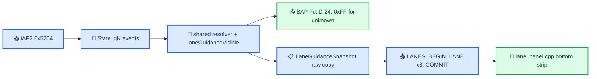
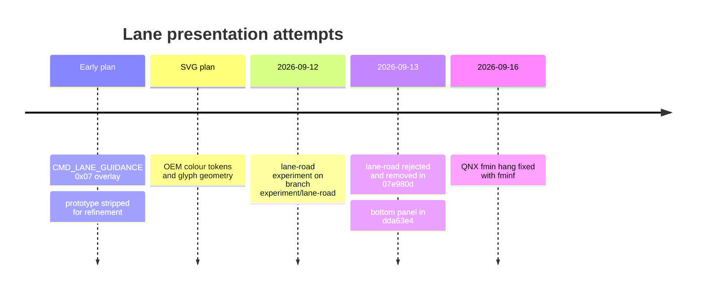

# Lane Guidance

*Lane guidance as an independent event: the shared HUD/renderer gate, the raw lane snapshot and its atomic wire batch, the transparent bottom panel in `maneuver_render`, the QNX `fmin` hang it once caused, and the rejected lane-road experiment with the lessons it left.*

---

## 📋 The model: lanes are their own event

Lane data does not belong to the current maneuver descriptor. It can arrive, vanish, return or switch **inside one maneuver**, even during its animation, and data before a roundabout does not prove lanes on the ring. So there is no "wide 3D road with the arrow in the chosen lane": the input cannot support that topology (see the rejected experiment below). Lanes are drawn as a separate strip under the maneuver; ordinary maneuvers without lanes are fully supported. `[code]`, `[car]`

- **iAP2 0x5204 LaneInformations:** per lane `status` (TLV `0x0001`: 0 not good, 1 good, 2 preferred/best), all `angles` (`0x0002`), highlighted angle (`0x0003`), index/position. Native storage: 8 lanes × 16 angles. The highlight is authoritative; without it the parser uses the first angle; an absent direction stays `1000`. Apple is inconsistent about including the highlight inside `angles[]`. `[code]` (`hook/routeguidance/rgd_tlv.c:96`, `:204`)
- **How iOS sends them:** CarKitNavigation `CRAccNavController sendLaneGuidances` (iOS 27, decompiled) sends a window of `MaxLaneGuidanceStorageCapacity` events (we advertise 6) starting at the current lane index, only events it has not sent yet, and again whenever `currentLaneGuidanceIndex` moves; its own sent-cache drops the lowest index on overflow, so it never holds an index below the current one and re-sends anything it does not hold. On the wire a window's 0x5204s come **before** the 0x5201 that makes one of them current (`delegateUpdatedRouteGuidance`: maneuvers, lanes, then the route update). Only `-[CRAccNavController reset]` empties the sent-cache, and it sends a reset 0x5201 with it; a reroute that changes the lane source does not. Lane event indices are a sequence of their own, never maneuver indices. `[decompile]`
- **Native cache:** `hook/routeguidance/rgd_hook.c` keeps up to 32 events keyed by lane index. A 0x5201 that carries the current lane index drops the events below it (iOS will never need them again), so a snapshot holds about one window; nothing is dropped when a 0x5204 arrives, because its window precedes the 0x5201 that activates it. A route reset (`rgd_maneuver_map_reset`) empties the cache; a full cache drops the oldest entry except the active one, which keeps a lane source renumbered by a reroute. It is never pruned by maneuver index: that once deleted pre-sent events before 0x5201 activated them, so lanes showed only at route start. A 0x5204 without a lane index is dropped. The 0x5201 INFO log line carries `lane_event`, `lane_showing` and `man_first`. `[code]` (`tests/test_rgd_lane_cache.py`, `scripts/test_lane_guidance_e2e.sh`)
- **Java cache:** `RouteGuidance.State` keeps independent `lgN_*` events (positions, directions, statuses, full angle vectors). Lane-cache slot numbers are not maneuver-cache slot numbers. The active event is the `lg` slot whose `lgN_index` equals 0x5201's `lane_guidance_index`; there is no other selector or fallback. A new maneuver does not clear lane events; a new `lg` event ID clears that slot's old content; explicit `count = 0` never revives old arrays. `[code]`
- **Shared gate:** HUD FctID 24 and the renderer use the same resolver and `laneGuidanceVisible = laneGuidanceShowing == 1 && !(maneuverCount == 0 && routeState <= 0)`. No distance, approach, maneuver-type, identity or transition gate. The old `nowApproach && laneGuidanceShowing == 1` gate is gone; lanes legitimately appear long before a junction (highway pre-positioning). Prefetch of a future event never selects it. `[code]` (`java_patch/com/luka/carplay/rgd/BAPBridge.java:1170`, `:1561-1563`)
- **HUD converter:** `+1000`, `−1000` and anything outside ±180 → `0xFF` **before** direction quantization. An unknown primary never becomes a recommendation, but a valid extra branch may still show grey. Missing angles for one lane never borrow the first lane's. `[code]` (`BAPBridge.java:1714-1716`)

Sources: `SCENE_ENGINE`, `RGI_HUD_RENDERER_KNOWLEDGE`, `CARPLAY_HUD_REGRESSION_CROSSCHECK_2026_09_13`

## ⚙️ Snapshot and wire batch

`LaneGuidanceSnapshot.copy` only copies: raw status, position, primary angle and direction list. It does not pick a primary lane, sort, match the maneuver angle, guess connectivity or turn a missing field into a recommendation. Up to 8 lanes and 16 angles; out-of-range values become explicit unknowns (`position 65535`, `status 255`, `angle 1000`) and clear `complete`. A hidden event is the `HIDDEN` singleton. `[code]` (`java_patch/com/luka/carplay/rgd/LaneGuidanceSnapshot.java:5-50`)

| Command | Payload (all integers big-endian) |
|---|---|
| `LANES_BEGIN` 0x0c | token u32 `[0..3]`, count `[4]`, complete `[5]`, showing `[6]`, event i32 `[8..11]` |
| `LANES_LANE` 0x0d | token `[0..3]`, record `[4]`, position u16 `[5..6]`, status `[7]`, angle count `[8]`, primary i16 `[9..10]`, up to 16 signed-degree angles `[11..42]` |
| `LANES_COMMIT` 0x0e | token `[0..3]` |

- No MANEUVER packet is part of the batch; a lane-only update never restarts the arrow. Lane angles are plain signed degrees, unlike the half-degree maneuver geometry. `[code]` (`maneuver_render/protocol.h:35-45`)
- `lane_guidance.h` stages and commits atomically: BEGIN resets staging; a LANE with the wrong token is ignored; a duplicate or out-of-range record marks the batch malformed; COMMIT with a malformed batch or missing records **clears** the shown guidance (keeping the event index) instead of leaving stale lanes. CLEAR and disconnect reset staged and accepted data; a normal maneuver does not. `[code]` (`maneuver_render/lane_guidance.h:25-58`)
- Under queue pressure the Java writer keeps the latest atomic lane snapshot (including a hide) and replaces only older lane snapshots; CLEAR barriers stay ordered. `[code]`
- 0x09…0x0b were the lane-road `SCENE_BEGIN/LANE/COMMIT` commands and are retired.

Sources: `SCENE_ENGINE`

## 📍 The bottom panel

`maneuver_render/scene/lane_panel.cpp` paints a separate screen-space row against the bottom edge of the **current** visible rectangle, on a transparent background. `[code]`

| Property | Value |
|---|---|
| Cell pitch | 36 source px, glyph size never changes (`Pitch = 36`, `Padding = 8`) |
| Capacity | `floor((min(w, 328) − 16) / 36)`: 5 cells in the 210 px popup, 8 in the 328 px frame (`lane_panel.cpp:152`) |
| Panel height, feather | 32 px, top feather 12 px, side fade 8 px (`maneuver_render/lane_panel.h:11`) |
| Order | Sorted by position when all positions are known and unique; otherwise received order, nothing invented |
| Overflow | One end cell becomes `…`. Keep the end nearest to a best recommendation; ties/default keep the right end (the verified HUD fallback) |
| Directions per cell | Up to 3 canonical 45° buckets; anything outside ±180 (both ±1000) is unknown (`lane_panel.cpp:37-40`) |
| Colour | Only a valid primary with status 2 is cyan; status 0/1 and extra branches are neutral grey; a cell with no valid direction is a short neutral dash |
| Nothing drawable | An event with no valid direction at all hides the panel and restores the camera (`lane_panel.cpp:143-151`) |
| Transitions | 250 ms crossfade on event/capacity change; the row follows the 250 ms viewport animation |

- **Full-width mask:** under any visible panel, even one lane, one screen-space pass multiplies destination RGB **and** alpha across the whole 328 px source width, down to the physical bottom of the 181-row texture (including the extra row below the 180 px VC crop). The arrow never leaks between or under glyphs; the real cluster background shows through; premultiplied alpha is preserved. No opaque plate, no extra FBO, no scene-mask rebuild. `[code]`
- **Camera:** while lanes show, the camera dollies back 12% of its look-at distance, up to 18% if needed (`render.c:1412` clamps to 0.18), with a small lens shift so the important route and the complete arrowhead fit **the small frame in both stages**, above the feathered row. FOV and source size stay fixed. Framing targets are cached per scene identity; current and incoming settled scenes both count during a handoff while native camera travel continues underneath. Dolly and shift use the same 250 ms easing; hiding restores the pose smoothly; CLEAR resets it immediately. The fill origin follows the row's visible entry edge. `[code]` (`lane_panel.cpp:258-277`)
- The raw transport has no HUD `laneDescription` expansion flags, so those are not inferred.

Sources: `SCENE_ENGINE`, `RGI_HUD_RENDERER_KNOWLEDGE`

## ⚠️ QNX `fmin` hang (2026-09-16)

On the car, the first drawable lane event (two lanes) was followed by `progress watchdog TIMEOUT phase=lane-update`; Java lost the renderer heartbeat, hid ctx 80, and the supervisor restarted the process (the new one connected and confirmed a frame). An isolated CPU-only ARM probe hung inside `cr_lane_panel_layout` before any GL or socket work (killed by a 4 s alarm, exit 90). `[car]`

Cause: in the GCC 8.5 / QNX 6.5 build, `std::fmin(float, float)` resolves to the SDK `xtgmath.h` generic template, which recursively calls itself; at `-O2` the branch compiled to ARM `b .` (self-branch at offset `0x114`). Host sanitizers cannot see a target-header problem. `[code]`, `[decompile]`

- `qnx-os_defines.h` sets `_NO_CPP_INLINES=1` (removes QNX's concrete float/long-double overloads) and `__CORRECT_ISO_CPP11_MATH_H_PROTO_FP=1` (also suppresses GNU cmath's float `fmin`/`fmax`). QNX's `_TGEN_R2(fmin/fmax)` templates stay enabled and win for two floats.
- Toolchain commit `95917883` (2026-08-24) had already fixed the libstdc++ crossconfig `HAVE_*F/*L` table (recursive `powf`/`sqrtf` stubs), present in image `5d9d97c0944b`; the renderer does not link libstdc++, so that fix did not cover this.
- `_NO_CPP_INLINES` exists since the toolchain's first commit `6950f106` (2026-07-22); the `__CORRECT_ISO_CPP11_MATH_H_PROTO_*` flags came with the GCC 8.5 port in `618d38e1` (2026-08-15), moved to `gcc/port` in `2089bd10`. RetroArch's N64 core added `-D_NO_CPP_INLINES` later (`f9139dae`, 2026-08-09) — the timeline fits related bring-up work but proves nothing.
- **Fix:** explicit `::fminf` / `::fmaxf` libm entry points in lane layout, glyphs, fade, framing and scene-bound projection (`maneuver_render/scene/lane_panel.cpp:10-11`, `scene/scene.cpp:29-33`). Do not "fix" it by lengthening the watchdog or hiding lanes. The toolchain header still needs a general fix plus executable C++ overload coverage. `[code]`
- Validation: `make -C tools/maneuver-preview test`, `bash scripts/build_renderers.sh`, `bash scripts/build_maneuver_cpu_test.sh` → `build/maneuver_qnx_cpu_test` on the HU passed 729 lane combinations, 32 camera fits, compact/full layout and reset (no Screen/EGL window, no socket, 10 s timeout). A visual lane event on the updated binary was still pending. `[car]`

Sources: `MANEUVER_QNX_LANE_MATH`

## 🔍 What the Audi references say about lanes

- **HUD firmware:** `RE/navigation_icons.md` and `navigation_icons/maneuvers_manifest.json` (under `Firmwares/HUD/extracted/FL_8W6919617G_1952_APPL_V000/`) list **158 small lane-arrow variants**, 1–3 directions composed in one lane cell, separate from the main 3D maneuver (resources r0516…r0673). BAP lane status has not-recommended, recommended and best; both recommended classes can be cyan. `[decompile]`
- **MHI2Q HMI** (`Tools/jxe2jar/out/MU1316-combined-vf/.../map/routeinfo/LaneGuidanceWrapper.java`, `filterLaneCell` line 144): more than six cells → a six-cell window chosen with `hasBlueArrow`; an omitted edge cell gets `arrowType = 0`, which `MixedListLaneGuidanceController.LaneData` maps to the `OMIT_LANE = 78` atlas entry. Without a blue arrow the first six are kept and the last becomes the omission symbol; both edges can be omitted. This is the HU HMI, **not proven** for the HUD MCU runtime. `[decompile]`
- **OEM look** (from on-car crops `logs/lane_guidance_crops/user_crops/`): arrows centred below the maneuver, preferred lane light blue, others grey/silver, dashed vertical separators (3 short rounded pills), no background, road-sign glyphs (stem + curved branch + head), soft glow through the glass. `[car]`

Sources: `LANE_ROAD_EXPERIMENT`, `plan_lane_guidance_svg_templates`

## ❌ Earlier approaches

*Timeline of the lane presentation attempts, from the first plan to the shipped panel and the QNX fix.*

### The first renderer plan (superseded)

A single `CMD_LANE_GUIDANCE = 0x07` packet: count + flags, then 5 bytes per lane (i16 primary angle with 1000 = unknown, status, extra-angle count 0…2, two 4-bit quantized extras from the 9-entry table −180…180 step 45). 2D overlay in NDC inside the 210×153 popup, fade `LANE_FADE_SPEED 0.08`. Colours: preferred `(0.56, 0.82, 0.98)`, good `(0.76, 0.76, 0.79)`, not good `(0.61, 0.61, 0.64)`; 3-dot separators; extras = angles differing from the primary by more than 5°. Why it is dead: 0x07 became `CMD_CLEAR`, the approach gate was removed, and quantizing to three directions throws away raw angles. The then-deployed BAP fix (narrowed dirty mask, strict resolver) is kept.

### The SVG template plan (not executed as runtime)

Design masters from the day/night crops: `viewBox 0 0 772 252`, baseline y ≈ 164, stem ≈ 70, separator dash 9–11 × 28–34 radius 5, lane pitch 110–118, stroke 22–26, three layers (glow blur σ 5–8, soft core σ 0.7–1.2, core). Colour tokens day/night: blue core `#9fc7df`/`#5b7fb4`, blue glow `#c8ecff`/`#6fb7ff`, white core `#b3b8b0`/`#80797a`, white master `#d8ddd8`/`#c7c2c0`, muted `#8f958e`/`#5e5a58`; opacities active core 0.82, glow 0.28, white 0.72, muted 0.42, separators 0.68. Open questions it left (photo vs idealized source, full direction library, SVG vs procedural) were answered by the procedural panel.

### The lane-road experiment (rejected 2026-09-13)

A C++11 scene compiler drew one perspective road with dashed separators, pavement arrows, and the big arrow starting in a representative preferred lane, fitted to the small red frame `(59,27,210,153)`, with the nearest true road edge always visible and at most one side fading. It was connected end to end (atomic Java/native transport, hook completeness metadata) and passed large host suites (78,720 layout combinations, 36 GL captures, 377 transition frames), then was removed after Luka's visual review. It never ran on the HU. `[model]`

Why it failed:

- **The data has no topology.** No lane widths, no vehicle lane position, no lane-to-lane connectivity. A representative lane must never be shown as the car's measured lane, and ambiguous connectivity forced a "safety gate" (complete snapshot, contiguous unique positions, anchor agreeing with the maneuver within 5°, every outer lane explicitly permitting the turn, no sharp/U-turn/roundabout) that fell back to the plain maneuver most of the time. A full 8-slot buffer or contiguous prefix is not proof that all lanes were received.
- Rules from it that must **not** come back: snap to the road edge, rotating road surface, limiting visible lanes, three dots at the road edge, a 0.80 s crossfade instead of native camera travel.

Lessons that survived into the current engine:

- **Alpha blending:** `glBlendFunc(SRC_ALPHA, ONE_MINUS_SRC_ALPHA)` squared alpha (4,929 invalid pixels, max excess 132/255 in one frame; flattening onto a dark matte hid it). The shared renderer now uses `glBlendFuncSeparate(SRC_ALPHA, ONE_MINUS_SRC_ALPHA, ONE, ONE_MINUS_SRC_ALPHA)` and FXAA filters RGBA together; captures assert `RGB <= A`. `[code]` (`maneuver_render/render.c:1082`, `:1430`)
- A baked-in viewport clip rotates with the moving scene and cuts corners during camera travel; the red small frame is a composition guide, not a clip plane.
- Side roads end with a 0.30 smooth fade after a solid 0.20 reach, never a hard cut; the arrow itself stays opaque.
- Progress handoff: the outgoing fill retracts over 0.40 s, stays empty through commit, then the incoming arrow fills (kept, see [HUD Renderer](HUD_RENDERER.md)).
- Rejected-geometry details, for anyone tempted to retry: primary lane width 0.26 with secondary packed 0.26→0.14; multi-lane bends used primary radius = distance to the group's inner edge + 0.055 with a common approach tangent at y = −0.04; contours had to precede all asphalt fills to avoid white barriers; offsetting the tiny arrow fillet across lanes collapsed into a square or a negative-radius white hook; a fixed-width continuation lane (0.26 instead of packed 0.14) shifted hidden glyphs between stages; a full white exit backing under translucent fades caused outline regressions; lanes started from a representative lane only after projecting the raised head back to the ground stayed within ±0.13 of its lane.
- Preview visual constants: 656×362 Retina framebuffer (not a larger source), FOV 40°, route width 0.14, lane width 0.26 (packed minimum 0.14), shoulders 0.022, prism base 0.002 / top 0.008.

Sources: `LANE_ROAD_EXPERIMENT`, `plan_lane_guidance_renderer`, `plan_lane_guidance_svg_templates`

## 🔗 Related

- [HUD Renderer](HUD_RENDERER.md): the scene engine the panel sits in.
- [Maneuver Mapping](MANEUVER_MAPPING.md): why the maneuver itself never depends on lanes.
- [RGI and BAP Bridge](RGI_AND_BAP_BRIDGE.md): FctID 24 and the route lifecycle that clears lanes.

## 📚 Sources

Merged originals were removed from the tree after this note absorbed them; they remain in git history (commit 23972aa).

- `SCENE_ENGINE`: current panel, wire batch, shared gate, camera framing.
- `RGI_HUD_RENDERER_KNOWLEDGE`: status summary, panel rules.
- `MANEUVER_QNX_LANE_MATH`: the `std::fmin` self-recursion hang on QNX.
- `CARPLAY_HUD_REGRESSION_CROSSCHECK_2026_09_13`: lane edge-case fixes in `BAPBridge`.
- `LANE_ROAD_EXPERIMENT`: the rejected lane-road renderer and its lessons.
- `plan_lane_guidance_renderer`: the first single-packet overlay plan.
- `plan_lane_guidance_svg_templates`: OEM colour tokens and SVG geometry plan.
