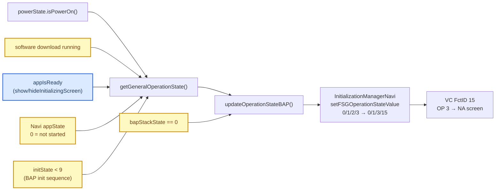

# Nav Initializing Screen

*Why the Virtual Cockpit still shows "Initialising navigation system. Please wait..." over the CarPlay cluster map, what really drives it on both sides, why the September 16 fix (`7d35b53`) does not stop it, and the fix that should. Status: **fix implemented 2026-09-23, not yet tested on the car** (the owner reported that day that the text still appears with `7d35b53`). The analysis is static, of the VC `hmi_app.elf` (A5 2018, `AU491_0379`) and the HU stock Java (`Tools/jxe2jar/out/MU1316-vf/`).*

---

## 📋 Summary

| Question | Answer |
|---|---|
| Which VC screen shows the text? | The Nav **NA** ("not available") screen, state 183 `SV_NavFPK_NA`. It replaces the whole map view, including the CarPlay plane. |
| What selects it? | NavSD **FSG_OperationState** (FctID 15) with `OP_State` 1, 3 or 15. `OP_State = 3` (INITIALIZING) picks the "Initialising navigation system" text. |
| What is *not* the cause | NavSD **InfoStates** (FctID 38). It drives a separate hint-text popup and the "navigation on mobile device" screen (which the KSS firmware makes unreachable on this VC), not this text. |
| Why the HU sends INITIALIZING | `AbstractBAPModuleInitializationManagerFSG.getGeneralOperationState()` returns INITIALIZING when the "Navi" app has not started (`appState == 0`), when the BAP init sequence is still running (`initState < 9`), during a software download, when `appIsReady` is false, or when the BAP stack is down. |
| Why `7d35b53` fails | It only intercepts `showInitializingScreen()` / `hideInitializingScreen()`, which toggle `appIsReady`. The other four inputs still send INITIALIZING, from a manager that runs before and beside our wrapper. |
| Fix (implemented) | A patched `InitializationManagerNavi.setFSGOperationStateValue()` sends INITIALIZING as NORMAL while CarPlay owns the cluster. InfoStates hint values are left alone for now. |

## 🖥️ The VC side

### The Nav state tree

State names come from the table at `0x223BFC` (state id = name index + 2). `[decompile]`

```mermaid
stateDiagram-v2
    accTitle: VC Nav state tree around the NA screen
    accDescr: The NavFpk state chooses NA when NavSD OP_State is 1, 3 or 15, otherwise Operable; Operable chooses the compass, the mobile-device screen, the hint texts or the normal map, and only the normal map contains the LVDS view that carries CarPlay.
    state "153 Nav" as nav
    state "166 NavFpk" as fpk
    state "183 SV_NavFPK_NA" as na
    state "167 Operable" as op
    state "180 Compass" as compass
    state "181 Compass_MobileDevice" as mobile
    state "182 HinweisTexte" as hint
    state "168 Normal" as normal
    state "177 SV_LVDS_NavMap_FPK (CarPlay plane)" as lvds
    [*] --> nav
    nav --> fpk: FPK cluster variant
    fpk --> na: DP 0x200006A in {1, 3, 15} or DP 0x2000073 == 2
    fpk --> op: otherwise
    op --> compass: DP 0x400004B != 0
    op --> mobile: InfoStates == 6
    op --> hint: hint index != 0
    op --> normal: otherwise
    normal --> lvds
```

- `166 NavFpk` → `183 NA` when DP `0x200006A` (the NavSD OP_State mirror) ∈ {1, 3, 15} or DP `0x2000073` == 2, else `167 Operable` (`sub_2286B4`). On a non-FPK cluster, `162 LVDS_Nav_Generic` is used instead (DP `0x6400DE3`).
- `167 Operable` picks `180 Compass` (DP `0x400004B` != 0), `181 Compass_MobileDevice` (DP `0x400000F` == 6, i.e. InfoStates 6), `182 HinweisTexte` (DP `0x4000044` != 0), else `168 Normal` (`sub_22871C` / `sub_22879C`).
- Only `168 Normal` → `169 NavMap_FPK` → `177 SV_LVDS_NavMap_FPK` shows the HU's LVDS map, which is where the CarPlay plane appears. **Any of NA, compass, mobile-device or hint screens takes the CarPlay map away.**

### The handlers

| VC handler | BAP | Writes |
|---|---|---|
| `0x1797E4` (logs `NavSD_FSG_OperationState_OP_State`) | NavSD FctID 15 FSG_OperationState | DP `0x200006A` = {0→0, 1→1, 3→3, 15→15, other→0}. For OP != 0 it also calls `VC_CloseKDKHole`, closing the map window; OP 0 calls `VC_TryShowKDKFlap`. |
| `0x179320` → `sub_177940` | NavSD FctID 38 InfoStates | DP `0x400000F` = raw InfoStates; DP `0x4000044` = hint index: 1→2, 2→4, 4→5, 5→6 (only in map views 20/22/23), anything else → 0 |
| `0x17BA38` | NavSD RG_ActDeact_Result | hint index from the route-guidance result, a 6 s "infostate timer" (`sub_175BC0`) that clears it, and event 370 (back from the route-guidance submenu to the map) |

An earlier note in this repo named `0x17BA38` the InfoStates handler; that was wrong.

### Which text the NA screen shows

The NA text chain at `0x611154` (`sub_610324`):

| Condition | Text id | Text |
|---|---|---|
| OP == 1 | 419 | (off / standby) |
| OP == 3 and DP `0x2000073` == 1 | 358 | **"Initialising navigation system. Please wait..."** (inferred from OP == INITIALIZING) |
| OP == 15 | 361 | (defect) |
| DP `0x2000073` == 2 | 360 | "Navigation is not available." / "currently unavailable" |

The NA widget reads its strings from the lists `0x6400F35` / `0x6400F36`, which were not decoded; the English string pool (`0x90A0ED`) has exactly three "no navigation" texts (currently unavailable, not available, initialising), so id 358 = "Initialising" is an inference from the OP value. No code writes DP `0x2000073`; it is probably filled from a network signal (guess: NavSD availability, 1 = available). `[decompile]`

**The hint list** (DP `0x4000044`, lists `0x6400ED7` / `0x6400ED8`), mapped against the route-guidance result enum: 1 no home address, 2 insert data medium, 3 no route, 4 database unreadable, 5 database updating, 7 no alternative route, 8/10 select route on the MMI, 9 route guidance could not be stopped, 11 select home on the MMI, 12 no navigation data, 13 map offline, 14 route guidance already active. Index 6 (InfoStates 5) is either "Initialising navigation system" or "Initialising Google Earth map" — not resolved, and the HU does not send InfoStates 5 in normal use (see below).

**LVDS NA_Init states** 160 / 164 / 155 depend on DP `0x200032D` (main unit / LVDS capture present) == 0 and OP != 1. The VC writes that itself on LVDS lock loss or capture failure; it matters only on non-FPK cluster variants.

## 🧠 The HU side

### Where NavSD OP_State comes from

`AbstractBAPModuleInitializationManagerFSG.getGeneralOperationState()` (`:123-152`): power off → 1 (OFF); software download running or `!appIsReady` → 2 (INITIALIZING); `appState == 0` → 2; `appState == 1` → 0 (NORMAL) only if `isRequiredDataForOpStateNormalAvailable() && getInitState() >= 9`, else 2; any other app state → 3 (DEFECT). `updateOperationStateBAP()` then forces 2 when `getBapStackState() == 0`. `InitializationManagerNavi.setFSGOperationStateValue()` maps 0/1/2/3 to BAP 0/1/3/15. `[decompile]`

- **`appState`** is the startup manager's "Navi" component state (`InitializationManagerNavi.appStateChanged`, `"Navi"` or the Asia nav app). It stays 0 until the navigation domain has started, which is exactly the cold-boot window in which CarPlay is already on the cluster.
- **The init sequence** (`CommandUpdateOperationState` runs before `CommandFinishInitializationSequence`) sends INITIALIZING on every NavSD BAP (re)initialisation: VC wake-up, a BAP stack drop, init retries after error 0x42.
- **`appIsReady`** is the only input `AppConnectorNavi.showInitializingScreen()` / `hideInitializingScreen()` touch (`setAppIsReady(false/true)`). `CombiBAPListener.forceShowInitScreen` starts `true`, so every `updateAll()` requests a show/hide.

### Why `7d35b53` does not work

`GatedCombiService` defers `showInitializingScreen()` and reasserts `hideInitializingScreen()` while CarPlay owns the cluster (`java_patch/com/luka/carplay/rgd/GatedCombiService.java:52-75`, `:138-157`). That only keeps `appIsReady` true. `appState == 0`, `initState < 9`, a download or a dropped BAP stack still produce INITIALIZING, and `setAppIsReady(true)` cannot override them. The init manager also lives in the combi bundle and runs before `ClusterService` or our wrapper exist. The regression test (`tests/GatedCombiServiceInitStateTest.java`) checks the deferral logic, not the operation state the VC receives. `[decompile]` `[code]`

### InfoStates in stock

`CombiBAPListener.updateInfoStates()` (`:1100-1122`) sends 6 if `naviIsRunningOnSmartphone`, else the navi info state (`setInfoStateNavi`: 0/1/2), else the GPS state (`setInfoStateGPS`: 0/3). `naviIsRunningOnSmartphone` is set by `setGALState()` (`:2186-2188`) from `GALHandler.updateAppStates` when a terminal-mode navigation app runs on the phone; `GALHandler` is generic terminal mode, so CarPlay is likely included (not verified for CarPlay). InfoStates 5 is sent only by `CombiBAPListener.showSplashScreen(true)`, from the diagnostic `NavigationDiag.cmdKombiToggleSplashScreen`. `GatedCombiService.updateInfoStates` passes every value through (`GatedCombiService.java:177`). `[decompile]` `[code]`

**On this VC, InfoStates 4 and 6 never reach the state chart.** The KSS AUTOSAR firmware validates the value before EB GUIDE sees it (`sub_108F42C`: `a1 <= 0xF && (a1 & 5) != 4 && (a1 & 0xA) != 8`), which rejects 4, 6, 8, 9, 12 and 13, so `181 Compass_MobileDevice` is unreachable ([VC FPK State Machine](VC_FPK_STATE_MACHINE.md#-infostates-6-is-rejected-by-kss)). Of the stock values, only 1, 2 (hint popups) and 5 (splash) can show anything. `[decompile]`

## 🛠️ The fix

**Implemented** in `java_patch/de/audi/app/combi/bap/app/navi/InitializationManagerNavi.java` (patched stock class) and `AltScreenNavStatusGate.setAltScreenActive()`, which calls `InitializationManagerNavi.setCarPlayClusterOwner()` outside its own lock before the existing takeover logic. The clamp applies only while the BAP stack is up and only to INITIALIZING; OFF and DEFECT pass through. While clamped, stock `isOpStateNormalOperation()` also reads NORMAL, which is harmless while CarPlay owns the cluster. Covered indirectly by `AltScreenStartupTest` (cold/warm/stop) in `scripts/test_java_transports.sh`; the clamp itself has no unit test because the stock init manager needs the BAP framework. `[code]`

1. **Clamp OP_State in `InitializationManagerNavi` (main fix, done).** Ship a patched `de/audi/app/combi/bap/app/navi/InitializationManagerNavi.java` (the tree already patches classes under `de/audi/app/combi`):
   - keep a static reference to the instance in the constructor;
   - add a static `setCarPlayClusterOwner(boolean)` that stores the flag and calls `instance.updateOperationState()` (public, synchronized, safe from any thread);
   - in `setFSGOperationStateValue(int i)`: when the flag is set, `getBapStackState() != 0` and `i == 2` (INITIALIZING), use 0 (NORMAL); optionally treat 3 (DEFECT) the same;
   - leave `updateOperationStateMOST` and every other input unchanged;
   - call the setter from `AltScreenNavStatusGate.setAltScreenActive()` (the `connected || videoAvailable` edge).
   No cache is needed: on release, `updateOperationState()` recomputes the real value from `appState`, `initState` and `appIsReady`, and because it changes back to 2 it is resent. The VC keeps the KDK map window open, since OP 0 calls `VC_TryShowKDKFlap`. Risk (guess): the VC sees NORMAL while the HU init sequence still runs; the sequence finishes on its own, so this looks harmless.
2. **Optional: neutralise InfoStates in `GatedCombiService`.** While CarPlay owns the cluster, cache the last value and forward 0 for anything that would draw over the map; replay the cached value on release. 6 and 4 are already dropped by the KSS validator on this VC, and 5 is diagnostic only, so this matters only for 1/2 (no data medium, database corrupted), which put a hint popup over the CarPlay map.
3. **Optional:** gate `routeGuidanceActDeactResult` while CarPlay route guidance is active, so stock route-guidance results cannot pop hints (for example "Route guidance is already active").
4. The `7d35b53` show/hide deferral stays as a second layer until (1) is proven on the car.

## ✅ How to confirm on the car

- **HU log:** `updateOperationState ... (swdlRunning=?, appState=?)` followed by `updateOperationStateBAP ... is 2 (INITIALIZING)` at the moment the text appears. `appState=0` → the cold-boot cause; `initState < 9` → the init sequence.
- **VC trace:** `FSG_OperationState: new OP_State=03` / `NavSD_FSG_OperationState_OP_State: 03` at the same moment.
- After the fix: cold boot with CarPlay connected shows the CarPlay cluster map with no NA screen; disconnecting CarPlay during a stock navigation start shows the stock "Initialising" screen again until navigation is ready; stock navigation without CarPlay behaves as before.

## 🔗 Related

- [NavSD FctID Matrix](NAVSD_FCTID_MATRIX.md): FctID 15 and 38 in the ownership table.
- [AltScreen Cluster Video](../altscreen-and-video/ALTSCREEN_CLUSTER_VIDEO.md): the NavStatus bar and the takeover.
- [VC FPK State Machine](VC_FPK_STATE_MACHINE.md): the VC firmware layers and datapool.
- [Cluster Contexts](CLUSTER_CONTEXTS.md): who owns the cluster planes.

Provenance: 2026-09-23 static analysis of `UiModVC/A5_2018_unpacked/hmi_app.elf` and `Tools/jxe2jar/out/MU1316-vf` (`AbstractBAPModuleInitializationManagerFSG`, `InitializationManagerNavi`, `CombiBAPListener`, `GALHandler`), after the owner reported the text still showing.
