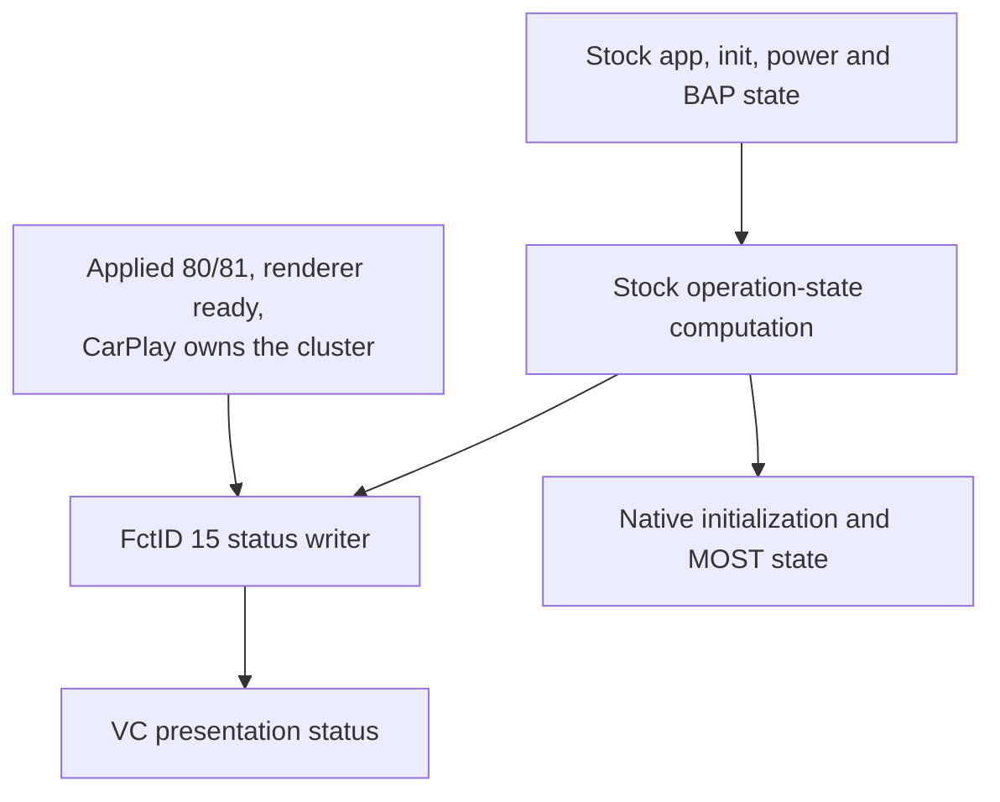
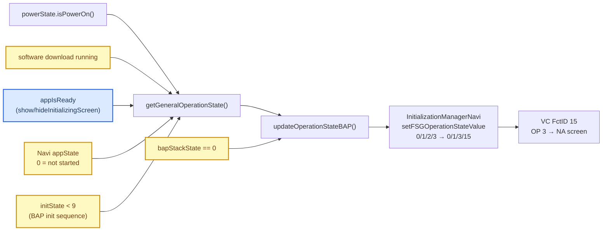

# Nav Initializing Screen

*Why the Virtual Cockpit still shows "Initialising navigation system. Please wait..." over the CarPlay cluster map, what really drives it on both sides, why the September 16 fix (`7d35b53`) does not stop it, and the fix that should. Status (2026-10-19): **no workaround is in the tree.** The 2026-10-18 candidate (`1bad426`) did not clear the text on the owner's cold-boot test and was reverted; the September 16 show/hide deferral (`7d35b53`) was removed with it, so the hook no longer touches NAVSD INITIALIZING. Why: [2026-10-19: why nothing is patched](#-2026-10-19-why-nothing-is-patched). The [2026-10-18 deep dive](#-2026-10-18-deep-dive-jar-binding-the-readiness-chain-and-why-the-candidate-was-blind) is kept for the jar-binding analysis and the readiness chain. A clamp in a patched `InitializationManagerNavi` was built on 2026-09-23 (`b4a661a`), did not remove the screen on the car, and was removed on 2026-09-24. The analysis is static, of the VC `hmi_app.elf` (A5 2018, `AU491_0379`), the HU stock Java (`Tools/jxe2jar/out/MU1316-vf/`), `navStartup`/`servicemgrmibhigh`, and the HU startup configs.*

---

## 📋 Summary

| Question | Answer |
|---|---|
| Which VC screen shows the text? | The Nav **NA** ("not available") screen, state 183 `SV_NavFPK_NA`. It replaces the whole map view, including the CarPlay plane. |
| What selects it? | NavSD **FSG_OperationState** (FctID 15) with `OP_State` 1, 3 or 15. `OP_State = 3` (INITIALIZING) picks the "Initialising navigation system" text. |
| What is *not* the cause | NavSD **InfoStates** (FctID 38). It drives a separate hint-text popup and the "navigation on mobile device" screen (which the KSS firmware makes unreachable on this VC), not this text. |
| Why the HU sends INITIALIZING | `AbstractBAPModuleInitializationManagerFSG.getGeneralOperationState()` returns INITIALIZING when the "Navi" app has not started (`appState == 0`), when the BAP init sequence is still running (`initState < 9`), during a software download, when `appIsReady` is false, or when the BAP stack is down. |
| Why `7d35b53` fails | It only intercepts `showInitializingScreen()` / `hideInitializingScreen()`, which toggle `appIsReady`. The other four inputs still send INITIALIZING, from a manager that runs before and beside our wrapper. |
| Fix | October 18 candidate overrides INITIALIZING only for an applied CarPlay composition with a ready renderer; preserves native initialization semantics. Deployed and ineffective on the 2026-10-18 cold boot — the test was blind (see the deep dive below); the next candidate adds hook-file logging and a binding-independent stock-instance fallback. |

## ⏸️ 2026-10-19: why nothing is patched

On the owner's car CarPlay is up 10–15 s after power-on, stock Navigation reports ready at about 26 s (the native `0x704` run mode, [Stock Nav Readiness](STOCK_NAV_READINESS.md)), and the VC shows the NA screen in between. NAVSD has **two** barriers in that window, and an OP_State override can only pass the second:

1. **The NAVSD BAP module is OFF until Java Navigation registers its listener.** `AbstractNavigationActivator.start()` registers `CombiBAPServiceNaviListener` (`AbstractNavigationActivator.java:424-429`); `ServiceManagerNavi` hands it to `AppConnectorNavi.setAppServiceListener()`, which calls `notifyAppServiceChanged(true)` (`AppConnectorNavi.java:63-66`). Until then `updateHMIState()` keeps hmiState 0 (`AbstractBAPModuleInitializationManager.java:175-210`), and the BAP init sequence (initState 2 → 9) starts only after the VC acknowledges hmiState 1 (`notifyHMIStateAcknowledged`). `[decompile]`
2. **OP_State NORMAL needs the "Navi" app state 1**, i.e. the native readiness report. `[decompile]`

Every cluster BAP module has its own app-service gate: AudioSD follows `AppConnectorMedia` / `AppConnectorTuner`, Phone follows `AppConnectorPhone`. That is why CarPlay music reaches the VC long before NAVSD is up. A fix inside the window would have to give NAVSD an app-service listener of our own while CarPlay owns the cluster and hand it back to stock Navigation later; it was not attempted. `[decompile]`

## 🔍 October 18 comparison and candidate

The compared kamgurgul revision is
`1c3e07528b59bb424ff45b7d14ed7f44bd687efb`; source hashes and the normalized
comparison are in ignored `build/cluster-startup-comparison.json`.

| Boundary | kamgurgul at that revision | This repository |
|---|---|---|
| Native Navigation startup | `NavReadyMarker.watch()` polls `Navigation.getInstance()` and writes `/tmp/carplay_nav_ready`[^nav_marker] | No Navigation marker is required by AltScreen startup |
| Renderer launch | Monitor waits for the marker or a 90-second cumulative timeout before starting both renderers[^nav_monitor] | Monitor starts AltScreen first, then maneuver renderer, without that gate |
| Video visibility | Polls renderer heartbeat every 250 ms; screen module selects video context after live frames[^up_alt] | Current renderer control connection reports a posted loader/video surface; selects 80/81 without waiting for native Navigation |
| Existing NavSD interception | `ScreenNavStatusGate` and `GatedCombiService` defer show/hide requests[^up_gate] | Same gate after class/tag renaming; only `appIsReady` is affected |
| Final operation-state writer | No replacement `InitializationManagerNavi` in compared Java tree | New presentation-only replacement; candidate described below |

The explicit renderer delay is documented upstream as a workaround for native
Navigation missing its startup deadline during concurrent cold phone startup.
A non-null Navigation singleton does not establish that the native map is fully
loaded. Removing that workaround from another installation needs its own boot
resource measurements; this repository already has a different startup path.
The source comparison does not establish which older release a reporter used.

### Presentation-only operation state

The candidate adds
[`InitializationManagerNavi.java`](../../java_patch/de/audi/app/combi/bap/app/navi/InitializationManagerNavi.java)
at the final FctID 15 status writer. A state originating from native
INITIALIZING is sent as NORMAL only when all of these hold:

- The cached applied context is CarPlay 80 or 81 and a CarPlay session/video owns it.
- The current renderer has published a surface; intention to connect alone is insufficient.
- The BAP stack is up, power is on and software download is not running.

OFF, DEFECT, BAP-down and software-download states retain stock behavior.
The internal native app/init state and MOST operation state remain stock.
`isOpStateNormalOperation()` also retains native initialization semantics:
a presentation override must not tell the BAP initialization engine that
Navigation has become ready.

Refreshes occur after context application, renderer readiness/loss and lifecycle
publication, outside the AltScreen state lock. Each refresh reads current state;
there is no queued boolean takeover edge that can survive a reconnect.
Disconnect/failure recomputes native readiness rather than replaying a guessed
READY value. Native Navigation remains free to start normally in parallel.

This differs from the removed September candidate: it uses applied surface
readiness instead of connection intent, preserves software-download/power
behavior and preserves the native `isOpStateNormalOperation()` result.
It still needs a real cold HU/VC test; vphone/QNX video alone does not exercise
the instrument cluster's BAP state machine.

### Verification

[`NavOperationStateTest.java`](../../tests/NavOperationStateTest.java) executes
the shipping replacement with the **unmodified stock superclass** computing
operation state. External BAP transport, power and DisplayManager are controlled
fixtures; framework constructors are bypassed with host-only Unsafe. It proves
the old show/hide wrapper's counterexample, then exercises absent Navigation,
all init phases before 9, actual native readiness, software download, power off,
BAP down, native defect, failed context, renderer loss/reconnect, TMDevice bounce
and disconnect. The generated stock FctID 15 serializer is exercised too.

The test adds 10000 deterministic state mutations (seed 47426351), comparing
native readiness to the original superclass result. Run through
`scripts/test_java_transports.sh` against US MU1316, EU MU1329 and CN MU1003.
Original `InitializationManagerNavi.class` is byte-identical across those three
stock JARs (SHA-256 `f675258fa7078df96d82bc01efabde3c59375bda4cb054cd85e14b4ecf963fec`).
Validation passed the Java transport/startup/context/lifecycle/PDC suite,
renderer monitor lifecycle tests and US/EU/CN stock linkage audit. The context
fuzzer passed 11200 switch cases and 10000 lifecycle events per firmware with
seed 47426351; the NAVSD test independently passed 10000 mutations per firmware.
These are host results, not physical VC timing measurements. Logs are under
ignored `build/cluster-startup-*.log`; the review snapshot is
`build/nav-startup-review-20261018/`.

[^nav_marker]: [kamgurgul NavReadyMarker at the compared revision](https://github.com/kamgurgul/mib2q-carplay/blob/1c3e07528b59bb424ff45b7d14ed7f44bd687efb/java_patch/com/luka/carplay/core/NavReadyMarker.java).
[^nav_monitor]: [kamgurgul renderer monitor at the compared revision](https://github.com/kamgurgul/mib2q-carplay/blob/1c3e07528b59bb424ff45b7d14ed7f44bd687efb/deploy/smartphone_integrator/carplay_monitor.sh).
[^up_alt]: [kamgurgul AltScreen heartbeat at the compared revision](https://github.com/kamgurgul/mib2q-carplay/blob/1c3e07528b59bb424ff45b7d14ed7f44bd687efb/java_patch/com/luka/carplay/core/AltScreenModule.java).
[^up_gate]: [kamgurgul NavSD gate at the compared revision](https://github.com/kamgurgul/mib2q-carplay/blob/1c3e07528b59bb424ff45b7d14ed7f44bd687efb/java_patch/com/luka/carplay/core/ScreenNavStatusGate.java).

## 🔬 2026-10-18 deep dive: jar binding, the readiness chain, and why the candidate was blind

The owner's cold-boot test of `1bad426` (CarPlay up on the HU, music playing, VC still on
"Initialising navigation") produced no diagnostics, so the test cannot distinguish "our class never
ran" from "our override gate was false". This section answers three things statically: how
`carplay_hook.jar` is loaded relative to the ROM classes in `lsd.jxe`, the full native→Java readiness
chain with addresses, and a ranked fix whose next boot is conclusive on its own. The HU was offline
during this research; every `[car]` claim is inherited from earlier sections of this document and the
repo history.

### Does the car run our `InitializationManagerNavi`? (Q1)

**Launch mechanics.** `lsd.sh` finds every jar under `$BASE_DIR/lsd/jars/` and appends it to
`BOOTCLASSPATH` (`lsd.sh:392-399`), appends `lsd.jxe` **last** (`lsd.sh:432`), and launches
`$J9 $VMOPTIONS -Xbootclasspath:$BOOTCLASSPATH -jxe:$LSD_JXE` (`lsd.sh:434`). So on the boot class
path the order is `carplay_hook.jar : … : lsd.jxe`. The JVM runs with `-Xquickstart`, microJIT and
`-noverify` (`lsd.sh:45-47`). `[code]`

**JXE format.** `lsd.jxe` is a ZIP whose first member `rom.classes` is a J9 ROM image (magic `J99J`).
ROM classes store JVM-standard bytecode (J9-private opcodes aside); class references are
constant-pool entries resolved through the class loader at run time — there is no build-time
interning of cross-class references that could bypass the boot loader (see `Tools/jxe2jar/README.md`,
"The J9 opcode space" and the `new`-site recovery, which reads exactly those CP class refs).
`[code]` `[doc]`

**Empirical anchor.** Whole-class stock replacements in the same package tree demonstrably work on
this car: `AppConnectorTerminalMode` is constructed by the ROM class
`CombiModuleAudio` (`CombiModuleAudio.java:91`) and `ServiceManagerPhone` by the ROM class
`CombiModulePhone` (`CombiModulePhone.java:91`). `[decompile]` `[car]` The navi manager is
constructed the same way: `CombiModuleNavi.initModuleComponents()` executes
`new InitializationManagerNavi(...)` (`CombiModuleNavi.java:78-83`), which runs from the
`AbstractBAPModule` constructor (`AbstractBAPModule.java:56`) when `CombiActivator.createModules`
unconditionally creates `CombiModuleNavi` (`CombiActivator.java:26-35`) — no configuration gate.
`[decompile]`

**Conclusion.** A ROM-vs-jar binding difference cannot explain the failed candidate: the replacement
should bind exactly like the audio/phone replacements do. That narrows the failure to the ranked
hypotheses below (stale jar, false override gate, or an unobserved load failure), and all three are
closed by logging + the fallback in the next candidate. Only a boot log can *prove* the instance ran;
the static analysis can only say the mechanism is the proven one. `[code]`

**Why "it logs nothing" proves nothing.** Production runs with `-DLOG=all=0,Ext.Power=5` and
`-DSLOG=Ext.Startup=5,Fw.Error=2` (`lsd.sh:240-241`): every stock BAP `logChannel` line — including
the two log calls the replacement carries over from stock — is silenced. The hook's own logger
(`com/luka/carplay/framework/Log.java`) writes WARN+ to `/tmp/carplay_java.log` (RAM, rotated,
SSH-tailable; INFO behind a `/mnt/app/carplay_verbose` marker) — the navi replacement never used it.
The 2026-10-18 test was blind by construction. `[code]`

### The readiness chain end to end (Q2)

Addresses are IDB addresses (both IDBs have image base 0x100000). Native timeline reference: the
P5092 boot sloginfo (other car) — `startDomain(Nav, 0x700)` at 15 s, `APP_RUN_MODE 1796` (0x704) at
26 s, `updateDomainState(Nav, 0x3852)` / domain 'navigation' state 0xf0c at 37 s. `[doc]`

```mermaid
flowchart LR
    accTitle: Native navigation readiness to the VC NA screen
    accDescr: servicemgr starts navStartup on the HMI's startDomain request; navStartup checks the map database, starts the engine and PresCon, reports the app run mode; servicemgr forwards it over DSI; the HMI Java starts the Navi component; the BAP init sequence and app state together decide FctID 15.
    sm["servicemgrmibhigh<br/>startDomain(Nav=6)"] --> launcher["dsistartup.json launcher 'navigation'<br/>init apprunmode 512, run 60 s timeout"]
    launcher --> nav["navStartup<br/>DB check, SWDL check"]
    nav --> eng["AppStartATF 'navi'<br/>SignalMapper-1.5.cfg<br/>libPathfinderApp + libPresentationController"]
    eng --> sdk["StartupNaviSDK + StartupNaviPresCon<br/>60 s wait for PresCon"]
    sdk --> rep["reportAppRunMode 0x704"]
    rep --> fwd["[SM] APP_RUN_MODE trace<br/>[updateDomainStatus] -> DSI"]
    fwd --> jhmi["DomainHandler -> AppStateManager<br/>ComponentState 'Navi' = 1"]
    jhmi --> bap["appStateChanged -> processAppStateChanged(1)<br/>NORMAL needs initState >= 9"]
    bap --> vc["FctID 15 OP_State 0<br/>VC leaves the NA screen"]
```

1. **Domain start (servicemgr side).** Navigation is *not* in `on_startup_normal`
   (`dsistartup.json`); the HMI's `startDomain(6, 0x700)` request triggers the `"navigation"`
   launcher: `init` with `apprunmode` 512 (30 s timeout), then `run` (60 s timeout); restart policy 3
   attempts then `kill_process` (`dsistartup.json:309-350`). `servicemgrmibhigh` spawns
   `/navigation/navStartup` per `framework.json` (`"navigationProc"`, id 311, `singleapp`
   `"navigation"`, `NAV_MAP_PATHS=/fs/sda0/navDatabase:/mnt/navdb`, `STYLE_DB_PATHS=/mnt/app/navigation`,
   `framework.json:318-338`). `[code]`
2. **navStartup gates.** Checks the map database and SWDL state (strings `NO DATABASE`,
   `CHECK FAILED`, `READY4NAV`), then starts its children via PMon: `/navigation/AppStartATF` as
   procname `navi` with `SignalMapper-1.5.cfg` — the ATF module loader that loads
   `libPresentationController.so` and the 24 MB engine `libPathfinderApp.so` into the one `navi`
   process — plus `DRController`, `IconProviderApp`, `PNavApp`. `[decompile]` `[code]`
3. **PresCon handshake.** `StartupNaviPresCon` (helper `sub_11B500`) sends the start command and
   waits up to 60 s for the response (`StartupPresCon: Did not receive Start Response`); response
   id 17/value 1 logs `StartupPresCon: Ready for navigation`, id 1/value 1 logs
   `PresCon running. APP set to running.`. `ReStartPrescon` (`sub_12141C`) shows the sequence:
   `reportAppRunMode(1)` → IPC → `StartupNaviSDK` (`sub_11CD48`) → PresCon start → on success
   report the stored run mode (`ReStartPrescon OK runMode %d`). `[decompile]`
4. **Run mode report.** `servmngt::Application::reportAppRunMode` (`navStartup` `0x11AB6C`) →
   broker → `servicemgrmibhigh` trace `[SM] APP_RUN_MODE %d reported for %s` (`0x1792C0`) → domain
   state machine → `[updateDomainStatus] domain '%s' state 0x%x` (`0x175D58`) → the DSIStartup
   listener (`listener_updateDomainStatusNav`). Observed values: 0x704 = 0x700 base flags +
   OPERABLE (0x4) at ~26 s; 0xF0C later. The meaning of the high flag bits 0x100/0x200/0x400/0x800
   is **not decoded** (guess: per-subsystem readiness flags; `apprunmode: 512` seeds 0x200 at init).
   `[decompile]` `[doc]`
5. **Java component state.** `hmi_startup.json` (embedded `resources/hmi_startup.json` in
   `lsd.jxe`, byte-identical to `hmi_startup.json.example`) component "Navi": domain
   `{id: 6, required_state: "0x700"}`, bundles `adaptermanager` + `AppNavi`, guide module
   `HMINavi`/`SMNavi`, dependency `{id: 10 (SDS), required_state: 0x300, start_asynchron}`; the
   "Info" component needs domain 6 ⊇ 0xF00 and stops when Navi fails. The DSI callback chain is
   `DomainHandler.updateDomainStatusNav` → `updateDomainStatus` → `StartupManager` →
   `AppStateManager.updateDomainState` → `ComponentState["Navi"].updateDomainState` →
   `stateUpdate` → `componentStarted` → ChoiceModel 361 = 1 →
   `appStateChanged("Navi", 1)`. **"Navi" = 1 therefore requires all of:** domain 6 status ⊇ 0x700
   (inclusion check `(required & ~updated) == 0`), `AppNavi`/`adaptermanager` bundles ACTIVE,
   guide module active, and the SDS domain ⊇ 0x300. `ComponentState`'s enabled check
   `(value & -768) != 0` (`ComponentState.java:487`) treats the 0x100/0x400 flag bits as
   "not enabled". `[decompile]` `[code]`
6. **BAP init phases (`initState`).** Entirely Java-side, on every NavSD BAP (re)start:
   `startInitialization` (`AbstractBAPModuleInitializationManagerFSG.java:43-58`) runs
   `CommandUpdateFunctionList` (state 3, `:371`) → `CommandUpdateOperationState` →
   `CommandUpdateProperties` (state 4, `:435`) → `CommandUpdateArrays` →
   `CommandFinishInitializationSequence` (state 9, `:231`); failure 0x42 restarts (state −1, max 5).
   HMI-ack states 0/1/2/10/11 come from `updateHMIState`
   (`AbstractBAPModuleInitializationManager.java:158-205`), driven by app-service availability
   (`AppConnectorNavi.setAppServiceListener` → `notifyAppServiceChanged`).
   `isOpStateNormalOperation()` has **no call site** in the decompiled tree — only its definitions
   (checked across the whole MU1316-vf tree). `[decompile]`

**What stock waits for, enumerated:** map database readable + SWDL checks (`navStartup`), the nav
SDK modules up, PresCon up (60 s timeout), run mode 0x704 reported, SDS domain 0x300,
`AppNavi`/`adaptermanager`/`HMINavi`/`SMNavi` bundles active, then the NavSD BAP init sequence to 9.
Any slow or stuck stage extends the INITIALIZING window; the greps in the verification plan below
attribute a slow boot to its stage.

### Why `1bad426` could fail on the car — ranked hypotheses

| # | Hypothesis | Evidence for/against | What settles it |
|---|---|---|---|
| H1 | The jar on the unit was not the `1bad426` build | The build receipt `build/carplay_hook-build.json` (built 2026-10-18 21:20, commit `1bad426`) says `"deployed": false`; the doc status said "not deployed" before the owner test | sha256 of `/mnt/app/eso/hmi/lsd/jars/carplay_hook.jar` vs the receipt (read-only) |
| H2 | `isClusterPresented()` was false the whole observed window | The gate needs `rendererReady && (connected \|\| videoAvailable) && currentCtx ∈ {80, 81}` (`AltScreenModule.java:113-117`); the worker defers context application until the renderer is ready (`AltScreenModule.java:522`), so cold-boot renderer contention keeps the gate false exactly while the owner watches the text; all refresh edges are wired, so once presented the override should fire | refresh log lines with all gate inputs |
| H3 | The replacement class did not bind or failed to load | Argued unlikely (binding section) but not excluded without a log | "manager installed" line, or the stock-fallback path serving the refreshes |

### Ranked fixes (Q3)

**Fix A (recommended): keep the `1bad426` override, make it observable and binding-independent.**

- Replace the replacement's diagnostics with `com.luka.carplay.framework.Log` (tag `NavOpState`,
  WARN level so it is on by default): constructor ("patched manager bound"), every
  `refreshCarPlayPresentation` (`appState`, `initState`, `bapStackState`, swdl, power, presented,
  decision), every `setFSGOperationStateValue` (`in=%d out=%d override=%b`).
- Add a **stock-instance fallback** that works even if the class replacement does not bind. When
  `InitializationManagerNavi.instance == null`, resolve the live stock manager without any class
  replacement: `Navigation.getInstance()` (`Navigation.java:423`, public static) →
  `getClusterService()` (`:1072`) → `getCombiBAPListenerCombiService()` (accessor added by our
  replaced `ClusterService`, proven on the car) → reflect the protected
  `AbstractCombiConnector.moduleFsg` field (`AbstractCombiConnector.java:7`, inherited by
  `AppConnectorNavi`) → public `getInitializationManager()` (`AbstractBAPModule.java:124`) → cast
  `AbstractBAPModuleInitializationManagerFSG` → reflect protected `fsgOperationStateFunction` →
  public `getLastStatus()` / `resendLastStatus()` (`BAPFunctionPropertyFSG.java:172,204`).
  While presented and stock would send INITIALIZING (power on, BAP stack up, no SWDL): set
  `op_State = 0` on the status object and `resendLastStatus()`; on presentation loss call the
  stock `updateOperationState()` so the true value is recomputed and resent. Re-assert on the
  existing refresh edges (start, stop, republish, rendererReady, applyContext finally). Log which
  path served each refresh ("patched" vs "stock-fallback").
- Risk: the same presentation-level status write the candidate already makes. The init engine's own
  state (appState/initState/MOST operation state) is untouched; the init sequence runs on BAP events
  independently. In the fallback path a forced `op_State = 0` makes the stock
  `isOpStateNormalOperation()` read true while CarPlay owns the cluster — with no call sites found
  in the tree this is believed inert, but it is unverified at run time (state as a guess).

**Fix B (only if Fix A's logs show H2):** loosen the gate while a CarPlay session is connected
(drop `rendererReady`/`currentCtx` from the override condition, keep `connected`). Faster relief,
but it masks stock initialization whenever a phone is connected and the cluster takeover failed.
Decide after one logged boot, not before.

**Fix C (rejected):** make stock report readiness earlier — lower `required_state` in the embedded
`hmi_startup.json` or relax the `navStartup` run-mode bits. This lies about native readiness, the
Info component depends on 0xF00, and BAP init (initState 9) would still gate NORMAL.

**Fix D (rejected):** VC-side change — least preferred per the task; needs VC firmware work and
cannot distinguish a stuck HU from a correct one.

### One-boot verification plan

Preparation (owner, before the boot):

1. Deploy the rebuilt jar. After boot, verify read-only that
   `sha256 /mnt/app/eso/hmi/lsd/jars/carplay_hook.jar` equals the receipt in
   `build/carplay_hook-build.json` — this alone settles H1.
2. `touch /mnt/app/carplay_verbose` (INFO level; survives reboot).

Cold boot with the phone connected, then read-only SSH:

3. Native timeline (whole-buffer grep; QNX grep has no `-o`/`\|`):
   `sloginfo | grep -e startDomain -e APP_RUN_MODE -e updateDomainStatus -e StartupPresCon -e StartupNaviSDK -e READY4NAV`
   Healthy boot: `startDomain` ≤ 20 s, `APP_RUN_MODE` 0x704 ≈ 26 s, 0xF0C ≈ 37 s. A missing
   `APP_RUN_MODE` line plus `StartupPresCon: Did not receive Start Response` or a database check
   failure names the stuck stage.
4. Hook log: `cat /tmp/carplay_java.log | grep NavOpState`:
   - "patched manager bound" → H3 dead.
   - `presented=true` and `OP in=2 out=0` while CarPlay is up → the override fired; if the VC still
     shows the text at that moment, the problem is downstream (BAP transport/VC) — capture the VC
     side again.
   - only "stock-fallback" lines → class replacement did not bind (H3 alive), and the fallback is
     what must clear the text.
   - `presented=false` persisting while the phone session is up → gate problem (H2) → Fix B.

Pass criteria: with the CarPlay cluster presented, the VC shows the CarPlay map with no NA text;
a stock navigation start with CarPlay disconnected still shows the stock screen; the text never
returns while the same session stays presented.

## 🖥️ The VC side

### The Nav state tree

State names come from the table at `0x223BFC` (state id = name index + 2). `[decompile]`

```mermaid
stateDiagram-v2
    accTitle: VC Nav state tree around the NA screen
    accDescr: The NavFpk state chooses NA when NavSD OP_State is 1, 3 or 15, otherwise Operable; Operable chooses the compass, the mobile-device screen, the hint texts or the normal map, and only the normal map contains the LVDS view that carries CarPlay.
    state "153 Nav" as nav
    state "166 NavFpk" as fpk
    state "183 SV_NavFPK_NA" as na
    state "167 Operable" as op
    state "180 Compass" as compass
    state "181 Compass_MobileDevice" as mobile
    state "182 HinweisTexte" as hint
    state "168 Normal" as normal
    state "177 SV_LVDS_NavMap_FPK (CarPlay plane)" as lvds
    [*] --> nav
    nav --> fpk: FPK cluster variant
    fpk --> na: DP 0x200006A in {1, 3, 15} or DP 0x2000073 == 2
    fpk --> op: otherwise
    op --> compass: DP 0x400004B != 0
    op --> mobile: InfoStates == 6
    op --> hint: hint index != 0
    op --> normal: otherwise
    normal --> lvds
```

- `166 NavFpk` → `183 NA` when DP `0x200006A` (the NavSD OP_State mirror) ∈ {1, 3, 15} or DP `0x2000073` == 2, else `167 Operable` (`sub_2286B4`). On a non-FPK cluster, `162 LVDS_Nav_Generic` is used instead (DP `0x6400DE3`).
- `167 Operable` picks `180 Compass` (DP `0x400004B` != 0), `181 Compass_MobileDevice` (DP `0x400000F` == 6, i.e. InfoStates 6), `182 HinweisTexte` (DP `0x4000044` != 0), else `168 Normal` (`sub_22871C` / `sub_22879C`).
- **How NA is left again.** The event-1 transitions with flag `0x4` are initial-child choices, evaluated only on entry; 183 itself has no transitions. A datapool watcher (table filled in `sub_222158`) fires event **354** whenever DP `0x200006A` (OP_State), `0x2000073` or `0x200052D` changes, and `153 Nav` handles 354 as an external self-transition. So every OP_State change re-enters 153 → 166 and re-runs the NA/Operable choice: OP 3 → 0 leaves the NA screen, and the FctID 15 handler also calls `VC_TryShowKDKFlap` for OP 0. Sending NORMAL is enough on the VC side. `[decompile]`
- Only `168 Normal` → `169 NavMap_FPK` → `177 SV_LVDS_NavMap_FPK` shows the HU's LVDS map, which is where the CarPlay plane appears. **Any of NA, compass, mobile-device or hint screens takes the CarPlay map away.**

### The handlers

| VC handler | BAP | Writes |
|---|---|---|
| `0x1797E4` (logs `NavSD_FSG_OperationState_OP_State`) | NavSD FctID 15 FSG_OperationState | DP `0x200006A` = {0→0, 1→1, 3→3, 15→15, other→0}. For OP != 0 it also calls `VC_CloseKDKHole`, closing the map window; OP 0 calls `VC_TryShowKDKFlap`. |
| `0x179320` → `sub_177940` | NavSD FctID 38 InfoStates | DP `0x400000F` = raw InfoStates; DP `0x4000044` = hint index: 1→2, 2→4, 4→5, 5→6 (only in map views 20/22/23), anything else → 0 |
| `0x17BA38` | NavSD RG_ActDeact_Result | hint index from the route-guidance result, a 6 s "infostate timer" (`sub_175BC0`) that clears it, and event 370 (back from the route-guidance submenu to the map) |

An earlier note in this repo named `0x17BA38` the InfoStates handler; that was wrong.

### Which text the NA screen shows

The NA text chain at `0x611154` (`sub_610324`):

| Condition | Text id | Text |
|---|---|---|
| OP == 1 | 419 | (off / standby) |
| OP == 3 and DP `0x2000073` == 1 | 358 | **"Initialising navigation system. Please wait..."** (inferred from OP == INITIALIZING) |
| OP == 15 | 361 | (defect) |
| DP `0x2000073` == 2 | 360 | "Navigation is not available." / "currently unavailable" |

The NA widget reads its strings from the lists `0x6400F35` / `0x6400F36`, which were not decoded; the English string pool (`0x90A0ED`) has exactly three "no navigation" texts (currently unavailable, not available, initialising), so id 358 = "Initialising" is an inference from the OP value. No code writes DP `0x2000073`; it is probably filled from a network signal (guess: NavSD availability, 1 = available). `[decompile]`

**The hint list** (DP `0x4000044`, lists `0x6400ED7` / `0x6400ED8`), mapped against the route-guidance result enum: 1 no home address, 2 insert data medium, 3 no route, 4 database unreadable, 5 database updating, 7 no alternative route, 8/10 select route on the MMI, 9 route guidance could not be stopped, 11 select home on the MMI, 12 no navigation data, 13 map offline, 14 route guidance already active. Index 6 (InfoStates 5) is either "Initialising navigation system" or "Initialising Google Earth map" — not resolved, and the HU does not send InfoStates 5 in normal use (see below).

**LVDS NA_Init states** 160 / 164 / 155 depend on DP `0x200032D` (main unit / LVDS capture present) == 0 and OP != 1. The VC writes that itself on LVDS lock loss or capture failure; it matters only on non-FPK cluster variants.

## 🧠 The HU side

### Where NavSD OP_State comes from

`AbstractBAPModuleInitializationManagerFSG.getGeneralOperationState()` (`:123-152`): power off → 1 (OFF); software download running or `!appIsReady` → 2 (INITIALIZING); `appState == 0` → 2; `appState == 1` → 0 (NORMAL) only if `isRequiredDataForOpStateNormalAvailable() && getInitState() >= 9`, else 2; any other app state → 3 (DEFECT). `updateOperationStateBAP()` then forces 2 when `getBapStackState() == 0`. `InitializationManagerNavi.setFSGOperationStateValue()` maps 0/1/2/3 to BAP 0/1/3/15. `[decompile]`

- **`appState`** is the startup manager's "Navi" component state (`InitializationManagerNavi.appStateChanged`, `"Navi"` or the Asia nav app). It stays 0 until the navigation domain has started, which is exactly the cold-boot window in which CarPlay is already on the cluster.
- **The init sequence** (`CommandUpdateOperationState` runs before `CommandFinishInitializationSequence`) sends INITIALIZING on every NavSD BAP (re)initialisation: VC wake-up, a BAP stack drop, init retries after error 0x42.
- **`appIsReady`** is the only input `AppConnectorNavi.showInitializingScreen()` / `hideInitializingScreen()` touch (`setAppIsReady(false/true)`). `CombiBAPListener.forceShowInitScreen` starts `true`, so every `updateAll()` requests a show/hide.

### Why `7d35b53` does not work

Until 2026-10-19 `GatedCombiService` deferred `showInitializingScreen()` and reasserted `hideInitializingScreen()` while CarPlay owned the cluster (removed; both are pure pass-throughs now). That only kept `appIsReady` true. `appState == 0`, `initState < 9`, a download or a dropped BAP stack still produce INITIALIZING, and `setAppIsReady(true)` cannot override them. The init manager also lives in the combi bundle and runs before `ClusterService` or our wrapper exist. Its regression test (`tests/GatedCombiServiceInitStateTest.java`, removed with it) checked the deferral logic, not the operation state the VC receives. `[decompile]` `[code]`

### InfoStates in stock

`CombiBAPListener.updateInfoStates()` (`:1100-1122`) sends 6 if `naviIsRunningOnSmartphone`, else the navi info state (`setInfoStateNavi`: 0/1/2), else the GPS state (`setInfoStateGPS`: 0/3). `naviIsRunningOnSmartphone` is set by `setGALState()` (`:2186-2188`) from `GALHandler.updateAppStates` when a terminal-mode navigation app runs on the phone; `GALHandler` is generic terminal mode, so CarPlay is likely included (not verified for CarPlay). InfoStates 5 is sent only by `CombiBAPListener.showSplashScreen(true)`, from the diagnostic `NavigationDiag.cmdKombiToggleSplashScreen`. `GatedCombiService.updateInfoStates` passes every value through (`GatedCombiService.java:126`). `[decompile]` `[code]`

**On this VC, InfoStates 4 and 6 never reach the state chart.** The KSS AUTOSAR firmware validates the value before EB GUIDE sees it (`sub_108F42C`: `a1 <= 0xF && (a1 & 5) != 4 && (a1 & 0xA) != 8`), which rejects 4, 6, 8, 9, 12 and 13, so `181 Compass_MobileDevice` is unreachable ([VC FPK State Machine](VC_FPK_STATE_MACHINE.md#-infostates-6-is-rejected-by-kss)). Of the stock values, only 1, 2 (hint popups) and 5 (splash) can show anything. `[decompile]`

## 🛠️ The tried fix (removed)

**Tried, then removed (2026-09-24).** On the car the owner still saw the screen, and CarPlay came up late or on the second attempt in that drive. No logs were taken (the unit was offline). Static findings behind the removal decision:

- **The VC side is sufficient.** OP 3 → 0 re-enters `153 Nav` through event 354 and leaves NA (see the state tree above), so NORMAL is enough to bring the CarPlay map back.
- **The HU override is loaded.** `lsd.sh` puts `lsd/jars/*.jar` on `-Xbootclasspath` before `lsd.jxe`, the same path the other patched combi classes use; `setFSGOperationStateValue` is the only OP_State writer.
- **The clamp cannot cover the window the owner sees.** Ownership is `connected || videoAvailable`. `connected` is set in `AltScreenModule.start()` (first `CarPlayApp.onActivate`); `videoAvailable` comes from `altscreen_render` (`decode_video_ready()`: stream 111 attached, decoder alive, OMX presented a frame → `VIDEO_ON` on :19832) and is accepted only after `connected` or inside the 1.5 s `acceptVideoFallback` grace after `stop()`. So from cold boot until the CarPlay session activates, nothing can clamp, and the VC shows the stock NA screen for that whole time; a slow or retried CarPlay start makes it long.
- **Decision:** remove the clamp rather than ship an untested extra patched stock class for the part it can cover. A future fix needs an earlier, trustworthy "CarPlay will own the cluster" signal (for example a CarPlay device attached at boot), and it must not hide a real stock-navigation initialisation when no phone comes.

What the removed patch did: `java_patch/de/audi/app/combi/bap/app/navi/InitializationManagerNavi.java` (patched stock class) and `AltScreenNavStatusGate.setAltScreenActive()`, which calls `InitializationManagerNavi.setCarPlayClusterOwner()` outside its own lock before the existing takeover logic. The clamp applies only while the BAP stack is up and only to INITIALIZING; OFF and DEFECT pass through. While clamped, stock `isOpStateNormalOperation()` also reads NORMAL, which is harmless while CarPlay owns the cluster. Covered indirectly by `AltScreenStartupTest` (cold/warm/stop) in `scripts/test_java_transports.sh`; the clamp itself has no unit test because the stock init manager needs the BAP framework. `[code]`

1. **Clamp OP_State in `InitializationManagerNavi` (tried in `b4a661a`, removed).** Ship a patched `de/audi/app/combi/bap/app/navi/InitializationManagerNavi.java` (the tree already patches classes under `de/audi/app/combi`):
   - keep a static reference to the instance in the constructor;
   - add a static `setCarPlayClusterOwner(boolean)` that stores the flag and calls `instance.updateOperationState()` (public, synchronized, safe from any thread);
   - in `setFSGOperationStateValue(int i)`: when the flag is set, `getBapStackState() != 0` and `i == 2` (INITIALIZING), use 0 (NORMAL); optionally treat 3 (DEFECT) the same;
   - leave `updateOperationStateMOST` and every other input unchanged;
   - call the setter from `AltScreenNavStatusGate.setAltScreenActive()` (the `connected || videoAvailable` edge).
   No cache is needed: on release, `updateOperationState()` recomputes the real value from `appState`, `initState` and `appIsReady`, and because it changes back to 2 it is resent. The VC keeps the KDK map window open, since OP 0 calls `VC_TryShowKDKFlap`. Risk (guess): the VC sees NORMAL while the HU init sequence still runs; the sequence finishes on its own, so this looks harmless.
2. **Optional: neutralise InfoStates in `GatedCombiService`.** While CarPlay owns the cluster, cache the last value and forward 0 for anything that would draw over the map; replay the cached value on release. 6 and 4 are already dropped by the KSS validator on this VC, and 5 is diagnostic only, so this matters only for 1/2 (no data medium, database corrupted), which put a hint popup over the CarPlay map.
3. **Optional:** gate `routeGuidanceActDeactResult` while CarPlay route guidance is active, so stock route-guidance results cannot pop hints (for example "Route guidance is already active").
4. The `7d35b53` show/hide deferral (covers `appIsReady` only) was removed on 2026-10-19 together with `1bad426`.

## ✅ How to confirm on the car

- **HU log:** `updateOperationState ... (swdlRunning=?, appState=?)` followed by `updateOperationStateBAP ... is 2 (INITIALIZING)` at the moment the text appears. `appState=0` → the cold-boot cause; `initState < 9` → the init sequence.
- **VC trace:** `FSG_OperationState: new OP_State=03` / `NavSD_FSG_OperationState_OP_State: 03` at the same moment.
- For any future fix: cold boot with CarPlay connected shows the CarPlay cluster map with no NA screen; disconnecting CarPlay during a stock navigation start shows the stock "Initialising" screen again until navigation is ready; stock navigation without CarPlay behaves as before.

## 🔗 Related

- [NavSD FctID Matrix](NAVSD_FCTID_MATRIX.md): FctID 15 and 38 in the ownership table.
- [AltScreen Cluster Video](../altscreen-and-video/ALTSCREEN_CLUSTER_VIDEO.md): the NavStatus bar and the takeover.
- [VC FPK State Machine](VC_FPK_STATE_MACHINE.md): the VC firmware layers and datapool.
- [Cluster Contexts](CLUSTER_CONTEXTS.md): who owns the cluster planes.

Provenance: 2026-09-23 static analysis of `UiModVC/A5_2018_unpacked/hmi_app.elf` and `Tools/jxe2jar/out/MU1316-vf` (`AbstractBAPModuleInitializationManagerFSG`, `InitializationManagerNavi`, `CombiBAPListener`, `GALHandler`), after the owner reported the text still showing.
