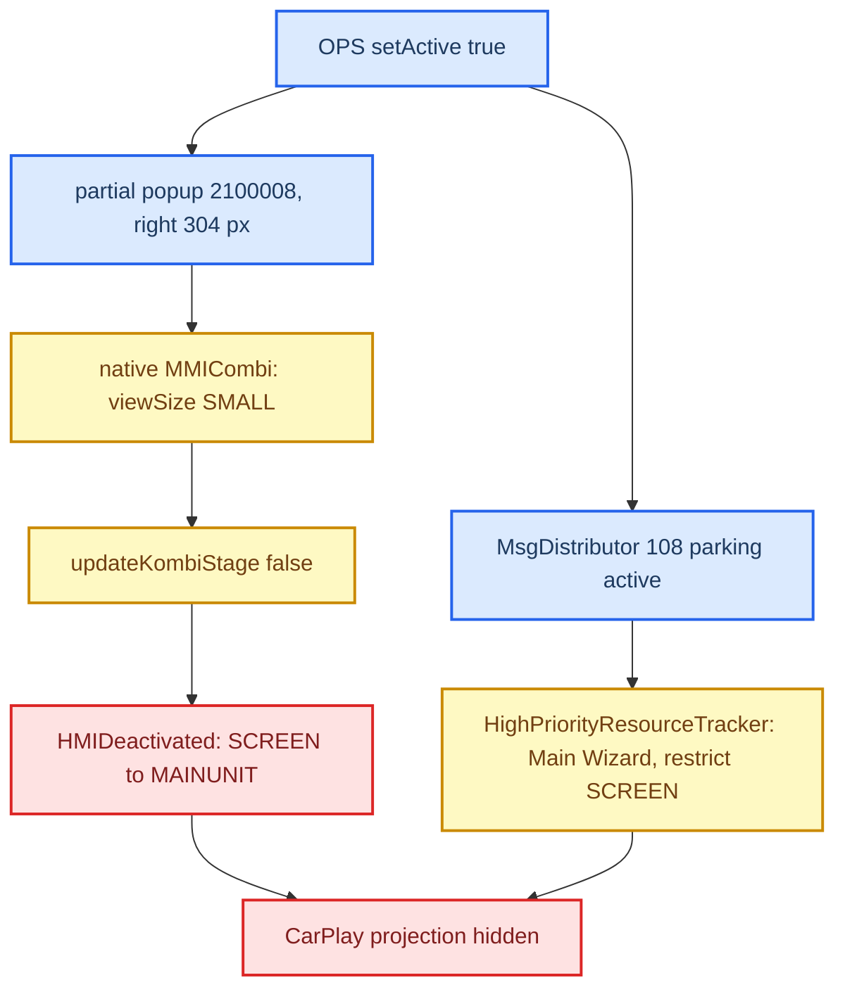

# PDC Small Stage

*Why CarPlay used to vanish when the right-hand parking (PDC/OPS) popup appeared, the stock HMI chain that causes it, and the narrow Java guard that keeps CarPlay visible beside the popup. Not an audio topic — it lives here because it came out of the same investigation batch; it belongs with the HMI/Java notes.*

---

## 📋 Status

| Date | Build | Result |
|---|---|---|
| 2026-09-02 | second guard (`smallStageType 1 → 6` + AP 1002) | CarPlay stayed under the right OPS popup **[car]** |
| 2026-09-14 | same | re-broke: parking message **108** also comes from plain OPS |
| 2026-09-15 | `6d057db-pdc-pla1`, `915c479-pdc-events` | 108 handled, passive-PLA classification, AP ordering — host-tested |
| 2026-09-17 | `b0653c6` (includes `2e536a6-ops-aps-drawer-r2`) | "Check surroundings!" drawer gone; stock status line (clock/LTE, black bar over CarPlay's bottom buttons) remained **[car]** |
| 2026-09-17 | `b0653c6-ops-statusline-r3` | hides status-line popup 62 during pure OPS |
| 2026-09-22 | r3 on HU | clock/LTE line gone; a black block remained centred at the bottom (entertainment-drawer glass plate) **[car]** |
| 2026-09-22 | r4 (drawer follows 62) | hides the entertainment drawer under the same guard — built and host-tested |
| 2026-10-10 | r4 on HU | owner: the right-hand OPS popup beside CarPlay "works great", no bottom strips **[car]** |

> [!IMPORTANT]
> Intended presentation (owner, 2026-09-22): with a partial popup beside CarPlay there are **no** bottom strips at all: no status line, no APS warning drawer, no entertainment drawer. This is deliberate; do not restore the stock footer or warning while the guard holds. Reverse gear still opens the full-screen camera (stock takeover).

The installed-runtime build ID was not captured; installation and restart are known only from the owner's report, as is the 2026-10-10 confirmation. The reverse-camera and HOME-footer regression checks were not separately reported. The separate alarm/teardown report no longer reproduces (owner, 2026-09-22).

## 🔍 Root cause — a policy clash, not a drawing bug

**The popup itself is harmless.** Pure OPS shows `ParkingPopupIdentifier(1, 2100008)` via `hmiService.showPartialPopup(0, 2100008)`: bounds `(720,0,304,480)`, HMI layer 3, slot 4, type 7 (unbound partial), ZPM priority 135, ZPM slot 1 `PARKING`. Volume (52, layer 1, ZPM 5) and massage (2100016/2100017, layer 3, ZPM 5) use the same `PartialPopupController` and never hide CarPlay. `setSmallStageType(3)` on the PDC popup is a no-op (the partial-popup setter is empty in this build).

**Path 1 — small stage.** Parking policy (below Java; the `IMMICombiViewSizeSync` implementation is not in the decompiled tree) sets `viewSize = 1` (SMALL). `MMICombiStageListener.viewSizeChanged(1)` → `updateKombiStage(false)` → `ExternalEventsListener.hmiDeactivated()` → `HMIDeactivated` sets `Resource.SCREEN` owner `MAINUNIT`. The CarPlay screen `TERMINALMODEIPODOUT` (ID `3200000`) is built with `setSmallStageType(1)` = `SMALL_STAGE_OMISSION`: in small stage it is dropped, not resized. Stock apps reflow for small stage; TerminalMode deliberately does not.

**Path 2 — message 108.** `AbstractParkingSystemOPSComponent.setActive(true)` → `notifyParkingSystemActive` → `updateInterappClients(true)` → `MsgDistributor.sendMessage(108)` (107/108 = parking system off/on, not camera) — delivered **synchronously** and *before* the popup request. Stock `HighPriorityResourceTracker.processMsg(108)` flips `SWITCH_TO_MAIN_WIZARD_CHOICE`, sets `SMARTPHONE_SCREEN_BLOCKED_CHOICE = 3`, `rvcActive = true` → `acquireHighPriorityResources(SCREEN)` → `TMState.restrictAccessTo(SCREEN)` for `MAINUNIT`, `MURVCActive = true`. The earlier "pure OPS = small stage only, VPS = 108" split was wrong.

**Red herrings.** Action-proxy methods 1004/1005 (`parkingActivatedTerminalMode`) have no listeners and are never called. Display context `78 = {16 HMI, 59 CarPlay}` already composites HMI over CarPlay, so adding a context does not help; displayable `17` (camera) matters only for the deferred partial-360 idea. Full-screen VPS/RVC is a genuine takeover (`activateComponentRVC(17)`) and must stay stock.

## ⚙️ The guard in code

All in `java_patch/` **[code]**:

- `com/luka/carplay/pdc/PdcSmallStageGuard.java` — state for popup `2100008` on terminal 0. Before `showPartialPopup` it switches the live CarPlay screen widget `3200000` from `SMALL_STAGE_OMISSION (1)` to `SMALL_STAGE_NO_CHANGE (6)` (`:34-46`, `:340-367`) and restores it on hidden/removed/unregister/deinit or when an unconfirmed show request expires after **3 s** (`SHOW_REQUEST_TIMEOUT_MS`, `:46`).
- **Classification (2026-09-15).** Allowed only for DSI popups `POPUP_OPS (1)`, `OPSAUTOACTIVATION (4)`, `OPSFLANKGUARD (7)`, `OPSOFFROAD (17)` with exactly one OPS (system ID 2) on partial `2100008`, plus at most one **passive** PLA whose `isSystemActive()` is false (`:114-138`). A plain side OPS legitimately arrives as `[OPS=2, PLA=16]` — stock `AbstractParkingSystemPLAComponent.getSupportedDSIPopupIDs()` includes 1/4/7/17 — so the old `systems.size() == 1` test broke it. Camera/VPS, ARA, `OPSFLANKGUARDPLA (15)`, trailer-assist mode 12, unknown or incomplete combos keep the stock takeover. An old test fixture used popup `3`, which is actually `VPSOPS`.
- `de/audi/app/earlyfunc/evo/parking/ParkingSystemControllerComponentEvo.java` — stock replacement overriding `deactivateCurrentlyVisibleParkingSystems(newContent, nextSystems)`, which the base `activateParkingSystem` calls **before** activating anything, so the guard is armed before 108; `notifyParkingSystemActive(nonOPS, true)` revokes it.
- `de/audi/app/terminalmode/interapp/HighPriorityResourceTracker.java` — full MU1316 replacement (Java 1.4 anonymous classes). For an allowed standalone OPS, 108 neither switches the Main Wizard nor takes SCREEN (`:182-197`, log `OPS 108: keep CarPlay SCREEN; no Main Wizard takeover`); a late 107 from an old component does not erase the new intent; eCall/clamp-S restrictions stay stock.
- `de/audi/app/terminalmode/ExternalEventsListener.java` — `updateKombiStage(false)` and AP 1002 (`AP_METHOD_HMI_DEACTIVATED`) skip `HMIDeactivated` only for CarPlay active + guarded popup + the *same* protected screen instance + no pending screen change; the CarPlay key handler is deactivated under the popup and `hmiActivated()` restores it at BIG stage. The old one-shot AP 1002 exemption was used up by the first OPS event; repeats are now allowed while the conditions hold. The 70 ms `DebounceOperation` could deliver a stale AP after OPS closed — a confirmed parking transition now survives that window and is revoked by camera/PLA/timeout/unregistration/teardown; `deinit` cancels the subscription.
- `de/audi/app/earlyfunc/core/parking/ParkingPartialPopupHandler.java` — arms the guard before the show (closes the race where SMALL arrives before `partialPopupVisible`); `partialPopupHidden` now cancels only a matching `visiblePPID` on the main terminal (any hidden, including the registration snapshot, used to cancel).
- **"Check surroundings!" drawer.** Labels 3261/3928 → `SystemScreenBag6.aPSAUDIO()` / `aPSAUDIOREDUCED()`, screens 182/190, drawer content **6001/6002** chosen by `AbstractParkingSystemControllerComponent.updateAudioDrawerContext` → `AudioDrawerContext.SOURCE_APS` → model **538**. `de/audi/audio/context/AudioDrawerContextImpl.java` + `com/luka/carplay/pdc/OpsAudioDrawerPolicy.java` publish `INACTIVE` for column 0 only while protected, remember the last stock value and republish it on release (front MU only; choice 3915, sounds and the other 22 columns untouched). The earlier fix aimed at eight PLA/ARA popup IDs (`21000xx`) was the wrong target and was deleted.
- **Status line 62 (r3).** `SystemScreenBag2` popup 62 (slot 3, layer 1, `StatusbarRendererHigh`, prefab `mib2_statusBar`) is separate from the APS drawer. `de/esolutions/hmi/widgets/audi/evo/high/PartialPopupManagerEvoHigh.java:187-246` hides 62 before showing `2100008` and returns HIDDEN for a repeat `showPopup(62)` or a queue replay through `doShowPopup`, only for the protected screen instance; stock TerminalMode's own normal state is `StatusBarStubController.renderStyle=2` (no bar).
- **Entertainment drawer (r4).** The black block left by r3 is the entertainment drawer's glass plate, centred in the 62 gap. Stock `StatusBarStubController.updateStatusBar()` always toggles 62 and the drawer together (`showPopup(62)` + `setEntertainmentDrawerVisible(true)`). The trigger on the CarPlay screen: parking sets choice **3915=1** (`AbstractParkingSystemControllerComponent.updateAudioDrawerContext`), and `TerminalModeScreenFactory` condition 3915 on screen `0x30D400` (= 3200000) switches its stub from `renderStyle 2` to `0`. 3915=0 at parking end switches it back to 2 and stock hides both. r4 covers both orders: `PartialPopupManagerEvoHigh.hideFooter()` hides 62 **and** the drawer when OPS opens, and the patched `de/esolutions/hmi/widgets/audi/evo/widgets/StatusBarStubController.java` turns a drawer-visible request into hidden while `keepCarPlayStatusLineHidden()` holds. Outside that guard (HOME, camera, a pending screen change) stock wins. The stub copy is bytecode-equivalent to `MU1316-final.jar` apart from the check. Not covered by host tests (the fixture has no drawer). The `KombiType 4` (G24) popup 101 variant is not guarded.

**Do not** globally pin context 78 or opacity 100 (breaks HOME and full camera), ignore all 108s, or rely on `getCurrentDisplayContent()` alone (stock updates it after `activateParkingSystem`). RetroArch context `90 = {16, 43}` belongs to the RetroArch patch (removed from this JAR in `7590e88`); on G24 kombis ID 90 is a stock `11 + 79` context.

## ✅ What to check on the car

On the car: side OPS leaves nothing at the bottom of CarPlay and its bottom buttons work; reverse gear opens the full-screen camera; HOME/camera show the stock footer; leaving reverse returns to CarPlay.

With `/mnt/app/carplay_verbose` or `/tmp/carplay_verbose` present at the phone connect (the Java `Log` re-reads the markers at each CarPlay session start): `ParkingPartialPopupHandler#showPopup popupID=2100008` → `OPS guard: screen 3200000 smallStageType 1 -> 6` → `…SMALL_STAGE pure OPS: keep CarPlay SCREEN owner` (and `partial OPS: suppress HMI_DEACTIVATED` if AP 1002 fires) → `parking intent popup=… systems=2,16(idle) standaloneOPS=true` → `OPS 108: keep CarPlay SCREEN…`; on close `BIG_STAGE` → `HMIActivated` → `OPS guard: restored … 1`. HOME, full camera and active PLA must still show `HMIDeactivated.execute`. Next trace for any regression: build ID, parking intent/108, SMALL/BIG, AP/HMI commands, current/connected/pending screen, terminal-0 context and opacity of 59.

Deferred (owner decision 2026-09-14): CarPlay beside a partial 360° camera (`{16, 17, 59}`, camera at `(720,0,304,480)`); no new context ID chosen. Preflight findings: the A5 context array has length 82 and G24 already uses `dc[91]` (`12 + 79`); stock `DisplayManager` callbacks pass `context % 79`; `switchVPSView(4)` yields `view=4, mode=9` without changing popup/screen, while stock Evo VPS needs fullscreen popup `2100000` plus 108; addressed crop needs HMI `IDisplayManager.setCropping(17, 0, …)` (the interapp API ignores the displayable); `getExtends(17)` may return `null` and its cached `int[]` is borrowed; native distinguishes context-origin from component-origin capture, so teardown must respect ownership; the OPS overlay background depends on VPS type/view and stock screen `2100001`. Detail: `sources/reference/CARPLAY_PARTIAL_360_PREFLIGHT.md`.

**Test harness** (host, stock MU1316 classes, physical HMI/services faked): `scripts/test_pdc.sh`, `scripts/test_java_transports.sh`, `scripts/audit_java_stock.sh` (linkage vs `MU1316-final.jar` and `MU1316-combined.jar` + real J9 class library, 0 errors, 116–121 Java 1.4 classes). Tests: `PdcResourcePolicyTest` (real OPS/PLA/VPS popup tables, stock `activateParkingSystem` lifecycle, 4→1→7→17→1 updates), `PdcExternalEventsTest` (real `DebounceOperation`, AP ordering), `CarPlayPdcLifecycleTest` (real `CarPlayApp` + guard + drawer), `OpsStatusLineTest` (shipping popup manager + stock queues). Stock-first negative controls reproduce `pure OPS 108 toggled Main Wizard`, `stock OPS + passive PLA toggled Main Wizard, popup=1`, the APS 6001 warning and `MMI status line 62 remained over CarPlay`. Runtime tests use `MU1316-combined.jar`: `MU1316-final.jar`'s `NotifyOnAddProperty$2` throws `IllegalAccessError` on the host (decompile artifact, not a shipping bug). None of this runs Kanzi or the native compositor. Candidate artifacts: `build/releases/carplay-pdc-fix-20260914/` (`8ca2c73-pdc-fix`), `build/releases/carplay-production-6d057db-20260915-pdc1/`, `build/pdc-aps-20260917/`, `build/pdc-statusline-20260917-r3/`. r4: `build/carplay_hook.jar` (not archived yet).

---

## 📚 Sources

Merged originals were removed from the tree after this note absorbed them; they remain in git history (commit 23972aa).

- `CARPLAY_PDC_SMALL_STAGE_ROOT_CAUSE` — (Russian) the full investigation: stock chain, three implementations, 108, PLA classification, APS drawer, status line r3.

## 🔗 See also

[Cluster Contexts](CLUSTER_CONTEXTS.md) · [Reconnect and Lifecycle](../altscreen-and-video/RECONNECT_AND_LIFECYCLE.md) · [Landmines](../LANDMINES.md) · [Home](../README.md)
