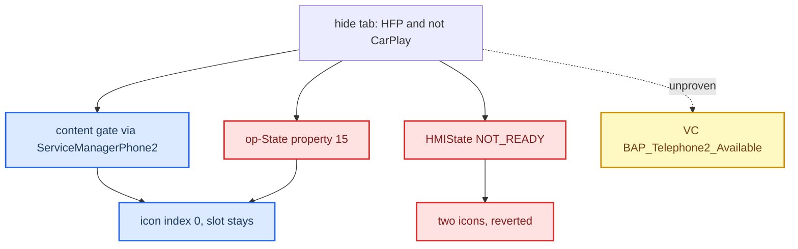

# Phone Tab Gating

*An attempt to hide the cluster telephone tab while CarPlay owns the phone: the traps and seams it found, why the slot-removal lever is still unproven, and the fact that the gate code has since been removed.*

---

## 📋 Current state in code

No phone-tab gate exists in the current tree. `63e7f35` ("remove obsolete phone-gating code") deleted `com/luka/carplay/phone/PhoneTabGate.java`, the patched `InitializationManagerPhone2.java`, and the patched `BAPPropertyTelFSGSetup.java`. `java_patch/` has no Phone2, telMode or HMIState references today. `[code]` (`git show --stat 63e7f35`)

| Seam | In current code | Last known result |
|---|---|---|
| Content gate (wrap `CombiBAPServicePhone2`) | no | `[car]` worked safely, but the slot stayed |
| Late-registration replay (`registerResend`) | no | `[car]` fixed the first race |
| Existence gate (make the slot vanish) | no | `[open]` never proven |

`GatedCombiService` still exists, but it wraps only `CombiBAPServiceNavi` for route guidance and has nothing to do with the phone. `[code]` (`java_patch/com/luka/carplay/rgd/GatedCombiService.java:1-10`, installed by `java_patch/com/luka/carplay/core/AltScreenNavStatusGate.java:55-60`, `:90-94`)

The rest of this note is the investigation record.

## 🎯 The goal and the rule

While CarPlay owns the phone, hide the stock crossed-out telephone tab in the cluster. Restore it only once MMI HFP telephony is really available again. The rule that was implemented and then removed: `[car]`

```text
tabVisible = (mobileConnectionType == HANDS_FREE_PROFILE) && !carPlayActive
```

`mobileConnectionType == 3` is the stock HFP state. The gate was fail-open before the first phone update, so a missing callback could never permanently remove the tab. v1 did not hide the tab. v2 produced two telephone icons and was rolled back. `[car]` (`docs/cluster-and-rgi/PHONE_TAB_GATING.md`)

## ⚠️ The signal traps

Every obvious source for the two inputs is the wrong one. `[decompile]`, `[car]`

| Signal | Trap | The real source |
|---|---|---|
| `hfpActive` | `getTelMode()` returns the raw DSI code (`TELMODE_HFP = 3`), not the app-model `TEL_MODE_HFP = 0` | `callLeadingDevice.getTelMode() == 3 && telActivationState ∈ {2,5}`, published on the phone side (`BAPPropertyTelFSGSetup`) |
| "BT phone present" | `moduleState` (property 23) is the embedded NAD modem state (`getNadInstanceState()`), not the BT/HFP handset | Do not gate on it |
| `carplayActive` | none | `CarPlayApp.isActive()` (conservative), or the stricter `terminalModeDevice.isActive() && getConnectionMethod() == 1` |

## 🔍 What the seams showed

- **Content gate:** wrap `CombiBAPServicePhone2` at `ServiceManagerPhone2.registerServices`. Every Tel2 handler resolves through OSGi, so the wrapper intercepts them. The diagnosis path bypasses the wrapper, so test mode stays intact. The result is icon index 0 (nothing drawn), but the slot remains. `[car]`
- **Late-registration replay:** PHONE2 and terminal mode start in different bundles. Replaying registration fixed the first race. `[car]`
- **Existence gate:** the code that turns state into slot present or absent lives in the cluster `hmi_app.elf`, not the HU jar. No per-tab flag was found in the jar. It needs an on-unit A/B test. `[open]`

## ❌ Two levers that were tried and refuted

Both HMI-side levers failed on the unit. Do not touch HMI state again. `[car]`

- **op-State** (BAP property 15) can never remove the tab. In `hmi_app.elf`, op-State maps to a separate `OpState` field that only changes the icon (index 2/5, "no service"). The slot stays.
- **HMIState = NOT_READY(0)** did not remove the slot on the unit and produced two telephone icons. It broke the Telephone↔Telephone2 domain, so stock PHONE fell back alongside PHONE2. A source bug also made it fire too early, because it treated the startup value `0` as "hide". `DSIBAP.setHMIState()` only accepts `0/1/2`; there is no "unavailable" value.



## 💡 The real target, still open

The visual target is known: force VC `phoneAvailable = 0`. `[decompile]`

- In `hmi_app.elf`, `App::getTabBarIconIndex` (`0x183378`) returns icon index 0 when `phoneAvailable == 0` (`App+960`).
- Only `App::setPhoneAvailable` (`0x18836C`) sets it, from a separately cached service-availability byte (handler `0x17F1B0`). op-State and the FSG value do not set it.
- So the real signal is VC-side `BAP_Telephone2_Available = 0 → phoneAvailable = 0`.
- **Correction (2026-09-23, `[decompile]`, likely not proven):** the handler that sets App+960 sits in the VC `Telephone` module (HU PHONE 0x28), not `Telephone2`; `BAP_Telephone2_Available` (`0x2000093`) belongs to `AsgTelephone2`. See [VC Telephone Tab](VC_TELEPHONE_TAB.md).

Next step, if this is picked up again: find the real publisher of `BAP_Telephone2_Available` in MHI Java/BAP and gate that on CarPlay, or minimally patch the VC availability consumer. `hmi_app.elf` alone cannot show whether `avail = 0` collapses the ribbon slot or leaves an empty gap, because another component fills the ribbon. Only an on-unit A/B test can answer it. `[open]`

## 🔗 Related

- [RGI and BAP Bridge](RGI_AND_BAP_BRIDGE.md): `CarPlayApp` activation and the Navi `GatedCombiService`.
- [Reconnect and Lifecycle](../altscreen-and-video/RECONNECT_AND_LIFECYCLE.md): `CarPlayApp` activation edges.
- [Archive and History](../reference/ARCHIVE_AND_HISTORY.md): the two rejected tab-gate jars in the project history.
- [Landmines](../LANDMINES.md): the DSI, NAD and telMode traps as one-liners.
- [Smartphone Tab and Kombi DSI](SMARTPHONE_TAB_AND_KOMBI_DSI.md): `DSIKombiSync2` reports the active VC tab (`mainContext` PHONE = 3) and `DCMainItems` has a telephone zone value; neither is wired in our code.

Provenance: `docs/cluster-and-rgi/PHONE_TAB_GATING.md` (its `java_patch_new_replace/...` paths are historical and those trees no longer exist), `MEMORY.md` (Phone tab gating), `memory/phone_tab_gating_findings.md`; removal commit `63e7f35`; consolidation commit `d9c6d02`. The old source pool `Tools/jxe2jar/out/MU1316-combined-vf/` no longer exists; the nearest artifact is `../jxe2jar/out/MU1316-combined.jar` `[open]`. VC binary `hmi_app.elf`.
