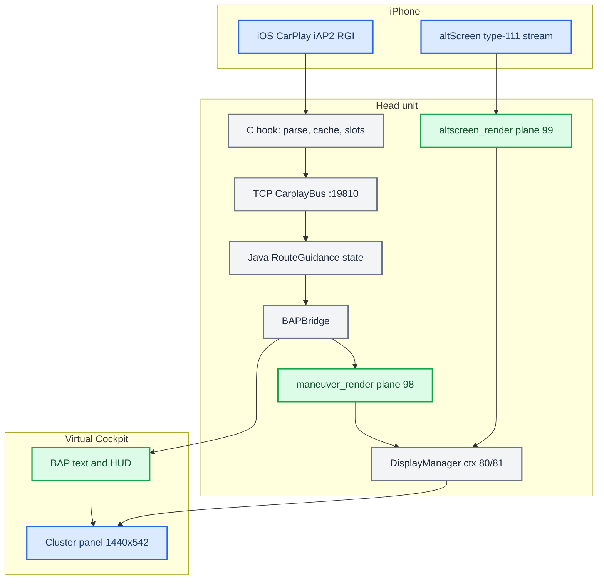

# Cluster and RGI

*Map of content for CarPlay route guidance in the Audi Virtual Cockpit: the iAP2 wire, the C hook and TCP bus, BAP text and HUD, our maneuver renderer, the CarPlay cluster map plane, and the custom DisplayManager contexts.*

---

## 📋 What this section covers

CarPlay never draws the cluster maneuver itself. iOS sends semantic route guidance (a maneuver type, junction angles, a distance, a string). The head unit turns that into everything the driver sees: BAP text and HUD icons, a procedural 3D arrow, and the cluster planes.

The path is `iAP2 RGI TLVs → C hook (parse, cache, slot-remap) → TCP bus :19810 → Java RouteGuidance → BAPBridge`. `BAPBridge` has two outputs. BAP (`AppConnectorNavi`) feeds VC text and the HUD. TCP `:19800` feeds `maneuver_render` (plane 98). The map on the cluster is the phone's own type-111 altScreen stream, drawn by `altscreen_render` on plane 99. A DisplayManager context state machine (`AltScreenModule`) composes these planes on the 1440×542 cluster terminal.

Earlier versions of these notes described a KOMO/LVDS video-map output from `BAPBridge`. The current code does not feed KOMO route info (see [HUD Renderer](HUD_RENDERER.md)).

Start here, then open the note you need. For the hub and the trap list see [Home](../README.md) and [Landmines](../LANDMINES.md). The CarPlay video plane on the cluster is [AltScreen Cluster Video](../altscreen-and-video/ALTSCREEN_CLUSTER_VIDEO.md). The bus is [Hook to Java Bus](../reference/HOOK_TO_JAVA_BUS.md).

## 📊 The whole pipeline

## 🔗 The notes

| Note | What it covers |
|---|---|
| [Cluster Contexts](CLUSTER_CONTEXTS.md) | The DisplayManager context state machine (74 stock / 80 nav / 81 map), why displayable 103 is not creatable, and the single writer `AltScreenModule`. |
| [RGI and BAP Bridge](RGI_AND_BAP_BRIDGE.md) | The route-guidance path: `BAPBridge` outputs, FSG sync and ExitView, FctID 18/37, slot mapping and LRU, `visible_in_app` vs route-active. |
| [HUD Renderer](HUD_RENDERER.md) | The three renderers, the procedural arrow, the stock KOMO map pipeline (unused by CarPlay code), and the VC FPK state machine. |
| [AltScreen Input Commands](../altscreen-and-video/ALTSCREEN_INPUT_COMMANDS.md) | Native roller cadence, priority, immutable selected age, state ACKs and CF ownership; preserves the BAP reply. |
| [Third-party Nav Apps](THIRD_PARTY_NAV_APPS.md) | Why Waze and AMap send no usable RGI, `updateViewArea`, `CMD_ALT_ZOOM`, and the cluster scene URL. |
| [CarPlay Telephony](CARPLAY_TELEPHONY.md) | CarPlay calls, actions, recents/favorites, mic mute, missed calls and signal on the cluster telephone tab: the gated PHONE 0x28 service, status and the on-car checks (working on the car since 2026-09-23). |
| [VC Telephone Tab](VC_TELEPHONE_TAB.md) | How the VC telephone tab reads PHONE 0x28: `mobileConnectionType` and the CarPlay note, callOptions, mute, lists, and the steering-wheel Tel key on the VC and HU sides. |
| [iAP2 Communications](IAP2_COMMUNICATIONS.md) | iAP2 call state, communications, hold/mute and list updates: every parameter, the Identify rules and the iOS/Cinemo/car evidence. |
| [Phone Tab Gating](PHONE_TAB_GATING.md) | The removed cluster telephone-tab gate (HFP && !CarPlay), its traps, and what stays unproven. |
| [KDK Geometry and Animation](KDK_GEOMETRY_AND_ANIMATION.md) | Where the maneuver box sits on the 1440×542 panel, View-button sync (FctID 44/54), the VC's 200 ms fade. |
| [VC FPK State Machine](VC_FPK_STATE_MACHINE.md) | The Virtual Cockpit's firmware layers, nav view tree, dp items, signal groups, why side menus can't be blocked. |
| [Smartphone Tab and Kombi DSI](SMARTPHONE_TAB_AND_KOMBI_DSI.md) | `DSICarKombi`/`DSIKombiSync2`, HU display architecture, the unbuilt VC Smartphone-tab alternative. |
| [iAP2 Route Guidance TLVs](IAP2_ROUTE_GUIDANCE_TLVS.md) | What iOS sends in 0x5201/0x5202, what the hook parses, angle sentinels, the `SendIAP2` injection fix. |
| [CarPlay Speed Limits](CARPLAY_SPEED_LIMIT.md) | Which message IDs were checked for a numeric limit, cluster-video speed-limit policy on 26.6 and 27, and the proposed sign-rendering experiment. |
| [Road Object Detection](IAP2_ROAD_OBJECT_DETECTION.md) | Start/update/stop, subtype Type, detection fields, identification rejection, activation requirements, and the first proposed transport experiment. |
| [NavSD FctID Matrix](NAVSD_FCTID_MATRIX.md) | All 56 Navigation BAP functions and who owns each while CarPlay drives the cluster. |
| [Nav Initializing Screen](NAV_INITIALIZING_SCREEN.md) | Why the VC's "Initialising navigation system" NA screen still covers the CarPlay map: NavSD OP_State 3, its five HU inputs, why `7d35b53` misses them, and the tried OP_State clamp (removed 2026-09-24, open). |
| [Maneuver Mapping](MANEUVER_MAPPING.md) | The 54-type iAP2 → BAP icon → HUD selector → renderer arrow table and the HUD firmware chain. |
| [Distance Bargraph](DISTANCE_BARGRAPH.md) | Why the VC hides the distance while the bargraph is on, FctID 18 bytes, arrow fill instead of a column. |
| [Lane Guidance](LANE_GUIDANCE.md) | Lanes as an independent event, the wire batch, the bottom panel, the QNX `fmin` hang, rejected approaches. |
| [VC Layout and Fonts](VC_LAYOUT_AND_FONTS.md) | Extracted VC fonts and glyphs, the 359 px CurrentPosition budget, FctID 19 scrolling, Classic/Sport seam, and the layout options file (`/mnt/app/carplay_layout.cfg`: safe areas, View source, compact placement, phone cards). |
| [PDC Small Stage](PDC_SMALL_STAGE.md) | Why CarPlay vanished beside the parking popup and the narrow Java guard that keeps it visible. |

## 💡 Truth levels

Claims are tagged:

- `[car]`: confirmed on the unit.
- `[code]`: verified in the current source tree (cited `path:line`).
- `[decompile]`: from reverse engineering.
- `[open]`: not verified.

Status in short: BAP text and HUD and the ctx 80/81 machine are `[car]` and `[code]`. The third-party-app analysis is `[decompile]`. The phone-tab gate was removed from the code in `63e7f35`, and its existence-gate question is still `[open]`.

Provenance: `docs/cluster-and-rgi/HUD_RENDERER.md`, `docs/cluster-and-rgi/THIRD_PARTY_NAV_APPS.md`, `docs/cluster-and-rgi/DISTANCE_BARGRAPH.md`, the project `MEMORY.md`, and `memory/production_full_audit_9295b04.md`. The only Java tree is `java_patch/` (built by `scripts/build_java.sh:25`).
