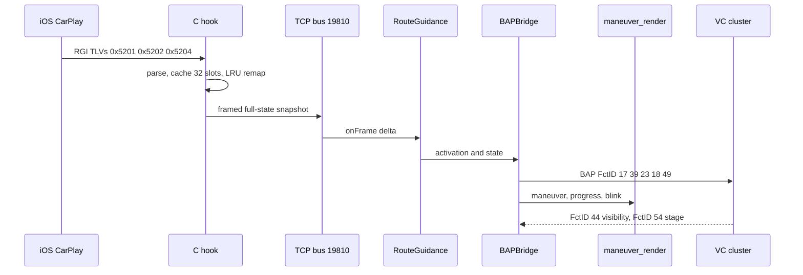
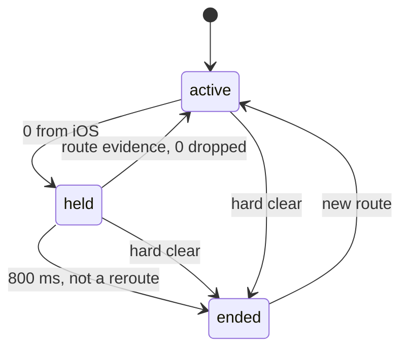
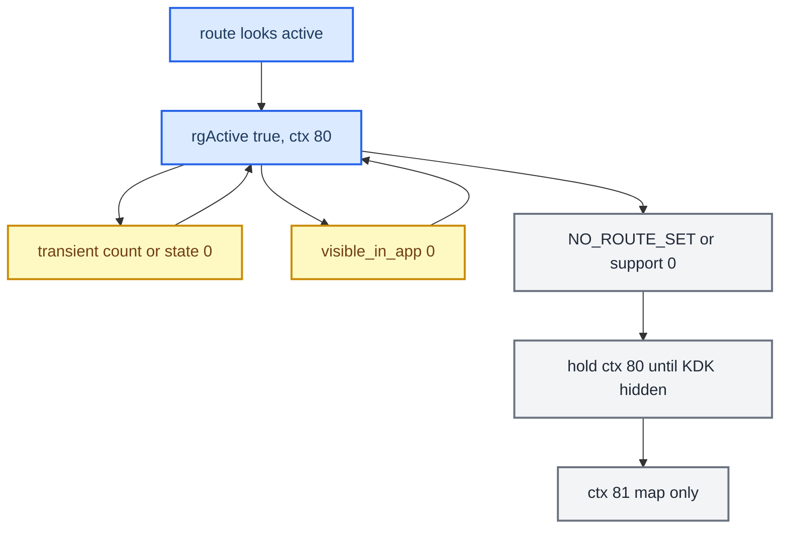

# RGI and BAP Bridge

*The route-guidance path from the iAP2 wire to the cluster: the C hook's slot cache, BAPBridge and its two outputs, the FSG and ExitView handshake, and the field rules that decide when guidance really ends.*

---

## 📋 The bridge and its two outputs

`BAPBridge` feeds two consumers from one `RouteGuidance.State`. `[code]`

- **BAP path** (`AppConnectorNavi`), `ACTIVE_RGTYPE = 0` (RGI): maneuver descriptor, distance and bargraph, street text, lane guidance. The VC uses it for text and the HUD uses it for icons. (`java_patch/com/luka/carplay/rgd/BAPBridge.java:36-39`)
- **Renderer path**: maneuver, progress, and blink commands over TCP `:19800` to `maneuver_render`, which draws plane 98 in ctx 80. Java is the server. The supervisor owns the renderer process, and Java never spawns or kills it. (`java_patch/com/luka/carplay/rgd/RendererServer.java:2-6`, `:44`; `BAPBridge.java:1987`)

`BAPBridge` no longer feeds KOMO route info. There is no `updateNextManeuver`/`setRouteInfo` call from our code. The only KOMO use is `forceGfxAvailable`, which returns early unless the cluster map is MOST, so it does nothing on this FPK car. The cluster map during CarPlay is the phone's altScreen stream on plane 99. `[code]` (`BAPBridge.java:542-546`, `:2268-2290`; `java_patch/de/audi/tghu/navi/app/cluster/ClusterService.java:779-797` is stock-nav only)

`forceClusterRouteInfoState(true)` runs on start. It saves and overrides `container.rgActive`, sets `rgiValid` through `updateRGIString({1})`, and calls `triggerRefreshRGIValid()`. On stop it restores the saved `rgActive`. It does not touch `favoredViewMode`. `[code]` (`BAPBridge.java:558-592`, `:722`)

Concurrency: the blink worker (600 ms) only touches `blinkDistM`/`actionBlinkFull`/the denominator under `synchronized(this)`. Lock order is `this → distanceToManeuverLock → renderer queue`, never inverted. `[code]` (`BAPBridge.java:58`, `:206-212`, `:323`)

## 📊 iAP2 to cluster

> [!IMPORTANT]
> Route guidance reaches the hook only if the unit's `dio_manager.json` lists the message IDs (`0x5200`/`0x5203` sent, `0x5201`/`0x5202`/`0x5204` received). The hook's Identify patch (component `0x001E`) makes iOS offer route guidance but does not register them; the M.I.B. installer does (`patch_dio` in `custom.sh`). Manual procedure and checks: [Deploy and Release](../build-and-deploy/DEPLOY_AND_RELEASE.md#-route-guidance-message-ids-in-dio_managerjson).

## 🔧 Slot mapping and LRU

The C hook keeps a bounded cache and remaps iOS's ever-growing maneuver indices to local slots. `maneuver_list` carries slot indices, and `maneuverOrder[0]` is the current maneuver. `[code]`

- `MANEUVER_CACHE_SIZE = 32`, `MAX_MANEUVER_LIST = 16`. (`hook/routeguidance/rgd_tlv.h:219`, `:230`)
- **LRU bug (fixed):** `rgd_slot_for_iap_index()` did not refresh the sequence on an existing-slot lookup, and it had no eviction guard for active slots. The icon or turn text got stuck. Current code touches the LRU sequence on lookup and skips active indices when it evicts. `[code]` (`rgd_hook.c:304`, `:339-385`), `[car]`
- The current maneuver is `maneuverOrder[0]` only. If that slot is not valid yet, `BAPBridge` waits and never picks the next filled slot, because that would pair the next arrow with the current distance. `[code]` (`BAPBridge.java:1531`)

## ⚙️ FSG sync and ExitView (FctID 49)

On start, `BAPBridge` sends `RGStatus(1)` (FctID 17), which opens `sync(0)` for `{17, 39, 23, 18, 49}`. It then sends FctID 39, 23, 18 and 49 to close the window. Maneuver updates run `sync(1)` over `{23, 18, 49}`. `[code]` (`BAPBridge.java:725-736`, `:1048`)

Two hard rules: `[car]`, `[code]`

- **Never use `exitViewNum = 1`.** It overwrites the icon with a highway-exit glyph. `sendExitView()` always sends `0`. (`BAPBridge.java:2357-2358`)
- **Toggle the ExitView variant EU↔NAR on every send.** If variant and number are unchanged, `AppConnectorNavi` deduplicates FctID 49, `sync(1)` never closes, and descriptor delivery stalls. (`BAPBridge.java:41-47`, `:2355-2361`)

## ⚙️ FctID 18: distance and bargraph

`BAPBridge` sends distance, `bargraphOn` and percent in one FctID 18 status through `AppConnectorNavi.updateDistanceToNextManeuver`. Our side sets them independently. `[code]` (`BAPBridge.java:317-348`)

- **Denominator:** the step length `mDistance[idx]` (0x5202 TLV 0x0005), capped at 15% of the prepare threshold. If the step length is unknown (`-1`/`0`, as with Google Maps) or longer than the cap, the cap is used. The old rule "unknown ⇒ `bargraphOn = false`" is gone. `[code]` (`BAPBridge.java:56`, `:2495-2513`; commit `4858fc7`)
- **HU model:** `ClusterService` keeps the distance model valid alongside the bargraph while CarPlay owns the cluster: `if (flag && i > 0 && (!showBargraph || AltScreenModule.isConnected()))`. `[code]` (`java_patch/de/audi/tghu/navi/app/cluster/ClusterService.java:377-386`) This is the successor of the old "drop `!showBargraph`" fix that was cited at `:353`.
- **VC display:** whether the VC shows the number and the bar together is not decided by the HU. The audited AU491 `hmi_app.elf` hides the distance on its own when `BargraphOn != 0`. `[decompile]` (`docs/cluster-and-rgi/DISTANCE_BARGRAPH.md` §1-2, comment at `ClusterService.java:377-381`) The earlier claim "they show together" is withdrawn. What the installed cluster shows is `[open]`.

## ⚙️ FctID 37: FunctionSync

FunctionSync is property FctID 37 on LSG 50. It is handled by the stock class `FunctionSynchronizationNavi`, which is not in our tree. Its lifecycle is IDLE → STARTING → RUNNING → COMPLETED. `[car]`

| Type | Open payload | Members |
|---|---|---|
| type 0 | `{0:0:97:0:1:0:64:0}` | `{17, 39, 23, 18, 49}` |
| type 1 | `{0:0:33:0:0:0:64:0}` | `{23, 18, 49}` |
| close | all-zero | none |

## ⚠️ `visible_in_app` (TLV 0x0F) is not route-active

iAP2 `RouteGuidanceUpdate` TLV `0x0F` is `RouteGuidanceBeingShownInApp`. It tells whether the nav app's guidance UI is on screen, not whether a route is active (accessoryd 23G71 `+[ACCNavigationRouteGuidanceUpdateInfo keyForType:]` case `0xF`). iOS sends `0` for third-party maps and whenever the nav app is in the background, even mid-route. `[decompile]`

So `visible_in_app == 0` does not tear down RGI while route state, maneuver count or the maneuver list still look active. `route_state == NO_ROUTE_SET` and `source_supports_rg == 0` force deactivation. `[code]` (`java_patch/com/luka/carplay/rgd/RouteGuidance.java:492-521`; fix `1d6cafd`), `[car]`

## ⚠️ Transient `route_state = 0` and `maneuver_count = 0`

iOS briefly sends `count = 0` at route start, and `route_state = 0` during setup and about every 30 s mid-route. These only reset count and order, and they never clear per-slot data. `[code]` (`RouteGuidance.java:911-935`, `:961-990`)

### Hook side: the zero hold

Java treats `route_state = 0` as final: it drops `wantActive` at once (`RouteGuidance.java:519`), which stops BAP guidance, leaves ctx 80 and clears the maneuver renderer. iOS Maps, however, uses the same 0 for two things: the real end of a route, and a reset frame during a reroute (`REROUTING (5) → 0 → new route data`). Passing every zero through would make the HUD and VC go dark and come back on each reroute and each stray mid-route zero. So the hook does not forward a zero straight away; it holds it until the zero proves itself. `[code]` (`hook/routeguidance/rgd_hook.c:15-33`, added in `a7a4144`, 2026-05-01)

| Event while the zero is held | Effect | Where |
|---|---|---|
| Active-route evidence: `route_state > 0`, `maneuver_count > 0`, a non-empty maneuver list, distance to maneuver or remaining > 0, a destination or current road, any `0x5202` or `0x5204` | Hold cancelled; Java never sees the zero | `rgd_hook.c:173-183`, `:1422-1431`, `:1457`, `:1474` |
| Hard clear: `route_state = 0` with `source_supports_rg = 0` | Zero forwarded at once | `:1382-1397` |
| Disconnect (`rgd_clear_state`) | Zero forwarded at once, hold bookkeeping reset | `:1190-1205` |
| No evidence for `ROUTE_ZERO_NORMAL_GRACE_MS` = 800 ms, and the zero did not follow a reroute | The 1 Hz bus tick (`rgd_periodic_tick`) sends a sticky `route_state=0, maneuver_count=0` | `:33`, `:1670-1716`; tick `hook/framework/bus.c:731-745` |
| Zero after `REROUTING (5)` | Held with no deadline until evidence or a hard clear | `:1402-1418`, `:1681` |
| Reset-only `0x5201` frames | Suppressed while the hold is pending | `:1432-1438` |

Notes:

- The 800 ms is checked on a 1 s tick, so a real route end reaches Java 0.8–1.8 s late. That is the whole cost of the hold.
- The hook's own slot cache and maneuver map are flushed as soon as the zero arrives (`:1405-1411`); only the Java update is held. The next route's maneuvers therefore start from clean slots either way.
- A zero while nothing is active (`emitted_route_state == 0`) passes straight through (`:1398-1400`).
- This is why Java can afford to treat 0 as final: false zeros never reach it. Do not remove the hold or add a second debounce in Java.

A full per-slot clear happens only on:

- `source_supports_rg == 0` (`RouteGuidance.java:886-905`)
- a disconnect reason (`:458-468`)
- a new `route_generation` from the hook (`:822-838`)

`[code]`

## 🔄 RGI lifecycle

Route end goes back to ctx 81, not to the stock cluster. Ctx 74 returns only when CarPlay stops owning the cluster (see [Cluster Contexts](CLUSTER_CONTEXTS.md)). `[code]` (`RouteGuidance.java:553-560`, `java_patch/com/luka/carplay/core/AltScreenModule.java:356-378`)

## 📍 Route text, ETA and the MFW OK key

All CarPlay route text goes into FctID 19 (`CurrentPositionInfo`, one UTF-8 field of at most 96 bytes). FctID 20 (`TurnToInfo`) is sent as `("", "")` during RGI and stock writes to it stay gated. FctID 22 is always absolute arrival time (`timeInfoType = 1`), because the VC has no remaining-time widget (see [VC FPK State Machine](VC_FPK_STATE_MACHINE.md)). `[code]` (`java_patch/com/luka/carplay/rgd/BAPBridge.java:1442-1457`, `:1273-1330`)

| View | Phase 0 | Phase 1 (after OK) |
|---|---|---|
| Fullscreen | `‹exit/signpost›`, else `● next road or maneuver description`, else current road | `◌ 10:42 PM \| 37 min` (or `1 h 05 min`) |
| Smallscreen | same as fullscreen | `◌ 37 min` |

Rules: `[code]` (`BAPBridge.java:69-74`, `:1273-1308`)

- Input priority: `mExitInfo → mAfterRoad → mName → currentRoad`, after whitespace normalisation. Exit text keeps its full input, including any colon prefix; `mAfterRoad` keeps the last-colon-part normalisation.
- Prefixes: exit text in U+2039/U+203A angle quotes; next road or description after U+25CF BLACK CIRCLE + space (chosen 2026-09-13, 4 of the 96 bytes); time after U+25CC DOTTED CIRCLE + space (replaces a literal `ETA`; not a combining mark, not emoji). Current-road and pending fallbacks get no prefix.
- The quotes reserve 6 bytes, leaving 90 for exit content. Multibyte characters and surrogate pairs are never split at the limit.
- Unknown ETA falls back to route text. With neither text nor an estimate, active RGI publishes a neutral `…`. **Never publish `""`**: this VC then shows its native circle/`---` placeholder.
- Every View transition resets to phase 0 and republishes cached state at once, without waiting for an iOS delta. A second click restores route text. Teardown clears the fields and releases stock ownership.
- The 12/24-hour clock follows the HU setting and local-time conversion.
- Overlong text is split into fragments by `CurrentPositionScroll` (96-byte limit, 1800 ms hold, 250 ms minimum step) and ticks write only FctID 19 (`java_patch/com/luka/carplay/rgd/CurrentPositionScroll.java:5-10`).

Glyph coverage `[open]`: VC 0379's Arabic and JP/KR fonts contain U+25CC, but the five Audi faces do not, so the fallback is an on-unit test. The angle quotes are in all five Audi faces (see [VC_FONT_GLYPHS](VC_LAYOUT_AND_FONTS.md)). Luka reported that this text does not appear on the HUD in the tested configuration, so the layout targets the VC only. `[car]`

History: commit `3f1ef4a` (2026-09-09) moved text into FctID 20 and emptied FctID 19 on smallscreen clicks, removing the non-empty fallback from `2308e51` (2026-08-08). The VC then showed its placeholder, and the change was rolled back on 2026-09-10 to the all-FctID-19 layout with bracketed exit text and no synthetic arrow. An earlier smallscreen OK toggled FctID 22 between type 1 and type 0; that erased the clock on the car, so OK is not a time-type switch. `[car]`

**The OK key.** It is the left steering-wheel roller press, raw `KEY_MFW_ROLLER_LEFT` (key 40), watched by a dedicated `DSIKeyPanel` listener in `SteeringWheelInputModule` before the stock stack collapses it and the console DDS (key 16) into `INC_MENU_ENTER` / `Key.DDS_SELECT`. The marked key-40 copy is removed at the CarPlay DSI controller on every tab, so it never becomes an iOS Select; unmarked key 16 stays normal CarPlay Select. It is not derived from FctID 45 (that carries map-scale steps). `[code]` (`java_patch/com/luka/carplay/core/SteeringWheelInputModule.java:10-13`, `:37`, `:147`, `:207-223`)

- The action requires the VC map tab: `IMMICombiScreenChangeManager.getLastConfirmedDisplayStatus()` must report `MAIN_CONTEXT_NAVIGATION_MAP` (20). That manager has no implementation in MU1316, so it is optional: without it the gate is "CarPlay owns the cluster and nav is active" (`:76-91`, `:190-204`). `[code]`
- Before that change the module required the manager, sat in the retry loop forever ("modules still pending after 10 s") and never hooked OK in either view. Both failure paths logged at `Log.d`, below production level, so the failure was silent. `[car]`
- Stock `KbdListener` handles key 40 only for roller turns (`updateEncoderInternal`); nothing in MU1316 handles a key-40 press, so it is free for us. A bounded raw-key census (since removed) confirmed `board=4 code=40 state=1/0` for press and release, and also saw `board=4 code=35/99/100` and `board=1 code=78`. `[car]`

## 🔍 Delivery and slot identity (Java audit 2026-09-13)

An audit of `dda63e4` found four reproducible state bugs in the Java RGI path. All four were fixed in `9720844`. `[code]`, host tests only; no on-car check in that pass.

| # | Bug | Fix in current code |
|---|---|---|
| P1 | The 32-entry renderer queue protected CLEAR, the last viewport and the last lane packet, but `CMD_MANEUVER` could be evicted by later `CMD_PROGRESS`. `updateRendererIfChanged` then marked it sent. Reproduced: 1 maneuver + 80 fills left 0 maneuvers queued, and a resend returned false. | Progress coalesces only within one maneuver; maneuvers and CLEAR are protected; a full queue refuses and triggers a full RGI resend without dropping the socket; new-maneuver progress never reaches the old arrow (`java_patch/com/luka/carplay/rgd/RendererServer.java:49`, `:665-705`) |
| P1 | A BAP failure after start lost the update: `presentationConfirmed` stayed true, `clearDirty()` wiped the dirty bits, and retry ran only when unconfirmed. | Dirty bits survive until both outputs publish; the worker retries on a 500 ms tick even without new iOS data; an active context stays visible through a transient failure (`RouteGuidance.java:63`, `:565`, `:588`, `:695-745`) |
| P1 | A new maneuver in a reused slot inherited missing fields (side roads, name, step length) from the old owner, because fields are deltas and `mN_ver` only bumped the version. Also, native `rgd_maneuver_map_reset` restarts versions, so a new route could repeat them. | A version change clears the slot before new fields apply (`RouteGuidance.java:1171-1178`); new C → Java key `route_generation` distinguishes native resets and clears route and lane data (`RouteGuidance.java:821-843`; `hook/routeguidance/rgd_hook.c:96`, `:224-230`, `:1007`) |
| P2 | A cache replay treated `DIRTY_TIME_REMAINING` as a fresh sample, so without an absolute ETA the remaining time jumped back (600 s sampled 120 s ago: 480 → 600). | The sample time lives in `State.timeRemainingSampleSeconds` and survives replay (`RouteGuidance.java:154`, `:1077`; `BAPBridge.java:1412-1415`) |

The exit angle was never inherited through the real producer: `rgd_tlv.c:618` always publishes 1000 for an indexed maneuver without an angle. The Java-only repro bypassed that. HUD icon choice did not regress: 7,890 cases matched `07e980d`, and 1,083 lane records matched. The bugs predate the lane-row work: slots since `42f2cbb0`, presentation confirm since `00a2f137`, time age since `f33c90b2`, queue eviction since at least `13801f27`. The new hook and JAR must deploy together, because an old hook sends no `route_generation`. `[code]`

What each Java piece does:

| Piece | Job |
|---|---|
| `CarplayBus → RouteGuidance` | delta parse, 32 maneuver slots, separate lane-event cache, start/stop, clears, dirty flags, replay when services are ready |
| `ManeuverMapper` + `SideStreets` | CarPlay type/angle → BAP family and direction, road quantisation for the HUD, driving side, sentinels |
| `BAPBridge` | `AppConnectorNavi` output, distance, prepare/action/blink, text, ETA, lane-event choice, renderer coordination (about 2,500 lines) |
| `RendererMapper` | shared maneuver family plus raw CarPlay geometry; lanes do not pick the shape |
| `RendererServer` | TCP, 48-byte commands, atomic lane snapshots, queue, READY / FRAME_READY / CLEAR ACK, reconnect, viewport |
| `RgdModule` / `CarPlayApp` | start order, Navigation service lookup, start retry, OSGi rebind |
| `GatedCombiService` / `AltScreenNavStatusGate` / `ClusterService` | BAP ownership during CarPlay, blocking competing stock writes, restore on stock NavigationJobs |
| `AltScreenModule` / `ClusterLayerController` / DM / `CombiMapController` | ctx 80/81, displayable 98, viewport, stock layout, visibility |
| `SteeringWheelInputModule` | OK key text/time toggle, only in the RGI context |

The native renderer owns road geometry, materials, camera, motion between maneuvers, fill interpolation, shadows, the lane row and the mask.

Our own presentation policies (not a copy of iOS `maneuver_state`): `[code]` (`BAPBridge.java:53-58`, `:952`, `:2495-2513`)

- The real maneuver shows at any distance. Prepare threshold: city 1500 m, highway 3000 m; a step over 2000 m counts as highway.
- Action zone: the step length capped at 15 % of the prepare threshold (225 / 450 m); unknown length uses the cap. Blink: the last 20 % of the action zone, 600 ms phase shared by HUD and renderer.
- Ramps render as one slight turn; an off-ramp also draws the road continuing straight.
- The renderer keeps the full roundabout ring and continuous sharp angles; a sign that contradicts the type does not win.
- Lanes follow the active lane event and `lane_guidance_showing`, independent of prepare distance and of the maneuver descriptor.

Keep, not workarounds: the `1000 / -1000` guards and presence flag for a real −1°, conflicting-angle rules, the full ring, ramp/slight, maneuver version, refresh-only updates, the shared blink phase, the EU/NAR ExitView toggle with id 0, the presentation gate, the OSGi rebind, and the `BAPDistanceFormatter` access workaround for builds against the reconstructed stock JAR. Lane packets keep the raw sentinel; the HUD converter returns `0xFF` for both.

Small cleanup candidates still in the tree: `lastDistanceToDestinationM` is written but never read (`BAPBridge.java:95`, `:1418`); `hexBytes` is unused (`:2362`); the three-argument `mapRawLaneValueToDirectionCode` overload is only called with `false, 0` (`:1710-1714`); `keepLastColonPart` on `mAfterRoad` can cut a real name containing `:` (`:2421`); `CarplayBus.Data.intList` turns a bad token into `0`, which is "straight" for an angle and slot 0 for a list (`java_patch/com/luka/carplay/bus/CarplayBus.java:288`). A split of `BAPBridge` into HUD, renderer, distance/blink and text/ETA parts is sensible only after delivery and identity are right. `[code]`

Checks: `bash scripts/test_route_info.sh` (1,363 text checks, 1,088 maneuvers, 1,083 lane angle/status cases, delta, viewport, distance/blink, lane lifecycle), `bash scripts/test_java_transports.sh` (real sockets, CLEAR order, full queue, 30 restarts), `tests/test_rgd_native_contract.py` (real C parser + slot writer + Java + stock BAP sender, C part under ASan/UBSan), `scripts/test_lane_guidance_e2e.sh` (the real native hook fed iOS-ordered lane windows -> bus -> Java -> HUD/renderer, run by `test_route_info.sh`), `python3 scripts/check_local_protocols.py` (38 Java/C constants, 107 classes at Java 1.4 / major 48). The audit's probe outputs under `output/java-rgi-audit-2026-09-13/` are not in the repo. `[code]`

## 🔗 Related

- [Cluster Contexts](CLUSTER_CONTEXTS.md): `rgActive` here flips ctx 81↔80.
- [HUD Renderer](HUD_RENDERER.md): the maneuver arrow and the HUD.
- [Third-party Nav Apps](THIRD_PARTY_NAV_APPS.md): why `source_supports_rg` is 0 for Waze.
- [Hook to Java Bus](../reference/HOOK_TO_JAVA_BUS.md): the `:19810` framing.
- [iAP2 Route Guidance TLVs](IAP2_ROUTE_GUIDANCE_TLVS.md): the wire fields, maneuver-type table and the `0x5200` injection.
- [NavSD FctID Matrix](NAVSD_FCTID_MATRIX.md): every NavSD FctID and its owner.
- [Distance Bargraph](DISTANCE_BARGRAPH.md): FctID 18 distance vs the bargraph.
- [Lane Guidance](LANE_GUIDANCE.md): FctID 24 lanes.
- [VC Layout and Fonts](VC_LAYOUT_AND_FONTS.md): how the FctID 19 / 22 text fits on the VC.
- [Cluster Video Encoder](../altscreen-and-video/CLUSTER_VIDEO_ENCODER.md): the cluster video path beside BAP.
- [Archive and History](../reference/ARCHIVE_AND_HISTORY.md) · [MHI2 MU1439 Port](../reference/MHI2_MU1439_PORT.md): earlier bridge designs and the MU1439 port.

## 📚 Sources

Merged originals were removed from the tree after this note absorbed them; they remain in git history (commit 23972aa).

- `JAVA_RGI_AUDIT_2026_09_13`: the four delivery and identity bugs, their fixes, the Java responsibility map and policies.
- `NAVSD_FCTID_MATRIX`: route-info phases, OK key design, FctID 19 text rules and the 2026-09-10 rollback.
- `CLUSTER_KDK_GEOMETRY`: the optional `IMMICombiScreenChangeManager`, the key-40 census and the FctID 22 toggle failure.
- Earlier provenance: `docs/cluster-and-rgi/HUD_RENDERER.md`, `docs/cluster-and-rgi/DISTANCE_BARGRAPH.md`, `MEMORY.md` (BAP Bargraph, Slot Mapping, FSG Sync, BAP FunctionSync, visible_in_app), `memory/bapbridge_architecture.md` (its KOMO dual path is superseded); source `hook/routeguidance/rgd_hook.c`, `hook/routeguidance/rgd_tlv.h`, `java_patch/com/luka/carplay/rgd/{BAPBridge,RouteGuidance,RendererServer}.java`, `java_patch/de/audi/tghu/navi/app/cluster/ClusterService.java`.
