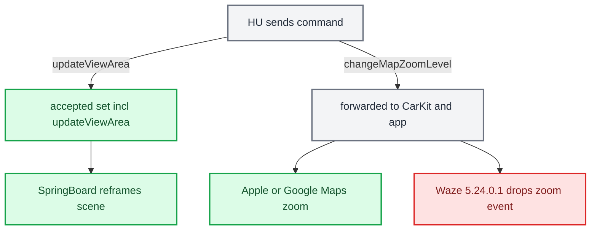

# Third-party Nav Apps

*Current compatibility, the semantic navigation contract and cluster scene controls.*

---

## Compatibility and evidence

| App | RGI / HUD guidance | Evidence boundary |
| --- | --- | --- |
| Apple Maps / Google Maps | Semantic route guidance is supported | Existing integration and app analysis |
| AMap | Owner-confirmed working with its CarPlay guidance setting enabled on a recent iOS | Exact working app/iOS versions and setting label were not recorded |
| Waze | No usable semantic RGI in the analysed 5.23.0.1 / 5.24.0.1 builds | These versions do not opt in to navigation metadata; do not generalize this to every future release |

RGI/HUD maneuvers and the AltScreen map are separate outputs. A working video map does not prove that an app supplies semantic maneuvers. The old AMap 16.25.0 analysis does not describe the owner-confirmed working configuration.

## 📋 Where RGI actually comes from

Analysed from the decrypted IPAs (`com.waze.iphone` 5.23.0.1 and 5.24.0.1, `com.autonavi.amap` 16.25.0) and iOS 26.6 (23G71) `CarPlay.framework` / `CarPlaySupport`. The binary tables below are version-specific static evidence; the compatibility table separately identifies owner observations. `[decompile]`

The app does not produce the iAP2 `RouteGuidanceUpdate`. `CarPlay.framework` does, from two private model objects, through a generic serializer, and hands it to accessoryd: `[decompile]`

```text
CPMapTemplate startNavigationSessionForTrip:        app calls this
  -> CPNavigationSession                            app fills maneuvers here
  -> CPNavigationManager setRouteGuidance:/modifyRouteGuidance:
  -> CPRouteGuidance (CPAccNavUpdate)               +accNavParameters
  -> +[CPAccNavUpdate accNavInfoWithUpdate:component:customValueBlock:]
  -> ACCNavigationRouteGuidanceUpdateInfo / ACCNavigationManeuverUpdateInfo
  -> accessoryd -> iAP2 RouteGuidanceUpdate
```

| Symbol (iOS 26.6, `CarPlay` image base `0x23d8f1000`) | Address |
|---|---|
| `-[ACCNavigationManeuverUpdateInfo(CPAccNavInfo) initWithManeuver:component:]` | `0x23d9119e0` |
| its custom-value block (keys 2 and 4) | `0x23d911ab8` |
| `+[CPAccNavUpdate accNavInfoWithUpdate:component:customValueBlock:]` | `0x23d8f68a8` |
| `+[CPManeuver(CPAccNavUpdate) accNavParameters]` once-block | `0x23d91d540` |
| `+[CPRouteGuidance(CPAccNavUpdate) accNavParameters]` once-block | `0x23d916be0` |

The once-blocks build a fixed `CPAccNavParam(property, keys)` table. That table is the accessory payload; anything not in it never leaves the phone. `[decompile]`

- `CPManeuver`, 13 params: `componentID, index, instructionVariants, maneuverType, roadFollowingManeuverVariants, initialDistance, initialDistanceDisplay, trafficSide, junctionType, junctionElementAngles, junctionExitAngle, linkedLaneGuidanceIndex, highwayExitLabel`.
- `CPRouteGuidance`, 22 params: `componentID, guidanceState, maneuverState, currentRoadNameVariants, destinationNameVariants, estimatedTimeOfArrival, timeRemaining, distanceRemaining, distanceRemainingDisplay, distanceRemainingToNextManeuver, distanceRemainingToNextManeuverDisplay, currentManeuverIndexes, totalManeuverCount, beingShownInApp, currentLaneGuidanceIndex, totalLaneGuidanceCount, laneGuidanceShowing, sourceName, sourceSupportsRouteGuidance, destinationTimeZoneOffsetMinutes, stopType, electricVehicleDestination`.

Neither table has an image property. `symbolImage`, `symbolSet`, `junctionImage`, `dashboardSymbolImage` and `cardBackgroundColor` are CarPlay-screen only. The cluster gets semantics (a type, a junction shape, angles, a distance, a string) and draws its own icon. That is why our `ManeuverMapper` exists (`java_patch/com/luka/carplay/rgd/ManeuverMapper.java`). `initialDistance` is derived: `-[CPManeuver(CPAccNavUpdate) initialDistance]` returns `initialTravelEstimates.distanceRemaining`, so setting travel estimates is enough. How these fields arrive on the wire is in [iAP2 Route Guidance TLVs](IAP2_ROUTE_GUIDANCE_TLVS.md).

## Navigation metadata gate

The on/off gate is `CPRouteGuidance.sourceSupportsRouteGuidance` (TLV `0x14`). It is written in one place, `-[CPSTemplateInstance setSendsNavigationMetadata:]` (`CarPlaySupport` `0x24a18b3c8`, block `0x24a18b4c4`), which copies a BOOL through. That BOOL comes from `-[CPMapTemplate startNavigationSessionForTrip:]` (`0x23d92cfb4`): `[decompile]`

```objc
if ([mapDelegate respondsToSelector:@selector(mapTemplateShouldProvideNavigationMetadata:)]) {
    BOOL b = [mapDelegate mapTemplateShouldProvideNavigationMetadata:self];
    [session setSendsNavigationMetadata:b];
    if (b) [session pauseTripForReason:2 description:nil];
}
```

It reaches the host as `hostStartNavigationSessionForTrip:sendsNavigationMetadata:supportsRouteSharing:reply:` (block `0x23d92d354`), where `-[CPSMapTemplateViewController hostStart…]` (`0x24a233380`) sets `navigatorObserver.sendsNavigationMetadata` unconditionally. `-[CPNavigationSession initWithTrip:mapTemplate:]` (`0x23d925ea8`) leaves the ivar zero, so a delegate without the selector means NO.

The analysed Waze builds omit the delegate opt-in, so `source_supports_rg == 0` makes the Java RGI path deactivate cleanly. AMap's owner-confirmed working configuration enables guidance; the old missing-maneuverType result belongs to AMap 16.25.0 / iOS 26.6.

The [archived app analysis](../archive/internal-reference-2026-10-29/cluster-and-rgi/THIRD_PARTY_NAV_APPS.md) preserves the app addresses, old AMap table, Waze maneuver construction and Waze 5.24.0.1's discarded zoom callback. That zoom finding is specific to the inspected build, not a universal claim about Waze.

## ⚙️ `CMD_ALT_ZOOM` is live

`changeMapZoomLevel` is a semantic command, not HID. `CMD_ALT_ZOOM = 0x0110` is live end to end. `[code]`

- Java: the MFL roller arrives as the NavSD FctID 45 SetGet; `AltScreenCombiBAPListener.setMapScale` hands the steps to `AltScreenModule`, which sends the command (`java_patch/de/audi/tghu/navi/app/cluster/AltScreenCombiBAPListener.java:62-70`, `java_patch/com/luka/carplay/core/AltScreenModule.java:95-101`). The constant is at `java_patch/com/luka/carplay/bus/CarplayBus.java:54`.
- Hook: `zoom_on_cmd` accepts signed intent, and the native command worker paces
  `changeMapZoomLevel{uuid, zoomDirection}` for the cluster UUID. A selected step
  keeps immutable input age; `ALTSCREEN_ZOOM_INVERT` flips direction. See
  [Input commands](../altscreen-and-video/ALTSCREEN_INPUT_COMMANDS.md) for current
  bounds, runtime knobs and offline tests.[^input]

`CMD_ALT_HID` and `CMD_KNOB` are not defined in `bus_protocol.h`. The cluster display advertises no `primaryInputDevice` (`altscreen_hook.c:508-510`), so all cluster commands are BAP or semantic. `[code]`

## 🔧 The other lever: `updateViewArea`

The phone accepts a fixed set of HU→phone commands in `carEndpoint_processEventCreatingResponse` (AirPlaySender, iOS 27 24A5418b): `forceKeyFrame, hidSendReport, changeModes, iAPSendMessage, requestSiri, requestUI, updateViewArea, setLimitedUI, setNightMode, setVideoPlaybackAllowed, videoPlayerBackButtonEvent, updateVehicleInformation`. Everything else, including `changeMapZoomLevel`, is logged "Unhandled command … forwarding to clients" and goes to CarKit, DashBoard, and the app's delegate. `[decompile]`

`updateViewArea` (`carEndpoint_updateViewArea`, `0x2510891fc`) is the only command that changes what an app draws without its cooperation. Params: `uuid`, `viewAreaIndex`, `adjacentViewAreas`, `animationDurationMillis`. `carEndpoint_validateViewAreaParams` looks the `uuid` up in the whole `/info` `displays[]` (no main-display restriction) and checks only `viewAreaIndex < viewAreas.count`. Gates: `"viewAreas"` in the setup-response feature list, and on the display entry `viewAreas` (array of `{originXPixels, originYPixels, widthPixels, heightPixels, safeArea?, viewAreaTransitionControl?, viewAreaSupportsFocusTransfer?, viewAreaStatusBarEdge?}`), `initialViewArea` and `adjacentViewAreas`. On success: `kFigEndpointNotification_ViewAreaChanged` → CarKit `-[CARSession _sessionUpdatesQueue_handleViewAreaChangeWithPayload:]` → per-screen `CARScreenInfo.currentViewArea` (each display has its own, so the altScreen carries its own `viewAreas`) → SpringBoard re-frames that display's scenes. `[decompile]`

Private offsets are build-specific: this iOS 27 analysis records `viewAreas` at endpoint+0x45, while the iOS 26.6 table records `viewAreas+0x3D`, `altScreen+0x3E`, `uiContext+0x3F`. Use the matched binary and [architecture address table](../reference/ARCHITECTURE.md#ios-266-altscreen-addresses); do not combine offsets across builds.

The zoom idea: shrink or grow the cluster window while the map stays at 1:8000 per point, so the visible extent changes; the HU crops the active view area out of the unchanged 111 stream and scales it to the panel. Scale trap: `CRScreenScaleHeuristics getPrimaryDisplayScale:viewAreas:` derives point scale from pixels and physical size, so more pixels need proportionally more mm or iOS goes @2x and the extent does not change. `zoomFactor` in the display description is the static form of the same lever. `[decompile]`



## Current zone and scene behavior

`viewAreas` and `updateViewArea` are implemented in `hook/altscreen/altscreen_hook.c`, but only for zone switching (fullscreen / sportscreen / classicscreen via `CMD_ALT_ZONE 0x0111`, acknowledged by `CMD_ALT_ZONE_ACK 0x0112`). `[code]` (`altscreen_hook.c:2016-2025`, `:2269-2291`; `hook/framework/bus_protocol.h:95-98`)

- The display is declared as 292 × 110 mm, approximately the 12.3-inch panel diagonal.
- All three view areas keep the full 1440×542 visible frame and differ only in the nested `safeArea`. The panel calibration grid is 16 columns × 6 rows (one column = 90 px; row edges 0/90/181/271/361/452/542). The VC draws its own translucent map bar from about y = 390 and hides row 6 under the clock bar. `[code]` (`altscreen_hook.c:254-294`)

| View area | Safe area | Cells |
|---|---|---|
| fullscreen | (270, 90) 900×290, bottom y = 380 | D2-M5 |
| sportscreen | (90, 90) 360×300, bottom y = 390 | B2-E5 |
| classicscreen | (540, 90) 360×300 | centred |

The zones change safe-area layout while retaining the full visible frame. They do not implement a map-zoom workaround. The earlier reduced-frame experiment and rejected activation are retained in the archived app analysis.

## 🔧 Choosing the cluster scene (`showUI`)

The HU never sends URLs during activation; the phone does. AirPlaySender calls `_APCarPlay_CRFetchInstrumentClusterURLs` → CarKit `CARInstrumentClusterURLController` → CarPlayServices `-[CRSAppHistoryService serviceFetchInstrumentClusterURLs:]`, and puts the result in the follow-up `/info` request under `altScreenURLs`. `_appLibraryUpdated:` builds it: Maps contributes `maps:/car/instrumentcluster`, `…/map`, `…/instructioncard`; Now Playing contributes `nowplaying://`; third-party apps contribute `carPlayInstrumentClusterURLSchemes` from LaunchServices (Waze 5.24.0.1 and AMap 16.25.0 declare none). Third-party nav apps register `[maps:/car/instrumentcluster, maps:/car/instrumentcluster/map]` through `-[CPSNavigator setAppSupportsInstrumentCluster:]`, so the `maps:` namespace is shared. `[decompile]` (iOS 27 24A5418b, 2026-09-19)

Maps sends `suggestUI{urls}` (stock 210 answers −6714; we ignore it); CarKit sanitises it in `_CARHandleSuggestUI` by intersecting the app, session and suggested lists. The HU answers with `showUI{uuid, url}` at any time, handled by `-[CARSession _sessionUpdatesQueue_handleShowUIWithParameters:]`. `[decompile]`

`-[DBInstrumentClusterURLHandler applySettingsForClusterURL:toSceneSettings:]` (DashBoard; 23G71 and 24A5418b) parses the URL for every app into `CRSUIInstrumentClusterSceneSettings`. Key names are case-sensitive, values are lowercased; unknown keys are ignored; an unsupported path is rejected whole. `[decompile]`

| URL part | Setting |
|---|---|
| `maps:/car/instrumentcluster` | itemType 3 (map + cards, "anyContent") |
| `.../map` | itemType 1 (map only) |
| `.../instructioncard` | itemType 2 (card only) |
| `showETA=yes\|1 / no\|0 / user` | enabled 1 / disabled 2 / userPreference 3; other or absent → 2 |
| `showSpeedLimit=`, `showCompass=` | same values; parsed in the Maps URL branch on both 26.6 and 27; absent → disabled |
| `maneuverLayout=topAligned / leftAligned / rightAligned` | justification 1 / 2 / 3; anything else (including `no`) → 0 |
| `mapsPresentation=anycontent / map / instructioncard` | itemType 3 / 1 / 2 (Maps-hosted content) |

Both inspected iOS 26.6 and 27 binaries contain the Maps URL query-to-setting path; the separate `nextGenHostedContent` branch has different query handling. This establishes display-policy parsing, not an exported numeric speed or on-car sign rendering. [Speed-limit investigation](CARPLAY_SPEED_LIMIT.md). `[decompile]` / `[open]`

`CarPlay.framework` creates an app's cluster window only for itemType 1 or 3 (`updateSceneForNewItemTypeSetting`). `[decompile]`

For third-party apps the ETA and turn card are one platter drawn in the app process by `CPSInstrumentClusterCardViewController` (CarPlaySupport): `[decompile]`

- Layout 1 (centre): platter centred, width `clamp(safeW, 165, 300)`, turn card on top (0.41 × safe height), ETA at the bottom. Layouts 2 / 3: a 213 px column at the left / right edge of the safe area. ETA needs safe height > 202 px.
- With no layout requested (`initWithSafeAreaFrame:…physicalPixelWidth:`): `scale = 0.153 mm / (physicalWidth / pixelWidth)` = 0.7545 for 292 mm × 1440 px. Wide if `safeW ≥ 660 × scale` (about 498 px), then 2 or 3 by safe-area mid vs display mid (equal → 2 on LHD). Otherwise centre when `0.3 × safeH > 115 × scale` (about 87 px), else layout 0: "Undefined layout (0), will not show cluster content", which hides ETA too. That is why narrow zones keep safe height ≥ 290 (now 300); fullscreen at 900 px is always wide.
- `mapOnly` (turn cards off) is logged by `-[… setShowETA:]`; the itemType 1 → mapOnly plumbing was not found in the extracted 26.6 dylibs. Waze on `/map` showed ETA + road name and no turn card, consistent with mapOnly.

URLs the hook sends today: `[code]` (`altscreen_hook.c:2599-2625`)

- RGI off: `maps:/car/instrumentcluster?showETA=yes&maneuverLayout=rightAligned&showSpeedLimit=no` (map + cards, so the cluster shows guidance while our BAP/KDK path is idle).
- RGI on: `maps:/car/instrumentcluster/map?showETA=no&maneuverLayout=no&showSpeedLimit=no`. The root URL is "anyContent", and Maps kept drawing its turn card and ETA there even with `showETA=no` (seen 2026-09-19); maneuvers and ETA come from BAP/KDK instead. `[car]`

The runtime switch is `CMD_ALT_RGI 0x0116`, sent from `AltScreenModule.republish()` (`AltScreenModule.java:299-330`, `bus_protocol.h:115`). The hook re-sends `showUI` when the 111 stream first becomes decodable, after every accepted view-area switch, and on every RGI edge. The same URL is used for every zone. There is no env override; Luka rejected one. `[code]`

## 🔗 Related

- [RGI and BAP Bridge](RGI_AND_BAP_BRIDGE.md): `source_supports_rg == 0` (as in the analysed Waze builds) clears RGI cleanly.
- [iAP2 Route Guidance TLVs](IAP2_ROUTE_GUIDANCE_TLVS.md): the wire form of the `CPRouteGuidance` / `CPManeuver` fields.
- [AltScreen Cluster Video](../altscreen-and-video/ALTSCREEN_CLUSTER_VIDEO.md): the type-111 stream these commands act on.
- [Cluster Contexts](CLUSTER_CONTEXTS.md): where the cluster video plane lands.
- [Maneuver Mapping](MANEUVER_MAPPING.md): what an app's maneuver types turn into on the HUD.

## 📚 Sources

Merged originals were removed from the tree after this note absorbed them; they remain in git history (commit 23972aa).

- `RGI_THIRD_PARTY_NAV_APPS`: CarPlay.framework serializer, the metadata gate, Waze and AMap RE, Waze zoom, `updateViewArea`, scene URLs and card layout.
- Earlier provenance: `MEMORY.md` (Third-party nav apps, zoom vs HID, updateViewArea), `memory/rgi_third_party_maneuvertype.md`, `memory/carplay_updateviewarea_cluster_zoom.md`, `memory/cluster_scene_url_itemtype_layout.md`; source `hook/altscreen/altscreen_hook.c`, `hook/framework/bus_protocol.h`, `java_patch/com/luka/carplay/bus/CarplayBus.java`, `java_patch/com/luka/carplay/core/AltScreenModule.java`.

[^input]: [Native input handler](../../hook/altscreen/altscreen_hook.c), [command policy](../../hook/altscreen/command_policy.h), [command worker](../../hook/altscreen/command_worker.h).
