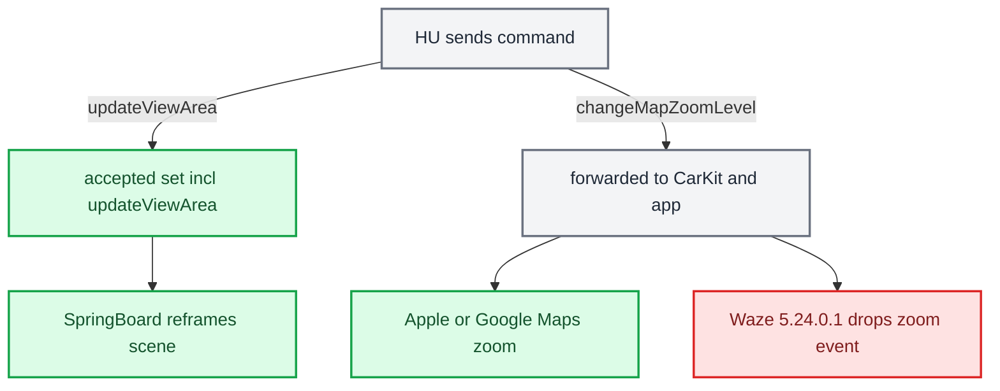

# Third-party Nav Apps

*Current compatibility, the semantic navigation contract and cluster scene controls.*

---

## Compatibility and evidence

| App | RGI / HUD guidance | Evidence boundary |
| --- | --- | --- |
| Apple Maps / Google Maps | Semantic route guidance is supported | Existing integration and app analysis |
| AMap | Owner-confirmed working with its CarPlay guidance setting enabled on a recent iOS | Exact working app/iOS versions and setting label were not recorded |
| Waze | No usable semantic RGI in the analysed 5.23.0.1 / 5.24.0.1 builds | These versions do not opt in to navigation metadata; do not generalize this to every future release |

RGI/HUD maneuvers and the AltScreen map are separate outputs. A working video map does not prove that an app supplies semantic maneuvers.

**AMap correction, 2026-11-08:** both the inspected 16.25.0 and 17.03.0 builds set `maneuverType` through KVC (`setValue:forKey:`). The earlier inference from missing setter selectors was wrong. In 17.03.0, `WCPNaviManeuverCard.updateInstrumentClusterManeuver:` sets `junctionType` to **0**, even for its roundabout mappings, and supplies no angles in that path. Its icon-ID conversion differs from Baidu's. The dedicated `amap` stack corrects CP28/29/30 to roundabout semantics: left, generic departure and right respectively. Ordinary turns and CP6/19 keep default behaviour; valid received angles take precedence over direction hints. See [Maneuver Mapping](MANEUVER_MAPPING.md#source-compensation-stacks) for matching and limits. This is static evidence plus host tests, not vehicle validation. Evidence: `/tmp/amap-17.3.0/findings.txt`, `maneuver-map.json`, `maneuver-mapping.asm`; binary SHA256 `a972f03cf8c6b702b6aca5d3c461e615525e5a4ca4759a72aa48caaea237d928`.

## 📋 Where RGI actually comes from

Analysed from the decrypted IPAs (`com.waze.iphone` 5.23.0.1 and 5.24.0.1, `com.autonavi.amap` 16.25.0) and iOS 26.6 (23G71) `CarPlay.framework` / `CarPlaySupport`. The binary tables below are version-specific static evidence; the compatibility table separately identifies owner observations. `[decompile]`

The app does not produce the iAP2 `RouteGuidanceUpdate`. `CarPlay.framework` does, from two private model objects, through a generic serializer, and hands it to accessoryd: `[decompile]`

```text
CPMapTemplate startNavigationSessionForTrip:        app calls this
  -> CPNavigationSession                            app fills maneuvers here
  -> CPNavigationManager setRouteGuidance:/modifyRouteGuidance:
  -> CPRouteGuidance (CPAccNavUpdate)               +accNavParameters
  -> +[CPAccNavUpdate accNavInfoWithUpdate:component:customValueBlock:]
  -> ACCNavigationRouteGuidanceUpdateInfo / ACCNavigationManeuverUpdateInfo
  -> accessoryd -> iAP2 RouteGuidanceUpdate
```

| Symbol (iOS 26.6, `CarPlay` image base `0x23d8f1000`) | Address |
|---|---|
| `-[ACCNavigationManeuverUpdateInfo(CPAccNavInfo) initWithManeuver:component:]` | `0x23d9119e0` |
| its custom-value block (keys 2 and 4) | `0x23d911ab8` |
| `+[CPAccNavUpdate accNavInfoWithUpdate:component:customValueBlock:]` | `0x23d8f68a8` |
| `+[CPManeuver(CPAccNavUpdate) accNavParameters]` once-block | `0x23d91d540` |
| `+[CPRouteGuidance(CPAccNavUpdate) accNavParameters]` once-block | `0x23d916be0` |

The once-blocks build a fixed `CPAccNavParam(property, keys)` table. That table is the accessory payload; anything not in it never leaves the phone. `[decompile]`

- `CPManeuver`, 13 params: `componentID, index, instructionVariants, maneuverType, roadFollowingManeuverVariants, initialDistance, initialDistanceDisplay, trafficSide, junctionType, junctionElementAngles, junctionExitAngle, linkedLaneGuidanceIndex, highwayExitLabel`.
- `CPRouteGuidance`, 22 params: `componentID, guidanceState, maneuverState, currentRoadNameVariants, destinationNameVariants, estimatedTimeOfArrival, timeRemaining, distanceRemaining, distanceRemainingDisplay, distanceRemainingToNextManeuver, distanceRemainingToNextManeuverDisplay, currentManeuverIndexes, totalManeuverCount, beingShownInApp, currentLaneGuidanceIndex, totalLaneGuidanceCount, laneGuidanceShowing, sourceName, sourceSupportsRouteGuidance, destinationTimeZoneOffsetMinutes, stopType, electricVehicleDestination`.

Neither table has an image property. `symbolImage`, `symbolSet`, `junctionImage`, `dashboardSymbolImage` and `cardBackgroundColor` are CarPlay-screen only. The cluster gets semantics (a type, a junction shape, angles, a distance, a string) and draws its own icon. That is why our `ManeuverMapper` exists (`java_patch/com/luka/carplay/rgd/ManeuverMapper.java`). `initialDistance` is derived: `-[CPManeuver(CPAccNavUpdate) initialDistance]` returns `initialTravelEstimates.distanceRemaining`, so setting travel estimates is enough. How these fields arrive on the wire is in [iAP2 Route Guidance TLVs](IAP2_ROUTE_GUIDANCE_TLVS.md).

## Navigation metadata gate

The on/off gate is `CPRouteGuidance.sourceSupportsRouteGuidance` (TLV `0x14`). It is written in one place, `-[CPSTemplateInstance setSendsNavigationMetadata:]` (`CarPlaySupport` `0x24a18b3c8`, block `0x24a18b4c4`), which copies a BOOL through. That BOOL comes from `-[CPMapTemplate startNavigationSessionForTrip:]` (`0x23d92cfb4`): `[decompile]`

```objc
if ([mapDelegate respondsToSelector:@selector(mapTemplateShouldProvideNavigationMetadata:)]) {
    BOOL b = [mapDelegate mapTemplateShouldProvideNavigationMetadata:self];
    [session setSendsNavigationMetadata:b];
    if (b) [session pauseTripForReason:2 description:nil];
}
```

It reaches the host as `hostStartNavigationSessionForTrip:sendsNavigationMetadata:supportsRouteSharing:reply:` (block `0x23d92d354`), where `-[CPSMapTemplateViewController hostStart…]` (`0x24a233380`) sets `navigatorObserver.sendsNavigationMetadata` unconditionally. `-[CPNavigationSession initWithTrip:mapTemplate:]` (`0x23d925ea8`) leaves the ivar zero, so a delegate without the selector means NO.

The analysed Waze builds omit the delegate opt-in, so `source_supports_rg == 0` makes the Java RGI path deactivate cleanly. AMap's owner-confirmed working configuration enables guidance; its private KVC metadata path is conditional on HUD settings and selector availability. See the correction above rather than the superseded missing-maneuverType claim.

The [archived app analysis](../archive/internal-reference-2026-10-29/cluster-and-rgi/THIRD_PARTY_NAV_APPS.md) preserves the app addresses, old AMap table, Waze maneuver construction and Waze 5.24.0.1's discarded zoom callback. That zoom finding is specific to the inspected build, not a universal claim about Waze.

## ⚙️ `CMD_ALT_ZOOM` is live

`changeMapZoomLevel` is a semantic command, not HID. `CMD_ALT_ZOOM = 0x0110` is live end to end. `[code]`

- Java: the MFL roller arrives as the NavSD FctID 45 SetGet; `AltScreenCombiBAPListener.setMapScale` hands the steps to `AltScreenModule`, which sends the command (`java_patch/de/audi/tghu/navi/app/cluster/AltScreenCombiBAPListener.java:62-70`, `java_patch/com/luka/carplay/core/AltScreenModule.java:95-101`). The constant is at `java_patch/com/luka/carplay/bus/CarplayBus.java:54`.
- Hook: `zoom_on_cmd` accepts signed intent, and the native command worker paces
  `changeMapZoomLevel{uuid, zoomDirection}` for the cluster UUID. A selected step
  keeps immutable input age; `ALTSCREEN_ZOOM_INVERT` flips direction. See
  [Input commands](../altscreen-and-video/ALTSCREEN_INPUT_COMMANDS.md) for current
  bounds, runtime knobs and offline tests.[^input]

`CMD_ALT_HID` and `CMD_KNOB` are not defined in `bus_protocol.h`. The cluster display advertises no `primaryInputDevice` (`altscreen_hook.c:508-510`), so all cluster commands are BAP or semantic. `[code]`

## 🔧 The other lever: `updateViewArea`

The phone accepts a fixed set of HU→phone commands in `carEndpoint_processEventCreatingResponse` (AirPlaySender, iOS 27 24A5418b): `forceKeyFrame, hidSendReport, changeModes, iAPSendMessage, requestSiri, requestUI, updateViewArea, setLimitedUI, setNightMode, setVideoPlaybackAllowed, videoPlayerBackButtonEvent, updateVehicleInformation`. Everything else, including `changeMapZoomLevel`, is logged "Unhandled command … forwarding to clients" and goes to CarKit, DashBoard, and the app's delegate. `[decompile]`

`updateViewArea` (`carEndpoint_updateViewArea`, `0x2510891fc`) is the only command that changes what an app draws without its cooperation. Params: `uuid`, `viewAreaIndex`, `adjacentViewAreas`, `animationDurationMillis`. `carEndpoint_validateViewAreaParams` looks the `uuid` up in the whole `/info` `displays[]` (no main-display restriction) and checks only `viewAreaIndex < viewAreas.count`. Gates: `"viewAreas"` in the setup-response feature list, and on the display entry `viewAreas` (array of `{originXPixels, originYPixels, widthPixels, heightPixels, safeArea?, viewAreaTransitionControl?, viewAreaSupportsFocusTransfer?, viewAreaStatusBarEdge?}`), `initialViewArea` and `adjacentViewAreas`. On success: `kFigEndpointNotification_ViewAreaChanged` → CarKit `-[CARSession _sessionUpdatesQueue_handleViewAreaChangeWithPayload:]` → per-screen `CARScreenInfo.currentViewArea` (each display has its own, so the altScreen carries its own `viewAreas`) → SpringBoard re-frames that display's scenes. `[decompile]`

Private offsets are build-specific: this iOS 27 analysis records `viewAreas` at endpoint+0x45, while the iOS 26.6 table records `viewAreas+0x3D`, `altScreen+0x3E`, `uiContext+0x3F`. Use the matched binary and [architecture address table](../reference/ARCHITECTURE.md#ios-266-altscreen-addresses); do not combine offsets across builds.

The zoom idea: shrink or grow the cluster window while the map stays at 1:8000 per point, so the visible extent changes; the HU crops the active view area out of the unchanged 111 stream and scales it to the panel. Scale trap: `CRScreenScaleHeuristics getPrimaryDisplayScale:viewAreas:` derives point scale from pixels and physical size, so more pixels need proportionally more mm or iOS goes @2x and the extent does not change. `zoomFactor` in the display description is the static form of the same lever. `[decompile]`



## Current zone and scene behavior

`viewAreas` and `updateViewArea` are implemented in `hook/altscreen/altscreen_hook.c`, but only for zone switching (fullscreen / sportscreen / classicscreen via `CMD_ALT_ZONE 0x0111`, acknowledged by `CMD_ALT_ZONE_ACK 0x0112`). `[code]` (`altscreen_hook.c:2016-2025`, `:2269-2291`; `hook/framework/bus_protocol.h:95-98`)

- The display is declared as 292 × 110 mm, approximately the 12.3-inch panel diagonal.
- All three view areas keep the full 1440×542 visible frame and differ only in the nested `safeArea`. The panel calibration grid is 16 columns × 6 rows (one column = 90 px; row edges 0/90/181/271/361/452/542). The VC draws its own translucent map bar from about y = 390 and hides row 6 under the clock bar. `[code]` (`altscreen_hook.c:254-294`)

| View area | Safe area | Cells |
|---|---|---|
| fullscreen | (330, 88) 780×294, bottom y = 382 | D2-M5 (clears small gauges at x < 328 / x > 1112) |
| sportscreen | (108, 88) 348×294, bottom y = 382 | B2-F5 (clears B2 top-left bezel and F3-F4 central dial) |
| classicscreen | (540, 88) 360×294, bottom y = 382 | G2-J5 centred |

The zones change safe-area layout while retaining the full visible frame. They do not implement a map-zoom workaround. The earlier reduced-frame experiment and rejected activation are retained in the archived app analysis.

## 🔧 Choosing the cluster scene (`showUI`)

The HU never sends URLs during activation; the phone does. AirPlaySender calls `_APCarPlay_CRFetchInstrumentClusterURLs` → CarKit `CARInstrumentClusterURLController` → CarPlayServices `-[CRSAppHistoryService serviceFetchInstrumentClusterURLs:]`, and puts the result in the follow-up `/info` request under `altScreenURLs`. `_appLibraryUpdated:` builds it: Maps contributes `maps:/car/instrumentcluster`, `…/map`, `…/instructioncard`; Now Playing contributes `nowplaying://`; third-party apps contribute `carPlayInstrumentClusterURLSchemes` from LaunchServices (Waze 5.24.0.1 and AMap 16.25.0 declare none). Third-party nav apps register `[maps:/car/instrumentcluster, maps:/car/instrumentcluster/map]` through `-[CPSNavigator setAppSupportsInstrumentCluster:]`, so the `maps:` namespace is shared. `[decompile]` (iOS 27 24A5418b, 2026-09-19)

Maps sends `suggestUI{urls}` (stock 210 answers −6714; we ignore it); CarKit sanitises it in `_CARHandleSuggestUI` by intersecting the app, session and suggested lists. The HU answers with `showUI{uuid, url}` at any time, handled by `-[CARSession _sessionUpdatesQueue_handleShowUIWithParameters:]`. `[decompile]`

`-[DBInstrumentClusterURLHandler applySettingsForClusterURL:toSceneSettings:]` (DashBoard; 23G71 and 24A5418b) parses the URL for every app into `CRSUIInstrumentClusterSceneSettings`. Key names are case-sensitive, values are lowercased; unknown keys are ignored; an unsupported path is rejected whole. `[decompile]`

| URL part | Setting |
|---|---|
| `maps:/car/instrumentcluster` | itemType 3 (map + cards, "anyContent") |
| `.../map` | itemType 1 (map only) |
| `.../instructioncard` | itemType 2 (card only) |
| `showETA=yes\|1 / no\|0 / user` | enabled 1 / disabled 2 / userPreference 3; other or absent → 2 |
| `showSpeedLimit=`, `showCompass=` | same values; parsed in the Maps URL branch on both 26.6 and 27; absent → disabled |
| `maneuverLayout=topAligned / leftAligned / rightAligned` | justification 1 / 2 / 3; anything else (including `no`) → 0 |
| `mapsPresentation=anycontent / map / instructioncard` | itemType 3 / 1 / 2 (Maps-hosted content) |

Both inspected iOS 26.6 and 27 binaries contain the Maps URL query-to-setting path; the separate `nextGenHostedContent` branch has different query handling. This establishes display-policy parsing, not an exported numeric speed or on-car sign rendering. [Speed-limit investigation](CARPLAY_SPEED_LIMIT.md). `[decompile]` / `[open]`

`CarPlay.framework` creates an app's cluster window only for itemType 1 or 3 (`updateSceneForNewItemTypeSetting`). `[decompile]`

For third-party apps the ETA and turn card are one platter drawn in the app process by `CPSInstrumentClusterCardViewController` (CarPlaySupport): `[decompile]`

- Layout 1 (centre): platter centred, width `clamp(safeW, 165, 300)`, turn card on top (0.41 × safe height), ETA at the bottom. Layouts 2 / 3: a 213 px column at the left / right edge of the safe area. ETA needs safe height > 202 px.
- With no layout requested (`initWithSafeAreaFrame:…physicalPixelWidth:`): `scale = 0.153 mm / (physicalWidth / pixelWidth)` = 0.7545 for 292 mm × 1440 px. Wide if `safeW ≥ 660 × scale` (about 498 px), then 2 or 3 by safe-area mid vs display mid (equal → 2 on LHD). Otherwise centre when `0.3 × safeH > 115 × scale` (about 87 px), else layout 0: "Undefined layout (0), will not show cluster content", which hides ETA too. That is why narrow zones keep safe height ≥ 290 (now 300); fullscreen at 900 px is always wide.
- `mapOnly` (turn cards off) is logged by `-[… setShowETA:]`; the itemType 1 → mapOnly plumbing was not found in the extracted 26.6 dylibs. Waze on `/map` showed ETA + road name and no turn card, consistent with mapOnly.

URLs selected by `alt_cluster_url_for_mode()` in `hook/altscreen/altscreen_hook.c`: `[code]`

- Cards visible (RGI off, or Hide Maneuver when RGI disabled): `maps:/car/instrumentcluster?showETA=yes&maneuverLayout=<layout>&showSpeedLimit=no`. Fullscreen uses the user's `leftAligned`, `topAligned` or `rightAligned` choice; Sport and Classic use `topAligned` without changing that saved choice.
- Cards hidden (RGI active and Hide Maneuver when RGI enabled): `maps:/car/instrumentcluster/map?showETA=no&maneuverLayout=topAligned&showSpeedLimit=no` in every zone. The root URL is "anyContent", and Maps kept drawing its turn card and ETA there even with `showETA=no` (seen 2026-09-19); maneuvers and ETA come from BAP/KDK instead. `[car]`

The hidden URL deliberately specifies `topAligned`, not `no` or an omitted layout. Both of the latter select automatic layout. In the inspected Apple 26.6 / 27.0 code, side layouts reserve platter width even with turn cards disabled. ETA hiding targets `estimatesVC.view`, while `_updateClientSafeArea` tests its distinct child `contentView.isHidden`; trip updates can unhide that child. With turn cards and ETA disabled, the top layout adds zero extra insets. The 27.0 template host keeps the navigation controller for `/map` and applies the explicit layout override. ARM64 emulation confirmed the inset calculation for Fullscreen, Sport and Classic; exact iOS 27.2 and vehicle behaviour remain unverified. `[decompile]` / `[test]` / `[open]`

The runtime switch is `CMD_ALT_RGI 0x0116`, sent from `AltScreenModule.republish()` (`AltScreenModule.java:299-330`, `bus_protocol.h:115`). The hook re-sends `showUI` when the 111 stream first becomes decodable and on every RGI edge. After a successful view-area response for the current session and requested zone, it updates an already selected URL if the new zone requires a different one. Hidden mode keeps the same explicit top layout across all zones. There is no env override; Luka rejected one. `[code]`

## Waze turn card on the cluster (automatic)

Car test 2026-11-16 (Waze 5.27.5.0, diagnostic build, Position = Center): for the bare `maps:/car/instrumentcluster/instructioncard` URL (itemType 2), iOS draws Waze's own turn card (arrow and distance) into stream 111. No other URL showed it: bare root, `topAligned` and `rightAligned` gave the map only. `[test]`

The hook now selects that URL by itself, with no marker:

- **Decision (`rgd_hook.c`, `rgd_publish_nav_card`).** From each 0x5201: `source_supports_rg = 0` with a source name (this update's, else the cached one) means card; a different provider that also sends `source_supports_rg = 0` gets its own card. An explicit empty source name (with or without `source_supports_rg`), `source_supports_rg != 0`, a name-only update from a different provider, or a disconnect (`rgd_clear_state`) means map. An update with neither field changes nothing, and neither does `source_supports_rg = 0` without any name: Waze's first frame is a hard clear, which drops the cached name. `[code]`
- **URL (`altscreen_hook.c`, `alt_cluster_url_for_mode`).** RGI active with Map Cards = Hidden still gives `/map`. The card comes next, in every zone and Position, and ahead of the `alt_url_diag` mapping. `altscreen_nav_card_update` sends `showUI` (`reason=nav-source`) on each edge in a live session; before a session the state is cached and used at the first IDR. `[code]`
- **Setting.** `alt_waze_card=0` in `/tmp/carplay_settings` keeps the map; the default is on. There is no menu row yet, so this is a manual override in RAM: the Java settings writer rewrites the file without the key on the next settings change, and a reboot clears it. The hook re-reads the file at every SETUP and keeps the last value it read until it restarts. `[code]`
- **Logs.** `alt: nav source "<name>" card=<0|1> -> cluster url …` (WARN) for each edge, then the usual `alt: showUI mode=… reason=nav-source`.

Open on the car: whether Waze sends anything when its route ends while the app stays in front. If it does not, the card stays until another provider, an empty source name or a disconnect. While the card is shown the cluster has no map; map and card together would need a second cluster stream. Host tests: `rgd_timeout_race_test` (`nav_card_source`) and `altscreen_command_worker_test` (`nav_card_policy`, `nav_card_live`). `[test]`

## Waze cluster diagnostic build (opt-in markers)

With Waze the VC can stay black while Apple Maps works. Waze reports `source_supports_rg = 0`, so RGI stays off and Waze always gets the root URL with its query on ctx 81. Each of the diagnostics below is armed by its own RAM marker in `/tmp` and tests one open cause: the scene is never re-selected, Waze does not draw for root+query, the `displayPanels`/`properties` advert, or a phone-side cause. With no marker present the cluster behaves as before; only logging changes, and these changes are on by default: `[code]`

- `alt: showUI mode=`, the `'showUI' ack` and `first IDR arrived` now log at WARN, so they appear without verbose.
- A new WARN line, `post-showUI IDR`, logs the first keyframe after each accepted showUI.
- `111 sender` lines now log without verbose: one every 10 s, or 1 Hz with verbose or the pace trace, and a `111 sender summary` per stream. To produce them, every production session now parses the phone's opcode-5 bplist with the stock CFLite parser in the stream-111 receive thread, at most once per 10 s. Before this build that parse ran only with verbose.

On the car only the `alt_url_diag` mapping has been used so far (2026-11-16, see above). No car results are claimed for `advert_legacy`, `luma_probe`, `capture111` or `card_display`. `[open]`

**Arming.** Put an empty trigger file at the top of the M.I.B. SD card and run the [logging script](../../logging_MoreIncredibleBash/mod/custom.sh). On every run the script creates the marker for each trigger file present and removes the marker for each one missing, so to disarm, delete the file and run the script again. `info.txt` records the armed set before the run (`diag …`) and after it (`diag markers: …`). The markers are in RAM (`/tmp` is `/dev/shmem`), so a reboot disarms everything.

| Trigger file | RAM marker | Read by, when | Effect when armed |
|---|---|---|---|
| `alt_url_diag.txt` | `/tmp/carplay_alt_url_diag` | hook: at hook start, at every SETUP (media SETUPs included) and at every cluster setting command (a CarPlay on Cluster, Position or Map Cards change; also Java boot and hook hello). The change takes effect at the next showUI. | Maneuver Cards Position picks the URL in every zone: Left = bare `maps:/car/instrumentcluster`, Center = bare `maps:/car/instrumentcluster/instructioncard` (itemType 2, card only; added 2026-11-16 after Waze 5.27.5.0 drew no turn card under bare root, `topAligned` or `rightAligned`), Right = the full-screen `rightAligned` root+query URL. That Right URL is the unarmed URL only in the full-screen view, because Sport and Classic normally get `topAligned`. The mapping applies whenever RGI is inactive, and also while RGI is active with Map Cards during Guidance = Shown. Only RGI active with Map Cards = Hidden keeps `/map` unchanged. |
| `advert_legacy.txt` | `/tmp/carplay_alt_advert_legacy` | hook, when the session's display advert is built | The cluster is advertised through legacy `displays` only, without `displayPanels`, cluster `properties` (`Instrument Cluster`, `showsInstruments`) or `altScreenSuggestUIURLs`. |
| `luma_probe.txt` | `/tmp/carplay_luma_probe` | cluster renderer, at each decoder start (each new stream) | Logs min/mean/max luma of the presented picture. It only logs and never skips a frame; at most once a second, the sampled frame's swap waits for a synchronous 3-row readback. |
| `capture111.txt` | `/tmp/carplay_cap111` | cluster renderer, at the next hook connection. That is the stream start; a reconnect after a codec change or a link loss is a new connection. | One raw stream-111 capture to `/tmp/carplay_cap111.h264`. It is single-shot: the renderer removes the marker when it arms. The capture closes at 12 MB or when that hook connection ends, so a stable session keeps one capture open. Each script run copies the file into the save's `tmp/`. Once the renderer has closed the capture (`cap111 wrote` in the log), the run deletes the RAM copy and re-arms the marker while the trigger stays on the card. A capture still being written is kept, and `info.txt` says so; a later run saves the rest. The file contains map imagery and location. |
| `card_display.txt` | `/tmp/carplay_alt_card_display` | hook (QNX builds only), once per phone connect when the display advert is built; ignored while `advert_legacy` is armed and for wireless CarPlay | Experiment: a third, card-only cluster display (initial URL `/instructioncard`) is advertised, so iOS can open a second stream 111 for the turn card. That stream is only appended to `/tmp/carplay_cap111b.h264` (12 MB cap) and never shown; while the session runs, the cluster display keeps its map URLs and never gets `/instructioncard`. The marker is two-phase: the connect removes it and writes `carplay_alt_card_display.active`, and only an advertised session of 20 s or more that received a map keyframe puts it back. A shorter or keyframe-less session, a guessed per-stream TEARDOWN, a card receiver error or a failed card dict leaves it removed and writes the reason to `carplay_alt_card_display.disarmed`; the next script run then renames the trigger to `card_display.disarmed` instead of re-arming it (rename it back to arm again). After a crash or dio_manager restart the marker stays removed, and the reason is written at the next connect after the script re-arms it. Each run copies the capture into the save's `tmp/` and deletes the RAM copy once it is saved and the hook log shows it closed. The file contains map imagery and location. |

**Reading it in the car.** Waze should be navigating with the VC black, in the full-screen view. Verbose is on after the script run, which the 1 Hz `111 sender` lines need.

- **Same-URL re-send.** Toggle "Map Cards during Guidance" (the row needs the Route Guidance setting On). While RGI is inactive, which is always the case for Waze, the URL does not depend on this row. Each toggle therefore sends a `cfg-change` showUI with an identical URL, with or without a marker. A map appearing means re-selecting the scene is enough. Run this before arming `alt_url_diag`, or with Position = Right: the first setting change after arming already sends the mapped URL.
- **URL test.** Arm `alt_url_diag` and run the script; no reconnect is needed. Start from Position = Right: in the full-screen view the armed Right URL is the same `rightAligned` root+query URL as unarmed, so the VC should stay black. Then step Left / Center / Right to get bare root / `/instructioncard` / `rightAligned` root+query. Each change sends a `cfg-change` showUI. The `url=` field of `alt: showUI mode=` shows what was sent, and `alt: url diag armed=1` confirms the marker.
- **Advert test.** The advert marker is read per session. Arm `advert_legacy`, run the script, then reconnect the phone.
- **Black source or black presentation.** Near-zero `luma` while frames arrive means the decoded picture is black. A `luma last` age that keeps growing means no new picture is presented. Decoding the capture on a computer shows whether the phone encoded black.
- **Capture.** The capture starts at the next hook connection after arming. Arm `capture111`, run the script, start Waze navigating, and only then connect the phone. The capture then begins on Waze's scene and does not spend its 12 MB on the home screen or another app first. `cap111 armed generation=` in the render log marks the start. Try the levers in that session, then disconnect the phone (`cap111 wrote`) and run the script to save the file.

| grep (in the save's `tmp/carplay_hook.log` / `tmp/altscreen_render.log`) | What it shows |
|---|---|
| `alt: showUI mode=` | every showUI: zone, `rgi`, `reason` (`first-IDR`, `cfg-change`, …), `url`, `rc` (now WARN) |
| `'showUI' ack` | the phone's status for that showUI (now WARN) |
| `first IDR arrived` | the stream's first keyframe and its `body=` size (now WARN) |
| `post-showUI IDR` | the keyframe that follows a showUI (new) |
| `111 sender` | the phone's encoder counters, e.g. `submitSurfaceFPS=`: 1 Hz with verbose, otherwise every 10 s; `111 sender summary` per stream |
| `alt: url diag armed` | the URL-diagnostic marker as the hook read it |
| `alt: advert legacy armed` | the legacy-advert marker for the session |
| `luma probe` | the probe armed for this stream (`armed rows=…`), disarmed (`off`), or a readback error |
| `luma min=` | luma samples of the presented picture: the stream's first, every dark/not-dark change and one per 10 s. As a fixed string: `grep -F 'altscreen_render[egl]: luma'`, because `[egl]` is a character class in a basic regex. |
| `luma last` | every 10 s while armed: the latest sample of this stream and its `age_ms`. A growing `age_ms` with `mean` below 6 means a static black picture; `none` means this stream has no sample yet. |
| `cap111 armed` / `cap111 wrote` | capture start (generation, existing bytes) and close (bytes written) |

## 🔗 Related

- [RGI and BAP Bridge](RGI_AND_BAP_BRIDGE.md): `source_supports_rg == 0` (as in the analysed Waze builds) clears RGI cleanly.
- [iAP2 Route Guidance TLVs](IAP2_ROUTE_GUIDANCE_TLVS.md): the wire form of the `CPRouteGuidance` / `CPManeuver` fields.
- [AltScreen Cluster Video](../altscreen-and-video/ALTSCREEN_CLUSTER_VIDEO.md): the type-111 stream these commands act on.
- [Cluster Contexts](CLUSTER_CONTEXTS.md): where the cluster video plane lands.
- [Maneuver Mapping](MANEUVER_MAPPING.md): what an app's maneuver types turn into on the HUD.

## 📚 Sources

Merged originals were removed from the tree after this note absorbed them; they remain in git history (commit 23972aa).

- `RGI_THIRD_PARTY_NAV_APPS`: CarPlay.framework serializer, the metadata gate, Waze and AMap RE, Waze zoom, `updateViewArea`, scene URLs and card layout.
- Earlier provenance: `MEMORY.md` (Third-party nav apps, zoom vs HID, updateViewArea), `memory/rgi_third_party_maneuvertype.md`, `memory/carplay_updateviewarea_cluster_zoom.md`, `memory/cluster_scene_url_itemtype_layout.md`; source `hook/altscreen/altscreen_hook.c`, `hook/framework/bus_protocol.h`, `java_patch/com/luka/carplay/bus/CarplayBus.java`, `java_patch/com/luka/carplay/core/AltScreenModule.java`.

[^input]: [Native input handler](../../hook/altscreen/altscreen_hook.c), [command policy](../../hook/altscreen/command_policy.h), [command worker](../../hook/altscreen/command_worker.h).
