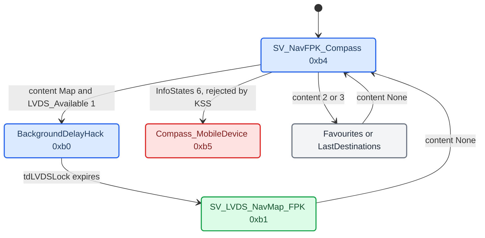

# VC FPK State Machine

*How the AU491 Virtual Cockpit (FPK cluster) turns BAP and MOST data into navigation views: the three firmware layers, the nav view tree, the dp items that drive it, why the mobile-device view is unreachable, and why the side menus cannot be blocked from the head unit.*

---

## 📋 Three layers in the VC

All of this is `[decompile]` of the AU491 FPK firmware (`KI_FPK_AU491`).

```text
MHI2Q HU (Java)
   | BAP over MOST (LSG 50)          | video over MOST (isochronous)
   v                                 v
gssipc-kbd  (BAP -> dp gateway)      HW video decoder -> display layer
   | dp item writes (bap_send_indication_u8/u16/u32/bytes)
   | map table at dword_19A2E8: (28*lsg + 7*fctId_group + record) -> dp index
   v
fds  (EB GUIDE HMI runtime) -> dp bindings -> state machine -> cluster views
```

- `gssipc-kbd` only receives BAP and writes dp items.
- The state machine is compiled into `fds` (EB GUIDE model), not the KZB files. The AU491 KZBs such as `AU491_CarWarnings.kzb` are car warnings, not navigation.
- `dp_monitor.cfg` is the schema only: items, states, views, events, enums.

Paths: `extract_stage3/KI_FPK_AU491/.../bin/app/gssipc-kbd`, `.../bin/app/fds`, `extract_app/KI_FPK_AU491/.../dp/dp_monitor.cfg`, `.../models/*.kzb`.

## 📊 The nav view tree

```text
NavFpk (0xa6)
+-- SV_NavFPK_NA (0xb7)                  nav not available: NavSD OP_State 1/3/15 (3 = "Initialising navigation system")
+-- NAV_fpk_Operable (0xa7)
    +-- SV_NavFPK_HinweisTexte (0xb6)    info / hint texts
    +-- NAV_FPK_Operable_Normal (0xa8)
        +-- NavMap_FPK (0xa9)            video map
        |   +-- OptionMenu (0xaa)        map settings submenu
        |   +-- SV_LVDS_NavMap_FPK_BackgroundDelayHack (0xb0)
        |   +-- SV_LVDS_NavMap_FPK (0xb1)
        +-- SV_NavFPK_Favourites (0xb2)
        +-- SV_NavFPK_LastDestinations (0xb3)
        +-- SV_NavFPK_Compass (0xb4)
        +-- SV_NavFPK_Compass_MobileDevice (0xb5)
```

| View | Maneuver source | Trigger |
|---|---|---|
| `SV_LVDS_NavMap_FPK` (0xb1) | the HU video over MOST | `INTERN_Active_NavFPK_Content = 1` and `LVDS_Available = 1` |
| `SV_NavFPK_Compass` (0xb4) | signal groups 58/61 (MOST 0x500-0x522) | `InfoStates != 6`, content = None |
| `SV_NavFPK_Compass_MobileDevice` (0xb5) | `AIO_Arrow*` dp items (MOST 0x2289) | `InfoStates = 6`, blocked by KSS (below) |
| `SV_NavFPK_Favourites` (0xb2) / `LastDestinations` (0xb3) | none | content = 3 / 2 |
| `SV_NavFPK_HinweisTexte` (0xb6) | none | hint-text mode |
| `SV_NavFPK_NA` (0xb7) | none | nav not ready or no BAP |



The video map enters `BackgroundDelayHack` (0xb0) first and waits for video sync via `CODING_Timer_tdLVDSLock` before 0xb1. It is triggered by `APP_Nav_LeftMenu_Map_pressed` or the HU BAP MapPresentation. `LVDS_Available` is set by the VC graphics subsystem when it sees valid sync from the MOST decoder. The video sits behind the EB GUIDE widget overlays. During CarPlay, that video is the terminal-1 composition of ctx 80/81 (see [Cluster Contexts](CLUSTER_CONTEXTS.md)). `[code]`

The hardware pipeline behind that video, stock: `PresentationController` renders map/KDK into a GPU framebuffer → `videoencoderservice` captures it via IPTE (Inline Processing and Transfer Engine) → Qualcomm H.264 hardware encoder → MPEG-TS packetizer → MLB (Media Logical Block) ISO TX → MOST isochronous channel → VC MOST receiver → hardware decoder → display layer. No dp item carries video. `[decompile]`

Non-FPK clusters use other state paths, each with `NA_Init` / `NA_Off` availability sub-states: `LVDS_NavMap` (0x9e) → `SV_LVDS_NavMap` (0x9f), `LVDS_NavDest` (0x9a) → `SV_LVDS_NavDestinations` (0x9d), `LVDS_Nav_Generic` (0xa2) → `SV_LVDS_Nav` (0xa3). `[decompile]`

## 📊 The dp items that drive it

| dp item | ID | Type | Controls |
|---|---|---|---|
| `INTERN_Active_NavFPK_Content` | 0x4000037 | Integer | None 0, Map 1, LastDest 2, Fav 3 |
| `BAP_NavSD_InfoStates_States` | 0x400000f | Integer | 6 = NavigationInMobileDevice |
| NavSD OP_State mirror | 0x200006A | Integer | 1/3/15 → `SV_NavFPK_NA` (`sub_2286B4`); written by the FctID 15 handler `0x1797E4` |
| `DP_ID_NavFPK_HinweisTexte_TextIndex` | 0x4000044 | Integer | hint text index; != 0 → `SV_NavFPK_HinweisTexte` |
| `BAP_NavSD_RG_Status_RG_Status` | 0x2000070 | Integer | route guidance active |
| `LVDS_Available` | 0x20002d7 | Integer | video stream present |
| `NavFPK_RG_toggled` | 0x400004f | Integer | RG toggle tracking |
| `AIO_Arrow0..3_Direction` | 0x1000000-03 | Integer | KOMO/DSI turn arrows |
| `AIO_Arrows_IconPaths` | 0x6000000 | StringVector | arrow icon paths |

AIO arrow enum: `NoArrow 0, Straight 1, StraightLeft 2, Left 3, SharpLeft 4, UturnLeft 5, UturnRight 6, SharpRight 7, Right 8, StraightRight 9`.

**The VC has no dp item for ActiveRGType (FctID 39).** It is either mapped to the "not mapped" sentinel `0x1f` in the BAP→dp table or consumed internally. The VC switches views on content and InfoStates, not on rgType. `[decompile]`

<details>
<summary>Video and KDK placement dp items</summary>

| dp item | ID | Purpose |
|---|---|---|
| `SV_LVDS_FPK_NavMap_Image_x/y` | 0x400007c/7d | video frame position |
| `SV_LVDS_FPK_NavMap_Image_imageFiles` | 0x60000c1 | fallback / background images |
| `SV_LVDS_FPK_NavMap_Overlay_color` | 0x400007e | tint overlay |
| `SV_LVDS_FPK_NavMap_Slider_x/y` | 0x400007f/80 | slider widget position |
| `SV_LVDS_FPK_NavMap_overlay_txtPaths` | 0x60000c2 | overlay text paths |
| `LVDS_KDK_visible` | 0x20002df | KDK overlay visible |
| `LVDS_KDK_opacity` | 0x20002dc | KDK opacity (fade) |
| `LVDS_KDK_position_x/y` | 0x20002dd/de | KDK position |
| `LVDS_KDK_follow` | 0x20002db | KDK follow mode |
| `LVDS_KDK_DM_opacity` | 0x20002d8 | display-manager KDK opacity |
| `LVDS_KDK_DM_position_x/y` | 0x20002d9/da | display-manager KDK position |
| `CODING_Timer_tdLVDSLock` | 0x20000e6 | video lock delay |
| `MMI_Current_LVDS_Skin` | 0x20002e6 | skin variant |

LVDS events: `APP_LVDS_Capturing_Enable` (0xb7) / `_Disable` (0xb6), `INTERN_LVDS_Nav_Update` (0x162), `ENGINEERING_LVDS_DebugLabel_Text/Visible`. How the HU fills `LVDS_KDK_*` is in [KDK Geometry and Animation](KDK_GEOMETRY_AND_ANIMATION.md).

</details>

---

<details>
<summary>BAP text and map-widget dp items drawn over the video</summary>

| dp item | ID | FctID | Content |
|---|---|---|---|
| `BAP_NavSD_DistanceToNextManeuver_Distance` | 0x2000067 | 18 | distance |
| `BAP_NavSD_DistanceToNextManeuver_BargraphOn` | 0x2000066 | 18 | bargraph active |
| `BAP_NavSD_DistanceToNextManeuver_Unit` | 0x2000068 | 18 | unit |
| `BAP_NavSD_DistanceToNextManeuver_ValidityInformation` | 0x2000069 | 18 | validity |
| `BAP_NavSD_TurnToInfo_TurnToInfo_text` / `_available` | 0x1000018 / 17 | 20 | turn-to street |
| `BAP_NavSD_TurnToInfo_SignPost_text` / `_available` | 0x1000016 / 15 | 20 | signpost |
| `BAP_NavSD_CurrentPositionInfo_PositionInfo_text` / `_available` | 0x1000013 / 12 | 19 | lower-bar text |
| `BAP_NavSD_DistanceToDestination_Distance` / `_Unit` | 0x4000001 / 02 | 21 | distance to destination |
| `BAP_NavSD_RG_Status_RG_Status` | 0x2000070 | 17 | RG active |
| `NavFPK_DTD_ArrivalTime` | 0x400003b | 22 | arrival clock |
| `NavFPK_DTD_Distance` | 0x400003d | 21 | formatted distance |
| `BAP_NavSD_Seperator_text` | 0x1000014 | - | separator |
| `Nav_Map_Scale_String` / `_Unit` / `_visible` | 0x4000056 / 57 / 58 | - | scale bar |
| `Nav_Map_Altitude_String` / `_Unit` | 0x4000053 / 54 | - | altitude |
| `Nav_Map_Streetname` | 0x4000059 | - | street name on map |
| `Nav_Map_TurnToInfo_available` | 0x400005a | - | turn-to bar |
| `Nav_Map_signPost` / `_available` | 0x400005b / 5c | - | signpost |
| `BAP_NavSD_MapColorAndType_Colour` | 0x400001c | 43 | day / night / auto |
| `BAP_NavSD_MapScale_AutoZoom` | 0x400001d | 45 | auto zoom |
| `BAP_NavSD_MapViewAndOrientation_ActiveMapView` | 0x400001e | 44 | 2D / 3D / overview |

</details>

---

## ⚠️ The destination block has only an arrival clock

The VC's whole distance-to-destination block is five data points: `NavFPK_DTD_ArrivalTime`, `NavFPK_DTD_ArrivalTime_visible`, `NavFPK_DTD_Distance`, `NavFPK_DTD_Distance_Unit`, `NavFPK_DTD_Distance_visible`. There is no `RemainingTime`, `Duration` or `TTD` anywhere in `gtf2`. `[decompile]`

Stock `AppConnectorNavi.updateTimeToDestination` encodes FctID 22 type 0 (remaining time) correctly, but the cluster has nowhere to show it and drops `ArrivalTime_visible`. Toggling type 1 ↔ 0 on the car erased the clock instead of switching it. `[car]` So `publishTimeToDestinationForMode()` always sends type 1. `[code]` (`java_patch/com/luka/carplay/rgd/BAPBridge.java:1442-1457`) Remaining time goes into FctID 19 text instead (see [RGI and BAP Bridge](RGI_AND_BAP_BRIDGE.md)).

## 🔍 The native compass view and signal groups 58/61

`SV_NavFPK_Compass` (0xb4) needs content = None and `InfoStates != 6`. It draws the compass rose (`NavFPK_Compass_Angle`) and, when native RG is active (InfoStates 3), maneuver data. Two paths feed it: `[decompile]`

1. BAP → `gssipc-kbd` → named dp items (the text table above).
2. MOST class 46 → KSS `EclWrapper` → signal groups 58/61 → `KssIpc` → EB GUIDE, for the maneuver icon.

| MOST msg | Signal group (offsets) | Content |
|---|---|---|
| 0x500 | SG 58 (+10, +16) | ManeuverDescriptor part 1 |
| 0x501 | SG 61 (+24, +30) | ManeuverDescriptor part 2 |
| 0x504 | SG 58 (+42 / +22, variant-dependent) | distance |
| 0x505 | SG 61 (+0, +6) | turn-to street |
| 0x506 | SG 61 (+12, +18) | current street |
| 0x509 | SG 58/61 | route info |
| 0x50C | SG 58 (+57) | lane guidance (5 lanes, byte-swapped) |
| 0x510 | SG 58 (+70, +76) | distance to destination |
| 0x522 | SG 61 (+44) | RG status byte |

There are no ManeuverDescriptor, ExitView, LaneGuidance or SideStreet dp items in `dp_monitor.cfg`. EB GUIDE reads the signal-group bytes directly. Our FctID 23 sends become MOST 0x500/0x501, so this data path already works.

## 🚫 InfoStates 6 is rejected by KSS

The intended mobile-device path was `setGALState(true)` → `CombiBAPListener.naviIsRunningOnSmartphone = true` → `updateInfoStates()` → InfoStates 6 (MOST 0x515) → `SV_NavFPK_Compass_MobileDevice`. `[decompile]` The source recorded this as "FctID 17 sends 6"; InfoStates is FctID 38 (see [NavSD FctID Matrix](NAVSD_FCTID_MATRIX.md)).

The KSS AUTOSAR firmware rejects 6 before EB GUIDE sees it. Validator `sub_108F42C` at `0x108F42C`: `[decompile]`

```c
return a1 <= 0xF && (a1 & 5) != 4 && (a1 & 0xA) != 8;   // 6 & 5 == 4 -> reject
```

`BAP_NavSD_InfoStates_States` never becomes 6, so the VC never enters 0xb5. The VC firmware cannot be persistently patched (secure AUTOSAR, RAM-only UDS patches are lost on reboot), so the AIO-arrow approach is not viable. The patch bytes are in [HUD Renderer](HUD_RENDERER.md); production does not need them. The full KSS reverse engineering was recorded in `kss_aio_arrow_analysis.md`, which is not in the current tree `[open]`. Our code never calls `ClusterService.updateGALState` (`java_patch/de/audi/tghu/navi/app/cluster/ClusterService.java:1056-1058` has no caller in `com/luka`). `[code]`

In stock navigation the AIO arrows are written by native KOMO/DSI. The CarPlay path does not use them: maneuvers go over BAP FctID 23 to the HUD and the text items to the VC. `[code]`

## 🚫 The side menus are VC-local

The cluster's left and right nav drawers (Kartenfarbe, Kartentyp, Kartendarstellung, Autozoom, Stau umfahren, Zielführung abbrechen) kept opening during CarPlay. Both attempts to block them from the HU failed on the car and were removed. `[car]`, `[code]`

Why FctID 54 cannot work: it points the wrong way. `BAPIndicationHandlerNavi.processMapPresentationSetGet` shows the VC sending a SetGet ("I opened the left drawer") and the HU answering with a Status. The drawer is already open by the time the HU hears. `gtf2` confirms the open is VC-local: `[decompile]`

- `eEventIdKEY_SideMenu_left_pressed` / `_right_pressed` / `_longPressed` / `_doubleClick`: the VC handles the MFW side-menu keys itself.
- `eEventIdINT_OptionMenu_ForceOpen` / `_ForceClose` are internal events with no BAP entry.
- The master lock `Intern_SideMenusNavigation_Locked` is `Intern_`-prefixed: written by VC app logic, unreachable from the HU.

The per-entry gates are `Nav_`-prefixed and fed from the nav function block: `Nav_SideMenusNav_MapColors_visible`, `_MapType_visible`, `_MapDisplay_visible`, `_AutoZoom_visible`, `_StopRouteGuideance_visible`. The HU publishes capability bitfields for them:

| BAP | HU seam | Bits |
|---|---|---|
| FctID 43 `MapColorAndType_Status.supportedMapTypes` | `AppConnectorNavi.updateSupportedMapTypes(mainMapSetup, mask)` | destinationMap, position2D, position3D, overviewMap, rangeMap, mainMapSetup |
| FctID 44 `MapViewAndOrientation_Status.supportedMapViews` | `AppConnectorNavi.updateSupportedMapViews(views, supplementary)` | standardMap, googleEarth, trafficMap; 1Box, compass, intersectionZoom |

Measured failures, do not retry: `[car]`

- The FctID 54 override in `AltScreenCombiBAPListener.setMapPresentation`: wrong direction, and it lied to stock navigation about the drawer. The current override only forwards the stage and calls `super` (`java_patch/de/audi/tghu/navi/app/cluster/AltScreenCombiBAPListener.java:57-60`).
- Empty FctID 43/44 capability bits from `GatedCombiService`: the VC kept opening the drawers. Both methods are pass-throughs again (`java_patch/com/luka/carplay/rgd/GatedCombiService.java:130-132`). Stock owns FctID 43/44/54.

What is left `[open]`: the per-entry `Nav_SideMenusNav_*_visible` gates have another input besides FctID 43/44, which must be found first. Reaching the master lock means patching the VC. There is no BAP path to the drawer-open event.

## 🔗 Related

- [KDK Geometry and Animation](KDK_GEOMETRY_AND_ANIMATION.md): the KDK placement and fade inside `SV_LVDS_NavMap_FPK`.
- [NavSD FctID Matrix](NAVSD_FCTID_MATRIX.md): every NavSD FctID and who owns it during CarPlay.
- [Nav Initializing Screen](NAV_INITIALIZING_SCREEN.md): what selects `SV_NavFPK_NA` and the "Initialising navigation system" text, and why it still covers the CarPlay map.
- [Smartphone Tab and Kombi DSI](SMARTPHONE_TAB_AND_KOMBI_DSI.md): the VC Smartphone tab and the HU-side Kombi DSI interfaces.
- [HUD Renderer](HUD_RENDERER.md): the KOMO video pipeline and the KSS patch bytes.

## 📚 Sources

Merged originals were removed from the tree after this note absorbed them; they remain in git history (commit 23972aa).

- `vc_fpk_state_machine`: three-layer VC architecture, nav view tree, dp item tables, SG 58/61 mapping, KSS InfoStates rejection.
- `CLUSTER_SIDE_MENUS`: why FctID 54 and FctID 43/44 cannot block the drawers.
- `CLUSTER_KDK_GEOMETRY`: the DTD block has only an arrival clock.
