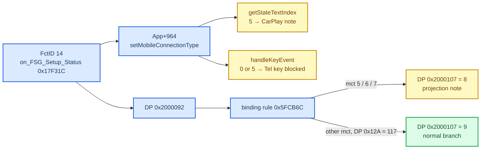

# VC Telephone Tab

*How the Virtual Cockpit's telephone tab reads HU PHONE (LSG 0x28), why it shows the "Apple CarPlay mode" note, why `mobileConnectionType = 3` takes the normal call view, what the tab needs for calls, lists and mute, and how the steering-wheel Tel key travels on both sides. Background for [CarPlay Telephony](CARPLAY_TELEPHONY.md).*

---

Unless noted, addresses are in `hmi_app.elf` of an A5 2018 VC (`UiModVC/A5_2018_unpacked`, VC `AU491_0379`), and HU paths are relative to `Tools/jxe2jar/out/MU1316-vf/`. Everything here is `[decompile]`; our car's VC build may differ.

## 📋 What the tab renders from

The VC has two phone BAP modules: **`Telephone`** (dispatcher `0x79F778`) carries everything about calls, **`Telephone2`** (dispatcher `0x79A4F4`) only status (signal, lock, email count, connection state). On the HU, the call screen rides PHONE 0x28 (`CombiModulePhone` / `CombiBAPServicePhone` / `AppConnectorPhone`), not PHONE2 0x29.

| FctID | Function | Notes |
|---|---|---|
| 14 | FSG_Setup | carries `mobileConnectionType` (`mct`) |
| 15 | FSG_OperationState | op_State, Tel_State, privacy |
| 16 | MobileServiceSupport | the per-function "supported" bits |
| 18 / 20 / 21 | RegisterState / NetworkProvider / SignalQuality | |
| 22 / 23 / 24 | CallState ×7 / CallInfo ×7 / CallDurationSync | the VC runs the call timer itself |
| 25 | DisconnectReason | |
| 34 | MicroMute | SetGet |
| 45 | MissedCallIndication | missedCalls, missedNumbers |
| 49 | CombinedNumbers | the recents list |
| 52 | Phonebook | not needed for recents/favorites |
| 60 | FavoriteList | |

Actions the VC sends back: DialNumber 26, HangupCall 29, AcceptCall 30, CallHold 31, ResumeCall 32, MicroMute 34, the multi-call functions 35–41, and `resetMissedCallsIndicator`.

## 🔀 `mobileConnectionType` and the CarPlay note

- **Two writes.** `on_FSG_Setup_Status` (`0x17F31C`) stores `mct` in `App+964` through `App::setMobileConnectionType` (`0x18475C`) and in datapool `DP_GLOBAL[0x92]` (`0x2000092`) through `sub_69EA00`. Values above 7 become 0.
- **C++ path.** `App::getStateTextIndex` (`0x182B9C`) returns text 14 (`TextIndex_AppleLink`) whenever `mct == 5`, before anything else, and treats 0 as "no connection". `setMobileConnectionType` recomputes the tab text at once (`processTelephoneState`, `0x184554`) and raises `DP 0x500008D = 1` ("phone connected") whenever the value changes to anything in 1..4.
- **Datapool path.** `0x2000092` has one writer and 9 readers (guards `0x21716C`, `0x2171CC`, `0x217248`, `0x2172C4`, `0x217BC8` and a duplicate set at `0x5EC240`–`0x5EC398`). They belong to a binding rule (record `0x87F424`, on-change `0x5FCDB0` → `0x5FCB6C`), not to state-chart transitions, and run when `0x2000030`, `0x200012A` or `0x2000092` changes:

  | Guard | Result |
  |---|---|
  | `0x2171CC`: `mct == 5` and (`DP[0x30] == 37` or `DP[0x12A] == 117`) | `DP 0x2000107 = 8`, the CarPlay note |
  | `0x2172C4` / `0x217248`: `mct == 6` / `7` | the Android Auto / other projection notes |
  | `0x21716C`: `DP[0x12A] == 117` and `mct` ∉ {5, 6, 7} | `DP 0x2000107 = 9`, normal |
  | `0x5FC830`: `DP[0x12A] == 13` and no projection guard | `DP 0x2000107 = 6` |

  The datapool write notifies only when the value really changes (`sub_6A1944` → `sub_6A0790`), so a 5 → 3 change re-runs the rule.
- **What the HU sends** (`BAPPropertyTelFSGSetup.getMobileConnectionType`, `:170-186`): 5 while CarPlay is active, 6 while Android Auto is active, 3 for a low-priority SOS call, otherwise the lead BT device's telMode through `getClusterMobileConnectionType` (0 internal SIM → 1, 1/2 rSAP → 4, **3 HFP → 3**), and 0 with no phone.
- **1, 3 and 4 are the same to the VC**; it only distinguishes 0, 1–4 and 5–7. A 5 → 3 flip fires the "phone connected" event once, exactly like a BT phone connecting.

So `mct = 3` with Tel_State 15 takes both the C++ path and the normal branch, the same path a BT HFP phone takes. The wrapper also never lets 5 reach the VC, so the note has no source.

**op_State** (FctID 15) is not tied to CarPlay: `InitializationManagerPhone.updateOperationStateBAP` sets it from power and BAP-stack state (0 normal operation, 1 off/standby, 3 initializing, 15 defect). The VC leaves the menu for 1, 3 or 15 (guard `0x228F9C`), which is the same for a BT phone.

## 🔘 Call screen and actions

**callOptions bits** (`0x17D3D8` / `0x17ED50`); "supported" = function-list flag AND MobileServiceSupport bit, OR `0x1000` (`setSupportedCallOptions` `0x186C04`):

| Bit | Function |
|---|---|
| `0x01` | Accept (30) |
| `0x02` / `0x04` | FctID 37 / 35 |
| `0x08` | CallHold (31) |
| `0x10` | Resume (32) |
| `0x20` | MPSwap (36) |
| `0x40` / `0x80` | CCJoin (40) / CCSplit (41) |
| `0x800` | Hangup (29) |
| `0x2000` | RingToneMute (56) |
| `0x4000` | MicroMute (34) |

- **Incoming popup** (`0x185684`): shows `(callOptions | 0x2800) & supported`, so Accept appears only if the ringing call has `0x01` and AcceptCall is supported.
- **Active call screen** (`processActiveCalls`, `0x1861E8`): states 2/3/6/7 always offer Hangup; held states 5/8 offer Resume if `0x10`, else Swap if `0x20`; the Hold button follows the call's raw `0x08`.
- **Mute** shows only when supported `& 0x4000` and a call is in state 2. The button (`SetMicroMuteOnOff`, `0x17FB08`) sends the toggle of the **last MicroMute Status received** and changes nothing locally, so every SetGet needs a status reply.
- The popup and the "Halten" button send CallHold/ResumeCall with callID 0 (`0x187290`); the active-call menu uses the slot index (`0x183D9C`).

## 🚗 The steering-wheel Tel key

**VC side** (`App::handleKeyEvent`, `0x185BBC`, event 479 `KEY_Phone_pressed`):

1. Tel_State ∉ {7, 15} or `mct` ∈ {0, 5}: a notice popup instead of any action.
2. Incoming popup visible: `AcceptCall(0)`.
3. Conference call: `HangUpAllActiveCalls`.
4. A call in state 2, 3, 5, 6, 7 or 8: `HangupCall(slot)`.
5. No call: opens the recents list (`ChangeContextToCombinedNumbers`), no BAP.

A long press (478) does nothing; the Mute key (468) only logs.

**HU side, stock:** the HU also gets the raw steering-wheel keys (`DSIKeyPanel`; our `SteeringWheelInputModule` already receives the MFW left roller on this car). `KEY_MFW_HOOK`/`HANGUP` (53/54/55, `org/dsi/ifc/keypanel/Constants.java:52-54`) → `KeyMap` → virtual buttons 14/44 → `MFLPhoneButtonsListener` (registered unconditionally, `TerminalModeApplication:2382`) → `phoneCallController.flash()` → `CarPlayDSIManager` → `postDSICarplayButtonEvent(20)`. Both phone keys map to FLASH because `hasBothPhoneMFLKeys()` is hard-coded false (`AbstractTerminalModeConfiguration:178`): FLASH is Audi's single answer-or-end key. It acts only while CarPlay is the selected device.

So with the gate on, one Tel press can reach CarPlay twice: stock FLASH and our AcceptCall/HangupCall. [CarPlay Telephony](CARPLAY_TELEPHONY.md#-actions-from-the-cluster) keeps the first of the two.

## 📋 Lists

`on_MobileServiceSupport_Status` (`0x17ED50`):

- recents available = FctID 49 in the HU function list **and** MobileServiceSupport bit 49 → `DP 0x500009C`;
- favorites available = FctID 60 in the function list only → `DP 0x500009D`;
- phonebook = FctID 52 and its bit → `DP 0x500009E`.

The list transitions themselves are unconditional (guards `0x229174`, `0x2291A0`, `0x22923C` always return 1). The telephone menu closes only when none of the back-to-call, recents, favorites or phonebook flags is set, or `DP 0x6400107` (a coding value) is 0 (`0x617430`). No Phonebook or PB_State is needed for recents and favorites.

On the HU, `CombinedNumbersListHandler.updateList` sends a full-range ChangedArray whenever the list changes, and `FavoriteNumbersListHandler` sends delta ChangedArrays, so a list the VC fetched while still empty is announced again (whether the VC re-fetches on it was not decompiled).

## 🔗 Related

- [CarPlay Telephony](CARPLAY_TELEPHONY.md): the module that feeds this tab while CarPlay is active.
- [Phone Tab Gating](archive/PHONE_TAB_GATING.md): the earlier attempt to hide the tab, and the Telephone vs Telephone2 correction.
- [VC FPK State Machine](VC_FPK_STATE_MACHINE.md): the VC firmware layers and datapool.
- [Smartphone Tab and Kombi DSI](SMARTPHONE_TAB_AND_KOMBI_DSI.md).
