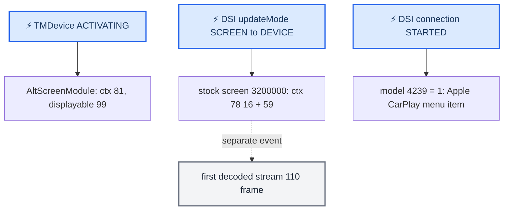

# HMI Startup and Identity

*Which stock Java chains turn a connecting iPhone into the main CarPlay screen (context 78 / displayable 59) and into the "Apple CarPlay" main-menu entry, and why the cluster altScreen can show up before either.*

---

## 📋 Three independent start signals

A connecting phone drives three separate things on the head unit, on different triggers. Treating any one of them as "CarPlay is up" is the classic misreading. **[decompile]** of stock MU1316 Java in `Tools/jxe2jar/out/MU1316-vf/`, 2026-09-13; runtime behaviour unchanged by that study, live timing not measured (SSH to the unit timed out that day).

| Signal | Trigger | Owner | What it proves |
|---|---|---|---|
| Cluster altScreen (ctx 81, displayable 99) | TMDevice **ACTIVATING** | our `CarPlayApp` → `AltScreenModule` | only that a CarPlay device is activating |
| Main CarPlay screen (ctx 78, displayable 59) | DSI `updateMode` SCREEN → DEVICE, then stock screen 3200000 | stock TerminalMode + `EALManager` | that the HMI asked for the context — not that 110 video arrived |
| Main-menu "Apple CarPlay" entry (model 4239 = 1) | DSI `CONNECTIONSTATE_STARTED` → TMDevice Active | stock `TMDeviceControl` | that Java saw STARTED — not that a frame is shown |



## 🔍 Why the cluster can appear first

`TerminalModeBapCombi.ActiveDeviceStateListener.updateActiveDeviceState()` calls `CarPlayApp.onActivate()` already on **ACTIVATING** (`java_patch/de/audi/app/terminalmode/combi/TerminalModeBapCombi.java:89-111`), without waiting for ACTIVE or a main-video frame. The lifecycle worker starts `AltScreenModule`, whose `start()` sets `connected = true` and `desiredCtx = CTX_CLUSTER_MAP` (81) (`java_patch/com/luka/carplay/core/AltScreenModule.java:423-428`). Its single cluster worker applies the context on logical terminal 1 with a bounce through ctx 72 and a 180 ms settle on first capture (`AltScreenModule.java:47-48`). Ownership afterwards is `connected || videoAvailable` (`:306-307`), not readiness of main 110. **[code]**

Displayable 99 belongs to the persistent `altscreen_render`, whose early RGBA loader draws its own image before any H.264/111 decode (`altscreen_render/screen_egl_present.c`, loader in `altscreen_render/loader/`); the first presented decoded frame replaces it. Early visibility of 99 therefore says nothing about main 110 or the stock TerminalMode transition. See [Cluster Loader](../altscreen-and-video/CLUSTER_LOADER.md).

## ⚙️ Who physically requests main context 78

Stock chain from model to composition:

```text
ExternalEventsListener.init()
  model TERMINAL_MODE_DISPLAY_CONTEXT_CHOICE (3200035) = 78   (a model value, not a screen grab)
TerminalModeScreenBag1.tERMINALMODEIPODOUT()
  creates ScreenWidgetEVO(3200000); its DisplayControllerEvo is bound to model 3200035
on a new HMI screen:
  EALManager.newScreenConnected() -> screenPainted=false
  EALManager.draw(): !screenPainted && isContextSwitchNeeded()
    -> lockDisplay(terminal) -> handleContextSwitch()
    -> DisplayControllerEvo.prepareAndSwitchToTargetContext() -> switchToTargetContext()
    -> DisplayManagerMIB2High.switchContext(78, terminal=0, listener)
    -> DisplayManager.switchContext() -> DSIDisplayManagement.switchContext(mappedContext, internalDisplay, sessionId)
    -> native DisplayManager / QNX composition -> renderer.render(project), unlockDisplay()
```

- `DisplayControllerEvo.processModelUpdateEvent()` can also switch when the bound model changes. The widget's initial `staticContext = 8` does not win: `getTargetContextID()` returns the model value 78 first.
- **[code]** Context 78 is `{16, 59}` in our patched `DisplayManagerMIB2High` (`java_patch/de/audi/tghu/fwhmi/DisplayManagerMIB2High.java:166`; the removed cursor experiment used `{16, 103, 59}`). Arrays run front to back; the declaration does not decide *when* it shows — activation of the HMI screen does.
- **[code]** Our guard against foreign context writers applies to **terminal 1 only**: while `AltScreenModule.isConnected()`, `switchContext` on the cluster terminal accepts writes only from the AltScreen worker thread (`DisplayManagerMIB2High.java:300-315`). Main terminal 0 is untouched.
- Java `DisplayManager.switchContext()` waits up to **200 ms** for confirmation and re-sends the DSI request if none arrives. There is no fixed 10 s pause before context 78; requested context, confirmed context, window 59 and first decoded frame are four separate events.

Stock anchors: `de/audi/atip/model/ICoreTerminalModeModelBank.java:12` (model 3200035); `de/audi/tghu/terminalmode/hmi/evohigh/TerminalModeScreenBag1.java:63,136`; `de/esolutions/hmi/widgets/audi/base/eal/EALManager.java:968,1124,1136`; `de/esolutions/hmi/widgets/audi/evo/DisplayControllerEvo.java:94,221,305`; `de/audi/tghu/fwhmi/DisplayManager.java:151,180,187,230`.

### What makes the stock HMI switch to CarPlay

Device-requested switch:

```text
DIO/CarPlay DSI updateMode(resources, appStates)
  -> DSICarplayListenerImpl.updateMode() -> CarPlayDSIManager.updateMode()
  -> SmartphoneManager.updateMode() -> UpdateMode.execute()
  -> StateHandlerImpl.changeState(..., IRequestor.DEVICE)
  -> Resource.SCREEN: MAINUNIT -> DEVICE -> ScreenChange.execute()
  -> ChoiceModel 4095 (SWITCH_TO_TERMINAL_MODE_CHOICE)
  -> SystemSMM mediator: model 4095 -> event 2000
  -> stock TerminalMode transition / screen 3200000 -> the chain above
```

- `SmartphoneManager.updateMode()` first offers the change to the active command; only if unconsumed is an `UpdateMode` created. Commands are serialized, so one DSI event does not mean the screen changed at that instant.
- `StateHandlerImpl.changeState()` acts only after `serviceStarted`; before that it stores state via `UpdateMainunitState`.
- The stock CarPlay SCREEN override is an `AbstractStateChangeActionHook` that keeps the base action (`executeSuperAction() = true`); on an MU-side request it additionally runs `RequestModeChangeCarPlay` (500 ms timeout).
- User-opened CarPlay runs the reverse chain: the shown screen calls `AbstractTerminalModeHMIApplication.screenVisible()` → AP 1001 → `ExternalEventsListener` (70 ms debounce) → `HMIActivated` → SCREEN owner DEVICE → mode negotiated with the phone. AP 1001 is therefore also a *consequence* of showing the HMI, not a universal first event.

Stock anchors: `CarPlayDSIManager.java:524,1018`; `SmartphoneManager.java:49`; `statemachine/commands/UpdateMode.java:37`; `statemachine/StateHandlerImpl.java:148,677`; `statemachine/commands/ScreenChange.java:16`; `ICoreSystemModelBank.java:366` (model 4095); `SystemSMMInitMediators.java:92`; `AbstractTerminalModeHMIApplication.java:119`.

### Why "10 seconds" is not a diagnosis

Window 59 is created inside stock stream 110 / OMX after its separate screen TCP connection. libairplay `_ScreenThread@0x24220` has a **10 s `SocketAccept` timeout** (`mov r1,10` @`0x242a0`, call @`0x242b0`), a limit rather than a delay. In the saved failing trace `log/live_20260812_black110_restart/sloginfo.txt`:

| Event | Time |
|---|---|
| first 110 attempt NONE → INITIALIZING | 00:18:25.036224 |
| INITIALIZING → STOPPING, screen thread exit | 00:18:35.040612 |
| new attempt NONE → INITIALIZING | 00:18:45.063130 |
| window ID 59 created | 00:18:45.226294 |
| INITIALIZING → READY | 00:18:45.348164 |

The second attempt created the window in ~163 ms and reached READY in ~285 ms; the first died after ~10 s, consistent with the accept timeout (root cause: the port collision in [Session Lifecycle](SESSION_LIFECYCLE.md)). READY is still not a physically shown first frame. Stock `AbstractCommand` and `RequestAudioConnection` also have 10 s limits; their existence proves nothing without execution events, and the saved slogs lack the Java `switchContext`/`DSICarplayListenerImpl` lines.

Next measurement **[open]**: one connection with monotonic marks for TMDevice ACTIVATING, DSI `updateMode` SCREEN owner, `ScreenChange`, requested/confirmed ctx 78, window 59 creation, stream-110 TCP start, and first OMX output. Forcing ctx 78 alone neither creates window 59 nor speeds up the decoder.

Sources: `MAIN_HMI_CONTEXT_78_STARTUP`

## 👤 Main-menu smartphone identity

The main-menu entry that changes from "Smartphone Integration" to "Apple CarPlay" is fully owned by stock Java. A 2026-09-14 experiment with an HU loader and substituted menu state was removed; these models again belong to stock only. **[decompile]**

`TMDeviceControl.SM.BaseState.DiscoveredState.Busy.SubsystemActive.Active` calls `setHMIDeviceState(true)` on entry and `(false)` on exit; `updateMainWizardModel()` writes model `ACTIVE_SMARTPHONE_DEVICE_CHOICE` **4239** (CarPlay detected by `tmDevice.isCarplayDevice()`):

| 4239 | Menu item | Widget ID = choice-138 value | Label ID |
|---|---|---|---|
| 0 | Smartphone Integration | 18 | 3197 |
| 1 | Apple CarPlay | 16 | 3199 |
| 2 | Android Auto | 17 | 3198 |
| 3 | CarLife | 19 | 4068 |

On disconnect 4239 returns to 0. If `MAIN_APPLICATION_WIZARD_CURRENT_APPLICATION_CHOICE` (**138**) already points at one of the four smartphone items, it is moved to the matching new Widget ID, keeping the selection; other selections are untouched. Separately, `updateTabbarModel()` writes **4552** `SMARTPHONE_TABBAR_DEVICE_TYPE_CHOICE` (1 CarPlay, 2 other active smartphone systems, 0 inactive) — do not confuse it with 4239.

Trigger chain:

```text
DSISmartphoneIntegrationListener.updateDeviceConnectionState(deviceID, state, method, valid)
  -> SmartphoneIntegrationDSILifecycleController (valid check, dispatcher)
  -> DeviceManager.SMIControllerListener.updateDeviceConnectionState()   (picks TMDeviceControl by address + method)
  -> TMDeviceControl.setConnectionStateByDSIState(2)                     (CONNECTIONSTATE_STARTED = 2 -> internal msg 6)
  -> ActivatingSubsystem.connectionStateStarted() -> SubsystemActive.Active
  -> Active.enter(): serviceStarted=true, ConnectionState.ACTIVE, SPIServiceState.STARTED, setHMIDeviceState(true)
  -> updateMainWizardModel(): 4239 = 1
```

ACTIVATING comes earlier (Connecting/ActivatingSubsystem) and does not switch the icon. ActivatingSubsystem has a 10,000 ms timeout cancelled on exit — a limit, not a pause.

Rendering: `SystemScreenBag2.mAINWIZARD()` builds four `MenuItemController`s that all send event **1959** with different Label and Widget IDs. On a 4239 update `SystemScreenFactory` toggles their visibility through conditions **948** (generic), **713** (CarPlay), **714** (Android Auto), **949** (CarLife), which also check function availability/coding. `AbstractPlaceholderMenuController.getIconData()` returns the Widget ID; `MainWizardRendererHigh.applyProperties()` maps it to an icon/decorator pair from the layout and sets EAL `AtlasIndex`. For `LayoutMIB2HighQ7` and `LayoutMIB2HighScale`: CarPlay widget 16 → atlas 17, generic widget 18 → atlas 19, decorator 12 for both. The text comes from the Label ID via the stock text provider. These are built-in HMI resources — the phone sends no image for this item.

This chain is separate from `updateMode(SCREEN)` → ctx 78: the icon means Java saw STARTED and entered Active, nothing about window 59 or stream 110.

Stock anchors: `org/dsi/ifc/smartphoneintegration/Constants.java:15`; `SmartphoneIntegrationDSILifecycleController.java:346`; `DeviceManager.java:651`; `TMDeviceControl.java:231,902,982,1050,1062,1113`; `SystemScreenBag2.java:1594`; `SystemScreenFactory.java:2848,1287,1293,2225,2237`; `AbstractPlaceholderMenuController.java:270`; `MainWizardRendererHigh.java:228`; `LayoutMIB2HighQ7.java:923`.

Sources: `MAIN_MENU_SMARTPHONE_IDENTITY`

---

## 📚 Sources

Merged originals were removed from the tree after this note absorbed them; they remain in git history (commit 23972aa).

- `MAIN_HMI_CONTEXT_78_STARTUP` — who requests ctx 78, the DSI → TerminalMode chain, why the cluster appears first, the 10 s accept-timeout trace.
- `MAIN_MENU_SMARTPHONE_IDENTITY` — model 4239 / 138 / 4552, the STARTED chain, menu rendering and atlas mapping.

Related: [Reconnect and Lifecycle](../altscreen-and-video/RECONNECT_AND_LIFECYCLE.md), [Session Lifecycle](SESSION_LIFECYCLE.md), [Cluster Loader](../altscreen-and-video/CLUSTER_LOADER.md), [Landmines](../LANDMINES.md).
