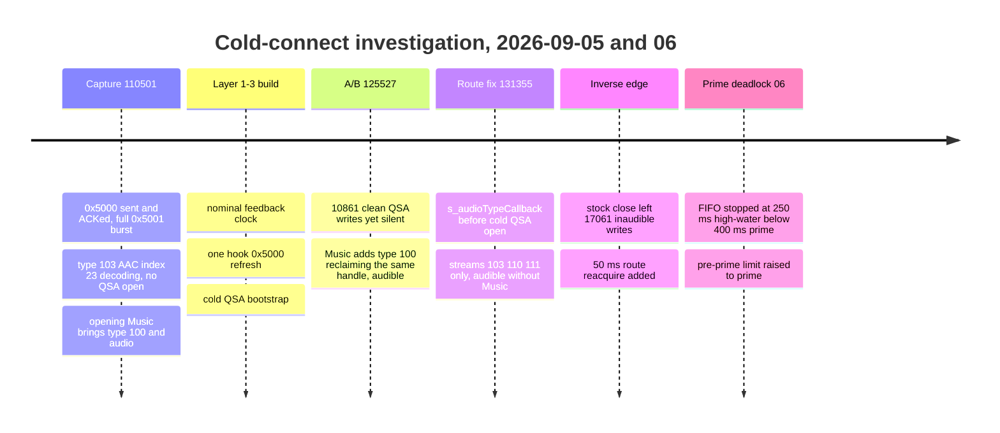

# Now Playing Cold Start

*Why a cold connect could show playback on the phone while the head unit stayed silent and blank, how the three start-up rails (iAP2 Now Playing, AirPlay MediaRemote binding, audio) were separated, and the bounded cold-connect path the hook now runs.*

---

## 📋 The symptom and the three rails

Reported early September 2026: right after connecting, Apple Music plays on the phone but the HU has no audio and no track metadata; HU Play/Next do not help; opening Apple Music on the phone heals it. In another failure the audible track advanced while the HU kept the previous track's title. That last observation proves audio and displayed Now Playing advance independently, so the audit followed three rails instead of one "playback" state machine. **[car]** The owner confirmed connection and audio/UI transitions closed on 2026-09-17 (`TODO.md:5-10`); the per-revision acceptance notes below are history.

| Rail | Head-unit entry | iOS owner | Observable result |
|---|---|---|---|
| iAP2 Now Playing | `0x5000` request / `0x5001` update | `accessoryd` + `AccessoryNowPlaying` XPC service | HU title, artist, playback state and commands |
| AirPlay MediaRemote binding | control SETUP / endpoint activation | `AirPlaySender` | command sink and metadata source bound to a routing context |
| Audio | type 100/103 SETUP, RTP/APAP, feedback, QSA | `AirPlaySender` + the media app | decoded PCM at `/dev/snd/mpl5_dio_ent` |

Binaries analysed: MU1316 MHI2Q P5087 `dio_manager` (SHA-256 `e9862680…c0e794`) and `libNmeVfs.so` (`7cb70418…726fad`); iOS `24A5418b` iPhone18,1 `AccessoryNowPlaying` (`5870bd01…da35c`), `accessoryd` (`3c736704…f9ef`), `ACCNowPlayingFeature` (`cc8a052c…e509`), `AirPlaySender` (`379fb232…ead1`). Annotated IDBs sit beside the images under `Refferences/ios27_dsc/24A5418b__iPhone18,1/state_machine_out/` and `aps_out/`.

## 🔍 Stock HU: `0x5000` is sent exactly once per physical Identify

**[decompile]** `libNmeVfs.so:NmeIAP2_StartNowPlayingUpdates @0xD907C` builds `0x5000` with media attributes `0,1,4,6,7,8,9,0x0A,0x0C,0x10,0x12,0x15,0x16,0x17,0x18,0x1A,0x1B` and playback attributes `0..0x10`, queued by the normal control-session send at `0xD8320`. It has exactly one caller, and so does every step above it:

```text
NmeIAPDevice_OpenIAP @0x10DB64
  0x10DDEC -> NmeIAPDevice_ConnectDevice @0x10C0D0
    0x10C640 -> NmeIAP2Device_Create @0xE7DF8
      0xE7FE8 -> NmeIAP2Device_CompleteIdentification @0xE7A00
        0xE7A58 -> NmeIAP2_StartNowPlayingUpdates @0xD907C
```

- `NmeIAP2_StopNowPlayingUpdates @0xD8B58` has no xrefs; there is no periodic resubscribe, timeout or retry.
- The second `OpenIAP` branch (`0x10DE78` → `NmeIAPDevice_ReConnect @0x106714`) is not a recovery path: at `0x1067CC` it reads the iAP2 flag and `0x1067F0` returns error 162 ("iAP2 devices must not be reconnected", spec R23 §2.13). Only iAP1 is recreated.
- `dio_manager` adds no retry: `CIAP2ServiceCinemo::onJob_connect @0x17C3F8` opens only when `+0x9C` is null (`0x17C588` "Already connected"), creates via `CinemoCreateIAP` (`0x17D330`), opens with flag `0x0E` Identify|Device|ForCarPlay (`0x17D5A4`/`0x17D5BC`), then starts Communications (`0x17DAC8`, vtable `+0x7C`), CallState (`0x17DB18`, `+0x74`) and Power (`0x17DBAC`, `+0x68`) updates — no Now Playing start. `iap2Stop @0x179798` closes the outer object; `notifyiAP2DeviceDisconnected @0x15410C` only clears the flag at `+484`; `closeIAP2Connection @0x1554EC` enqueues a close only while that flag is set, called from `CDSICarPlay_tearDownTheSession @0x15FA58`.
- Receive: `NmeIAP2_OnControlData @0xE4864` → `NmeIAP2_OnNowPlayingUpdate @0xE1E00`, which clones the cached media item, applies `MediaItemAttributes` via `sub_E09F4`, and calls the listener (vtable `+0x34`) **only when `MediaItem::compare` reports a change** (`0xE2010-0xE212C`). The target is `CIAP2ServiceCinemo::onNowPlayingUpdate @0x17AA90` (vtable `0x1A5764`), which copies title, duration, album, artist, genre, composer, status, elapsed time, shuffle, repeat and app. A syntactically full but unchanged `0x5001` is therefore invisible to the HMI.

The subscription is tied to physical iAP2 identification, not to any AirPlay media session.

## 💡 iOS side: what heals and what does not

**[decompile]**

- **`accessoryd` handles a fresh `0x5000` by healing itself.** `NowPlaying_CreateFeature @0x100146AC8` / `DestroyFeature @0x100146C84` manage the per-link feature and the shared client user count. `_startNowPlayingUpdatesHandler @0x10014788C` validates feature 14, removes the previous request's subscribers (`0x100147E00`), replaces arrays and flags, copies default/current dictionaries (`platform_nowPlaying_copyDefaultMediaItemAttributes @0x10008EC10`, `…PlaybackAttributes @0x10008F000`), sends an immediate initial `0x5001` (`0x100148060`), then adds live `PlaybackAttributes` (`0x1000812C0`) and `MediaItemAttributes` (`0x100081360`) subscribers. `_stopNowPlayingUpdatesHandler @0x1001487D8` tears it down. A new `0x5000` — not a new audio SETUP — rebuilds the state.
- **`AccessoryNowPlaying` recovers from interruption, not invalidation.** Client connects to `com.apple.accessories.now-playing-feature` (`_connectToServiceOnQueue @0x22619105C`). Interruption (`@0x226191628`) clears the remote, sets `needsSubscriberListResync` and reconnects after 1 s (`0x226191784`). Invalidation (`@0x226191538`) clears everything and schedules nothing. `_updateSubscriberListOnQueue @0x226192020` connects first, so any later subscriber mutation (which a handled `0x5000` performs) heals it. The user count connects only on 0→1 (`0x226191AB8`) and disconnects on →0 (`0x226191BA8`).
- **The XPC service does not need the Music UI.** `ACCNowPlayingFeature main @0x100001A98` starts the feature before its listener; `startFeature @0x100002270` creates an `MPMusicPlayerController` named `com.apple.accessoryd.mediaplayer`, registers MediaRemote observers, and primes playback state, now-playing info, app and supported commands. Current-value RPCs (`0x10000E48C`, `0x10000E634`) reply without gating on subscribers, with defaults for missing keys (`currentMediaItemAttributes @0x10000642C`, `currentPlaybackAttributes @0x100007374`). One global subscriber list; unexpected loss of the last client arms a 60 s grace timer (`0x10000CFDC`) that releases the transaction but not the list; media/playback updates (`0x10000E708`/`0x10000E980`) broadcast to all live connections.
- **`AirPlaySender` can keep a stale routing context.** `_endpoint_Activate @0x25116D480` reads `_kFigEndpointActivateOptionKey_RoutingContextUUID` (`endpoint_readActivationOptions @0x2510D183C`, stored at activation `+0x40` / endpoint `+0xC8`). `endpoint_createMetadataSourceAndCommandSinkIfNeeded @0x25116E278` creates `APMediaRemoteCommandSink` + `APMetadataSource` only when `old_features == 0 && new_features != 0` (`0x25116E2AC`). `endpoint_updateFeaturesInternalWithContext @0x251170018` exits on equal masks (`0x2511700EC-0x2511700F8`), and a nonzero→nonzero change may reread the UUID (`0x25117028C`) but the helper (`0x2511702F4`) will not recreate the objects. Only full dissociate (`@0x250F70870`, call `0x250F70AB0`) or deactivate (`@0x2510D6E28`, call `0x2510D7380`) reaches `_endpoint_stopMediaRemoteAndMetadataServices @0x250F71104`. Whether the car's lifecycle uses that reuse path is **[open]**.

### Proved, falsified, inferred

| Status | Statement |
|---|---|
| Proved | The stock HU sends `0x5000` once per physical Identify, no retry; `0x5001` arrives independently of audio; a fresh iOS `0x5000` sends an initial `0x5001` and rebuilds subscribers; XPC interruption reconnects, invalidation alone does not; the XPC service starts without Music; AirPlay command/metadata objects bind only on zero→nonzero features |
| Falsified | Music UI is a coded prerequisite; a new AirPlay media SETUP makes the stock HU resend `0x5000`; `ReConnect` resubscribes iAP2; invalidation stays stuck after a fresh handled `0x5000`; the symptom implicates AAC/APAC, QSA, upmix or PCM6 |
| Inferred, not proof | cold failure fits a missing/undelivered/unanswered single `0x5000`; stale metadata over live audio fits either a stale iAP2/XPC rail or a stale routing context; opening Music changes MediaRemote publication or route activation |

Sources: `NOW_PLAYING_STARTUP_STATE_MACHINE_AUDIT`

## 📊 The compact state trace

A passive, generation-scoped discriminator, build-time only: `AUDIO_STATE_TRACE=1 ./scripts/build_hook.sh` (`-DENABLE_STATE_TRACE=1` in `scripts/build_hook_common.sh`). A trace build compiles the ordinary hook log and all packet/PCM captures out on its own (`-DENABLE_LOGGING=0`); the trace keeps only the bounded async writer and writes `/tmp/carplay_state_trace.log`. Stock callbacks enqueue one short record and never touch the filesystem. It records no title, artist, artwork, cookie or audio payload. **[code]**

```text
ST ev=<process-event> mono_ms=<monotonic> pid=<pid> gen=<physical-Identify-generation> name=<event> ...
```

(`hook/framework/state_trace.c:49`). `pid` is part of the analyser's key because a `dio_manager` restart resets `gen`. Markers cover Identify/auth; `0x5000` construction, its `NmeTransport::Send` result and FF5A seq/ack/session (both `ack == tx_seq` and `tx_seq + 1` logged without guessing); every `0x5001` with payload hash and the two nested group counts (param 0 = `MediaItemAttributes`, 1 = `PlaybackAttributes`); first `0x5200` and first other `0x520x`; AirPlay session edges, SETUP ordinal/result/timing, proposed/enabled feature counts, every stream's type/format/index/port/buffer, `/info`, feedback, teardown; buffered cookie, decoder, SETRATE, FLUSH; QSA open/reclaim/params/first write/anomalies/close; and up to 256 HID reports per generation reaching `HIDDevicePostReport`, plus decoded Consumer usages from `HIDRemotePlaybackFillReport` (exact MHI2Q `dio_manager`: `CDIOManager_sendButtonHIDReport @0x1566c8` calls the fill at `0x15694c`, copies one byte into a `CBlob` at `0x156960-0x15697c`; `CHIDService_onJob_sendHIDReport @0x176f70` posts it at `0x176fb4`).

Workflow: `scripts/carplay_state_trace.sh clear` (truncates the inode, safe after dio restarted), then `scripts/carplay_state_trace.sh pull` → timestamped `logs/captures/state-trace/` + `tools/analyze_carplay_state_trace.py`. Decisive capture recipe: leave Music closed, connect, wait ~15 s, try HU Play and Next, then open Music once; do not create `carplay_verbose`.

| Trace result | Boundary |
|---|---|
| Identify completes, no outbound `0x5000` | Stock one-shot lifecycle |
| `0x5000` sent, no link ACK | iAP2 transport/lifetime |
| ACKed, no inbound `0x5001` | iOS `accessoryd` handler |
| first `0x5001` stays default/empty | MediaRemote publication / XPC |
| nonempty `0x5001`, HU still blank | Stock callback / HMI propagation |
| metadata fine, no type 100/103 SETUP | iOS media-route/app selection |
| SETUP/SETRATE arrive, QSA never writes | hook/render rail |
| audio advances, metadata/commands stale | compare iAP2 generation with full AirPlay activation (stale routing context) |

## 🔄 What the car showed

*Timeline of the vehicle captures under `logs/captures/state-trace/` (timeline diagrams take no accTitle/accDescr).*



1. **Capture `20260905-110501`.** `0x5000` built and sent at `00:27:24.995`, ACKed, and iOS returned a full initial `0x5001` (17 media + 16 playback attributes) — the "no `0x5000`" and "no `0x5001`" hypotheses are false. Type 103 was up (SETUP index 23 AAC-LC 48 kHz stereo at `27.221`, 39-byte cookie `27.282`, decoder `27.306`, SETRATE 1 `27.348`) but `mpl5_dio_ent` never opened. Afterwards hundreds of `0x5001` carried only a 12-byte playback progress group, no new media item; every `updateFeedback` returned `response=0 realtime_clock=0 buffered_active=1`. Opening Music at `00:32:44` produced media-group updates, a type-100 SETUP in the same session (`32:56.067`), QSA open (`56.930`), PCM6 expansion, first write from the already-running 103 ring (`buffered_frames=768`), feedback clock (`57.258`), and handoff to detached 103 when 100 closed (`33:01.262`). Title, artist and artwork appeared at the same moment. Correlation, not causation: one foreground action can refresh MediaRemote and activate a stream.
2. **Bounded cold path, then A/B `20260905-125527`.** The first build added a nominal feedback clock, one stock-identical `0x5000` refresh and a cold QSA bootstrap. Cold result: APAC index 65 decoded to 6 ch and **10,861** full detached writes with zero short/zero writes, recoveries or underruns — and silence. Opening Music: type-100 SETUP at `02:23:19.881`, `QSA_OPEN action=reclaim` of the same handle, first stock write from the 103 ring, audible. Opening/writing QSA is necessary but not sufficient.
3. **Missing call found.** Stock `AudioStreamPrepare @0x4A9D0` (libairplay `01c116b1…56f2`) calls the audio-type callback (`stream+0x74`, type `+0x70`, ctx `+0x78`, `0x4AA14-0x4AA28`) and waits for an ACK of 1 (`+0x80`, `0x4AA2C-0x4AAEC`) before opening QSA. In `dio_manager` that is `dio::CDIOManager::s_audioTypeCallback(int, void*) @0x154E58` → `CAirPlayServiceEvent_UpdateMainAudioType` → `onEvent_updateMainAudioType @0x1584E8` (`kAudioTypeMedia` 1 → DSI type 2) → `CDSICarplayImpl::updateMainAudioType(2, true) @0x168AEC` (vtable `+0x74`). Release: `s_audioTornDownCallback(void*) @0x154DBC`. Acceptance `20260905-131355`: stream types `[103, 110, 111]`, `AUDIO_ROUTE action=request owner=cold_buffered audio_type=1` at `02:41:30.228`, cold QSA open `.231`, first full period `.232`, 2,560 clean periods, audible without touching Music. **[car]**
4. **Inverse edge.** A generation that began on stock type 100 and then detached kept writing (17,061 full writes) but lost the Media route to stock `AudioStreamStop @0x4A2F8`'s torn-down callback (`stream+0x90/+0x94`). A 50 ms reacquire after a retained stock close was added; the analyser flags `route_reacquire_missing`.
5. **Prime deadlock (2026-09-06).** The rate-zero FIFO stopped decoding at the 250 ms / 12,000-frame high-water while cold bootstrap waited for the 400 ms / 19,200-frame prime; fixed by using `max(high_water, prime_target)` before priming.

Route declaration, reacquire timing and prime details are canonical in [Buffered Playback Lifecycle](../audio/BUFFERED_PLAYBACK_LIFECYCLE.md).

<details>
<summary><strong>Capture details worth keeping</strong></summary>

- **Deployed trace build (2026-09-05, read back byte-identical):** `build/libcarplay_hook.health-trace.so` `b831166f…afb1c`, `build/libcarplay_apac.so` `a6a7bc8c…f044f`, `build/hssr/hssr_model.bin` `fa46e265…7abe`, `carplay_startup.sh` `e291dd82…bf3a`. Process policy then: `hssr-neon`, rear gain `0.25`, LFE `assist`, buffered priority 18, buffered format indices `[65,23]`.
- **Accepted cold-connect hook (`20260905-131355`):** 553,898 bytes, SHA-256 `7e886987…31754`; APAC codec and HSSR model unchanged. Auth, TLV, decode, zero-PCM, sequence-gap, drop and upmix-failure counters all zero; one 248 ms APAP arrival gap at start caused no ring wait or underrun; the seven initial `QSA_WRITE_ANOMALY` records were full 9216/9216 writes with `clock_reset=1` — clock-estimator resets, not partial writes.
- **Inverse-edge failure (`20260905-media-start-failed-live/`, `pid=238407815` gen 1):** Identify + nonempty `0x5001` at `03:45:51.139`, type-100 SETUP `53.660`, stock QSA open `55.812` (the SETUP spent 2247 ms in stock code), first stock write `55.912`, AAC index 23 ready `56.353`, stock close retained for 103 at `03:46:10.423`, first detached write `10.441`, then 17,061 clean inaudible writes with no later `AUDIO_ROUTE request`. The replug control (`20260905-media-start-replug-success/`, `pid=245895303`, streams `[103,110,111]`) took the cold path at `03:53:34.910-.917` and was audible.
- **Prime-deadlock run (2026-09-06):** type-103 AAC index 23 for `com.apple.Music`, SETRATE 1, nominal feedback; 33 authenticated APAP records, sequence `9482929..9482961`, media time +1024 each at timescale 48000, no trim fields 4/5; then no route request and no QSA open. A host regression with the production 1024-frame codec, 12,000-frame high-water and 19,200-frame prime proves queued decode now reaches 19,456 frames.

</details>

---

## ⚙️ What the hook runs now

**[code]**

| Layer | Implementation |
|---|---|
| Rollback switch for the whole cold path | `AUDIO_COLD_CONNECT` (default on; value-checked, `0` disables) — `hook/audio/audio_hook.h:51-52`, `hook/audio/audio_hook.c:81-95` |
| Nominal feedback clock `{type=100, sampleRate=48000}` when type 103 is active and no stock/detached/cached clock exists | `hook/audio/audio_hook.c:8840-8882`; `AUDIO_FEEDBACK_BLANK=1` restores the old empty response for A/B (`:8763,8846`) |
| One stock-identical `0x5000` refresh after the first decoded type-103 media frame, via the retained `ICinemoIAP` (Cinemo keeps seq/ACK); retried at 1 s, at most 8 attempts, stops after the first successful queue | `spa103_retry_now_playing_after_media` `hook/audio/audio_hook.c:4516-4580`; builder `iap2_build_now_playing_start` `hook/framework/iap2_protocol.c:194` (144 payload bytes, FNV-1a `0ee9e0ae`, identical to the captured stock request) |
| Media route declared before the cold QSA open, released only if still hook-owned | exported symbols `hook/audio/audio_hook.c:3788-3797`, request at `:5289` |
| Route reacquired 50 ms after a retained stock close; a stock reopen cancels | `SPA_MEDIA_ROUTE_REACQUIRE_DELAY_NS` `hook/audio/media_route.h:18,120` |
| Cold QSA bootstrap on the existing APAP receiver thread (no thread inside `io-audio`, no second ring consumer; stock type 100 later reclaims the same handle under `ioLock`) | PCM6 / S16LE / 48 kHz / 768-frame periods |
| Pre-prime decode limit | `hook/audio/pcm_period.h:90-99` |

<details>
<summary><strong>Frame-scale glitch check (2026-09-05) — negative, with the limit</strong></summary>

While index-23 AAC stereo played, the owner heard rare frame-scale noises. Capture `20260905-112450` (through `00:53:05`) showed no `QSA_WRITE_ANOMALY`, zero/short write, recovery, extra flush or close; no decoder reject, rebuild, format switch or render stop; feedback always carried a clock (largest interval 2089 ms against ~2 s polling); no `mpl5_dio_ent` underrun/xrun in `sloginfo` (`deva_timer_play_mpl5_dio_ent` adjusted its 16 ms period in 400 ns steps, no reset); `dio_manager` ~5 % CPU, the priority-18 receiver/QSA writer 2.3-2.7 %. A recurrence at a track boundary (`00:54:02.433`, 92-byte `0x5001`) had no FLUSH/SETRATE/cookie/decoder/QSA event, but whole-unit load sat at 91-99 % (99 % at `53:58`, 98 % at `54:03`), keeping scheduler starvation viable. Device writes are always whole 768-frame / 9,216-byte PCM6 periods; `spa_pcm_sink_drain_detached()` submits nothing below 768 frames, so if the eight queued periods drain first the device can underrun without any short write, and QSA/libasound can recover internally and still return a full write. The fix was to export `BUFFERED_HEALTH` / `QSA_HEALTH` counter snapshots before touching buffering, priority or DSP. **[open]** whether the noise was pre-QSA loss or a hidden underrun.

</details>

---

## 📚 Sources

Merged originals were removed from the tree after this note absorbed them; they remain in git history (commit 23972aa).

- `NOW_PLAYING_STARTUP_STATE_MACHINE_AUDIT` — the three-rail audit, Cinemo/iOS decompiles, the trace design, all 2026-09-05/06 vehicle captures and repairs.

Related: [Buffered Playback Lifecycle](../audio/BUFFERED_PLAYBACK_LIFECYCLE.md), [Session Lifecycle](SESSION_LIFECYCLE.md), [HMI Startup and Identity](HMI_STARTUP_AND_IDENTITY.md), [Landmines](../LANDMINES.md).
