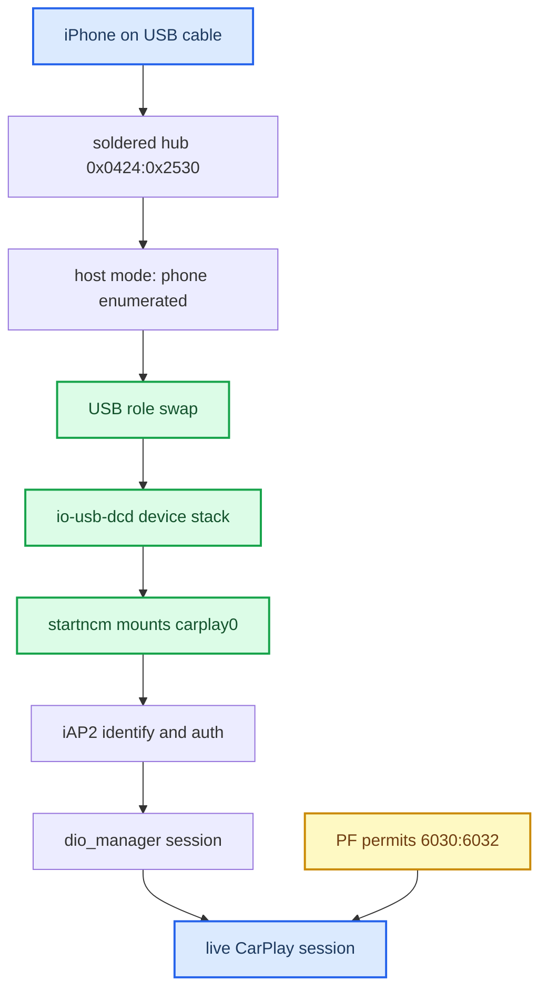

# Connect and USB

*Map of content for how an iPhone gets from a USB plug to a live CarPlay session on MHI2Q — enumeration, role swap, NCM, iAP2, dio, and every way that path wedges.*

---

## 📋 What this section covers

CarPlay on this head unit rides a soldered `0x0424:0x2530` USB hub. The phone plugs in as a host-mode Apple device, the head unit performs a USB role swap so the phone enumerates *us*, then a gadget descriptor brings up an NCM network interface (`carplay0`) over which iAP2 and the CarPlay session run. Every note below covers one segment of that chain or one failure mode of it.

Start with [USB and NCM Connect](USB_AND_NCM_CONNECT.md) for the healthy path and its timing. [USB Replug Recovery](USB_REPLUG_RECOVERY.md) is the big one — how a single fast replug wedged the whole stack until reboot, and what the shipping build does about it. [PF Firewall](PF_FIREWALL.md) and [iOS Version Gate](IOS_VERSION_GATE.md) cover two traps that block a connect for reasons that look nothing like USB. For the hub note and the full trap list see [Home](../README.md) and [Landmines](../LANDMINES.md).

## 📊 The connect path

## 🔗 The notes

| Note | What it covers |
|---|---|
| [USB and NCM Connect](USB_AND_NCM_CONNECT.md) | The healthy stock connect path, the IPv6 DAD ~1 s hypothesis (lever not implemented), and the levers proven harmless (`-w 10000`, en-dashes, `connect_poll`). |
| [USB Replug Recovery](USB_REPLUG_RECOVERY.md) | The replug-wedge: one fast replug kills `io-usb-dcd`, `carplay0` loses carrier, `TIMEOUT_STARTUP` loops. The old startup self-heal was **removed**; the shipping build carries the SI re-arm image, the NCM fence stays experimental. |
| [PF Firewall](PF_FIREWALL.md) | Why patching `pf.conf` alone does nothing — the live ruleset is per-interface (`pf.ecm0.conf` on LTE). The installer widens all four in place; verify with `pfctl -sr`. |
| [iOS Version Gate](IOS_VERSION_GATE.md) | iOS 26 vs 27 BonjourHost behaviour — iOS 27 carkitd tolerates our advertisement; the HU advertisement is still the suspect side. |
| [SI Stack and Replug Race](SI_STACK_AND_REPLUG_RACE.md) | Stock `smartphone_integrator` RE: the stack-restart rule and the two race windows behind `start_stack::none`. |
| [Session Lifecycle](SESSION_LIFECYCLE.md) | One session from control SETUP to teardown: healthy timeline, the −6030 port collision, generation rules. |
| [HMI Startup and Identity](HMI_STARTUP_AND_IDENTITY.md) | Context 78 / displayable 59 start chains and the "Apple CarPlay" main-menu identity. |
| [Now Playing Cold Start](NOW_PLAYING_COLD_START.md) | The three start-up rails and the bounded cold-connect path for silent-and-blank connects. |

## 💡 Truth levels

Claims are tagged **[car]** confirmed on the unit, **[decompile]** from reverse engineering, **[code]** read from the current repo, **[open]** hypothesis.

- The replug-wedge cause is **[car]**.
- Code state **[code]**: `carplay_startup.sh` is a thin wrapper with no USB recovery (`deploy/smartphone_integrator/carplay_startup.sh:1-4`, `deploy/smartphone_integrator/README.md:95-97`); the shipping SI image is the re-arm-patched one (SHA `606236a8…`, `docs/build-and-deploy/DEPLOY_AND_RELEASE.md:27,49-51`); the NCM fence is not in the release map.
- The owner confirmed connection and reconnection stability as closed on 2026-09-17 (`TODO.md:5-10`) — an acceptance report, not a recorded A/B of each recovery component.
- The IPv6 DAD cost is a strong **[open]** hypothesis, never measured HU-side.

Provenance lives in `docs/sources/USB_REPLUG_RECOVERY_RUNBOOK.md`, `docs/connect-and-usb/USB_REPLUG_RECOVERY.md`, and `docs/connect-and-usb/USB_AND_NCM_CONNECT.md`.
