# SI Stack and Replug Race

*How stock `smartphone_integrator` (SI) decides whether a dying dio generation takes `carplay0` and the whole USB device stack with it, and the two race windows that let a fast replug end in a permanent `start_stack::none`.*

---

## 📋 What SI owns

SI is the supervisor of the whole USB/OTG side of CarPlay. `dio_manager` owns none of it; it only consumes the finished IP link. **[decompile]** of the stock MU1316 P5087 image (SHA-256 `a25dc981…0d02`, 802,798 bytes; IDA database `smartphone_integrator.i64` with renamed functions and comments).

| Thing | Owner | Detail |
|---|---|---|
| Creating `carplay0` | OTG `usblauncher` | class rule `0x02/0x0d/0x00` in `usblauncher_otg.lua:254` → `startncm.sh` |
| Destroying `carplay0` | **SI** | `smartphone_integrator.json:92` `"otgStackCleanupScript": "/etc/scripts/stopncm.sh"` → `sleep 1; ifconfig carplay0 destroy` |
| The OTG stack | **SI** | `otgStackStartScriptDeviceMode`, `otgStackStopScript`, `otgCmdStartStackDeviceModeCarPlay = start_stack::device,2`, `restartOtgStackDelayTime: 5000`, `otgStackReconnectTimeout: 30000`, all over PPS `/ramdisk/pps/device/usb_ctrl1` |
| iAP2 | long-lived driver | `class(0xFF,0xF0,0x00)` → `io-otg-cinemo -s /dev/io-usb/otg_dev -lc 212 -v -t 8` |
| `dio_manager` | nobody's owner | consumer of the IP link |

This asymmetry is why the phone can show iAP2 alive but no network: the iAP2 driver survives a stack restart, while NCM is a one-shot script that must re-match. The same "SI tears NCM down on child stop" pattern exists on MH2p (its SI binary contains the literal `/etc/scripts/stopncm.sh` and `SI_EVENT_ERROR_CREATING_CARLIFE_NCM_FLAG`), so it is the eSolutions design, not an MHI2Q quirk. See [USB and NCM Connect](USB_AND_NCM_CONNECT.md) for the platform comparison.

## 🔍 The stack-restart rule

**A clean dio exit leaves the USB stack alone; an error or timeout exit makes SI restart it, and that restart destroys `carplay0`.** What matters is how the generation ended, not that it ended. **[decompile]**

`CarPlaySupervisor_RunningState_HandleAppState` @`0x186B00` reacts to `reportedAppState == 9` (`STOPPED`) and dispatches on the previous state (names from `AppState_toString` @`0x172D5C`):

| `oldAppState` | SI action | USB stack |
|---|---|---|
| 6 `DEINITIALIZING` / 7 `DEINITIALIZED` (clean self-termination) | `cleanup(error=0, portResetNeeded)` | spared |
| 8 `STOPPING` | `cleanup(error=0, …)` | spared |
| 13 `TIMEOUT_WATCHDOG` / 15 `TIMEOUT_SHUTDOWN` | `cleanup(error=1, …)` | teardown |
| 11 `ERROR_SETUP` / 14 `TIMEOUT_STARTUP` / 16 `PREPARING` | retries left → `prepare(retry=1)`, else `cleanup(error=1)` | `RestartDeviceStack` |
| 12 `ERROR_RUNTIME` | retries left → `prepare(retry=1)`, else `cleanup(error=1)` | `RestartDeviceStack` |

`MediaConnectorHandler_prepare(app, retry)` @`0x1800B0` branches on connector type `*(*(a1+40)+980)`: type 1 with retry → `MakeJob_RestartHostStack`; type 2 (our new `0x2530` connector) with retry → `MakeJob_RestartDeviceStack`, otherwise the normal connect job.

`MediaConnectorHandler_cleanup(app, error, portReset)` @`0x17FC48`:

- `children.<app>.cleanupScript` runs through `system()` **only when `error != 0`**;
- `error == 0 && portReset == 0` → `softPath_noStackRestart()`;
- otherwise → `scheduleResetPort()` with `CONNECTION_FLAG_LONG_DELAY` / `NORMAL_DELAY`.

> ⚠️ Superseded claim: an earlier note said the stock `carplay_cleanup.sh` (which slays `mdnsd`) runs on every dio generation. It runs only on the `error != 0` path; a clean `DEINITIALIZED → STOPPED` cycle runs no cleanup script and restarts no stack.

### The diagnostic that settles a case

Every transition logs one line:

```text
[CSIStateRunning] onEvent_appState : App=%s with [deviceID=%i|oldAppState=%s|reportedAppState=%s|
  newAppState=%s|oldRemovedFlag=%s|newRemovedFlag=%s|runtimeRetries=%i|setupRetries=%i|
  downTimeRetries=%i|portResetNeeded=%d|teardownIndication=%d|restartMe=%d]
```

Grep slog for `CSIStateRunning` and read `oldAppState` at the transition into `STOPPED`. `DEINITIALIZED`/`DEINITIALIZING` means dio exits cleanly and NCM loss comes from elsewhere. `ERROR_*`/`TIMEOUT_*` means SI is restarting the device stack, and the fix belongs in dio or the hook (end the generation cleanly), not in the USB or firewall layer.

### App-context offsets

App context = `*(controller + 96)`:

| Offset | Field |
|---|---|
| +1240 | appId |
| +1244 | current appState |
| +1256 | deviceID |
| +1260 | setupRetries |
| +1264 | runtimeRetries |
| +1276 | selfTermination allowed |
| +1376 | portResetNeeded |
| +1378 | teardownIndication |
| +1380 | restartMe |

Sources: `SI_STACK_RESTART_RE`, `CONNECT_FAILURE_ROOT_CAUSE`

## ⚠️ Terminal cleanup — why SI "stops trying"

The missing `io-usb-dcd` seen after a failed reconnect is **not** proof that the device stack crashed first. Stock SI creates that state deliberately once its finite setup-retry budget is spent. **[decompile]**, offline analysis 2026-09-04.

```mermaid
stateDiagram-v2
  accTitle: SI setup-retry path to terminal cleanup
  accDescr: TIMEOUT_STARTUP consumes a setup retry and restarts the device stack with a 5 s gap; once retries are exhausted, final CarPlay cleanup enqueues SwitchPort direction 0 which stops the stack with no matching start, leaving SI waiting for an insertion event that already happened.
  [*] --> starting
  starting --> timeout_startup: no control SETUP within 10 s
  timeout_startup --> restart_stack: setup retries left
  restart_stack --> starting: none, 5 s, device 2
  timeout_startup --> final_cleanup: retries exhausted
  final_cleanup --> stack_none: SwitchPort direction 0
  stack_none --> waiting: no device-stack start
  waiting --> starting: new connector event only
  final_cleanup --> starting: re-arm patch, direction 1
  classDef danger fill:#fee2e2,stroke:#dc2626,stroke-width:2px,color:#7f1d1d
  classDef warning fill:#fef9c3,stroke:#ca8a04,stroke-width:2px,color:#713f12
  class stack_none,waiting danger
  class timeout_startup,final_cleanup warning
```



1. `TIMEOUT_STARTUP` consumes one setup retry.
2. With retries left, SI runs its normal restart job: `start_stack::none`, a 5,000 ms delay, then `start_stack::device,2`.
3. With retries exhausted, final CarPlay cleanup on connector type 2 enqueues `SwitchPort(direction=0)`. Its service handler runs the cleanup script and writes `start_stack::none`.
4. Direction 0 has no matching start. SI completes cleanup and waits for a new device or connector event.
5. The soldered `0x2530` hub never leaves, so `usblauncher.lua`'s insertion handler never runs again. A phone that is already plugged in produces no new event. Result: a stable dead state with the phone connected, no `otg_dev`, and the last `usb_ctrl1` command equal to `start_stack::none`.

### MHI2Q function map

| Address | Function | Behaviour |
|---|---|---|
| `0x172C14` | app-name mapper | `0=CARPLAY`, `1=GAL`, `2=MIRRORLINK`, `3=CARLIFE` |
| `0x172D5C` | `AppState_toString` | state 12 = `ERROR_RUNTIME`, 14 = `TIMEOUT_STARTUP` (`0x172E28`, `0x172E10`) |
| `0x186B00` | `CSIStateRunning_OnEventAppState` | consumes setup retries on state 14, picks retry or final cleanup |
| `0x1800B0` | `MediaConnectorHandler_Prepare` | CarPlay retry on connector type 2 enqueues restart-device-stack |
| `0x193544` | `MediaConnectionService_OnJobRestartDeviceStack` | stop command, 5 s delay, CarPlay device-start command |
| `0x17FC48` | `MediaConnectorHandler_Cleanup` | final CarPlay cleanup on type 2 enqueues `SwitchPort(direction=0)` |
| `0x12B588` | `MediaConnectionJobProxy_EnqueueSwitchPort` | stores upstream port/device, direction, serial, flags, reset time |
| `0x19461C` | `MediaConnectionService_OnJobSwitchPort` | direction 0 cleans and stops (reaches stop writer at `0x1946F8`); direction 1 activates, switches and starts (start writer at `0x19492C`) |
| `0x193264` | stop-command writer | `start_stack::none` |
| `0x1933FC` | start-command writer | `start_stack::device,2` |
| `0x19409C` | `MediaConnectionService_OnJobCleanup` | one-shot connector-init cleanup; only producer is classification at `0x16AB48` — **not** the session path |
| `0x194294` | `onJob_resetPort` | real hardware reset job, calls `sub_192D10` @`0x194534` → controller @`0x192D34` |
| `0x19B984` | reset command builder | `reset port <port> <resetTime> <device>`, written via `sub_19B1BC`; `sub_19B168` opens `/dev/media-con-ctrl` |

### Why `verifyPortReset` is not the CarPlay root cause

`SI_VerifyPortResetForAppState` @`0x184030` really contains `portResetNeeded = (appState == ERROR_RUNTIME)` (assignment at `0x184124`), so state 14 never sets it — for the app types that reach that line. CarPlay is app ID 0: the verifier returns immediately for it, CarPlay's context sets `portResetNeeded = 1` when cleanup finishes (`0x187290`), and it follows the special connector-type branch in `MediaConnectorHandler_Cleanup`. Patching the compare from 12 to 14 would not fix CarPlay and could regress other apps.

> Superseded: the 2026-08-04 diagnosis read `verifyPortReset` (states 7/12/14 handled together at `0x18752C`, reset byte at session `+0x560` passed to cleanup at `0x187554`, reset branch `0x17FDD8-0x17FEEC`) as the controlling CarPlay branch and treated `OnJobCleanup` as the session path. Both were corrected on 2026-09-04.

Sources: `SI_RAPID_REPLUG_RACE_RE`, `USB_STARTUP_RECOVERY_DIAGNOSIS`

## ⚡ The two race windows

Either window can feed the retry machine into terminal cleanup. The exact initiating event of the captured failure is **[open]**.

### Window 1 — stale `stopncm.sh` destroys the new interface

Stock `stopncm.sh` deliberately delays the destroy and selects the interface only by the global name:

```sh
# To workaround race condition between removal/unmount
sleep 1
ifconfig ${INTERFACE} destroy
```

A rapid replug can run: old removal launches `stopncm.sh` → it sleeps → the new phone enumerates and `startncm.sh` creates a new `carplay0` → the old script wakes and destroys the new interface. The race is static fact; the live capture never timestamped both scripts well enough to prove this ordering. `startncm.sh` adds two more weaknesses: it never checks that `/dev/io-usb/otg_dev` exists before mounting, and it does not stop on a mount failure.

### Window 2 — final cleanup overtakes reinsertion

| Setting | Value |
|---|---:|
| `deviceRemovalDelay` | 1,250 ms |
| NCM removal sleep | 1,000 ms |
| `cleanupTimeout` | 2,500 ms |
| CarPlay `startupTimeout` | 10,000 ms |
| `restartOtgStackDelayTime` | 5,000 ms |
| CarPlay `restartDelay` (stock) | 2,000 ms |
| CarPlay `maxSetupRetries` | 2 |

An insertion inside the removal/cleanup window can belong to the new generation while old-generation work is still queued. After the retries are spent, final cleanup stops the stack and assumes a later detection event will rebuild it.

### Other triggers that reach the same terminal state

- a short cable or power interruption during USB role reversal;
- the phone not enabling both iAP2 and NCM interfaces before the 8 s `io-otg-cinemo` (`-t 8`) or 10 s CarPlay startup deadline;
- a slow or custom `dio_manager` start that eats SI's 10 s budget (see below);
- an NCM mount failure or a stale NCM removal;
- a delayed device-removal or cleanup job overtaking a new insertion;
- a media-connector power cycle whose OTG launcher hits its control timeout before SI publishes the command path.

Sources: `SI_RAPID_REPLUG_RACE_RE`

## ⚙️ The startup budget

SI starts the 10,000 ms `startupTimeout` clock when it spawns the child `exec` — `carplay_startup.sh`, not `dio_manager`. Everything the wrapper does before `exec` is subtracted from dio's budget. A missed deadline reports `TIMEOUT_STARTUP`, which is exactly the branch above: `prepare(retry=1)` → `RestartDeviceStack` → `stopncm.sh` → `carplay0` destroyed → the phone's `USB eligible: N (No Network Interface)`. The ~15 s generation lifetime measured earlier fits `startupTimeout 10000 + restartDelay 3000 + overhead`. **[decompile]** for the branch; that the unit actually hit `TIMEOUT_STARTUP` then stayed **[open]** (it needs one `[CSIStateRunning]` line).

The 2026-09 wrapper had front-loaded costs: `cp_usb_consume_pending_reset` (`sleep 1` on the latched path), a full `pidin ar`, two `netstat -an` probes, a 1 s kill grace for a wedged renderer and a fixed `sleep 1` EGL settle — ~1 s floor, ~3-4 s worst case.

**[code]** All of that is gone. `carplay_startup.sh` now does only file checks, an atomic owner-file publish, a monitor fork and `exec dio_manager` (`deploy/smartphone_integrator/carplay_startup.sh:21-95`). The monitor first sleeps 1 s "so exec wins scheduling", then adopts or starts the renderers (`deploy/smartphone_integrator/carplay_monitor.sh:110-118`). The pending-USB-reset consumer no longer exists in any script.

Sources: `SI_STACK_RESTART_RE`, `NCM_AND_FIREWALL_IDEAL_START`

## 🔄 MH2p comparison

The later MH2p SI (`Firmwares/HU/MH2p_US_LB636_P2712/…/smartphone_integrator`, SHA-256 `e7d9480f…cdc7`) has a different layout and more app/connector support, but the same recovery policy **[decompile]**:

| MH2p address | Behaviour |
|---|---|
| `0xBCEE8` | `SI_VerifyPortResetForAppState`; still tests state 12 only |
| `0xB4554` | CarPlay retry enqueues restart-device-stack |
| `0xB5238` | final connector cleanup: soft cleanup or switch-port job |
| `0xCAD2C` | `OnJobSwitchPort`; direction 0 cleans/stops, 1 activates/switches/starts |
| `0xCB008` | one-shot connector-init cleanup |
| `0xC8F90` | writes the OTG stop command |

MH2p's `usblauncher.lua` is better at insertion (explicit host/device-mode script, launcher bound to `otg_dev`, connector `0x4940`), but it keeps the `/tmp/usblauncherFlag_mediaconnector_*` one-shot guard and a 10 s launcher timeout. There is no fixed SI to copy: this is a shared policy limit, not MHI2Q binary corruption.

## 🔧 Fix direction and what ships

| Candidate | Verdict |
|---|---|
| Re-arm patch: one instruction at VA `0x17FDB4` makes CarPlay's error-final cleanup use direction 1 | **Shipping** — see [USB Replug Recovery](USB_REPLUG_RECOVERY.md) |
| NCM generation fence (`busno/devno/iface` + shared lock) | Experimental, not installed |
| Patch `verifyPortReset` 12 → 14 | ❌ wrong branch for CarPlay |
| Raise `maxSetupRetries` | Diagnostic only — more proper stop/delay/start cycles, but it removes neither race and can turn a permanent failure into a long restart storm |
| Restore the kill/relaunch `usblauncher` wrapper | ❌ returned the node behind the owner's back |
| Recovery child under `/mnt/app/root/rc.local` (`Patches/wifi_fix`) | Only with per-session generation tracking, a success latch and a cooldown — its `respawn()` restarts children forever. SI must stay the only owner of `dio_manager` |

---

## 📚 Sources

Merged originals were removed from the tree after this note absorbed them; they remain in git history (commit 23972aa).

- `SI_STACK_RESTART_RE` — IDA RE of the `STOPPED` dispatch, prepare/cleanup, context offsets, startup-budget hypothesis.
- `SI_RAPID_REPLUG_RACE_RE` — terminal cleanup, race windows, full address map, MH2p comparison, fix direction.
- `USB_STARTUP_RECOVERY_DIAGNOSIS` — the earlier `verifyPortReset` reading and the reset-port machinery addresses.
- `CONNECT_FAILURE_ROOT_CAUSE` — the NCM ownership table.

Related: [USB Replug Recovery](USB_REPLUG_RECOVERY.md), [USB and NCM Connect](USB_AND_NCM_CONNECT.md), [Session Lifecycle](SESSION_LIFECYCLE.md), [Landmines](../LANDMINES.md).
