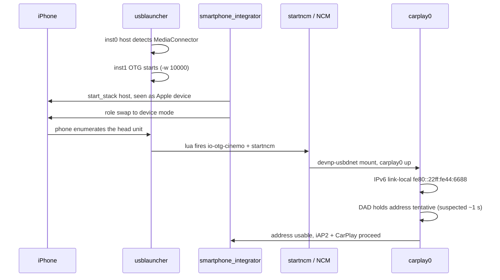

# USB and NCM Connect

*The healthy stock connect path from plug to `carplay0`, who owns each piece, what the phone reports when it breaks, where the time goes, and the levers already proven not to matter.*

---

## 🌐 The stock connect path

The phone never talks to us as a plain USB device. The head unit runs two `usblauncher` instances and a role swap so the phone ends up enumerating the head unit, after which an NCM gadget interface carries iAP2 and CarPlay. **[decompile]** re-read from `Firmwares/HU/MHI2Q_US_AUG22_P5087_MU1316/extracted` on 2026-08-24.

1. `startup.sh:start_usblauncher()` launches instance 0 on the host port (`-n /dev/io-usb/io-usb -S 0`). Verbosity defaults to `-vv`; flag files only raise it to `-vvvvvv`, there is no quiet setting.
2. `usblauncher.lua` detects the MediaConnector hub (`0x0424:0x4040` / `0x0424:0x2530`) and starts instance 1 on the OTG port with `-w 10000` — once, gated on a `/tmp` flag (see [USB Replug Recovery](USB_REPLUG_RECOVERY.md)).
3. `smartphone_integrator` drives the OTG stack over PPS `/ramdisk/pps/device/usb_ctrl1` (`start_stack::host` / `device,2` / `none`), per `smartphone_integrator.json` → `usb.launcher`.
4. The phone is first seen in host mode as an Apple device: `usblauncher_otg.lua` matches `product(0x05AC, 0x1200, 0x12FF)` and runs `driver"echo dummy iOS driver"` — a deliberate no-op whose only job is to let `usblauncher` issue `role_swap`.
5. Role reversal: the head unit becomes the device and presents the composite gadget.
6. The phone (now host) enumerates it and `usblauncher_otg.lua` fires per interface: iAP2 → `io-otg-cinemo -s /dev/io-usb/otg_dev -lc 212 -v -t 8`; NCM → `startncm.sh /dev/io-usb/otg_dev carplay io-pkt`.
7. `startncm.sh` mounts `devnp-usbdnet.so` into io-pkt (`protocol=ncm, usbdnet_mac=000022446688, mac=020022446688, name=carplay, npkt=10`), then `if_up -p carplay0`, then `ifconfig carplay0 up`.
8. IPv6 link-local `fe80::22ff:fe44:6688%carplay0` comes up (documented by the stock `CP_get_ip_address.sh`). CarPlay rides link-local IPv6.



The NCM scripts on the unit are **stock** — the release map ships no `startncm.sh`, `stopncm.sh` or `usblauncher_otg.lua` (`docs/build-and-deploy/DEPLOY_AND_RELEASE.md:13-29`). Modified copies exist only under `deploy/experimental/usb_replug_recovery/`. **[code]**

Sources: `NCM_AND_FIREWALL_IDEAL_START`

## 📦 The gadget and who owns it

`usblauncher_carplay_descriptor.lua`: VID `0x1A96`, PID `0x2018`, strings `AUDI AG` / `iAP2 NCM Accessory`, one configuration, four interfaces. **[decompile]**

| # | Class | Contents |
|---|---|---|
| 0 | `0xFF/0xF0/0x00` | iAP interface, BulkIn + BulkOut 512 |
| 1 | `0x02/0x0d/0x00` | CDC NCM control, InterruptIn 64, CDC header/union/ethernet/NCM functional descriptors (`iMACAddress = 000022446688`) |
| 2 | `0x0A/0x00/0x01` alt 0 | CDC Network Data, no endpoints |
| 3 | `0x0A/0x00/0x01` alt 1 | CDC Network Data, BulkIn + BulkOut 512 |

NCM is always in the descriptor, so "only one of two functions" cannot happen at descriptor level. Data flows only after the host issues `SET_INTERFACE` alt 1 **and** something on our side services those endpoints — `devnp-usbdnet.so`, mounted by `startncm.sh`. If that mount did not happen, the function is advertised but nobody answers.

Ownership: `usblauncher` (OTG) creates `carplay0`; `smartphone_integrator` destroys it and owns the OTG stack; iAP2 is a long-lived separate driver; `dio_manager` owns none of it. Full table and the stack-restart rule: [SI Stack and Replug Race](SI_STACK_AND_REPLUG_RACE.md).

### MHI2Q vs MH2p

Compared against `MH2p_US_LB636_P2712`. Both platforms share the SI-owned OTG lifecycle and `stopncm.sh` cleanup, and both ship `devnp-ncm.so`. MH2p's `/etc/scripts` extraction has only six files and no NCM scripts — an extraction gap, since its SI binary names `/etc/scripts/stopncm.sh`.

| | MH2p (Tegra3) | MHI2Q (MSM8960, ours) |
|---|---|---|
| Device-controller DLL | `devu-iap2ncm-tegra3-ci.so` (iAP2 **and** NCM in one driver) + `devu-iap2-tegra3-ci.so` | `devu-usbrndis-msm8960-ci.so` |
| `usblauncher-Apple.so` plugin | present | absent |
| NCM network driver used | `devnp-ncm.so` | `startncm.sh` mounts `devnp-usbdnet.so` `protocol=ncm`, although `devnp-ncm.so` ships at `/app/armle/lib/dll/devnp-ncm.so` |
| OTG launcher binds to | `-n /dev/io-usb/otg_dev` | `-n /dev/io-usb/otg` |
| Port mode at connector insertion | explicit `start_usblauncher_otg_port_device_mode.sh` | not set |
| Connector IDs | `0x4040`, `0x2530`, `0x4940`, one shared function | `0x4040`, `0x2530` |

Candidates this produced, both **[open]** and never tried: mount `devnp-ncm.so` instead of `devnp-usbdnet.so protocol=ncm` (one line in `startncm.sh`; mount options may differ and the generic driver may be deliberate); MH2p's combined DLL hints the iAP2/NCM split is our fragile part, but the Tegra3 DLL does not port to MSM8960. Neither was worth trying before stopping the ~15 s dio generation churn.

Sources: `USB_NCM_MH2P_VS_MHI2Q`, `USB_IPHONE_CONNECT_POSTMORTEM`

## 🔍 When it fails — the phone names the reason

The August 2026 connect failures were settled from an iOS 26.6.1 sysdiagnose (`23G83`, captured 2026-08-21 23:38 during a failing evening). `airplayd` states it outright **[car]**:

```text
airplayd [APBrowserCarSessionHelper] [Bonjour/USB] StartBonjourForUSB
airplayd [APBrowserCarSessionHelper] [Bonjour/USB] WiFi eligible: N (<disabled>), USB eligible: N (No Network Interface)
```

| Verdict (all 257 in the capture were N) | Count |
|---|---:|
| `N (No Network Interface)` | **180** |
| `N (<disabled>)` | 68 |
| `N (Session Start Timeout, No Remote IP)` | 3 |
| `N (Session Start Timeout, No Remote IP, No Local IP)` | 1 |
| `N (No Local IP)` | 1 |

The NCM function was simply absent. iAP2 was fine throughout (`accessoryd`: `Protocol [iAP2] detected`, `Link state changed! (Connected: 1)`, MFi chain parsed) and `carkitd` built its display configuration (`displayScaleMode=2`) every cycle. Only 5 of 185 verdicts ever saw an interface. The chain: dio generation dies at ~15 s → SI OTG stop/start churn → gadget comes back with iAP2 but NCM unmatched → `No Network Interface` → repeat. It also explains two field observations: a reboot gives one clean enumeration, and `carplay0` carried only ~5 IPv6 Neighbour Discovery packets per cycle — a link with no addressing. A second mine in the same loop: stock `/etc/scripts/carplay_cleanup.sh` does `slay -f -s SIGTERM -m name mdnsd`, killing the daemon that discovers the phone's advertisement (SI runs it only on error cleanup).

Retracted theories, recorded so nobody rebuilds them:

1. "The head unit is not advertising its Bonjour service" — wrong direction. The **phone** advertises (`Starting USB Bonjour advertising with host`); the unit discovers. `dns-sd -B` on the unit showed the phone's service.
2. "iOS 27's `updateBonjourHost` repairs a malformed host from the accessory" — neither version takes a host from the accessory (see [iOS Version Gate](IOS_VERSION_GATE.md)).
3. "iOS ≤ 26's single car-wide `zoomFactor` cannot reconcile our density mismatch" — the display configuration was built successfully every cycle; the zoom never reaches that decision.

Re-query the locally kept capture (`logs/`, gitignored, ~1 GB, the owner's device log): `log show --archive logs/system_logs.logarchive --style compact --predicate 'eventMessage CONTAINS "USB eligible"'`.

Sources: `CONNECT_FAILURE_ROOT_CAUSE`

## ⚡ Where the time goes

### Phone-side timing of the one success

```text
23:36:57.177  USB eligible: N (No Local IP)       interface appeared, no address yet
23:36:57.184  USB eligible: Y                     NCM up, phone has a local IP
              Session: No Remote IP              waiting for the HU's address on carplay0
23:36:58.179  Session: No Remote IP              ~1 s still waiting
23:36:59.272  Link Connected:1 + ConfigUSBHost   role reversal, phone becomes host
23:36:59.280  Starting Accessory Authentication
23:36:59.611  Authentication Passed              iAP2 auth ~330 ms
23:37:00.034  Created APEndpointCarPlay          session up
```

iAP2/MFi auth (~330 ms) is a fixed Apple cost and not the bottleneck. The visible delay is ~2 s of `No Remote IP` — HU-side NCM addressing. An iAP2 link bounce (`Connected: 0 -> 1`) immediately precedes success. Caveat: one success among failures, phone-side timestamps only. **[car]**

### IPv6 DAD — ~1 s suspected on every connect

- Stock `startup.sh` sets no `net.inet6.*` sysctl — only `kern.sbmax`, `net.inet.ip.forwarding` and `net.inet.tcp.{recv,send}space` (`Firmwares/.../extracted/system/etc/boot/startup.sh:999-1002,1071-1072`) — so `ip6_dad_count = 1`.
- Decompiled `nd6_dad_start` (`io-pkt-v6-hc`): `if (flags&1 || !ip6_dad_count) { clear TENTATIVE; return; }`, else `callout_reset(… hz * retrans / 1000 …)` — the link-local stays tentative (unusable as a source) for one `RETRANS_TIMER`, ~1 s.
- `in6if_do_dad` only checks `IFF_LOOPBACK`, `if_type != 242` and `IFF_UP|IFF_RUNNING` — no per-interface opt-out; `ndp -i` only displays `retrans`. The sole lever is the global `net.inet6.ip6.dad_count`.

> ⚠️ **[open]** hypothesis: the code proves DAD costs ~1 s in this path; no HU-side timing has shown it is the same second the phone waits.

### Role-reversal power delays — ~2 s, first connect only

`smartphone_integrator.json`: `powerDelayTimeHostMode: 1000` + `powerDelayTimeDeviceMode: 1000`, plus `deviceRemovalDelay: 1250` and `restartOtgStackDelayTime: 5000`. SI has no function symbols (vtable names only), so call sites were not traced; the values are config and A/B-testable. `stopncm.sh`'s `sleep 1` adds 1 s per reconnect teardown — do not touch it without understanding the race it guards ([SI Stack and Replug Race](SI_STACK_AND_REPLUG_RACE.md)).

### Ranked levers

| Tier | Lever | Status |
|---|---|---|
| 1 — no USB impact | `sysctl -w net.inet6.ip6.dad_count=0` before `start_network` (global; wlan/ecm lose duplicate detection, impossible to need on point-to-point `carplay0`) | **Not implemented** **[code]**: no `dad_count`/`sysctl` in `deploy/`, `install_MoreIncredibleBash/mod/custom.sh` or `carplay_startup.sh` |
| 1 | drop `usblauncher`'s default `-vv` (zero risk, unknown gain, costs diagnostics) | not implemented |
| 2 — needs A/B + rollback | `powerDelayTime{Host,Device}Mode` 1000 → 500 (biggest first-connect target; may break slow hub enumeration) | not implemented |
| 2 | `connect_poll` 100 → 50 | not implemented |
| 3 — the real one | stop re-paying the whole chain (enumeration + role reversal + auth + addressing) on every dio generation death | the churn fix: [SI Stack and Replug Race](SI_STACK_AND_REPLUG_RACE.md), `deploy/smartphone_integrator/STOCK_BISECT.md` |

"Ideal NCM start" is therefore not a faster or parallel `startncm.sh` — the mount is already a one-shot the moment the class appears. It is **not restarting it**. Even stock is slightly slow at boot because `start_network &` and `start_hmi &` race (`startup.sh:1555-1561`); the persistent PF edit removes the window where the port is missing ([PF Firewall](PF_FIREWALL.md)).

Sources: `NCM_AND_FIREWALL_IDEAL_START`, `CONNECT_FAILURE_ROOT_CAUSE`

## ✅ Levers proven harmless — do not re-investigate

Three things looked like connect-speed suspects and were each cleared by decompile. **[decompile]**

| Lever | Why it costs nothing |
|---|---|
| `usblauncher -w 10000` | A timeout, not a sleep: `start_usb_ctrl_thread` (`usblauncher` @`0x106b60`) polls `eaccess` on the ctrl path every 50 ms and breaks the moment a previous instance has released `usb_ctrl1` — first iteration on a clean boot. |
| en-dashes in `startncm.sh` (`if_up -p ${IF_NAME} –s 2 –r 1`, U+2013, md5 `3135298a…6fd9` in two extractions) | `if_up [-ap] [-r retries] [-s seconds] interface...` uses POSIX `getopt`, which stops at the first operand, so the tokens become phantom interface operands. Decompiled main: `v7 = argc - optind; if (!v5) v7 = 1;` — without `-a` one present interface exits 0. `-p` skips the IPv4-address check; defaults `retries=5`, `seconds=1` only matter while `carplay0` is absent. The stock script still carries them (`deploy/experimental/usb_replug_recovery/bundle_mu1316_p5087/stock/startncm.sh:23`); only the unshipped experimental copy uses ASCII (`deploy/experimental/usb_replug_recovery/startncm.sh:173`). Likely a smart-dash paste; it ships in every production MHI2Q. An earlier note calling it an NCM defect is retracted. |
| `connect_poll = 100` | Already a stock CarPlay optimisation — the stock comment reads "poll 100ms in order to improve CarPlay connection times" (`Firmwares/.../extracted/system/etc/usblauncher_otg.lua:106`). |

<details>
<summary><strong>OTG stack ownership — why poking PPS is not enough</strong></summary>

The OTG `usblauncher` owns the device stack. Its `usblauncher_otg.lua` declares `Device_Stack` with `cmd = /etc/scripts/start_usb_device_stack.sh`, `path = /dev/io-usb/otg_dev`, `connect_poll = 100` (`Firmwares/.../extracted/system/etc/usblauncher_otg.lua:104-106`), and the gadget descriptors `{usbdesc_carlife, usbdesc_carplay, rndis}`. The launcher starts `io-usb-dcd` itself, chooses the gadget descriptor, and mounts NCM via `startncm.sh` when the gadget appears.

The two OTG stacks are mutually exclusive (one controller, one mode): `start_otg_stack_host_mode.sh` → `start_stack::host` → `/dev/io-usb/otg`; `start_otg_stack_device_mode.sh` → `start_stack::device,2` → `/dev/io-usb/otg_dev`. `usblauncher` does not create a stack, it attaches to one — the stack comes from `io-usb-dcd`. This ownership is exactly why [USB Replug Recovery](USB_REPLUG_RECOVERY.md) cannot just re-poke the PPS node.

</details>

---

## 📚 Sources

Merged originals were removed from the tree after this note absorbed them; they remain in git history (commit 23972aa).

- `NCM_AND_FIREWALL_IDEAL_START` — stock chain re-read from firmware, DAD decompile, power delays, ranked levers, the en-dash retraction.
- `USB_NCM_MH2P_VS_MHI2Q` — MH2p vs MHI2Q USB stack and the gadget descriptor.
- `CONNECT_FAILURE_ROOT_CAUSE` — `No Network Interface` verdict counts, NCM ownership, phone-side latency.
- `USB_IPHONE_CONNECT_POSTMORTEM` — the `Device_Stack` ownership finding and MH2p launcher differences.

Related: [USB Replug Recovery](USB_REPLUG_RECOVERY.md), [SI Stack and Replug Race](SI_STACK_AND_REPLUG_RACE.md), [PF Firewall](PF_FIREWALL.md), [iOS Version Gate](IOS_VERSION_GATE.md), [Landmines](../LANDMINES.md).
