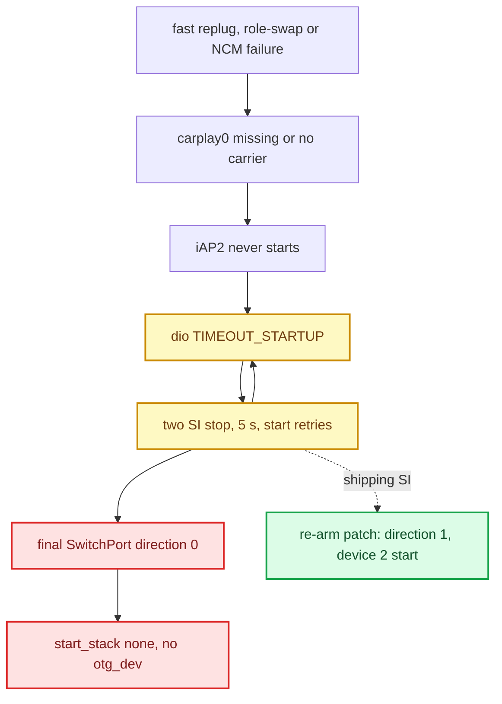

# USB Replug Recovery

*The replug-wedge: one fast unplug/replug left CarPlay dead until a reboot — what was measured, the corrected causal reading, what the shipping build carries against it, and the staged A/B runbook for the remaining candidate.*

---

## ⚠️ The failure

CarPlay is working. The phone is unplugged and replugged once, quickly. It never reconnects — through roughly 500 retry cycles over 45 minutes, until a reboot. Observed 2026-09-03 on MU1316 MHI2Q US P5087 (`MU1316-MHI2Q_US_AUG22_P5087-JTB-07426.03.1811930398`), media connector `0x0424:0x2530`, transport iAP2 + NCM on `carplay0`. **[car]**

| Observation | How it was read |
|---|---|
| `carplay0` UP but without `RUNNING` (compare `ecm0`, which has it) | `ifconfig carplay0` — no `RUNNING` = no carrier = link/stack problem, not our software |
| ~500 `smartphone_integrator_error_*` dumps, `appState=TIMEOUT_STARTUP` | slog |
| iPhone enumerated as `05ac:12a8`, four configs incl. `iPod USB Interface` | `usb` — cable, port and phone are fine |
| hook log stops after `Captured stock ICinemoIAP`, no `NmeTransport::Recv` | iAP2 never starts; a healthy boot shows `Recv [FF 55 02 00]` within 20 ms, then Identify and Auth |
| `/dev/io-usb/otg_dev` missing, `io-usb-dcd` not running; only host stack `/dev/io-usb/io-usb` present | `ls` |

The observed chain: no `io-usb-dcd` → no `otg_dev` → `startncm.sh` mounts NCM on a node that does not exist → `carplay0` without carrier → iAP2 never starts → dio misses its startup budget → SI kills and relaunches it, forever.

## 🔍 Corrected reading — two races, one dead end

> 📌 Correction 2026-09-04: the missing `io-usb-dcd` is **not** proof the device stack crashed first. It is the terminal state SI deliberately creates after exhausting CarPlay setup retries. Full RE in [SI Stack and Replug Race](SI_STACK_AND_REPLUG_RACE.md). **[decompile]**

Two independent races can feed that terminal state, and one can mask the other:

1. **Stale teardown.** Stock `stopncm.sh` sleeps one second, then destroys `carplay0` by global name. A new phone can create a new `carplay0` inside that second; the old teardown then destroys it.
2. **Terminal cleanup.** Repeated `TIMEOUT_STARTUP` exhausts `maxSetupRetries`; SI queues a final `SwitchPort(direction=0)`, writes `start_stack::none` and never starts the device stack again. The phone is already inserted and the soldered hub sees no new insertion, so the system sits in a stable dead end.



## 🔧 Why it never heals on its own

`/etc/usblauncher.lua`, media-connector block for the hub:

```lua
bLsResult = os.execute("ls /tmp/usblauncherFlag_mediaconnector_*")
os.execute("touch /tmp/usblauncherFlag_mediaconnector_2530_" .. obj.devno)
if bLsResult then
    return 'echo "... NoOp because either 0x4040 or 0x2530 already detected"'
else
    return "usblauncher ... -c /etc/usblauncher_otg.lua ... -n /dev/io-usb/otg"
end
```

The OTG launcher starts once, gated on a `/tmp` flag. The flag is removed only by the hub's *removed* handler, and the hub is soldered in. `/tmp` is a RAM disk, so the state survives every replug and clears only on reboot. `startup.sh` also does the boot-time port switch gated on the same flag. **[car]**

Platform mechanics worth keeping **[car]**:

- The OTG stacks are mutually exclusive (one controller, one mode): `start_otg_stack_host_mode.sh` → `start_stack::host` → `/dev/io-usb/otg`; `start_otg_stack_device_mode.sh` → `start_stack::device,2` → `/dev/io-usb/otg_dev` (`device,1` selects the CarLife descriptor; the script picks by `/tmp/carlife_active`).
- `usblauncher` does not create a stack, it attaches to one; restarting it against a dead stack does nothing.
- The physical port is switched between main hub and OTG hub through `/dev/media-con-ctrl`: `switch port <1|2> <1=OTG|0=Main> 1`. `switchMediaConnectorPort.sh` is only a diagnostic wrapper; a binary does the real switching.

## 📌 What the current code does

**[code]** Physical USB recovery is deliberately absent from the supervisor scripts; the only shipped component is the SI image.

- `deploy/smartphone_integrator/carplay_startup.sh` is a thin wrapper: file checks, atomic owner-file publish, monitor fork, `exec dio_manager` (`carplay_startup.sh:1-4,21-95`). No `otg_dev` check, no stack start, no `usblauncher` relaunch, no port reset.
- `deploy/smartphone_integrator/README.md:70-72` says no USB recovery runs in SI's startup path; `:95-97` points rapid-replug recovery at the NCM fence and the SI image.
- `carplay_cleanup.sh` only logs and calls Audi's stock `/etc/scripts/carplay_cleanup.sh` (`deploy/smartphone_integrator/carplay_cleanup.sh:17-22`).
- `carplay_monitor.sh` "never controls USB, OTG, dio_manager or the SI retry state machine" (`deploy/smartphone_integrator/carplay_monitor.sh:3`).
- The shipping `smartphone_integrator` **is** the re-arm image: `deploy/smartphone_integrator/smartphone_integrator` hashes to `606236a8…` (re-verified 2026-09-22), equal to `PATCHED_SHA256` in `deploy/experimental/usb_replug_recovery/patch_si_rearm.py:15`; the release map installs it whole-file (`docs/build-and-deploy/DEPLOY_AND_RELEASE.md:27,49-51`, HU readback 2026-09-16).
- The NCM generation fence is **not** in the release map (`docs/build-and-deploy/DEPLOY_AND_RELEASE.md:13-29`).
- The owner confirmed connection and reconnection closed on the current car on 2026-09-17 (`TODO.md:5-10`). That is an acceptance report, not a recorded A/B of either component. A later 2026-09-17 report (an alarm coinciding with a ~1 s picture+audio loss and a session teardown) is open (`TODO.md:12-16`).

<details>
<summary><strong>History — recovery attempts that were rolled back</strong></summary>

**Startup `otg_dev` guard** (added `392dd0a`, extended `7c63140`, removed `2b15361`):

```sh
# removed — no longer in deploy/smartphone_integrator/carplay_startup.sh
if ! ls /dev/io-usb/otg_dev >/dev/null 2>&1; then
    /etc/scripts/start_otg_stack_device_mode.sh   # start_stack::device,2 -> PPS usb_ctrl1
    # + relaunch the OTG usblauncher from pidin argv
fi
```

It lived in startup, not cleanup, because startup runs on every retry while SI may skip cleanup on a startup timeout. Verified live: with `otg_dev` missing, the stack start brought `io-usb-dcd` back and recreated the node — but CarPlay stayed dead. The OTG launcher owns the device stack (`Device_Stack.cmd = start_usb_device_stack.sh`, see [USB and NCM Connect](USB_AND_NCM_CONNECT.md)), so the node came back behind the owner's back. The guard then relaunched the launcher; its first version silently did nothing because `/proc/<pid>/cmdline` is **empty** for `usblauncher` on QNX (`pidin -F "%a %A"` shows it) and `usblauncher` is not on `PATH` (it lives in `/mnt/app/armle/bin/`). Whether node plus launcher restart was sufficient stayed **[open]** before removal.

**Guarded port reset (2026-08-04 → 2026-08-12 era).** During that failure mode the live PPS showed `/ramdisk/pps/device/usb-1.0.1` = `product::iAP2 NCM Accessory`, `drivers_matched::2` but `drivers_running::1`, and `usb-0.0.2` = connector `0424:2530` with `upstream_port::3`, `upstream_device_address::1`; slog repeated `io-otg-cinemo ERROR: The interface was not enabled in time` → `TIMEOUT_STARTUP` → `start_stack none` → `start_stack device,2`, with no `ResetPort`/`onJob_resetPort` entry anywhere (capture `/tmp/diag_slog_latest.txt`, `TIMEOUT_STARTUP` at line 9405, dio kill + OTG cycle at 9406-9420; a fresh 2026-08-04 capture repeated it every generation with no RTSP/control-SETUP activity in the hook log). Because no control SETUP, RTSP request, stream-111 setup or renderer connection happens in those generations, removing `ALTSCREEN_CLUSTER_URL` or touching the altScreen hook, renderer, Java or libairplay cannot affect this failure. The derived controller payload was `reset port 3 250 1` (on QNX PD ksh `printf` is missing, `print -n '…' > /dev/media-con-ctrl` is the form). A wrapper latch (three ≥8 s generations with no control-SETUP marker and that exact PPS state → one queued reset, consumed pre-exec, rearmed on success) was built (`cp_usb_stuck_pre_setup`, `c4912d5`). Later measured: `reset port 3 250 1` made it **worse** (`drivers_running` 1 → 0). All of it is gone from `deploy/`. `/etc/scripts/disable_usb_pwr_0.sh` was rejected as a first method — it power-cycles the connector GPIO, a wider blast radius than one bridge port.

**`restartDelay`.** Our child briefly ran `restartDelay: 250`; stock is 2000 with `portResetTime: 250` (`smartphone_integrator.json:161-162`). Five-second gaps failed identically, so it was never the primary cause. The current child uses 3000 (`deploy/smartphone_integrator/carplay_child.json:20`).

</details>

---

## 🔄 The two recovery components

Both are in `deploy/experimental/usb_replug_recovery/` (README states nothing there deploys by itself, `README.md:3-4`); an exact-version bundle with `payload/`, `stock/`, `MANIFEST.sha256`, guarded `install_over_ssh.sh` / `rollback_over_ssh.sh` / `verify_over_ssh.sh` / `capture_state_over_ssh.sh` and `docs/{LIVE_TEST,ROLLBACK,TECHNICAL}.md` sits in `bundle_mu1316_p5087/`.

| Component | Mechanism | Code state | Evidence |
|---|---|---|---|
| SI error re-arm | `patch_si_rearm.py` flips one instruction at VA `0x17FDB4` / file offset `0x7FDB4`: `00 30 a0 e3` `MOV R3,#0` → `2e 33 09 e0` `AND R3,R9,LR,LSR #6` (`patch_si_rearm.py:17-20`). `R9` is the error flag and `LR == 0x40` only for CarPlay, so normal CarPlay disconnect → 0, any CarLife cleanup → 0, CarPlay final cleanup after error → **1** (stock activate + switch-port + `start_stack::device,2`). Checks size `802798` and a 20-byte context window, refuses in-place writes. MHI2Q MU1316 only — not MH2p (same 0/1 policy, different ISA layout). | **Shipping** (whole-file SI replace) | static verify + byte-exact revert; no recorded live A/B **[decompile]** |
| NCM generation fence | `usblauncher_otg.lua.patch` passes `$(busno) $(devno) $(iface)` to both `startncm.sh` and `stopncm.sh` (CarLife keeps the legacy no-arg call). A shared per-interface `mkdir` lock serializes the delayed teardown with the new mount; `startncm.sh` publishes `/tmp/ncm_generation_carplay0 = busno:devno:iface:pid` only after mount/up; stale teardown logs `skip`. Dead-owner locks are reclaimed; an ownerless lock gives up after 8 tries (`stopncm.sh:36-61`). Also: `otg_dev` presence check via `ls`, mount return code checked, ASCII `-s 2 -r 1`, decisions logged as `NCM_FENCE` to `/tmp/carplay_hook.log`. | **Experimental**, not installed | host tests `scripts/test_usb_replug_recovery.sh`, `scripts/test_usb_replug_bundle.sh`; residual risk: assumes QNX gives a fresh `devno` per enumeration **[open]** |

### Control hashes

| File | Stock MU1316 P5087 | Candidate |
|---|---|---|
| `startncm.sh` | `c533b63f…713f` | `e40ef903…06ba` |
| `stopncm.sh` | `596b349c…0008` | `804b3854…3d68` |
| `usblauncher_otg.lua` | `21ca8cb9…6b5c` | `76843b2d…e329` |
| `smartphone_integrator` | `a25dc981…0d02` | `606236a8…2af3` |

Any mismatch stops the install; never force the patch or name an unknown file `stock`.

## 📋 A/B runbook (historical procedure, 2026-09-07)

Both failure points were statically confirmed; which one killed the captured session was never proven live, so each fix must be proven alone.

### Safe-test rules

1. Record a fully stock baseline first.
2. Test the NCM set alone with SI stock; restore the whole NCM set to stock before testing SI alone.
3. Never install both before independent A/B — a good replug would not say which defect was fixed.
4. Replace each set atomically and whole (never a new Lua with an old `stopncm.sh`).
5. Edit the persistent copies (`mount -uw /mnt/system` or `/mnt/app`, one-time `*.usb-replug-stock` backups, upload as `.usb-replug-new`, read back and hash, `sh -n`, `chmod`, `mv`, `sync`), then activate with a full HU reboot **done by the owner**. A running `usblauncher` and the RAM copy of `/etc` stay old until then.
6. Host preflight: `sh -n` both scripts, run the host tests (expect `USB replug recovery shell tests: PASS`), `patch_si_rearm.py check` on the firmware SI (expect `state=stock … sha256=a25dc9…`), then read the four persistent files off the HU and hash them.

The NCM host test covers: normal removal of the current generation, stale removal from an old USB address, overlap where stop holds the stock `sleep 1` while a new start arrives, a repeated start of one generation, reclaiming a lock whose owner PID died, and mount failure without a false success.

### Test matrix and pass criteria

Per phase, after the owner's reboot and a runtime hash check of `/etc` copies: one cold connect, 10 slow replugs (>3 s pause), 20 fast replugs (~0.1-0.5 s), 5 replugs while the session is still coming up, one CarLife cycle if used. Mark runs in the quiet log (`echo "USB_REPLUG_TEST phase=NCM run=01" >> /tmp/carplay_hook.log`).

| Phase | Pass | Inconclusive |
|---|---|---|
| A — NCM fence | CarPlay up after every connect; exactly one `carplay0` (no orphan `carplay1`) with `RUNNING`; distinct `busno:devno:iface` per enumeration in `NCM_FENCE`; overlap shows `wait_lock` or stale `skip`; no `lock_timeout`, endless `mount_rc` or permanent `TIMEOUT_STARTUP` | QNX reuses the same `devno` immediately → fence cannot tell old from new; stop, do not mask with longer timeouts |
| B — SI re-arm | after retry exhaustion the stack does not stay on `start_stack::none`; `io-usb-dcd` and `otg_dev` return via SI; the plugged phone gets a new chance; no restart storm; normal unplug and CarLife still behave as direction 0 | no run actually exhausted `maxSetupRetries` — twenty good connects prove nothing |

### Combination decision

| NCM-only | SI-only | Decision |
|---|---|---|
| fixes a reproducible overlap | could not reach exhaustion | keep NCM; SI unproven — do not install "just in case" |
| race remains | exhaustion recovers via direction 1 | keep SI, keep studying NCM identity |
| both close their own scenario | both PASS | combined install allowed, re-run the full matrix |
| any regression or storm | — | roll back that layer immediately |

Even with two PASS: if the OTG `usblauncher` itself dies and the one-shot hub flag blocks its relaunch, neither patch recovers that third scenario. It needs its own generation-aware lifecycle design first.

Sources: [USB_REPLUG_RECOVERY_RUNBOOK](../sources/USB_REPLUG_RECOVERY_RUNBOOK.md)

## 💡 Diagnosing a dead session

Before any reboot, snapshot: `ls -l /dev/io-usb/otg_dev /dev/io-usb/otg /dev/io-usb/io-usb`; `pidin ar | grep -E "[i]o-usb-dcd|[i]o-otg|[u]sblauncher|[d]io_manager|[s]martphone_integrator"`; `ifconfig carplay0`; `ifconfig -a | grep carplay`; `cat /ramdisk/pps/device/usb_ctrl1`; `ls /ramdisk/pps/device`; `grep -E "NCM_FENCE|TIMEOUT_STARTUP|start_stack" /tmp/carplay_hook.log`.

| State | Likely branch |
|---|---|
| `otg_dev` present, no `carplay0`, `mount_rc`/timeout in log | NCM start/mount |
| `carplay0` present without `RUNNING`; PPS matched 2 / running 1 | phone did not enable both functions; iAP2 never began |
| no `otg_dev` after retries; last `usb_ctrl1` = `start_stack::none` | SI terminal cleanup |
| new start waited on the lock then came up; old stop got `skip` | NCM fence worked |
| `usblauncher` absent with SI and hub alive | separate launcher-lifecycle failure, not covered by either patch |

- `sloginfo`'s ring buffer is flushed in ~2 min by a `devp-iso-mmx[isoTX2]` / videoCore open-close storm (59 % of lines) — its silence proves nothing. Save `/tmp/carplay_hook.log` and `/tmp/carplay_wrapper.log` first.
- `[ -e ]` is reliable on QNX resource-manager paths: `-e -f -c -r -x -s -d` all correctly return false for a missing `/dev/io-usb/otg`. `-x` misleads the other way — a live character device is not executable either.
- The only proven full recovery of an already-wedged session is a **reboot, performed by the owner**.

> 🚫 Never loop `start_otg_stack_device_mode.sh` per dio launch; never kill/relaunch `usblauncher` without a generation latch; never run `reset port` or a GPIO power cycle from `rc.local`; never restart `dio_manager` from an external watchdog in parallel with SI; never raise `maxSetupRetries` as a "fix" (it only lengthens the storm). Switching media-connector port 1 to the OTG hub once moved the phone off the host controller so it stopped enumerating, and switching back did not restore it — the command is reversible, the state was not.

Not needed for this failure: `verifyPortReset` 12 → 14 (wrong branch, see [SI Stack and Replug Race](SI_STACK_AND_REPLUG_RACE.md)); Tailscale, memory or CPU; the LTE edit in `usblauncher.lua`; altScreen/APAC/renderers (the failure is before RTSP); turning `rc.local` into a second owner of the USB state machine.

<details>
<summary><strong>Refuted hypotheses from the 2026-09-03 session</strong></summary>

1. **"Memory is exhausted."** `FreeMem` ~100 MB of 2 GB with constant `memmonit` warnings, but stable over time (97-105 MB). "116 → 94 declining" was sampling noise read as a trend.
2. **"tailscaled leaked it."** Largest process, but its size never moved across samples. (It really did hold ~516 MB — fixed separately with `MAP_LAZY` — but that was not this failure.)
3. **"The CPU is pegged."** The heartbeat printed `CPU=81…100%`, yet two `pidin times` samples put the busiest process at 3 % of one core.
4. **"`usblauncher.lua` was modified."** A `.orig` sat beside it; the only difference was `transmit=256,receive=256` on the LTE modem's `ecmplus` line.

</details>

---

## 📚 Sources

Merged originals were removed from the tree after this note absorbed them; they remain in git history (commit 23972aa).

- `USB_IPHONE_CONNECT_POSTMORTEM` — live symptoms, the one-shot hub flag, the rolled-back guard, refuted hypotheses, log traps.
- [USB_REPLUG_RECOVERY_RUNBOOK](../sources/USB_REPLUG_RECOVERY_RUNBOOK.md) — two-race diagnosis, hashes, safe-test rules, phase A/B criteria, dead-session table, the don't-do list.
- `USB_STARTUP_RECOVERY_DIAGNOSIS` — PPS `matched 2 / running 1` evidence, the `reset port 3 250 1` design and its rollback.
- `SI_RAPID_REPLUG_RACE_RE` — the correction that SI creates the terminal state; canonical RE in [SI Stack and Replug Race](SI_STACK_AND_REPLUG_RACE.md).

Related: [USB and NCM Connect](USB_AND_NCM_CONNECT.md), [SI Stack and Replug Race](SI_STACK_AND_REPLUG_RACE.md), [Reconnect and Lifecycle](../altscreen-and-video/RECONNECT_AND_LIFECYCLE.md), [Landmines](../LANDMINES.md).
