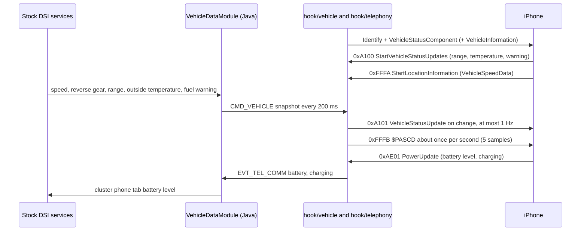

# Vehicle Data To Phone

*Four car-and-phone features built on 2026-10-10: wheel speed for Apple Maps in tunnels, range and outside temperature for Maps, the iPhone battery on the cluster phone tab, and Siri on a short press of the voice key. Enhanced Siri was decoded, not built.*

---

## 📋 Status

| Feature | What the driver gets | Where | Switch | State |
|---|---|---|---|---|
| Wheel speed (`$PASCD`) | Maps keeps position from the car's own wheel speed when GNSS is weak (tunnels, garages, city canyons) | `hook/vehicle/`, `VehicleDataModule` | `IAP2_VEHICLE_SPEED=on`, dio `nmea` bit 0x08 | built, host-tested **[code]** |
| Vehicle status | Maps warns about low range, knows the remaining range and the outside temperature | `hook/vehicle/`, `VehicleDataModule` | `IAP2_VEHICLE_STATUS=on`, `IAP2_VEHICLE_ENGINE` | built, host-tested **[code]** |
| iPhone battery on the cluster | The VC phone tab shows the iPhone's charge like a Bluetooth phone | `hook/telephony/`, `GatedPhoneService` | `IAP2_PHONE_BATTERY=on` | built, host-tested **[code]** |
| Siri on a short press | With CarPlay connected, a short press of the wheel voice key starts Siri instead of the car's voice control; a second one ends it; the long press is unchanged | `TerminalModeSDSHandler`, `CarPlaySpeechRequestHandler` (replaced stock classes) | none | built, linkage-audited **[code]** |
| Enhanced Siri | Zero-latency listening on the key; voice trigger | probe only | none | decoded, not built: [Enhanced Siri Contract](../altscreen-and-video/ENHANCED_SIRI_CONTRACT.md) **[open]** |

Car session 2026-10-14 **[car]** (owner): vehicle data reaches the phone, and Siri on a short press works (second version, `daaeac50`). The iPhone battery on the cluster was not reported.

Car session 2026-10-10 (iOS beta phone, wired) **[car]**:

- The first jar broke HMI start: `VehicleDataModule$KombiListener` extended a RemoteHMI adapter that the unit does not load, `CarPlayApp`'s static init failed and took `AppTerminalMode` and `AppNavi` down ("Initialising navigation" forever). Fixed with listener bases generated from the `org.dsi` interfaces and guarded lazy creation; see [Landmines](../LANDMINES.md).
- Identify with the VehicleStatus component accepted; the phone started VehicleStatus updates (range, temperature, warning) and asked for `VehicleSpeedData`.
- PASCD: one sentence per second; on pulling away `0.88 → 1.74 m/s` from CAN wheel speed, 0 at standstill.
- VehicleStatus: range 595 km and the warning went out; the outside temperature did not, because the code demanded `CarBCTemperature.state == 1`, which this kombi leaves unset. Stock `AbstractBCComponent` checks only the DSI valid flag; the code now does the same (not yet re-checked in the car).
- iPhone battery: stock's `StartPowerUpdates` already asks for the battery (`nothing to add`), but the first `PowerUpdate` carried only the charging state, no level; the VC therefore showed nothing. The hook now logs stock's request bytes and the first five `PowerUpdate`s to tell "level only on change" from a wrong parse. **[open]**
- The phone proposes `enhancedSiri` (and `vehicleStateProtocol`, `videoPlayback`) in the control SETUP. The hook takes effect at the next `dio_manager` start, the jar at the next HU reboot, and the `dio_manager.json` change (installer) at the next `dio_manager` start.

## 🔄 Data flow

## 🚗 Wheel speed (PASCD)

- **Spec.** MFi R32 section 41: an accessory with speed sensors should send `PASCD` (vehicle speed data), at 1 to 50 sentences per second, from a dedicated sensor, never derived from GNSS. Fields: timestamp in seconds (3 decimals, monotonic, daily rollover), sensor type `C`, transmission state `P/R/D/N/U` (`R` if reverse was engaged at any time in the interval), slip flag, sample count 1–50, then `timeOffset,speed` pairs (2 and 3 decimals), `*` and the XOR checksum. Each sentence goes as one NUL-terminated `NMEASentence` (param 0) of `LocationInformation` 0xFFFB. **[doc]**
- **Advertisement.** Stock declares its NMEA set from `dio_manager.json` `"nmea"`: `0x0003` = GPGGA + GPRMC. The installer ORs bit `0x08` (PASCD), so dio's `LocationInformationComponent` (22) carries `VehicleSpeedData` (20). The hook warns once per Identify when that parameter is missing. **[code]**
- **Start and stop.** Only when the phone's `StartLocationInformation` 0xFFFA lists `VehicleSpeedData` (param 4); `StopLocationInformation` 0xFFFC stops it. **[code]**
- **Samples.** `VehicleDataModule` reads `DynamicVehicleInfoHighFrequent` from `DSICarVehicleStates` (attribute 14, the same subscription stock's traffic-light assistant uses), prefers `realVehicleSpeed` over the displayed `vehicleSpeed`, and sends it in cm/s with the reverse-gear flag from `DSIGeneralVehicleStates`. A speed older than 1 s is sent as invalid, except while `DSIGeneralVehicleStates` reports standstill: then 0 m/s is sent, so the phone keeps getting sentences at a traffic light even if the speed stream only reports changes. Whether attribute 14 streams periodically on this car is **[open]**: `first PASCD sent` in the log and no gaps while driving answer it. The hook batches five samples (0.8 s span) into one sentence, so the phone gets about one per second; a gap over 2 s drops the old samples instead of sending them late. **[code]**
- **Stock overlap.** If stock dio ever sends its own `$PASCD`, the hook sees it on the outgoing 0xFFFB, logs `stock already sends PASCD`, and stops its own for that session. Its own sentences coming back through the encoder are recognised by content. **[code]**
- **Check.** The format matches the two R32 41.3.3 examples byte for byte, checksums `*41` and `*57` (`tests/vehicle_hook_test.c`). **[code]**

## ⛽ Vehicle status

- **Spec.** MFi R29 section 97.18 (R32 no longer contains it): `VehicleStatusComponent` (Identify param 21) lists what the car can report; the phone asks with `StartVehicleStatusUpdates` 0xA100 and the car answers with `VehicleStatusUpdate` 0xA101: `Range` (3, uint16 km), `OutsideTemperature` (4, int16 °C), `RangeWarning` (6, bool), on change, at most 1 Hz. `VehicleInformationComponent` (20) carries the `EngineType` (0 gasoline, 1 diesel, 2 electric, 3 CNG) and a display name. A car that reports `RangeWarning` must not itself offer to find fuel while CarPlay guides. **[doc]**
- **Identify.** The hook appends component 21 (identifier `0x0F21`; range, temperature, warning) and, when stock's Identify has none, component 20 (identifier `0x0F20`, engine from `IAP2_VEHICLE_ENGINE`, display name `Audi`). Growth goes through the framework's `hook_identify_grow`, the same path route guidance uses. The installer registers `0xA100`/`0xA102` as received and `0xA101` as sent, so Cinemo declares them. **[code]**
- **Declared messages first.** iOS accepts component 21 only when the Identify also declares all three messages; otherwise it rejects the component (`IdentificationRejected` 0x1D03, reason 14). Declared messages without the component are rejected one by one (iOS 26.1 CoreAccessories `_checkIdentificationInfo_19`). So the hook appends the components only when Cinemo's Identify lists `0xA101` as sent and `0xA100`/`0xA102` as received, that is, when the installer's `dio_manager.json` change is active. There is no rejection fallback. **[decompile]** / **[code]**
- **Values.** Range is `DSICarKombi` `BCTotalCurrentRange`, else `BCCurrentRange1`; outside temperature is `BCOutsideTemperature`; the warning is `DSIGeneralVehicleStates` `TankInfo.fuelWarning`. Miles and Fahrenheit are converted; a value is sent only while DSI marks it valid. **[code]**
- **Native fuel prompt.** The spec forbids the car's own "find a fuel station" prompt while CarPlay guides once `RangeWarning` is advertised. The Audi MMI may still show its reserve hint from native navigation; that is a compliance gap, not a malfunction. **[open]**
- **Open.** Whether iOS 26/27 starts vehicle-status updates for a petrol car over wired CarPlay, and what Maps shows, is unknown until the car session. The engine type is a knob because the HU does not know it; this unit ships `gasoline`. **[open]**

## 🔋 iPhone battery on the cluster

- Stock subscribes to `PowerUpdate` with `StartPowerUpdates` 0xAE00 for its own charging logic. When stock's request lacks `BatteryChargingState` (5) or `BatteryChargeLevel` (6), the hook sends stock's request once more with both added: every stock parameter stays in, so iOS keeps sending what stock wants whether a second request replaces or extends the first. The hook sees stock's request in `Encode`, before it is on the wire, and the injection worker could overtake it; so the extended request goes out only after the phone's first `PowerUpdate`, which proves stock's own request has arrived. Once per Identify. **[code]**
- `PowerUpdate` 0xAE01 is parsed read-only; `EVT_TEL_COMM` gains `battery` (0–100, −1 unknown) and `charging` (0 off, 1 charging, 2 charged, −1 unknown). **[code]**
- `GatedPhoneService` sets the `MOBILE_BATTERY_LEVEL` support bit and publishes the level in the BAP buckets stock uses for HFP phones (0, 19, 39, 59, 79, 100; below 20 % critical). Stock's own battery value is cached while CarPlay owns the tab and replayed when it gives it back; without one, the tab gets "device not connected" (255). The charging state has no BAP field and is only logged. **[code]**

## 🎙️ Siri on a short press

Stock: the short press of the wheel voice key opens the car's own voice control, the long press opens Siri (owner, 2026-10-10). `SDSHMIListener.handlePTTShort()` starts the native dialog unless `TerminalModeSDSHandler.isTerminalModeSpeechActive()` says the phone's speech app is running; only then does it hand the press to TerminalMode (`SDSAppHandler`), which ends an active Siri or, with speech free, calls `cancelPrewarm()`. `SDSHMIListener` differs on all three firmwares, so it is not replaced. Two small classes that are byte-identical on MU1316, MU1329 and MU1003 are replaced instead:

- `TerminalModeSDSHandler` reports speech as active for every CarPlay connection (connection method 1), so the short press goes to TerminalMode. Its only callers are the three PTT branches of `SDSHMIListener`; Android Auto and CarLife keep the stock answer.
- `CarPlaySpeechRequestHandler.cancelPrewarm()`, whose only caller is that short-release branch, replays the stock long-press path on `SDSAppHandler` (found as the TerminalMode `ISDSKeyInterceptor` service): `pttLongDetected()` then `pttReleasedAfterLongPress()`. Stock thereby sets the SPEECH owner to the phone, which is what opens the microphone, and sends SIRI START then STOP: a button tap, after which iOS listens until the speaker stops. The first version sent a bare SIRI START: on the car (2026-10-10) Siri showed its animation, heard nothing and never got the release. Whether iOS treats the immediate START+STOP as a tap (hands-free) and not a zero-length push-to-talk is **[open]**.

Result with CarPlay connected: short press starts Siri, a second short press ends it, the long press stays hold-to-talk Siri. The car's own voice control is reachable only without CarPlay. **[code]** Confirmed by the owner in the car on 2026-10-14: Siri opens on a short press and hears the driver. **[car]**

## 🧩 Enhanced Siri

The phone side was decoded on 2026-10-10: [Enhanced Siri Contract](../altscreen-and-video/ENHANCED_SIRI_CONTRACT.md). The phone must itself propose `enhancedSiri` for this car, the `'zll '` message framing is undecoded, and the pre-trigger audio would need a second microphone open beside stock's. Only the first, harmless step is built: the control SETUP now logs the phone's feature proposal (`control SETUP: phone proposes N features [...]; enhancedSiri PROPOSED|not proposed`, WARN). If it says `not proposed`, the feature stops there. **[code]** / **[open]**

## 🔍 What to read after the first drive

| Log line (hook, WARN) | Meaning |
|---|---|
| `vehicle data: status=1 engine=0 speed=1` | knobs read at start |
| `Identify: +VehicleStatus +VehicleInformation (N -> M bytes)` | components appended |
| `Identify has no VehicleSpeedData: set dio_manager.json "nmea" bit 0x08` | installer change not active |
| `Identify does not declare 0xA100/0xA101/0xA102 (dio_manager.json not patched): no VehicleStatus` | installer change not active; Identify left as stock |
| `phone started VehicleStatus updates: range=1 temp=1 warning=1` | the phone wants vehicle status |
| `StartLocationInformation: VehicleSpeedData requested` | the phone wants PASCD |
| `first PASCD sent: $PASCD,...` | the first sentence |
| `StartPowerUpdates extended with battery level/state (a -> b bytes)` | battery requested |
| `control SETUP: phone proposes N features [...]; enhancedSiri ...` | Enhanced Siri probe |

Java (`/tmp/carplay_java.log`): `vehicle data: kombi=true general=true dynamic=true` shows which DSI services were found; `voice key short press -> Siri start` marks the short-press path.

## ↩️ Switching off

Each hook feature has its own knob in `carplay_startup.sh` (`IAP2_VEHICLE_STATUS`, `IAP2_VEHICLE_SPEED`, `IAP2_PHONE_BATTERY`; `off` disables, read by value). The short-press Siri change lives in the jar; the previous jar restores the stock behaviour.

Related: [Hook to Java Bus](../reference/HOOK_TO_JAVA_BUS.md), [CarPlay Telephony](../cluster-and-rgi/CARPLAY_TELEPHONY.md), [Deploy and Release](../build-and-deploy/DEPLOY_AND_RELEASE.md), [CarPlay Feature Survey](../altscreen-and-video/CARPLAY_FEATURE_SURVEY.md).
