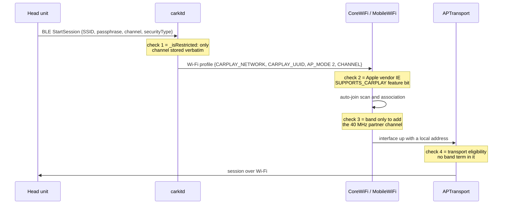
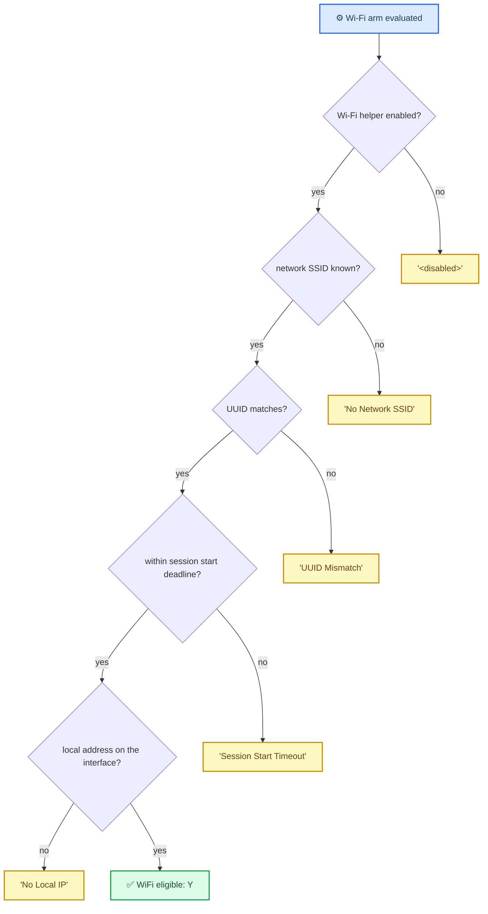
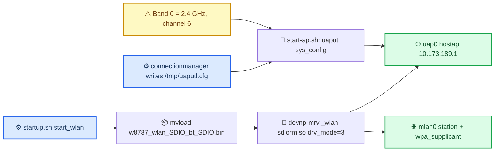
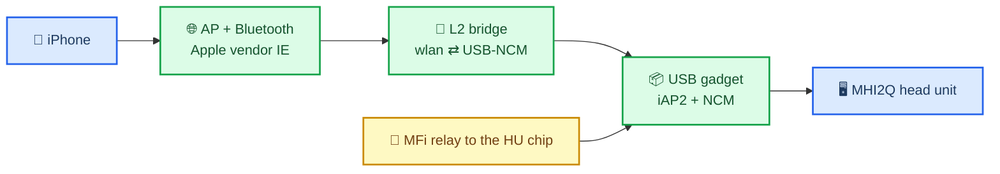

# Wireless CarPlay and Wi-Fi

*What the iPhone actually requires to bring CarPlay up over Wi-Fi, why there is no 5 GHz check anywhere in iOS, and why this head unit is 2.4 GHz only and has no wireless CarPlay transport at all.*

---

## 📋 Summary

The folklore says wireless CarPlay needs a 5 GHz access point and that iOS refuses a 2.4 GHz one. **Both halves are wrong.** Apple's own specification permits either band, and across iOS 27 `APTransport`, `carkitd`, `CarKit`, `CarPlaySupport`, `CarPlayServices`, `MobileWiFi`, `CoreWiFi` and `CoreUtils` there is **no band, channel or frequency comparison that gates a CarPlay session**. **[spec]** / **[decompile]**

What the phone does check is a different thing entirely: the access point must carry Apple's vendor information element with the CarPlay feature bit set. The band appears in that element only as a **declaration** by the accessory, never as a test.

| Question | Answer |
|---|---|
| Does iOS reject a 2.4 GHz CarPlay access point? | No. No code path compares the band before or during a session. **[decompile]** |
| Does Apple's specification require 5 GHz? | No. It says the access point "may operate in either the 2.4 GHz or the 5 GHz frequency bands" and only *highly recommends* 5 GHz. **[spec]** |
| What marks a network as a CarPlay network? | The beacon's `APPLE_DEVICE_IE` with `APPLE_DEVICE_IE_FEATURE_SUPPORTS_CARPLAY` true. **[decompile]** |
| Is there any CarPlay 5 GHz code at all? | Yes, one scan optimisation in `CoreWiFi` auto-join. It skips 2.4 GHz, it never rejects it. **[decompile]** |
| What does 2.4 GHz actually cost? | Channels 1, 6 or 11 only, HT20 only, and **no legacy Bluetooth profiles** alongside iAP2. **[spec]** |
| Could this head unit do wireless CarPlay? | Not as it stands: its CarPlay stack has no wireless transport at all. The band is not the blocker. **[code]** |
| Which band would it have to use? | 2.4 GHz. The unit's radio sees nothing above 2452 MHz across three scans. **[car]** |

Wireless is out of scope for the head-unit patch itself ([CarPlay Feature Survey](../altscreen-and-video/CARPLAY_FEATURE_SURVEY.md)), but it is not out of scope for the programme: the sibling project `cp-wireless-to-usb-proxy` attacks it from the other side, see [The path that does exist](#-the-path-that-does-exist).

## 🌐 Where a band check could live, and what is there instead

A wireless session has four decision points between the Bluetooth handshake and live video. Each one was read; none of them looks at the band.



### Check 1 · carkitd takes the channel verbatim

`-[CRCarKitServiceAgent serviceConnector:receivedStartSessionMessage:fromVehicle:]` (`0x100070214`) copies the car's `SSID`, `passphrase`, `channel` and `securityType` straight into the profile dictionary. Its only gate is `-[CRCarKitServiceAgent _isRestricted:]` (`0x100002ce0`), which is Screen Time and device management, not radio. **[decompile]**

`-[CRWiFiCarManager saveNetworkCredentials:forCarPlayUUID:]` (`0x100084514`) then builds the network with `CARPLAY_NETWORK`, `CARPLAY_UUID`, `AP_MODE` 2 and the channel. When the car sends no channel it logs `invalid Wi-Fi channel, set channel to 1` and uses **channel 1**, which is a 2.4 GHz value that iOS is content to write into a CarPlay profile. The update path `-[CRWiFiCarManager updateExistingNetwork:password:securityType:channel:carPlayUUID:]` (`0x10008413c`) compares the stored channel against the new one only to decide whether to rewrite it. **[decompile]**

### Check 2 · the Apple vendor IE is the real requirement

`MobileWiFi` exports the test that decides whether a network counts as a genuine CarPlay network:

```c
// _WiFiNetworkIsFullyQualifiedCarPlayNetwork, iOS 27 MobileWiFi
ie = WiFiNetworkGetProperty(net, CFSTR("APPLE_DEVICE_IE"));
if (!ie) return 0;
v = WiFiNetworkGetProperty(ie, CFSTR("APPLE_DEVICE_IE_FEATURE_SUPPORTS_CARPLAY"));
return v && v == kCFBooleanTrue;
```

This reads a vendor information element out of the access point's beacon. An access point that does not advertise it is not a CarPlay access point no matter which band it sits on, and one that does advertise it qualifies on any band. `CoreWiFi` carries the same constant on the scan-result side (`-[CWFScanResult supportsCarPlay]`). **[decompile]**

The element is Apple's OUI `00:A0:40` with a Flags sub-element (specification Table 50-8). Three bits matter here, and the two band bits are **claims the accessory makes about itself**, not something the phone enforces: **[spec]**

| Bit | Byte value | Meaning |
|---|---|---|
| 10 | byte 1 `0x20` | Supports CarPlay over Wireless — required |
| 14 | byte 1 `0x02` | Supports 2.4 GHz |
| 15 | byte 1 `0x01` | Supports 5 GHz |

The full element layout, the remaining sub-elements and a ready `hostapd vendor_elements` line live in the sibling project's `docs/PROTOCOL.md`.

### Check 3 · the only CarPlay 5 GHz code is a scan optimisation

`CoreWiFi` auto-join (`sub_241E8E6E8`) caches a preferred channel per CarPlay network and, for 5 GHz only, also scans the partner channel of the 40 MHz pair so a channel-hopping car access point is still found.

```asm
; CoreWiFi sub_241E8E6E8, iOS 27 24A5418b
241e90994  BL   <CWFChannel band>
241e90998  CMP  W0, #2                  ; band 2 = 5 GHz
241e9099c  B.NE skip                    ; 2.4 GHz leaves the branch, nothing is rejected
241e909b4  MOV  W19, #4                 ; default offset +4
241e909c8  CMP  X0, #0x24               ;  36 -> +4
241e909d0  CMP  X0, #0x28               ;  40 -> -4
241e909f8  CMP  X0, #0x2C               ;  44 -> +4
241e90a00  CMP  X0, #0x30               ;  48 -> -4
241e909e4  CMP  X0, #0x95               ; 149 -> +4
241e909ec  CMP  X0, #0x99               ; 153 -> -4
241e90a0c  CMP  X0, #0x9D               ; 157 -> +4
241e90a14  CMP  X0, #0xA1               ; 161 -> -4
; log: "[corewifi] AUTO-JOIN: Adding adjacent 5GHz channel (%{public}@) for CarPlay network"
```

| Cached channel | Partner also scanned |
|---|---|
| 36 | 40 |
| 44 | 48 |
| 149 | 153 |
| 157 | 161 |

Those eight channels are exactly the specification's permitted 5 GHz list for a CarPlay access point (Table 30-5: UNII-I 36, 40, 44, 48 and UNII-III 149, 153, 157, 161). The code is paired to the spec, which is why the optimisation exists for that band and not for the three permitted 2.4 GHz channels. **[spec]** / **[decompile]**

The neighbouring log lines are `AUTO-JOIN: Caching CarPlay preferred channel`, `Number of preferred channels for CarPlay %lu`, `Preferred channel for CarPlay %lu` and `Already associated to CarPlay network, transition is not allowed`. A 2.4 GHz CarPlay network simply gets no partner channel. **[decompile]**

Two other 5 GHz sightings are red herrings. `CoreUtils` `CUWiFiScanner` has the scan parameters `channel_2pt4GHz` and `channel_5GHz`, which are generic scan sets. `AirPlaySender` has the counters `2GHzBandCount`, `5GHzBandCount` and `6GHzBandCount`, which are session analytics. **[decompile]**

### Check 4 · transport eligibility, the gate that decides Wi-Fi versus USB

`APTransport` decides whether a discovered car may be used over Wi-Fi, over USB, or not at all, in `carPlayHelperSession_updateNetworkAndSessionState` (`0x24f3426a4`). It is the source of the log line already quoted in [USB and NCM Connect](USB_AND_NCM_CONNECT.md):

```
airplayd [APBrowserCarSessionHelper] [Bonjour/USB] WiFi eligible: N (<disabled>), USB eligible: N (No Network Interface)
```

The Wi-Fi arm is a plain conjunction, and every failure prints a named reason. **[decompile]**



The USB arm adds `No Remote IP` and `USB transport type mismatch:%d, Sim:Yes|No`. The bracketed prefix in the log names the discovery mode and the armed transports: `[Bonjour/WiFi]`, `[Bonjour/USB]`, `[Bonjour/WiFi/USB]`, `[Session/WiFi]`, `[Session/USB]`, `[Session/WiFi/USB]`. That vocabulary is the fastest way to read a phone-side connect log. **[decompile]**

## 📐 What Apple's specification actually requires

Read first-hand from the MFi Accessory Interface Specification r29, chapter 30 "CarPlay", section 30.2.5 "CarPlay over Wireless". The wording is unambiguous. **[spec]**

> The Wi-Fi access point may operate in either the 2.4 GHz or the 5 GHz frequency bands.
>
> — §30.2.5.2.2 Frequency Bands

5 GHz is a recommendation with a stated reason, and the specification even names the case that forces 2.4 GHz:

> It is highly recommended that the accessory Wi-Fi access point operate in the 5 GHz frequency band. Operating in the 5 GHz frequency band will avoid interference and coexistence with Bluetooth traffic that only exists in the 2.4 GHz frequency band. […] It is understood that some regulatory domains may prohibit operation in the 5 GHz frequency band, therefore the accessory Wi-Fi access point will have to operate in the 2.4 GHz frequency band.

So the real content of the "5 GHz rule" is a set of constraints that a 2.4 GHz accessory must accept:

| Requirement | 2.4 GHz | 5 GHz |
|---|---|---|
| Permitted channels (§30.2.5.2.2, Tables 30-4 and 30-5) | 1, 6, 11 only | 36, 40, 44, 48, 149, 153, 157, 161 |
| 802.11n width (§30.2.5.2.1) | HT20 only, HT40 **must not** be supported | HT20 or HT40 |
| Bluetooth profiles alongside iAP2 (§30.2.5.1) | **iAP2 only** — no HFP, A2DP, AVRCP or other legacy profiles | all relevant profiles may be negotiated |
| Dual-band with one shared SSID (§30.2.5.2.3) | both bands must then support CarPlay | — |
| Dual-band with different SSIDs (§30.2.5.2.3) | CarPlay must be offered on 5 GHz only | — |

Two further access-point rules apply to both bands: the SSID must not be hidden, and channel switching should be limited, avoided across power cycles and must not happen during a session.

The Bluetooth-profile restriction is the sharp edge. A 2.4 GHz car radio may carry either hands-free telephony or wireless CarPlay bootstrap traffic, not both at once, because Bluetooth and 2.4 GHz Wi-Fi share the band. That is a genuine product limitation, and it is what "wireless CarPlay needs 5 GHz" really means.

## 📡 What this head unit has

The unit does have Wi-Fi hardware, and it is configured for 2.4 GHz everywhere. Read from `Firmwares/HU/MU1316-MHI2Q_US_AUG22_P5087-…/advanced`. **[decompile]**



| Where | Setting |
|---|---|
| `etc/uaputl_wpa2.conf`, `etc/uaputl_mixedWPA.conf` | `Band=0` with the comment `0 for 2.4GHz band`, `Channel=6`, `ChanList=1,6,11`, `Enable11n=1` |
| `etc/hostapd.conf` (the QCA "Rome" variant, `armle/scripts/wifi-mode-switch-rome.sh`) | `hw_mode=g`, `channel=6`, `ieee80211n=0` |
| `etc/wifidirect.conf` | channel list 1 to 11, `WPSRFBand=0x01` |
| `connectionmanager` → `/tmp/uaputl.cfg` | `ap_config={ SSID … Channel=%u … }` with **no** `Band=` line, so the uaputl default band 0 applies |
| `eso/telephone/start-ap.sh` | applies it with `uaputl sys_config`, then `deepsleep 0`, `coex_config`, `aggrpriotbl` |
| `asi.wlan.ems_table.json` | exposes only `requestSdisProperties` / `replySdisProperties`, no band or channel parameter |

One caveat worth keeping honest: the driver is not obviously the limit. It carries A-band code (`wlan_11h_unii_lower_band`, `wlan_11h_unii_mid_upper_band`, `fw_bands`, `Scan in A band is not allowed!!`) and the access-point tool takes a band argument, `uaputl sys_cfg_channel_ext [CHANNEL] [BAND] [MODE]`. On the unit, though, the radio behaves as 2.4 GHz only, measured below.

Nor is the Apple vendor element out of reach. Our `hostapd` is v0.6.4 and has no `vendor_elements`, but the access point is driven by the Marvell tool, which carries arbitrary elements with `uaputl sys_cfg_custom_ie [INDEX] [MASK] [IEBuffer]`. The binary's own help assigns bit 8 to beacon, bit 5 to probe response, bit 3 to reassociation response and bit 1 to association response, so `0x12A` selects all four frames required by the Device IE specification. Its example mask `0x101` selects beacon and association **request**, not probe response. **[code]**

### What the live access point looks like

Read off the unit, 2026-09-27, read-only. The hotspot is up and, on the Wi-Fi side alone, it already satisfies what the specification asks of a 2.4 GHz CarPlay accessory. **[car]**

| Property | Live value | Against the specification |
|---|---|---|
| Interface and mode | `uap0`, `hostap`, status active, `10.173.189.1` | — |
| SSID | `Audi_MMI_9137`, broadcast | not hidden, as required |
| Channel and band | channel 11, `Band = 2.4GHz`, no secondary channel | 11 is one of the three permitted 2.4 GHz channels |
| 802.11n | enabled, `STA channel width = 20MHz` | HT20, and HT40 is forbidden on 2.4 GHz |
| 802.11d | enabled | — |
| Custom information elements | eight slots, indices 0 to 7, every one `len=0` with mask `0x00` | all free, so the Apple element has somewhere to go |

### The radio does not see 5 GHz

The station interface `mlan0` is up with no network, and `wpa_supplicant` runs on it, so it can be asked to scan. Three passes were run with the hotspot's clients disconnected first, so nothing was disturbed. **[car]**

| Pass | Networks found | Frequencies |
|---|---|---|
| 1 | 2 | 2412, 2452 |
| 2 | 3 | 2412, 2452 |
| 3 | 4 | 2412, 2437, 2452 |

Six distinct access points across the three passes, every one in the 2.4 GHz band, including the dual-band `LuKa-WiFi` at signal 55 to 58 whose 5 GHz radio the owner's phone sees from the same spot. Not one entry above 2452 MHz appeared. So on this unit the radio scans 2.4 GHz only, and 5 GHz is not available as shipped.

That is evidence rather than proof: a region code can gate the A band, and `mlan_region [interface] [regioncode]` exists to change it. Changing it is a write to the radio configuration and was not attempted. The practical reading stands: plan for 2.4 GHz, which the specification permits, and accept the Bluetooth-profile restriction that comes with it.

Against the specification the unit's access point is legal where it counts: channel 6 is one of the three permitted 2.4 GHz channels, and `Enable11n=1` with no HT40 setting matches the HT20-only rule. What it is missing is everything above the radio.

## 🔒 Why this unit cannot do wireless today

The band is not the blocker. Even a spec-perfect 5 GHz access point would change nothing, because the CarPlay stack on this unit has no wireless transport to offer.

- `dio_manager.json` marks `carplay0` as the Bonjour Direct Link interface through `MDNS_DIRECTLINK_IFACE=carplay0`. This does not exclude `uap0`: the stock `mdnsd` still calls `mDNS_RegisterInterface` for other interfaces. The actual WLAN barrier is PF's quick inbound block to `uap0`; see [Wireless firewall](../../wireless/firewall/README.md). **[decompile]**
- `smartphone_integrator.json` carries no Wi-Fi or wireless key at all. **[code]**
- Neither `dio_manager` nor `libairplay` has a wireless CarPlay path. The only related symbol in `libairplay` is the helper `IsWiFiNetworkInterface`, and the transport-type field it feeds (`platformData +0x288`: 1 Ethernet, 2 Wi-Fi, 8 USB, 16 Direct, 32 BTLE, 64 WFD) is set to USB on this unit ([AltScreen RE History](../altscreen-and-video/ALTSCREEN_RE_HISTORY.md)). **[decompile]**
- The stock HMI Java has `ComaWlanListener` and `WLANSource` for tethering and media, and nothing for CarPlay over Wi-Fi. **[code]**

Doing it inside the head unit means supplying that transport and the missing CU pairing/encrypted control/media around stock AirPlay210. The Bluetooth donor uses our chip and build line, but Bluetooth alone is insufficient. The donor analysis is in [Wireless CarPlay on the Head Unit](WIRELESS_CARPLAY_HU_FEASIBILITY.md); the [current implementation](../../wireless/README.md) records the hook/daemon/bridge integration, passing offline tests and remaining hardware validation.

## 🚀 The path that does exist

The realistic route is not to teach the head unit Wi-Fi, but to give it the wired accessory it already understands and put the radio in a box beside it. That is the sibling project `cp-wireless-to-usb-proxy`: a Radxa Zero 3W that is an accessory to the iPhone over Bluetooth and Wi-Fi and an iPhone to the head unit over a USB gadget, bridging the two at layer 2 so the AirPlay session stays end-to-end between phone and head unit.



There is prior art for the accessory side as a whole: `Refferences/LIVI` is a native CarPlay head unit for Linux and macOS, GPLv3, whose Rust core registers exactly the two Bluetooth records the specification asks for and then browses `_carplay-ctrl._tcp` and sends the connect request. Its message definitions independently confirm the iAP2 Wi-Fi handover identifiers used above.

Relevance to this note: that project's access point config uses channel 36, one of the permitted 5 GHz channels, precisely to sidestep the Bluetooth coexistence problem described above. Its `docs/PROTOCOL.md` holds the Device IE layout, the iAP2 Wi-Fi credential message and the MFi relay design; its `ROADMAP.md` holds the phase plan. Neither the band nor the phone-side code is the hard part there. The hard part is MFi identity, because the accessory must present a certificate the phone accepts.

An external developer reports having the iPhone-facing bootstrap working already: Bluetooth authentication, Wi-Fi credential transfer, the phone associating to the access point, pairing, and a secured control session coming up. That is consistent with the chain described above and with the specification, and it is exactly the part that needs no 5 GHz and no head-unit changes. It is a third-party report; nothing in it has been reproduced here, and the AirPlay session and the head-unit-facing half are not covered by it. **[open]**

## 🔧 Reproducing the iOS side

The CarPlay frameworks live in the shared cache, so they have to be pulled out before analysis. `carkitd` is a plain binary in the extracted root filesystem.

```sh
C="Refferences/ios27_dsc/24A5418b__iPhone18,1/dyld_shared_cache_arm64e"
ipsw dsc str "$C" "WiFi eligible" "APBrowserCarSessionHelper"   # locate the owning image
ipsw dyld extract "$C" "/System/Library/PrivateFrameworks/APTransport.framework/APTransport" --objc --stubs -o out/
ipsw dyld extract "$C" "/System/Library/PrivateFrameworks/MobileWiFi.framework/MobileWiFi" --objc -o out/
ipsw dyld extract "$C" "/System/Library/PrivateFrameworks/CoreWiFi.framework/CoreWiFi"     --objc -o out/
```

| Binary | Version read | What to look at |
|---|---|---|
| `APTransport` | iOS 27 24A5418b, iPhone18,1 | `carPlayHelperSession_updateNetworkAndSessionState` `0x24f3426a4` |
| `carkitd` | iOS 27 24A5418b root filesystem | `0x100070214`, `0x100084514`, `0x10008413c` |
| `MobileWiFi` | iOS 27 24A5418b | `_WiFiNetworkIsFullyQualifiedCarPlayNetwork` |
| `CoreWiFi` | iOS 27 24A5418b | `sub_241E8E6E8`, band test `0x241e90998` |
| head unit | MU1316 MHI2Q US AUG22 P5087 | `etc/boot/startup.sh` `start_wlan`, `etc/uaputl_*.conf`, `eso/telephone/start-ap.sh` |

Cross-checked against iOS 26.6 23G71 `AirPlaySender`, which shows the same counters and no band gate.

## 💡 Truth levels

Claims are tagged **[car]** confirmed on the unit, **[decompile]** from reverse engineering, **[code]** read from the current repo or firmware, **[open]** hypothesis, and — used only in this note — **[spec]** quoted from the MFi Accessory Interface Specification r29 in `Refferences/`.

- The absence of a band gate in iOS is **[decompile]** and covers every CarPlay-related image in the iOS 27 cache plus `carkitd`.
- That either band is permitted, the channel lists, the HT20 rule and the Bluetooth-profile restriction are **[spec]**, quoted from §30.2.5.
- The Apple vendor IE requirement is **[decompile]**, read from `MobileWiFi` and corroborated by the same constant in `CoreWiFi`; its Flags bit layout is **[spec]**.
- The head unit's 2.4 GHz configuration and the missing wireless transport are **[code]**, read from the MU1316 trees.
- The radio seeing only 2.4 GHz is **[car]**, from three scan passes with six distinct access points and nothing above 2452 MHz. Whether a region-code change would unlock the A band is **[open]** and was not attempted.
- The live access-point properties and the eight free information-element slots are **[car]**, read with the stock Marvell tool.
- The external report of a working iPhone-facing bootstrap is **[open]** and unreproduced here.
- Nothing in this note was tested on the car. There is no wireless path on the unit to test.

Related: [USB and NCM Connect](USB_AND_NCM_CONNECT.md) · [Session Lifecycle](SESSION_LIFECYCLE.md) · [iOS Version Gate](IOS_VERSION_GATE.md) · [CarPlay Feature Survey](../altscreen-and-video/CARPLAY_FEATURE_SURVEY.md) · sibling project `cp-wireless-to-usb-proxy`
