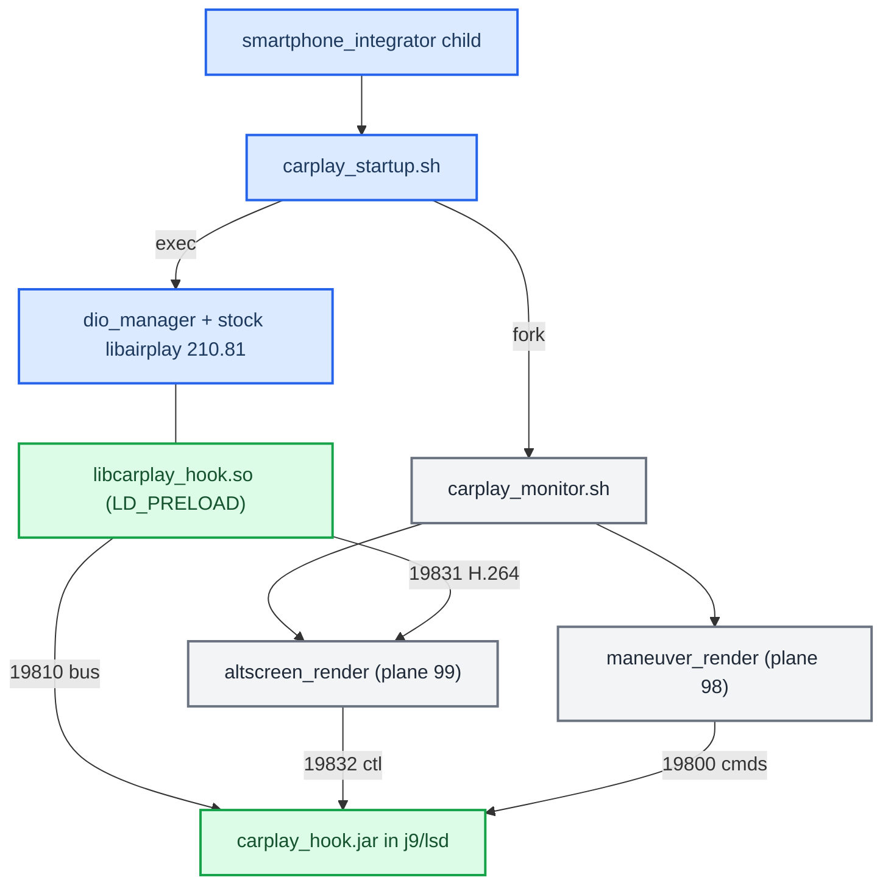
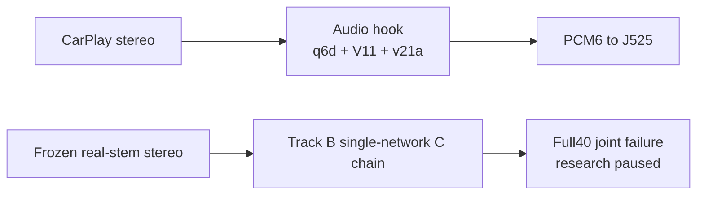
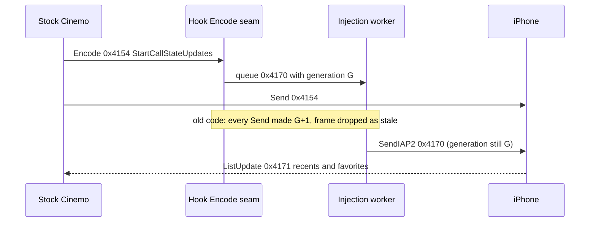
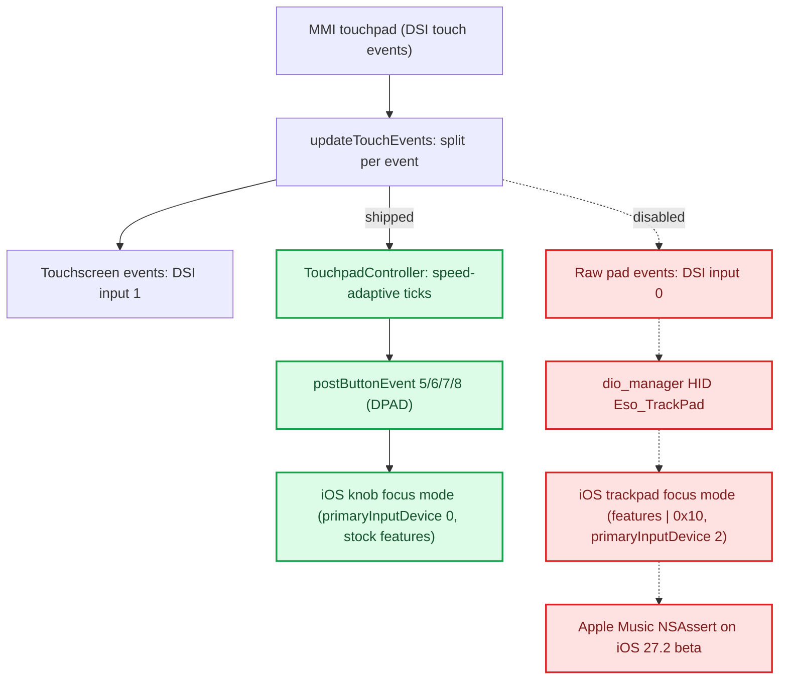

# Architecture

*How the shipping MHI2Q (MU1316) CarPlay mod is put together: stock binaries plus one `LD_PRELOAD` hook, one Java patch jar and two persistent renderers, which stock seams it rides, and who owns which process.*

---

## 📋 The shape of production

Production is **stock `dio_manager` + stock `libairplay.so` 210.81 + `LD_PRELOAD` `libcarplay_hook.so` + the Java patch + two external renderers**. Nothing from the from-source libairplay/dio experiments ships; they were excluded as an authority by the seam audit and live under `Patches/dio_asm_to_c/_legacy_attempt/` (see [Record Replay Tooling](RECORD_REPLAY_TOOLING.md)). **[code]**

The four ports and their frame formats are in [Hook to Java Bus](HOOK_TO_JAVA_BUS.md). The only supported artifacts are the hook `.so` (plus the optional `libcarplay_apac.so`), the jar and the two renderers; variant and probe builds no longer exist ([Build System](../build-and-deploy/BUILD_SYSTEM.md)).

Sources: `ARCHITECTURE`, `DEPLOYMENT`

## 🎵 Audio runtime and research boundary

The production stereo path remains Track A's q6d routing controller, V11 vocal guard and v21a eligibility mask inside the audio hook; discrete multichannel audio follows its separate reorder path. Track B's single causal spectral network runs in an isolated research chain. Its completed spectral40k full40 study fails joint acoustic promotion and research is paused. Host/ARM numerical checks do not establish a deployed replacement or an owner listening verdict.

See [Audio overview](../audio/README.md), [upmix domain and evidence model](../audio/UPMIX_DOMAIN_MODEL.md), [Track A matched40](../audio/UPMIX_TRACKA_MATCHED40_2026-09-30.md), [Track B wrap](../audio/archive/UPMIX_SESSION_WRAP_2026-09-30.md) and the [attempt chronicle](../audio/archive/UPMIX_SEPARATOR_CHRONICLE_2026-09-25_TO_2026-09-30.md).

## ⚙️ Native hook: a module table over framework seams

`hook/main.c` is only the module table (`hook/main.c:28-36`): `rgd`, `coverart`, `altscreen`, `telephony`, and `audio` when `HOOK_AUDIO=1`. The framework never names a module. It registers the table in order through one `pthread_once` at the **first real Cinemo boundary** (`hook/framework/hook_framework.c:117`, `:582`) and logs one WARN, `lazy runtime init complete (constructor-free; first Cinemo boundary)` (`:608`). It tears the table down in reverse from its destructor. There is no ELF constructor, and the build enforces that ([Build System](../build-and-deploy/BUILD_SYSTEM.md)). **[code]**

Each module declares its needs in one `hook_module_def_t` next to its code (`hook/framework/hook_framework.h:78-99`):

| Field | Seam |
|---|---|
| `on_init` / `on_shutdown` | framework lifecycle, reverse-order teardown |
| `on_identify` | patch the outgoing iAP2 Identify |
| `on_message` + `msg_filter` | incoming iAP2 messages |
| `on_state`, `on_transport_send` | session edges, outgoing transport frames |
| `on_transport_recv` / `_reset` | raw `NmeTransport::Recv` bytes, Identify boundary |
| `airplay.*` | AirPlay SETUP request/response (+final), `/info` (+final), TearDown |

The three AirPlay entry points that more than one module wants (`AirPlayReceiverSessionSetup`, `AirPlayCopyServerInfo`, `AirPlayReceiverSessionTearDown`) are interposed **once**, in `hook/framework/airplay_seams.c`, and fan out to subscribers in priority order. An ELF symbol has one definition per object, so before this the altScreen module owned all three and called the audio module's type-103 negotiation on its behalf. Single-consumer interposers (`SetNightMode`, `AirPlayReceiverServerPlatformCopyProperty`, the QSA writers) stay in the module that uses them. **[code]**

| Module | Priority (`.priority`) | Seams used |
|---|---|---|
| `routeguidance` | normal (`rgd_hook.c:453`) | Identify, 0x52xx messages, state, transport send |
| `coverart` | low (`coverart_hook.c:825`) | transport recv + reset |
| `altscreen` | normal (`altscreen_hook.c:2656`) | AirPlay setup response, `/info`, teardown |
| `audio` | high (`audio_hook.c:9091`) | setup request/response (+final), `/info` (+final), teardown |

The stream-111 H.264 path is self-contained in the hook and forwards Annex-B access units to `altscreen_render` on 19831; stock `libairplay.so` stays installed and loaded. See [AltScreen Cluster Video](../altscreen-and-video/ALTSCREEN_CLUSTER_VIDEO.md).

Also from the seam audit: not every read/write of the shared `g_fw.ctx` fields is under one lock; stock normally serialises the NME callbacks, but that is an external assumption, so a future refactor should prove single-threading or lock the Identify/session state. **[open]** K1004 (MHI2Q CN) shares the public DIO/Cinemo seams with MU1316, but its private `libairplay.so` layout differs, so the MU1316-only type-103 request-dispatch patch requires an exact code fingerprint and fails closed on K1004 or any unknown image (`hook/audio/audio_hook.c:1296-1297`). **[code]**

Open hardening item **[code]**: `hook_process_is_dio_manager()` still returns *true* when `/proc/self/cmdline` cannot be opened or read (`hook_framework.c:35-45`). The startup script only preloads into dio_manager, so this is dormant, but fail-closed would be safer if an environment regression ever let helpers inherit the hook.

Sources: `ARCHITECTURE`, `STOCK_INTEGRATION_SEAM_AUDIT`

## 🔍 Which stock seams LD_PRELOAD really reaches

The old blanket rule "a library's calls to its own exports always bypass `LD_PRELOAD`" is **false** for this binary. The correct rule: classify **every callsite** as PLT/GOT (interposable) or direct/local (not interposable). A symbol being exported proves nothing; check the exact caller instruction before accepting any new hook target. **[decompile]**

| Seam | Stock implementation | Stock caller | Result |
|---|---|---|---|
| `AirPlayCopyServerInfo` | libairplay `0x22254` | `_requestProcessInfo@0x30034` calls PLT `0x1abb4` / GOT `0xb9910` at `0x301ec` | Interposable even though the caller is libairplay itself; the working `/info` advert seam |
| `AirPlayReceiverSessionSetup` | `0x272b8` | `_requestProcessSetupPlist@0x2f198` calls PLT `0x18c04` / GOT `0xb8e80` at `0x2f79c` | Interposable; why control SETUP and stream-111 SETUP are visible |
| `AirPlayReceiverSessionTearDown` | `0x26b60` | PLT `0x19264` / GOT `0xb90a0`; setup-failure call `0x275fc`; dio imports it too | Interposable |
| `AirPlayReceiverSessionSetNightMode` | `0x28768` | dio `CDSICarPlay_requestNightMode@0x155848`, call at `0x15589c` | Genuine dio→libairplay boundary |
| `CinemoCreateIAP` | libNmeSDK `0x5848c` | dio PLT calls at `0x17d330`, `0x17d360` | Genuine dio→Cinemo boundary |

**Stock SETUP.** `AirPlayReceiverSessionSetup@0x272b8` loops over request `streams` and handles types 100, 101 and 110; type 111 reaches the unsupported branch at `0x27564–0x27580`. So the hook supplies a genuinely absent case, it does not duplicate hidden stock altScreen support. Stock `_ScreenSetup@0x26f9c` keeps one screen object per session (`session+5136/+5140`), derives screen crypto from the 16-byte session key at `session+456`, opens a server socket with QoS 12 and returns `{type:110, dataPort}`; the hook's 111 response has the same shape. **[decompile]**

### Cinemo NME and iAP2 injection ABI

| Stock symbol (libNmeBase) | Address | ABI fact |
|---|---|---|
| `NmeTransport::Recv` | `0x186ff8` | `NmeArray<u8>` = `{data@+0, len@+4, capacity@+8, growth@+12}`; returns 0 on success |
| `NmeTransport::Send` | `0x186e60` | returns 0 on success |
| `NmeIAP2Message::Decode` | `0x120880` | validates the `0x40 0x40` prefix and exact length |
| `NmeIAP2Message::Encode` | `0x11ffe8` | grows the same NmeArray with process-libc `realloc` |

libNmeVfs imports all four through its PLT (Recv `0x12af20`, Send `0x12af70`, Decode `0xe4924`, Encode `0xd834c`, `0xd84f8`, `0xdf49c`, `0xdf888`, `0xdf988`), so they are valid preemption seams. That is why the Identify resize may `realloc` Cinemo's buffer: it matches the stock allocator, and it still checks pointer, length, capacity and an 8192-byte ceiling first (`hook/routeguidance/rgd_hook.c:1516-1581`). **[code]** See the realloc trap in [Landmines](../LANDMINES.md).

`CinemoCreateIAP@0x5848c` returns an `ICinemoIAP` whose vtable has AddRef `0x9b60c` (slot 0), Release `0x9b620` (`+4`) and SendIAP2 `0x9b748` (`+60`, args `(self, session, data, size)`). The hook captures the object only after the real factory succeeds, keeps a persistent reference and takes a transient reference around every injected `SendIAP2`. The stock outbound frame is sent first; only after a successful stock Send does LocationInfo trigger the separate 0x5200 injection, so LocationInfo is never consumed or used as a carrier. The component-0x001E schema and 0x520x payloads are **operationally** verified on the car, not independently proven from the phone binary. **[decompile]** **[car]**

**Injected frames go through one worker thread.** `hook_inject_message()` snapshots `(link_session, generation)` and queues the frame; the worker re-checks both just before the stock `SendIAP2` and drops a frame whose values changed (`Dropped stale semantic frame …`, WARN). `generation` names **one iAP2 link session**: it advances when a stock link frame arrives on a new session or after an Identify boundary (`inject_note_link` / `inject_unlink` in `hook/framework/hook_framework.h`), and is never reset, so a frame queued for an old link cannot match the next one. Until 2026-09-24 it advanced on every stock Send. Telephony queues StartListUpdates from the Encode of stock `0x4154`, before that message's own Send, so whenever the stock Send won the race the worker dropped the request and the recents and favorites stayed empty for the whole session. Checked by `tests/inject_generation_test.c`. **[code]**

### iOS 26.6 altScreen addresses

The gate itself is explained in [AltScreen Cluster Video](../altscreen-and-video/ALTSCREEN_CLUSTER_VIDEO.md); this table keeps the phone-side addresses the seam audit read (iPhone18,2 build 23G71, `AirPlaySender` + `CarKit`). **[decompile]**

| What | Where |
|---|---|
| Phone reads accepted features from response key `enabledFeatures` | `_apsession_ensureControlStreamSetup@0x22786db80`, lookup `0x22786dd2c` |
| `altScreen` → endpoint `+0x3e`; `uiContext` → `+0x3f`; `viewAreas` → `+0x3d` | `0x2277f977c`, `0x2277f97a8`, `0x2277f97d4` |
| Cluster URL fetch; NULL aborts activation | `APCarPlay_CRFetchInstrumentClusterURLs` at `0x2277f9ff4`, abort `0x2277f9ff8–0x2277fa000`; stored as `altScreenURLs` at `0x2277fa090` |
| All displays used only if count ≥ 2 and `+0x3e` set | `carEndpoint_setupStreams@0x2277ff304`, checks `0x2277ffa9c` / `0x2277ffaac` |
| 110 vs 111 chosen by UUID compare with display 0, not by the `type` field | `APEndpointStreamScreenCreate@0x227850b74`, `CINC` at `0x227850ed8` |
| Physical display needs `widthPixels/heightPixels`, `widthPhysical/heightPhysical`, `uid`, `properties`, `initialVideoStreams` | `CARDisplayInfo initWithPhysicalScreenDictionary@0x1cafbed6c` |
| Gauge-cluster predicate reads `displayPanels` | `CARSessionConfiguration@0x1cafba0dc`, `0x1cafbaf8c`, `0x1cafbb1d8` |
| `forceKeyFrame` reads params key `uuid` | `carEndpoint_handleEventCreatingReply@0x2276d8214`, `0x2276d86a4–0x2276d86bc` |
| `updateViewArea` reads `uuid`, `viewAreaIndex`, `adjacentViewAreas`, `animationDurationMillis` | `carEndpoint_updateViewArea@0x227802b90` |
| Night mode reads optional `uuid` + `nightMode` | `carEndpoint_setNightMode@0x22780305c` |
| 110 and 111 share screen crypto | sender `0x2276e5df8–0x2276e6080`; receiver `AirPlay_DeriveAESKeySHA512ForScreen@0x2d5fc` (labels `AirPlayStreamKey%llu` / `AirPlayStreamIV%llu`) |
| Frame wire: 128-byte header, opcode 0 = AES-CTR body, opcode 1 = clear codec config | stock `AirPlayReceiverSessionScreen_ProcessFrames@0x2b154` |

Authority for these tables: stock `libairplay.so` 210.81 (copy at `Patches/carplay_vc/libairplay.so`), the MU1316 `MU1316-appimg` executables and Cinemo libraries, `MU1316-combined-final.jar`, the K1004 comparison set `MHI2Q_CN_AUG22_K1004_requested_files`, and iOS 26.6 `AirPlaySender`/`CarKit` from iPhone18,2 build 23G71; callsites were followed in IDA through PLT/GOT. The from-source `libairplay-mhi2q` was excluded. The HU never provides cluster app URLs; the phone fetches them from its own CarKit over XPC and hands them to the HU. `showUI` and `changeMapZoomLevel` were not traced to their final consumer; car behaviour is the proof for those.

### Stream-111 ownership and presentation

`altav_claim` accepts only a strictly newer generation under its lock; config, frame forwarding and shutdown check ownership inside that lock; a generation is assigned only to a receiver whose response insertion succeeded; a superseded receive thread checks ownership before forwarding data or commands. Renderer socket backpressure counts as a stall after 1000 ms (`hook/altscreen/altscreen_av.c:35`). An older, slower control SETUP could in theory finish after a newer one and still return feature keys; RTSP requests are normally serialized, so this is a low-probability edge. **[code]**

The renderer does not post raw Qualcomm tiled NV12: it requests native 32m output `0x7f000004` (linear NV12 cannot finish Loaded→Idle on this decoder), binds Screen buffers with `OMX_UseBuffer`, imports each decoded buffer as an EGL external image and draws it into a managed RGBA8888 plane-99 window, recycling the OMX buffer only after the synchronous present. A callback-close gate waits for active callbacks before arrays are destroyed; health is asserted only after a successful swap, and three consecutive failures arm output-only recovery. `maneuver_render` creates its Screen context before `eglGetDisplay`, which this Adreno stack requires. Details in [Video Pipeline](../altscreen-and-video/VIDEO_PIPELINE.md). **[code]**

The 2026-10-06 source candidate transfers owned length-size-4 AU buffers through
a bounded forwarding worker, batches header/payload I/O and carries producer
metadata across the renderer queue. Recovery is shared per generation; idle EOF
is observed without another phone frame, and an opt-in presentation-status
channel confirms readiness. The presenter selects the newest pending nonempty
decoded picture through a bounded mailbox snapshot; selected/in-flight buffers
remain owned until GPU completion. `ALTSCREEN_PRESENT_FIFO=1` restores FIFO.
These changes have offline test and QNX build evidence, with vehicle pacing
unmeasured. Details: [Video Pipeline](../altscreen-and-video/VIDEO_PIPELINE.md),
[six improvements](../altscreen-and-video/ALTSCREEN_FRAME_RATE.md), and
[current boundary validation](../altscreen-and-video/ALTSCREEN_PACING_VALIDATION.md).
HELLO capability activation is deadline-bound; unsolicited STATUS is rejected.
Idle observation uses a monotonic QNX/Linux condition or relative Darwin wait.
Startup promotion requires fresh latest, pending and in-flight input, independently
of presentation readiness.
**[code]**

The separate CF-command worker has a pure scheduling policy, reserved urgent
capacity and bounded zoom intent. Each selected zoom saves its input age, retains
a generation-matched target, then commits under the command mutex before calling
the SDK outside both mutexes. State construction must succeed before replacing
pending state. Contracts and sources: [Input commands](../altscreen-and-video/ALTSCREEN_INPUT_COMMANDS.md).

Sources: `STOCK_INTEGRATION_SEAM_AUDIT`

## 📦 Java patch

There is one Java tree, `java_patch/`, compiled against `MU1316-final.jar` as Java 1.4 bytecode ([Build System](../build-and-deploy/BUILD_SYSTEM.md)). `CarPlayApp` keeps the bus transport alive for the process lifetime and runs an **ordered module chain**: `AltScreenModule` (cluster display context, steering-wheel map zoom) first, then `RgdModule` once the first is ready (RGI/BAP maneuver state). Activation and deactivation only record the desired state and wake a daemon lifecycle worker; module start/stop is serialized by `lifecycleLock`, and the general state lock is never held across `Module.start` (that was the cold-boot ABBA deadlock in [Landmines](../LANDMINES.md)). Deactivation is debounced 400 ms (`java_patch/com/luka/carplay/core/CarPlayApp.java:230`). **[code]** Details of the context state machine are in [Cluster Contexts](../cluster-and-rgi/CLUSTER_CONTEXTS.md) and [Reconnect and Lifecycle](../altscreen-and-video/RECONNECT_AND_LIFECYCLE.md).

The tree has 47 sources: 29 new classes under `com/luka/carplay/` and 18 files that replace or extend stock classes (`ClusterService`, `AltScreenCombiBAPListener`, `DisplayManagerMIB2High`, `CombiMapController`, `TerminalModeBapCombi`, `CarplayDSILifecycleController`, `ExternalEventsListener`, `HighPriorityResourceTracker`, `AppConnectorTerminalMode` + `$CoverArtProvider` + `CoverArtProviderMux`, `ParkingPartialPopupHandler`, `ParkingSystemControllerComponentEvo`, `PartialPopupManagerEvoHigh`, `StatusBarStubController`, `AudioDrawerContextImpl`, `ServiceManagerPhone`, the phone state machine's `Activator`). **[code]** The pure OPS parking popup `2100008` has a narrow `SMALL_STAGE` exception: CarPlay keeps `Resource.SCREEN`, while every other HMI deactivation and fullscreen camera takeover stays stock (`java_patch/de/audi/app/terminalmode/ExternalEventsListener.java:39`, `PartialPopupManagerEvoHigh.java:53`).

### MMI touchpad

CarPlay has no pointer: the MMI touchpad moves CarPlay's focus. Rotary, knob press and softkeys reach CarPlay through stock DSI and are not touched. Since 2026-10-13 the pad runs through the Java DPAD bridge again; iOS's native trackpad focus mode is built but disabled, because it crashes Apple Music on iOS 27.2 beta. `[code]`

**What ships (2026-10-13).**

- `CarplayDSILifecycleController.updateTouchEvents` splits each batch by event, where stock routes the whole batch by element 0: touchscreen events go to DSI input 1 with the screen offset removed; a single active pad finger goes to `com.luka.carplay.input.TouchpadController`, which emits speed-adaptive DPAD ticks through `postButtonEvent` 5/6/7/8 (west/east/north/south, press then release). The sink is installed in `init()` and cleared in `deinit()`, so no gesture reaches a torn-down DSI proxy. Test: `tests/TouchpadControllerTest.java`, run by `scripts/test_java_transports.sh`.
- The hook's `main_disp_modernize` keeps the stock main display `features` and sends `primaryInputDevice = 0`, so iOS picks knob focus mode. The trackpad advert (`features | 0x10`, `primaryInputDevice = 2`) stays in the source under `#if 0` (`hook/altscreen/altscreen_hook.c`); flip it to `#if 1` and drop the Java bridge to return to native trackpad focus.

**Why the stock trackpad only highlighted.** Stock MHI2Q already declares a touchpad: `EvoTMConfiguration.hasTouchpad()` is true, so DSI `inputFeatures` = 9 (knob + touchpad), stock posts pad events on DSI input 0 (touchscreen on 1), and `dio_manager` registers a real HID trackpad `Eso_TrackPad` (`libairplay` `HIDSingleTrackPadCreateDescriptor`: Digitizer/TouchPad, one finger, absolute X/Y, no physical units). On the car a pad touch only highlighted the focused item; focus never moved. `[car]` The cause is the display advert, not the pad: `dio_manager` `createMainDisplay` builds the main display's `features` from the knob (0x02) and touchscreen (0x04/0x08) flags only, never the trackpad bit 0x10, and sends no `primaryInputDevice`. iOS (CarKit `CARScreenInfo`: `primaryInputDevice` 1 touch, 2 trackpad, 3/4 knob; missing or 0 picks touch, then knob, then trackpad) therefore runs CarPlay in knob focus mode. Only the trackpad mode `_UIFocusBehavior_CarPlayTouchpad` enables `supportsIndirectPanningMovement` and focus-on-select, which make `_UIFocusEventRecognizer` attach its pan recognizer; knob mode has none, so swipes do nothing. Missing physical units are not the cause: iOS falls back to a 4×4 cm surface at sensitivity 0.5, which only sets the gain. `[decompile]` (iOS 26.1 pseudo-source, iOS 27 `UIKitCore`, stock `dio_manager` / `libairplay`)

**Native trackpad focus mode (2026-09-23 to 2026-10-13, now disabled).**

- The hook ORed 0x10 into the main display `features` and set `primaryInputDevice = 2`; `updateTouchEvents` posted raw pad events on DSI input 0, which `dio_manager` turns into the trackpad report (`sendTouchScreenHIDReport` → `HIDSingleTrackPadFillReport`: tip plus the first finger's X/Y).
- On the car (owner, 2026-10-10): a pad swipe moved the CarPlay focus in discrete steps, "like a D-pad", the expected shape of CarPlay's pointer-less trackpad focus mode. `[car]`
- **Apple Music crashed on any pad input** (owner, 2026-10-10/12); the knob and every other app were fine. The crash (iOS 27.2 beta 24B5099f) is a UIKit NSAssert in `-[_UIFocusEventRecognizer _panGestureStart:]`, "Attempted a pan-gesture-based focus movement without a touchpad.": on CarPlay the method looks the touch's `_senderID` up in `windowScene.carPlaySession touchpadForSenderID:` (the list DashBoard's `-[DBScreenController _UISceneTouchpads]` copies from its `CARInputDeviceManager`, unfiltered) and in `CARInputDeviceManager touchpadWithSenderID:`, and asserts when both are nil. CarKit makes a touchpad from an IOHID service whose `displayUUID` is a session screen ID and whose primary usage is Digitizer/TouchPad; stock `dio_manager` (MU1316 `fcn.00158ef8`) gives every HID `displayUUID` `e5f7a68d-7b0f-4305-984b-974f677a150b`, the registered main screen, so the HU side is consistent, and other apps find the pad. Read as an iOS beta bug in Music. `[decompile]` (iOS 27 dsc 24A5418b, stock `dio_manager`)
- To re-enable: recheck Music on a newer iOS build first. The default 4 cm gain was never judged; `HIDSingleTrackPadCreateDescriptor` can be interposed to add physical units.

**History.** The DPAD bridge first shipped before 2026-09-14 as a workaround for knob-mode highlighting. Commit `8c78e282` (2026-09-23) replaced it with native trackpad focus mode; it was restored on 2026-10-13 after the Music crash and confirmed working in the car by the owner on 2026-10-14. `[car]`

### Cluster composition

On non-G24 clusters (`kombiType != 4`) the patched DisplayManager declares two contexts (`java_patch/de/audi/tghu/fwhmi/DisplayManagerMIB2High.java:170-179`) **[code]**:

| Context | Displayables | Meaning |
|---|---|---|
| 80 | `98, 101, 102, 99` | CarPlay map plus maneuver (98) over the two stock KDK backings |
| 81 | `99` | plain CarPlay map |

98 belongs to `maneuver_render`, 99 to `altscreen_render`. `AltScreenModule` is the single writer of context changes ([Cluster Contexts](../cluster-and-rgi/CLUSTER_CONTEXTS.md)).

**Context 90 is deliberately not declared here.** It was briefly, for RetroArch, and was removed: `DisplayManagerMIB2High` is a patched stock class carried only by `carplay_hook.jar`, so RetroArch would have silently depended on this repo. RetroArch owns context 90 from its own repository (`luka-dev/audi-mib2q-retroarch`) by extending the table at runtime, the way its `RuntimeSmmInjector` already extends the state machine.

### Two deliberate policies that exceed the stock contract

- **Strong terminal-1 context ownership.** While `AltScreenModule.isConnected()` is true, `DisplayManagerMIB2High.switchContext` rejects every terminal-1 physical context write except the AltScreen worker's own (`DisplayManagerMIB2High.java:307`). `isConnected` is `connected || videoAvailable`, so it can also block a legitimate stock transition while video is recovering. Treat it as product policy and check warning/safety screens on the car. **[code]** **[open]**
- **Hidden map-scale sentinel.** `GatedCombiService` publishes `updateMapScale(15, false, 0xFFFF, 0xFF, false)` and a hidden altitude sentinel (`java_patch/com/luka/carplay/rgd/GatedCombiService.java:98`). Stock `CombiBAPListener.setMapScaleSetting` changes native map setup; the emitted hidden status does not. So the historical "Navigation currently unavailable" flashes during wheel zoom cannot be pinned on the sentinel from code alone. **[code]**

Sources: `ARCHITECTURE`, `STOCK_INTEGRATION_SEAM_AUDIT`

## 🔄 Process ownership

| Process | Owner | Rule |
|---|---|---|
| `carplay_startup.sh` | smartphone_integrator child | Writes its generation to the owner file atomically (stage file + `mv`, `deploy/smartphone_integrator/carplay_startup.sh:40-42`), forks the monitor with `LD_PRELOAD=` cleared (`:45`), exports `LD_PRELOAD` (`:50`) and `exec`s `dio_manager` (`:95`) so SI keeps the exact PID for its watchdog |
| `carplay_monitor.sh` | its own generation | Acts only while the owner file holds its dio PID and that PID is alive; waits 1 s before any `pidin`/EGL work so dio's 10 s SI startup budget is untouched; starts or adopts `altscreen_render` then `maneuver_render`; re-checks every 2 s; caps logs every 150 ticks (`carplay_monitor.sh:108-130`) |
| Renderers | the generation monitor | Launched with `LD_PRELOAD=` and `GRAPHICS_ROOT=/proc/boot` (`carplay_monitor.sh:93`). When dio exits the monitor **leaves them running** for the next generation to adopt. Never add them as `servicemgr external:true` services |
| `carplay_cleanup.sh` | SI `cleanupScript` | Does not know which generation it serves, so it only runs Audi's stock `/etc/scripts/carplay_cleanup.sh` for mdnsd/PPS (`carplay_cleanup.sh:21`); never overwrite that stock script |

The SI child is `deploy/smartphone_integrator/carplay_child.json`: keep `IPL_CONFIG_DIR_DIO_MANAGER=/etc/eso/production` in its env and keep `LD_PRELOAD` out of it; `restartDelay` is `3000` (`carplay_child.json:20`). **[code]**

Superseded: the seam audit's "zero scheduling margin" finding (old monitor waited 2 s, equal to a 2 s restart delay, then stopped renderers the new generation meant to adopt) no longer applies. The current monitor never stops renderers on exit and `restartDelay` is 3000 ms. **[code]**

Sources: `DEPLOYMENT`, `STOCK_INTEGRATION_SEAM_AUDIT`

## ✅ Release verification matrix (seam audit)

The seam audit (2026-08-11) confirmed the altScreen protocol and rendering, the hook ABI against MU1316 stock, and the Java outer-class ABI. It listed these focused on-car checks; status against today's code:

| Check | Status |
|---|---|
| Cold boot with phone connected: no worker/log activity before the first NME callback | Closed in code: constructor-free lazy init, enforced by the `.init_array` assert **[code]** |
| 20 quick replugs: no SETUP delay near 1.8 s | Closed in code: the same-slot reaper wait is gone; a new SETUP retires old generations and fails fast if all four slots are retiring (see [Production Audits](../build-and-deploy/PRODUCTION_AUDITS.md)) **[code]** |
| Cold OMX start under socket pressure: no false disconnect at the 1000 ms send-stall limit | Still open: `AV_SEND_STALL_LIMIT_MS 1000L` (`hook/altscreen/altscreen_av.c:35`) **[open]** |
| Kill dio at the restart boundary: old monitor must not kill adopted renderers | Closed in code (see above) **[code]** |
| Forced EGL swap / plane-disown failures: VIDEO_OFF only after real failures | **[open]** on the car |
| Context guard does not hide cluster warnings while 111 is down | **[open]** |
| Only the intended interposes exported | Closed: exact allowlist, 26 in a quiet audio build ([Build System](../build-and-deploy/BUILD_SYSTEM.md)) **[code]** |

---

## 📚 Sources

Merged originals were removed from the tree after this note absorbed them; they remain in git history (commit 23972aa).

- `ARCHITECTURE`: the shipping-architecture summary (topology, module seams, Java chain, contexts, ports).
- `DEPLOYMENT`: SI child, process ownership, install/uninstall steps.
- `STOCK_INTEGRATION_SEAM_AUDIT`: 2026-08-11 audit of every stock seam, Cinemo ABI, the iOS 26.6 contract, reconnect and supervisor risks.

See also [Hook to Java Bus](HOOK_TO_JAVA_BUS.md), [Build System](../build-and-deploy/BUILD_SYSTEM.md), [Deploy and Release](../build-and-deploy/DEPLOY_AND_RELEASE.md), [Production Audits](../build-and-deploy/PRODUCTION_AUDITS.md), [AltScreen Cluster Video](../altscreen-and-video/ALTSCREEN_CLUSTER_VIDEO.md), [Cluster Contexts](../cluster-and-rgi/CLUSTER_CONTEXTS.md), [Home](../README.md), [Landmines](../LANDMINES.md).
