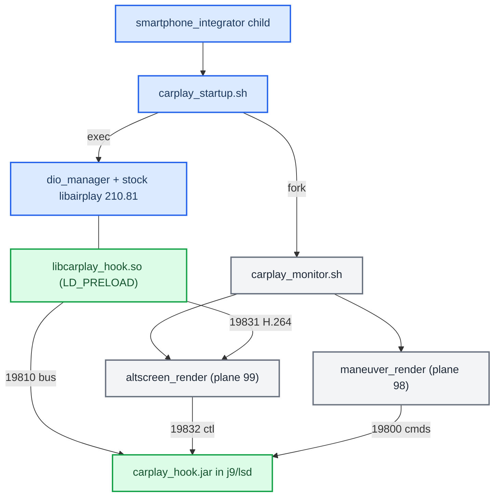
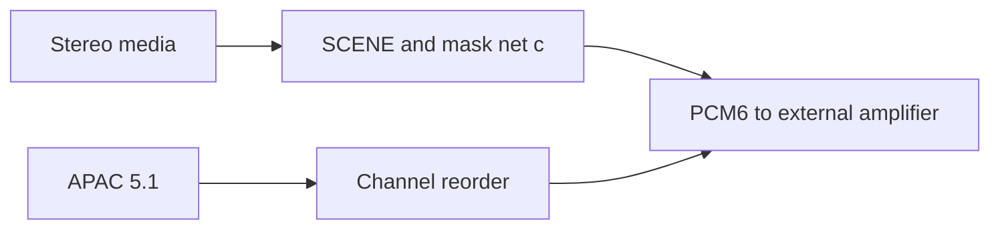

# Architecture

*How the shipping MHI2Q (MU1316) CarPlay mod is put together: stock binaries plus one `LD_PRELOAD` hook, one Java patch jar and two persistent renderers, which stock seams it rides, and who owns which process.*

---

## 📋 The shape of production

Production is **stock-derived `dio_manager` + `libairplay.so` 210.81 + `LD_PRELOAD` `libcarplay_hook.so` + the Java patch + two external renderers**. The [stock patch catalog](../stock-patches/README.md) identifies the modifications to those binaries. **[code]**

The four ports and their frame formats are in [Hook to Java Bus](HOOK_TO_JAVA_BUS.md). The normal package contains the hook `.so`, optional `libcarplay_apac.so` and scene blob, Java jars, two renderers, assets and installer patches. Audio-disabled, tracing and experimental wireless build paths also exist ([Build System](../build-and-deploy/BUILD_SYSTEM.md)).

Sources: `ARCHITECTURE`, `DEPLOYMENT`

## 🎵 Audio runtime

The current stereo renderer is SCENE with the fine mask net c. Both buffered stereo and realtime media can enter it; discrete APAC 5.1 follows the reorder path. Live MMI settings control UpMix and Spatial Audio. The installer keeps internal amplifiers on stock stereo; all supported external amplifier families use the six-channel path, including confirmed B&O and Bose support.

See [current audio runtime](../audio/STEREO_TO_5_1_UPMIX.md), [amplifier compatibility](../audio/ODIS_AMP_MAPPING.md#external-amplifier-support) and [retirement history](../audio/archive/UPMIX_CODE_RETIREMENT_2026-10-09.md). Stock-derived receiver binaries retain their original implementation with selected patches; [the patch catalog](../stock-patches/README.md) identifies those changes. Experimental SI-owned wireless integration is documented in [Wireless CarPlay](../wireless-carplay/README.md).

## ⚙️ Native hook: a module table over framework seams

[hook/main.c](../../hook/main.c) registers optional `wireless` first, then `rgd`, `coverart`, `altscreen`, `telephony`, `vehicle`, `decoder_optimize`, and `audio` plus `upmix_level` when `HOOK_AUDIO=1`. The framework never names a module. It registers the table in order through one `pthread_once` at the **first real Cinemo boundary** (`hook/framework/hook_framework.c`) and logs one WARN, `lazy runtime init complete (constructor-free; first Cinemo boundary)`. It tears the table down in reverse from its destructor. There is no ELF constructor, and the build enforces that ([Build System](../build-and-deploy/BUILD_SYSTEM.md)). **[code]**

Each module declares its needs in one `hook_module_def_t` next to its code (`hook/framework/hook_framework.h`):

| Field | Seam |
|---|---|
| `on_init` / `on_shutdown` | framework lifecycle, reverse-order teardown |
| `on_identify` | patch the outgoing iAP2 Identify |
| `on_message` + `msg_filter` | incoming iAP2 messages |
| `on_state`, `on_transport_send` | session edges, outgoing transport frames |
| `on_transport_recv` / `_reset` | raw `NmeTransport::Recv` bytes, Identify boundary |
| `airplay.*` | AirPlay SETUP request/response (+final), `/info` (+final), teardown and control |
| `http.*` | Shared stock210 HTTP open/close, request and transport seams |
| `on_file_transfer` | Wireless artwork file delivery |

The three AirPlay entry points that more than one module wants (`AirPlayReceiverSessionSetup`, `AirPlayCopyServerInfo`, `AirPlayReceiverSessionTearDown`) are interposed **once**, in `hook/framework/airplay_seams.c`, and fan out to subscribers in priority order. Each shared ELF interposer has one definition; modules subscribe through the framework. Single-consumer interposers (`SetNightMode`, `AirPlayReceiverServerPlatformCopyProperty`, the QSA writers) stay in the module that uses them. **[code]**

| Module | Priority | Main subscriptions |
| --- | --- | --- |
| `wireless` (optional) | first | AirPlay setup/info/teardown and HTTP pairing/media hooks |
| `audio` (optional) | high | Audio messages, setup/info/teardown and control |
| `routeguidance` | normal | Identify, route messages, state and transport send |
| `altscreen` | normal | Identify, setup/info/teardown and control |
| `coverart` | low | Transport receive/reset and wireless file transfer |
| `telephony` | low | Phone messages and state |
| `vehicle` | low | Identify, vehicle messages and state |
| `decoder_optimize` | last | Decoder lifecycle |
| `upmix_level` (optional) | low | Live audio settings bus |

The authoritative registrations and priorities are in [main.c](../../hook/main.c) and each module's `hook_module_def_t`; registration order and callback priority are distinct.

The stream-111 H.264 path is self-contained in the hook and forwards Annex-B access units to `altscreen_render` on 19831; stock `libairplay.so` stays installed and loaded. See [AltScreen Cluster Video](../altscreen-and-video/ALTSCREEN_CLUSTER_VIDEO.md).

Concurrency and image scope are part of the integration contract. `g_fw.ctx` is not protected by one lock on every access; preserve the stock NME callback serialization assumption when changing those paths. Private MU1316 patches require matched instruction fingerprints and fail closed on unknown layouts. Public DIO/Cinemo seams alone do not prove private-layout compatibility with K1004.

`hook_process_is_dio_manager()` permits initialization when `/proc/self/cmdline` cannot be read. Process isolation therefore also depends on the wrapper: preload the hook into DIO and clear `LD_PRELOAD` for helpers.

Sources: `ARCHITECTURE`, `STOCK_INTEGRATION_SEAM_AUDIT`

## 🔍 Which stock seams LD_PRELOAD really reaches

For each proposed hook, classify **every callsite** as PLT/GOT (interposable) or direct/local (not interposable). A symbol being exported proves nothing; check the exact caller instruction before accepting any new hook target. **[decompile]**

| Seam | Stock implementation | Stock caller | Result |
|---|---|---|---|
| `AirPlayCopyServerInfo` | libairplay `0x22254` | `_requestProcessInfo@0x30034` calls PLT `0x1abb4` / GOT `0xb9910` at `0x301ec` | Interposable even though the caller is libairplay itself; the working `/info` advert seam |
| `AirPlayReceiverSessionSetup` | `0x272b8` | `_requestProcessSetupPlist@0x2f198` calls PLT `0x18c04` / GOT `0xb8e80` at `0x2f79c` | Interposable; why control SETUP and stream-111 SETUP are visible |
| `AirPlayReceiverSessionTearDown` | `0x26b60` | PLT `0x19264` / GOT `0xb90a0`; setup-failure call `0x275fc`; dio imports it too | Interposable |
| `AirPlayReceiverSessionSetNightMode` | `0x28768` | dio `CDSICarPlay_requestNightMode@0x155848`, call at `0x15589c` | Genuine dio→libairplay boundary |
| `CinemoCreateIAP` | libNmeSDK `0x5848c` | dio PLT calls at `0x17d330`, `0x17d360` | Genuine dio→Cinemo boundary |

**Stock SETUP.** `AirPlayReceiverSessionSetup@0x272b8` loops over request `streams` and handles types 100, 101 and 110; type 111 reaches the unsupported branch at `0x27564–0x27580`. So the hook supplies a genuinely absent case, it does not duplicate hidden stock altScreen support. Stock `_ScreenSetup@0x26f9c` keeps one screen object per session (`session+5136/+5140`), derives screen crypto from the 16-byte session key at `session+456`, opens a server socket with QoS 12 and returns `{type:110, dataPort}`; the hook's 111 response has the same shape. **[decompile]**

### Cinemo NME and iAP2 injection ABI

| Stock symbol (libNmeBase) | Address | ABI fact |
|---|---|---|
| `NmeTransport::Recv` | `0x186ff8` | `NmeArray<u8>` = `{data@+0, len@+4, capacity@+8, growth@+12}`; returns 0 on success |
| `NmeTransport::Send` | `0x186e60` | returns 0 on success |
| `NmeIAP2Message::Decode` | `0x120880` | validates the `0x40 0x40` prefix and exact length |
| `NmeIAP2Message::Encode` | `0x11ffe8` | grows the same NmeArray with process-libc `realloc` |

libNmeVfs imports all four through its PLT (Recv `0x12af20`, Send `0x12af70`, Decode `0xe4924`, Encode `0xd834c`, `0xd84f8`, `0xdf49c`, `0xdf888`, `0xdf988`), so they are valid preemption seams. That is why the Identify resize may `realloc` Cinemo's buffer: it matches the stock allocator, and it still checks pointer, length, capacity and an 8192-byte ceiling first (`hook/routeguidance/rgd_hook.c`). **[code]** See the realloc trap in [Landmines](../LANDMINES.md).

`CinemoCreateIAP@0x5848c` returns an `ICinemoIAP` whose vtable has AddRef `0x9b60c` (slot 0), Release `0x9b620` (`+4`) and SendIAP2 `0x9b748` (`+60`, args `(self, session, data, size)`). The hook captures the object only after the real factory succeeds, keeps a persistent reference and takes a transient reference around every injected `SendIAP2`. The stock outbound frame is sent first; only after a successful stock Send does LocationInfo trigger the separate 0x5200 injection, so LocationInfo is never consumed or used as a carrier. The component-0x001E schema and 0x520x payloads are **operationally** verified on the car, not independently proven from the phone binary. **[decompile]** **[car]**

**Injected frames go through one worker thread.** `hook_inject_message()` snapshots `(link_session, generation)` and queues the frame; the worker re-checks both just before the stock `SendIAP2` and drops a frame whose values changed (`Dropped stale semantic frame …`, WARN). `generation` names **one iAP2 link session**: it advances when a stock link frame arrives on a new session or after an Identify boundary (`inject_note_link` / `inject_unlink` in `hook/framework/hook_framework.h`), and is never reset, so a frame queued for an old link cannot match the next one. The generation contract is covered by `tests/inject_generation_test.c`. Ordinary stock sends within the same link do not invalidate queued messages.

### iOS 26.6 altScreen addresses

The gate itself is explained in [AltScreen Cluster Video](../altscreen-and-video/ALTSCREEN_CLUSTER_VIDEO.md); this table keeps the phone-side addresses the seam audit read (iPhone18,2 build 23G71, `AirPlaySender` + `CarKit`). **[decompile]**

| What | Where |
|---|---|
| Phone reads accepted features from response key `enabledFeatures` | `_apsession_ensureControlStreamSetup@0x22786db80`, lookup `0x22786dd2c` |
| `altScreen` → endpoint `+0x3e`; `uiContext` → `+0x3f`; `viewAreas` → `+0x3d` | `0x2277f977c`, `0x2277f97a8`, `0x2277f97d4` |
| Cluster URL fetch; NULL aborts activation | `APCarPlay_CRFetchInstrumentClusterURLs` at `0x2277f9ff4`, abort `0x2277f9ff8–0x2277fa000`; stored as `altScreenURLs` at `0x2277fa090` |
| All displays used only if count ≥ 2 and `+0x3e` set | `carEndpoint_setupStreams@0x2277ff304`, checks `0x2277ffa9c` / `0x2277ffaac` |
| 110 vs 111 chosen by UUID compare with display 0, not by the `type` field | `APEndpointStreamScreenCreate@0x227850b74`, `CINC` at `0x227850ed8` |
| Physical display needs `widthPixels/heightPixels`, `widthPhysical/heightPhysical`, `uid`, `properties`, `initialVideoStreams` | `CARDisplayInfo initWithPhysicalScreenDictionary@0x1cafbed6c` |
| Gauge-cluster predicate reads `displayPanels` | `CARSessionConfiguration@0x1cafba0dc`, `0x1cafbaf8c`, `0x1cafbb1d8` |
| `forceKeyFrame` reads params key `uuid` | `carEndpoint_handleEventCreatingReply@0x2276d8214`, `0x2276d86a4–0x2276d86bc` |
| `updateViewArea` reads `uuid`, `viewAreaIndex`, `adjacentViewAreas`, `animationDurationMillis` | `carEndpoint_updateViewArea@0x227802b90` |
| Night mode reads optional `uuid` + `nightMode` | `carEndpoint_setNightMode@0x22780305c` |
| 110 and 111 share screen crypto | sender `0x2276e5df8–0x2276e6080`; receiver `AirPlay_DeriveAESKeySHA512ForScreen@0x2d5fc` (labels `AirPlayStreamKey%llu` / `AirPlayStreamIV%llu`) |
| Frame wire: 128-byte header, opcode 0 = AES-CTR body, opcode 1 = clear codec config | stock `AirPlayReceiverSessionScreen_ProcessFrames@0x2b154` |

Authority for these tables: stock `libairplay.so` 210.81 (copy at `Patches/carplay_vc/libairplay.so`), the MU1316 `MU1316-appimg` executables and Cinemo libraries, `MU1316-combined-final.jar`, the K1004 comparison set `MHI2Q_CN_AUG22_K1004_requested_files`, and iOS 26.6 `AirPlaySender`/`CarKit` from iPhone18,2 build 23G71; callsites were followed in IDA through PLT/GOT. The from-source `libairplay-mhi2q` was excluded. The HU never provides cluster app URLs; the phone fetches them from its own CarKit over XPC and hands them to the HU. `showUI` and `changeMapZoomLevel` were not traced to their final consumer; car behaviour is the proof for those.

### Stream-111 ownership and presentation

`altav_claim` accepts only a strictly newer generation under its lock; config, frame forwarding and shutdown check ownership inside that lock; a generation is assigned only to a receiver whose response insertion succeeded; a superseded receive thread checks ownership before forwarding data or commands. Renderer socket backpressure counts as a stall after 1000 ms (`hook/altscreen/altscreen_av.c`). An older, slower control SETUP could in theory finish after a newer one and still return feature keys; RTSP requests are normally serialized, so this is a low-probability edge. **[code]**

The renderer does not post raw Qualcomm tiled NV12: it requests native 32m output `0x7f000004` (linear NV12 cannot finish Loaded→Idle on this decoder), binds Screen buffers with `OMX_UseBuffer`, imports each decoded buffer as an EGL external image and draws it into a managed RGBA8888 plane-99 window, recycling the OMX buffer only after the synchronous present. A callback-close gate waits for active callbacks before arrays are destroyed; health is asserted only after a successful swap, and three consecutive failures arm output-only recovery. `maneuver_render` creates its Screen context before `eglGetDisplay`, which this Adreno stack requires. Details in [Video Pipeline](../altscreen-and-video/VIDEO_PIPELINE.md). **[code]**

The 2026-10-06 source candidate transfers owned length-size-4 AU buffers through
a bounded forwarding worker, batches header/payload I/O and carries producer
metadata across the renderer queue. Recovery is shared per generation; idle EOF
is observed without another phone frame, and an opt-in presentation-status
channel confirms readiness. The presenter selects the newest pending nonempty
decoded picture through a bounded mailbox snapshot; selected/in-flight buffers
remain owned until GPU completion. `ALTSCREEN_PRESENT_FIFO=1` restores FIFO.
These changes have offline test and QNX build evidence, with vehicle pacing
unmeasured. Details: [Video Pipeline](../altscreen-and-video/VIDEO_PIPELINE.md),
[six improvements](../altscreen-and-video/ALTSCREEN_FRAME_RATE.md), and
[current boundary validation](../altscreen-and-video/ALTSCREEN_PACING_VALIDATION.md).
HELLO capability activation is deadline-bound; unsolicited STATUS is rejected.
Idle observation uses a monotonic QNX/Linux condition or relative Darwin wait.
Startup promotion requires fresh latest, pending and in-flight input, independently
of presentation readiness.
**[code]**

The separate CF-command worker has a pure scheduling policy, reserved urgent
capacity and bounded zoom intent. Each selected zoom saves its input age, retains
a generation-matched target, then commits under the command mutex before calling
the SDK outside both mutexes. State construction must succeed before replacing
pending state. Contracts and sources: [Input commands](../altscreen-and-video/ALTSCREEN_INPUT_COMMANDS.md).

Sources: `STOCK_INTEGRATION_SEAM_AUDIT`

## 📦 Java patch

There is one Java tree, `java_patch/`, compiled against `MU1316-final.jar` as Java 1.4 bytecode ([Build System](../build-and-deploy/BUILD_SYSTEM.md)). `CarPlayApp` keeps the bus transport alive for the process lifetime and runs an **ordered module chain**: `AltScreenModule` (cluster display context, steering-wheel map zoom) first, then `RgdModule` once the first is ready (RGI/BAP maneuver state). Activation and deactivation only record the desired state and wake a daemon lifecycle worker; module start/stop is serialized by `lifecycleLock`, and the general state lock is never held across `Module.start`. Deactivation is debounced 400 ms (`java_patch/com/luka/carplay/core/CarPlayApp.java`). **[code]** Details of the context state machine are in [Cluster Contexts](../cluster-and-rgi/CLUSTER_CONTEXTS.md) and [Reconnect and Lifecycle](../altscreen-and-video/RECONNECT_AND_LIFECYCLE.md).

Stock class replacements and new modules are compiled from [java_patch](../../java_patch/); the [build script](../../scripts/build_java.sh) defines the current source/artifact set. The pure OPS parking popup `2100008` has a narrow `SMALL_STAGE` exception: CarPlay keeps `Resource.SCREEN`, while every other HMI deactivation and fullscreen camera takeover stays stock (`java_patch/de/audi/app/terminalmode/ExternalEventsListener.java`, `PartialPopupManagerEvoHigh.java`).

### MMI touchpad

The main display uses knob focus mode. Java splits DSI touch batches per event: touchscreen events go to DSI input 1; a single active pad finger goes through `TouchpadController`, which emits speed-adaptive focus steps. Horizontal steps become rotary ticks (±1); vertical steps become DPAD press/release events 7/8. The input sink is installed during init and cleared during deinit. Rotary, knob press and softkeys retain stock routing.

The native trackpad-focus advertisement is disabled in the hook. Its historical iOS beta compatibility investigation is preserved in the [architecture snapshot](../archive/internal-reference-2026-10-29/reference/ARCHITECTURE.md); it is not an open defect in the selected Java input path. Sources: [TouchpadController](../../java_patch/com/luka/carplay/input/TouchpadController.java), [DSI lifecycle](../../java_patch/de/audi/app/terminalmode/dsi/carplay/CarplayDSILifecycleController.java).

### Cluster composition

On non-G24 clusters (`kombiType != 4`) the patched DisplayManager declares two contexts (`java_patch/de/audi/tghu/fwhmi/DisplayManagerMIB2High.java`) **[code]**:

| Context | Displayables | Meaning |
|---|---|---|
| 80 | `98, 101, 102, 99` | CarPlay map plus maneuver (98) over the two stock KDK backings |
| 81 | `99` | plain CarPlay map |

98 belongs to `maneuver_render`, 99 to `altscreen_render`. `AltScreenModule` is the single writer of context changes ([Cluster Contexts](../cluster-and-rgi/CLUSTER_CONTEXTS.md)).

Context 90 belongs to the separate RetroArch integration and is not declared by this patch.

### Two deliberate policies that exceed the stock contract

- **Strong terminal-1 context ownership.** While `AltScreenModule.isConnected()` is true, `DisplayManagerMIB2High.switchContext` rejects every terminal-1 physical context write except the AltScreen worker's own (`DisplayManagerMIB2High.java`). `isConnected` is `connected || videoAvailable`, so it can also block a legitimate stock transition while video is recovering. This is the current context-ownership policy; changes must preserve stock warning/safety-screen behavior. **[code]**
- **Hidden map-scale sentinel.** `GatedCombiService` publishes `updateMapScale(15, false, 0xFFFF, 0xFF, false)` and a hidden altitude sentinel (`java_patch/com/luka/carplay/rgd/GatedCombiService.java`). Stock `CombiBAPListener.setMapScaleSetting` changes native map setup; the emitted hidden status does not. **[code]**

Sources: `ARCHITECTURE`, `STOCK_INTEGRATION_SEAM_AUDIT`

## 🔄 Process ownership

| Process | Owner | Rule |
|---|---|---|
| `carplay_startup.sh` | smartphone_integrator child | Writes its generation to the owner file atomically (stage file + `mv`, `deploy/smartphone_integrator/carplay_startup.sh`), forks the monitor with `LD_PRELOAD=` cleared, exports `LD_PRELOAD` and `exec`s `dio_manager` so SI keeps the exact PID for its watchdog |
| `carplay_monitor.sh` | its own generation | Acts only while the owner file holds its dio PID and that PID is alive; waits 1 s before any `pidin`/EGL work so dio's 10 s SI startup budget is untouched; starts or adopts `altscreen_render` then `maneuver_render`; re-checks every 2 s; caps logs every 150 ticks (`carplay_monitor.sh`) |
| Renderers | the generation monitor | Launched with `LD_PRELOAD=` and `GRAPHICS_ROOT=/proc/boot` (`carplay_monitor.sh`). When dio exits the monitor **leaves them running** for the next generation to adopt. Never add them as `servicemgr external:true` services |
| `carplay_cleanup.sh` | SI `cleanupScript` | Does not know which generation it serves, so it only runs Audi's stock `/etc/scripts/carplay_cleanup.sh` for mdnsd/PPS (`carplay_cleanup.sh`); never overwrite that stock script |

The SI child is `deploy/smartphone_integrator/carplay_child.json`: keep `IPL_CONFIG_DIR_DIO_MANAGER=/etc/eso/production` in its env and keep `LD_PRELOAD` out of it; `restartDelay` is `3000` (`carplay_child.json:20`). **[code]**

## Verification boundaries

Build checks enforce constructor-free initialization and the exact export allowlist for the selected feature set. Host tests cover queue/generation and renderer ownership contracts. Deployment and physical checks belong to [Deploy and Release](../build-and-deploy/DEPLOY_AND_RELEASE.md), [frame-rate validation](../altscreen-and-video/ALTSCREEN_FRAME_RATE.md) and the [wireless acceptance ledger](../carplay-lab/WIRELESS_COMPLETION_PLAN.md).

The [historical seam audit and incident record](../archive/internal-reference-2026-10-29/reference/ARCHITECTURE.md) preserves earlier race explanations, version-specific observations and the original release matrix. Closed findings there are not current defects.

## 📚 Sources

Merged originals were removed from the tree after this note absorbed them; they remain in git history (commit 23972aa).

- `ARCHITECTURE`: the shipping-architecture summary (topology, module seams, Java chain, contexts, ports).
- `DEPLOYMENT`: SI child, process ownership, install/uninstall steps.
- `STOCK_INTEGRATION_SEAM_AUDIT`: 2026-08-11 audit of every stock seam, Cinemo ABI, the iOS 26.6 contract, reconnect and supervisor risks.

See also [Hook to Java Bus](HOOK_TO_JAVA_BUS.md), [Build System](../build-and-deploy/BUILD_SYSTEM.md), [Deploy and Release](../build-and-deploy/DEPLOY_AND_RELEASE.md), [Production Audits](../build-and-deploy/archive/PRODUCTION_AUDITS.md), [AltScreen Cluster Video](../altscreen-and-video/ALTSCREEN_CLUSTER_VIDEO.md), [Cluster Contexts](../cluster-and-rgi/CLUSTER_CONTEXTS.md), [Home](../README.md), [Landmines](../LANDMINES.md).
