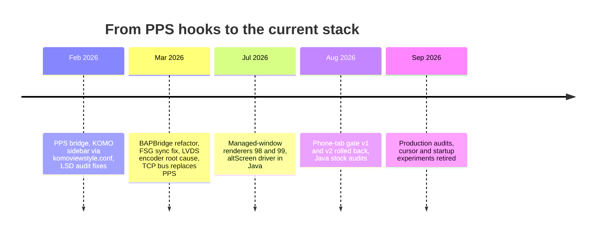

# Archive and History

*What the project looked like before today's design, why each earlier approach was dropped, and the reverse-engineering facts from those phases that are still true (MHI3 TBT parity, the CarPlay modes protocol, the LVDS encoder path).*

---

## 📋 How the design got here

Every document under `sources/archive/` describes a superseded design. Its RE findings about **stock** binaries usually still hold; its statements about **our** code usually do not. This note separates the two: the "then vs now" tables are history, the RE sections are reference. **[decompile]** marks stock-binary facts, **[code]** marks a check against today's tree.

*Project phases as recorded in the archive, 2026.*

## 🔄 Then vs now

| Area | Then (archive) | Now (code) |
|---|---|---|
| Hook ↔ Java transport | PPS files `/ramdisk/pps/iap2/routeguidance` and `/ramdisk/pps/iap2/coverart_notify`; Java `PPS.java` delta subscriber | TCP bus on 127.0.0.1:19810, `EVT_RGD_UPDATE` / `EVT_COVERART` ([Hook to Java Bus](HOOK_TO_JAVA_BUS.md)) |
| Bus roles | hook = server, Java = client (old MEMORY) | **hook = client, Java = long-lived server** (`hook/framework/bus.c:6-10`) **[code]** |
| Cover-art trigger | file watcher on `/var/app/icab/tmp/37/` | assembler on `NmeTransport::Recv` ([Architecture](ARCHITECTURE.md)) |
| Enabling RGI messages | edit `dio_manager.json` `MessagesSentByAccessory` (0x5200, 0x5203) and `MessagesReceivedFromDevice` (0x5201, 0x5202, 0x5204) | Identify patch inside the hook ([RGI and BAP Bridge](../cluster-and-rgi/RGI_AND_BAP_BRIDGE.md)) |
| Java deployment | prepend `carplay_hook.jar:` to `CLASSPATH` in `navigation.json`, compile against `mu1316_lsd.jar` "Java 1.2", `-source 8 -target 8` | jar on j9's `-Xbootclasspath`, `-source 1.4 -target 1.4` against `MU1316-final.jar` ([Build System](../build-and-deploy/BUILD_SYSTEM.md)) |
| Native build | `compile_c.sh` over SSH on a QNX 6.5 VM | Docker `qnx65-armv7-toolchain` ([Build System](../build-and-deploy/BUILD_SYSTEM.md)) |
| Hook module registration | ELF constructors in `c_hook/main.c` | lazy `pthread_once` at the first Cinemo call ([Architecture](ARCHITECTURE.md)) |
| VC turn arrows | KOMO/DSI sidebar through `libPresentationController.so` + `komoviewstyle.conf` style 3 `KVS_FPK` → `KVS_Most` (328×181) | `maneuver_render` on plane 98 ([HUD Renderer](../cluster-and-rgi/HUD_RENDERER.md)) |
| Cluster map | LVDS/MOST encoder of stock context 72/74, or a mirror renderer on displayable 33 | stream 111 drawn by `altscreen_render` on plane 99 ([AltScreen Cluster Video](../altscreen-and-video/ALTSCREEN_CLUSTER_VIDEO.md)) |
| Source tree | `c_hook/`, `java_patch_new/`, `java_patch_new_replace/` | `hook/`, `java_patch/` only |

One archive fact that stays true: without `0x5204` in the received list, iOS never sends lane guidance (it checks `iap2_identification_isIdentifiedForOutgoingMessageID` in the 0x5200 handler). **[decompile]**

Sources: `oldREADME`, `MEMORY (archive)`

## 🔍 Durable facts from the old MEMORY

These are the stock-behaviour rules the old memory recorded; most have a current home, linked.

- **Transient `maneuver_count=0`.** iOS briefly sends 0 at route start before re-populating. Clear per-slot data only on `route_state=0` or `source_supports_rg=0`. See [RGI and BAP Bridge](../cluster-and-rgi/RGI_AND_BAP_BRIDGE.md).
- **Slot LRU bug.** `rgd_slot_for_iap_index()` did not refresh the sequence on lookup and did not protect active ManeuverList slots, so 0x5202 data for future maneuvers evicted active slots and froze icon and turn-to text. Fixed with an LRU touch on lookup plus `rgd_is_active_index()`.
- **FSG sync(1) stall.** `AppConnectorNavi` uses `sendStatusIfChanged`; when the ExitView variant and number were unchanged, FctID 49 was skipped, the sync for `{23,18,49}` never closed, and ManeuverDescriptor updates were silently dropped. Fix: toggle the ExitView variant EU↔NAR on every send (`exitViewNum` stays 0, so the variant is cosmetic). Never send `exitViewNum=1`: it overwrites the maneuver icon with a highway exit. `forceClusterRouteInfoState(true)` is still needed on start in BAP-only mode (sets `rgActive`, `rgiValid`, favoured view mode KDK). The FunctionSync strings (FctID 37, LSG 50) are in [RGI and BAP Bridge](../cluster-and-rgi/RGI_AND_BAP_BRIDGE.md).
- **LSD audit fixes (Feb 2026).** Play-position sentinel was `-65536`, fixed to `65535` (`0xFFFF` = BAP "unknown time") in `TerminalModeBapCombi$EventListener`. Ferry `mainElement=44` (MHI3 value) does not exist in the MHI2Q BAP spec (max 38, no `IconUtil` case), so enter/change/exit ferry map to `FOLLOW_STREET` (11).
- **Stock screen teardown chain.** Hiding CarPlay sends RTSP TEARDOWN for stream 110: `_requestProcessTearDown` → `AirPlayReceiverSessionTearDown(session, dict, …)` → `_ScreenTearDown` → `SendCommand('q')` → `ProcessFrames` exits → OMX drains. `dict != NULL` = specific streams, `dict == NULL` = full finalize. `SetVisibility` is in a vtable but never called. **[decompile]**
- **First altScreen backport notes.** Feature bit 26 (`0x4000000`) was already set on MHI2 and MHI3; `HasFeatureAltScreen` reads `session->platformData[0x18][0x127]`; MHI2 `CopyDisplaysInfo` returns one flat dict where MHI3 returns an array; MHI2 `Screen_Setup` only extracts `latencyMs`. Superseded as a plan by [AltScreen Cluster Video](../altscreen-and-video/ALTSCREEN_CLUSTER_VIDEO.md).
- **`libPresentationController.so` widget patches** (ARM32, file offset = VA). Root cause: `ManeuvreViewManager_Stop` → `StopDSIs` unregisters the DSI services and clears the request interface at `+104` and the selectManoeuvreView interface at `+116`, after which every Java DSI call is dropped. Patches: (1) `0x60BE48` NOP `StopDSIs` (`MOV R0,#0; BX LR`), which must be applied first; (2) `0x61C11C` `BNE→B` in `StartDrawing`; (3) `0x5C75A0`, `0x5C75E4`, `0x5C783C` `LDR` offset `0x68 → 0x54` in `StartNewFrame`, so `setKOMODataRate()` controls fps directly (0 stops, 2 resumes; the `0x54→0x64→0x68` double buffer breaks without native guidance). Prerequisite: `ManeuvreViewManager_Start` ran at boot. Not used by today's CarPlay path ([HUD Renderer](../cluster-and-rgi/HUD_RENDERER.md)).
- **BAPBridge before the renderer era (Mar 2026).** BAPBridge talked to `AppConnectorNavi` (`CombiBAPServiceNavi`) directly with `ACTIVE_RGTYPE=0` (RGI; the HUD reads ManeuverDescriptor, the VC FPK ignores rgType). KOMO/GAL were removed then: no InfoStates override, no `DSIKOMOView`, no MobileDevice mode. The **FPK guard** blocks KOMO: `Util.isClusterMapFPK()` is `getSysConst(0)==2`, and `refreshViewMode()` returns early for FPK/MMI, leaving viewMode COMPASS, rgSelect 2, rgType 4; hence `forceClusterRouteInfoState(true)` sets `container.rgActive`, `rgiValid`, `favoredViewMode=KDK(2)` and the KDK handler state by reflection. BAP text overlays work independently of any video.
- **VC FPK state machine.** `gssipc-kbd` is the BAP→datapool gateway, `fds` the EB GUIDE HMI runtime. There is no ActiveRGType datapool item; `InfoStates=6` → `SV_NavFPK_Compass_MobileDevice` (AIO arrows from KOMO); `INTERN_Active_NavFPK_Content` 0 None→compass, 1 Map→LVDS video, 2 LastDest, 3 Fav; `LVDS_Available=1` + Map → `SV_LVDS_NavMap_FPK`. Full diagram in [HUD Renderer](../cluster-and-rgi/HUD_RENDERER.md).
- **HU maneuver rendering pipeline.** `libPresentationController.so` in PNavApp is the only thing rendering maneuvers into the MOST stream; it creates `KVS_FPK` render targets 210×153 / 328×181 via `SDKRenderTargetFactory`; `videoencoderservice` captures via IPTE → Qualcomm H.264 → MPEG-TS → MLB ISO → MOST → VC. CarPlay data never used this path.
- **Bargraph and FctID 18 then.** Denominator = `mDistance[firstIdx]` (distance-between from 0x5202); −1 or 0 → `bargraphOn=false`. Stock `ClusterService.java:305` hid the distance whenever the bargraph showed (`showDistance && distance > 0 && !showBargraph`); model 64 = distance metrics, 65 = bargraph choice. Current treatment in [Distance Bargraph](../cluster-and-rgi/DISTANCE_BARGRAPH.md).
- **Slot mapping.** The hook maps iOS monotonic maneuver indices to 8 fixed slots with LRU eviction; `maneuver_list` carried slot indices, not iOS indices.

Sources: `MEMORY (archive)`

## 📊 MHI3 TBT parity (IDA evidence)

Reference firmware `MHI3_ER_AU_P4364_8W0906961DR`: `dio_manager` turns iAP2 into structs, `tbt_renderer` maps maneuvers and formats, `DSINavBap` emits BAP. We do not run `tbt_renderer`; the Java patch re-implements the minimum mapping and calls the Combi BAP Navi API. **[decompile]**

**Findings that shaped the Java mapper:**

- `ExitInfo` is a string: `getRouteGuidanceManeuverInformation@0x308ea0` builds a `UnicodeString8` (format `exitInfo='%s'` at `0x5126a8`).
- Bargraph (`sub_2B9C90`): `denom = distanceBetweenManeuver`, clamped to 3000 if above 2999; `bar = distanceToNext / denom * 255`; if `bar > 255` the bargraph is **hidden and 0**, not saturated. See [Distance Bargraph](../cluster-and-rgi/DISTANCE_BARGRAPH.md).
- TurnToInfo (`sub_295ED0`) removes the street name from the signpost string.
- `DSINavBap` sends descriptors and `exitViewId` separately (`sub_551800`, "send_maneuver_descriptors"; state machine `sub_6E3740`); ExitView ids come from navcore junction-view assets (`sub_6E42E0`), which CarPlay never provides. The MIB3 doc says we "always call `updateExitView(0,0)`"; today's code always sends exit view number 0 but alternates the variant EU/NAR on every send to force FctID 49 through (`java_patch/com/luka/carplay/rgd/BAPBridge.java:2355-2359`). **[code]**
- Descriptor object (`sub_8ACF30`, 0x28 bytes): `mainElement` u32 at `+0`, `direction` int16 at `+4`, **`zLevelGuidance` hard-coded 0** at `+8`, `sideStreets` shared pointer at `+0x10`.
- MHI2Q distance encoding (`BAPDistanceFormatter` in `mu1316_lsd.jar`): raw ≤ 0 → invalid (`value=-1`); `value = round(displayDistance * 10)` (tenths; `1092616192` = `0x41200000` = 10.0f); for miles, quarter multiples become `unit=QUARTER_MILE`, `value = 10 × quarters`. **[open]**: quarter-mile not validated on the car.

**Direction from angle.** `tbt_renderer` init (`sub_30090`) loads 17 exit bins `-180..180` step 22.5 (`unk_530F68`) and a bin→code map (`unk_531010`); roundabout exits pick the nearest bin (`sub_2B31A0`), i.e. clamp + nearest 22.5°:

| Angle | −180 | −157.5 | −135 | −112.5 | −90 | −67.5 | −45 | −22.5 | 0 | 22.5 | 45 | 67.5 | 90 | 112.5 | 135 | 157.5 | 180 |
|---|---|---|---|---|---|---|---|---|---|---|---|---|---|---|---|---|---|
| Code | 128 | 112 | 96 | 80 | 64 | 48 | 32 | 16 | 0 | 240 | 224 | 208 | 192 | 176 | 160 | 144 | 128 |

Named directions: straight 0, slight left 32, left 64, sharp left 96, U-turn 128, sharp right 160, right 192, slight right 224.

**mainElement per iAP2 ManeuverType (0..53):**

| iAP2 types | mainElement |
|---|---|
| 0 no turn, 5 follow road | `FOLLOW_STREET` (11) |
| 1, 2, 3, 6, 8, 9, 11, 13, 14, 16, 22, 23, 47–51 | `TURN` (13) |
| 4, 18, 26 | `UTURN` (25) |
| 7 exit roundabout | `EXIT_ROUNDABOUT_TRS_RIGHT/LEFT` (26/27) by driving side |
| 19, 28–46 | `ROUNDABOUT_TRS_RIGHT/LEFT` (21/22) by driving side |
| 52, 53 | `CHANGE_LANE` (12) |
| 10, 12, 24, 25, 27 | `ARRIVED` (3) |
| 15, 17 | `FERRY` (44), mapped to 11 on MHI2Q (see above) |
| unmapped | `NO_INFO` (1) |

Direction rules (LHT = left-hand traffic): enter roundabout = TURN + (LHT ? LEFT : RIGHT); U-turns = UTURN + (LHT ? RIGHT : LEFT); roundabout exits 1–19 = roundabout icon + nearest-bin code; end-of-road left: `[-67..-1]` slight, `[-180..-113]` sharp, else left (mirror for right); keep/slight left 13/49 → slight left, keep/slight right 14/50 → slight right; sharp 47/48; ramps 8/9 default slight right, slight left for LHT with `(uint32)exitAngle > 0xB3`; change highway 52/53 → CHANGE_LANE + left/right. `junctionType` gate: 0 = normal, 1 = roundabout mode (most types become `NO_INFO` except 7 and 28–46), other values → `NO_INFO`; `sideStreets` is empty when `mainElement == NO_INFO` and for `EXIT_ROUNDABOUT`.

**DSINavBap override** (`sub_6E3740`, `BapState==2`): unless `Action` (`+0xC4`) is 5–8 (roundabout, enter, exit, U-turn), direction is coarsened from `Turn` (`+0xC0`): 3–6 → 192, 7–10 → 64, 11 → 128, else 0. The patch does not have Action/Turn and approximates from the iAP2 type.

**SideStreets parity.** Tables `EXITS_FULL_17@0x530F68`, `EXITS_15@0x530FB0` (−157.5..157.5), `EXITS_7@0x530FF0` (135, 90, 45, 0, −45, −90, −135), fixed patterns `192`/`64` at `0x5310E0`. Roundabouts (`sub_2B9030`): exit ±180 uses all of `EXITS_15` as "before"; otherwise partition around the exit match and swap by driving side; too many before → empty, too many after → omit after. Intersections (`sub_2B97D0`) partition `EXITS_7` and exclude the pivot. Partitioning (`sub_2B7510`) compares each angle with `exitAngle` (greater/less/equal ignored) and keeps input order; the Java helper once assumed a descending prefix and was fixed. Emission (`sub_2B3570`, sorted by `sub_2B71C0` via `sub_2B4050`/`sub_2B38F0`) outputs unique codes in best-match order. `sideStreets` must be `byte[]`, one byte per entry, not packed int32. Missing `exit_angle` defaults to the sentinel 1000. **[decompile]**

What the PPS-era patch did with it: the hook published `m{slot}_turn_angle` (legacy) and `m{slot}_exit_angle`, plus ExitInfo as `m{slot}_exit_info_len`, `m{slot}_exit_info_hex` and a decoded `m{slot}_exit_info` (UTF-8 bytes ≥ 0x80 kept, ASCII control bytes replaced by `?`); Java passed it as the second argument of `updateTurnToInfo(nextStreet, exitInfo)` with MHI3-style signpost filtering. Remaining gaps then: no road-number field exists in iAP2 (the signpost is approximated from ExitInfo), SideStreets **input** parity (do iOS `junctionAngles/exitAngle/junctionType` match what MHI3 gets for the same junction?), quarter-mile units unvalidated, and "no exit view" accepted by the cluster with no regression seen. **[open]**

Sources: `MIB3`

## 🔍 Stock encoder and modes RE

### The LVDS/MOST encoder only captures on a real context switch

Chain: Java `DisplayManager.switchContext(ctx, 1)` → DSI `CDSIDisplaymanagement::switchContext(ctx, display 4)` → `CContextManager::preContextSwitchHook()` → for a display without a terminal (MOST) `CASIMostEncoder::setActiveDisplayable(4, context.displayables[0])` → `videoencoderservice` `CASIVideoEncodingSrv::setActiveDisplayable` (`sub_10A0D0`). `setUpdateRate(1, fps)` reaches `setUpdateRate` (`sub_1078D8`) and `CServiceController::adjustTimer` (`sub_10A694`, interval 1000/fps, capped at 60). Each tick of `CDisplayTimer::process` (`sub_10B478`) does IPTE capture → Qualcomm OMX H.264 → MPEG-TS → MLB ISO → MOST → VC. `mapDisplayId(4)` = remote 0 (cluster); the timer for remote 0 is pre-created at 1000 ms. **[decompile]**

Root cause of the empty map: `setActiveDisplayable` is called **only** from `preContextSwitchHook`, and Java `switchContext` skips the DSI call when the context is already confirmed. So re-requesting 72 does nothing and the encoder keeps displayable 0. Switching 72→74 sends displayable 20 (KDK), which is empty without native guidance. Fix that was used: `switchContext(0)`, wait 250 ms, `switchContext(72)`, wait, `setUpdateRate(1, 10)`, and never `setKDKVisible`. Context 0 works as the "away" context. Contexts: 72 = `{33}`, 74 = `{20, 102, 101, 33}`; 76/77 are the FPK split variants. `processEvent` (`sub_106EC4`) sends `displayable>0 && fps<0` to `adjustDisplayable` and `displayable<0 && fps>=0` to `adjustTimer`; `CDisplayTimer::process` opens the encoder when needed and encodes only in state 1 (ACTIVE). Java terminal 1 → internal display 4. Tests in March 2026 (KOMOProbe) confirmed displayable 33 has content during CarPlay and the MOST link works (map flicker on the VC). The then-open blocker was `gfxAvailable`, with a forced `KOMOService.updateGfxState(1,1)` under test; today's code uses the stock `updateDataRate` then `updateGfxState` order ([Production Audits](../build-and-deploy/PRODUCTION_AUDITS.md)). `DSIKOMOView` has a provider (`libPresentationController.so`), but `DSIKOMONavInfo` and `DSIKOMOGfxStreamSink` have none on MHI2Q, so `ClusterViewMode.gfxAvailable` never becomes true on its own. Today's cluster path does not use this encoder ([Cluster Video Encoder](../altscreen-and-video/CLUSTER_VIDEO_ENCODER.md)).

### CarPlay "hide" is a modes change, not TEARDOWN

When the HU UI leaves CarPlay it sends `hmi2IOSChangeModesRequest(ModeState, AppStates)` over DSI to dio (`CDSICarplayImpl` `sub_168434`), which fills `CDIOManager::hmiRequestOrReleaseResources` (`sub_155CEC`), calls libairplay `AirPlayReceiverSessionChangeModes@0x28aec` (`{"type":"changeModes", …}`) and `AirPlayReceiverSessionSendCommand@0x18880`. iOS sees `screen.type = untake` and stops sending frames while the session stays up; completion comes back via `s_changeModeCompletionCallback@0x1562dc`. **[decompile]**

| `CDIOManager` int index | Field | Values |
|---|---|---|
| `[145]` (`0x244`) | screen.type | 0 n/a, 1 take, 2 untake, 3 borrow, 4 unborrow |
| `[146]` | screen.priority | 100 niceToHave, 500 userInitiated |
| `[147]` | screen.takeConstraint | 100 anytime, 500 userInitiated, 1000 never |
| `[148]` | screen.borrowUnborrowConstraint | same as above |
| `[149]`–`[152]` | audio type / priority / take / borrow | same vocabularies |

`AirPlayReceiverSessionPlatformControl@0x1f190` handles `duckAudio`, `unduckAudio`, `setUpStreams`, `tearDownStreams`, `startSession`. A real TEARDOWN (`0x26b60`) with `streams` `{100|101|110}` runs `_ScreenTearDown@0x266e4`: state 3 STOPPING, quit byte `'q'` (113), join + close, state 4 STOPPED. Screen states are only `0 NONE, 1 INITIALIZING, 2 READY, 3 STOPPING, 4 STOPPED` (`0x29fa8`); pausing lives entirely in iOS. Session teardown is `CSIService::terminate` (`sub_165030`) → `tearDownTheSession` (`sub_15FA58`).

The mirror plan built on this never shipped: phase 1 would rewrite `untake` to 0 before the real call and restore it after; phase 2 would copy tiled NV12 from `COMXVideoDecoder::onFillBufferDoneCallback` into SHM `/cp_vc_frame_shm` (magic `0x43505643` "CPVC", v2 with a format flag); phase 3 would detile on the GPU and draw on displayable 33 in context 74 ordered `33 20 102 101`. The Adreno 64×32 tile rules it recorded: tiles of 64 bytes × 32 rows in 2×2 blocks; even block columns order `[TL, TR, BL, BR]`, odd ones `[BL, BR, TL, TR]`; an odd final tile row is stored sequentially after all full block rows (`tile_idx = full_pairs × nbx × 4 + tx`); detiling applies only when `width % 64 == 0`. The planned SHM header was `{magic, version, width, height, stride (64 tiled / width linear), format (0 NV12_LINEAR, 1 NV12_TILED_64x32), y_size, uv_size, sequence (bumped per frame), frame_ready, data[]}`; the planned shader sampled Y as a `GL_LUMINANCE` texture 64 wide and `y_tiled_size/64` tall (UV as `GL_LUMINANCE_ALPHA`, half resolution) and converted with BT.601 (`r = y + 1.402v`, `g = y − 0.344136u − 0.714136v`, `b = y + 1.772u`). The earlier sibling project `Patches/carplay_vc/` had a working CPU-detile OMX hook and a `CP_VC_KEEP_ALIVE` that blocked `SetVisibility(false)`, `StopSession` and `CScreenRender::stop`. Questions it left open and never answered: whether iOS accepts a redundant `take` after a blocked `untake`, the real CarPlay resolutions (`width % 64`), whether encoder rate gating applies to a non-native owner of 33, and the UV texture layout. Today's renderer avoids CPU detiling by importing the decoder's own Screen buffer through EGL ([Video Pipeline](../altscreen-and-video/VIDEO_PIPELINE.md)).

Sources: `lvds_video_pipeline.root-memory`, `VC_MIRROR_PLAN`

## 📍 The July 2026 snapshot

`NEXT_STEPS` (2026-07-27) records the move to managed Screen windows that the DM composites and the MOST encoder captures by `SCREEN_PROPERTY_ID_STRING`. Durable facts: the managed-window request string is `"How are you gentlemen?"` and the DM stamps `MANAGER_STRING = "All your base are belong to us!"`; `display_init` does no GPU magic; the displayable id space is enum 15–60 (60 = `HUD_MAP_VIEW`) plus KDK 100/101/102, leaving 61–99 free; 98 = maneuver (RGBA8888, format 8, usage `OPENGL_ES2` 0x20, transparent), 99 = altScreen (tiled NV12 then, opaque); 102 = LARGE_STAGE, 101 = SMALL_STAGE; stock map 33 = `KOMBI_MAP_VIEW`; the cluster is LVDS2, display id 1, 1440×542. **[car]** **[decompile]**

Superseded parts: contexts were then planned as three (`dc[80]={98,102,101}`, `dc[81]={98,102,101,33}`, `dc[82]={98,102,101,99}`, array bumped to 83); today there are two, 80 and 81 ([Architecture](ARCHITECTURE.md)). The altScreen input then planned `CMD_ALT_HID` at 0x0110; today 0x0110 is `CMD_ALT_ZOOM` and there is no HID command ([Hook to Java Bus](HOOK_TO_JAVA_BUS.md)). The open "who launches the renderers" question was answered by the generation monitor ([Architecture](ARCHITECTURE.md)).

Other items from that snapshot: `common/cluster_surface.{c,h}` was the shared managed-window primitive (raw `screen_create_window` + `screen_manage_window` + a `MANAGER_STRING` watchdog; `maneuver_render` shrank from 968 to 391 lines on it); the planned altScreen tab needed `MenuState.smartPhone=AVAILABLE(2)` and a `DSIKombiSync mainContext==117` observer, plus VC coding 4237/4238 (see [Cluster and RGI overview](../cluster-and-rgi/README.md)). Its risks were: the hand-rolled manage path had never run on hardware (prove with one canary renderer), the DM can still disown a managed window on context-away (keep the watchdog), and `make hostcheck` checks only syntax against stubs. Open RE then: that a managed window appears as a CREATE in `videoencoderservice`'s IPTE context, that `displayables[0]` composites on top, and that the DM does not validate ids against its enum (unknown ids show as `--` in `dmdt` and render). **[open]** for the first; the others were settled by the shipping contexts.

Sources: `NEXT_STEPS`

## ❌ Phone-tab gate, rolled back

The rule `tabVisible = (mobileConnectionType == HANDS_FREE_PROFILE(3)) && !carPlayActive` (fail-open before the first phone update) was implemented twice through PHONE2 LSG 41 (`0x29`) `NOT_READY` (0), sent through `IDSIBAPController` from an override of `InitializationManagerPhone2.updateHMIState()`. Two inputs fed it: `BAPPropertyTelFSGSetup.updateAsync()` (the real `mobileConnectionType`, decides when HFP is back) and `TerminalModeBapCombi.ActiveDeviceStateListener` (`isCarplayDevice()` during ATTACHED/ACTIVATING, hides early). v1 did not prove anything because of three holes: a hide before PHONE2 registered was lost (fixed by `registerResend()` replay), a `NOT_READY` could land in `NullDSIBAPService` and then be skipped as "already 0" (fixed by always re-sending 0), and errors were swallowed without log lines. v2 (jar SHA-256 `3605c795dd374f71979078a3d2534db2f1dedceea8725fe8c728119e55ba2df2`, 2026-08-04) hid the tab at boot on `mobileConnectionType=0` (log `[PhoneGate] visible=false reason=mobileConnectionType=0`, then `PHONE2 apply hidden=true … lsg=41`) and showed **two** telephone icons, consistent with the VC falling back between its Telephone and Telephone2 domains, so the lever itself was rejected. The rollback jar (`84165b82523e6ec17c303a2ad3e1217522687cb65186d74a10d6dade3cbdef62`) removed `PhoneTabGate` and both patched stock classes. The older idea of gating `AppConnectorPhone2.updatePhoneModuleState()` was never implemented and the VC analysis does not support it. The VC `hmi_app.elf` addresses and the real target (`phoneAvailable = 0`) are in [Phone Tab Gating](../cluster-and-rgi/PHONE_TAB_GATING.md). **[car]**

Sources: `PHONE_TAB_GATING`

---

## 📚 Sources

Merged originals were removed from the tree after this note absorbed them; they remain in git history (commit 23972aa).

- `oldREADME`: the PPS-era README (artifacts, device paths, `komoviewstyle.conf`, `dio_manager.json` message ids, source layout).
- `MEMORY (archive)`: the early project memory (bus, BAP, FSG sync, teardown chain, libPresentationController patches).
- `MIB3`: MHI3 `tbt_renderer` / `DSINavBap` parity evidence and patch status.
- `NEXT_STEPS`: 2026-07-27 status, managed-window facts, open risks.
- `VC_MIRROR_PLAN`: the unshipped displayable-33 mirror plan and the modes-protocol RE.
- `lvds_video_pipeline.root-memory`: LVDS/MOST encoder chain and why the map stayed empty.
- `PHONE_TAB_GATING`: phone-tab gate v1/v2 record.
- The Java audit kept in `archive/` is covered in [Production Audits](../build-and-deploy/PRODUCTION_AUDITS.md).

See also [Architecture](ARCHITECTURE.md), [RGI and BAP Bridge](../cluster-and-rgi/RGI_AND_BAP_BRIDGE.md), [HUD Renderer](../cluster-and-rgi/HUD_RENDERER.md), [Home](../README.md).
