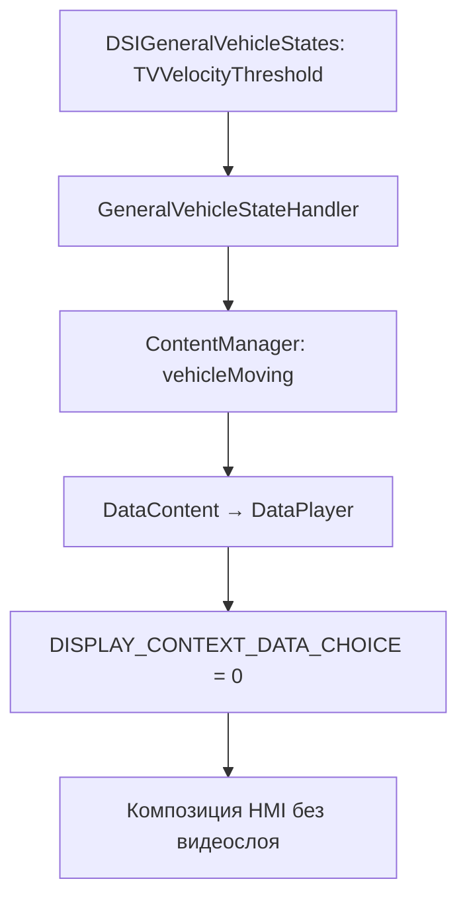

# CarPlay Video: штатный плеер MHI2, экран и ответы iPhone

Дата исследования: 2026-09-15. Продолжение [принимающего PlaybackV2](CARPLAY_VIDEO_RECEIVER_2026_09_14.md)
и [sender / допуска приложений](CARPLAY_VIDEO_TRANSPORT_2026_09_14.md).
Статический анализ локальных образов. На HU воспроизведение не запускалось.

## Основные результаты

1. В MU1316 уже есть **Cinemo** и штатный видеовыход: QNX Screen window
   **class `media`, ID `43`**. Java-контекст первого плеера — **25 = `{16, 43}`**.
   Это композиция интерфейса HMI и видео для центрального экрана. Второй
   физический монитор исследованному пути CarPlay Video не требуется.
2. Есть штатный API **`DSIMediaPlayer.setPlaybackURL(String)`** и job, который
   останавливает старый трек, устанавливает URL, ждёт готовности и запускает
   воспроизведение. В native-коде запрос требует выбранный media source.
3. Найден конкретный исполнитель штатной блокировки картинки Audi:
   `TVVelocityThreshold → ContentManager → DataPlayer → display context 0`.
   Проверенная ветка скрывает видеослой; она не вызывает `stop` плеера.
4. На стороне Apple восстановлены конверты ответов и событий, поля
   `playbackInfo`, значения состояний и причины остановки.

**Что это пока не доказывает:** stock MU1316 не получил поддержку CarPlay
Video. Его `libairplay.so` не создаёт stream 130 — см. предыдущий отчёт.
Совместимость Cinemo с URL от iPhone, TLS-PSK, HLS и конкретными приложениями
не проверена. Окно 43 — установленный выход штатного media player, а не
фиксированное требование Apple к CarPlay-приёмнику.

## 1. Источники и адреса

Корень проверенной прошивки:

```text
/Users/luka/Desktop/AUDI_2/Firmwares/HU/MHI2Q_US_AUG22_P5087_MU1316/extracted
```

| Образ | Адреса / SHA256 |
|---|---|
| `app/eso/bin/apps/media` | ARM32 ELF, base `0x100000`; `b18cf3cdccd7288b43c609db2f170d5008a3af3aa57dfb642d12fc78c4d02c59` |
| `app/armle/usr/lib/cinemo/libNmeVideoDevice.so` | ARM32 ELF, base 0; `e99a67f146d5e323976ec7d3a3e6c7f21a3fea04660dd40b472bc9797a341044` |
| AirPlayReceiverKit | iOS 27 `24A5418b`, base `0x250ee8000`, SHA256 в предыдущем отчёте |
| Audi Java | `Tools/jxe2jar/out/MU1316-vf/`; ключевые переходы сверены через `javap -p -c` с `MU1316-combined.jar` |

Адреса native-функций ниже — VA соответствующего образа без runtime slide.
Hex-Rays местами теряет аргументы C++/ObjC и обрезает большие функции.
Такие прототипы не являются восстановленным ABI. Для ключей Apple использованы
инструкции и CFString из исходного dyld cache; для Java — также байткод.

Доказательства в `output/carplay-video-re-20260915/`:

- [Native media](../../output/carplay-video-re-20260915/stock-media-evidence.json).
- [QNX Screen backend Cinemo](../../output/carplay-video-re-20260915/stock-video-device-evidence.json).
- [ReceiverKit ответы](../../output/carplay-video-re-20260915/receiver-response-evidence.json).
- [Ключи сообщений](../../output/carplay-video-re-20260915/protocol-annotations.json),
  [конверты и диапазоны](../../output/carplay-video-re-20260915/response-annotations.json),
  [таблица состояний](../../output/carplay-video-re-20260915/playback-state-constants.json).
- [Java manifest и SHA256 JAR](../../output/carplay-video-re-20260915/java-evidence-manifest.json).
- [Конфигурация и исходные пути](../../output/carplay-video-re-20260915/config-evidence.json),
  [native config indices](../../output/carplay-video-re-20260915/media-config-paths.json).

## 2. Куда выводится штатное видео

### Конфигурация и native-код

`system/etc/eso/production/media.json`, `cinemo.config.videoConfigs`:

```json
{
  "statsLayer": false,
  "windowClass": "media",
  "windowId": "43",
  "useOverlay": true
}
```

`media` **`0x48ab9c`** читает строковые config indices **362 / 363** и
передаёт их в `CINEMO_OPTION_VIDEO_VIDEO_WINDOW_CLASS` / `...WINDOW_ID`.
Это вызывается из `CCinemoConfig::configure`, **`0x48ca5c`**.
В конструкторе таблицы конфигурации **`0x213f88`**, инструкции
**`0x21c0a0–0x21c150`**, эти индексы связаны с путями
`cinemo/config/videoConfigs/windowClass` и `.../windowId`.

В `libNmeVideoDevice.so` **`0x10098`** создаёт Screen windows и устанавливает:

- `SCREEN_PROPERTY_CLASS`, вызов **`0x104f8`**;
- `SCREEN_PROPERTY_ID_STRING`, вызов **`0x10588`**.

Вспомогательные **`0x2073c` / `0x20614`** выбирают класс / ID для HMI, видео
или субтитров; для видео читают `video-window-class` / `video-window-id`,
с возможностью переопределения в URL и fallback к конфигурации.
Это реальный Screen backend, а не только строка в JSON.

### Композиция и физический выход

Stock `DisplayManagerMIB2High.defineContexts`, проверено в байткоде:

```text
context 0  = [16]       HMI
context 25 = [16, 43]   HMI + digital video player 1
context 26 = [16, 44]   HMI + digital video player 2
context 58 = [36, 43]   вариант с HMI второго terminal
```

`DataPlayer.activate` выбирает контекст 25 при `PHYSICAL_PLAYER_ID == 1`,
иначе 26. `JobAttachSession.finishJob` сообщает клиентской file-player
сессии тот же выбор через `updateVideoContext`.

`system/etc/eso/production/displaymanager.json` связывает **Main Display,
ID 0, с LVDS1**; Cluster Display имеет ID 4 и LVDS2.
Контекст композиции, displayable, QNX window ID и физический display ID —
разные сущности. Наличие context 58 не означает, что видео обязано идти на
дополнительный экран.

Для CarPlay iPhone уже доказана работа с логическим `mainScreen`.
Следовательно, при реализации приёмника можно исследовать использование
штатного media-слоя центрального дисплея. **Не доказаны** одновременная
композиция с CarPlay displayable 59 и необходимые переходы владения экраном.
Маршрут CarPlay Video → окно 43 пока не реализован.

## 3. Штатный путь воспроизведения URL

На Java-стороне есть:

```text
JobPlayURL
  → FilePlayerContent.setPlaybackURL(url)
  → MediaDSIPlayerControllerImpl.setPlaybackURL(url)
  → DSIMediaPlayer.setPlaybackURL(url)
```

`JobPlayURL` сначала приводит плеер к состоянию для нового URL, при
необходимости меняет repeat mode, ждёт ответа URL / ready state, применяет
video scaling, затем делает resume либо pause в зависимости от audio state.
То есть одного вызова `setPlaybackURL` недостаточно для полного жизненного
цикла воспроизведения.

В native `media`:

- **`0x32d030`**, `DSIMediaPlayerImpl::setPlaybackURL`, ищет активный source;
- **`0x32abe8`** использует сохранённые `deviceID / mediaID`;
- **`0x32799c`** копирует URL в request и посылает event **23** через
  **`0x3274f8`**;
- при отсутствии source возвращается async error с `sourcePtr=NULL`.

Отдельно в Cinemo найдены `loadTrack` **`0x4abbcc`**, `enqueueTrack`
**`0x4aba00`**, `playTrack` **`0x4aad74`**. `loadTrack` очищает очередь и
передаёт строку UTF-8 в `ICinemoPlaylist::AppendTrack`.
Прямые xrefs к этим трём wrappers не найдены. Окончательная цепочка event 23
до конкретного Cinemo request ещё не восстановлена.

В file-player session API определены существующие клиенты boardbook и
ringtone. Это не готовый публичный CarPlay API. Понадобится проверить
выбор source, audio ownership и поддерживаемые схемы URL. Само имя
`setPlaybackURL` не доказывает поддержку Apple HTTPS-PSK или любого HLS.

## 4. Кто выключает видео

### Проверенная штатная цепочка Audi



`GeneralVehicleStateHandler.updateTVVelocityThreshold` направляет Boolean
в threshold **2 = `TVVELOCITYTHRESHOLD`**. **2 — идентификатор, не км/ч.**
Обработчик принимает обновление при validity **1** и вызывает слушателей.
`ContentManager.init` подписывается на этот threshold для front terminal.
Callbacks `exceedsUpperThreshold` / `belowLowerThreshold` передают true / false.

`ContentManager.setVehicleMoving` обновляет модель движения и вызывает
`vehicleMoving` активного контента. В `DataPlayer.vehicleMoving`, если
текущий трек — видео, вызывается `enableVideoDisplayable(!moving)`.
При запрете эта функция устанавливает choice **200663** в **0**.
В исследованной ветке нет вызова stop/pause; её непосредственный эффект —
скрытие видеокомпозиции. Это не доказывает отсутствие других ограничений
в нижних слоях. Конфигурационные исключения существуют; их значения на
живом HU не проверялись и не менялись.

В native Cinemo найден отдельный **`changeVideoOutput`, `0x4a9e1c`**:
GetVideoParams → изменить `disabled` → SetVideoParams. true означает disabled,
false — allowed. Прямой caller не найден; нельзя приписывать этому методу
исполнение найденной Java-цепочки или команды CarPlay.

### CarPlay Video

Уже проверенная сторона iPhone принимает разрешение **от HU**:
начальный `videoPlaybackInfo.videoPlaybackAllowed`, затем
`setVideoPlaybackAllowed.params`. При запрете sender переводит playback в
audio-only и в соответствующей ветке посылает `changeVideoPlaybackToAudioOnly`.
См. [адреса и условия sender](CARPLAY_VIDEO_TRANSPORT_2026_09_14.md).

Это два уровня: автомобиль определяет разрешение, а принимающий плеер и
iPhone должны согласованно его исполнять. Простое скрытие окна Audi не
реализует протокол CarPlay. Связь с `TVVelocityThreshold` для будущего
CarPlay receiver — **предложение для исследования**, не обнаруженный stock
обработчик. Правила парковки, пороги и источник разрешения нового приёмника
нужно устанавливать отдельно; штатный TV threshold нельзя считать полной
политикой CarPlay.

## 5. Что принимающий плеер сообщает iPhone

Ниже — внутренние plist dictionaries. Внешняя упаковка через
`params.data` и `X-Apple-StreamID` описана в предыдущем отчёте.
JSON-подобная запись иллюстрирует структуру, не является wire JSON.

### Ответ `playbackInfo`

`_processPlaybackInfoRequestWithDictionary`, **`0x250ef20b8`**:

```text
{
  type: "playbackInfo",
  kind: "response",
  messageID: <из запроса, если присутствовал>,
  info: <текущее состояние плеера>
}
```

Base response helper **`0x250ee9414`** копирует `type` и `messageID` при
наличии и устанавливает `kind = response`.
`_currentPlaybackInfoDictionary`, **`0x250eecb08`**:

| Поля | Наблюдаемое содержание |
|---|---|
| `item.uuid`, `readyToPlay` | Текущий элемент и его готовность |
| `duration`, `position` | **CMTime dictionaries**, не просто секунды |
| `rate`, `playbackState` | Скорость и строковое состояние |
| `playbackLikelyToKeepUp`, `playbackBufferFull`, `playbackBufferEmpty` | Состояние буфера |
| `seekableTimeRanges`, `loadedTimeRanges` | Массивы `{start: CMTime dictionary, duration: CMTime dictionary}` |
| `stallCount` | Число остановок из-за буферизации |
| `date`, `absoluteTime`, `estimatedDate` | Временные данные, когда доступны |
| `isWaitingToSetRateFromSenderAfterSeek` | Признак ожидания sender после seek, условный |
| `interstitialInfo` | Условное вложенное состояние interstitial player |

Большая часть полей добавляется в ready-ветке. `rate` / `position` также
зависят от внутреннего флага. При отсутствии текущего основного item
формируется вложенная ошибка. Минимальный обязательный набор для sender
ещё не установлен: наличие поля в Apple receiver не доказывает обязательность.

### Асинхронные события

`_sendUpstreamPlaybackStateMessage…`, **`0x250ef284c`**:

```text
{ type: "playbackState", name: "playing", item: {uuid: ...}, params: <playbackInfo> }
{ type: "playbackState", name: "stopped", reason: "ended" | "interrupted" }
{ type: "error", error: {domain: ..., code: ...} }
```

`item` / `params` добавляются при внутреннем состоянии playing; требуется
UUID. Для stopped причина зависит от аргумента `stoppedBecauseInterrupted`.
`kind=response` и `messageID` не добавляются базовым event helper автоматически.

Таблица **`0x26938c080`**, функция **`0x250ef331c`**:

| Внутренний enum | Строка |
|---|---|
| 0 | `paused` |
| 1 | `loading` |
| 2 | `playing` |
| 3 | `stopped` |

Некоторые флаги ожидания принудительно сообщают `loading`, включая случаи
с внутренним paused / playing. Эти числа — внутренний enum Kit;
не переносить их как wire enum в HU.

## 6. Следующие ограниченные проверки

1. Проследить native event 23 через конкретный source до Cinemo; установить
   условия допуска URL, поддерживаемые схемы и выбор HTTP/HLS transport.
2. Проверить, как добавить TLS-PSK для адресов iPhone. Найденный Apple путь
   использует `Pair-TLS-PSK`; наличие обычного HTTPS в плеере этого не заменяет.
3. На sender восстановить читаемый минимум `playbackInfo`, обработку
   acknowledgements / ошибок и последовательность seek/rate/state.
4. Спроектировать согласованные ownership главного экрана и audio-only
   переход. Не считать Java-скрытие видеослоя подтверждением CarPlay-команды.

Правила допуска приложений остаются в предыдущем sender-отчёте: entitlement
для CarPlay UI и обычная поддержка AirPlay приложением — отдельные проверки.
Этот проход не добавляет ни одного приложения в список проверенных на MHI2.
