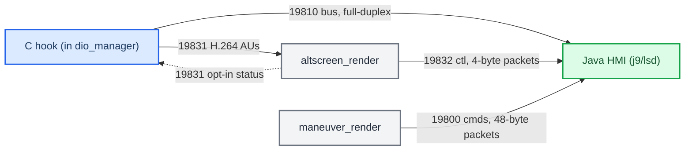
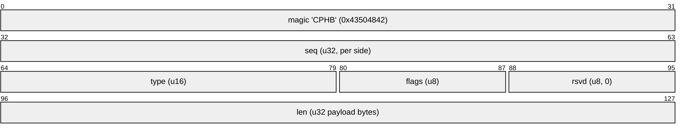
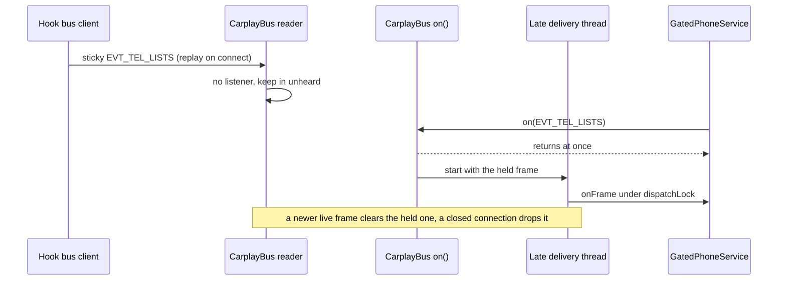

# Hook to Java Bus

*How the C hook, the Java HMI and the two renderers talk: a full-duplex TCP bus on 127.0.0.1:19810 plus three loopback renderer channels. PPS is gone.*

---

## 📋 What this is

The C hook (inside dio_manager) and the Java patch (inside j9/lsd) exchange route-guidance state, cluster commands and cover-art over **TCP loopback**, not PPS. The two renderer processes use their own TCP channels for pixels and control. This note is the wire map; for the semantics it carries see [RGI and BAP Bridge](../cluster-and-rgi/RGI_AND_BAP_BRIDGE.md) (route guidance / BAP) and [AltScreen Cluster Video](../altscreen-and-video/ALTSCREEN_CLUSTER_VIDEO.md) (video). For the traps around TCP framing see [Landmines](../LANDMINES.md).

Provenance: `hook/framework/bus_protocol.h`, `hook/framework/bus.c`, `java_patch/com/luka/carplay/bus/CarplayBus.java`, `hook/routeguidance/rgd_hook.c`, `altscreen_render/protocol.h`, `maneuver_render/protocol.h`, `MEMORY.md` §"Hook→Java bus". Truth tags: **[code]** read in the current tree, **[car]** confirmed live, **[open]** unverified.

---

## 🌐 Topology

*Loopback TCP fabric: Java is the long-lived server on the control bus and on both renderer side-channels; altscreen_render is the server only for the video data the hook pushes to it.*

Arrows point from the connecting client to the listening server; traffic on every channel flows both ways unless noted.

| Channel | Port | Client → server | Payload | Evidence |
|---|---|---|---|---|
| Control bus | `127.0.0.1:19810` | hook → Java | RGI state, cover-art, cluster commands (full-duplex) | `bus_protocol.h:7,59`; `CarplayBus.java:34` **[code]** |
| AltScreen data/status | `127.0.0.1:19831` | hook → renderer AUs; renderer → hook negotiated status | Annex-B H.264 with v2 metadata or legacy length framing; HELLO capability 3 + explicit ACK opts into STATUS readiness | [alt_video_wire.h](../../common/alt_video_wire.h); [Video Pipeline](../altscreen-and-video/VIDEO_PIPELINE.md#negotiation-and-presentation-readiness) **[code]** |
| AltScreen ctl | `127.0.0.1:19832` | altscreen_render → Java | Fixed 4-byte packets: `VIDEO_ON`/`VIDEO_OFF` up, `VIEW_AREA` down | `altscreen_render/protocol.h:30-43`; `AltscreenControlServer.java:32` **[code]** |
| Maneuver renderer | `127.0.0.1:19800` | maneuver_render → Java | Fixed 48-byte command packets; renderer heartbeat up | `maneuver_render/protocol.h:4,15`; `RendererServer.java:2,44` **[code]** |

Correction to the earlier version of this note: the hook does **not** talk to `maneuver_render`, and it is not an endpoint of 19832 — the renderers are clients of Java on 19800 and 19832. Renderers are persistent services started by the supervisor (`deploy/smartphone_integrator/carplay_monitor.sh:85-95`); Java only listens, it never spawns or kills them (see [Landmines](../LANDMINES.md)).

---

## ⚙️ Wire format and sticky state

Every control-bus message is one frame with a 16-byte big-endian header (`hook/framework/bus_protocol.h:9-19,59-62`) **[code]**:

*Control-bus frame header, 16 bytes, followed by 0..128 KB of payload.*

Payload defaults to text `key:type:value\n` lines; `BUS_FLAG_BINARY` (0x02) marks a packed struct. Event types (hook → Java) sit in `0x0000–0x00FF` — e.g. `EVT_COVERART 0x0010`, `EVT_RGD_UPDATE 0x0020`; commands (Java → hook) in `0x0100–0x01FF` — `CMD_SYNC_REQ 0x0100`, `CMD_PING 0x0101`, the altScreen set from `0x0110` (`bus_protocol.h:71-110`) **[code]**.

**Sticky replay is the reconnect mechanism.** A frame sent with `BUS_FLAG_STICKY` (0x01) is cached by the hook, one slot per type (`hook/framework/bus.c:374`). On connect the hook sends HELLO + the sticky snapshot; Java can also send `CMD_SYNC_REQ` after registering its listeners, and the hook replays every cached frame between `EVT_SYNC_BEGIN`/`EVT_SYNC_END` with `BUS_FLAG_REPLAY` set (`bus.c:12-14,406-441,574-582`) **[code]**. The protocol header still says "server caches"; in the current topology the caching side is the hook, which is the TCP client (`bus.c:6-10`).

**Keep `write_bus_snapshot_from_cache`.** It builds one `EVT_RGD_UPDATE` carrying route state, the maneuver list and slot data, sent sticky, so Java sees a coherent full state atomically rather than a delta history (`hook/routeguidance/rgd_hook.c:146,464-483,1179`) **[code]**. The old PPS delta-drop problem doesn't exist on TCP; the snapshot exists for coherence and reconnect, not packet loss.

**Cluster commands ride the same bus.** `CMD_ALT_ZOOM` is live at `0x0110` (`bus_protocol.h:92`, `CarplayBus.java:54`, handler `zoom_on_cmd` in `hook/altscreen/altscreen_hook.c`); `CMD_ALT_ZONE 0x0111`, `CMD_ALT_ZONE_ACK 0x0112`, `CMD_ALT_APPEARANCE 0x0114`, `CMD_ALT_UICTX 0x0115`, `CMD_ALT_RGI 0x0116` follow. `CMD_ALT_HID` / `CMD_KNOB` do not exist (the old stale `CMD_KNOB` comment in `bus.c` is gone too) — the cluster has no HID path; all cluster commands are BAP/semantic. The July 2026 plan had put `CMD_ALT_HID` at 0x0110; that slot is now `CMD_ALT_ZOOM`. `EVT_DEVICE_STATE 0x0030` is reserved and unused. **[code]**

The hook paces bounded zoom intent and replaces only pending idempotent cluster
states. A replaced view-area request receives a cancellation status; successful
ACKs still come from SDK completion. The bus payloads and BAP status reply are
unchanged. Selected zoom keeps an immutable input timestamp; final validation
follows retained-session acquisition. CF construction errors do not replace a
valid queued state. See [Input commands](../altscreen-and-video/ALTSCREEN_INPUT_COMMANDS.md).

**Telephony rides it too.** `EVT_TEL_LISTS 0x0040` is a sticky text frame with CarPlay recents (`r.n`, `r.<i>.a|b|type|ts|occ`) and favorites (`f.n`, `f.<i>.a|b`) from iAP2 ListUpdate; `EVT_TEL_COMM 0x0041` is a sticky text frame with `signal`, `registration`, `airplane` and `carrier` read from the stock CommunicationsUpdate, plus `battery` (0–100) and `charging` (0/1/2) from PowerUpdate 0xAE01 (−1 = not reported); `CMD_TEL 0x0117` is `[u8 action][u8 on]`: `1` = mic mute (iAP2 0x4160), `2` = hold (0x415F), `3` = accept (AcceptCall 0x415B), `4` = end (EndCall 0x415C), `5` = swap (SwapCalls 0x415D) (`hook/telephony/tel_hook.c`, `GatedPhoneService`). See [CarPlay Telephony](../cluster-and-rgi/CARPLAY_TELEPHONY.md). **[code]**

**Vehicle data goes the other way.** `CMD_VEHICLE 0x0118` (Java → hook, binary, little-endian, 14 bytes) is `[u8 version 1][u8 valid bits: speed, gear, range, temperature, warning][u16 speed cm/s][u8 gear 0 unknown / 1 D / 2 R / 3 N / 4 P][u16 range km][i16 outside temperature 0.1 °C][u8 range warning][u32 Java ms]`, sent every 200 ms by `VehicleDataModule`; `hook/vehicle` turns it into `$PASCD` and VehicleStatusUpdate. See [Vehicle Data To Phone](../connect-and-usb/VEHICLE_DATA_TO_PHONE.md). **[code]**

**The upmix level goes one way.** `CMD_UPMIX 0x0119` (Java → hook, binary) is `[u8 level]`, 0 off / 1 moderate / 2 normal / 3 full / 4 aggressive, sent by the Sound effects "CarPlay UpMix" row. Java stores the level; the hook gets the boot value from `/tmp/carplay_upmix_level`, which Java writes at HMI start, before `dio_manager`. See [Stereo To 5.1 Upmix](../audio/STEREO_TO_5_1_UPMIX.md#mmi-level). **[code]**

---

## ⚙️ Hook side: threads, queue and failure handling

`hook/framework/bus.c` runs three threads under one mutex (`bus.c:12-22`) **[code]**:

| Thread | Job |
|---|---|
| connector | `connect()` to Java with backoff 100 ms doubling to a 2 s cap (`bus.c:630-641`); on success sends HELLO + the sticky snapshot, then waits for a writer-side disconnect and reconnects |
| writer | drains the send queue to the current fd; on a write error it drops the fd and waits for the next connect |
| timer | optional 1 Hz local tick for module debounce; sends no heartbeat to Java |

- **Queue.** A fixed ring of 256 heap frames (`SEND_QUEUE_CAPACITY`, `bus.c:43`). When full, `bus_send` drops the **newest** frame and logs `send queue full, dropped type=…` (`bus.c:389-401`). Types index a direct table of `MAX_TYPES 0x0120` slots (`bus.c:47`, `:80`), so different types can never collide in the sticky cache.
- **Per-type send policy is vestigial.** `bus.h:34-37` still defines `RELIABLE` / `LOSSY` / `DROP_OLD` and `bus_set_policy()` stores it, but nothing calls it and `bus_send` never reads it. The archive's claim that LOSSY and DROP_OLD are live is superseded. **[code]**
- **Sticky cache safety.** If allocating the new sticky copy fails, the previous valid entry is kept and the send fails with `HOOK_ERR_MEMORY` (`bus.c:374-386`); earlier code could leave `has_last` set with a NULL payload and crash replay in `memcpy`. Replay deep-copies the cache under the lock, then sends outside it, with fresh sequence numbers so `SYNC_BEGIN < replay < SYNC_END` (`bus.c:405-455`); a failed send stops the replay at the first error instead of splicing headers into a half-written frame.
- **fd ownership.** Every write re-checks the pair (fd, connection generation). Only the connector closes the fd, after the reader finishes, and `shutdown()` wakes a blocked `recv`; so a reused fd number can never reach a new connection or a file (`bus.c:140`, `:224-230`).
- **Signals.** `send()` flags must be 0: QNX 6.5 io-pkt defines `MSG_NOSIGNAL` but returns `ENOSYS` for it, which once silently killed the whole bus (`bus.c:208-213`). Instead the bus installs a **reversible** SIGPIPE policy with `sigaction`, saving dio_manager's previous dispositions and restoring them on clean shutdown or partial-init failure; fatal-signal diagnostics are async-signal-safe and re-raise into the predecessor (`bus.c:771-863`). The save/restore bookkeeping lives in `hook/framework/signal_guard.c` (`spa_signal_guard_install` / `_chain` / `_restore`), tested by `tests/signal_guard_test.c`. **[code]**
- **Scope.** The bus only starts inside dio_manager (`hook_framework.c:540-545`).

## 📦 Java side

`java_patch/com/luka/carplay/bus/CarplayBus.java` is the long-lived `ServerSocket` on 19810 (`:34`), sets `TCP_NODELAY` on accept (`:393`), rejects payloads over 128 KiB (`:37`, `:442`) and types outside `0..0x011F` (`:38`, `:465`). Listeners are a per-type array. Text frames parse into `CarplayBus.Data` with a **1024-key** capacity and an explicit `text frame truncated` warning on overflow (`:253-260`, `:334`); the original 512-key parser silently dropped the tail of a full RGI snapshot (16 maneuvers plus 32 lane slots). A failed bind closes its `ServerSocket` instead of leaking one FD per retry. After registering its RGD listener, Java sends `CMD_SYNC_REQ` so a cold-boot snapshot published before Java was ready is replayed. **[code]**

**A late listener still gets the sticky frame it missed.** The hook replays its sticky state once per connection, and a listener can register after that (`GatedPhoneService` wraps the stock phone service long after the bus is up). `dispatch()` keeps the last `FLAG_STICKY` frame of a type that has no listener (`unheard[type]`); `on()` only registers and hands that frame to a short `carplay-bus-late-<type>` thread, which delivers it under `dispatchLock`. A live frame of the same type clears the held one first, so an older frame never overwrites a newer one, and closing the connection drops every held frame, so a module never gets the previous session's route or artwork. `on()` itself never waits for `dispatchLock`: callers such as `CoverArt.start()` hold their own monitor, which a listener on the reader thread may need. Tests in `tests/CarplayBusTransportTest.java` cover delivery, no survival across a connection, and a non-blocking `on()`. **[code]**

## 🔄 History: PPS to TCP

Until early 2026 the hook wrote QNX PPS objects and Java subscribed in delta mode: `/ramdisk/pps/iap2/routeguidance` became `EVT_RGD_UPDATE`, `/ramdisk/pps/iap2/coverart_notify` became `EVT_COVERART`, and `PPS.java` plus the PPS writer were deleted. The text payload deliberately kept the PPS `key:type:value\n` format so consumers barely changed. The first TCP version had the **hook as server**; it was inverted to hook = client because Java lives from boot while dio_manager is spawned per phone connect, which removed the retry and sleep hacks the other direction needed (`bus.c:6-10`). See [Archive and History](ARCHIVE_AND_HISTORY.md).

---

## ⚠️ Framing landmine

**Keep `TCP_NODELAY` on every loopback socket, above all hook → altscreen_render.** Historical separate header/AU writes exposed Nagle/delayed-ACK rubber-banding; those measurements belong to the earlier build. The current hook batches header + AU with partial-write-safe `writev`, retains `TCP_NODELAY` and negotiates v2 metadata/status within its greeting deadline. It rejects STATUS without opt-in. The remaining bus and renderer sockets also retain NODELAY. Current framing and historical measurements are separated in [Video Pipeline](../altscreen-and-video/VIDEO_PIPELINE.md); exact review contracts are in [Pacing Validation](../altscreen-and-video/ALTSCREEN_PACING_VALIDATION.md). **[code]** / historical **[car]**.

---

## 🔗 See also

- [RGI and BAP Bridge](../cluster-and-rgi/RGI_AND_BAP_BRIDGE.md) — what the route-guidance messages mean once Java has them.
- [AltScreen Cluster Video](../altscreen-and-video/ALTSCREEN_CLUSTER_VIDEO.md) — the renderer channels and the video pipeline.
- [HUD Renderer](../cluster-and-rgi/HUD_RENDERER.md) — the maneuver renderer on :19800.
- [Architecture](ARCHITECTURE.md) — where the bus sits among the processes.
- [iAP2 Route Guidance TLVs](../cluster-and-rgi/IAP2_ROUTE_GUIDANCE_TLVS.md) — the `route_generation` / `source_name` keys and the RGI wire fields the bus carries.
- [Cover Art Pipeline](../altscreen-and-video/COVER_ART_PIPELINE.md) — the cover-art messages on the same bus.
- [Home](../README.md) · [Landmines](../LANDMINES.md).

---

## 📚 Sources

Merged originals were removed from the tree after this note absorbed them; they remain in git history (commit 23972aa).

- `MEMORY (archive)`: the original bus design notes (wire format, sticky replay, send policies, replaced PPS paths).
- `ARCHITECTURE`: the port table.
- `CATPLAY_REVIEW_FIXES`: the sticky-cache, replay and fd-generation fixes.
- `HOOK_RELEASE_SAFETY_AUDIT`: the reversible signal policy.
- `JAVA_PATCH_STOCK_AUDIT`: the 512-key truncation and cold-boot sync findings.
