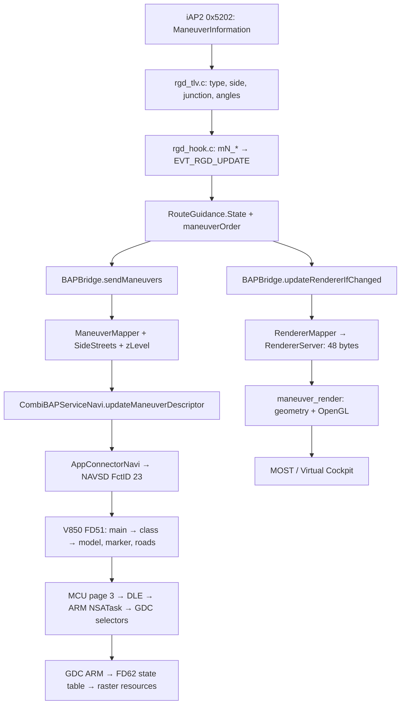

# ManeuverDescriptor: iAP2, BAP, HUD и maneuver_render

> Исторический снимок до согласования renderer. Текущие исправления, проверки и новый лист 54 типов: [MANEUVER_RENDERER_PARITY_FIXES.md](MANEUVER_RENDERER_PARITY_FIXES.md).

> Аудит ниже фиксирует состояние до пересмотра иконок. **Последующие изменения 8 типов и решения по всем 54: [CARPLAY_HUD_ICON_SELECTION.md](CARPLAY_HUD_ICON_SELECTION.md).**

Проверено 2026-09-11, HEAD `28327b6`. Поведение приложения и прошивки не менялось.
Дистанция/bargraph оставлены как есть.

**Сейчас общего отображения 1:1 нет.** Два независимых mapper-а интерпретируют один
iAP2-манёвр по-разному. Для некоторых входов расходится даже выбранный манёвр,
а не только форма стрелки.

[Полная таблица всех 54 типов, RHT/LHT и изображения](MANEUVER_MAPPING_TABLE.md).
В ней отправляемые поля BAP и команды renderer получены исполнением Java-кода.
HUD selector-ы и дороги теперь получены исполнением оригинального V850-конвертера G1952/M2325 в активном 3D-режиме.

**Уточнение по съездам:** [углублённый разбор HUD 3D / ramp-on / ramp-off](HUD_RAMP_3D_CHAIN.md).
V850-прогон закрыл преобразование BAP→selector: EXIT_RIGHT/E0 — s35/r0305,
TURN/E0 — s32/r0302. EXIT_RIGHT/A0 и EXIT_LEFT/60 дают пустую 3D-модель;
текущий mapper отправляет эти неподдерживаемые сочетания при ±135°.
Прежняя гипотеза EXIT→s39 опровергнута: s39 — SERVICE_ROAD_RIGHT.

## Что проверено

| Участок | Проверка | Результат |
|---|---|---|
| iAP2 → hook → поля Java | Чтение текущего C/Java-кода | Тип, сторона движения, junction type, углы |
| Java State → BAP descriptor | Исполнение настоящего `BAPBridge.sendManeuvers`, `ManeuverMapper`, `SideStreets` | 7 890 входов, все 54 типа |
| Descriptor → stock FctID 23 | Исполнение реконструированного `AppConnectorNavi` и serializer | Числовые поля подтверждены; строки stock JAR содержат артефакт реконструкции |
| Java State → 48 байт renderer | Настоящие `updateRendererIfChanged` и `RendererServer.sendManeuver` | Записаны фактические команды без подключения к HU |
| Команда → наш кадр | Собран текущий macOS renderer; команды из Java-прогона | 122 примера / 48 разных команд, реальные OpenGL-снимки |
| Внутренний пакет HUD → ресурсы | Оригинальный ARM dispatch/walker + оригинальная FD62 | 2 450 состояний на каждой из G1952/M2325 |
| **BAP → внутренние поля HUD** | Оригинальный V850 importer, converter, model transfer, selector packer | **829 дескрипторов на каждой из G1952/M2325; результаты одинаковы**, включая все 169 дескрипторов матрицы Java |
| Готовые поля MCU → GDC packet | Статический разбор DLE-передатчика MCU + исполнение ARM NSA page adapter | 768 NSA-примеров на G1952; копирует selectors и дороги |

Теперь есть проверенный эталон `mainElement,direction,zLevel,sidestreets` →
основной selector, marker и 17 road selectors: [hud_mcu_decoder.py](../../tools/hud_mcu_decoder.py).
Область проверки — активный 3D-режим 3, первый descriptor, остальные слоты пусты.
Полный запуск панели, выбор между 2D/3D и другими режимами, CAN-трафик и оптика
не эмулированы. Штатный HU `IconUtil.getManeuverIconID` не использовался как замена
преобразователю HUD.

## Полная цепочка



Наш OpenGL renderer даёт изображение для приборки. HUD рисует своей прошивкой
из данных; видеокадр `maneuver_render` в HUD не передаётся.

### Входные поля

[rgd_tlv.h](../../hook/routeguidance/rgd_tlv.h),
[rgd_tlv.c](../../hook/routeguidance/rgd_tlv.c),
[rgd_hook.c](../../hook/routeguidance/rgd_hook.c),
[RouteGuidance.java](../../java_patch/com/luka/carplay/rgd/RouteGuidance.java):

| iAP2 TLV | Значение | Java |
|---|---|---|
| 0x0003 | ManeuverType, 0…53 | `mType` |
| 0x0008 | 0=RHT, 1=LHT | `mDrivingSide` |
| 0x0009 | 0=intersection, 1=roundabout | `mJunctionType` |
| 0x000A | Массив signed BE16 JunctionElementAngle | `mJunctionAngles` |
| 0x000B | Signed BE16 JunctionElementExitAngle | **оба** `mTurnAngle` и `mExitAngle` |

`turn_angle` — историческое имя того же exit angle, а не отдельный угол поворота.
При отсутствии exit angle C-парсер для индексированного манёвра публикует 1000.
Java State до заполнения содержит `mTurnAngle=-1` и `mJunctionType=-1`.

`z_level` умеет принимать Java-парсер, но текущий C `write_slot_data_keys` его
не публикует. Обычный iAP2-путь поэтому оставляет z неизвестным, а BAPBridge
отправляет 0. Нельзя считать отсутствие z в renderer уже наблюдаемой потерей
данных штатного hook: сначала нужен источник этих данных.

### Что именно отправляется в BAP

[BAPBridge.java](../../java_patch/com/luka/carplay/rgd/BAPBridge.java),
`sendManeuvers` около строки 1416:

- `MAX_BAP_MANEUVERS=1`: используется текущая позиция в `maneuverOrder`.
- Индекс за границей массива пропускается. Допустимый индекс с недопустимым
  `mType` **останавливает** поиск; это отличается от renderer.
- `ManeuverMapper.map(type, turnAngle, junctionType, drivingSide)` возвращает
  два числа: `mainElement` и `direction`.
- `zLevel` сохраняется только для 1/2; остальные значения → 0.
- `NO_SYMBOL`/`NO_INFO` получают пустые sidestreets. Для остальных вызывается
  `SideStreets.calcSideStreetsBytes`.
- При `maneuverCount=0` отправляется `NO_SYMBOL`. При наличии счётчика без
  пригодного первого описания новый descriptor не отправляется.
- Stock `AppConnectorNavi` упаковывает три слота, отсутствующие 2/3 сбрасывает
  по числовым полям в `NO_SYMBOL/0/0`.

FctID **23 / 0x17**, `ManeuverDescriptor_Status`. Каждый из трёх слотов:

```text
u8 mainElement
u8 direction
u8 zLevelGuidance
BAPString(raw): length + sidestreets bytes
```

Sidestreets — **массив направлений, не битовая маска и не текст**.
Для длины 0…17 используется однобайтовая длина.
Расчётный пример: LEFT_TURN, угол −90°, junctionAngles=[−90,0,+90], z=0:

```text
0d 40 00 02 00 c0 | 00 00 00 00 | 00 00 00 00
main=13 dir=64 z=0  [straight,right]   absent slots 2 and 3
```

Это пример контракта из полей bridge, **не захват с CAN**.
В локальном `MU1316-combined-final.jar` пустые строковые литералы/обработка пустой
строки искажены: при реальном вызове stock serializer появляется 20-байтовая
строка `isNativeLittleEndian`. Поэтому CSV сохраняет и `bap_sidestreets`
до stock-обработки, и сырые `stock_sidestreets`/`stock_fct23_hex`.
Нельзя объявлять эту строку ошибкой автомобильного BAP-трафика по одному
прогону реконструированного JAR. Для проверки wire нужен фактический захват.

Stock `getMappedManeuverMainElement` имеет дополнительное правило
`PREPARE_TURN(28)` + direction 64/192 → `CHANGE_LANE(12)`.
Наш `createDescriptor` содержит своё правило для 28, но текущий mapper вообще
не выдаёт 28, поэтому оно не влияет на эти 54 типа.

### Direction и круги

| Направление | BAP decimal / hex | Угол renderer |
|---|---|---|
| Прямо | 0 / 00 | 0° |
| Слегка влево | 32 / 20 | типовой −45°, может быть исходный угол |
| Влево | 64 / 40 | типовой −90° |
| Резко влево | 96 / 60 | типовой −135° |
| Назад на круге | 128 / 80 | ±180° |
| Резко вправо | 160 / A0 | типовой +135° |
| Вправо | 192 / C0 | типовой +90° |
| Слегка вправо | 224 / E0 | типовой +45° |

Для кругов BAP использует **16 направлений с шагом 22,5°**: направления
0,16,…240; `directionFromAngle16` округляет вход и ограничивает его ±180°.
Для UTURN(25) направление 64/192 означает сторону петли, а не конечный курс.

MT 28…46 (EXIT_1…EXIT_19) одинаково используют угол; отдельный номер съезда
не отправляется ни в ManeuverDescriptor, ни в команду renderer. Из EXIT_3
невозможно восстановить угол без геометрии перекрёстка.

### SideStreets

[SideStreets.java](../../java_patch/com/luka/carplay/rgd/SideStreets.java):

| Типы | Что получает BAP |
|---|---|
| 6, ENTER_ROUNDABOUT | Один фиксированный код: RHT `40`, LHT `C0` |
| 7, EXIT_ROUNDABOUT | Пусто |
| 8/22/23, съезды | Один фиксированный код `00`, независимо от массива дорог |
| 11/16/19/51 | Динамический расчёт, если допустим junctionType |
| 1/2/3/13/14/20/21/47…50 | Динамический расчёт при junctionType=0 |
| 28…46 | Динамический расчёт при junctionType=1 |
| Остальные | Пусто |

Пересечения используют семь основных направлений (45°), круги — 22,5°.
Выезд исключается, дороги распределяются по сторонам, квантуются и
дедуплицируются. При переполнении доступных направлений часть/все дороги
могут быть отброшены. Проверка missing exit angle здесь только `==1000`.

Renderer получает исходный массив signed angles, максимум 18, без этой
типовой фильтрации BAP. Например, NO_TURN с junctionAngles рисует перекрёсток
у нас, хотя sidestreets BAP для этого типа пусты. Даже одинаковая синяя стрелка
не гарантирует одинаковые серые дороги.

## Как HUD выбирает графику

ARM GDC из `FD_61FLASHDATA.bin`, ресурсы/таблицы в `FD_62FLASHDATA.bin`:

| Поле | Значение |
|---|---|
| `packet[8]` | Страница; рассматриваем page 3 |
| `packet[9..12]` | Маска групп |
| group 20, `packet[102]` / field 89 | 2D-символ: **72** состояния 0…71; 0 пустое |
| group 2, `packet[22]` / field 9 | Основная 3D-стрелка: **121** состояние 0…120; 0 пустое |
| group 2, тот же field 9 | Дополнительные destination-слои для selector 2/3 |
| group 2, `packet[23]` / field 10 | Дополнительный маркер: 5 состояний |
| group 2, `packet[24..40]` / fields 11…27 | 17 позиций дорог; для каждой две таблицы по 65 состояний |

Включённая группа и значение selector выбирают state entry. В нём относительный
указатель и количество 44-байтовых surface records. Record ссылается на
сжатый banked ресурс; GDC создаёт/активирует соответствующую поверхность.
Есть дополнительные режимы кэширования/композиции. Probe использует обычный
путь kind 0/1; это не эмуляция всей панели и её переключения режимов.

Проверены оригинальные функции:

- `0x808f9e68`: вход dispatch по kind;
- `0x808f9fb8`: вход выбора состояния, тело `0x808f9fbc`;
- `0x808fae9c`: чтение selector, тело `0x808faea0`;
- `0x808fa984`: граница создания/отправки поверхности, на ней снимается результат.

Узлы FD62: 2D `0x95ae8`; 3D main `0x8da20`; destination overlay `0x8040c`;
marker `0x8f2c0`. Исполнением проверены все raw states и selector 255 вне диапазона
для каждого из 38 рассматриваемых элементов. Результат совпадает с разбором
таблиц побайтно на **G1952 и M2325, 4 900 случаев суммарно**.

**Пустые состояния нельзя выбрасывать при нумерации.** Старый
`RE/layout_pages.json` перечисляет только непустые состояния: индекс в таком
списке не равен selector. В этом аудите индекс берётся из сырой FD62.

Каталог оригинальной графики с проверенными внутренними номерами:

- [2D selectors 0…47](../../output/maneuver-audit/hud_2d_000.png),
  [48…71](../../output/maneuver-audit/hud_2d_048.png).
- [3D selectors 0…47](../../output/maneuver-audit/hud_3d_000.png),
  [48…95](../../output/maneuver-audit/hud_3d_048.png),
  [96…120](../../output/maneuver-audit/hud_3d_096.png).
- [G1952: полные таблицы](../../output/maneuver-audit/8W6919617G_1952-selectors.json),
  [M2325](../../output/maneuver-audit/8W6919617M_2325-selectors.json).

В ресурсах есть 57 уникальных standalone 2D-стрелок (r0212…r0268),
3D-слои r0270…r0515 и отдельные lane guidance r0516…r0673.
Папка старого исследования `named_3d` содержит **полосы FctID 24**;
она не является таблицей ManeuverDescriptor FctID 23.

Имена 2D PNG были восстановлены совпадением alpha-mask со штатными HU-ресурсами.
Это идентификация рисунка, а не доказанный BAP lookup. Например,
в последовательности RHT-круга selector 37 находится `r0239`, названный
`roundabouttrsright_c0`, с визуально левой стрелкой. Selector 41 содержит
`r0242`, alias `roundabouttrsright_40`, с правой. Простое правило
«суффикс имени = BAP direction» здесь ненадёжно.

## Что рисует наш renderer

[RendererMapper.java](../../java_patch/com/luka/carplay/rgd/RendererMapper.java),
[RendererServer.java](../../java_patch/com/luka/carplay/rgd/RendererServer.java),
[maneuver.c](../../maneuver_render/maneuver.c),
[protocol.h](../../maneuver_render/protocol.h):

48-байтовая команда: `cmd,flags,icon,direction,exitAngle,drivingSide,junctionCount,
junctionAngles[18],reserved,perspective,bargraphLevel,bargraphMode`.
Все углы — signed BE16. `mainElement`, `zLevel`, `junctionType` и номер съезда
в этой команде отсутствуют. BAPBridge задаёт perspective=1.

| ICON | Геометрия |
|---|---|
| APPROACH (1) | Прямая синяя дорога; боковые дороги из исходных angles. Exit angle не поворачивает стрелку |
| TURN (2) | Поворот по исходному exit angle; серые боковые дороги |
| UTURN (3) | Петля; direction имеет приоритет, при 0 используется drivingSide |
| MERGE (4) | Фиксированное вливание слева/справа по direction; угол не меняет путь |
| EXIT (5) | Фиксированный S-образный съезд по direction; угол не меняет путь |
| ROUNDABOUT (6) | Кольцо, исходные дороги, RHT против часовой / LHT по часовой |
| ARRIVED (7) | Подъезд к месту назначения, анимированный флаг слева/в центре/справа |

Для ROUNDABOUT исходный угол дополнительно притягивается к ближайшему
junctionAngle, если разница меньше 30°. У BAP другая процедура: округление
на 22,5°. Поэтому даже при общей категории конечные направления могут различаться.
Геометрический подъём дороги для перекрытий в `maneuver_elevation` — эффект
нашего renderer, он не читает BAP zLevel.

## Подтверждённые расхождения

Это установленные различия кода/команд. Частота таких входов в реальном iOS-трафике
по синтетической матрице не определяется.

| Приоритет сверки | Вход/триггер | BAP | Renderer | Основание |
|---|---|---|---|---|
| 1 | `maneuverOrder=[0,1]`, тип первого слота −1, второго RIGHT | Не отправляет новый descriptor | Пропускает первый и отправляет RIGHT | Исполнены оба метода; checks JSON |
| 1 | Поменялись только junctionAngles, type/angle/side/ver прежние | Новые sidestreets доступны для отправки | `updateRendererIfChanged` возвращает false | Исполнено; смена ver возвращает true |
| 2 | ENTER_ROUNDABOUT=6 | TURN вправо RHT / влево LHT + фиксированная боковая дорога | Полное кольцо | Фактические команды + снимки |
| 2 | EXIT_ROUNDABOUT=7, junction=1 | EXIT_ROUNDABOUT 26/27 | Та же категория полного кольца, что и у входа | Фактические команды + снимки |
| 2 | START_ROUTE=11 / EXIT_FERRY=16 / CHANGE_HIGHWAY=51, angle=−90 | TURN влево | APPROACH прямо | Матрица; draw_approach не использует угол |
| 2 | LEFT_TURN=1, angle=0 либо +90 | TURN влево | Прямо либо вправо | Матрица + реальные снимки |
| 2 | U_TURN_AT_ROUNDABOUT=19, angle=0/+90 | Всегда roundabout direction=128 | Прямой/правый выезд по исходному углу | Матрица; исправный missing=1000 отдельно даёт 180° |
| 1 | Съезд 23, angle=135; съезд 22, angle=−135 | EXIT/A0 или EXIT/60 → MCU model=0, пустые стрелка/дороги в 3D | Продолжает рисовать EXIT | Оригинальное исполнение V850 на G/M; normal reset перед преобразованием подтверждён |
| 2 | Съезд 23, angle=45/90 | Direction=E0/C0 → разные HUD s35/s34 | Один и тот же путь EXIT | V850→ARM mapping; кадры renderer c042/c043 одинаковы |
| 2 | ON_RAMP=9 | TURN slight: s27/s32, обычный диагональный поворот | Отдельная геометрия MERGE | V850→ARM mapping + реальные кадры; при одинаковом descriptor HUD не различает ON_RAMP и SLIGHT/KEEP |
| 2 | CHANGE_HIGHWAY_LEFT/RIGHT=52/53 | CHANGE_LANE=12 → s24/s25 | Общий ICON_EXIT вместе со съездами | На HUD это отдельные ресурсы; BAP и renderer объединяют разные множества случаев |
| 3 | Неподходящий/неизвестный junctionType | Для многих типов NO_INFO=1 | junctionType вообще не передаётся/не проверяется | Полная сетка junction −1/0/1 |
| 3 | Равный type при произвольных углах | TURN часто фиксируется типом / круги округляются | TURN использует непрерывный угол, круги ещё и snap-to-road | Реальные mapper-ы и C-код |
| 3 | `angle=-1`, например UTURN в LHT | BAP считает угол отсутствующим, выбирает правую петлю | Renderer считает угол отрицательным, выбирает левую | Матрица; обычный C missing уже нормализует в +1000 |

Дополнительно, renderer не применяет BAP-фильтрацию sidestreets и не сравнивает
их в кэше. Изменение только `mExitAngle` тоже не входит в ключ renderer, однако
текущий C hook обычно одновременно публикует `mTurnAngle` с тем же значением.
У ARRIVED версия намеренно исключена из ключа, чтобы не перезапускать анимацию
при парковке.

## Покрытие BAP mainElement

Текущие 54 типа + очистка используют **13 из 35** определённых значений:

| Используется | MainElement |
|---|---|
| Очистка | 0 NO_SYMBOL |
| Неизвестная геометрия/junction | 1 NO_INFO |
| Прибытие | 3 ARRIVED |
| Движение по дороге | 11 FOLLOW_STREET |
| Перестроение | 12 CHANGE_LANE |
| Поворот | 13 TURN |
| Съезды | 15 EXIT_RIGHT, 16 EXIT_LEFT |
| Круг | 21 ROUNDABOUT_TRS_RIGHT, 22 ROUNDABOUT_TRS_LEFT |
| Разворот | 25 UTURN |
| Выезд с круга | 26 EXIT_ROUNDABOUT_TRS_RIGHT, 27 EXIT_ROUNDABOUT_TRS_LEFT |

Остальные 22: 2 DIRECTION_TO_DESTINATION; 4 NEAR_DESTINATION;
5 ARRIVED_DESTINATION_OFFMAP; 6 OFF_ROAD; 7 OFF_MAP; 8 NO_ROUTE;
9 CALC_ROUTE; 10 RECALC_ROUTE; 14 TURN_ON_MAINROAD;
17/18 SERVICE_ROAD_RIGHT/LEFT; 19/20 FORK_2/FORK_3;
23/24 SQUARE_TRS_RIGHT/LEFT; 28 PREPARE_TURN; 29 PREPARE_ROUNDABOUT;
30 PREPARE_SQUARE; 31 PREPARE_U_TURN; 34 MICHIGANG_TURN;
35 DOUBLE_TURN; 38 DIRECTION_TO_WAYPOINT.

Для них текущий iAP2 mapper не строит отдельный descriptor. Это не означает,
что HUD их не поддерживает. В `maneuver_render` нет общего BAP decoder и
соответствующего полного enum; он принимает только восемь собственных ICON.

## Как получить настоящее 1:1

Предлагаемая следующая реализация — после выбора желаемой политики изображения:

1. **Один resolved maneuver** в Java: выбранный слот/версия, mainElement,
   direction, sideStreets, validity/junction, zLevel. Один и тот же объект
   используется BAP и renderer. Политика неизвестного первого слота тоже общая.
2. Renderer получает resolved-семантику, а не заново угадывает её по iAP2 type.
   Сохранять raw angle можно отдельным полем для плавной геометрии, но для
   строгого совпадения направления использовать направление BAP.
3. Разделить ENTER/EXIT/FULL_ROUNDABOUT, FOLLOW/TURN/MERGE/EXIT/CHANGE_LANE там,
   где требуется отдельный рисунок. Обновления sidestreets должны входить в
   сравнение состояния. Номер съезда — отдельное расширение, если нужен.
4. Для **точной копии HUD** использовать восстановленный BAP→selector/road mapping
   из FD51 и отдельные семейства ресурсов. [Таблица всех BAP mainElement](HUD_BAP_3D_SELECTORS.md).
   Ещё не воспроизведены выбор режима панели, все режимы композиции, анимация и оптика;
   их следует проверять отдельно на автомобиле. Геометрический выбор активного 3D-слота
   больше не требует подбора кандидатов по форме.

Общий resolved descriptor устранит
расхождения двух наших отправителей. Побитовое/попиксельное совпадение с HUD —
отдельная проверка, потому что firmware использует растровые слои, а наш renderer
строит анимированную геометрию другой формы и цвета.

## Воспроизведение и артефакты

```sh
bash scripts/audit_maneuvers.sh
python3 tools/audit_hud_maneuver_selectors.py /path/to/FL_8W6919617G_1952_APPL_V000 output/maneuver-audit
python3 tools/audit_hud_maneuver_selectors.py /path/to/FL_8W6919617M_2325_APPL_V000 output/maneuver-audit
make -C maneuver_render BUILD_DIR=../output/maneuver-audit/host
python3 tools/capture_maneuver_audit.py
python3 tools/audit_hud_maneuver_mapping.py prepare
# Ghidra: tools/ghidra/HudManeuverChainAudit.java, отдельно G1952/M2325
python3 tools/audit_hud_maneuver_mapping.py check
python3 tools/build_maneuver_comparison.py
python3 tools/build_hud_ramp_comparison.py
```

Последний capture открывает локальное окно renderer и занимает 127.0.0.1:19800
только на время прогона. В Java-прогоне sockets не открываются.
Unicorn-проверка требует оригинальные flash blocks с закреплёнными SHA256;
PNG берутся из существующей распаковки G1952 `navigation_icons`.
Stock JXE-прогон использует `-Xverify:none` только в отдельном host-процессе.

- [Java проверки выбора/кэша](../../output/maneuver-audit/java_mapping.csv.checks.json).
- [SHA256 исходников](../../output/maneuver-audit/source-hashes.json).
- [IDA: разобранный выбор состояния](../../output/maneuver-audit/ida-selected-surfaces.json).
- Прошивки и IDB не сохранены с изменениями; аннотации IDA экспортированы отдельно.
- Production C/Java-код в этом аудите не изменялся, ничего на автомобиль не загружалось.
