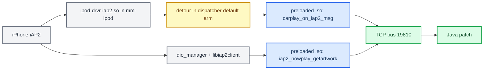

# MHI2 MU1439 Port

*Research, not shipped: what it takes to move the RGI and cover-art features from MHI2Q (MU1316, Qualcomm, Cinemo iAP2) to plain MHI2 (MU1439 Audi US AUG22 G22, Tegra3, Apple reference iAP2 stack), with every symbol, offset and dead end found so far.*

---

## 📋 Verdict and scope

The owner narrowed the port to **RGI + cover art**; AltScreen was dropped from scope. The study's reason ("210.81 has no altScreen strings, so it is impossible") is **superseded**: production now runs altScreen on stock 210.81 MHI2Q by interposing `AirPlayCopyServerInfo` and SETUP and carrying its own stream-111 receiver in the hook ([AltScreen Cluster Video](../altscreen-and-video/ALTSCREEN_CLUSTER_VIDEO.md)). MU1439 has a different 210.81 build, so that route would need its seams re-checked callsite by callsite ([Architecture](ARCHITECTURE.md)). The findings also cover siblings MU1326 / MU1339 / MU1340. Feasibility of RGI: **medium, viable**. Cover art: simpler than on MHI2Q. Java: a bounded recompile plus small fixes. **[decompile]**

| Layer | MHI2Q (MU1316, shipping) | MHI2 (MU1439 target) | Effort |
|---|---|---|---|
| iAP2 stack | Cinemo SDK (`libNmeSDK.so`) inside `dio_manager` | Apple reference stack in `mm-ipod` (dlopens `ipod-drvr-iap2.so`) | architectural change |
| Hook process | `dio_manager` only | `mm-ipod` for RGI + `dio_manager` for cover art | two hooks |
| RGI enable | runtime Identify patch + msg IDs in `dio_manager.json` | `[ident] recvmsgs/sendmsgs` in `/etc/mm/iap2.cfg`, no binary patch | trivial config edit |
| RGI capture | `LD_PRELOAD` interpose of Cinemo `NmeIAP2Message::Decode` | **binary detour** of `link_handle_iap2pkt@0x12e00` in `ipod-drvr-iap2.so` | the main C work |
| Cover art | chunked-JPEG reassembly from the raw stream | `LD_PRELOAD` into `dio_manager` that calls `iap2_nowplay_getartwork` | simpler |
| AltScreen | shipping today via hook interposition (the study called it impossible) | not studied | dropped from scope |
| Java | built against MU1316 | cover-art class identical; `ClusterService` rebuild vs new `Util` signatures | small |

Platform facts shared by both: ARM32 QNX 6.5 (EABI5, `ldqnx.so.2`), so the hook toolchain and the no-`__thread` rule carry over ([Build System](../build-and-deploy/BUILD_SYSTEM.md), [Landmines](../LANDMINES.md)). The two `libairplay.so` builds differ in size (MHI2Q 763,420 B), so every libairplay offset must be re-derived. MHI2Q lives in partition `MMX2QC`, MHI2 in `MMX2`. **[decompile]**

Early hypothesis, superseded by the RGI study below: `dio_manager` contains `CIAP2LocationsHandlerJob` / `CIAP2LocationsHandlerJobListener`, `CSmartphoneLauncherService` and `CIAP2ClientEventListener`, which suggested route guidance might already be handled natively as the iAP2 Location feature; in fact `[location]` is HU→phone NMEA only. Superseded, from the MHI2Q era of this study: an early memo assumed the MHI2Q hook reads raw iAP2 via libc `read()/recv()`. Today's hook interposes the Cinemo NME seams instead ([Architecture](ARCHITECTURE.md)). **[code]**

Sources: `mhi2-port README`, `mhi2_mu1439_port_analysis`

## ⚙️ The hook split



What carries over unchanged: `framework/bus.{c,h}`, `framework/logging.c`, `framework/iap2_protocol.{c,h}` (the iAP2 TLV format does not depend on the SDK), `routeguidance/rgd_tlv.{c,h}`, the state half of `rgd_hook.c` (slot mapping, dirty tracking, publish) and the decode/CRC/PNG/bus half of the cover-art hook. What is rewritten: `framework/hook_framework.c` loses the Cinemo interposers and gains the exported `carplay_on_iap2_msg(payload, len)` entry plus a cover-art trigger; `rgd_hook.c`'s entry is re-pointed at that function. New: a Python detour patcher for `ipod-drvr-iap2.so` in the style of the old `patch_libpresentationcontroller.py` (signature search, write branch + trampoline, verify hash before/after). Dropped: `altscreen/`; the old `cursor/` would port mechanically (and has since been retired on MHI2Q).

Sources: `hook_port_plan`

## 🔧 RGI path in mm-ipod

MHI2Q's Cinemo SDK already knew messages 0x5200–0x5204, so the patch only enabled them. MU1439's Apple reference stack (2018) has **no route-guidance support at all**: zero `Route`/`Guidance`/`Maneuver`/`Lane`/`0x52xx` strings in the driver, no RG feature in `init_features@0xe2cc`, no `[routeguidance]` cfg section, and `[location]` is HU→phone NMEA only. **[decompile]**

### Step 1: enable the messages (config only)

```ini
# /etc/mm/iap2.cfg (system partition; same schema as the MU1367 proxy)
[ident]
recvmsgs=0x5201,0x5202,0x5204
sendmsgs=0x5200,0x5203
```

`ident_info_recvmsgs@0xbd60` and `ident_info_sendmsgs@0xc46c` build the Identification arrays feature by feature, then append comma-separated hex IDs from these keys via `ipod_cfg_find(cfg,"ident",…)` + `strtoul` (capacity 0x80 bytes, at most 64 IDs; overflow logs `Cannot add custom messages`). **[open]** whether iOS also needs a navigation *component* declaration like MHI2Q's EAGroupComponent 0x001E; probably not, since RG is a core control feature.

### Step 2: why a binary detour, not LD_PRELOAD

`ipod-drvr-iap2.so` carries the legacy **`DT_SYMBOLIC` (16)** tag (`DT_FLAGS=0`, `DT_FLAGS_1=0`, no `DT_BIND_NOW`), so the driver's calls to its own globals bind locally and an `LD_PRELOAD` definition of `link_handle_iap2pkt` never sees them. `mm-ipod` does not import that symbol either (it dlsyms only a few entry points), so there is no external caller to interpose. Interposing libc `read/recv/MsgReceive` would work but yields pre-deframe link bytes and means re-implementing iAP2 link deframing. MHI2Q never hit this because `libNmeSDK.so` is not `DT_SYMBOLIC` and dio calls `Decode` through the PLT. `libiap2client.so.1` is not `DT_SYMBOLIC` either, but the port only calls it. **[decompile]**

Superseded: the earlier RGI memo said `link_handle_iap2pkt` is exported so a plain interpose "works directly". The later `.dynamic` dump showed `DT_SYMBOLIC`, which defeats it for internal calls.

`link_handle_iap2pkt@0x12e00` (`int (int link_ctx, int packet_obj)`) calls `link_handle_reply@0x11a2c` before a hard-coded switch on the 16-bit msg id; `iap2_ctrl_msg_table@0xace80` is a sparse runtime struct, not the dispatch table. Unknown ids fall to the default arm and are dropped silently (return 0, no log, no forward):

| Msg id | Handler |
|---|---|
| `0x1D00` / `0x1D02` / `0x1D03` | Identification request / accepted (→ `iap2_start_features`) / rejected |
| `0x4155`, `0x4158` | telephony |
| `0x4C01`, `0x4C04` | media library |
| `0x4E09`, `0x4E0A` | device notifications |
| `0x5001` | `nowplay_update_recv@0x1bb18` |
| `0x5702` | Wi-Fi |
| `0xA100`, `0xA102` | vehicle |
| `0xAA00`–`0xAA05` | authentication |
| `0xAE01` | power |
| `0xDA01` | device audio |
| `0xEA00`, `0xEA01` | EAP session |
| `0xFFFA`, `0xFFFC` | GPS start / stop |
| `0x52xx` | **none: the default arm we hijack** |

Packet object (from prior RE, to be confirmed on the prologue trace): `*(pkt+0x24)` = payload pointer, `*(u16*)(pkt+0x28)` = length. Payload bytes `[0..1]` length, `[2..3]` `0x4040` control marker, `[4..5]` **big-endian** msg id, `[6..]` TLV body.

Two detour designs: **(A)** overwrite the first one or two instructions at entry and re-execute them in the trampoline; **(B, preferred)** patch the default/drop branch so only unknown ids reach the trampoline and known paths are untouched. The trampoline does no parsing: once it does `dlsym(RTLD_DEFAULT, "carplay_on_iap2_msg")`, caches the pointer, then calls it (one load + branch after that). The `.so` lives on the writable `/app` partition, like the already-patched `libPresentationController.so`.

### Step 3: preload the handler into mm-ipod

`libcarplay_hook.so` (or a slim variant) is `LD_PRELOAD`ed into `mm-ipod`, exports `carplay_on_iap2_msg`, and on ids `0x5201/0x5202/0x5204` parses with `rgd_tlv` and pushes to the bus. It is a passive sniffer and sends nothing to the driver. **[open]** where `mm-ipod` gets its environment on MU1439 (the MU1367 proxy launches `io-usb-dcd -d devu-iap2-tegra3-ci.so` from `start_usb_device_stack.sh`; `usblauncher_otg.lua` or `mm-sync.conf` are candidates).

### Next RE step (where the study stopped)

1. Disassemble the prologue of `link_handle_iap2pkt` (first ~6 instructions) to know what a detour displaces.
2. Locate the dispatcher's default arm, the preferred patch point.
3. Confirm the `+0x24/+0x28` writes happen before the dispatch.
4. Pick trampoline space: append to a non-executed region, or add a `DT_NEEDED` glue library (appending is cleaner).

Sources: `hook_port_plan`, `mhi2_mu1439_rgi_path`, `symbol_offsets`

## 🔍 Cover-art path in dio_manager

`dio_manager` (≈657 KB, stripped but with mangled dynamic symbols) exposes DSI service `dsi.carplay.DSICarplay` (string `0x19a104`, UUID `B60FF3E0-C276-5843-8023-5ABA5E2AC150` built at `0x1809c4`), implemented by `CDSICarplayImpl` (`operator new(0x11C)`, created in `CDIOManager::startDSIInterface@0x13a458`, stored at `DIOManager+0x228` = `m_pCarPlayDSI`, assert `NULL == m_pCarPlayDSI` at `DIOManager.cxx:0x6AA`, registered in `startDSI@0x18089c`). Now-playing metadata flows over it, gated on `m_pCarPlayDSI != NULL` (CarPlay only, `0x1418bc–0x1418c8`):

- `onEvent_updateNowPlayingTrackInfo` (~`0x141700`) → `updateTrackState@0x14b1bc`: title, album, artist, composer, duration, genre. The natural fetch trigger.
- `onEvent_updateNowPlayingPlaybackInfo` (~`0x142a00`) → `0x14b0b4`: status, repeat, shuffle, app name.

**Cover art is DSI attribute 6 `coverArtUrl`, and it is dead skeleton code.** `addClient@0x17db58` subscribes all 10 attributes, `reportAttribute` (`0x17d394`) reads attr 6 at `+0xB0`, the listener fan-out at `0x17ef0c` has the string `listener_updateCoverArtUrl: unable to forward call to peer!` (`0x199e1c`), but nothing ever sets it: no `onEvent_*CoverArt*` handler, no `coverArtUrl` key in the PPS tables (`CPPSNowPlayingMetadataObject@0x16d164`, tables `off_19E6E8`/`off_19E6B8`). dio does link `libiap2client.so.1` and imports `iap2_connect`, `iap2_eap_*`, `iap2_gps_data_send`, `iap2_disconnect`, but **not** `iap2_nowplay_getartwork`: the artwork is simply discarded. Even if set, the attribute would carry a URL, not bytes. **[decompile]**

The port: a preloaded hook in dio_manager calls the fully exported client API (≈18 KB, a thin `MsgSendsv` shim to the iap2 daemon):

| Symbol | VA | Notes |
|---|---|---|
| `iap2_nowplay_getartwork(int *h, void *buf, int buflen)` | `0x18c4` | msgcode `0x2100`; no id argument (current track); two-phase: `buflen=0` returns the size, then call again with a caller-owned buffer; the daemon (`nowplay_getartwork@0x1ba3c`) does the file transfer |
| `iap2_connect(const char *devpath, int oflag)` | `0x2cec` | returns a `calloc(1,0x18)` handle `{fd/coid, aux}`; handshake msgcode `0x9999` expects status 2; default `/dev/ipod0` |
| `iap2_disconnect` | `0x2c58` | frees the aux pointer |
| `iap2_filexfer_read` | `0x15cc` | msgcode `0x2900`, explicit transfer id; not needed for art |
| `iap2_ppsdir_get` | `0x153c` | msgcode `0x2703`; the `/ramdisk/pps/iap2` directory |
| `iap2_raw_msg_send` | `0x131c` | generic HU→device control send |
| `iap2_eap_open/close/send/recv/file_descriptor/event_arm` | `0x2e00`, `0x2c88`, `0x13b8`, `0x1660`, `0x127c`, `0x1efc` | third-party EA channel |
| playback (`play`, `pause`, `next`, `prev`, `playpause`, `shuffle`, `repeat`, `fast*`, `audiobook_speed`) | `0x1ea4`, `0x1e4c`, `0x1df4`, `0x1d9c`, `0x1b2c`, `0x1b84`, `0x1bdc`, `0x1c94/0x1cec/0x1d44`, `0x1c34` | |
| `iap2_power_set`, `iap2_bt_status_set`, `iap2_language_set`, `iap2_vehicle_update`, `iap2_app_launch[_ext]`, `iap2_gps_data_send`, `iap2_hid_*` | `0x1ac4`, `0x1954`, `0x2388`, `0x240c`, `0x2378/0x22f0`, `0x1f20`, `0x1444/0x14c0/0x1a64/0x2264` | |

Check the magic of the result (`FF D8 FF` JPEG, `89 50 4E 47` PNG); iOS nearly always sends JPEG. Trigger options: watch PPS `PPS_IAP2_NOWPLAYING_METADATA` (event type 30, which is how dio itself learns track changes) and fetch on change, or poll with CRC dedup as MHI2Q does. Then the existing pipeline: decode → 256×256 → PNG → `/var/app/icab/tmp/37/coverart.png` → `EVT_COVERART`. The daemon's cfg has `[nowplaying] enable=yes` with `ArtworkFileTransferIdentifier` in the metadata list (MU1367 sample), so it does receive artwork by file transfer. **[open]**, and decisive: whether `getartwork` returns bytes **during a CarPlay session**, or whether CarPlay art rides the AirPlay path. If empty, fall back to reassembly by hooking `iap2_eap_recv` / `iap2_filexfer_read`. Answerable by reversing the daemon's `0x2100` handler or one live probe.

Sources: `mhi2_mu1439_coverart_path`, `symbol_offsets`

## 📦 Java side

All four port-target classes were decompiled with the same cfr for MU1316, MU1326 and MU1439, so the diffs are real. MU1326 (MHI2 ER, the closest proxy) is **byte-identical to MU1316** for all four (`cmp`, 962 / 789 / 119 / 78 lines). An earlier "identical" claim compared `java_stock` stubs; the full classes do differ on MU1439:

| Class | MU1316 → MU1439 | Impact on the port |
|---|---|---|
| `AppConnectorTerminalMode` (cover art) | 0-byte diff | ports 1:1 |
| `ClusterService` (RGI, 962 → 952 lines) | `Util.formatDistance` and `Util.getInvalidDistance` take an extra `String`; `satMapProviderChanged` + `setProviderChangeFlag`/`hasSatMapProviderChanged` removed; `setOnlineNavigationState(n==1, …)` no longer checks the provider flag; one `updateDestinationInfo(null,0,0)` on route end dropped | the patched class must be **rebuilt against MU1439's `Util`** |
| `AppConnectorNavi` (not replaced by the patch) | `updateRGStatus` now always `startSync(0)`; the maneuver-descriptor sync gate changed from `!isSyncActive() && !isSyncPending()` to `!isSyncActive() \|\| getCurrentSyncType() != 0`; sideStreets set directly instead of via `BAPStringUtilities.convertToRawString`; new stubs `updateManeuverDescriptorAndExitView` (logs "deprecated"), `responseLast/FavoriteDestinationsList` | compile-safe; `sideStreets` is `byte[]` in both, so `SideStreets.java` output stays valid; **re-check the exitView-toggle FSG sync(1) workaround** against the new gate ([RGI and BAP Bridge](../cluster-and-rgi/RGI_AND_BAP_BRIDGE.md)) |
| `TerminalModeBapCombi` | synthetic accessors swapped: `access$700` ↔ `access$800` (`lc` ↔ `context`) | the replaced `$EventListener` must match MU1439's synthetic numbering |

The cover-art replacement hooks `combiModule.getPictureManager().registerPictureProvider(0, …)`, overrides `updateCurrentStation` → `pushCoverArt` → `ResourceLocator(stationInfo.getPictureID(), url)` + `pictureProvider.addToMapping(listRef, …)` + `responseCoverArt(listRef, SOURCE_TYPE_VC, …, true)`: all stock BAP picture APIs shared across generations. The evidence is kept verbatim: `ClusterService` decompiles for [MU1316](../sources/research/mhi2-port/java/MU1316/de/audi/tghu/navi/app/cluster/ClusterService.java) / [MU1326](../sources/research/mhi2-port/java/MU1326/de/audi/tghu/navi/app/cluster/ClusterService.java) / [MU1439](../sources/research/mhi2-port/java/MU1439/de/audi/tghu/navi/app/cluster/ClusterService.java) and [their diff](../sources/research/mhi2-port/java/diffs/ClusterService_1316_vs_1439.diff); `AppConnectorNavi` [MU1316](../sources/research/mhi2-port/java/MU1316/de/audi/app/combi/bap/app/navi/AppConnectorNavi.java) / [MU1326](../sources/research/mhi2-port/java/MU1326/de/audi/app/combi/bap/app/navi/AppConnectorNavi.java) / [MU1439](../sources/research/mhi2-port/java/MU1439/de/audi/app/combi/bap/app/navi/AppConnectorNavi.java) and [diff](../sources/research/mhi2-port/java/diffs/AppConnectorNavi_1316_vs_1439.diff); `TerminalModeBapCombi` [MU1316](../sources/research/mhi2-port/java/MU1316/de/audi/app/terminalmode/combi/TerminalModeBapCombi.java) / [MU1326](../sources/research/mhi2-port/java/MU1326/de/audi/app/terminalmode/combi/TerminalModeBapCombi.java) / [MU1439](../sources/research/mhi2-port/java/MU1439/de/audi/app/terminalmode/combi/TerminalModeBapCombi.java) and [diff](../sources/research/mhi2-port/java/diffs/TerminalModeBapCombi_1316_vs_1439.diff); `AppConnectorTerminalMode` [MU1316](../sources/research/mhi2-port/java/MU1316/de/audi/app/combi/bap/app/audio/AppConnectorTerminalMode.java) / [MU1326](../sources/research/mhi2-port/java/MU1326/de/audi/app/combi/bap/app/audio/AppConnectorTerminalMode.java) / [MU1439](../sources/research/mhi2-port/java/MU1439/de/audi/app/combi/bap/app/audio/AppConnectorTerminalMode.java) and its [empty diff](../sources/research/mhi2-port/java/diffs/AppConnectorTerminalMode_1316_vs_1439.diff).

Sources: `mhi2_mu1439_java_port_lowrisk`, [ClusterService diff](../sources/research/mhi2-port/java/diffs/ClusterService_1316_vs_1439.diff), [AppConnectorNavi diff](../sources/research/mhi2-port/java/diffs/AppConnectorNavi_1316_vs_1439.diff), [TerminalModeBapCombi diff](../sources/research/mhi2-port/java/diffs/TerminalModeBapCombi_1316_vs_1439.diff)

## 💾 LZOZ: unpacking MU1439's HMI image

MU1439's `lsd.jxe` sits in `MMX2/mifs-stage2/{50,70}/default/mifs-stage2.img` (48 MB; also `extracted/app70/img_restore/main_stage2.ifs.lzo`, 29.6 MB), an eso **LZOZ** container. MU1316 stored the same image uncompressed. Solved 2026-05-26:

```text
0x000  "LZOZ"                               magic (stage1 prints "found lzo1z header")
0x004  u32 blocksize = 0x00200000           2 MiB output per block
0x008  u32 table[37]                        compressed length of each block
0x09c  zero pad to 0x800
0x800  block 0, then blocks 1..36           each padded to 512 bytes:
       fb[0] = 0x800; fb[k+1] = fb[k] + ((tbl[k] + 0x1ff) & ~0x1ff)
```

- Algorithm **lzo1z**, not lzo1x; **37 independent streams**, one per 2 MiB output block (the last is the remainder).
- Block 0 decodes with plain `lzo1z_decompress_safe`; blocks 1–36 use `lzo1z_decompress_dict_safe` with **block 0's own output (0x200000 bytes) as the preset dictionary**.
- Output is exactly `0x04883B28` = 76,036,904 bytes (the imagefs `image_size`). Validate with **native QNX `dumpifs`**; the macOS port chokes.
- `lsd.jxe` is not nested: `ifs/lsd.jxe` at offset `0x878000`, size `0x376FFBE` (~58 MB). `jxe2jar.py` turns it into `MU1439-lsd.jar` (123 MB, 28,528 classes).
- The 48 MB `mifs-stage2.img` carries a ~18.6 MB second partition after the 29.6 MB LZOZ payload.
- The working decoder was a small C wrapper built on the QNX VM (`/tmp/vmfinal.c` there); the earlier macOS lzo1x tools under `extracted/` (`lzoz_unpack.c`, `lzoz_unpack_dict.c`, `lzoz_diag_*.c`, a partial imagefs) are superseded.
- The genuine decoders are in QNX `liblzo.a` (`lzo1z.h`) on the QNX SDP VM; brew `liblzo2` also has lzo1z.

<details>
<summary>Three false leads that cost days, and why</summary>

---

1. **"It's lzo1x."** A hand-ported lzo1x decoder reached the expected ~76 MB but produced garbage (corrupt ELF headers, no directory). Lesson: validate by **content** (a real dirent or imagefs header), never by output size.
2. **"The preset dictionary is a template imagefs in stage1."** `mifs-stage1.img` is zlib (raw `78 da` at file offset `0x800` behind an `A.D.O.D` header `41 ff 44 ff 4f ff 44 ff`) and inflates to a 7,099,344-byte ARM startup binary that holds a template imagefs at `0x1a110`. Aligning its end at `0x22460` made a 6-byte dirent match at output `0x5c`, but that was coincidence: `dumpifs` still failed.
3. **"There is a block-36 framing desync."** An artifact of the wrong decoder; with lzo1z, 512-byte alignment and block 0 as dictionary all 37 blocks decode cleanly.

Also disproven: `swdlclient` is not the LZO decompressor. It links only zlib, uses `LZOX/LZOY/LZOZ` as magic detection, and copies stage2 to flash verbatim; `air::Util::decompressBuffer` in `libair.so` is zlib inflate. The LZO+dict decoder runs at boot inside the stage1 startup binary.

</details>

---

Sources: `lzoz README`, `mhi2_mu1439_lzoz_format`

## 🔗 Where the artifacts live

All outside this repo, under `/Users/luka/Desktop/AUDI_2/`:

| What | Path |
|---|---|
| MU1439 flash root (img_ver `CLU6_MMX2_AU_NAR_G22_055PROD`) | `Firmwares/MHI2_US_AUG22_K3347_MU1439/` (app.img is QNX6, extracted with `Firmwares/qnx6_extract.py` + `dissect.qnxfs`) |
| Extracted `/app` | `…/MU1439/extracted/app70/`, `app50/` |
| Clean imagefs | `…/MU1439/extracted/mifs-stage2.full.imagefs` (76 MB) |
| Carved `lsd.jxe` | `…/MU1439/extracted/ifs/lsd.jxe` |
| `mm-ipod` (≈40 KB, not stripped, BuildID `85ad8230b269addaef1a74ef1e198b71`) | `extracted/app70/armle/usr/sbin/mm-ipod` |
| `ipod-drvr-iap2.so` (≈740 KB, 180 dynamic symbols) | `extracted/app70/armle/lib/dll/` |
| `dio_manager`, `libairplay.so`, `swdlclient` | `extracted/app70/eso/bin/apps/`, `extracted/app70/eso/lib/` |
| `libiap2client.so.1` | `extracted/app70/armle/usr/lib/` |
| Converted jars | `Tools/jxe2jar/out/`: `MU1316-lsd.jar` (compile baseline), `MU1326-lsd.jar`, `MU1339-lsd.jar`, `MU1340-lsd.jar`, `MU1439-lsd.jar`; `MU1326-lsd-vf/` = 30,998 decompiled files |
| Sibling proxies | `Firmwares/MU1367-MHI2_ER_VWG13_K4525/` (VW MHI2, no LZOZ; has `start_usb_device_stack.sh` and an `iap2.cfg` template), `Firmwares/MU1326-MHI2_ER_AU37x_…` |
| Tools | `Tools/jxe2jar/src/jxe2jar.py`, `Tools/dumpifs-linux/dumpifs_macos`, `Tools/cfr.jar`; QNX SDP 6.5 VM via `qnx_ssh.sh` (credentials not recorded here) |

Status when the study paused: LZOZ cracked, Java diffs done, the RGI mechanism chosen (binary detour), all symbols located. Next: the `link_handle_iap2pkt` prologue and default arm. **[open]**

---

## 📚 Sources

Merged originals were removed from the tree after this note absorbed them; they remain in git history (commit 23972aa).

- `mhi2-port README`: TL;DR table, folder map, status.
- `hook_port_plan`: the C-hook port plan, detour design and reuse list.
- `paths`: firmware, jar and tool locations.
- `symbol_offsets`: symbols and offsets in `ipod-drvr-iap2.so`, `libiap2client.so.1`, `dio_manager`, `mm-ipod`.
- `lzoz README`: the LZOZ container and decode recipe.
- `mhi2_mu1439_port_analysis`: generation delta, first feasibility memo.
- `mhi2_mu1439_rgi_path`: RGI recipe (its interpose claim is superseded).
- `mhi2_mu1439_coverart_path`: dead `coverArtUrl` and the `getartwork` API.
- `mhi2_mu1439_java_port_lowrisk`: Java diff findings.
- `mhi2_mu1439_lzoz_format`: LZOZ solution plus the full dead-end history.
- Decompiled port-target classes (cfr), MU1316 / MU1326 / MU1439:
  - `ClusterService`: [MU1316](../sources/research/mhi2-port/java/MU1316/de/audi/tghu/navi/app/cluster/ClusterService.java), [MU1326](../sources/research/mhi2-port/java/MU1326/de/audi/tghu/navi/app/cluster/ClusterService.java), [MU1439](../sources/research/mhi2-port/java/MU1439/de/audi/tghu/navi/app/cluster/ClusterService.java)
  - `AppConnectorNavi`: [MU1316](../sources/research/mhi2-port/java/MU1316/de/audi/app/combi/bap/app/navi/AppConnectorNavi.java), [MU1326](../sources/research/mhi2-port/java/MU1326/de/audi/app/combi/bap/app/navi/AppConnectorNavi.java), [MU1439](../sources/research/mhi2-port/java/MU1439/de/audi/app/combi/bap/app/navi/AppConnectorNavi.java)
  - `TerminalModeBapCombi`: [MU1316](../sources/research/mhi2-port/java/MU1316/de/audi/app/terminalmode/combi/TerminalModeBapCombi.java), [MU1326](../sources/research/mhi2-port/java/MU1326/de/audi/app/terminalmode/combi/TerminalModeBapCombi.java), [MU1439](../sources/research/mhi2-port/java/MU1439/de/audi/app/terminalmode/combi/TerminalModeBapCombi.java)
  - `AppConnectorTerminalMode`: [MU1316](../sources/research/mhi2-port/java/MU1316/de/audi/app/combi/bap/app/audio/AppConnectorTerminalMode.java), [MU1326](../sources/research/mhi2-port/java/MU1326/de/audi/app/combi/bap/app/audio/AppConnectorTerminalMode.java), [MU1439](../sources/research/mhi2-port/java/MU1439/de/audi/app/combi/bap/app/audio/AppConnectorTerminalMode.java)
- Diffs MU1316 vs MU1439: [ClusterService](../sources/research/mhi2-port/java/diffs/ClusterService_1316_vs_1439.diff), [AppConnectorNavi](../sources/research/mhi2-port/java/diffs/AppConnectorNavi_1316_vs_1439.diff), [TerminalModeBapCombi](../sources/research/mhi2-port/java/diffs/TerminalModeBapCombi_1316_vs_1439.diff), [AppConnectorTerminalMode](../sources/research/mhi2-port/java/diffs/AppConnectorTerminalMode_1316_vs_1439.diff) (empty: identical).

See also [Architecture](ARCHITECTURE.md), [RGI and BAP Bridge](../cluster-and-rgi/RGI_AND_BAP_BRIDGE.md), [Build System](../build-and-deploy/BUILD_SYSTEM.md), [Home](../README.md).
