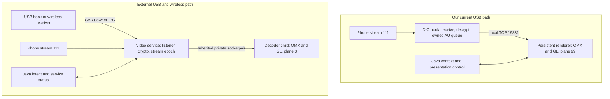

# Repository Comparison: mhi2q-evo and Our CarPlay Stack

_Source comparison and selected host verification, 2026-10-10. Recommendations are proposed; no runtime changes or deployment._

---

## 📋 Scope and conclusion

Compared our commit `9305604dceda3e4ce333f008a495e70645194e66` with the private GitHub repository `mhi2q-evo/mhi2q-evo`, main at `f4cc3a131214a3c0d07d7e7b3c2c24d4d245096b`. The external tree was cloned separately under `/tmp`; this review made no head-unit or NAS connection. Our existing dirty iOS VM files were left alone. This is a broad subsystem review with selected code checks, not an exhaustive defect or security audit.[^evo]

**The useful transfers are diagnostics, session ownership, independent wire-vector tests and narrow firmware patching.** The external tree does not supply an upmix or a demonstrated faster decoder. Our current video recovery, input scheduling, route presentation, telephony and multichannel audio must be preserved when evaluating its ideas.[^alt][^ours_video][^ours_input][^ours_rgd][^ours_tel][^ours_audio]

Firmware matters: their native SI/COMM work is pinned to P5092; our shipped integration and tests also account for MU1316/P5087 and separate CN Java deltas. An offset, replacement class, displayable ID or crop rectangle is not portable just because both machines are called MHI2Q.[^si][^ours_build]

### Shared source families

A relative-path comparison of first-party `.java`, `.c`, `.h`, `.cpp` and `.hpp` files found:

| Matched family | Our files | External files | Shared relative names | Byte-identical shared files |
|---|---:|---:|---:|---:|
| `java_patch/` | 50 | 38 | 24 | 3 |
| `maneuver_render/` vs `src/maneuver_render/` | 32 | 18 | 17 | 1 |
| Hook framework | 16 | 10 | 10 | 0 |
| Route-guidance hook | 4 | 4 | 4 | 0 |
| Cover-art hook | 7 | 3 | 3 | 0 |

These counts establish shared implementation shapes and substantial divergence. They do not establish authorship, direction of copying, quality, or a safe merge base. Read differences per contract instead of replacing a same-named file wholesale.

## 🗺️ Process and ownership differences

Both stacks already put proprietary OMX/GL work outside `dio_manager`. The external design additionally removes video receive/parsing from DIO, adds a service dependency and centralizes USB/wireless ownership. A socketpair can simplify peer identity and lifecycle; it is not evidence of higher FPS or lower latency.[^alt][^ours_video]

## 🔍 Subsystem comparison

| Subsystem | Our current implementation | External implementation | Practical consequence |
|---|---|---|---|
| USB CarPlay base | Stock AirPlay 210.81 with module fan-out for audio/AltScreen and Cinemo seams | Stock USB AirPlay plus a thin type-111 service adapter | Keep stock110/audio behavior and our shared seams; evaluate service extraction separately.[^ours_arch][^alt] |
| Cluster111 receive | Hook owns framing, AES, AVCC validation/conversion and bounded owned AU forwarding | Service owns listener, framing, AES/ChaCha, validation and APV1; hook retains control-session ownership | A common transport-neutral receiver is useful for eventual USB/wireless convergence.[^ours_video][^alt] |
| Decoder and presentation | Separate reader/decode/presenter work, decoded-picture mailbox, retained GPU buffer lifetime, monotonic waits | Event loop drains stale outputs before presenting one picture; EGLImage shared buffers, held last picture, bounded watchdogs | Both avoid CPU pixel upload. No measured apples-to-apples FPS advantage was found.[^ours_video][^decoder] |
| Compressed backlog recovery | Latest fix keeps the last picture, requests IDR without changing the link, then drops pre-IDR backlog; decoder fault is separate | APV1 sender has 16-record/byte bounds and a 0.5 s residence limit; a stale queue resets the decoder connection | Preserve our latency/fault distinction; importing their timeout policy could reintroduce blink behavior.[^ours_video][^apv] |
| IPC | Loopback framed AU transport with generation, sequence, sender PTS, local receipt time, HELLO/ACK/STATUS | Private per-child APV1 socketpair plus separate owner/control IPC; cached config and fresh IDR after restart | Borrow owner-scoped private channels only with our age/generation/presentation information retained.[^ours_video][^ipc] |
| Startup and splash | Persistent renderer carries the PRISM loader; Java waits for a posted frame before cluster takeover | Service owns background99; decoder owns video3; connection/splash may request composition before first decoded frame | Separate background/video ownership is a valid alternative, but different IDs/context tables must move together.[^ours_arch][^alt][^screen] |
| View and KDK | FctID44 controls actual KDK visibility, FctID54 controls stage; acknowledged state is distinct from requested View | View/app-model logic and a 250 ms popup reveal fallback; different plane/crop arrangement | Preserve our acknowledged VC authority; do not substitute a timeout for an accepted KDK visibility event.[^ours_rgd][^evo_layers] |
| Input commands | Worker with reserved recovery/layout capacity, state replacement, paced zoom, immutable selected age and retirement checks | USB zoom sends up to 32 commands in a loop under the session mutex; wireless main knob uses native DSI/HID and focus ownership | Our USB command scheduler is worth retaining. External wireless focus/HID tests are useful future references.[^ours_input][^evo_input][^si] |
| Route/HUD graphics | Independent lane events and atomic renderer batches, C++ scene/lane strip, Unicode route-text scrolling, richer progress state | RGD/BAP and C maneuver renderer; related mapping family with different geometry/progress and text logic | Keep our lane/text/progress features. Test any mapping transfer on the same maneuver and lane fixtures.[^ours_rgd][^evo_rgd] |
| Cover art | Stream extraction and JPEG safety split into separately tested modules | Related async cover-art worker with a monolithic extraction path and bounded JPEG accumulation | There is no established reason to replace our parser with theirs.[^ours_cover][^evo_cover] |
| Phone tab | Native call state plus iAP2 recents/favorites/signal, hold/mute and gated BAP phone service | Phone-history probes and a Phone Reminder transport patch; no equivalent full cluster phone service found | Preserve our deployed telephony. Reminder suppression and probe tooling solve separate problems.[^ours_tel][^evo_java] |
| Audio | Stereo SCENE, mask worker, LFE/cabin guard; AAC/APAC buffered decode and discrete PCM6/SAD routing | Wireless LPCM authentication and bounded queue; runtime sink discards PCM; disconnected QNX output adapter | External audio code helps transport testing, not rear-scene quality.[^ours_audio][^evo_audio] |
| Wireless | C stock210 hook, Rust iAP2/MFi/bootstrap, receiver bridge and native owner supervisor; hardware acceptance remains open | From-source C receiver, BT preload/launcher, stock MFi/SAP helpers and native SI/COMM integration | Their SI/HMI findings can reduce our RE work. Replacing our architecture would import their remaining audio/focus/integration gaps.[^ours_wireless][^si][^mfi] |
| Build and firmware support | US/EU/JP compatible Java plus strict CN deltas, linkage audits, receipts, symbol/constructor gates and VIN protection | Docker Java build accepts an explicit firmware JAR; narrow ASM patches preserve stock methods; native bindings are fingerprinted | Adopt build-time method injection where suitable while keeping our multi-firmware validation.[^ours_build][^evo_build] |
| Deployment | M.I.B. package/rollback, exact-stock NCM replacements, supervised persistent renderers; host readback tooling | Host-driven complete bundles, locks/readback/restore sessions, optional no-backup mode, independently supervised video service | Review their state/rollback tests; their script cannot replace our M.I.B./VIN/region-aware installation contract.[^ours_deploy][^evo_deploy] |
| Logging and tests | Async hook logging already exists; AltScreen has source-hashed sanitizer/TSan/Linux/QNX/fuzz evidence | Shared bounded process logger, decoder-stage metrics, service/menu overlays, host crypto/IPC tests and saved-firmware inspectors | A common metrics vocabulary and targeted external fixtures are useful; async logging and mailboxes are not missing from our tree.[^ours_video][^evo_log][^decoder] |

## ✅ Changes worth taking

### 1. Show existing video diagnostics in the car

Port the **idea and small rendering/gesture components** of their service menu: hold left OK for two seconds and release; a short release still performs route-info toggle. Display our build ID, new-picture FPS, input/decode/present rates, queue age, superseded pictures, worst present/input wait and current recovery reason.[^menu]

Use our existing timestamps and counters. Never label decoder time as phone-to-glass latency, count idle redraw as a new frame, or call a successful swap proof of visible cluster pixels. Their metric code/tests already make several of these distinctions. Their recorded P5092 observations include decode progress without visible UI.[^decoder][^presentation]

Expected benefit: the owner can distinguish source starvation, decode starvation, renderer scheduling and recovery while reproducing a blink. This does not itself fix FPS. Keep the panel optional and bound its texture refresh rate.

### 2. Add explicit dependency readiness to feature advertisement

Their USB hook probes the service before advertising AltScreen; an absent service leaves the stock feature/display response intact.[^alt]

Our advertisement preflight currently proves CF objects, the main UUID and display consistency; it does not perform the same live renderer-service probe. A proposed extension should check an actual listener/handshake and feature support, without confusing that result with `VIDEO_ON`. A transient probe failure must not permanently lose a healthy session's cluster feature, and probe waits must not consume the SI startup budget.[^ours_alt]

### 3. Preserve stock classes with narrow build-time patches

Their `PatchVoiceButton` injects one guarded branch into `SDSHMIListener.handlePTTShort`, rejects unsupported/already patched input and preserves the other stock methods. Their startup/reminder patchers use the same build-time principle.[^voice][^evo_build]

This is a useful alternative to reconstructing a whole stock class for a small change. Trial one independent feature first, against each applicable stock JAR with bytecode/linkage tests. The P5092 Siri patch is a reference implementation, not an authorized or verified MU1316/CN drop-in.

### 4. Consolidate metrics across processes

Their shared async logger exposes queue peak, dropped records and completed-write latency; decoder metrics track submit/output/present, buffer ownership and stage peaks.[^evo_log][^decoder]

Our hook already has bounded async logging. Extend the existing system with consistent metric names and build/session IDs across hook, renderer and Java; avoid adding a second writer or migrating logging just for style. Add fixture cases for a blocked log sink and distinguish incomplete evidence after crash from a zero-drop run.

### 5. Evaluate 1.25x source supersampling after stability

External P5092 notes report functioning `1800x570` input reduced to logical `1440x455`, with extended visual/performance validation pending. `2880x910` was rejected in their recorded HU test. The header and packager require matching hook/decoder scale.[^ssaa]

Our source/output geometry is `1440x542`, not their `1440x455`; copying their constants would change the composition contract. Start from our measured viewport, derive even source dimensions, then measure text quality, OMX acceptance, buffer memory, renderer CPU and frame pacing. The reported 1.25x success does not establish our decoder limit or a free quality improvement.

### 6. Consider service extraction as a separate architecture trial

If our wireless path needs a second receiver, a common USB/wireless video service can remove duplicate framing/crypto code and isolate parser failures from DIO. Use one owner epoch, private decoder channels, fail-closed SETUP, cached configuration plus fresh IDR and bounded teardown.[^alt][^ipc]

Retain our owned buffers, origin timestamps, status generations, input worker and no-blackout backlog recovery. Before committing to migration, compare one recorded stream through both chains: exact decoded sequence, restart/disconnect behavior, application copies, queue memory and CPU. No network, GPU or frame-rate improvement should be assumed from the process diagram alone.

## ⚠️ Differences to keep out of a direct port

- **Video age timeout:** their 500 ms queue disconnect is not our latest keep-picture policy. The recent car evidence attributes our two blinks to renderer starvation amplified by recovery; our priority/wait/backlog fix has not yet been driven.[^ours_video][^apv]
- **Control calls under a session lock:** their USB zoom loop lacks our pacing/selected-age contracts. Preserve the existing worker.[^evo_input][^ours_input]
- **Readiness meanings:** their `CV_MAP_VIDEO_ACTIVE` is derived from validated video input and owner state. Our `VIDEO_ON` follows successful presentation. Preserve separate receive, decode, present and observed-visible states.[^ipc][^ours_video][^presentation]
- **Capabilities without a backend:** their current `/info` advertises AAC/Opus/uplink/type103 research capabilities despite an LPCM-only receiver. This is documented as research, not production support.[^evo_audio]
- **Experimental native ownership:** their SI constructor installs fingerprinted ARM entry gateways, while our production hook uses lazy initialization and fixed export seams. Their binding/rollback machinery is useful research; its constructor, prepared executable and offsets should not enter our shipping path as an incidental refactor.[^si][^ours_arch]
- **Old docs:** our `reference/ARCHITECTURE.md` still describes Track A audio despite current SCENE code; their architecture snapshot has older main-video/HMI descriptions than component READMEs. This report uses current code and names evidence dates rather than treating every overview as current.

## 🧪 Verification completed

| Check | Result | Boundary |
|---|---|---|
| External `scripts/test_wireless_audio.sh` | PASS, during the preceding audio review | Independent AEAD vectors, replay/reorder/timestamp/queue and QNX adapter mocks; no hardware audio |
| External `scripts/test_wireless_audio_receiver.sh` | PASS, during the preceding audio review | Dual lanes, cleanup/reconnect and byte-exact fixture sinks; production sink remains discard |
| External `scripts/test_airplay_alt.sh` | PASS in this review | ASan/UBSan parser/video/IPC/ownership/metrics/logging, installation simulations and supervisor checks; graphics/OMX calls use fixtures |
| External `tests/video_service_receive_test.py` | PASS in this review | Actual host service, owner IPC, AES/AEAD, fragmented TCP, exact private APV1, busy refusal, decoder restart, tamper and teardown; decoder/graphics child is synthetic |
| Our implementation comparison | Source inspection and recorded validation evidence | No new full regression, QNX build, real-phone session or vehicle benchmark |
| Report QA | PASS: local links/footnotes, whitespace and Mermaid rendering; diagram inspected | Documentation only |

External run logs are local temporary artifacts: `/tmp/upmix-evo-alt-review-20261010.log` and `/tmp/upmix-evo-service-review-20261010.log`. No runtime code, install scripts, models or pre-existing dirty files were changed by this review.

## 🎯 Suggested implementation order

1. Optional service menu using our existing metrics and ownership gates.
2. Consistent process/build/session counters and an acceptance table for visible output, input, reconnect and idle scenes.
3. Renderer dependency readiness probe with a bounded startup contract.
4. Independent PTT bytecode-patch trial and firmware matrix.
5. Controlled 1.25x supersampling experiment after the current pacing fix is verified.
6. Common video-service migration only when it solves a demonstrated USB/wireless ownership or duplication problem.

No implementation in this list has been started. Audio research and model training were not launched.

## 📚 Source references

[^evo]: [External tree at reviewed commit](https://github.com/mhi2q-evo/mhi2q-evo/tree/f4cc3a131214a3c0d07d7e7b3c2c24d4d245096b).
[^alt]: External [type111 adapter](https://github.com/mhi2q-evo/mhi2q-evo/blob/f4cc3a131214a3c0d07d7e7b3c2c24d4d245096b/src/hook_dio_manager/airplay_altscreen/README.md), [video service](https://github.com/mhi2q-evo/mhi2q-evo/blob/f4cc3a131214a3c0d07d7e7b3c2c24d4d245096b/src/carplay_video_service/README.md).
[^ours_video]: [Our video pipeline and current car findings](../altscreen-and-video/VIDEO_PIPELINE.md), [pacing validation](../altscreen-and-video/ALTSCREEN_PACING_VALIDATION.md); `hook/altscreen/altscreen_av.c`, `altscreen_render/main.c`, `queue_policy.h`, `sink_omx_qnx.c`.
[^ours_input]: [Our input command contract](../altscreen-and-video/ALTSCREEN_INPUT_COMMANDS.md); `hook/altscreen/command_policy.h`, `command_worker.h`.
[^ours_rgd]: [Our independent lane events](../cluster-and-rgi/LANE_GUIDANCE.md); `java_patch/com/luka/carplay/cluster/ClusterLayerController.java`, `rgd/BAPBridge.java`, `CurrentPositionScroll.java`, `VCUnicode.java`, `maneuver_render/scene/`.
[^ours_tel]: [Our CarPlay telephony](../cluster-and-rgi/CARPLAY_TELEPHONY.md); `hook/telephony/`, `java_patch/com/luka/carplay/telephony/`.
[^ours_audio]: [Our current stereo/discrete audio](../audio/STEREO_TO_5_1_UPMIX.md), [SCENE deployment evidence](../build-and-deploy/SCENE_BACKEND_DEPLOY.md); `hook/audio/stereo_upmix.h`, `scene_mask.h`, `audio_hook.c`.
[^si]: External [native SI integration](https://github.com/mhi2q-evo/mhi2q-evo/blob/f4cc3a131214a3c0d07d7e7b3c2c24d4d245096b/src/hook_smartphone_integrator/README.md), [ARM patch transactions](https://github.com/mhi2q-evo/mhi2q-evo/blob/f4cc3a131214a3c0d07d7e7b3c2c24d4d245096b/src/hook_smartphone_integrator/arm_intercepts.c).
[^ours_build]: [Our build and firmware matrix](../build-and-deploy/BUILD_SYSTEM.md); `scripts/build_java.sh`, `java_patch_cn/`, `scripts/audit_java_variants.sh`, `protector/`.
[^ours_arch]: [Our architecture](ARCHITECTURE.md), with the audio paragraph superseded by current SCENE code; `hook/main.c`, `hook/framework/airplay_seams.c`, `deploy/smartphone_integrator/carplay_monitor.sh`, `java_patch/com/luka/carplay/core/AltScreenModule.java`.
[^decoder]: External [decoder source](https://github.com/mhi2q-evo/mhi2q-evo/blob/f4cc3a131214a3c0d07d7e7b3c2c24d4d245096b/src/carplay_video_decoder/main.c), [display](https://github.com/mhi2q-evo/mhi2q-evo/blob/f4cc3a131214a3c0d07d7e7b3c2c24d4d245096b/src/carplay_video_decoder/display.c), [metrics](https://github.com/mhi2q-evo/mhi2q-evo/blob/f4cc3a131214a3c0d07d7e7b3c2c24d4d245096b/src/carplay_video_decoder/metrics.h).
[^apv]: External [APV1 sender and queue policy](https://github.com/mhi2q-evo/mhi2q-evo/blob/f4cc3a131214a3c0d07d7e7b3c2c24d4d245096b/src/carplay_video_service/apv_stream.c): 16 records, 0.5 s queue residence, allocation/copy in enqueue, reset/IDR flow.
[^ipc]: External [CVR1 contract](https://github.com/mhi2q-evo/mhi2q-evo/blob/f4cc3a131214a3c0d07d7e7b3c2c24d4d245096b/src/common/carplay_video/receiver_ipc.h), [service control](https://github.com/mhi2q-evo/mhi2q-evo/blob/f4cc3a131214a3c0d07d7e7b3c2c24d4d245096b/src/carplay_video_service/session_control.c), [service state](https://github.com/mhi2q-evo/mhi2q-evo/blob/f4cc3a131214a3c0d07d7e7b3c2c24d4d245096b/src/carplay_video_service/service.c).
[^screen]: External [ScreenModule](https://github.com/mhi2q-evo/mhi2q-evo/blob/f4cc3a131214a3c0d07d7e7b3c2c24d4d245096b/java_patch/com/luka/carplay/core/ScreenModule.java).
[^evo_layers]: External [ClusterLayerController](https://github.com/mhi2q-evo/mhi2q-evo/blob/f4cc3a131214a3c0d07d7e7b3c2c24d4d245096b/java_patch/com/luka/carplay/cluster/ClusterLayerController.java).
[^evo_input]: External [USB session commands](https://github.com/mhi2q-evo/mhi2q-evo/blob/f4cc3a131214a3c0d07d7e7b3c2c24d4d245096b/src/hook_dio_manager/airplay_altscreen/session.inc): `alt_zoom_command` and `alt_night_command`.
[^evo_rgd]: External [RGD Java family](https://github.com/mhi2q-evo/mhi2q-evo/tree/f4cc3a131214a3c0d07d7e7b3c2c24d4d245096b/java_patch/com/luka/carplay/rgd), [maneuver renderer](https://github.com/mhi2q-evo/mhi2q-evo/tree/f4cc3a131214a3c0d07d7e7b3c2c24d4d245096b/src/maneuver_render).
[^ours_cover]: `hook/coverart/coverart_stream.c`, `jpeg_safety.c`, `coverart_hook.c`; their separate source/test boundaries were inspected in this review.
[^evo_cover]: External [cover-art worker](https://github.com/mhi2q-evo/mhi2q-evo/blob/f4cc3a131214a3c0d07d7e7b3c2c24d4d245096b/src/hook_dio_manager/coverart/coverart_hook.c).
[^evo_java]: External [Java build](https://github.com/mhi2q-evo/mhi2q-evo/blob/f4cc3a131214a3c0d07d7e7b3c2c24d4d245096b/scripts/build_java.sh), [phone-history experiment](https://github.com/mhi2q-evo/mhi2q-evo/tree/f4cc3a131214a3c0d07d7e7b3c2c24d4d245096b/src/hook_dio_manager/phone_history).
[^evo_audio]: External [receiver sink](https://github.com/mhi2q-evo/mhi2q-evo/blob/f4cc3a131214a3c0d07d7e7b3c2c24d4d245096b/src/wireless_receiver/wireless_media.c), [advertisement](https://github.com/mhi2q-evo/mhi2q-evo/blob/f4cc3a131214a3c0d07d7e7b3c2c24d4d245096b/src/wireless_receiver/wireless_info.c), [LPCM formats](https://github.com/mhi2q-evo/mhi2q-evo/blob/f4cc3a131214a3c0d07d7e7b3c2c24d4d245096b/src/common/wireless_audio/wireless_audio_codec.c).
[^ours_wireless]: [Our stock210 wireless architecture and validation limits](../wireless-carplay/README.md); `hook/wireless/`, `wireless/daemon/`, `wireless/receiver_bridge/`, `wireless/integration/`.
[^mfi]: External [MFi helper](https://github.com/mhi2q-evo/mhi2q-evo/blob/f4cc3a131214a3c0d07d7e7b3c2c24d4d245096b/src/mfi_auth_helper/README.md), [bounded asynchronous SAP helper](https://github.com/mhi2q-evo/mhi2q-evo/blob/f4cc3a131214a3c0d07d7e7b3c2c24d4d245096b/src/mfi_sap_helper/README.md).
[^evo_build]: External [Java build](https://github.com/mhi2q-evo/mhi2q-evo/blob/f4cc3a131214a3c0d07d7e7b3c2c24d4d245096b/scripts/build_java.sh), [firmware tools](https://github.com/mhi2q-evo/mhi2q-evo/tree/f4cc3a131214a3c0d07d7e7b3c2c24d4d245096b/tools/firmware).
[^ours_deploy]: [Our deployment](../build-and-deploy/DEPLOY_AND_RELEASE.md), [USB replug recovery](../connect-and-usb/USB_REPLUG_RECOVERY.md); `scripts/prepare_install.sh`, `install_MoreIncredibleBash/mod/custom.sh`, `deploy/smartphone_integrator/`.
[^evo_deploy]: External [deployment entry point](https://github.com/mhi2q-evo/mhi2q-evo/blob/f4cc3a131214a3c0d07d7e7b3c2c24d4d245096b/scripts/deploy.sh), [supervisor](https://github.com/mhi2q-evo/mhi2q-evo/blob/f4cc3a131214a3c0d07d7e7b3c2c24d4d245096b/deploy/servicemgr/carplay_video_supervisor.sh), [vehicle acceptance](https://github.com/mhi2q-evo/mhi2q-evo/blob/f4cc3a131214a3c0d07d7e7b3c2c24d4d245096b/docs/deploy/vehicle-validation.md).
[^evo_log]: External [async logger contract](https://github.com/mhi2q-evo/mhi2q-evo/blob/f4cc3a131214a3c0d07d7e7b3c2c24d4d245096b/src/common/async_log.h); our existing `hook/framework/logging.c` has its own 64-record writer queue.
[^menu]: External [service-menu contract](https://github.com/mhi2q-evo/mhi2q-evo/blob/f4cc3a131214a3c0d07d7e7b3c2c24d4d245096b/docs/cluster/service-menu.md), [gesture](https://github.com/mhi2q-evo/mhi2q-evo/blob/f4cc3a131214a3c0d07d7e7b3c2c24d4d245096b/java_patch/com/luka/carplay/core/ServiceMenuGesture.java).
[^presentation]: External [P5092 video/presentation evidence and limits](https://github.com/mhi2q-evo/mhi2q-evo/blob/f4cc3a131214a3c0d07d7e7b3c2c24d4d245096b/docs/re/firmware/p5092-video-presentation-findings.md).
[^ours_alt]: `hook/altscreen/altscreen_hook.c`: advertisement preflight; [our AltScreen protocol](../altscreen-and-video/ALTSCREEN_CLUSTER_VIDEO.md).
[^voice]: External [PTT behavior and verification](https://github.com/mhi2q-evo/mhi2q-evo/blob/f4cc3a131214a3c0d07d7e7b3c2c24d4d245096b/docs/input/carplay-voice-button.md), [ASM patcher](https://github.com/mhi2q-evo/mhi2q-evo/blob/f4cc3a131214a3c0d07d7e7b3c2c24d4d245096b/tools/java_patch/PatchVoiceButton.java).
[^ssaa]: External [supersampling experiment and limits](https://github.com/mhi2q-evo/mhi2q-evo/blob/f4cc3a131214a3c0d07d7e7b3c2c24d4d245096b/docs/cluster/p5092-supersampling.md), [shared scale configuration](https://github.com/mhi2q-evo/mhi2q-evo/blob/f4cc3a131214a3c0d07d7e7b3c2c24d4d245096b/src/common/carplay_video_config.h).
