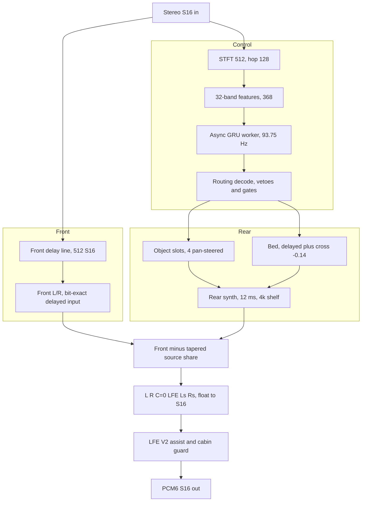
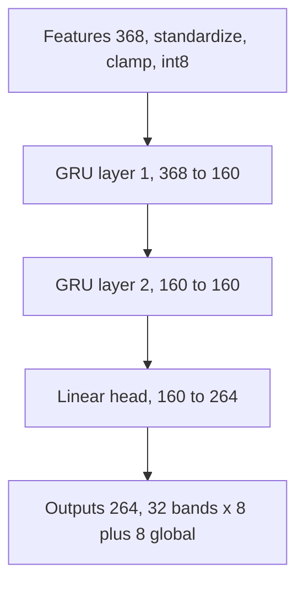

# HSSR — the stereo→5.1 upmix model, end to end

*A long-read on the AI that drives the CarPlay Virtual Cabin upmix: what it is, how it works, every iteration we tried, and what we actually shipped.*

---

> **Provenance.** Claims are tagged inline with the source file: `hook/audio/…`,
> `deploy/…`, the curated notes (`docs/`), `models/…`, `memory/…`. Code-state claims (constants,
> defaults, env flags, what the shipped startup sets) cite `path:line` against the
> current tree and the code is ground truth for them; training and measurement
> history cite the doc that recorded it. This paper was synthesized from the corpus in
> the Audio upmix notes (`docs/audio/`), `tools/stereo-upmix-render/`, the `hook/audio` sources, and the
> `upmix_*` memory notes; those remain the primary record.

## 📋 TL;DR

HSSR = **H**igh-**S**electivity **S**emantic **R**ear-routing. It is a small,
causal, quantized GRU **routing controller** — *not* a source separator. It never
splits audio into stems. It listens to a stereo signal 93.75 times a second and
emits, per frequency band, a decision: *how much of this belongs behind the
listener, and where*. A deterministic DSP then builds a 5.1 field from that
decision, on top of the reverse-engineered J525 amplifier "Virtual Cabin"
(`docs/audio/HSSR_MODEL.md`, `docs/audio/UPMIX_DATASETS_AND_TEACHERS.md`).

The honest one-paragraph history: we spent ~15 model generations trying to make a
network *separate* music into 12 instrument classes on 240 songs, and it never
worked — an independent audit found the trained model, after a full pass, equalled
"mute plus drums" (`docs/audio/UPMIX_TRAINING_HISTORY.md`). We abandoned
separation for a **genre-agnostic "second scene"**: move the not-protected,
spatially-wide part of the stereo image behind the listener, delayed so the front
still anchors the sound. The learned part shrank to a single job — a *protection
mask* that keeps lead vocal and bass out of the rear. What ships today is that DSP
second scene **gated by two GRUs**: `q6d` (primary, trained on real MoisesDB stems)
with `V11` kept as a conservative **vocal-protection guard**, plus the Dolby-derived
**scene-bed distribution** (front retention 0.5, per-band bed delays, owner attack)
switched on in the shipped startup (`deploy/smartphone_integrator/carplay_startup.sh:75-78`).

One-line lineage:

> V9 → **V11 selected** (2026-09-07, MUSDB, selectivity 59×) → V12 A–E rejected →
> V13 renderer+data fixes → V14 teachers+review → V15 FLOAT + streaming A/B/C
> rejected → **q6d selected** (2026-09-18, MoisesDB real 6-class, full fine-tune
> from V11), shipped as the primary model with **V11 kept as the vocal guard**.

**Caveat that matters:** "a learned protection mask, not 12 classes" is the design
*direction*. The purpose-built learned mask (the Q4 line) was prototyped, measured
**worse than V11 for vocals**, and shelved. What is deployed is a DSP
azimuth/coherence second scene gated by q6d + the V11 guard
(`docs/audio/UPMIX_LISTENING_AND_DEPLOY_LOG.md`, `memory/upmix_second_scene_formulation.md`).

## ❌ Why the first approach failed

For roughly fifteen architecture generations (V11…Q2) the model was asked to do
supervised source separation / role classification over 240 songs. It never
reached a regime where separation works. The 2026-09-17 independent audit is the
tombstone (`docs/audio/UPMIX_TRAINING_HISTORY.md`,
`memory/upmix_q2_independent_audit.md`):

- The trained model after a full 24,288-update pass **equals MUTE + drums**; its
  "+0.45 dB vs disabled" compares against an empty control, and "−0.1 dB vs raw
  scalar" means it sits at its own initialization (mask/refinement heads zero-init).
- Per-family DEV NMSE: drums 0.44, but lead 0.81, bass 0.81, guitar 0.90, backing
  1.06, keys 1.84 — most heads output 13–17 dB below target (MSE shrinkage toward
  mute).
- Only **2,352 of 111,132 parameters** actually do per-bin separation; the rest
  compute 32-band descriptors that, for vocal/guitar/keys, are no better than the
  training-set prior. Even *oracle* 32-band hints leave backing NMSE 0.57–0.89 —
  the band-power interface **structurally cannot** separate lead/backing or
  keys/guitar.
- Absent-head leakage was unscored (a −40 dB floor dropped 55% of cells — exactly
  where rear leakage lives); the keys head emitted a −12.8 dB phantom on songs with
  no keys.
- Nobody had ever listened to the output — 0 WAVs rendered.

A static per-bin 2×2 Wiener filter with **zero trainable parameters** beat the
trained model on every family except drums (`…AUDIT…` §10). The conclusion was not
"train longer" but "this problem is mis-posed": 12-class supervised separation on
240 songs cannot work; **the rear loudspeaker needs one mask, not twelve**
(`docs/audio/UPMIX_LISTENING_AND_DEPLOY_LOG.md`, `memory/upmix_second_scene_formulation.md`).

## 💡 The idea we kept: a genre-agnostic second scene

Given the Virtual Cabin, split the stereo image and move part of it behind the
listener as a *second scene* — not ambience, not a copy of the mix, for any genre,
with **no instrument classes** (adopted by Luka 2026-09-17,
`docs/audio/UPMIX_LISTENING_AND_DEPLOY_LOG.md`, `memory/upmix_second_scene_formulation.md`).
Rear = (NOT protected: lead vocal / bass / drum core / dominant harmonic line) AND
(spatially wide / decorrelated / texture-like). Three components:

1. **DSP, genre-free** — per-bin pan, inter-channel coherence, texture (fast/slow
   envelope); low frequencies stay front.
2. **The only learned part** — a *protection mask*: what must **not** go rear, with
   an **asymmetric loss** (a leaked lead is far worse than a missed piece of
   support).
3. **Renderer** — rear delayed 10–20 ms, high-passed, decorrelated; front = X −
   α·rear, with matrix-return compensation.

**Why the rear is delayed.** The shipped mechanism delays the *rear only* by 12 ms
(`SPA_SCENE_REAR_DELAY_FRAMES = 576` at 48 kHz, `hook/audio/stereo_upmix.h:28-30`) and
leaves the front aligned, so the louder, earlier front anchors the image by the
**precedence (Haas) effect** and the rear reads as distinct objects, not an echo. The
measured in-mix rear copy sits ~20–30 dB under the front and 12 ms late — "which is
why Luka hears objects, not a vocal echo" (`memory/upmix_second_scene_formulation.md`,
`docs/audio/UPMIX_LISTENING_AND_DEPLOY_LOG.md`). This is deliberately unlike Dolby, which
never sends the dominant object to the rear
(`docs/audio/UPMIX_CALIBRATION_AND_TUNING.md`).

## ⚙️ How the runtime works

Output rail is fixed PCM6 `L, R, C, LFE, Ls, Rs` (`hook/audio/stereo_upmix.h:46-53`).
**C is always digital zero** — the J525 amplifier derives centre from L/R, so the
hook must not (`docs/audio/STEREO_TO_5_1_UPMIX.md`).

End to end, one 128-sample hop:



The routing decode vetoes are `lead_keep⁴`, `bass_keep⁵`, `guard²`; the frequency
gates are 0 below 220 Hz, a ramp to 350 Hz, and roll-off above 15 kHz
(`hook/audio/hssr_dsp.c:659-758`). The retention HF taper is 1000:2500 Hz
(`hook/audio/stereo_upmix.h:42-43`).

### Signal path (STFT / WOLA)

- FFT size **512**, hop **128**, 257 half-spectrum bins, **32 perceptual bands**,
  64 four-bin "shape" bands; 4× overlap; latency 512 frames = **10.667 ms**
  (`hook/audio/hssr_dsp.h:15-22`).
- Analysis window is a half-sine `sin(π·(n+0.5)/512)`; the synthesis window is that
  divided by the per-phase COLA `Σw²`, with the inverse `1/N` folded in so the
  inverse transform never rescales (`hook/audio/hssr_dsp.c`, WOLA setup).
- In-place radix-2 512-point FFT; twiddles regrouped per butterfly pass for
  contiguous vector loads (`hook/audio/hssr_dsp.h:89-91`); first pass is pure add/sub.
  Because both output channels are real, left→real and right→imaginary are packed
  into one Hermitian spectrum and recovered with a **single** inverse FFT
  (`hssr_dsp.c`).
- **S16 vs float.** The DSP core is float; the boundaries are S16. Critically, the
  **fronts are not the STFT output** — they are the raw input samples read from a
  512-deep S16 delay line (`int16_t front_delay[2][512]`, `hook/audio/hssr_dsp.h:94`),
  so the front is a **bit-exact delayed copy of the input**; only the rear is
  synthesized float (bounded ±2.0). Q15 output gains (`hook/audio/stereo_upmix.h:25-36`):
  front `32670`≈0.997, front-with-LFE `31392`≈0.958, rear code default `5898`≈0.18
  (ceiling `16384`=0.5; the shipped startup sets 0.40), LFE default `4096` (the 0 dB
  reference of `AUDIO_STEREO_LFE_GAIN`), LFE max `16384` (+12 dB).
- The synchronous path (used by the offline render tools) is **bit-exact and
  reproducible**; the async worker path differs only in scheduling, never in
  arithmetic (`docs/audio/STEREO_TO_5_1_UPMIX.md`).

### The controller network

Shape: **368 → GRU(160) → GRU(160) → Linear(264)** (`hook/audio/hssr_neon.h:17-19`),
int8 weights with per-row float dequant scales and float biases, loaded from an
`HSSRNEO1` little-endian blob (CRC32-validated, all floats finite, all scales
positive) (`hook/audio/hssr_neon.h:86`, `hook/audio/hssr_neon.c:254-269`).



| Stage | Operation |
|---|---|
| Features (368) | 32 bands × 9 + 64 shape + 16 global; `(x−mean)·inv_std`, clamp ±6, int8 at 127/6 (`hook/audio/hssr_neon.c:378`) |
| GRU layer 1 (368→160) | int8 GEMV → per-row dequant → reset-after GRU, h clamp ±1 (`hook/audio/hssr_neon.c:317`) |
| GRU layer 2 (160→160) | same |
| Linear head (160→264) | int8 GEMV → scale → bias (`hook/audio/hssr_neon.c:398`) |
| Outputs (264) | 32 bands × [6 class logits (softmax), rearability (σ→smoothstep), pan (tanh ±0.85)] + 8 global (only k=3..7 used) |

451,464 parameters; 469,760-byte export (both shipped blobs are exactly 469,760
bytes: `models/hssr-q6d-moises-a/hssr_model.bin`,
`models/hssr-selection-v11/hssr_guard.bin`). Runtime inference is not PyTorch: the C
path additionally quantizes matrix inputs and recurrent activations and uses
rational sigmoid/tanh, so loading the exported weights into PyTorch is **not** the
shipped inference (`docs/audio/UPMIX_DATASETS_AND_TEACHERS.md`). Inference: standardize
`(x−mean)·inv_std`, clamp ±6, quantize int8 at `127/6`; int8 GEMV (NEON
`vmull_s8`/`vpadalq_s16`); PyTorch reset-after GRU `r,z,n` with rational
sigmoid/tanh (bounded cost on old QNX libm); hidden clamped ±1 (`hssr_neon.c`).

**Inputs (368)** — 32 bands × 9 features (log energy, side/mid, ILD, coherence,
phase cos/sin, flux, tonality, slow-energy tail) + 64 shape (per-4-bin mean
log-magnitude) + 16 global (total energy, crest, mid/side, weighted coherence,
sub-120 Hz & low-250 Hz fractions, centroid, flux, transient fraction,
harmonicity, diffuseness, pan, pan-entropy, `current_log_delta`) (`hssr_dsp.c`,
feature extraction).

**Outputs (264)** — 32 bands × 8 (`0..5` six-class softmax logits, `6`
rearability, `7` lateral/pan) + 8 global. The **6-class taxonomy** is the MoisesDB
stem set: `0 vocals, 1 bass, 2 drums, 3 guitar, 4 strings/unknown background, 5 keys` — the
last two are the "safe rear" classes (`hssr_dsp.c`,
`docs/audio/UPMIX_DATASETS_AND_TEACHERS.md`). Rearability → sigmoid → `smoothstep(0.12,
0.36)` (real positives cluster ~0.25, `hook/audio/hssr_dsp.c:645`); pan → tanh,
clamped ±0.85 (`hook/audio/hssr_dsp.c:765`). Of the 8 global outputs only `k=3..7`
are used at runtime: scene confidence, rear-activity target, scene stability,
fx-present, global safety (`hssr_dsp.c`).

**Async execution.** Inference runs every 4th hop (`SPA_HSSR_CONTROL_HOPS = 4`,
`hook/audio/hssr_dsp.h:21`; **93.75 Hz** = 48000/(128·4)). A `SCHED_RR`
priority-17 worker (`hook/audio/hssr_control_worker.c:119`,
`hook/audio/audio_hook.c:1964,3959`) owns the recurrent state; the audio thread
submits features and reads results through two-entry SPSC mailboxes with
acquire/release atomics — no locks, no allocation, no logging on the audio thread
(`hssr_control_worker.c`, `docs/audio/STEREO_TO_5_1_UPMIX.md`). One or two missed
deadlines keep the last stable mask; the third consecutive miss decays the mask
toward a quiet rear (`hook/audio/hssr_dsp.c:1160-1165`, control failsafe).

### From controller outputs to routing

Per band, rearability is multiplied by a chain of steep semantic vetoes, then
smoothed asymmetrically (fast attack 0.35 / slow release 0.035,
`hook/audio/hssr_dsp.c:761`) into persistent band controls (`hssr_dsp.c`, control
decode):

- `bass_keep = 1 − 0.85·p[bass]` (`hook/audio/hssr_dsp.c:659`), applied to the
  **5th power**.
- `lead_keep = 1 − 0.92·vocal_risk` (`hook/audio/hssr_dsp.c:674`), applied to the
  **4th power** (a leaked lead is far more audible than missed support). `vocal_risk`
  is `p[vocal]` reduced by band spatiality: a genuinely wide lead may survive; a
  centred lead cannot.
- drums `×(1−0.35·p[drums])`, guitar `×(1−0.10·p[guitar])`, background/FX lift
  `×(1+0.85·(p[keys]+p[other]))` (`hook/audio/hssr_dsp.c:679-681`), then
  scene-focus and global-safety scaling, then makeup `×16.0`
  (`SPA_HSSR_UNIVERSAL_SEMANTIC_MAKEUP`, `hook/audio/hssr_dsp.c:17`).
- Hard frequency gates: **zero rear below 220 Hz**, linear ramp 220→350 Hz, ×0.65
  above 15 kHz, ×0.25 above 20 kHz (`hook/audio/hssr_dsp.c:750-758`).

### Object slots

4 slots, two per rear half-plane (`SPA_HSSR_OBJECT_SLOTS = 4`,
`hook/audio/hssr_dsp.h:20`; 0/2 left, 1/3 right; 0/1 primary, 2/3 secondary). Each
band scores per slot from `semantic × directed-pan smoothstep × (0.55+0.45·coherence)`
(`hook/audio/hssr_dsp.c:871-874`), transient-boosted; nothing below 220 Hz
(`hook/audio/hssr_dsp.c:867`); confidence needs both an energy share and a peak
candidate, held ~250 ms (94 hops) with slow release. A confident object keeps its
pan; a weak one follows. At render, each bin picks the best slot and is gated by
per-bin ~45 ms coherence so room/reverb is not steered (`hssr_dsp.c`, object slots +
render).

### The protection mask (and the guard model)

The protection mask keeps **lead vocal (class 0) and bass (class 1)** out of the
rear (`docs/audio/UPMIX_DATASETS_AND_TEACHERS.md`, `docs/audio/UPMIX_DATASETS_AND_TEACHERS.md`). It is
implemented as the steep vetoes above (`lead_keep⁴`, `bass_keep⁵`), the rule that a
centred lead cannot acquire a slot, and a gated fallback-bed permission.

The **guard** is an optional second GRU — V11, whose bias is "everything harmonic
is vocal". Its vocal posterior is a safety net for the primary model, which misses
some heavily-processed leads (`hook/audio/hssr_dsp.h:168`). In the controller, the
guard's vocal probability is **discounted by the primary model's confidence the band
is keys/other** (`combined = gvocal·(1 − p[keys] − p[other])`), then max-merged into
the vocal probability. The merged `guard_vocal` raises `vocal_risk`, attenuates
rearability by `(1−0.95·guard_vocal)²` (`hook/audio/hssr_dsp.c:673`), and suppresses
focus-rescue — so a voice the guard hears is protected even when the primary reads it
as keys (`hssr_dsp.c`, `hssr_dsp.h`, `docs/audio/STEREO_TO_5_1_UPMIX.md`). This
hybrid veto is the reason two models ride together.

The guard needs no env flag in production: the hook loads `hssr_guard.bin` from the
directory of the main model when present, and `AUDIO_HSSR_GUARD_MODEL` only overrides
the path (`hook/audio/audio_hook.c:1754-1770`). An absent file means no guard,
silently.

### Front retention and the HF taper (the "too much treble in front" fix)

`front_retention = r` (`AUDIO_STEREO_FRONT_RETENTION`) is the object share left in
the front. The code default is 0 (full source removal,
`hook/audio/stereo_upmix.c:503`); **the shipped startup sets `r = 0.5`**
(`deploy/smartphone_integrator/carplay_startup.sh:75`). Energy conservation bounds
it: `r* = sqrt(1−b²)` (b = rear gain); above `r*` the object localizes forward and the
second scene collapses, so `r` is chosen below `r*`
(`docs/audio/UPMIX_CALIBRATION_AND_TUNING.md`). `r*` is a design calculation
only; no code clamps `r` to it. At the shipped `b = 0.40`, `r* = 0.917`, and
`r = 0.5` sits well below.

Measurement showed retention lifted the front **broadband** (+1.3 dB in the front
2–16 kHz, as the code records it at `hook/audio/hssr_dsp.c:1576-1578`), not just the
body — because bright objects (leads, cymbals) carry their treble into the front half
they leave behind. That is the "too much treble in the front" the user reported. The
fix makes retention **frequency-dependent** (`hook/audio/hssr_dsp.c:1579-1582`):

```text
retention_eff(band) = r · (1 − smoothstep(bandEdgeHz, lo, hi))
```

Full retention below `lo`, none from `hi` up (`hi ≤ lo` disables the taper).
Defaults `lo = 1000 Hz`, `hi = 2500 Hz` (`hook/audio/stereo_upmix.h:42-43`; override
`AUDIO_HSSR_RETENTION_HF=LO:HI`, not exported by the startup,
`carplay_startup.sh:79-82`), chosen so the front top returns to the no-retention state
(+0.04 dB at 2–8 kHz) while the body keeps 92% of the gain
(`docs/audio/STEREO_TO_5_1_UPMIX.md`, `docs/audio/UPMIX_CALIBRATION_AND_TUNING.md`
§7). The per-band taper acts **only when a bed-attack mode is set**; with
`bed_attack` off, retention is applied flat in the time domain
(`hook/audio/stereo_upmix.h:92-95`, `hook/audio/hssr_dsp.c:1583-1584`). The shipped
`AUDIO_HSSR_BED_ATTACK=owner` enables it. Deployed 2026-09-22 (commit `48b9851`).

### Bed delays, cross term, owner attack

With `AUDIO_HSSR_BED_DELAYS=on` (**on in the shipped startup**,
`carplay_startup.sh:76`), the ambience/fallback "bed" is separated from the coherent
object and distributed like a Dolby residual: undelayed share **0.79**, per-band
delayed share **0.60**, delayed **cross term −0.14** (unit energy for uncorrelated
copies: 0.79² + 0.60² + 0.14² ≈ 1) (`hook/audio/hssr_dsp.c:1192-1194,1226-1228,1300-1303`).
The delays come from a 16-hop per-bin ring (`SPA_HSSR_BED_RING = 16`,
`hook/audio/hssr_dsp.h:24`) with per-band L/R tables: 12/15 hops (32/40 ms) at LF,
shrinking to 1/2 hops above ~3 kHz (`hook/audio/hssr_dsp.c:52-63`). A Dolby-style
per-band attack detector (`hook/audio/hssr_dsp.c:1167-1188`) drives three modes
(`hook/audio/hssr_dsp.h:28-32`):

- **OFF** — retention applied in the time domain, `band_front_keep = 1`.
- **OWNER** (**shipped**, `carplay_startup.sh:77`) — on a transient the band collapses
  toward its owner (object→rear, ownerless bed→front):
  `band_front_keep = 1 − r·(1 − attack_collapse·w·owner)`
  (`hook/audio/hssr_dsp.c:1585-1588`); the bed's delayed copies fade by `1 − w·owner`
  and an ownerless bed row scales by `1 − 0.61·w` (×0.39 at a full hit,
  `hook/audio/hssr_dsp.c:1224-1228`). `attack_collapse = c` is the single
  collapse-depth knob: code default 1.0 (`hook/audio/audio_hook.c:216`), **shipped
  0.75** (`carplay_startup.sh:78`).
- **FRONT** (Dolby reference) — the whole bed row collapses forward on every hit.

All bed/attack machinery has a **code default of off and is bit-exact-equal to the
legacy renderer when off** (`hook/audio/stereo_upmix.c:502-506`,
`hook/audio/stereo_upmix.h:86-89`); the production startup turns it on.

### Cabin guard, LFE V2, shelves

- **J525 input matrix** — `kInputMatrix[6][8]`, profile-0/bank-1, 6 inputs × 8
  buses, transposed once from the A07 output-major rows
  (`hook/audio/stereo_upmix.c:57-72`), with a −99 dB floor standing in for "no feed"
  and a largest column norm `3.53`. This is a **downstream peak-detection model for
  the S16 guard, not an acoustic model or EQ inverse** (`stereo_upmix.c`,
  `stereo_upmix.h`).
- **Cabin guard with early-out** — sample limit `32275` (0.985 FS,
  `hook/audio/stereo_upmix.c:55`). Since every bus obeys `|bus| ≤ 3.53·max|sample|`,
  if `peak·3.53 ≤ 32275` nothing can clip and the guard returns before touching the
  matrix (`hook/audio/stereo_upmix.c:340`, the per-frame hot path). Overload is first
  repaired by clamping **only LFE** into its feasible interval (never synthesizing or
  sign-flipping LFE), skipping the 14 non-binding divisions (buses whose LFE entry is
  the floor, `hook/audio/stereo_upmix.c:355`); only then does it linked-scale all six
  channels (`hook/audio/stereo_upmix.c:404-407`).
- **LFE V2 assist** — per-side LR4 low-pass (60 Hz scene corner,
  `hook/audio/stereo_upmix.c:23-30`), a slow correlation-driven polarity move that
  folds L+R or L−R to preserve coherent anti-phase bass instead of cancelling it, plus
  a bounded dynamic gain (0.96..1.10, `hook/audio/stereo_upmix.c:279-281`) fed by the
  model's bass/drum confidence. The assist is **relative**: 4096 is the 0 dB
  reference, `AUDIO_STEREO_LFE_GAIN` spans −24..+12 dB up to Q15 16384
  (`hook/audio/audio_hook.h:88-91`, `hook/audio/stereo_upmix.h:31-36`); the corrected
  BANK1 also feeds the sub bus from L/R/C/Ls/Rs (`hook/audio/stereo_upmix.c:67-72`).
- **Rear high-shelf** RBJ, +3 dB with a 4 kHz midpoint (+1.5 dB at 4 kHz,
  asymptotically +3 dB), applied **only to separated Ls/Rs**
  (`hook/audio/stereo_upmix.c:43-53`) after a −4 dB @ 500 Hz scene-rear low shelf
  (`hook/audio/stereo_upmix.c:32`), before a linked limiter; the un-EQ'd source stays
  the front sidechain, so the shelf is output voicing only and cannot create rear
  content (`hook/audio/stereo_upmix.c:691-712`).

### NEON and why `-ffp-contract=off`

Every NEON kernel preserves scalar operation order, so results are bit-identical to
the scalar fallback. The QNX/ARMv7 target is VFPv3-d16 with **no FMA** — `a·b+c` is
two separately-rounded ops. A host compiler contracts that into one fused rounding
by default, diverging bit-for-bit. So host/bench builds force
**`-ffp-contract=off`**, which is what lets the offline render tools reproduce the
target's exact bits (`tools/stereo-upmix-render/bench/build_host.sh`,
`apac_decoder/tools/build_qnx.sh`, `docs/audio/UPMIX_RELEASE_AND_ACCEPTANCE.md`).
Contraction — not vectorization — is what would break determinism; this is why the
"bit-identical across host and target" claim holds.

## 🔄 The model iterations

All deployed/trained variants use the **same "HSSR-160" graph**: `GRU(368→160) →
GRU(160→160) → Linear(160→264)`, **451,464 params**, **469,760-byte** export, 32
bands, 6 classes, control rate 93.75 Hz (`tools/stereo-upmix-render/train_hssr.py`,
`docs/audio/UPMIX_DATASETS_AND_TEACHERS.md`). Only weights (and, in some pilots, which
rows are trainable) differ. A width ablation was costed (160→192 = 597k params;
160→256 = 943k) but **never adopted** — the audit found "insufficient width was
never demonstrated", and any width/layer change needs a new versioned model ABI
(fixed C loader/state arrays, `hook/audio/hssr_neon.h:17-19,33`)
(`docs/audio/UPMIX_DATASETS_AND_TEACHERS.md`).

| Gen | Date | What it did | Outcome |
|---|---|---|---|
| **V9** | pre-09-07 | prior production baseline, same graph | superseded by V11 |
| **V11** `hssr-selection-v11` | 2026-09-07 | MUSDB18-derived; sharpened instrument/vocal **selectivity** without graph change | **SELECTED**; level-weighted selection ratio 17.4×→**59.1×** vs V9; epoch 5/6; SHA `ab01463e…`. Now the **guard** |
| **V12 A–E** | 2026-09-08 | fine-tune V11 on 43 private songs + BS-RoFormer 2-stem teacher | **ALL REJECTED**, retain V11. A: vocal leakage +18–49%; B: selectivity 0.937 < 0.95; C: aux loss → 6.78× vocal; D: heldout +22% vocal; E: blend ≈ V11. Shipped bundle = new float hook + original V11 |
| **V13** | 2026-09-08 | (a) bass fix + experimental cabin renderer, both keeping V11; (b) routing-head-only pilot (freeze GRUs, train rearability+pan only) | renderer/data fixes kept; **no new weights selected** |
| **V14** | 2026-09-09 | full 50-song corpus teacher build (587 cores) + listening/content review | **no trainer launched**; finding: teacher filenames must not become training truth; karaoke input-path sensitivity |
| **V15 A/B/C** | 2026-09-09→11 | rebuilt dataset in **FLOAT** (V14's PCM16 clipped peaks on 44/50 songs); streaming routing-head distillation from V11 | **ALL REJECTED**, retain V11. Every candidate moved *more* vocal to the rear |
| **q6d** `hssr-q6d-moises-a` | 2026-09-18 | first trained on **real dataset stems** (MoisesDB 6-class) not pseudo-labels; **full network** fine-tune warm-started from V11 | **SELECTED** as the shipped primary; LR 5e-4, 5 epochs, **best epoch 3**, batch 16, Ryzen NAS CPU; SHA `96abe57d…`. Weakness: **confuses vocals with keys** → why the guard exists |

Both SHAs match the checked-in blobs (SHA-256 of
`models/hssr-q6d-moises-a/hssr_model.bin` = `96abe57d…`,
`models/hssr-selection-v11/hssr_guard.bin` = `ab01463e…`).

**Datasets.** MoisesDB v0.1 (240 songs, 12-class taxonomy; used 181 TRAIN / 40 DEV,
TEST sealed) for q6d's real 6-class targets; MUSDB18 (150 tracks) for V11 (now
guard); a 43-song private corpus for V11 supervision and V12/V13 fine-tunes; a
50-song local corpus (587 FLOAT cores) for V14/V15 teachers; AlbumDB / Amvizo /
HiRez for 5.1 reference (`docs/audio/HSSR_MODEL.md`,
`docs/audio/UPMIX_DATASETS_AND_TEACHERS.md`). Teacher networks (Demucs6, BS-RoFormer,
Mel-Band RoFormer karaoke, AST/CLAP) only ever **labelled** data; q6d used the
datasets' real stems, not teacher pseudo-labels. Both shipped weights are flagged
**development-only / non-commercial** (MUSDB18 + MoisesDB research licensing).

**Why two models ship.** Primary = q6d (MoisesDB real 6-class). Guard = V11. q6d's
vocal probability is unreliable exactly where it mislabels vocals as keys; the V11
guard's vocal posterior protects that voice. This matches the standing audit rule:
**vocal protection must never be traded away for instrument gains**
(`docs/audio/HSSR_MODEL.md`, `docs/audio/UPMIX_TRAINING_HISTORY.md`).

## 📊 Calibration

**The sweeps.** A 105-render grid (retention × rear × bass × LFE) and a 60-second
one-variable grid (2026-09-21) corrected several earlier conclusions
(`docs/audio/UPMIX_CALIBRATION_AND_TUNING.md`, `docs/audio/UPMIX_CALIBRATION_AND_TUNING.md`,
`memory/upmix_long_onevar_2026-09-21.md`):

- **6-second prefixes are not representative** — they understated bass/mid tilt by
  ~1.5 dB mean (up to 4.8 dB on one track); earlier 6 s conclusions were withdrawn.
- **Front bass is the only control that moves bass**, and it moves the modelled sub
  too (+3.3 dB per 3 dB shelf); retention does **not** touch bass — its tilt
  reduction is entirely front-mid restoration.
- **LFE is not a monotonic sub-volume knob** in the corrected model.
- The old "float candidate" was actually a **bass increase**, not a fix (see
  §"What was tried and rejected").

**Frozen production calibration** (Luka, 2026-09-21: *current calibration is OK for
now — do not tune*, `docs/audio/UPMIX_CALIBRATION_AND_TUNING.md`). It is the **scene-bed
variant** Luka chose after the 2026-09-21 headphone A/B
(`carplay_startup.sh:71-74`, commit `3676324`); the values are what
`deploy/smartphone_integrator/carplay_startup.sh` exports:

| Parameter | Value | Env flag / evidence |
|---|---|---|
| Render path | **S16** (float path removed) | — |
| Rear / surround gain | **0.40** (code ceiling 0.50, `hook/audio/audio_hook.c:170`) | `AUDIO_STEREO_SURROUND=0.40` (`:65`) |
| Front bass shelf | **−3 dB** (RBJ 200 Hz, front L/R only, `hook/audio/stereo_upmix.h:37`) | `AUDIO_STEREO_FRONT_BASS_DB=-3` (`:70`) |
| LFE assist gain | **0 dB re 4096** (assist mode) | `AUDIO_STEREO_LFE_GAIN=0`, `AUDIO_STEREO_LFE=assist` (`:66,68`) |
| Front retention | **0.5** | `AUDIO_STEREO_FRONT_RETENTION=0.5` (`:75`) |
| Retention HF taper | **1000:2500 Hz** (library default) | `AUDIO_HSSR_RETENTION_HF=LO:HI` (not exported) |
| Bed delays | **on** | `AUDIO_HSSR_BED_DELAYS=on` (`:76`) |
| Bed attack | **owner** | `AUDIO_HSSR_BED_ATTACK=owner` (`:77`) |
| Attack collapse | **0.75** | `AUDIO_HSSR_ATTACK_COLLAPSE=0.75` (`:78`) |
| Realtime type-100 upmix | **on** | `AUDIO_REALTIME_UPMIX=on` (`:86`) |
| Rear delay | **12 ms** (576 frames), rear-only | (baked in, `hook/audio/stereo_upmix.h:30`) |
| Models | primary q6d `96abe57d…`, guard V11 `ab01463e…` | `AUDIO_HSSR_MODEL` (`:64`); guard auto-found beside it (`hook/audio/audio_hook.c:1754-1770`) |
| Object slots | 4 (2/side), 250 ms hold | (single path) |

**The bass culprit (root cause, 2026-09-19).** The 2026-09-18 build silently raised
the LFE default from 4096 to 12288 (+9.5 dB) and widened the LFE LR4 48→60 Hz;
since the 5.1 bank feeds the sub bus mostly from LFE, the whole sub got +9.5 dB — the
"bass everywhere" the user heard. Fixed: default back to 4096
(`hook/audio/stereo_upmix.h:35`) plus the `AUDIO_STEREO_LFE_GAIN` knob
(`docs/audio/UPMIX_LISTENING_AND_DEPLOY_LOG.md`, `memory/upmix_second_scene_formulation.md`).
The 60 Hz corner itself stayed (`hook/audio/stereo_upmix.c:23-30`) and the startup
pins the gain at 0 dB (`carplay_startup.sh:67-68`).

**The scene-bed distribution build** adds, on top of the pre-09-21 config:
`AUDIO_STEREO_FRONT_RETENTION=0.5`, `AUDIO_HSSR_BED_DELAYS=on`,
`AUDIO_HSSR_BED_ATTACK=owner`, `AUDIO_HSSR_ATTACK_COLLAPSE=0.75`. Offline it lowers
Ls/Rs 2–8 kHz coherence from 0.50 to 0.36 at a 0.6 dB front-mid cost on hits
(`docs/audio/UPMIX_LISTENING_AND_DEPLOY_LOG.md`). Code defaults are all off
(`hook/audio/stereo_upmix.c:502-506`); the shipped startup turns all four on
(`carplay_startup.sh:75-78`).

## ⚡ Realtime

The realtime media path (`AUDIO_REALTIME_UPMIX=on`, **on in the shipped startup**,
`carplay_startup.sh:86`; code default off, `hook/audio/audio_hook.h:85-87`) runs
Spotify and every non-buffered app through the same HSSR renderer **inside the stock
QSA audio thread**, on its own DSP state and controller worker
(`hook/audio/audio_hook.c:3885-3893,3959`). It upmixes only periods the realtime
timeline really owns and only while every tracked main stream is media; with a phone,
Siri or alert stream tracked, or with type 103 owning the rail, it emits plain L/R.
Period = **768 frames = 16 ms**; it adds 10.7 ms front latency
(`docs/audio/STEREO_TO_5_1_UPMIX.md`).

Five recorded on-car sessions on the old 8 ms build **self-disabled in 3 of 5**
cases (worst period 8057–11079 µs) — the audible rear flicker. The current guard
policy (`hook/audio/rt_upmix_guard.h`, test `tests/rt_upmix_guard_test.c`):

- **Budget 10 ms** (`SPA_RT_UPMIX_BUDGET_NS`, `hook/audio/rt_upmix_guard.h:24`; up
  from 8, which was just half the period, invented before cost was measured), leaving
  6 ms for the rest of the thread; disable still needs **4 consecutive** overruns
  (`SPA_RT_UPMIX_SLOW_LIMIT`, `:25`).
- **Cold-start forgiveness**: the first **16 periods** after arm or any timeline
  reset are not judged (`SPA_RT_UPMIX_WARMUP_PERIODS`, `:26`; cold cache + cold
  controller worker), logged as `cold_us`.
- **Pause-based revival only**: a ≥500 ms gap (`SPA_RT_UPMIX_PAUSE_NS`, `:34`) =
  pause/track/app change; a disabled upmix waits for such a gap and revives cold
  (`:69-78`). No mid-track rear reappearance; the old timer/backoff logic is gone.

The headroom came from a **−28.8% typical / −26.2% loud-block** speedup on
QNX/ARMv7 (QEMU `-icount`), **bit-identical** — cabin-guard early-out, dropped
matrix divisions, inlined biquad, NEON in the FFT butterflies / cabin matrix /
window / overlap-add / bed mix (`docs/audio/STEREO_TO_5_1_UPMIX.md`). **These are
estimates, not on-car measurements** — the stop-line with the real `ms_hist`
distribution (`hook/audio/audio_hook.c:4014-4030`) has not yet been captured (see
§"Where it stands").

Historical Krait timing anchors the caution: HSSR-object under contention reached
P99 ≈ 21 ms in the R1 budget study — there is **no established free 75–80% budget**
(`docs/audio/UPMIX_COMPUTE_BUDGET.md`).

## 🚫 What was tried and rejected

- **Q4 learned protection mask** — the purpose-built learned mask leaked lead
  in-mix at −7.9 dB where deployed V11 held solo vocals at −23…−26 dB. Worse than
  V11; the whole ML-mask line was paused (`memory/upmix_second_scene_formulation.md`).
- **Float render candidate** — the one-variable grid proved its "tilt reduction"
  was actually a **+1.9 dB bass increase**; the entire float/cabin/quiet path was
  deleted, S16 output byte-identical before/after
  (`docs/audio/UPMIX_CALIBRATION_AND_TUNING.md`, `docs/audio/UPMIX_CALIBRATION_AND_TUNING.md`).
- **TRUEPAN** (objects keep own pan) — rear L/R correlation jumped to 0.86–0.90
  (rear went near-mono); wide steering *is* the second-scene width.
- **Front echo pre-compensation** — injected an anti-phase 12 ms copy into the
  centre bus, +4–5 dB at 4–16 kHz; worse than the echo it removed.
- **Vocal-veto hysteresis / max-hold** — latched on transient false positives;
  in-mix rear fell 7–20 dB. Reverted.
- **MPS training refusal** — the M3 Max (≈20–50× the NAS) was refused *only* because
  two runs differed by ≤3e-8 (a self-imposed bit-exact-restart contract research
  doesn't need), leaving a 4-core Ryzen NAS as the real bottleneck
  (`memory/upmix_compute_mac_vs_nas.md`). **Iteration scale, not rigor, was the
  limit.**
- Also rejected: aggressive object-mask coherence gate; object-hold length as a
  lever (the real levers are confidence decay and calm pan). Deliberately **not**
  done in the realtime guard: triggering on real `deviceUnderruns` (risks the QSA
  record intercept that once crashed dio_manager), thread-CPU timing, and
  vectorizing the branchy mask/slot loops.

## 📍 Where it stands, and what is still unknown

**Deployed 2026-09-22** (repo at commit `b021ec9`, `docs/audio/STEREO_TO_5_1_UPMIX.md`):
single-path scene code, primary q6d + V11 guard, surround 0.40 / front bass −3 /
LFE 0 / retention 0.5 with the 1000:2500 HF taper / bed delays on / owner attack at
collapse 0.75 / realtime type-100 upmix on (`carplay_startup.sh:63-86`; the scene-bed
and realtime commits `3676324`, `820f3e3`, `48b9851` all precede `b021ec9`). User
verdict after the scene build: "it sounds gorgeous now, great bright objects behind";
after the 2026-09-22 deploy: "everything was great".

**Open items — the honest gaps:**

1. **No real on-car period-time distribution** — the realtime numbers in §"Realtime"
   are instruction-count estimates; the stop-line with `mean_us`/`cold_us`/`ms_hist`
   has never been captured on a drive.
2. **No Krait full-chain loaded trace** for the shipped path; the release-acceptance
   TARGET gate (P99 ≤ 80% of period, zero underruns over ≥2 h) is **unverified**
   (`docs/sources/UPMIX_RELEASE_ACCEPTANCE_V2.md`).
3. **No blind listening / cabin acoustic evidence** — all tuning is on a conditional
   *electrical* DSP model, never SPL or a measured cabin transfer function.
4. **Known cheap-to-hit misses**: heavily processed/wide vocal intros (read as
   keys/bg), backing vocals as a scene, and electronic wide synth-bass whose
   harmonics >220 Hz q6d reads as keys — semantic, not frequency, errors
   (`docs/audio/UPMIX_LISTENING_AND_DEPLOY_LOG.md`).

## 🔗 Source map

- **Runtime:** `hook/audio/hssr_dsp.{c,h}` (STFT/FFT, features, control decode,
  slots, mask/render, bed, attack), `hook/audio/hssr_neon.{c,h}` (quantized GRU),
  `hook/audio/hssr_control_worker.c` (async worker), `hook/audio/stereo_upmix.{c,h}`
  (S16 boundary, J525 matrix + cabin guard, LFE V2, shelves, limiter, rear delay),
  `hook/audio/rt_upmix_guard.h` (realtime deadline policy), `hook/audio/audio_hook.{c,h}`
  (env parsing, model/guard loading, realtime path).
- **Shipped config:** `deploy/smartphone_integrator/carplay_startup.sh`.
- **Models:** `models/hssr-q6d-moises-a/{hssr_model.bin,manifest.json}`,
  `models/hssr-selection-v11/hssr_guard.bin`.
- **Training:** `tools/stereo-upmix-render/train_hssr.py`, `train_cabin_v13.py`,
  `train_v15_streaming.py`; `tools/stereo-upmix-render/bench/results/2026-09-07-hssr-selection-v11.md`.
- **Design & decisions:** `docs/audio/STEREO_TO_5_1_UPMIX.md`,
  `docs/audio/UPMIX_CALIBRATION_AND_TUNING.md`, `docs/audio/UPMIX_DATASETS_AND_TEACHERS.md`,
  `docs/audio/UPMIX_DATASETS_AND_TEACHERS.md`, `docs/audio/HSSR_MODEL.md`,
  `docs/audio/UPMIX_DATASETS_AND_TEACHERS.md`, `docs/audio/UPMIX_TRAINING_HISTORY.md`,
  `docs/audio/UPMIX_LISTENING_AND_DEPLOY_LOG.md`, `docs/audio/UPMIX_RELEASE_AND_ACCEPTANCE.md`,
  `docs/audio/UPMIX_RELEASE_AND_ACCEPTANCE.md`, `docs/audio/UPMIX_TRAINING_HISTORY.md`,
  `docs/audio/UPMIX_TRAINING_HISTORY.md`, `docs/audio/UPMIX_DATASETS_AND_TEACHERS.md`,
  `docs/audio/UPMIX_DATASETS_AND_TEACHERS.md`, `docs/audio/UPMIX_CALIBRATION_AND_TUNING.md`,
  `docs/audio/UPMIX_CALIBRATION_AND_TUNING.md`, `docs/audio/UPMIX_COMPUTE_BUDGET.md`,
  `docs/audio/UPMIX_RELEASE_AND_ACCEPTANCE.md`, `docs/sources/UPMIX_RELEASE_ACCEPTANCE_V2.md`,
  `docs/audio/STEREO_TO_5_1_UPMIX.md`, `docs/audio/UPMIX_CALIBRATION_AND_TUNING.md`,
  `docs/audio/UPMIX_RELEASE_AND_ACCEPTANCE.md`; memory `upmix_*`.
- **Companion papers:** [UPMIX.md](UPMIX.md), [VIRTUAL_CABIN.md](VIRTUAL_CABIN.md),
  [DOLBY_ATMOS_TEARDOWN.md](DOLBY_ATMOS_TEARDOWN.md).
