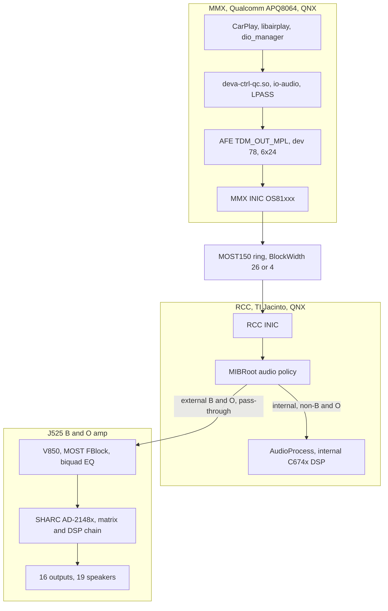
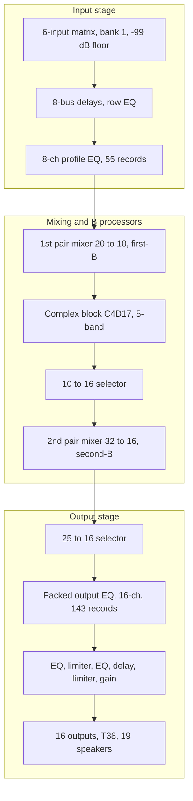

# Virtual Cabin — reverse-engineering the Audi B&O J525 amp and feeding it CarPlay 5.1

*A long-read on how the Audi B&O amplifier was reverse-engineered, why getting six discrete channels to it was so hard, and what the "Virtual Cabin" actually is.*

> **History: a long-read of the HSSR era (2026-09).** The upmix it describes (HSSR Universal, its knobs and the shipped-config table) was retired on 2026-10-09; the `path:line` cites are from that tree and have drifted. The amp reading here already uses the corrected matrix orientation, but the current amp hub is [Virtual Cabin and Amp RE](../audio/VIRTUAL_CABIN_AND_AMP_RE.md) with [J525 Wiring and Speakers](../audio/J525_WIRING_AND_SPEAKERS.md); what runs now: [Stereo to 5.1 Upmix](../audio/STEREO_TO_5_1_UPMIX.md).

---

> **Provenance & honesty.** Claims are tagged inline with the source (`docs/…` notes,
> `hook/audio/…`, `deploy/…`, `memory/…`); code-state claims cite `path:line` against
> the current tree. Two truth levels are marked throughout: **CONFIRMED-on-car**
> (heard/measured on the unit) vs **modelled / inferred** (static reverse-engineering
> of one firmware image, never read back live). The amp DSP model is *static RE* — no
> live vehicle state, no bit-exact SHARC arithmetic, and no cabin SPL is established.
> All amp facts trace to one image: `Firmwares/SoundAmp/…/CodeFlash_*.bin`, SHA-256
> `8776fdb84d05571cf4addf42655bc875da7c47cc35166e3cee6c60bc5841fe4b`.

## 📋 TL;DR

The Audi B&O amplifier (part `8W0035465`, the "J525") is a **complete 5.1 processor**:
it takes six logical inputs `L R C LFE Ls Rs`, runs them through an input matrix and a
deep per-driver DSP/EQ/crossover chain, and fans them out to 16 amplified circuits
driving 19 speakers. **The "Virtual Cabin" is our decision to let the amp be the
renderer** — the hook only has to deliver the *right six PCM channels* in Apple order
and declare them correctly. The amp derives the centre, manages the sub, crosses over
every driver, and spatializes. We do not re-implement any of that on the head unit.

Getting six channels *to* that amp took two months because the head unit silently
collapsed to stereo through **two independent mechanisms**, each of which masqueraded
as a fault somewhere downstream:

1. On the Qualcomm side, the CarPlay audio device advertised `min_voices=2`, and the
   driver copied that *minimum* into the active session geometry at route-attach —
   14 s before the PCM channel even exists — truncating a 6-channel fragment to a
   third and **tearing at 62.5 Hz**.
2. In `libairplay`, `createMetadata` wrote a **stereo speaker-allocation header**
   (`asad=0xc0`) beside genuinely six-channel PCM, so the MOST/amp side kept only L/R.

Both are fixed on the Qualcomm side (mirror the media device's caps record; interpose
`createMetadata` to announce `0xfc`/6ch/24-bit). With those two changes, **discrete
5.1 CarPlay plays correctly end to end — CONFIRMED on car (2026-09-06)**. For the far
more common stereo content, the HSSR upmix (see [HSSR_UPMIX_MODEL.md](HSSR_UPMIX_MODEL.md))
synthesizes the six channels the Virtual Cabin then renders.

The one thing we could **not** get: phone-side spatial (Atmos) over the realtime
CarPlay stream. It is `AAC-ELD 5.1.2` (format bit 42, `SPA_AAC_ELD_48K_5_1_2 42`,
`hook/audio/audio_hook.h:128`), not PCM 5.1 (bit 44) — the bit the hook advertises
(`SPA_DEFAULT_BIT 44u`, `hook/audio/audio_hook.h:42`); both were offered live and the
phone refused both — the gate is entirely phone-side.

## 🏠 The machine: two SoCs and an amp

The head unit is split across two processors, and that split is the root of the whole
problem (`docs/audio/INTERNAL_AMP_PATH.md`, `docs/audio/INTERNAL_AMP_PATH.md`):

- **MMX = Qualcomm APQ8064** (QNX) — runs the CarPlay/AirPlay stack, `dio_manager`,
  `libairplay.so`, the `deva-ctrl-qc.so` audio driver, `io-audio`, and LPASS (the
  Hexagon aDSP). It is **amplifier-agnostic**: nothing in MMX boot reads any amp
  coding (`startup.sh` hardcodes `platform_id=mib2`, `ACDB…mmx2_8064`).
- **RCC = TI Jacinto (DRA6xx, C674x DSP)** (QNX) — runs `MIBRoot` (the audio-policy
  owner), `AudioProcess`, and the *internal* amp's DSP. **All amplifier-specific
  routing policy lives here.**
- **J525 amp** (external, on the MOST ring) — a **V850** MOST/FBlock control
  processor + an **ADSP-2148x SHARC** audio DSP. This is the B&O box.

`MIBRoot` picks the route from `ExternalAmplifierCoded`; non-B&O cars render on the
internal C674x DSP.

**Why "MMX sends 6×24, the RCC link is 2- or 8-slot" is not a contradiction:** the two
framings sit on opposite sides of two INICs and the MOST ring. The INICs reframe; the
only quantity that crosses end-to-end is the MOST synchronous **BlockWidth** (26 bytes
for the multichannel source, read as `2 + 8×3`; the older `2 + 6×4` reading is superseded)
(`docs/audio/INTERNAL_AMP_PATH.md`, [QNX Audio Topology](../audio/QNX_AUDIO_TOPOLOGY.md)).

## 🔗 How audio reaches the amp — the routing decision

MIBRoot resolves a route through a two-table mapper keyed on one byte
(`docs/sources/INTERNAL_AMP_MIBROOT_ROUTING.md`, `docs/audio/INTERNAL_AMP_PATH.md`):

- CarPlay media = **connection 162** (`CL_ENT_AMP_DIO_MEDIA`) → resource `0x78`.
- **The only selector is `g_externalAmplifierCoded`** (VA `0x010BC0E8`), written from
  DSI prop `Amp.Amplifier.ExternalAmplifierCoded`, computed from **E2P record 0xF1,
  byte +0x0B (`Sound_System`)**: `==2` → external, else internal.

| ExternalAmplifierCoded | source | sink | width |
|---|---|---|---|
| 1 (external, B&O/Bose) | `eSRC_ENT_AMP_DIO_MEDIA_MC` (0x46f) | `eSNK_DTCP51` (2) | **26 B** (`2 + 8×3`; carries the six channels) |
| 0 (internal amp) | `eSRC_ENT_AMP_DIO_MEDIA` (0x46e) | `eSNK_SPEAKERS` (1) | **4 B = stereo** |

There is no channel-count negotiation, no capability check — one byte picks a static
`{source, sink}` pair. Read/flip it from a shell:
`on -f rcc /usr/apps/modifyE2P r fc 1` → `02`=external, `01`=internal (`0xFC` is the
flat EEPROM offset of that byte).

**The finding that shapes the product: the internal (non-B&O) amp has no native
6-channel CarPlay route.** MOST source width is a static property in MIBRoot's
`MmxSourcePresCtrl` table (`docs/audio/QNX_AUDIO_TOPOLOGY.md`): the internal media
source is BlockWidth 4 (stereo). `eSNK_SPEAKERS_MC` (the multichannel speaker sink) is
a **dead alias** — it appears in none of the 143 resource records and zero connections,
and `AudioProcess` even maps it back to the same stereo DSI input. So on an internal-amp
car a PCM6 stream is **front L/R only**. The safe product policy is therefore to gate
`AUDIO_SPATIAL` on E2P 0xFC (`AUDIO_STEREO_UPMIX=off` alone is not enough — the bypass
still rides the 6-voice path) (`memory/internal_amp_no_51_path.md`). The startup ships with `AUDIO_SPATIAL=1`; the
installer implements the E2P gate (`install_MoreIncredibleBash/mod/custom.sh`, `read_amp`
/ `gate_audio`) and rewrites it to `AUDIO_SPATIAL=0` unless the byte is `02`, and the MMI
UpMix row is hidden on internal amps (stock `AmplifierListener`, `DEVICETYPE` 1–3); neither
has run on an internal-amp car yet. A real internal 6-channel
path is *feasible* but needs RCC-side flashing (MIBRoot 8 bytes + Jacinto DSP
McASP3/reader/mixer edits) and an internal-amp car to develop against — planned, not
built (`docs/audio/INTERNAL_AMP_PATH.md`, `docs/audio/INTERNAL_AMP_PATH.md`).

## 🔧 Why six channels was hard — and the two fixes (CONFIRMED)

Both mechanisms silently defaulted to stereo through *different* layers, and each
looked like a fault somewhere else. This is the part that took a month per bug.

### The CSD width bug (Qualcomm side)

Both `mpl1_int_ent` and the CarPlay device `mpl5_dio_ent` route to the **same** CSD
device 78 (48 kHz / 24-bit) (`docs/audio/QNX_AUDIO_TOPOLOGY.md`). The active width is
chosen at route-attach from the driver's static capability record. `mpl5` shipped
`min_voices=2, min_fragsize=0x1800`; `mpl1` had `6, 0x4800`. The bug:
`deva_update_session_info_from_list` copies the record's **minimum** voices/fragsize
into the *active* CSD session (`docs/audio/QNX_AUDIO_TOPOLOGY.md`,
`memory/carplay_51_fault_is_virtual_channel.md`).

So even after widening the DMA side to 6 voices, CSD advanced `0x4800` bytes/tick while
submitting only `0x1800` — one third of each fragment — **tearing at 62.5 Hz** with the
sample clock still perfectly correct. Worse, Audioman attaches the route and starts the
timer **~14 s before the PCM channel exists**, so any patch that "reads the live
channel" takes its fallback.

**The fix (SOLVED 2026-09-02, confirmed by ear):** make `mpl5`'s caps record **mirror
`mpl1` field-for-field** (min/max voices = 6, fragsize `0x4800`;
`deploy/deva-ctrl-qc/patch_deva_mirror_mpl1.sh:36-46`). The CSD session is then built
six-channel at attach time. Stereo still opens because **QSA inserts a channel
conversion** rather than refusing a below-min open — `mpl1` had served stereo at
`min==max==6` all along. The month-long belief "widening the minima breaks stereo" was
simply false.

### The SAD header (libairplay side)

Beside the PCM on MOST rides a **speaker-allocation (SAD) header**: six slots are always
physically formed; the SAD says how many are *meaningful*. `asad=0xfc` = slots 1..6
(5.1); `asad=0xc0` = slots 1..2 (stereo) (`docs/audio/BUFFERED_AUDIO_PATH.md`,
`memory/carplay_sad_header.md`). `dio::CQNXSoundIF::createMetadata` described AirPlay's
*native* input (2ch/16-bit) and wrote `asad=0xc0` even after the PCM stream was widened
to six channels — six sent, two declared, the amp kept L/R. **Fix:** interpose
`createMetadata` to announce `asad=0xfc` / 6ch / 24-bit. **CONFIRMED on car 2026-09-03**:
centre + surrounds reach the speakers.

### The two-day retraction (a lesson worth keeping)

`tools/qsa_play.c` sets no SAD header, so it *inherited* the previous session's `0xc0`.
Its L/R-only output was misread as "the amp is innocent", sending the search deep into
ADSP/MOST/SHARC/COPP — all of which were found **correct**. The rule that came out of it:
**verify through CarPlay, never through `qsa_play`.**

### The physical layer was correct all along

The MMX AFE/LPASS packs six 24-bit slots at byte offsets 2,5,8,11,14,17 in a 32-byte
frame and never clamps to stereo; the COPP does not narrow; the MOST/INIC transport
carries BlockWidth 26; the amp's V850 accepts `SinkNr 0x26, BlockWidth 26` (whether the
connection lands on `0x26` or on the 26-byte 7.1 sink `0x32` is unresolved; either is accepted)
(`docs/audio/QNX_AUDIO_TOPOLOGY.md`, `docs/audio/QNX_AUDIO_TOPOLOGY.md`,
`docs/audio/QNX_AUDIO_TOPOLOGY.md`). Every amp-side layer did exactly what it
was told — consistent with the two width declarations above being the only faults.

### The mirror driver

`deploy/deva-ctrl-qc/` ships the fix as a three-step patch of the stock Qualcomm driver
(`deploy/deva-ctrl-qc/BUILD_CHAIN.md:1-13`): `patch_deva.sh` (caps maxima 2→6 + a
DMA-side helper, since `.rodata` shares the R+E segment there is no code cave — the
helper is injected into the tail of a `__FILE__` diagnostic string),
`patch_deva_csd_live.sh` (live-channel read, now redundant,
`deploy/deva-ctrl-qc/BUILD_CHAIN.md:29`), and `patch_deva_mirror_mpl1.sh` — **the step
that actually fixed the car** (`deploy/deva-ctrl-qc/BUILD_CHAIN.md:33-34`) — which
makes the minima mirror `mpl1`. The output `deva-ctrl-qc.so.patched` is deployed to
`/mnt/app/armle/lib/dll/deva-ctrl-qc.so` and becomes active at the next reboot
(`deploy/deva-ctrl-qc/BUILD_CHAIN.md:11-13`). **Ceiling: 6 is the max a byte can
reach** (`deva_csd_start_csd_session_playback` hardcodes 6; no 8-channel output node
exists), so CarPlay's 5.1.2 = 8 channels needs a mandatory **8→6 fold** on the hook side
(`hook/audio/spatial_downmix.h:95-96`). Channel order is Apple canonical
`L R C LFE Ls Rs`, no reorder at deva (`hook/audio/audio_hook.c:419-421`).

## 🔍 Inside the amp: the J525 DSP (V850 + SHARC), as reverse-engineered

> Everything in this section is **static RE + mathematical reconstruction** of the one
> CodeFlash image. No live amp state was read back; no arithmetic is bit-exact; no
> cabin acoustics are modelled. Exhaustive addresses live in [SHARC DSP Blocks](../audio/SHARC_DSP_BLOCKS.md) and
> `docs/audio/SHARC_DSP_BLOCKS.md`; this is the digest.

**Extraction (`docs/audio/SHARC_DSP_BLOCKS.md`).** The V850 CodeFlash *embeds the
complete ADSP-2148x SPI slave-boot stream* at file offset `0x041014`, length `0x27764`
(161,636 B) — earlier work wrongly assumed the SHARC program lived in an undumped
external flash. `AD301A07` and `AD301B01` are V850-consumed **parameter/tuning datasets**
(matrices, EQ banks, B config), not the application. Bytes are bit-reversed on the SPI
side; the bit-reversed loader (SHA `9169c24f…`) is what VISA disassembly runs on. 560
boot blocks parse to exactly `+0x27764`.

**Biquad math (`docs/audio/SHARC_DSP_BLOCKS.md`, `docs/audio/SHARC_DSP_BLOCKS.md`).**
The V850 filter designer (builder `0xA96C8`) uses an 8-byte design record
`{u16 freq_selector, s16 gain_tenths_dB, u8 Q_code, u8 type, u16 reserved}`, with
`K = cot(π·f/48000)`, `G = 10^(dB/20)`, and the convention **`Q = q_code/10` for peaks,
`ζ = q_code/10` for 2nd-order LP/HP** (q_code 7 = Butterworth). Coefficients are stored
normalized by a0 as `[-a1,-a2,b0,b1,b2]` and reordered to the IIR accelerator's
`[b0,b1,-a1,b2,-a2]`. Filter types include peak (1), 1st/2nd-order LP/HP (2..25),
**low shelf (26), high shelf (27)**, all-pass (28). A *separate* SHARC-internal designer
(`12AB1F`) implements RBJ cookbook filters for the "B" processor and stores
`[b0,b1,b2,-a1,-a2]`.

**The processing chain (`docs/audio/SHARC_DSP_BLOCKS.md`,
`docs/audio/SHARC_DSP_BLOCKS.md`).** A 79-entry descriptor schedule runs, in
order:

The `−99 dB` floor is **not** a mute. The complex block C4D17 defaults to identity and
is active-scheduled, but it is **not proven off**.

There are **two independent "B" processors**: a spectral **first-B** (74-band, wrapper
`124DF3`, ~1024-sample / 21.3 ms delay) injected at the first mixer, and a **second-B**
fed only by aux inputs at the second mixer. Their full binding/config/scheduling is
documented across [SHARC B Processors](../audio/SHARC_B_PROCESSORS.md) (merged from 16 audits); for the white paper the load-bearing
facts are: the model defaults both to conservative/identity behavior, but that is a
hypothesis — static evidence is compatible with an active first B (bank 1 requests library
mode 5), and C4D17 is not proven off — and the matrix **bank selects a SHARC "mode"** (below).

### The input matrix — corrected orientation

> **Correction that supersedes older notes:** the matrix orientation was transposed in
> earlier readings. The A07 RAM stores
> **rows = outputs, columns = inputs**; the hook's copy is transposed once so its rows
> are inputs (`hook/audio/stereo_upmix.c:57-58`). The memory-file per-speaker summaries
> derived from the old transposed reading ("sub = LFE only", "centre no bass",
> "woofers sum L/Ls/C/LFE", "fb3 = −3 dB woofers") are **withdrawn**. Use the matrix
> below (the same as [Virtual Cabin and Amp RE](../audio/VIRTUAL_CABIN_AND_AMP_RE.md)).

The V850 selects a signed-dB 8×8 table from `AD301A07` (profile 0, bank 1 for the
CarPlay/DTCP51 sink) and writes 64 linear coefficients to the SHARC. **Profile-0 /
bank-1**, input → bus, in dB, as the hook carries it in `kInputMatrix`
(`hook/audio/stereo_upmix.c:66-73`, converted from linear; full 8-profile × 3-bank set
in `docs/sources/SHARC_INPUT_OUTPUT_MATRICES.csv`):

| input → | busL | busR | busC | busLFE | busLs | busRs | bus6 | bus7 |
|---|---:|---:|---:|---:|---:|---:|---:|---:|
| **L** | −2 | · | −8 | −8 | −3 | · | −3 | · |
| **R** | · | −2 | −8 | −8 | · | −3 | · | −3 |
| **C** | −6 | −6 | −3 | −10 | · | · | · | · |
| **LFE** | · | · | · | +3 | · | · | · | · |
| **Ls** | · | · | · | −14 | +6 | · | +9 | · |
| **Rs** | · | · | · | −14 | · | +6 | · | +9 |

`·` = −99 dB floor (`kCabinMatrixFloor`, `hook/audio/stereo_upmix.c:62`): leakage,
deliberately not an exact zero. The largest bus column sum is bus6/bus7
(0.708 + 2.818 ≈ 3.53), which is exactly the guard's `kCabinMatrixMaxColumnNorm`
(`hook/audio/stereo_upmix.c:64`) — an internal consistency check on this orientation.

Structurally this shows the amp **derives the centre** (C bus fed from L and R at
**−8 dB**), sends the C input to the fronts at −6 dB, gives the **LFE input its own
+3 dB bus** that every other input also feeds (L/R −8, C −10, Ls/Rs −14), and routes
Ls/Rs both directly (+6) and into dedicated effect buses 6/7 (+9), which L/R also feed
at −3 dB. The **bus → physical-speaker binding and every per-driver crossover / EQ /
gain / delay live inside the extracted-but-not-yet-semantically-disassembled SHARC
runtime — inferred, not recovered.**

### The stereo↔5.1 mode switch

The matrix bank also writes a float to SHARC control `0x10`: **bank 0 → 2.0, banks 1/2 →
5.0** (`docs/audio/VIRTUAL_CABIN_AND_AMP_RE.md`). This is the strongest static evidence of
a real stereo-vs-multichannel operating mode, but the image gives it no name — it
**cannot honestly be called "Symphoria."** For the CarPlay sink `0x26`, both
`asad=0xc0` and `0xfc` map to raw bank 1, so ASAD does *not* switch it stereo↔5.1
there; bank 0 is a stereo fold-down (not an L/R→surround upmixer), so forcing it would
remove the centre feed. Adopted policy: one fixed PCM6/48k/S16 stream with `asad=0xfc`
for the whole session.

## 🎯 The Virtual Cabin: what the amp does for us, and the matrix in our code

"Virtual Cabin" = **feed the amp six correct PCM channels and let it be the renderer.**
Concretely, from the recovered matrix and modelled chain, the amp handles:

- **Centre**, derived from L+R — so the hook writes **digital C = 0** on purpose
  (`hook/audio/stereo_upmix.h:46-53`, `docs/audio/STEREO_TO_5_1_UPMIX.md`).
- **Bass management** — the LFE input has its own +3 dB bus, and that bus is also fed
  from L/R at −8 dB, C at −10 dB and Ls/Rs at −14 dB (`hook/audio/stereo_upmix.c:67-72`).
  So a stereo-as-5.1 stream with LFE = 0 does **not** leave the LFE bus silent; the
  hook's `AUDIO_STEREO_LFE=assist` is a *relative* top-up on that bus, not the whole
  sub level (`hook/audio/audio_hook.h:88-91`, `hook/audio/stereo_upmix.h:31-34`), and
  `AUDIO_STEREO_FRONT_BASS_DB` moves the sub too because L/R feed it.
- **Crossovers, per-driver EQ, spatial buses, and the 19-speaker fan-out.**

The hook only: delivers `L R C=0 LFE Ls Rs` to `mpl5_dio_ent`, declares `asad=0xfc`, and
(for stereo content) synthesizes a plausible C=0/LFE/Ls/Rs set.

**The matrix inside the hook is a *guard*, not acoustics.** `hook/audio/stereo_upmix.c`
embeds `kInputMatrix[6][8]` — the profile-0/bank-1 matrix converted to linear (e.g.
`0.794328` = −2 dB, `1.412538` = +3 dB, floor `0.00001122` ≈ −99 dB), transposed so rows
are inputs (`hook/audio/stereo_upmix.c:57-73`). Its **only** purpose is the S16 **cabin
guard** `spa_upmix_cabin_guard_s16` (`hook/audio/stereo_upmix.c:327`), which predicts
each logical bus peak so no bus exceeds `kCabinSampleLimit = 32275` (0.985 FS,
`hook/audio/stereo_upmix.c:55`). The largest column norm is **3.53**
(`kCabinMatrixMaxColumnNorm`, `hook/audio/stereo_upmix.c:64`), so the hot-path
early-out is: if `peak · 3.53 ≤ limit`, nothing can clip — return before touching the
matrix (`hook/audio/stereo_upmix.c:340`). On overload it first repairs via LFE only
(within a feasible interval, never synthesizing or sign-flipping LFE), then
linked-scales all six channels (`hook/audio/stereo_upmix.c:355-407`). Both the header
and the config validator state it explicitly: **this is a downstream peak-detection
model, not an acoustic model or an EQ inverse** (`hook/audio/stereo_upmix.h:31-34`,
`hook/audio/stereo_upmix.h:203`).

## 🔄 Discrete 5.1 vs the upmix, and the CarPlay spatial wireformat

Two tracks of work feed the same PCM6/48 kHz/S16 rail:

- **Discrete 5.1** — native decoded APAC 5.1 (from the buffered type-103 path) is
  reordered byte-identically from the decoder's `C L R Ls Rs LFE` to `L R C LFE Ls Rs`
  (`hook/audio/spatial_downmix.h:82-83`) and bypasses the upmixer. **CONFIRMED end to
  end on car** (`docs/audio/DISCRETE_5_1_ROUTING.md`).
- **Stereo → 5.1 upmix** — for the common AAC-LC stereo case, HSSR Universal synthesizes
  the six channels the Virtual Cabin renders (see [HSSR_UPMIX_MODEL.md](HSSR_UPMIX_MODEL.md)).
  The shipped startup also runs it on the realtime type-100 media stream
  (`AUDIO_REALTIME_UPMIX=on`, `deploy/smartphone_integrator/carplay_startup.sh:86`).

**The spatial (Atmos) reality** (`memory/carplay_spatial_atmos_wireformat.md`,
`docs/reference/IOS_CARPLAY_SPATIAL_WIREFORMAT.md §9-19`): CarPlay's realtime screen-receiver spatial transport is
**`AAC-ELD / 48000 / 5.1.2` = format bit 42** (`hook/audio/audio_hook.h:127-128`: bit 40
is AAC-LC 5.1.2, bit 42 AAC-ELD 5.1.2; proven from iOS 27 AirPlaySupport deltas). It is
**not** Dolby EC3 (the phone renders Atmos into AAC 5.1.2) and **not** multichannel PCM
(raw PCM 5.1 = bit 44 is a *buffered*/HomePod receiver format). The hook's advertised
main-audio bit is still **44** (`SPA_DEFAULT_BIT`, `hook/audio/audio_hook.h:42`,
`hook/audio/audio_hook.c:406-411`), and **both bits were offered live and refused**: the
phone chose stereo each time. The gate is phone-side
(`APAudioFormatIsScreenSpatialAudioReceiver`, feature-flag + device-model), so the
realtime-PCM lever for phone-side discrete spatial is **exhausted**; discrete
multichannel comes only via the buffered/APAC path. The codec authority on that path is
the **inline magic cookie**, not any format index (`memory/apap_no_format_index.md`,
`hook/audio/aac_bridge.c:7-12`). Also: 5.1.2 height is impossible on this amp (no height
codes; input positions 7/8 = BCL/BCR), so the 8→6 fold is mandatory.

**The speakers** (`docs/audio/J525_WIRING_AND_SPEAKERS.md`,
`docs/audio/J525_WIRING_AND_SPEAKERS.md`): PR 9VS "B&O 3D Advanced" = **19
loudspeakers on 16 amplified T38 circuits**, proven from the Audi current-flow diagram +
J525 connector page. Some outputs drive two drivers (door treble+bass share a circuit;
rear = 6 drivers on 4 outputs), and the R211 subwoofer occupies two output pairs. Driver
catalog numbers are listed in the parts doc. External mic-sweep passbands (the "B9 S4 B&O"
workbook) are **amateur observations, not Audi filter coefficients** — they must not be
fit as rectangular passbands or applied as invented EQ.

## 📍 Where it stands

### Confirmed on car

- Discrete 5.1 CarPlay end to end (2026-09-06); the two closing fixes (deva caps-mirror,
  SAD `asad=0xfc`/24-bit) plus restored `updateFeedback` clock reference.
- Buffered stereo (AAC-LC index 23) beside APAC 5.1 (index 65); cookie-driven APAC↔AAC
  switch both directions, no dropout; phone-lock/background lifecycle survives
  (`docs/audio/DISCRETE_5_1_ROUTING.md`).

### Shipped / checked in

What `deploy/smartphone_integrator/carplay_startup.sh` exports:

| Setting | Value | Evidence |
|---|---|---|
| Spatial policy | `AUDIO_SPATIAL=1`, `AUDIO_SPATIAL_ATMOS=0` | `carplay_startup.sh:60-61` |
| Buffered formats | `[65,23]` (APAC 5.1 + AAC-LC) | `SPATIAL_103_EXTRA_INDEX=23`, `carplay_startup.sh:92` |
| Stereo upmix | `on`, rear 0.40, `AUDIO_STEREO_LFE=assist` at 0 dB, front bass −3 dB | `carplay_startup.sh:63-70` |
| Scene-bed distribution | retention 0.5, bed delays on, owner attack, collapse 0.75 | `carplay_startup.sh:75-78` |
| Realtime type-100 upmix | on | `carplay_startup.sh:86` |
| Rollback | `AUDIO_STEREO_UPMIX=off` | `hook/audio/audio_hook.h:59` |

Driver: `deploy/deva-ctrl-qc/deva-ctrl-qc.so.patched` (needs a reboot to map,
`deploy/deva-ctrl-qc/BUILD_CHAIN.md:11-13`).

### Blocked / modelled / not done

- **Phone-side spatial over realtime CarPlay** — refused live; phone-side gate, lever
  exhausted.
- **Non-B&O internal 6ch** — no route exists; feasible via RCC flashing but untested for
  lack of an internal-amp car.
- **The amp DSP model is static RE** — no live bank/profile/mode/limiter/gain readback
  (no verified J525 SHARC readback transport); the complex block C4D17 is active-scheduled
  and **not proven off**; first-B "off" is a hypothesis, not measured silence; bus→speaker
  binding, per-driver EQ, and "3D OFF = level 0" are **inferences**; nothing is bit-exact,
  and no cabin SPL is modelled.
- **HSSR upmix quality** — a formal stationary-vehicle A/B is still outstanding.

## 🔗 Source map

- **Routing / topology:** `docs/sources/INTERNAL_AMP_MIBROOT_ROUTING.md`,
  `docs/audio/INTERNAL_AMP_PATH.md`, `docs/audio/INTERNAL_AMP_PATH.md`,
  `docs/audio/INTERNAL_AMP_PATH.md`, `docs/audio/INTERNAL_AMP_PATH.md`,
  `docs/audio/INTERNAL_AMP_PATH.md`, `docs/audio/INTERNAL_AMP_PATH.md`,
  `docs/audio/QNX_AUDIO_TOPOLOGY.md`, `docs/audio/QNX_AUDIO_TOPOLOGY.md`,
  `docs/audio/QNX_AUDIO_TOPOLOGY.md`, `docs/audio/QNX_AUDIO_TOPOLOGY.md`,
  `docs/audio/QNX_AUDIO_TOPOLOGY.md`, `docs/audio/QNX_AUDIO_TOPOLOGY.md`,
  `docs/audio/QNX_AUDIO_TOPOLOGY.md`, `docs/audio/CALL_AND_SIRI_ROUTING.md`.
- **6ch fixes:** `docs/audio/BUFFERED_AUDIO_PATH.md`, `docs/audio/DISCRETE_5_1_ROUTING.md`,
  `deploy/deva-ctrl-qc/{README,BUILD_CHAIN,RE_TIMING}.md`,
  `memory/carplay_51_fault_is_virtual_channel.md`, `memory/carplay_sad_header.md`,
  `memory/apap_no_format_index.md`, `memory/audio_210_pcm_passthrough.md`.
- **Amp DSP RE:** `docs/audio/SHARC_DSP_BLOCKS.md`, `docs/audio/SHARC_DSP_BLOCKS.md`,
  `docs/audio/VIRTUAL_CABIN_AND_AMP_RE.md` (+ `.csv`; old orientation, see correction above),
  `docs/audio/VIRTUAL_CABIN_AND_AMP_RE.md`, `docs/audio/VIRTUAL_CABIN_AND_AMP_RE.md`,
  `docs/audio/SHARC_DSP_BLOCKS.md`, `docs/audio/SHARC_DSP_BLOCKS.md`,
  `docs/audio/SHARC_DSP_BLOCKS.md`, `docs/audio/SHARC_DSP_BLOCKS.md`,
  `docs/audio/SHARC_DSP_BLOCKS.md`, `docs/audio/SHARC_DSP_BLOCKS.md`,
  [SHARC B Processors](../audio/SHARC_B_PROCESSORS.md), `memory/soundamp_full_dsp_chain.md`; model
  `tools/soundamp-virtual-cabin/amp_dsp_chain.py`.
- **Speakers / evidence:** `docs/audio/J525_WIRING_AND_SPEAKERS.md`,
  `docs/audio/J525_WIRING_AND_SPEAKERS.md`, `docs/audio/J525_WIRING_AND_SPEAKERS.md`.
- **Virtual Cabin in code:** `hook/audio/stereo_upmix.{c,h}`,
  `docs/audio/STEREO_TO_5_1_UPMIX.md`, `docs/audio/DISCRETE_5_1_ROUTING.md`.
- **Spatial wireformat:** `memory/carplay_spatial_atmos_wireformat.md`,
  `docs/reference/IOS_CARPLAY_SPATIAL_WIREFORMAT.md §9-19`, `hook/audio/audio_hook.h:40-43,120-140`.
- **Companion papers:** [UPMIX.md](UPMIX.md), [HSSR_UPMIX_MODEL.md](HSSR_UPMIX_MODEL.md),
  [DOLBY_ATMOS_TEARDOWN.md](DOLBY_ATMOS_TEARDOWN.md).
